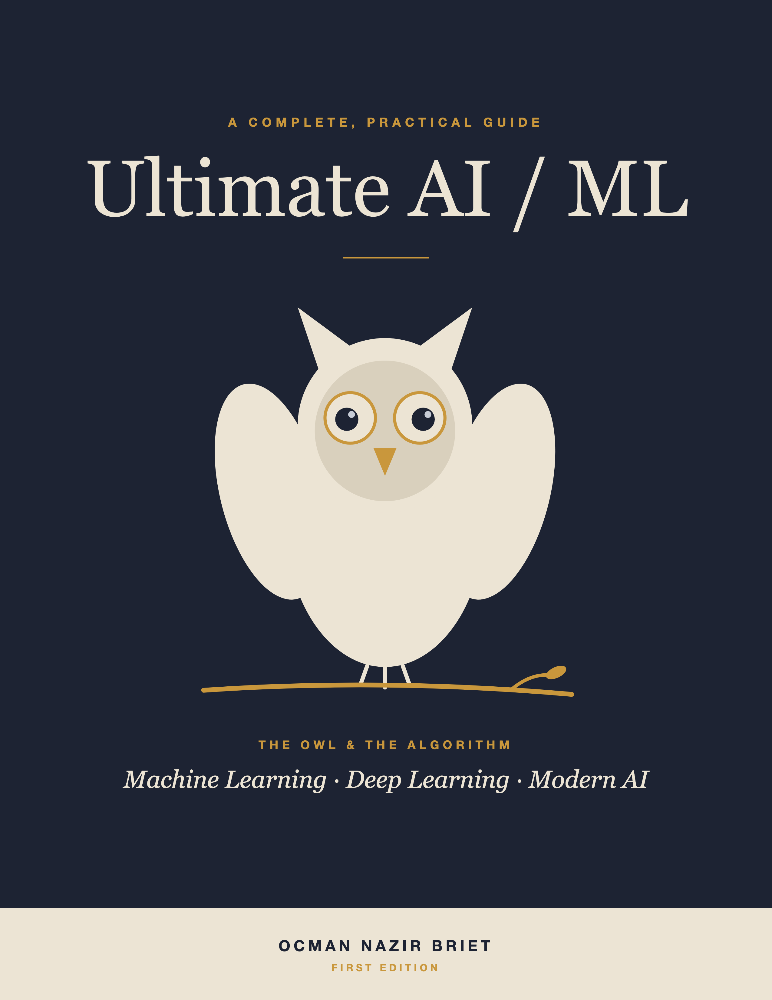

  

<h1 align="center">Ultimate AI/ML</h1>

<em>A Complete, Practical Guide to Machine Learning, Deep Learning, and Modern AI</em> 
by <strong>Ocman Nazir Briet</strong>

  <a href="chapters/ch01-introduction.md"><strong>Read online</strong></a> ·
  <a href="downloads/Ultimate-AI-ML-By-Ocman-Nazir-Briet.pdf"><strong>Download PDF</strong></a> ·
  <a href="downloads/Ultimate-AI-ML-By-Ocman-Nazir-Briet.epub"><strong>Download EPUB</strong></a>

---

*Ultimate AI/ML* takes you from the foundations of artificial intelligence to its modern frontier: classical machine learning, deep learning, reinforcement learning, large language models, retrieval-augmented generation, and agentic AI.

Every algorithm is explained in plain language first, then formalized with the essential math, illustrated with a diagram or plot, and demonstrated with Python code you can run yourself.

**What's inside**

- 30 chapters, 3 appendices, and a glossary
- 370+ diagrams and figures
- 300+ runnable Python code examples
- Exercises and key takeaways at the end of every chapter

## How to read

| Format | Best for |
|---|---|
| [Online, chapter by chapter](chapters/ch01-introduction.md) | Reading in the browser; code and math render right on GitHub |
| [PDF](downloads/Ultimate-AI-ML-By-Ocman-Nazir-Briet.pdf) | Printing, or reading on a laptop or tablet |
| [EPUB](downloads/Ultimate-AI-ML-By-Ocman-Nazir-Briet.epub) | E-readers and phones (Apple Books, Kobo, Google Play Books, Kindle via Send to Kindle) |

If GitHub says the PDF is too large to preview, click **Download raw file** (the download icon).

## Contents

- [Foreword](chapters/00a-foreword.md)
- [Preface](chapters/00b-preface.md)
- [How to Use This Book](chapters/00c-how-to-use-this-book.md)
- [Acknowledgments](chapters/00d-acknowledgments.md)
- [About the Author](chapters/00e-about-the-author.md)
- [1 Introduction to Artificial Intelligence and Machine Learning](chapters/ch01-introduction.md)
- [2 Mathematical and Statistical Foundations](chapters/ch02-math-foundations.md)
- [3 The Machine Learning Workflow and Data Preparation](chapters/ch03-ml-workflow.md)
- [4 Python Tooling for Machine Learning](chapters/ch04-python-tooling.md)
- [5 Supervised Learning and Model Evaluation](chapters/ch05-supervised-eval.md)
- [6 Regression Algorithms](chapters/ch06-regression.md)
- [7 Classification I: Logistic Regression, k-NN, and Naive Bayes](chapters/ch07-classification-1.md)
- [8 Classification II: Support Vector Machines and Kernel Methods](chapters/ch08-classification-svm.md)
- [9 Decision Trees and Ensemble Learning](chapters/ch09-trees-ensembles.md)
- [10 Clustering](chapters/ch10-clustering.md)
- [11 Dimensionality Reduction and Feature Extraction](chapters/ch11-dimensionality-reduction.md)
- [12 Association Rule Learning](chapters/ch12-association-rules.md)
- [13 Time Series Analysis and Forecasting](chapters/ch13-time-series-forecasting.md)
- [14 Recommender Systems](chapters/ch14-recommender-systems.md)
- [15 Reinforcement Learning Foundations](chapters/ch15-rl-foundations.md)
- [16 Reinforcement Learning Algorithms and Deep RL](chapters/ch16-rl-algorithms.md)
- [17 Neural Networks: Fundamentals](chapters/ch17-nn-fundamentals.md)
- [18 Training and Optimizing Deep Networks](chapters/ch18-training-deep-nets.md)
- [19 Convolutional Neural Networks and Computer Vision](chapters/ch19-cnn-cv.md)
- [20 Natural Language Processing: Fundamentals](chapters/ch20-nlp-fundamentals.md)
- [21 Sequence Models: RNNs, LSTMs, and GRUs](chapters/ch21-sequence-models.md)
- [22 Transformers and the Attention Mechanism](chapters/ch22-transformers.md)
- [23 Generative AI: GANs, VAEs, and Diffusion Models](chapters/ch23-generative-models.md)
- [24 Large Language Models: How They Work](chapters/ch24-llms-how-they-work.md)
- [25 LLMs in Practice: Prompting, Fine-Tuning, Serving, and the Claude API](chapters/ch25-llms-in-practice.md)
- [26 Retrieval-Augmented Generation (RAG)](chapters/ch26-rag.md)
- [27 Agentic AI](chapters/ch27-agentic-ai.md)
- [28 Image, Audio, and Code Generation](chapters/ch28-image-audio-code-gen.md)
- [29 MLOps: Deploying and Operating ML Systems](chapters/ch29-mlops.md)
- [30 Responsible AI: Ethics, Bias, Safety, and Governance](chapters/ch30-responsible-ai.md)
- [Appendix A: Mathematical Notation and Reference](chapters/ch31-appendix-a-math-notation.md)
- [Appendix B: Tools, Environment Setup, and Cheat Sheets](chapters/ch32-appendix-b-tools-cheatsheets.md)
- [Appendix C: Datasets, Projects, and Further Reading](chapters/ch33-appendix-c-datasets-resources.md)
- [31 Glossary of AI/ML Terms and Terminologies](chapters/ch34-glossary.md)

## Copyright

Copyright © 2026 Ocman Nazir Briet. All rights reserved.

You are welcome to read this book here for free. No part of it may be reproduced, distributed, or transmitted in any form without the author's prior written permission, except for brief quotations in reviews. The code examples may be used freely for learning, without warranty of any kind.

ISBN 978-0-557-72841-1 · Published via Lulu.com
