[← About the Author](00e-about-the-author.md) · [Contents](../README.md#contents) · [2 Mathematical and Statistical Foundations →](ch02-math-foundations.md)

---

# 1 Introduction to Artificial Intelligence and Machine Learning

Artificial intelligence has quietly become part of daily life: it routes your messages to spam folders, recommends the next show you watch, transcribes your voice, drafts your emails, and increasingly writes code alongside you. Behind these conveniences sits a set of ideas that are far more learnable than the hype suggests. This chapter builds the mental model and vocabulary that the rest of the book stands on. We will define what AI, machine learning, and deep learning actually are and how they nest inside one another; trace the field’s history from logic engines to large language models; lay out the major paradigms of learning with everyday examples; and pin down the working vocabulary — data, features, labels, models, parameters, training, inference — that every later chapter assumes you already own. By the end you should be able to look at almost any AI product and place it accurately: which paradigm it uses, roughly how it was built, and what is likely to make it fail.

This is a foundations chapter, so it favors breadth and intuition over depth in any single method. Do not worry if a technique named here — gradient descent, backpropagation, the Transformer — is not yet fully explained. Each has a dedicated chapter later. The goal now is a reliable map of the territory, so that when you reach those chapters you already know where they sit and why they matter.

## 1.1 What Are AI, ML, and Deep Learning?

The three terms you will hear most often — *artificial intelligence*, *machine learning*, and *deep learning* — are frequently used interchangeably in casual conversation, but they are not synonyms. They are nested concepts, each a specialized subset of the one before it. Getting this hierarchy straight early will save you endless confusion later.

**Artificial Intelligence (AI)** is the broadest term. It refers to any technique that enables computers to perform tasks that would normally require human intelligence — reasoning, perception, language understanding, planning, decision-making. Crucially, AI does *not* require learning from data. A chess program that searches millions of board positions using hand-written rules is AI. A thermostat that follows a fixed schedule is, debatably, a primitive form of it. AI is the goal; everything else is a means. Researchers sometimes divide the ambition into **narrow AI** — systems that excel at one specific task, which is everything we have today — and **artificial general intelligence (AGI)**, a hypothetical system with the broad, flexible competence of a human across arbitrary tasks. Every commercial system in existence is narrow AI, however impressive; AGI remains a research aspiration, not a product.

**Machine Learning (ML)** is a subset of AI in which systems improve their performance on a task by learning patterns from data, rather than being explicitly programmed with rules. Instead of a human writing `if email contains "free money" then spam`, we show the system thousands of labeled emails and let it discover the statistical signals of spam on its own. The defining shift is this: *the rules are inferred from examples, not authored by hand.* Arthur Samuel, who built a checkers-playing program in 1959, is often credited with coining the term and defining it as the “field of study that gives computers the ability to learn without being explicitly programmed.” A more operational definition comes from Tom Mitchell: a program **learns** from experience $`E`$ with respect to task $`T`$ and performance measure $`P`$ if its performance at $`T`$, as measured by $`P`$, improves with $`E`$. That trio — task, experience, performance — is worth remembering, because every ML project you ever build is an instance of it.

**Deep Learning (DL)** is a subset of machine learning that uses artificial neural networks with many layers (hence “deep”). These networks learn hierarchical representations — early layers detect edges in an image, later layers assemble those into shapes, then objects. Deep learning is what powers modern computer vision, speech recognition, and the large language models behind tools like Claude. It is not a separate field from ML; it is ML done with a particular, very powerful family of models. What sets it apart from classical ML is **representation learning**: rather than relying on humans to hand-craft the features that describe the data, a deep network learns useful features automatically as part of training. This is why deep learning tends to dominate on raw, high-dimensional inputs like pixels, audio waveforms, and text, where good hand-designed features are hard to specify.

A useful and increasingly visible fourth label is **Generative AI**: systems that *produce* new content — text, images, audio, code — rather than only classifying or predicting. Almost all of today’s generative AI is built on deep learning, so it sits inside the DL circle, but it is worth naming because it dominates current public attention. The complementary term is **discriminative AI**, which describes models that draw boundaries between categories or predict a value; a spam filter is discriminative, an image generator is generative.

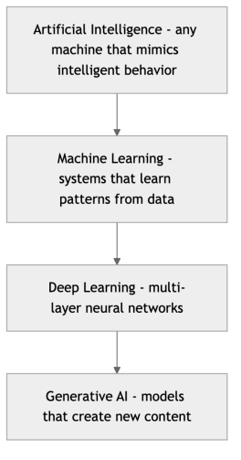

*Figure 1. The nested relationship of AI, machine learning, deep learning, and generative AI*

A simple way to remember the distinction: AI is the *ambition*, ML is the dominant *method* for achieving it today, deep learning is the most *powerful* current technique within ML, and generative AI is the most *visible* application of deep learning. Every deep learning system is machine learning; every machine learning system is AI; but the reverse is not true. There is plenty of AI that is not ML — a GPS routing engine running Dijkstra’s shortest-path algorithm is pure classical AI — and plenty of ML that is not deep learning, such as the gradient-boosted decision trees that quietly win a large share of real-world tabular-data competitions.

### 1.1.1 The Subfields of AI

AI is often described by the *problems* it tackles rather than the *methods* it uses. These subfields cut across the ML/DL hierarchy: each can be approached with hand-written rules, classical ML, or deep learning. Knowing the landscape helps you recognize which body of techniques a given application draws on.

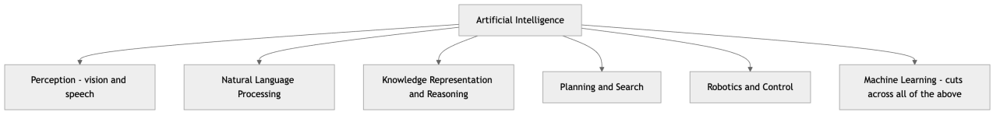

*Figure 2. The major problem-oriented subfields of artificial intelligence*

- **Computer vision** interprets images and video: recognizing objects, detecting faces, reading text, segmenting a medical scan. Covered by the chapter on Convolutional Neural Networks.
- **Natural language processing (NLP)** deals with human language: translation, summarization, question answering, and the large language models at the center of this book.
- **Knowledge representation and reasoning** encodes facts about the world and draws logical conclusions — the intellectual heart of the old symbolic era, now often blended with learning.
- **Planning and search** finds sequences of actions to reach a goal, from route-finding to game playing.
- **Robotics** couples perception, planning, and control so that a physical agent can act in the world.

Machine learning is drawn separately here because it is a *methodology* that now permeates every one of these subfields. Modern vision, NLP, and robotics are all overwhelmingly ML-driven; the symbolic reasoning tradition survives mostly in hybrid “neuro-symbolic” systems.

### 1.1.2 Rules-Based Programming vs. Machine Learning

To make the contrast concrete, consider the difference in how a problem is solved. In traditional programming, a human supplies the rules and the data, and the computer produces answers. In machine learning, a human supplies the data and the *answers* (for many examples), and the computer produces the rules.

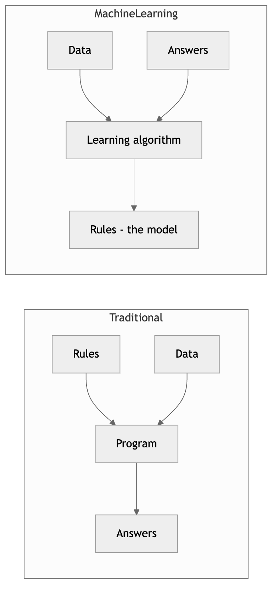

*Figure 3. Traditional programming versus machine learning in terms of inputs and outputs*

This inversion is the heart of the entire field. When the rules are too numerous, too subtle, or too context-dependent for a human to write down — how do you write a rule that distinguishes a cat from a dog in arbitrary photos? — machine learning lets the data write the rules for us.

Consider the spam problem in more detail. A rule-based approach begins hopefully: block any message containing “free money.” Spammers respond with “fr€e m0ney,” so you add more rules. Soon you are maintaining thousands of brittle patterns, legitimate mail gets caught, and each new evasion demands another patch. The rules never converge because an adversary is actively reshaping the data. A machine-learning spam filter instead is *shown* millions of messages labeled spam or not-spam and learns the statistical fingerprints of spam — including combinations of signals no human would think to encode. When spammers adapt, you retrain on fresh data rather than rewriting logic by hand. The system’s knowledge lives in learned parameters, not in source code.

That said, ML is not always the right tool. If the rules are simple, stable, and fully known — computing sales tax, validating a checksum, enforcing a business policy — hand-written code is cheaper, faster, exactly correct, and trivially auditable. Reach for machine learning when at least some of the following hold: the rules are unknown or too complex to specify; the patterns shift over time and need to adapt; the input is high-dimensional and unstructured, like images or natural language; and, critically, you have enough representative data to learn from. When none of these hold, a well-placed `if` statement beats a neural network every time. A recurring failure mode in industry is applying heavyweight ML to a problem that a lookup table would have solved.

## 1.2 A Short History of AI

Understanding where the field has been clarifies why it looks the way it does today. AI has moved through several distinct eras, each defined by a dominant idea — and each separated from the next by a period of disillusionment, the so-called “AI winters.” The timeline below anchors the milestones we will discuss.


*Figure 4. A timeline of landmark events in the history of artificial intelligence*

### 1.2.1 Symbolic AI and the Birth of the Field (1950s–1960s)

The field was formally christened at the 1956 Dartmouth Workshop, where researchers including John McCarthy, Marvin Minsky, and Claude Shannon gathered to explore whether “every aspect of learning or any other feature of intelligence can be so precisely described that a machine can be made to simulate it.” A few years earlier, in 1950, Alan Turing had already posed his famous test for machine intelligence: could a machine converse so convincingly that a human judge could not tell it apart from a person?

Early AI was **symbolic** — sometimes called “Good Old-Fashioned AI” (GOFAI). The premise was that intelligence could be captured by manipulating symbols according to logical rules. Programs like the Logic Theorist (1956) proved mathematical theorems; the General Problem Solver attempted human-like reasoning. In 1957 Frank Rosenblatt built the **perceptron**, an early neural network that could learn to classify simple patterns, sparking the first wave of excitement about brain-inspired computing. These systems were elegant but brittle: they worked in tidy, closed “toy” worlds and collapsed when faced with the messiness of the real one. The optimism of the era was extraordinary — in 1965 Herbert Simon predicted that “machines will be capable, within twenty years, of doing any work a man can do.”

### 1.2.2 Expert Systems and the First Winters (1970s–1980s)

By the 1970s, optimism had outrun results, and funding dried up — the first **AI winter**. Two blows landed in close succession. In 1969 Minsky and Papert’s book *Perceptrons* proved that a single-layer perceptron could not even learn the simple XOR function, chilling neural-network research for over a decade. And in 1973 the British government’s Lighthill Report concluded that AI had failed to deliver on its grand promises, gutting funding in the UK. Progress stalled not because the ideas were worthless but because the hardware, data, and algorithms of the day could not carry them.

The field rebounded in the 1980s with **expert systems**: programs that encoded the knowledge of human specialists as large collections of `if-then` rules. MYCIN diagnosed bacterial infections; XCON configured computer systems for DEC and reportedly saved the company tens of millions of dollars annually. For a time, expert systems were a genuine commercial success, and a whole industry grew up around specialized “Lisp machines” built to run them.

But they shared symbolic AI’s fatal flaw. Knowledge had to be painstakingly hand-coded by humans — the notorious **knowledge-acquisition bottleneck** — rules grew into unmaintainable thickets, and the systems could not learn or adapt. They had no graceful way to handle uncertainty or situations their authors had not anticipated. When the specialized hardware market that supported them collapsed in the late 1980s, and cheaper general-purpose workstations made Lisp machines obsolete, a second AI winter set in from roughly 1987 to 1993.

### 1.2.3 The Rise of Statistical Machine Learning (1990s–2000s)

The next era abandoned the dream of hand-coding intelligence and embraced a more humble, data-driven approach: let algorithms learn statistical patterns from examples. This is the machine learning we recognize today. Decision trees, support vector machines, random forests, and probabilistic methods like Naive Bayes matured into reliable workhorses. Two forces accelerated the shift: the explosion of digital data from the internet, and steadily growing computational power. The intellectual center of gravity moved from computer-science logic toward statistics and optimization, and the community began sharing standard benchmark datasets so that competing methods could be compared fairly.

A symbolic milestone came in 1997, when IBM’s Deep Blue defeated world chess champion Garry Kasparov — though notably Deep Blue relied heavily on brute-force search, a bridge between the symbolic and statistical eras. The deeper change was cultural: success was now measured by accuracy on real data, validated with statistics, rather than by elegance of hand-built logic. This period also saw ML quietly infiltrate everyday products — spam filters, search-engine ranking, product recommendations, and credit-card fraud detection — often without users ever hearing the phrase “artificial intelligence.”

### 1.2.4 The Deep Learning Revolution (2010s)

Neural networks had existed since the 1950s (the perceptron) and were refined in the 1980s with the **backpropagation** algorithm — the efficient method for computing how to adjust every weight in a network, popularized by Rumelhart, Hinton, and Williams in 1986. But they were long considered impractical — too data-hungry and too computationally expensive. Three things changed in the early 2010s and converged into a revolution:

1.  **Big data** — the internet, smartphones, and digitization produced massive labeled datasets like ImageNet (millions of categorized images).
2.  **GPUs** — graphics processing units, built for video games, turned out to be ideal for the massively parallel math of neural networks, cutting training time from months to days.
3.  **Algorithmic advances** — better activation functions (the ReLU), regularization techniques (dropout), and architectures made deep networks trainable at last.

The watershed moment was 2012, when a deep network called **AlexNet** won the ImageNet competition by a stunning margin, cutting the error rate roughly in half and crushing every traditional computer-vision approach. The result was undeniable, and the field pivoted almost overnight. Deep learning went on to surpass human performance on image classification, power speech recognition in every phone, drive the first practical machine translation, and in 2016 enable DeepMind’s AlphaGo to defeat world champion Lee Sedol at Go — a game with more board configurations than there are atoms in the observable universe, long thought to be a decade away for machines.

Why did depth suddenly matter so much? A key empirical observation of this era is that deep models keep improving as you feed them more data, long after classical methods have plateaued. The figure below sketches this now-famous pattern.

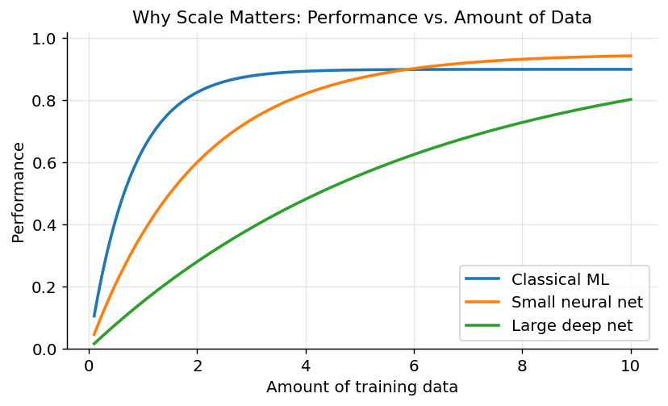

*Figure 5. Classical machine learning plateaus while large deep networks keep improving as data grows*

The practical lesson practitioners drew from curves like these was blunt: when you have a lot of data and enough compute, a bigger model trained on more of it tends to win. That lesson set the stage for the era that followed.

### 1.2.5 The Generative AI and LLM Era (2017–present)

The current era began with a 2017 research paper titled “Attention Is All You Need,” which introduced the **Transformer** architecture (covered in depth in the chapter on Transformers and the Attention Mechanism). Transformers proved exceptionally good at modeling sequences and, critically, at scaling: make them bigger, feed them more text, and they kept getting better in ways that did not plateau. Unlike the recurrent networks they replaced, Transformers process an entire sequence in parallel, which is exactly what modern GPUs are built to exploit — so they could be trained at previously impossible scale.

This unlocked **large language models (LLMs)**. By training enormous Transformers on much of the public internet, models learned to predict the next word with such fluency that they acquired surprising abilities — answering questions, writing essays, translating, summarizing, and coding — that were never explicitly programmed. These are sometimes called **emergent abilities**: capabilities that appear only once a model crosses a certain scale. OpenAI’s GPT series, Google’s models, and Anthropic’s Claude brought these capabilities to hundreds of millions of users. The November 2022 release of ChatGPT became the fastest-growing consumer application in history and pushed AI firmly into mainstream consciousness.

A striking property of self-supervised pretraining is that the same recipe generalizes across modalities. Hide the next word in text and you get a language model; hide patches of an image and you get a vision model; hide segments of audio and you get a speech model. Because the supervision comes free from the data’s own structure, these models can be trained on essentially the entire digital record of a modality, which is exactly what makes them so broadly knowledgeable. The pretraining-then-adapt recipe — learn general representations once, then cheaply specialize them to many downstream tasks — is now the default way capable systems are built, and it is why a single base model can be turned into a coding assistant, a summarizer, and a customer-service bot with comparatively little additional data.

The engine underneath this era is raw scale — in data, parameters, and compute. The figure below shows, on a logarithmic axis, how the parameter counts of landmark models have grown, roughly a thousandfold over a handful of years.

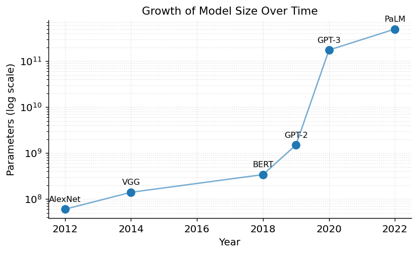

*Figure 6. The approximate parameter counts of landmark neural networks grew by orders of magnitude over a decade*

We now live in a period of *generative* and increasingly *agentic* AI, where models not only produce content but plan, use tools, and take actions on a user’s behalf — themes this book develops in its later chapters on LLMs in Practice, Retrieval-Augmented Generation, and Agentic AI.

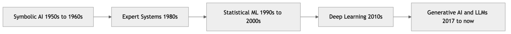

*Figure 7. The major eras of AI from symbolic systems to the generative era*

A pattern is visible across all these eras: each wave began with inflated promises, delivered real but narrower gains than hoped, and then either matured into durable technology or triggered a winter when reality caught up with the hype. Keeping that pattern in mind is a healthy antidote to the excitement — and the anxiety — of any given moment in AI.

## 1.3 The Paradigms of Machine Learning

Machine learning is not one technique but a family of them, traditionally grouped by *what kind of feedback the learning algorithm receives*. The three classical paradigms are supervised, unsupervised, and reinforcement learning. Two important hybrids — semi-supervised and self-supervised learning — have become central to modern AI and deserve equal billing.

### 1.3.1 Supervised Learning

In **supervised learning**, the training data comes with the correct answers attached. Each example is a pair: an input and its desired output, called a **label**. The algorithm’s job is to learn the mapping from inputs to outputs so that, given a new unlabeled input, it can predict the right output. The “supervision” is the labeled answer key it learns from. Formally, the model tries to approximate an unknown function $`f:\mathcal{X} \rightarrow \mathcal{Y}`$ from a set of examples $`\{(\mathbf{x}^{(i)},y^{(i)})\}_{i = 1}^{m}`$, choosing among candidate functions the one that best fits the data while still generalizing to inputs it has never seen.

*Everyday example:* a child shown flashcards labeled “cat,” “dog,” “horse” is learning in a supervised way. After enough cards, they generalize to new animals never seen before.

Supervised learning splits into two sub-types depending on the output:

- **Classification** predicts a discrete category. Is this email spam or not? Is this tumor benign or malignant? Which of ten digits is this handwritten image? When there are two possible classes it is *binary* classification; with more it is *multiclass*. (Covered in the chapters on Classification.)
- **Regression** predicts a continuous number. What will this house sell for? How many units will we sell next month? What temperature is expected tomorrow? (Covered in the chapter on Regression Algorithms.)

A quick test for which you are facing: ask whether the arithmetic mean of two valid answers is itself a meaningful answer. Halfway between \$200,000 and \$400,000 is a sensible \$300,000 (regression); halfway between “cat” and “dog” is nonsense (classification).

Supervised learning is the most widely deployed paradigm in industry because its goal is concrete and its success is easy to measure. Its main cost is *labeled data*, which can be expensive to obtain — someone, somewhere, had to assign every label, whether that is a radiologist annotating scans or a crowd worker tagging photos.

> **Supervised learning at a glance** - **Strengths:** clear objective, easy to evaluate, well-understood algorithms, strong performance when labels are plentiful. - **Weaknesses:** requires labeled data, which is costly; a model is only as good as its labels; struggles to predict categories never seen in training. - **When to use:** you can obtain enough labeled examples and you know exactly what you want to predict. - **Pitfalls:** label noise and bias flow straight into the model; leaking information from the future or from the test set inflates accuracy and collapses in production.

### 1.3.2 Unsupervised Learning

In **unsupervised learning**, the data has *no* labels. The algorithm is handed a pile of raw inputs and asked to find structure on its own — groupings, patterns, or compressed representations — without any answer key.

*Everyday example:* imagine sorting a drawer of mixed photographs into piles without being told the categories. You might group them by who appears in them, by location, or by color, discovering organization that no one specified in advance.

The main sub-types are:

- **Clustering** groups similar examples together — segmenting customers into behavioral groups, for instance. (Covered in the chapter on Clustering.)
- **Dimensionality reduction** compresses many features into a few while preserving structure, useful for visualization and noise reduction. (Covered in the chapter on Dimensionality Reduction and Feature Extraction.)
- **Association rule learning** discovers items that co-occur, like the classic “customers who buy diapers also buy beer.” (Covered in the chapter on Association Rule Learning.)
- **Anomaly detection** flags examples that do not fit the learned notion of “normal,” which is how many fraud and intrusion-detection systems work when no labeled examples of the rare event exist.

Unsupervised learning is powerful precisely because unlabeled data is abundant and cheap, but its results are harder to evaluate — there is no ground truth to check against, so judging whether a clustering is “good” often requires domain expertise and human interpretation.

> **Unsupervised learning at a glance** - **Strengths:** needs no labels, exploits abundant raw data, surfaces structure you did not know to look for. - **Weaknesses:** results are ambiguous and hard to validate; the “right” answer is often subjective. - **When to use:** exploration, segmentation, compression, or anomaly detection where labels are absent or the goal is discovery. - **Pitfalls:** it is easy to over-interpret clusters that are artifacts of an arbitrary distance metric or feature scaling.

### 1.3.3 Reinforcement Learning

In **reinforcement learning (RL)**, an **agent** learns by interacting with an **environment**. It takes actions, receives **rewards** or penalties, and adjusts its behavior to maximize cumulative reward over time. There is no labeled dataset of correct moves; instead, the agent learns from the consequences of trial and error. The learned rule mapping situations to actions is called a **policy**, and the central difficulty is the **credit-assignment problem**: when a reward finally arrives, which of the many earlier actions deserve the credit or blame?

*Everyday example:* training a dog. You cannot explain the rules of “sit” in language; instead you reward the desired behavior with treats, and over many repetitions the dog learns a policy that maximizes treats. Children learning to ride a bicycle learn the same way — through the reward of staying upright and the penalty of falling.

The interaction loop is the defining picture of the paradigm.

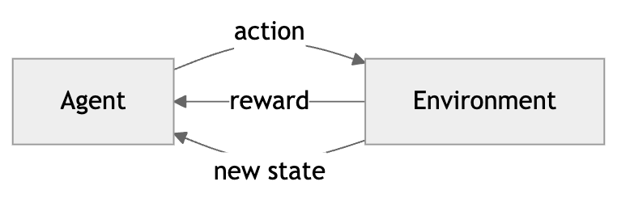

*Figure 8. The reinforcement learning loop of state, action, reward between agent and environment*

A recurring tension in RL is the trade-off between **exploration** (trying new actions to discover whether they pay off) and **exploitation** (repeating actions already known to be good). Lean too far toward exploitation and the agent may never discover a better strategy; explore too much and it wastes reward on known-bad moves.

RL is the paradigm behind game-playing breakthroughs (AlphaGo), robotics, recommendation and bidding systems, and, notably, the fine-tuning step that aligns modern LLMs with human preferences (Reinforcement Learning from Human Feedback, or RLHF). It is covered in the chapters on Reinforcement Learning Foundations and Reinforcement Learning Algorithms and Deep RL.

> **Reinforcement learning at a glance** - **Strengths:** learns sequential decision-making, can discover strategies humans never taught it, thrives where the only signal is delayed reward. - **Weaknesses:** notoriously sample-hungry and unstable to train; needs a reliable environment or simulator; designing the reward is subtle. - **When to use:** sequential control and decision problems where you can define a reward and afford many trials. - **Pitfalls:** *reward hacking* — the agent maximizes the literal reward in unintended ways, like a boat-racing agent that spins in circles collecting points instead of finishing the race.

### 1.3.4 Semi-Supervised and Self-Supervised Learning

Between the extremes of fully labeled and fully unlabeled data sit two increasingly important paradigms.

**Semi-supervised learning** uses a small amount of labeled data alongside a large amount of unlabeled data. This is enormously practical: labeling is expensive, but raw data is plentiful. A medical-imaging team might have a few thousand scans labeled by radiologists and millions that are not; semi-supervised methods leverage both, using the structure of the unlabeled data to sharpen what the labeled data teaches. A common technique is *pseudo-labeling*: train on the labeled data, use the resulting model to label the unlabeled data, keep the confident predictions, and retrain.

**Self-supervised learning** is the engine behind modern LLMs and is arguably the most consequential idea of the current era. Here the data provides its own supervision automatically — no human labeling required. The trick is to hide part of the input and ask the model to predict it, turning an unlabeled dataset into a supervised one for free. Train a model on billions of sentences with the next word (or a random masked word) hidden, and to predict those words well it must implicitly learn grammar, facts, world knowledge, and rudimentary reasoning. The “labels” are simply the hidden parts of the data itself, so the method scales to virtually unlimited text and images. This is how models like Claude acquire their broad knowledge in a **pretraining** phase, before any task-specific tuning. The same idea powers vision models that learn by predicting missing image patches, and audio models that predict masked sound.

The distinction between self-supervised and unsupervised learning is subtle but important: both use unlabeled data, but self-supervised learning invents a *prediction task* (fill in the blank) and so ends up using supervised machinery, whereas classical unsupervised learning seeks structure like clusters directly. In practice, self-supervised pretraining followed by a small amount of supervised fine-tuning has become the dominant recipe for building capable models.

The table below summarizes the paradigms.

| Paradigm | Data needed | What it learns | Everyday analogy | Example tasks |
|----|----|----|----|----|
| Supervised | Labeled inputs and outputs | Input-to-output mapping | Learning from flashcards | Spam detection, price prediction |
| Unsupervised | Unlabeled inputs only | Hidden structure and groupings | Sorting photos into piles | Customer segmentation, anomaly detection |
| Reinforcement | Rewards from interaction | A policy of actions | Training a dog with treats | Game playing, robotics, RLHF |
| Semi-supervised | A little labeled, much unlabeled | Mapping, boosted by structure | A few labeled, many guessed | Medical imaging with scarce labels |
| Self-supervised | Unlabeled data, auto-generated labels | General representations | Fill in the blank | Pretraining LLMs and vision models |

### 1.3.5 Choosing a Paradigm

Faced with a new problem, the first strategic question is not “which algorithm?” but “which paradigm?” The decision follows almost entirely from the *data you have* and the *decision you need to make*, as the following flowchart shows.

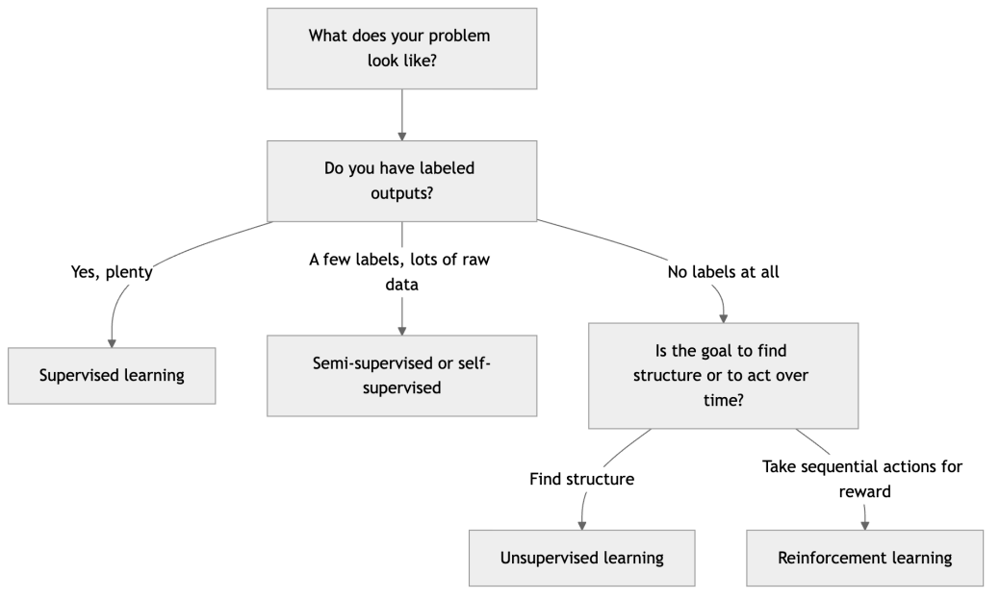

*Figure 9. A decision guide for choosing a learning paradigm based on your data and goal*

These boundaries are not rigid — real systems often stack paradigms. A modern chatbot is *self-supervised* during pretraining, *supervised* during instruction fine-tuning, and *reinforcement-learned* during preference alignment. Recognizing which paradigm a stage belongs to tells you what data it needs and how to evaluate it.

## 1.4 Where Machine Learning Fits Alongside Classical Programming

It is tempting, once excited about ML, to see it everywhere. A more mature view treats machine learning as one tool among several, chosen deliberately. The clearest way to think about the choice is in terms of *where the logic comes from* and *how much you can specify in advance*.

Classical software excels when the problem is well-defined and the rules are known: you encode the logic once, and it runs correctly forever, is easy to test, and can be audited line by line. Machine learning earns its place when the logic is *implicit in data* rather than known in advance — when you can more easily collect examples of correct behavior than describe the behavior itself. Nobody can write down the rule that maps a photograph to the word “cat,” but everyone can collect labeled cat photos.

A useful rule of thumb — sometimes called the “can you write the rules?” test — is this: if a knowledgeable person could sit down and write out the decision rules in an afternoon, write them as code. If they would struggle to articulate the rules even though they can *recognize* the right answer instantly, that is the signature of a machine-learning problem. Reading handwriting, judging sentiment, detecting tumors, and understanding speech all fit: humans do them effortlessly yet cannot explain the underlying rules, so we learn them from examples instead.

The two approaches are not rivals so much as layers. Production AI systems are overwhelmingly *hybrids*: a trained model sits at the core, wrapped in ordinary code that validates inputs, enforces business rules, applies safety filters, handles errors, and logs everything. The model supplies judgment where rules cannot; the classical code supplies the guarantees, structure, and control that a probabilistic model cannot provide on its own. Learning to see where the boundary between the two should fall is one of the most valuable practical skills this book aims to build.

## 1.5 The Core Vocabulary of Machine Learning

Every chapter in this book uses a shared set of terms. We define them once here, carefully, so that later chapters can move quickly. Throughout, we will use a running example: predicting the price of a house.

### 1.5.1 Data, Features, and Labels

**Data** is the raw material of machine learning, typically organized as a table where each row is one **example** (also called a sample, instance, or data point) and each column is one attribute.

The input attributes are called **features** (or, in statistics, *independent variables* or *predictors*). For a house, features might be square footage, number of bedrooms, age, and ZIP code. By long-standing convention we collect the features of a single example into a vector $`\mathbf{x}`$, and stack all examples into a feature matrix $`\mathbf{X}`$ with one row per example and one column per feature. A dataset of $`m`$ examples each with $`n`$ features is thus an $`m \times n`$ matrix.

The **label** (or *target*, *outcome*, or *dependent variable*) is the answer we want to predict — here, the sale price. We denote the label of an example by $`y`$. Labels exist only in supervised learning; unsupervised learning has $`\mathbf{X}`$ but no $`y`$.

``` python
import numpy as np
import pandas as pd

# A tiny housing dataset: 4 examples, 3 features each
data = pd.DataFrame({
    "sqft":     [1400, 1600, 1700, 1875],          # feature 1
    "bedrooms": [3,    3,    3,    4   ],           # feature 2
    "age":      [10,   3,    25,   8   ],           # feature 3
    "price":    [245000, 312000, 279000, 358000],  # label (target)
})

X = data[["sqft", "bedrooms", "age"]].values  # feature matrix, shape (4, 3)
y = data["price"].values                       # label vector,  shape (4,)
print("Feature matrix shape:", X.shape)        # (4, 3)
print("Label vector shape:  ", y.shape)        # (4,)
```

Features come in types that matter for modeling: **numerical** features like square footage are quantities you can do arithmetic on; **categorical** features like ZIP code or color take one of a fixed set of values and usually need encoding before a model can use them; and **ordinal** features like “small, medium, large” have a meaningful order but no fixed numeric spacing. Recognizing a feature’s type is the first step of preparing data well.

A central concept worth emphasizing now: the quality and relevance of features often matter more than the choice of algorithm. Practitioners have a slogan for this — “garbage in, garbage out.” The craft of designing good features, **feature engineering**, is covered in the chapter on The Machine Learning Workflow and Data Preparation.

### 1.5.2 Models, Parameters, and Hyperparameters

A **model** is the mathematical object that maps features to predictions. You can think of it as a function $`f`$ with adjustable knobs:

``` math
\widehat{y} = f(\mathbf{x};\mathbf{\theta})
```

Here $`\widehat{y}`$ (read “y-hat”) is the model’s prediction, $`\mathbf{x}`$ is the input feature vector, and $`\mathbf{\theta}`$ (theta) represents the **parameters** — the internal numbers the model learns from data. The simplest model, linear regression, looks like:

``` math
\widehat{y} = w_{1}x_{1} + w_{2}x_{2} + \cdots + w_{n}x_{n} + b
```

The weights $`w_{i}`$ and bias $`b`$ are the parameters. Learning *is* the process of finding parameter values that make predictions accurate. A linear model has a handful of parameters; a large language model has hundreds of billions.

Let us make this concrete with the housing data. Suppose after training we obtained the model $`\widehat{y} = 150 \cdot \text{sqft} + 10000 \cdot \text{bedrooms} - 1200 \cdot \text{age} + 20000`$. For the first house — 1400 sqft, 3 bedrooms, 10 years old — the prediction is

``` math
\widehat{y} = 150(1400) + 10000(3) - 1200(10) + 20000 = 210000 + 30000 - 12000 + 20000 = 248000.
```

The true price was \$245,000, so this model is off by \$3,000 on that example. Training is the search for the weights that make errors like this small across *all* examples at once, which brings us to the loss function below.

It is essential to distinguish parameters from **hyperparameters**:

- **Parameters** are learned *by* the algorithm *from* the data during training (the weights $`w_{i}`$ and bias $`b`$).
- **Hyperparameters** are set *by you, the practitioner, before* training begins. They configure *how* learning happens — the learning rate, the number of layers in a network, the depth of a decision tree, how strongly to regularize. The model does not learn these from data; you choose them, often by experimentation (a process called hyperparameter tuning, discussed in the chapter on Supervised Learning and Model Evaluation).

A helpful analogy: if learning is baking a cake, the parameters are the final taste and texture that emerge from the process, while the hyperparameters are the oven temperature and baking time you dial in beforehand.

| Aspect | Parameters | Hyperparameters |
|----|----|----|
| Who sets them | The learning algorithm | The practitioner |
| When | During training | Before training |
| Learned from data? | Yes | No |
| Examples | Weights, biases | Learning rate, tree depth, number of clusters |

### 1.5.3 Training vs. Inference

The lifecycle of a model has two distinct phases.

**Training** (also called *fitting*) is the phase where the algorithm adjusts the parameters $`\mathbf{\theta}`$ to fit the data. It does so by minimizing a **loss function** (or *cost function*) — a number that measures how wrong the predictions are. For regression, a common choice is the mean squared error:

``` math
J(\mathbf{\theta}) = \frac{1}{m}\sum_{i = 1}^{m}\left( {\widehat{y}}^{(i)} - y^{(i)} \right)^{2}
```

where $`m`$ is the number of training examples, $`y^{(i)}`$ is the true label of example $`i`$, and $`{\widehat{y}}^{(i)}`$ is the model’s prediction. Squaring the error means large mistakes are penalized disproportionately and the sign of the error does not cancel out. Training searches for the parameters that make this loss as small as possible, usually via an optimization procedure called **gradient descent** — repeatedly nudging each parameter a small step in the direction that most reduces the loss (developed in the chapters on Mathematical and Statistical Foundations and Training and Optimizing Deep Networks). Training is computationally expensive and done relatively rarely.

**Inference** (also called *prediction* or *serving*) is the phase where the trained model, with its parameters now frozen, is fed new, unseen inputs and produces predictions. This is what happens every time you ask Claude a question or your phone unlocks with your face. Inference is comparatively cheap per query, but because it happens constantly in production, it usually dominates the total lifetime compute and cost of a deployed system.

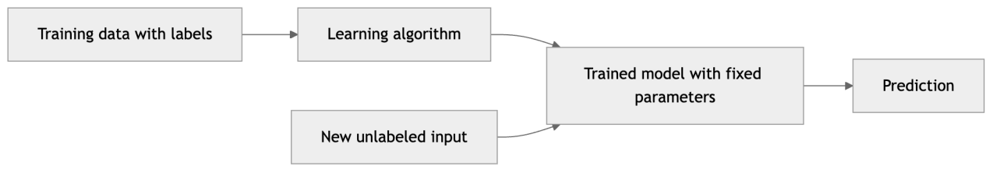

*Figure 10. The training phase produces a model that the inference phase uses on new data*

The single most important goal that connects these phases is **generalization**: a model is only useful if it performs well on data it did not see during training. A model that memorizes its training data but fails on new examples is said to **overfit**; a model too simple to capture the real pattern is said to **underfit**. Guarding against overfitting — through proper data splits, validation, and regularization — is a recurring theme of this book, introduced formally in the chapter on Supervised Learning and Model Evaluation.

### 1.5.4 Visualizing Training: Watching the Loss Go Down

To make training tangible before we have the formal machinery, the figure below shows what successful training looks like — a loss function decreasing as the model iteratively improves its parameters — and what overfitting looks like when validation loss starts to climb back up.

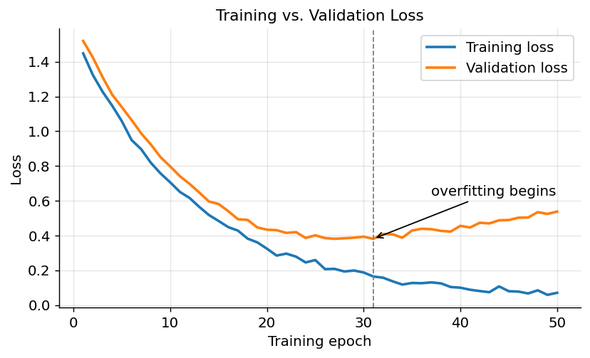

*Figure 11. A typical training curve - training loss keeps falling while validation loss bottoms out then rises as overfitting begins*

The gap between the two curves, and the upturn in validation loss, is the visual signature of overfitting. The vertical line marks the point of best generalization, where we would ideally stop training — a practical technique known as *early stopping*.

### 1.5.5 The Three-Way Data Split

The training curve above quietly introduced a second dataset — the *validation* set — and it is worth pausing on why serious ML uses three distinct splits rather than one. The core principle is that you can only trust a performance number measured on data the model has never influenced in any way.

- The **training set** is what the algorithm fits its parameters on. Performance here tells you almost nothing about generalization, because the model has seen every answer.
- The **validation set** (or *development set*) is held out from training and used to make decisions *about* the model: which hyperparameters to pick, when to stop, which of several candidate models is best. Because you tune against it repeatedly, the model indirectly adapts to it, so its scores are optimistic.
- The **test set** is locked away and touched exactly once, at the very end, to produce the honest estimate of real-world performance you report. If you peek at it during development, it silently becomes a second validation set and loses its meaning.

A typical split might be 70% training, 15% validation, 15% test, though the exact proportions depend on how much data you have. When data is scarce, a technique called *cross-validation* — rotating which slice serves as validation — squeezes more reliable estimates from limited examples; it is developed in the chapter on Supervised Learning and Model Evaluation. The discipline of guarding the test set is not bureaucratic fussiness. It is the difference between a model that looks good in a slide deck and one that actually works when it meets the world.

## 1.6 A First End-to-End Example

Vocabulary becomes real when you see it run. The example below trains a complete supervised model in scikit-learn — the foundational Python library introduced in the chapter on Python Tooling for Machine Learning. We use the classic Iris dataset, which ships with scikit-learn and requires no download. The task is classification: predict which of three iris species a flower is, from four measurements.

``` python
from sklearn.datasets import load_iris
from sklearn.model_selection import train_test_split
from sklearn.linear_model import LogisticRegression
from sklearn.metrics import accuracy_score

# 1. DATA: features (X) and labels (y)
iris = load_iris()
X, y = iris.data, iris.target        # X shape (150, 4); y shape (150,)

# 2. SPLIT into training and test sets so we can measure generalization
X_train, X_test, y_train, y_test = train_test_split(
    X, y, test_size=0.3, random_state=42, stratify=y
)

# 3. MODEL: choose a classifier; max_iter is a HYPERPARAMETER we set
model = LogisticRegression(max_iter=200)

# 4. TRAINING: the algorithm learns PARAMETERS from the training data
model.fit(X_train, y_train)

# 5. INFERENCE: predict on data the model has never seen
y_pred = model.predict(X_test)

# 6. EVALUATE generalization
print("Test accuracy:", accuracy_score(y_test, y_pred))
# Expected output: Test accuracy: ~0.98
```

Every concept from this chapter appears here, labeled in the comments: features and labels (`X`, `y`), the train/test split that lets us measure generalization, a model with a hyperparameter (`max_iter`) we chose, the `fit` call that performs training and learns the parameters, the `predict` call that performs inference, and an accuracy score that quantifies success. This same six-step skeleton — data, split, model, train, predict, evaluate — underlies nearly every supervised project in the book.

Notice the discipline embedded in step 2. We deliberately hold back 30% of the data and never let the model see it during training, so that the accuracy in step 6 estimates how the model will perform on genuinely new flowers rather than how well it memorized the ones it studied. Evaluating on data the model trained on is the single most common beginner mistake, and it produces numbers that look wonderful and mean nothing.

## 1.7 Where AI Is Used Today

AI is no longer confined to research labs or tech giants; it is embedded across virtually every industry. A survey of where it operates today both motivates the techniques ahead and shows which paradigm tends to fit which problem.

| Industry | Representative applications | Typical paradigm |
|----|----|----|
| Healthcare | Tumor detection in scans, drug discovery, patient-risk prediction | Supervised, self-supervised |
| Finance | Fraud detection, credit scoring, algorithmic trading | Supervised, unsupervised, RL |
| Retail and e-commerce | Recommendation engines, demand forecasting, dynamic pricing | Supervised, unsupervised |
| Transportation | Self-driving perception, route optimization, predictive maintenance | Deep learning, RL |
| Manufacturing | Defect detection on assembly lines, predictive maintenance | Supervised, unsupervised |
| Software and IT | Code completion, log anomaly detection, automated testing | Generative AI, supervised |
| Media and entertainment | Content recommendation, image and video generation, subtitling | Generative, supervised |
| Customer service | Chatbots, ticket routing, sentiment analysis | LLMs, supervised |
| Agriculture | Crop-disease detection from images, yield prediction | Deep learning, supervised |
| Science | Protein-structure prediction, weather forecasting, materials discovery | Deep learning, self-supervised |

Several patterns are worth noticing. Supervised learning dominates because so many valuable problems reduce to “predict this label from these features.” Unsupervised methods shine where labels are absent and the goal is discovery, such as flagging unusual transactions no one has seen before. Reinforcement learning appears wherever sequential decisions accumulate, from trading to robotics. And generative AI, the newest arrival, is rapidly entering every column — drafting text, synthesizing images, and writing code. The rest of this section tours a few domains in more depth to make the abstractions concrete.

### 1.7.1 Healthcare and the Life Sciences

Medical imaging is one of AI’s clearest wins. Convolutional neural networks now detect diabetic retinopathy in retinal photographs, flag suspicious nodules in lung CT scans, and triage mammograms at expert-level accuracy — always as a decision-support aid to a clinician, never a replacement. Beyond images, models predict which hospitalized patients are at risk of deterioration from their vital-sign trends, and in drug discovery they screen enormous chemical libraries for promising compounds. The landmark example is DeepMind’s AlphaFold, which used deep learning to predict the three-dimensional structure of proteins from their amino-acid sequences — a fifty-year grand challenge in biology — accelerating research across the life sciences. Healthcare also concentrates AI’s risks: biased training data can produce worse care for underrepresented groups, and errors carry life-and-death stakes, which is why regulation and validation are especially stringent here.

### 1.7.2 Finance

Finance was an early and enthusiastic adopter because it is awash in structured, labeled, high-value data. Fraud-detection systems score every card transaction in milliseconds, combining supervised models trained on confirmed fraud with unsupervised anomaly detection that catches novel schemes. Credit-scoring models estimate default risk, algorithmic trading systems act on market signals, and RL is used for portfolio allocation and optimal trade execution. The stakes make finance a cautionary domain too: a credit model that inadvertently encodes historical discrimination can deny loans unfairly and illegally, which is why *explainability* and *fairness* are not optional extras but regulatory requirements.

### 1.7.3 Computer Vision

Vision is the domain that ignited the deep-learning revolution, and it now runs quietly everywhere: unlocking phones with your face, reading license plates, enabling checkout-free stores, guiding quality-control cameras on assembly lines, and powering the perception stack of self-driving cars, which must detect pedestrians, vehicles, lane markings, and signs in real time. The core tasks — image classification, object detection, and segmentation — are developed in the chapter on Convolutional Neural Networks.

### 1.7.4 Natural Language Processing

NLP has been transformed twice: first by statistical methods, then wholesale by Transformers and LLMs. Today’s systems translate between languages, summarize documents, answer questions, extract structured data from unstructured text, gauge sentiment in reviews, and hold open-ended conversations. Large language models such as Claude represent the current frontier, and much of the second half of this book is devoted to how they work and how to use them responsibly and effectively.

### 1.7.5 Robotics and Autonomous Systems

Robotics fuses perception, planning, and control, and it is where reinforcement learning most naturally lives. Warehouse robots navigate and pick items, drones inspect infrastructure, and robotic arms learn dexterous manipulation, increasingly trained in simulation before being deployed to physical hardware — a technique called *sim-to-real transfer*. Robotics is humbling: tasks a toddler finds trivial, like reliably grasping an unfamiliar object, remain hard, a reminder that fluent language does not imply competent action in the physical world.

### 1.7.6 Science and Engineering

Perhaps the most exciting frontier is AI as an instrument of discovery. Beyond AlphaFold, deep-learning weather models now rival traditional physics simulations at a fraction of the compute; models help design new materials, catalysts, and battery chemistries; and they sift astronomical and particle-physics data for signals no human could find by hand. Here AI does not replace the scientific method — it accelerates the search through vast hypothesis spaces so that human scientists can focus on the promising few. The pattern recurs across domains: the model proposes, the human disposes, and the loop between them is far faster than either alone. This human-in-the-loop framing, rather than full automation, is the most productive and responsible way to think about AI in nearly every serious application you will encounter.

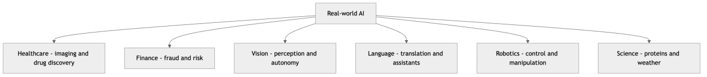

*Figure 12. AI applications span many industries, each favoring particular learning paradigms*

## 1.8 Challenges and Limitations

It is equally important to recognize what AI does *not* do well, because the failure modes are as characteristic as the successes. Understanding them early inoculates you against both overhyped promises and misplaced fear.

- **No genuine understanding.** Today’s models are sophisticated pattern matchers. An LLM that writes a flawless essay on gravity has no felt understanding of falling objects; it has learned statistical regularities of how humans write about gravity. This is why systems can be simultaneously brilliant and strangely brittle.
- **Hallucination.** Generative models can produce fluent, confident, and entirely false statements — inventing citations, facts, or events. Because the output is grammatical and assured, errors are easy to miss. Techniques like Retrieval-Augmented Generation, covered later, mitigate but do not eliminate this.
- **Bias and fairness.** A model learns whatever patterns exist in its training data, including society’s historical biases. If past hiring favored one group, a model trained on that history will too — and will do so at scale and behind a veneer of objectivity. Bias is not a bug to be patched but a property to be measured and managed continuously.
- **Distribution shift and brittleness.** Models assume the future resembles the data they were trained on. When conditions change — a new fraud pattern, a camera in unfamiliar lighting, an economic regime the model never saw — performance can degrade silently and sharply. This gap between training data and deployment reality is the leading cause of real-world ML failure.
- **Data hunger and cost.** Deep models need large, well-curated datasets and substantial compute to train. Both the data and the energy have real financial and environmental costs.
- **Opacity.** The most powerful models are the least interpretable. A random forest or neural network can be far more accurate than a simple linear model while offering little insight into *why* it made a particular decision — a serious problem in regulated, high-stakes domains where explanations are legally or ethically required.
- **Adversarial vulnerability.** Small, deliberately crafted perturbations to an input — imperceptible to a human — can fool a model into confident errors, a security concern anywhere ML meets adversaries.

A concrete illustration ties several of these together. Suppose a hospital trains a model to predict which patients will develop complications, using historical records. The model achieves excellent accuracy in testing and is deployed. Months later, clinicians notice it systematically under-flags a particular demographic. Investigation reveals the cause: that group historically had less access to care, so their records contained fewer documented complications — the *labels themselves* were biased. The model faithfully learned a pattern that was real in the data but wrong in the world, and because the model was opaque, the flaw went unnoticed until harm accumulated. No single technical fix would have caught this; it required domain knowledge, fairness auditing, and ongoing monitoring. This is the texture of real AI limitations — rarely a dramatic malfunction, usually a quiet, plausible, systematic error.

None of these are reasons to avoid AI; they are reasons to deploy it with clear eyes, appropriate guardrails, and human oversight where the stakes demand it. A useful habit, cultivated throughout this book, is to ask of every model not only “how accurate is it?” but “how does it fail, who does it fail, and how would we notice?”

## 1.9 A Preview of Responsible AI

Because AI now makes or shapes consequential decisions — who gets a loan, which resume is read, what medical follow-up is recommended — the question is no longer only “does it work?” but “should we build it, and how do we build it well?” This book treats responsible AI as a first-class engineering concern, not an afterthought, and devotes a full chapter to it: Responsible AI: Ethics, Bias, Safety, and Governance. The recurring themes are worth previewing now so you can carry them through every technique you learn.

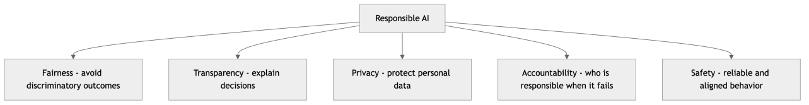

*Figure 13. The core themes of responsible AI that recur throughout the book*

- **Fairness** asks whether a system produces equitable outcomes across groups, and forces the uncomfortable recognition that there are multiple, mathematically incompatible definitions of “fair.”
- **Transparency and explainability** concern whether a decision can be understood and justified, especially when it adversely affects someone.
- **Privacy** covers how personal data is collected, used, and protected, and whether models leak the data they were trained on.
- **Accountability** asks who is responsible when an automated system causes harm — the developer, the deployer, or the user.
- **Safety and alignment** concern building systems that behave reliably and in accordance with human intentions, a central research focus for frontier models and the motivation behind techniques like RLHF.

The practical takeaway is that responsible AI is woven into the whole lifecycle — the data you collect, the model you choose, how you evaluate it, and how you monitor it in production — rather than bolted on at the end. Keep these questions active as you read.

## 1.10 How This Book Is Organized

This book is structured as a deliberate progression from foundations to the frontier. You can read it cover to cover, or use the map below to jump to what you need.

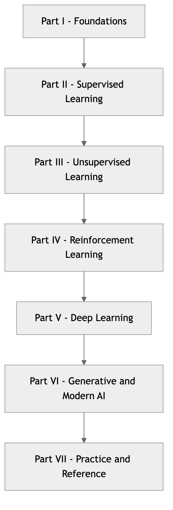


*Figure 14. The seven parts of this book progress from foundations to modern AI and practice*

- **Part I — Foundations** establishes the prerequisites: the math and statistics you need, the end-to-end ML workflow, and the Python tooling (numpy, pandas, scikit-learn) used throughout.
- **Part II — Supervised Learning** is the workhorse of practical ML: model evaluation, regression, and a thorough tour of classification algorithms from logistic regression to support vector machines to ensemble methods like random forests and gradient boosting.
- **Part III — Unsupervised Learning** covers clustering, dimensionality reduction, and association rules — finding structure without labels.
- **Part IV — Reinforcement Learning** introduces agents, environments, rewards, and the algorithms (including deep RL) that learn by interaction.
- **Part V — Deep Learning** builds neural networks from first principles, then specializes into convolutional networks for vision, recurrent networks for sequences, and the Transformer architecture that underpins modern AI.
- **Part VI — Generative and Modern AI** is the frontier: GANs, VAEs, and diffusion models; how large language models work; using them in practice with prompting, fine-tuning, and the Claude API; Retrieval-Augmented Generation; agentic AI; and multimodal generation of images, audio, and code.
- **Part VII — Practice and Reference** covers MLOps for deploying real systems, responsible AI, and a glossary you can return to whenever a term is unfamiliar.

### 1.10.1 How to Read This Book

A few practical suggestions. Keep a Python environment open and run the code as you read — the fastest path to intuition is to execute an example, change a number, and observe the result. Do not skip Part I if the math or workflow is rusty; later chapters lean on it heavily and reference it by name rather than re-teaching it. If you are an experienced practitioner, you may safely skim foundations and dive into the parts you need, using the cross-references to backfill. And when a term trips you up, consult the Glossary of AI/ML Terms — it is built to be your reference companion for the whole journey.

The chapters share a consistent structure so you always know where to look: intuition first, then formalism and derivation, then a worked numeric example, then runnable code, and finally a compact box of strengths, weaknesses, when-to-use guidance, and pitfalls. Each chapter closes with a summary, key takeaways, and exercises. If you are pressed for time, the summary and takeaways of any chapter give you the load-bearing ideas in a few minutes; the exercises are where the understanding actually consolidates.

By the end of this book you will understand not just *how* to call a library function, but *why* each algorithm works, *when* to reach for it, and *what* can go wrong. That combination — practical skill grounded in genuine understanding — is the aim of everything that follows.

## 1.11 Summary

This chapter laid the conceptual and vocabulary foundation for the entire book. We established that artificial intelligence, machine learning, and deep learning are nested rather than interchangeable: AI is any machine behavior that mimics intelligence, machine learning is the subset that learns rules from data instead of having them hand-coded, deep learning is the subset of ML built on multi-layer neural networks that learn their own features, and generative AI is the subset of deep learning that creates new content. The defining move of the whole field is an inversion of classical programming — rather than supplying rules and data to compute answers, we supply data and answers and let the machine infer the rules.

We traced the field through its major eras — symbolic AI and expert systems, the statistical machine-learning era, the deep-learning revolution ignited by AlexNet in 2012, and today’s generative and LLM era launched by the Transformer — noting that each wave rose on inflated promises, and that two “AI winters” followed when reality caught up. We surveyed the five learning paradigms, distinguished by the feedback available: supervised, unsupervised, reinforcement, semi-supervised, and self-supervised, the last of which powers modern LLMs. We nailed down the core vocabulary — features, labels, models, parameters, hyperparameters, training, inference, loss, and above all generalization — and saw every term appear in a runnable six-step scikit-learn example.

## 1.12 Key Takeaways

- **AI, ML, and DL are nested concepts.** Every deep learning system is machine learning; every machine learning system is AI; the reverse does not hold.
- **Machine learning inverts traditional programming.** It infers rules from examples, which is invaluable when the rules are unknown, complex, or shifting — and unnecessary when a simple `if` statement would do.
- **The field advanced in waves.** Symbolic AI, expert systems, statistical ML, deep learning, and the LLM era each contributed durable ideas, punctuated by AI winters when hype outran results.
- **Scale changed everything.** Big data, GPUs, and the Transformer architecture let ever-larger models keep improving where classical methods plateaued.
- **Five paradigms cover the landscape.** Supervised (labeled data), unsupervised (no labels), reinforcement (rewards from interaction), semi-supervised (a little labeled plus much unlabeled), and self-supervised (labels generated from the data itself).
- **Generalization is the goal.** A model is only useful if it performs well on unseen data; overfitting and underfitting are the twin dangers, managed through proper splits, validation, and regularization.
- **Parameters are learned; hyperparameters are chosen.** The algorithm fits parameters to data during training; you set hyperparameters beforehand to control how learning happens.
- **AI is everywhere but limited.** It spans healthcare, finance, vision, language, robotics, and science, yet it hallucinates, inherits bias, breaks under distribution shift, and lacks genuine understanding — so it demands responsible, oversight-aware deployment.

## 1.13 Exercises

1.  **(Conceptual)** For each of the following, state whether it is best framed as supervised, unsupervised, or reinforcement learning, and justify your choice: (a) grouping a streaming service’s users by viewing habits with no predefined categories; (b) predicting tomorrow’s electricity demand in megawatts; (c) teaching a simulated robot arm to stack blocks; (d) deciding whether an incoming transaction is fraudulent given a history of labeled past transactions.

2.  **(Conceptual)** Explain in your own words why self-supervised learning has been so transformative for large language models. What problem that classical supervised learning faces does it solve, and where do the “labels” come from?

3.  **(Conceptual)** Classify each of the following as a *parameter* or a *hyperparameter*, and explain why: the learning rate of gradient descent; the weights of a trained neural network; the number of clusters $`k`$ in a clustering algorithm; the bias term $`b`$ in linear regression; the maximum depth of a decision tree.

4.  **(Conceptual)** For each scenario, decide whether machine learning or ordinary rule-based code is the better tool, and explain your reasoning: (a) computing the total of a shopping cart including tax; (b) deciding whether a product review expresses positive or negative sentiment; (c) validating that an email address contains an “@” symbol; (d) recognizing spoken commands in a noisy kitchen.

5.  **(Conceptual)** The chapter argues that each AI era “rose on inflated promises” and that two AI winters followed. Choose either the expert-systems boom of the 1980s or the current LLM boom, and describe two specific ways its promises might outrun reality, and what would have to be true to avoid another winter.

6.  **(Coding)** Modify the Iris example in this chapter. Replace `LogisticRegression` with `from sklearn.neighbors import KNeighborsClassifier` and use `KNeighborsClassifier(n_neighbors=3)`. Run it and compare the test accuracy. Then try `n_neighbors` values of 1, 5, and 15. Which hyperparameter value generalizes best, and what does that tell you about the role of hyperparameter tuning?

7.  **(Coding)** Using scikit-learn’s `load_diabetes` dataset (a regression problem), build the six-step pipeline from this chapter: load the data, split it, fit a `LinearRegression` model (`from sklearn.linear_model import LinearRegression`), predict on the test set, and evaluate with `mean_squared_error` (`from sklearn.metrics import mean_squared_error`). Print the test RMSE (the square root of the mean squared error). Identify which lines correspond to training and which to inference.

8.  **(Coding)** Take the Iris example and deliberately evaluate the model on the *training* set instead of the test set by calling `model.predict(X_train)` and comparing to `y_train`. Report both the training accuracy and the test accuracy. Explain why the training accuracy is a misleading measure of the model’s real-world performance, connecting your answer to the concept of generalization.

9.  **(Conceptual)** Pick one industry from the “Where AI Is Used Today” table and describe a specific AI application in it. Identify what the features and labels would be, which learning paradigm applies, and one realistic way the system could fail or cause harm if deployed carelessly. Then name which responsible-AI theme from this chapter most directly addresses that harm.

---

[← About the Author](00e-about-the-author.md) · [Contents](../README.md#contents) · [2 Mathematical and Statistical Foundations →](ch02-math-foundations.md)
