[← 1 Introduction to Artificial Intelligence and Machine Learning](ch01-introduction.md) · [Contents](../README.md#contents) · [3 The Machine Learning Workflow and Data Preparation →](ch03-ml-workflow.md)

---

# 2 Mathematical and Statistical Foundations

Machine learning is, at its core, applied mathematics. Every model you will meet in this book — from a humble linear regression to a billion-parameter transformer — is built from the same small set of mathematical ideas: arrays of numbers (linear algebra), the slopes that tell us how to improve those numbers (calculus), the language for reasoning under uncertainty (probability), and the tools for summarizing and trusting data (statistics). This chapter teaches the *essential* math you need, with intuition first and a runnable `numpy` snippet for almost every concept. You do not need to be a mathematician to follow along; you need to be comfortable with these ideas well enough to read the rest of the book without friction.

We will not prove theorems for their own sake. Instead, every formula here earns its place by powering something concrete later: dot products power neural-network layers, gradients power training, eigenvectors power dimensionality reduction, Bayes’ theorem powers Naive Bayes classifiers, maximum likelihood powers the fitting of nearly every parametric model, and cross-entropy powers the loss function used in almost every classifier you will build.

The chapter is longer and deeper than a typical “math refresher” because the payoff compounds. Time spent here is the highest-leverage investment in the book: understand these foundations once and every subsequent chapter becomes easier, because you will recognize the same handful of ideas reappearing in new costumes.

## 2.1 How to Read This Chapter

Keep a Python session open. Each snippet is self-contained and uses only `numpy` (and occasionally `matplotlib`). If a concept feels abstract, run the code, change a number, and watch what happens. That loop — read, run, perturb, observe — is the fastest way to turn symbols into intuition.

Do not try to absorb everything in one pass. Read the intuition for each concept, skim the derivations, and run the code. When a later chapter leans on a particular tool — say, eigendecomposition for Principal Component Analysis or maximum likelihood for logistic regression — return here and read that section closely. This chapter is designed to be both a first read and a lasting reference.

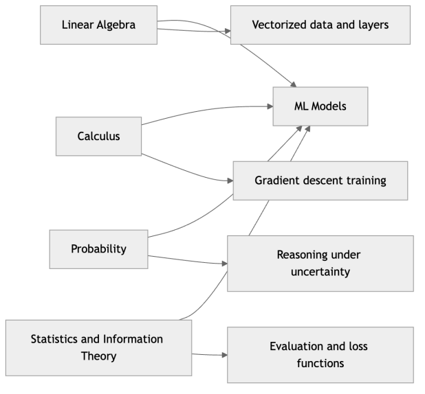

*Figure 15. The four mathematical pillars of machine learning and what each one powers*

## 2.2 Linear Algebra: The Language of Data

Almost all data in machine learning is represented as arrays of numbers. Linear algebra is the branch of math that manipulates those arrays efficiently and meaningfully. Before we can train anything, we need vocabulary. The map below shows the concepts we will build, from the basic objects up to the decompositions that power dimensionality reduction and recommendation systems.

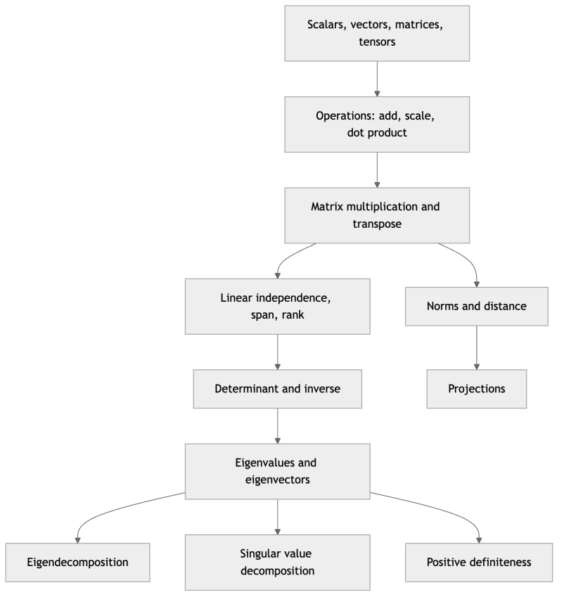

*Figure 16. A concept map of the linear algebra ideas covered in this section*

### 2.2.1 Scalars, Vectors, Matrices, and Tensors

These four objects differ only in how many indices you need to address a single number inside them.

- A **scalar** is a single number, like the temperature $`7.2`$. It has zero dimensions (zero axes). We write scalars in italics, $`x`$.
- A **vector** is an ordered list of numbers, like a single data point with three features $`\mathbf{x} = \lbrack 1.7,65,0.3\rbrack`$ (height, weight, body-fat fraction). It has one axis. We write vectors in bold lowercase. A vector with $`n`$ entries is said to live in $`\mathbb{R}^{n}`$, the space of all $`n`$-tuples of real numbers. By convention a vector is a **column** vector unless stated otherwise, so $`\mathbf{x} \in \mathbb{R}^{n}`$ has shape $`n \times 1`$.
- A **matrix** is a rectangular grid of numbers with rows and columns. In ML, a matrix often holds an entire dataset: one row per example, one column per feature. We write matrices in bold uppercase, $`\mathbf{X}`$. A matrix with $`m`$ rows and $`n`$ columns lives in $`\mathbb{R}^{m \times n}`$.
- A **tensor** is the generalization to any number of axes. A color image is a 3-D tensor (height $`\times`$ width $`\times`$ color channels); a batch of images is a 4-D tensor. The word *tensor* is why TensorFlow is named what it is. In this book “tensor” simply means “multi-dimensional array”; we do not need the stricter physics definition.

``` python
import numpy as np

scalar = np.array(7.2)                       # 0-D, shape ()
vector = np.array([1.7, 65.0, 0.3])          # 1-D, shape (3,)
matrix = np.array([[1.7, 65.0, 0.3],         # 2-D, shape (2, 3): 2 examples, 3 features
                   [1.8, 80.0, 0.2]])
tensor = np.random.rand(4, 28, 28, 3)        # 4-D: 4 RGB images of 28x28

for name, a in [("scalar", scalar), ("vector", vector),
                ("matrix", matrix), ("tensor", tensor)]:
    print(f"{name:7s} ndim={a.ndim}  shape={a.shape}")
# scalar  ndim=0  shape=()
# vector  ndim=1  shape=(3,)
# matrix  ndim=2  shape=(2, 3)
# tensor  ndim=4  shape=(4, 28, 28, 3)
```

The `shape` attribute is the single most useful diagnostic in all of practical ML. The overwhelming majority of bugs you will hit when building models are *shape mismatches*. Get into the habit of printing shapes.

### 2.2.2 Vector Operations and the Dot Product

Vectors support **element-wise addition** (add corresponding entries) and **scalar multiplication** (multiply every entry by the same number), which behave exactly as you would expect. Geometrically, addition places vectors tip-to-tail and scalar multiplication stretches or flips a vector without changing its direction line.

The interesting operation is the **dot product** (also called inner product), which multiplies two vectors of the same length pairwise and sums the results into a single scalar:

``` math
\mathbf{a} \cdot \mathbf{b} = \mathbf{a}^{\top}\mathbf{b} = \sum_{i = 1}^{n}a_{i}b_{i} = a_{1}b_{1} + a_{2}b_{2} + \ldots + a_{n}b_{n}
```

The dot product is the workhorse of machine learning. When a linear model computes a prediction, it takes the dot product of a weight vector $`\mathbf{w}`$ with a feature vector $`\mathbf{x}`$ and adds a bias: $`\widehat{y} = \mathbf{w} \cdot \mathbf{x} + b`$. Geometrically, the dot product also measures *alignment*, because

``` math
\mathbf{a} \cdot \mathbf{b} = \parallel \mathbf{a} \parallel \, \parallel \mathbf{b} \parallel cos\theta,
```

where $`\theta`$ is the angle between the two vectors. It is large and positive when two vectors point the same way ($`\cos\theta \approx 1`$), zero when they are perpendicular ($`\cos\theta = 0`$), and negative when they point in opposite directions.

**Worked example.** Take $`\mathbf{a} = \lbrack 1,0\rbrack`$ and $`\mathbf{b} = \lbrack 1,1\rbrack`$. Then $`\mathbf{a} \cdot \mathbf{b} = 1 \cdot 1 + 0 \cdot 1 = 1`$. The magnitudes are $`\parallel \mathbf{a} \parallel = 1`$ and $`\parallel \mathbf{b} \parallel = \sqrt{2}`$, so $`\cos\theta = 1/(1 \cdot \sqrt{2}) = 0.7071`$, giving $`\theta = 45^{\circ}`$ — exactly the geometric angle between “east” and “north-east.”

``` python
w = np.array([0.5, -1.2, 2.0])     # model weights
x = np.array([1.7, 65.0, 0.3])     # one example's features
b = 0.1                            # bias term

prediction = np.dot(w, x) + b      # or: w @ x + b
print(prediction)                  # -76.85

# Cosine similarity: alignment of two vectors, ignoring their length
def cosine(a, b):
    return np.dot(a, b) / (np.linalg.norm(a) * np.linalg.norm(b))

print(round(cosine(np.array([1, 0]), np.array([1, 1])), 4))  # 0.7071 (45 degrees)
```

Cosine similarity, built directly from the dot product, is exactly how modern systems compare text embeddings in the chapter on Retrieval-Augmented Generation later in this book.

### 2.2.3 Norms: Measuring Size

A **norm** measures the “length” or magnitude of a vector — a single non-negative number summarizing how big it is. The general family is the **p-norm**:

``` math
\parallel \mathbf{x} \parallel_{p} = \left( \sum_{i}^{}|x_{i}|^{p} \right)^{1/p}.
```

Three members matter in ML:

- The **L2 norm** ($`p = 2`$), the Euclidean length, is the straight-line distance from the origin: $`\parallel \mathbf{x} \parallel_{2} = \sqrt{\sum_{i}^{}x_{i}^{2}}`$. This is the “default” norm; when we write $`\parallel \mathbf{x} \parallel`$ without a subscript we mean L2.
- The **L1 norm** ($`p = 1`$) is the sum of absolute values, $`\parallel \mathbf{x} \parallel_{1} = \sum_{i}^{}|x_{i}|`$, sometimes called the *taxicab* or *Manhattan* distance because it measures travel along a grid.
- The **L**$`\infty`$ **norm** (the limit as $`p \rightarrow \infty`$) is the largest absolute entry, $`\parallel \mathbf{x} \parallel_{\infty} = \max_{i}|x_{i}|`$.

Norms are everywhere in ML. The distance between two points (for k-Nearest Neighbors and clustering) is a norm of their difference. **Regularization** penalizes large weights using the L1 or L2 norm of the weight vector to prevent overfitting — a technique you will see in the chapter on Regression. The two behave differently: L2 shrinks all weights smoothly toward zero, while L1 drives some weights *exactly* to zero, producing sparse models that effectively perform feature selection. The reason is geometric: the L1 “ball” (the set of points with $`\parallel \mathbf{x} \parallel_{1} \leq c`$) has sharp corners on the axes, and a loss contour is most likely to first touch that ball at a corner, where some coordinates are zero.

``` python
x = np.array([3.0, 4.0])
print(np.linalg.norm(x))          # 5.0  (L2: sqrt(9+16))
print(np.linalg.norm(x, ord=1))   # 7.0  (L1: |3|+|4|)
print(np.linalg.norm(x, ord=np.inf))  # 4.0 (Linf: max(|3|,|4|))

# Euclidean distance between two points = L2 norm of their difference
a, b = np.array([1, 2]), np.array([4, 6])
print(np.linalg.norm(a - b))      # 5.0
```

### 2.2.4 Matrix Multiplication and Transpose

Matrix multiplication generalizes the dot product. To multiply $`\mathbf{A}`$ (shape $`m \times n`$) by $`\mathbf{B}`$ (shape $`n \times p`$), the entry in row $`i`$, column $`j`$ of the result is the dot product of row $`i`$ of $`\mathbf{A}`$ with column $`j`$ of $`\mathbf{B}`$:

``` math
(\mathbf{AB})_{ij} = \sum_{k = 1}^{n}A_{ik}B_{kj}.
```

The inner dimensions must match ($`n = n`$); the result has shape $`m \times p`$. This single rule is why an entire batch of examples can flow through a neural-network layer in one operation: stack your examples as rows of $`\mathbf{X}`$, store the layer’s weights in $`\mathbf{W}`$, and compute $`\mathbf{XW}`$ to get every example’s pre-activation at once.

Matrix multiplication is **associative** ($`(\mathbf{AB})\mathbf{C} = \mathbf{A}(\mathbf{BC})`$) and **distributive** over addition, but it is **not commutative**: $`\mathbf{AB} \neq \mathbf{BA}`$ in general, and often only one of the two products is even shape-compatible.

``` python
X = np.array([[1.7, 65.0],         # 3 examples, 2 features
              [1.8, 80.0],
              [1.6, 55.0]])         # shape (3, 2)
W = np.array([[0.5, -0.2, 1.0],    # 2 features -> 3 output units
              [0.1, 0.3,  -0.4]])   # shape (2, 3)

Z = X @ W                          # shape (3, 3): every example, every unit
print(Z.shape)                     # (3, 3)
print(np.round(Z, 2))
# Matrix multiply is NOT commutative: A @ B != B @ A in general.
```

**Worked example.** Multiply $`\mathbf{A} = \begin{pmatrix}
1 & 2 \\
3 & 4
\end{pmatrix}`$ by $`\mathbf{B} = \begin{pmatrix}
5 & 6 \\
7 & 8
\end{pmatrix}`$. The top-left entry is the dot product of row 1 of $`\mathbf{A}`$ with column 1 of $`\mathbf{B}`$: $`1 \cdot 5 + 2 \cdot 7 = 19`$. The top-right is $`1 \cdot 6 + 2 \cdot 8 = 22`$; the bottom-left $`3 \cdot 5 + 4 \cdot 7 = 43`$; the bottom-right $`3 \cdot 6 + 4 \cdot 8 = 50`$. So $`\mathbf{AB} = \begin{pmatrix}
19 & 22 \\
43 & 50
\end{pmatrix}`$. Reversing the order gives $`\mathbf{BA} = \begin{pmatrix}
23 & 34 \\
31 & 46
\end{pmatrix}`$ — a different matrix, confirming non-commutativity.

A closely related idea is **broadcasting**: when you combine arrays of different but compatible shapes, `numpy` implicitly stretches the smaller one. Adding a bias vector of shape $`(3,)`$ to a $`(100,3)`$ batch of pre-activations adds the same bias to all 100 rows without any loop. Broadcasting is vectorization applied to shape mismatches, and it is how the bias term in every neural-network layer is added in one line.

The **transpose** $`\mathbf{A}^{\top}`$ flips rows and columns (so $`(\mathbf{A}^{\top})_{ij} = A_{ji}`$) and shows up constantly when aligning shapes (`A.T` in numpy). A useful identity: $`(\mathbf{AB})^{\top} = \mathbf{B}^{\top}\mathbf{A}^{\top}`$. The **identity matrix** $`\mathbf{I}`$ has ones on the diagonal and zeros elsewhere and acts like the number 1: $`\mathbf{AI} = \mathbf{IA} = \mathbf{A}`$. A matrix equal to its own transpose ($`\mathbf{A} = \mathbf{A}^{\top}`$) is **symmetric**; covariance matrices and the matrices $`\mathbf{A}^{\top}\mathbf{A}`$ that appear in least-squares are always symmetric, a fact we exploit repeatedly.

### 2.2.5 Linear Independence, Span, Basis, and Rank

A set of vectors is **linearly independent** if none of them can be written as a weighted combination of the others — equivalently, the only way to combine them to get the zero vector is to weight them all by zero. If one vector *is* a combination of the others, the set is **linearly dependent** and that vector carries no new directional information.

The **span** of a set of vectors is the set of all points you can reach by taking linear combinations (scaling and adding) of them. Two independent vectors in the plane span the whole plane; two *dependent* vectors (pointing along the same line) span only a line. A **basis** for a space is a minimal independent set that spans it — the smallest collection of building blocks from which every point can be reconstructed.

The **rank** of a matrix is the number of linearly independent columns (equivalently, independent rows). Rank tells you the true dimensionality of the information in the matrix. A matrix is **full rank** if its rank equals the smaller of its two dimensions. Rank deficiency signals redundancy: two features that are perfectly correlated make a data matrix rank-deficient, which is exactly the *multicollinearity* problem that destabilizes linear regression.

``` python
A = np.array([[1.0, 2.0, 3.0],
              [2.0, 4.0, 6.0],     # row 2 = 2 x row 1  -> dependent
              [1.0, 0.0, 1.0]])
print(np.linalg.matrix_rank(A))    # 2, not 3: one row is redundant

B = np.array([[1.0, 0.0],
              [0.0, 1.0],
              [1.0, 1.0]])
print(np.linalg.matrix_rank(B))    # 2 (full column rank)
```

### 2.2.6 Determinant

The **determinant** of a square matrix, written $`det(\mathbf{A})`$ or $`|\mathbf{A}|`$, is a single number measuring how the matrix scales volume when it transforms space. For a $`2 \times 2`$ matrix,

``` math
\det\begin{pmatrix}
a & b \\
c & d
\end{pmatrix} = ad - bc.
```

Geometrically, $`|det(\mathbf{A})|`$ is the area (in 2-D) or volume (in higher dimensions) of the shape you get by transforming the unit square/cube through $`\mathbf{A}`$. A determinant of $`2`$ means the transformation doubles areas; a determinant of $`0`$ means the transformation collapses space onto a lower-dimensional subspace (a line or plane), squashing volume to nothing. The sign indicates whether orientation is flipped.

The single most important fact: **a matrix is invertible if and only if its determinant is nonzero.** A zero determinant means the matrix is *singular* — it has collapsed some directions and cannot be undone, because information was lost.

``` python
A = np.array([[2.0, 1.0],
              [1.0, 3.0]])
print(np.linalg.det(A))            # 5.0  = 2*3 - 1*1

singular = np.array([[1.0, 2.0],
                     [2.0, 4.0]])  # second row is a multiple of the first
print(round(np.linalg.det(singular), 6))  # 0.0 -> not invertible
```

### 2.2.7 Matrix Inverse and Solving Linear Systems

The **inverse** of a square matrix $`\mathbf{A}`$, written $`\mathbf{A}^{- 1}`$, is the matrix that undoes it: $`\mathbf{A}\mathbf{A}^{- 1} = \mathbf{A}^{- 1}\mathbf{A} = \mathbf{I}`$. It exists only when $`det(\mathbf{A}) \neq 0`$. The inverse lets us solve linear systems: if $`\mathbf{Ax} = \mathbf{b}`$, then $`\mathbf{x} = \mathbf{A}^{- 1}\mathbf{b}`$.

Linear systems are everywhere in ML. The closed-form solution to linear regression, the **normal equations**, is $`\mathbf{w} = (\mathbf{X}^{\top}\mathbf{X})^{- 1}\mathbf{X}^{\top}\mathbf{y}`$ — an inverse applied to a system built from the data. In practice you should *not* compute an explicit inverse to solve a system; it is slower and numerically less stable than a dedicated solver. Use `np.linalg.solve`, which internally factorizes the matrix.

``` python
A = np.array([[2.0, 1.0],
              [1.0, 3.0]])
b = np.array([1.0, 2.0])

x = np.linalg.solve(A, b)          # solves A x = b, preferred
print(np.round(x, 3))              # [0.2 0.6]
print(np.allclose(A @ x, b))       # True

A_inv = np.linalg.inv(A)           # explicit inverse (avoid for solving)
print(np.round(A_inv @ b, 3))      # [0.2 0.6] -- same answer, worse numerics
```

### 2.2.8 Eigenvalues and Eigenvectors

Some vectors, when transformed by a matrix, do not change direction — they only get scaled. Such a vector is an **eigenvector**, and the scaling factor is its **eigenvalue**. Formally, for a square matrix $`\mathbf{A}`$, a nonzero vector $`\mathbf{v}`$ and scalar $`\lambda`$ satisfy

``` math
\mathbf{Av} = \lambda\mathbf{v}.
```

Eigenvectors are the “natural axes” of a transformation — the directions along which the matrix acts most simply, by pure stretching. Eigenvalues tell you how much stretching happens along each. This is not an abstract curiosity: the eigenvectors of a **covariance matrix** are exactly the **principal components** of a dataset, the directions of maximum variance that Principal Component Analysis (PCA) uses to compress data, covered in the chapter on Dimensionality Reduction.

To find eigenvalues by hand, solve the **characteristic equation** $`det(\mathbf{A} - \lambda\mathbf{I}) = 0`$.

**Worked example.** For $`\mathbf{A} = \begin{pmatrix}
2 & 1 \\
1 & 2
\end{pmatrix}`$, the characteristic equation is

``` math
\det\begin{pmatrix}
2 - \lambda & 1 \\
1 & 2 - \lambda
\end{pmatrix} = (2 - \lambda)^{2} - 1 = \lambda^{2} - 4\lambda + 3 = 0,
```

which factors as $`(\lambda - 1)(\lambda - 3) = 0`$, giving eigenvalues $`\lambda = 1`$ and $`\lambda = 3`$. Substituting back, the eigenvector for $`\lambda = 3`$ is $`\lbrack 1,1\rbrack`$ (the diagonal direction the matrix stretches most), and for $`\lambda = 1`$ it is $`\lbrack 1, - 1\rbrack`$.

``` python
A = np.array([[2.0, 1.0],
              [1.0, 2.0]])
vals, vecs = np.linalg.eig(A)
print(np.round(vals, 3))           # [3. 1.]  eigenvalues
print(np.round(vecs, 3))           # columns are unit eigenvectors
# Verify A v = lambda v for the first eigenpair:
v0 = vecs[:, 0]
print(np.allclose(A @ v0, vals[0] * v0))   # True
```

The figure below shows why eigenvectors are special: a generic vector changes direction when the matrix is applied to it, but an eigenvector stays on its own line, merely lengthening.

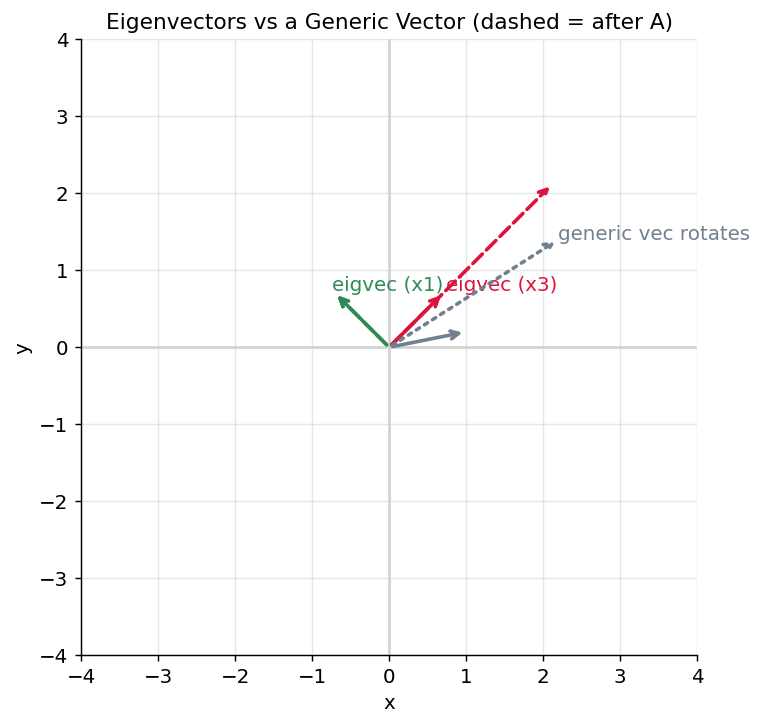

*Figure 17. Eigenvectors keep their direction under a matrix while a generic vector rotates*

### 2.2.9 Eigendecomposition

When a matrix has a full set of independent eigenvectors, it can be factored into its eigenvalues and eigenvectors — the **eigendecomposition**:

``` math
\mathbf{A} = \mathbf{V}\,\mathbf{\Lambda}\,\mathbf{V}^{- 1},
```

where the columns of $`\mathbf{V}`$ are the eigenvectors and $`\mathbf{\Lambda}`$ is a diagonal matrix of the corresponding eigenvalues. Reading this right to left, the decomposition says: any application of $`\mathbf{A}`$ is really “rotate into the eigenvector coordinate system, stretch along each axis by its eigenvalue, then rotate back.” For a **symmetric** matrix (like every covariance matrix), the eigenvectors are orthogonal and we can write $`\mathbf{A} = \mathbf{V}\mathbf{\Lambda}\mathbf{V}^{\top}`$ with $`\mathbf{V}`$ orthonormal — this is the **spectral theorem**, and it is the mathematical heart of PCA.

Eigendecomposition also makes matrix powers trivial: $`\mathbf{A}^{k} = \mathbf{V}\mathbf{\Lambda}^{k}\mathbf{V}^{- 1}`$, because the rotations cancel and only the diagonal is raised to the power. This is how the long-run behavior of Markov chains and PageRank is computed.

### 2.2.10 Singular Value Decomposition (SVD)

Eigendecomposition applies only to square matrices, but data matrices are almost never square (many more examples than features, or vice versa). The **singular value decomposition** generalizes the idea to *any* $`m \times n`$ matrix:

``` math
\mathbf{A} = \mathbf{U}\,\mathbf{\Sigma}\,\mathbf{V}^{\top},
```

where $`\mathbf{U}`$ ($`m \times m`$) and $`\mathbf{V}`$ ($`n \times n`$) are orthogonal matrices whose columns are the **left** and **right singular vectors**, and $`\mathbf{\Sigma}`$ is a rectangular diagonal matrix of non-negative **singular values** $`\sigma_{1} \geq \sigma_{2} \geq \ldots \geq 0`$. The singular values measure how much the matrix stretches space along each principal direction. SVD always exists, even for singular or non-square matrices, which makes it one of the most robust and useful tools in numerical linear algebra.

SVD powers **low-rank approximation**: keep only the largest few singular values and their vectors, and you reconstruct the best possible approximation of the original matrix using less information. This is the engine behind image compression, latent semantic analysis for text, and the matrix-factorization recommenders discussed in the chapter on Recommender Systems. It is also how PCA is computed in practice, because running SVD on the (centered) data matrix is more numerically stable than forming and eigendecomposing the covariance matrix.

``` python
A = np.array([[3.0, 1.0, 1.0],
              [-1.0, 3.0, 1.0]])   # 2 x 3, non-square
U, S, Vt = np.linalg.svd(A, full_matrices=False)
print(np.round(S, 3))              # singular values, largest first
# Reconstruct with only the top singular value: best rank-1 approximation
A1 = S[0] * np.outer(U[:, 0], Vt[0, :])
print("rank-1 error:", round(np.linalg.norm(A - A1), 3))
```

### 2.2.11 Positive Definiteness

A symmetric matrix $`\mathbf{A}`$ is **positive definite** if $`\mathbf{x}^{\top}\mathbf{A}\,\mathbf{x} > 0`$ for every nonzero vector $`\mathbf{x}`$, and **positive semi-definite** if that quantity is always $`\geq 0`$. Equivalently, a symmetric matrix is positive definite exactly when all its eigenvalues are strictly positive (semi-definite when they are all $`\geq 0`$).

Why care? Positive definiteness is the multivariable analogue of “curving upward everywhere.” The **Hessian** matrix of a function (its matrix of second derivatives, defined below) being positive definite at a point certifies that the point is a genuine minimum — the loss surface bowls upward in every direction. Covariance matrices are always positive semi-definite. And optimization methods like Newton’s method require positive definiteness to guarantee they step downhill. The bowl-shaped loss surfaces that make convex problems easy to solve are precisely those with positive-definite curvature.

``` python
A = np.array([[2.0, 1.0],
              [1.0, 2.0]])
eigvals = np.linalg.eigvalsh(A)    # eigvalsh: for symmetric matrices
print(np.round(eigvals, 3))        # [1. 3.] both positive -> positive definite
print(np.all(eigvals > 0))         # True
```

### 2.2.12 Projections

To **project** a vector $`\mathbf{b}`$ onto the direction of another vector $`\mathbf{a}`$ is to find the point along $`\mathbf{a}`$’s line that is closest to $`\mathbf{b}`$ — the “shadow” $`\mathbf{b}`$ casts on $`\mathbf{a}`$. The projection is

``` math
\text{proj}_{\mathbf{a}}(\mathbf{b}) = \frac{\mathbf{a} \cdot \mathbf{b}}{\mathbf{a} \cdot \mathbf{a}}\,\mathbf{a}.
```

Projections are the geometric meaning of **least squares**: fitting a linear model is equivalent to projecting the target vector $`\mathbf{y}`$ onto the subspace spanned by the feature columns, so that the residual (the error) is perpendicular to that subspace and therefore as small as possible. Whenever you see an $`\mathbf{X}^{\top}(\mathbf{y} - \mathbf{Xw}) = 0`$ condition in the Regression chapter, that is a projection statement in disguise: the residual is orthogonal to every feature.

``` python
a = np.array([2.0, 0.0])           # direction to project onto (the x-axis)
b = np.array([3.0, 4.0])
proj = (np.dot(a, b) / np.dot(a, a)) * a
print(proj)                        # [3. 0.] -- b's shadow on the x-axis
residual = b - proj
print(np.dot(residual, a))         # 0.0 -- residual is perpendicular to a
```

### 2.2.13 Why Machine Learning Is Vectorized

You could compute predictions for a thousand examples with a Python `for` loop. You should not. Libraries like `numpy`, and the GPUs that power deep learning, are optimized to apply one operation across an entire array at once — this is called **vectorization**. It is both dramatically faster (operations run in optimized, parallel C/CUDA code instead of the slow Python interpreter) and clearer to read.

``` python
import time
N = 1_000_000
a = np.random.rand(N)
b = np.random.rand(N)

t0 = time.time()
loop_result = 0.0
for i in range(N):                 # the slow way
    loop_result += a[i] * b[i]
t1 = time.time()

vec_result = a @ b                 # the vectorized way: one call
t2 = time.time()

print(f"loop:       {t1 - t0:.4f}s")
print(f"vectorized: {t2 - t1:.6f}s")  # typically 100x+ faster
print(np.allclose(loop_result, vec_result))  # True
```

The lesson is foundational: **express computation as operations on whole arrays**, not as element-by-element loops. Every framework in this book is built on this principle.

## 2.3 Calculus: How Models Learn

If linear algebra is how we *represent* models, calculus is how we *improve* them. Training a model means adjusting its parameters to reduce error, and calculus tells us which direction to adjust. The concept map below traces the path from a single derivative to the full machinery of gradient-based learning.

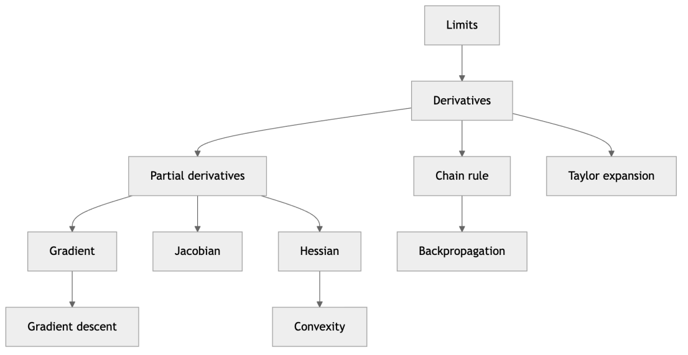

*Figure 18. A concept map of the calculus ideas that drive model training*

### 2.3.1 Limits

Calculus is built on the **limit** — the value a function approaches as its input approaches some point, even if the function is never actually evaluated there. We write $`\lim_{x \rightarrow a}f(x) = L`$ to mean “as $`x`$ gets arbitrarily close to $`a`$, $`f(x)`$ gets arbitrarily close to $`L`$.” Limits let us talk rigorously about instantaneous rates of change and about “infinitely small” steps without ever dividing by zero. Every derivative and integral is secretly a limit. In ML you rarely compute limits by hand, but the concept underlies the numerical-differentiation trick (shrink the step $`h`$ toward zero) that we use to sanity-check gradients.

### 2.3.2 Derivatives: Slope and Rate of Change

The **derivative** of a function $`f(x)`$, written $`f'(x)`$ or $`\frac{df}{dx}`$, is the slope of the function at a point: how fast the output changes as you nudge the input. Formally it is the limit of the rise over run as the run shrinks to zero:

``` math
f'(x) = \lim_{h \rightarrow 0}\frac{f(x + h) - f(x)}{h}.
```

The sign of the derivative tells you which way is “downhill.” If $`f'(x) > 0`$, the function is increasing, so to *decrease* $`f`$ you should move $`x`$ to the *left* (decrease $`x`$). This is the entire idea behind gradient descent. A few rules cover almost everything you will meet: the **power rule** $`\frac{d}{dx}x^{n} = nx^{n - 1}`$, the **sum rule** (differentiate term by term), the **product rule**, and the **chain rule** (below). We rarely compute derivatives by hand in practice — frameworks do **automatic differentiation** for us — but you must understand what they mean.

``` python
def f(x):
    return x**2 - 4*x + 5        # a parabola, minimum at x=2

def numerical_derivative(f, x, h=1e-6):
    return (f(x + h) - f(x - h)) / (2 * h)   # central difference

for x in [0.0, 2.0, 4.0]:
    print(f"x={x}: f'(x) ~ {numerical_derivative(f, x): .3f}")
# x=0.0: f'(x) ~ -4.000   (slope negative -> go right to decrease f)
# x=2.0: f'(x) ~  0.000   (flat -> at the minimum)
# x=4.0: f'(x) ~  4.000   (slope positive -> go left to decrease f)
```

### 2.3.3 Partial Derivatives and the Gradient

Real models have many parameters, so we need the derivative with respect to each one. A **partial derivative** $`\frac{\partial f}{\partial w_{i}}`$ is the derivative of a multivariable function with respect to one input while holding all the others fixed. The **gradient** $`\nabla f`$ collects all the partial derivatives into a vector — each entry says how $`f`$ changes as you nudge one parameter alone:

``` math
\nabla f(\mathbf{w}) = \left\lbrack \frac{\partial f}{\partial w_{1}},\frac{\partial f}{\partial w_{2}},\ldots,\frac{\partial f}{\partial w_{n}} \right\rbrack.
```

The crucial geometric fact: **the gradient points in the direction of steepest ascent.** So to minimize a function, we step in the *opposite* direction, $`- \nabla f`$. Imagine standing on a hilly landscape blindfolded; the gradient tells you which way is most steeply uphill, and you walk the other way to reach the valley. The *magnitude* of the gradient tells you how steep the slope is, which is why steps naturally shrink as you near a flat minimum.

**Worked example.** For $`f(w_{1},w_{2}) = w_{1}^{2} + 3w_{2}^{2}`$, the partials are $`\frac{\partial f}{\partial w_{1}} = 2w_{1}`$ and $`\frac{\partial f}{\partial w_{2}} = 6w_{2}`$, so $`\nabla f = \lbrack 2w_{1},6w_{2}\rbrack`$. At the point $`\lbrack 1,1\rbrack`$ the gradient is $`\lbrack 2,6\rbrack`$: the function rises steepest in a direction weighted more toward $`w_{2}`$, because the surface is three times as curved along that axis.

### 2.3.4 The Jacobian and the Hessian

Two matrices generalize the gradient and appear throughout deep learning and optimization.

The **Jacobian** is the matrix of first partial derivatives of a *vector-valued* function $`\mathbf{f}:\mathbb{R}^{n} \rightarrow \mathbb{R}^{m}`$. Its entry $`(i,j)`$ is $`\frac{\partial f_{i}}{\partial x_{j}}`$, so the Jacobian has shape $`m \times n`$ and describes how every output responds to every input. Each layer of a neural network is a vector-valued function, and backpropagation is really the repeated multiplication of layer Jacobians (done efficiently, without ever forming them fully).

The **Hessian** is the matrix of *second* partial derivatives of a scalar function $`f:\mathbb{R}^{n} \rightarrow \mathbb{R}`$, with entry $`(i,j)`$ equal to $`\frac{\partial^{2}f}{\partial x_{i}\partial x_{j}}`$. It captures curvature — how the gradient itself changes. The Hessian is symmetric for well-behaved functions. Its role: at a point where the gradient is zero, a **positive-definite** Hessian certifies a minimum (bowl up in all directions), a negative-definite Hessian certifies a maximum, and a Hessian with mixed-sign eigenvalues indicates a **saddle point**. Second-order optimizers such as Newton’s method use the Hessian to take smarter steps, and the condition number of the Hessian (ratio of largest to smallest eigenvalue) predicts how slowly plain gradient descent will converge on a stretched, valley-shaped loss surface.

### 2.3.5 The Chain Rule

Neural networks are deep compositions of functions: layer feeds into layer feeds into a loss. To find how the final loss depends on an early weight, we use the **chain rule**, which says the derivative of a composition is the product of derivatives:

``` math
\frac{d}{dx}f(g(x)) = f'(g(x)) \cdot g'(x).
```

The **backpropagation** algorithm — the engine of all deep learning, covered in detail in the chapter on Training Deep Networks — is nothing more than the chain rule applied systematically, multiplying local derivatives backward from the loss to every parameter.

``` python
# Chain rule example: f(x) = (3x + 1)^2, with g(x)=3x+1, f(u)=u^2
# df/dx = f'(g) * g'(x) = 2*(3x+1) * 3
def chained(x):
    return (3*x + 1)**2

def analytic_grad(x):
    return 2*(3*x + 1) * 3       # chain rule by hand

x = 2.0
print(analytic_grad(x))                              # 42.0
print(round(numerical_derivative(chained, x), 3))    # 42.000 (matches)
```

### 2.3.6 Taylor Expansion

The **Taylor expansion** approximates a smooth function near a point $`a`$ using its derivatives there. The first- and second-order versions are what optimization relies on:

``` math
f(x) \approx f(a) + f'(a)(x - a) + \frac{1}{2}f''(a)(x - a)^{2}.
```

The first-order term (a straight line through the point with the local slope) is the *linear approximation* that justifies taking a small gradient step: near the current parameters, the loss looks approximately linear, so moving against the gradient reliably decreases it. The second-order term adds curvature and is what Newton’s method uses to jump straight toward the bottom of a locally quadratic bowl. In the multivariable case the expansion becomes $`f(\mathbf{x}) \approx f(\mathbf{a}) + \nabla f(\mathbf{a})^{\top}(\mathbf{x} - \mathbf{a}) + \frac{1}{2}(\mathbf{x} - \mathbf{a})^{\top}\mathbf{H}(\mathbf{x} - \mathbf{a})`$, with the gradient playing the role of $`f'`$ and the Hessian $`\mathbf{H}`$ the role of $`f''`$.

### 2.3.7 Convexity

A function is **convex** if the line segment between any two points on its graph lies on or above the graph — intuitively, it is bowl-shaped, curving upward everywhere. Formally, $`f`$ is convex if for all $`x,y`$ and $`t \in \lbrack 0,1\rbrack`$,

``` math
f(tx + (1 - t)y) \leq tf(x) + (1 - t)f(y).
```

For a twice-differentiable function this is equivalent to $`f''(x) \geq 0`$ everywhere (or, in many dimensions, a positive-semi-definite Hessian). Convexity is a gift to optimization: **a convex function has no local minima other than the global minimum**, so gradient descent cannot get trapped. Linear regression, ridge regression, logistic regression, and linear SVMs all have convex loss functions, which is why they train reliably to the best possible solution. Deep networks are famously *non-convex* — their loss surfaces are riddled with saddle points and many local minima — which is why training them is more of an art, a theme developed in the chapter on Training Deep Networks. The figure below contrasts the two cases.

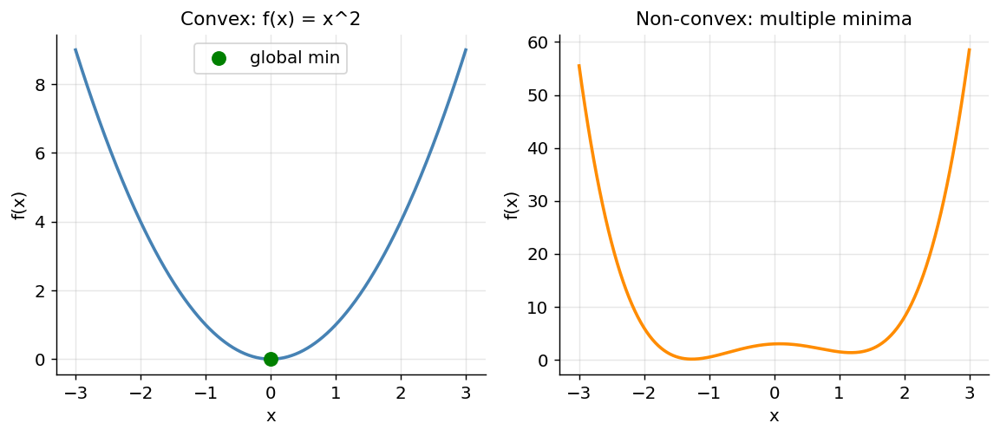

*Figure 19. A convex bowl has one global minimum; a non-convex curve has several traps*

### 2.3.8 Gradient Descent

We now assemble the pieces into the most important algorithm in machine learning. **Gradient descent** minimizes a function by repeatedly stepping in the direction of the negative gradient. The update rule for parameters $`\mathbf{w}`$ is:

``` math
\mathbf{w} \leftarrow \mathbf{w} - \eta\,\nabla J(\mathbf{w}).
```

Here $`J`$ is the **cost** (or loss) function we want to minimize and $`\eta`$ (eta) is the **learning rate**, a small positive number controlling step size. Too large and we overshoot and diverge; too small and training crawls. Choosing $`\eta`$ is one of the central practical skills of ML.

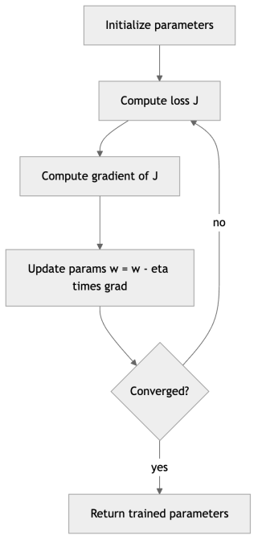

*Figure 20. The gradient descent training loop*

``` python
# Minimize f(x) = x^2 - 4x + 5 (true minimum at x = 2)
def grad(x):
    return 2*x - 4               # derivative of f

x = 8.0                          # starting guess
eta = 0.1                        # learning rate
for step in range(20):
    x = x - eta * grad(x)        # the gradient descent update
print(round(x, 4))               # ~2.0276, closing in on the true minimum 2.0
```

The figure below shows the path gradient descent takes down a parabola from a poor starting point, with each step shrinking as the slope flattens near the minimum.

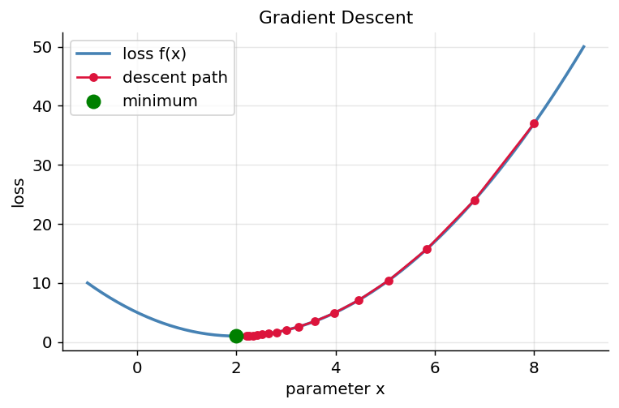

*Figure 21. Gradient descent stepping down a 1-D loss curve toward the minimum*

The same idea works in many dimensions. The figure below shows gradient descent navigating a 2-D bowl, following the negative gradient across the contour lines straight toward the center.

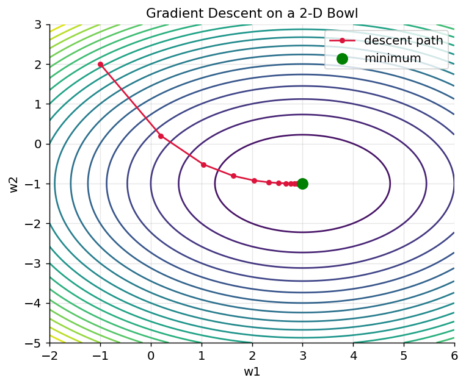

*Figure 22. Gradient descent path across the contours of a 2-D quadratic bowl*

Variants you will meet later include **stochastic gradient descent** (SGD), which estimates the gradient from one example or a small **mini-batch** at a time for speed, and adaptive optimizers like **Adam** that tune the effective learning rate per parameter. All of them are descendants of the simple rule above; the table below previews how they trade off cost and stability, a topic developed fully in the chapter on Training Deep Networks.

| Variant | Gradient computed from | Pros | Cons |
|----|----|----|----|
| Batch gradient descent | The entire dataset each step | Smooth, exact descent direction | Slow and memory-hungry on big data |
| Stochastic (SGD) | One example at a time | Fast updates, can escape shallow traps | Noisy, jittery path |
| Mini-batch | A small batch (e.g. 32-256) | Best of both; GPU-friendly | Batch size is another knob to tune |
| Momentum | Running average of gradients | Accelerates through valleys | Adds a momentum hyperparameter |
| Adam | Per-parameter adaptive rates | Robust, little tuning needed | Can generalize slightly worse than SGD |

## 2.4 Probability: Reasoning Under Uncertainty

Data is noisy and the world is uncertain. Probability is the mathematics for quantifying that uncertainty, and it underpins classification, generative models, and the entire framework of statistical learning.

### 2.4.1 Sample Spaces, Events, and Axioms

Probability begins with an experiment whose outcome is uncertain. The **sample space** $`\Omega`$ is the set of all possible outcomes (for a die, $`\{ 1,2,3,4,5,6\}`$). An **event** is any subset of the sample space (for example, “the roll is even” = $`\{ 2,4,6\}`$). A **probability** $`P`$ assigns each event a number obeying three axioms, due to Kolmogorov: every probability is between $`0`$ and $`1`$; the whole sample space has probability $`1`$ ($`P(\Omega) = 1`$); and the probability of a union of mutually exclusive events is the sum of their probabilities. Everything else in probability follows from these three rules. Two immediate consequences worth memorizing: $`P(\text{not}A) = 1 - P(A)`$, and for any two events $`P(A \cup B) = P(A) + P(B) - P(A \cap B)`$ (subtract the overlap so you do not double-count it).

### 2.4.2 Random Variables and Probability Distributions

A **random variable** is a quantity whose value depends on a random outcome — the result of a coin flip, tomorrow’s temperature, whether an email is spam. It is really a function mapping outcomes to numbers. A **probability distribution** describes how likely each possible value is.

A random variable is **discrete** if it takes countably many values (a die roll, a count of clicks); its distribution is a **probability mass function (PMF)** $`P(X = x)`$ giving the probability of each exact value, and these must sum to 1. A random variable is **continuous** if it takes values on a continuum (a height, a duration); its distribution is a **probability density function (PDF)** $`f(x)`$, where probabilities are *areas under the curve*: $`P(a \leq X \leq b) = \int_{a}^{b}f(x)\, dx`$, and the total area integrates to 1. For a continuous variable the probability of any single exact value is zero — only ranges have positive probability. The **cumulative distribution function (CDF)** $`F(x) = P(X \leq x)`$ works for both kinds and is often the most convenient handle.

We now tour the distributions you will meet most often, organized below.

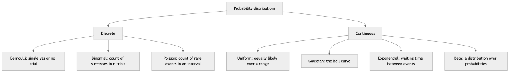

*Figure 23. The common probability distributions grouped by discrete versus continuous*

### 2.4.3 The Bernoulli Distribution

The **Bernoulli** distribution is the simplest: a single trial with two outcomes, success (1) with probability $`p`$ and failure (0) with probability $`1 - p`$. It models any yes/no event — a coin flip, a click, a positive class label. Its PMF is:

``` math
P(X = x) = p^{x}(1 - p)^{1 - x},\quad x \in \{ 0,1\}.
```

Its mean is $`p`$ and its variance is $`p(1 - p)`$ (largest at $`p = 0.5`$, where the outcome is most uncertain). A Bernoulli distribution is exactly what a binary classifier outputs: the predicted probability $`p`$ that an example belongs to the positive class.

``` python
rng = np.random.default_rng(42)
p = 0.3                                   # probability of a "1"
samples = rng.binomial(n=1, p=p, size=10_000)
print(samples.mean())                     # ~0.30, matches p
print(samples.var())                      # ~0.21, matches p(1-p)=0.21
```

### 2.4.4 The Binomial Distribution

The **binomial** distribution counts the number of successes in $`n`$ independent Bernoulli trials, each with success probability $`p`$. Its PMF is

``` math
P(X = k) = \left( \frac{n}{k} \right)p^{k}(1 - p)^{n - k},\quad k = 0,1,\ldots,n,
```

where $`\left( \frac{n}{k} \right) = \frac{n!}{k!(n - k)!}`$ is the number of ways to choose which $`k`$ of the $`n`$ trials succeed. Its mean is $`np`$ and its variance is $`np(1 - p)`$. The binomial answers questions like “if a classifier is right 80% of the time, what is the probability it gets at least 90 of the next 100 examples right?” — the foundation of significance testing for model accuracy. The figure below shows how its shape shifts with $`p`$.

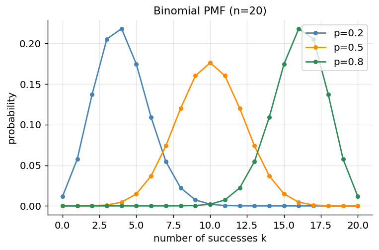

*Figure 24. Binomial PMF for n=20 trials at three different success probabilities*

### 2.4.5 The Poisson Distribution

The **Poisson** distribution models the number of times a rare event occurs in a fixed interval of time or space, given a known average rate $`\lambda`$. Its PMF is

``` math
P(X = k) = \frac{\lambda^{k}e^{- \lambda}}{k!},\quad k = 0,1,2,\ldots
```

Its mean and variance are both equal to $`\lambda`$ — a distinctive signature. It models website visits per minute, typos per page, photons hitting a sensor, or customer arrivals per hour. The Poisson is the limit of a binomial when $`n`$ is large and $`p`$ is small (many trials, each rarely succeeding), which is why it describes rare-event counts so well. It is the basis of Poisson regression for count data.

``` python
rng = np.random.default_rng(0)
lam = 3.0                                  # average events per interval
draws = rng.poisson(lam, size=100_000)
print(round(draws.mean(), 3), round(draws.var(), 3))  # ~3.0  ~3.0 (mean = var)
```

### 2.4.6 The Uniform Distribution

The **uniform** distribution spreads probability evenly. The continuous uniform on $`\lbrack a,b\rbrack`$ has constant density $`f(x) = \frac{1}{b - a}`$ for $`x \in \lbrack a,b\rbrack`$ and zero outside, with mean $`\frac{a + b}{2}`$ and variance $`\frac{(b - a)^{2}}{12}`$. It encodes “no value is more likely than any other in this range” and is the default assumption when you know only the bounds. It is also the raw material of simulation: computers generate uniform random numbers first, then transform them into every other distribution. In ML it appears as a common choice for initializing weights and as an uninformative prior.

### 2.4.7 The Gaussian (Normal) Distribution

The **Gaussian**, or **normal**, distribution is the famous bell curve and the most important continuous distribution in all of statistics. It is defined by two parameters: the mean $`\mu`$ (center) and the standard deviation $`\sigma`$ (spread). Its PDF is:

``` math
f(x) = \frac{1}{\sigma\sqrt{2\pi}}\, e^{- \frac{(x - \mu)^{2}}{2\sigma^{2}}}.
```

The Gaussian appears everywhere because of the **Central Limit Theorem** (discussed in the statistics section), which says that sums and averages of many independent random effects tend toward a normal distribution regardless of the original distribution. This is why measurement errors, heights, and countless natural quantities are approximately normal. It is also mathematically convenient: it is fully described by just two numbers, it is the maximum-entropy distribution for a given mean and variance, and its log is a simple quadratic — which is exactly why minimizing squared error corresponds to assuming Gaussian noise, a connection we make precise under maximum likelihood below.

``` python
mu, sigma = 0.0, 1.0
draws = rng.normal(mu, sigma, size=100_000)
print(round(draws.mean(), 3), round(draws.std(), 3))   # ~0.0  ~1.0

# The 68-95-99.7 rule: fraction within 1, 2, 3 std devs of the mean
for k in [1, 2, 3]:
    frac = np.mean(np.abs(draws - mu) < k * sigma)
    print(f"within {k} std: {frac:.3f}")
# within 1 std: 0.683
# within 2 std: 0.954
# within 3 std: 0.997
```

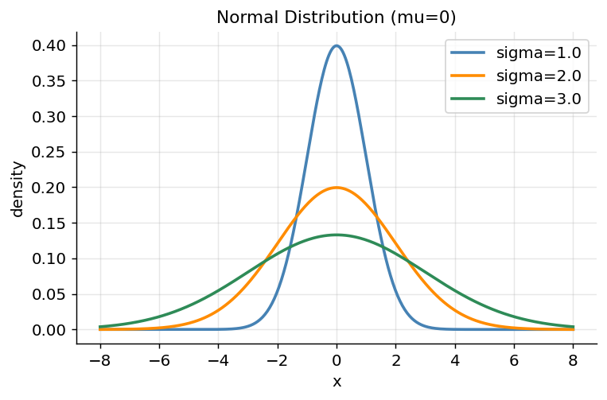

*Figure 25. Gaussian PDFs with different spreads; larger sigma means a flatter, wider bell*

### 2.4.8 The Exponential Distribution

The **exponential** distribution models the waiting time *until* the next event in a Poisson process — the flip side of the Poisson count. With rate $`\lambda`$, its PDF is

``` math
f(x) = \lambda e^{- \lambda x},\quad x \geq 0,
```

with mean $`1/\lambda`$ and variance $`1/\lambda^{2}`$. It describes times between customer arrivals, the lifetime of a component before failure, or the gap between server requests. Its defining property is **memorylessness**: the probability of waiting another minute does not depend on how long you have already waited — a fresh clock starts every instant. The figure below shows how a higher rate concentrates the waiting time near zero.

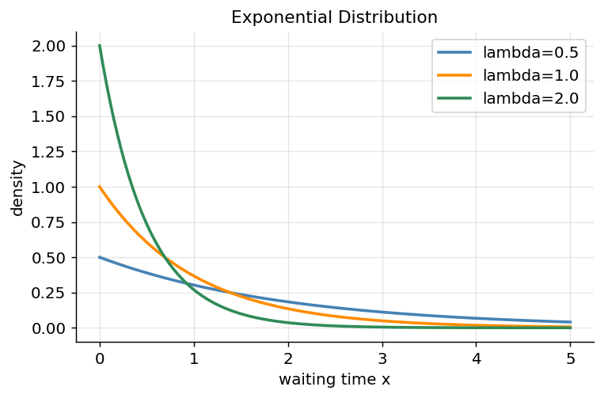

*Figure 26. Exponential PDFs; a higher rate lambda means shorter typical waiting times*

### 2.4.9 The Beta Distribution

The **Beta** distribution lives on the interval $`\lbrack 0,1\rbrack`$ and is therefore a natural distribution over *probabilities* themselves. It has two shape parameters $`\alpha`$ and $`\beta`$ and PDF proportional to $`x^{\alpha - 1}(1 - x)^{\beta - 1}`$. By tuning $`\alpha`$ and $`\beta`$ it can be flat (uniform, when $`\alpha = \beta = 1`$), bell-shaped, or piled up near either end. Its importance in ML is as the **conjugate prior** for the Bernoulli and binomial: if your prior belief about a success probability is Beta and you then observe some successes and failures, your updated (posterior) belief is again Beta, with the counts simply added to the parameters. This makes Bayesian updating of a click-through rate or a conversion probability a one-line calculation, and it is the mathematical core of Thompson sampling for multi-armed bandits. The figure below shows a few shapes.

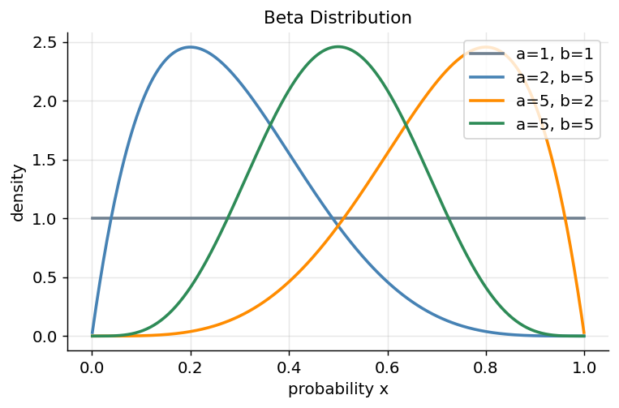

*Figure 27. Beta distribution shapes; the parameters alpha and beta bend the curve*

The table below summarizes the distributions and where you meet them.

| Distribution | Type | Parameters | Mean | Models | ML appearance |
|----|----|----|----|----|----|
| Bernoulli | Discrete | $`p`$ | $`p`$ | One yes/no trial | Binary classifier output |
| Binomial | Discrete | $`n,p`$ | $`np`$ | Successes in $`n`$ trials | Accuracy significance tests |
| Poisson | Discrete | $`\lambda`$ | $`\lambda`$ | Rare-event counts | Count regression |
| Uniform | Continuous | $`a,b`$ | $`(a + b)/2`$ | Equal likelihood on a range | Weight init, priors, sampling |
| Gaussian | Continuous | $`\mu,\sigma`$ | $`\mu`$ | Sums of many effects | Noise models, initialization |
| Exponential | Continuous | $`\lambda`$ | $`1/\lambda`$ | Waiting times | Survival, reliability |
| Beta | Continuous | $`\alpha,\beta`$ | $`\alpha/(\alpha + \beta)`$ | A probability itself | Bayesian priors, bandits |

### 2.4.10 Expectation, Variance, Covariance, and Correlation

The **expectation** (or expected value, mean) of a random variable is its long-run average, weighting each value by its probability:

``` math
\mathbb{E}\lbrack X\rbrack = \sum_{x}^{}x\, P(X = x)\quad\text{(discrete)},\quad\quad\mathbb{E}\lbrack X\rbrack = \int x\, f(x)\, dx\quad\text{(continuous)}.
```

Expectation is **linear**: $`\mathbb{E}\lbrack aX + bY\rbrack = a\,\mathbb{E}\lbrack X\rbrack + b\,\mathbb{E}\lbrack Y\rbrack`$, always, whether or not $`X`$ and $`Y`$ are independent — a fact used constantly in derivations. The **variance** measures spread as the expected squared deviation from the mean, $`Var(X) = \mathbb{E}\lbrack(X - \mathbb{E}\lbrack X\rbrack)^{2}\rbrack = \mathbb{E}\lbrack X^{2}\rbrack - (\mathbb{E}\lbrack X\rbrack)^{2}`$, and the **standard deviation** is its square root, restoring the original units.

For two variables, the **covariance** measures whether they move together:

``` math
Cov(X,Y) = \mathbb{E}\left\lbrack (X - \mathbb{E}\lbrack X\rbrack)(Y - \mathbb{E}\lbrack Y\rbrack) \right\rbrack.
```

Positive covariance means they tend to rise together, negative means one rises as the other falls. Covariance units are awkward (the product of the two variables’ units), so we normalize it into the **correlation coefficient** $`\rho = Cov(X,Y)/(\sigma_{X}\sigma_{Y})`$, which is always between $`- 1`$ and $`+ 1`$. When you have many features, all pairwise covariances are collected into the **covariance matrix**, a symmetric positive-semi-definite matrix whose eigenvectors are the principal components of the data.

**Worked example.** A fair die has $`\mathbb{E}\lbrack X\rbrack = (1 + 2 + 3 + 4 + 5 + 6)/6 = 3.5`$. Its variance is $`\mathbb{E}\lbrack X^{2}\rbrack - {3.5}^{2}`$. Since $`\mathbb{E}\lbrack X^{2}\rbrack = (1 + 4 + 9 + 16 + 25 + 36)/6 = 91/6 \approx 15.167`$, the variance is $`15.167 - 12.25 = 2.917`$.

The figure below makes covariance and correlation visual: three clouds of points with strong positive, near-zero, and strong negative correlation. The correlation coefficient is exactly the tightness-and-tilt of the cloud around a line.

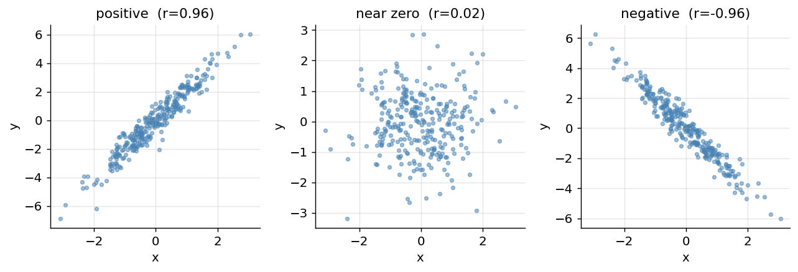

*Figure 28. Scatter clouds illustrating positive, near-zero, and negative correlation*

### 2.4.11 Joint, Marginal, and Conditional Distributions; Independence

When several random variables are in play, the **joint distribution** $`P(X,Y)`$ gives the probability of each combination of values. From it you recover the **marginal distribution** of one variable by summing (or integrating) over the others — $`P(X) = \sum_{y}^{}P(X,y)`$ — literally collapsing the joint onto one axis. The **conditional distribution** $`P(X \mid Y = y)`$ restricts attention to the slice where $`Y = y`$ and renormalizes so probabilities sum to 1.

Two variables are **independent** if knowing one tells you nothing about the other, which holds exactly when the joint factorizes: $`P(X,Y) = P(X)\, P(Y)`$ for all values. Independence is a strong and often-abused assumption — the “naive” in Naive Bayes is precisely the (usually false but useful) assumption that features are conditionally independent given the class. Note that zero correlation does *not* imply independence in general: correlation only detects *linear* relationships, so two variables can be uncorrelated yet strongly (non-linearly) dependent.

### 2.4.12 Conditional Probability and Bayes’ Theorem

**Conditional probability** $`P(A \mid B)`$ is the probability of $`A`$ given that we know $`B`$ happened. It is defined as:

``` math
P(A \mid B) = \frac{P(A \cap B)}{P(B)}.
```

From this definition follows **Bayes’ theorem**, arguably the most important equation in machine learning. It lets us *flip* a conditional probability — to compute $`P(A \mid B)`$ from $`P(B \mid A)`$:

``` math
P(A \mid B) = \frac{P(B \mid A)\, P(A)}{P(B)}.
```

In ML terms, we usually write it with hypothesis $`H`$ and evidence (data) $`D`$: the **posterior** $`P(H \mid D)`$ equals the **likelihood** $`P(D \mid H)`$ times the **prior** $`P(H)`$, divided by the **evidence** $`P(D)`$. The evidence in the denominator is computed by the **law of total probability**, summing the likelihood-times-prior over every hypothesis. Bayes’ theorem is the foundation of the Naive Bayes classifier in the chapter on Classification and of Bayesian inference more broadly.

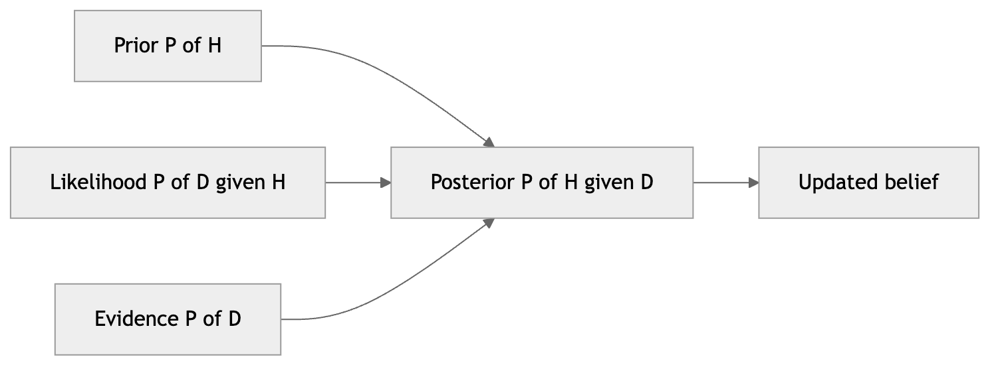

*Figure 29. The components of Bayes theorem and how belief updates with evidence*

#### 2.4.12.1 Worked Example: The Medical Test

This classic example reveals why Bayes’ theorem is so important — and why human intuition about probability so often fails. Suppose a disease affects 1% of people. A test is 99% accurate: it correctly flags 99% of sick people (true positive rate) and correctly clears 99% of healthy people. **You test positive. What is the probability you actually have the disease?** Most people guess 99%. The real answer is far lower, because the disease is rare.

Let $`H`$ = “has disease” and $`D`$ = “tests positive.”

- Prior: $`P(H) = 0.01`$, so $`P(\text{healthy}) = 0.99`$.
- Likelihood: $`P(D \mid H) = 0.99`$ (true positive), $`P(D \mid \text{healthy}) = 0.01`$ (false positive).
- Evidence: $`P(D) = P(D \mid H)P(H) + P(D \mid \text{healthy})P(\text{healthy}) = 0.99(0.01) + 0.01(0.99) = 0.0198`$.

``` math
P(H \mid D) = \frac{0.99 \times 0.01}{0.0198} = 0.5.
```

``` python
p_h = 0.01            # prior: prevalence of disease
p_d_given_h = 0.99    # true positive rate (sensitivity)
p_d_given_not = 0.01  # false positive rate

p_d = p_d_given_h * p_h + p_d_given_not * (1 - p_h)   # total prob of positive
posterior = (p_d_given_h * p_h) / p_d
print(round(posterior, 3))    # 0.5  -- only a 50% chance despite a "99% accurate" test!
```

Only a 50% chance. The lesson — that a rare condition makes false positives competitive with true positives — is exactly why **base rates** matter so much when evaluating classifiers on imbalanced data, a theme we return to in the chapter on Model Evaluation.

## 2.5 Statistics: Summarizing and Trusting Data

Probability reasons forward from a model to data; statistics reasons backward from data to a model. These are the tools for describing datasets and deciding when patterns are real.

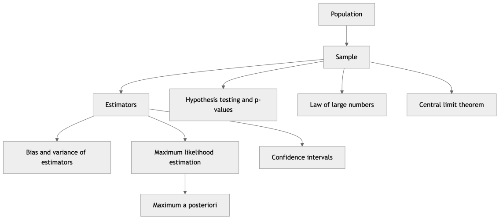

*Figure 30. A concept map of statistical inference from a sample to conclusions*

### 2.5.1 Populations versus Samples

A **population** is the entire set of items you care about — every possible email, every customer who might ever visit. A **sample** is the finite subset you actually observe. Statistics is the discipline of drawing trustworthy conclusions about the population from the sample. A quantity computed on the population (its true mean $`\mu`$, its true variance $`\sigma^{2}`$) is a **parameter**, fixed but usually unknown; the same quantity computed on a sample (the sample mean $`\bar{x}`$) is a **statistic**, which varies from sample to sample and serves as our estimate. A biased sample produces a biased model — if your training data over-represents one group, predictions for others will suffer. Almost every guarantee in ML, from a reported accuracy to a train/test split, is a statement about generalizing from sample to population.

One subtlety that trips up newcomers: to estimate the population *variance* from a sample without bias, you divide by $`n - 1`$ rather than $`n`$ (this is **Bessel’s correction**). Dividing by $`n`$ systematically underestimates the spread because the sample mean is itself fit to the data. `numpy`’s `var` uses $`n`$ by default (`ddof=0`); pass `ddof=1` for the unbiased sample variance.

### 2.5.2 Mean, Variance, and Standard Deviation

Three numbers summarize most of what you first want to know about a feature. The **mean** $`\mu`$ is the average (center). The **variance** $`\sigma^{2}`$ is the average squared distance from the mean (spread). The **standard deviation** $`\sigma`$ is the square root of the variance, putting spread back in the original units.

``` math
\mu = \frac{1}{n}\sum_{i = 1}^{n}x_{i},\quad\quad\sigma^{2} = \frac{1}{n}\sum_{i = 1}^{n}(x_{i} - \mu)^{2}.
```

``` python
data = np.array([2.0, 4.0, 4.0, 4.0, 5.0, 5.0, 7.0, 9.0])
print(data.mean())            # 5.0
print(data.var())             # 4.0  (population variance, ddof=0)
print(data.var(ddof=1))       # ~4.571 (unbiased sample variance)
print(data.std())             # 2.0
```

These statistics drive **standardization**, the preprocessing step (covered in the chapter on Data Preparation) that rescales each feature to mean 0 and standard deviation 1 — essential for algorithms sensitive to feature scale, like SVMs and neural networks.

``` python
def standardize(x):
    return (x - x.mean()) / x.std()

z = standardize(data)
print(round(z.mean(), 6), round(z.std(), 6))   # ~0.0  1.0
```

### 2.5.3 Estimators and Their Bias and Variance

An **estimator** is a rule (a function of the sample) for guessing an unknown parameter. The sample mean is an estimator of the population mean; the fitted weights of a model are estimators of the “true” relationship. Because an estimator depends on a random sample, it is itself a random variable with its own distribution across hypothetical repeated samples. We judge estimators by two properties of that distribution.

The **bias** of an estimator is how far its average value sits from the true parameter: $`Bias(\widehat{\theta}) = \mathbb{E}\lbrack\widehat{\theta}\rbrack - \theta`$. An estimator with zero bias is **unbiased** — right *on average*. The **variance** of an estimator is how much it bounces around from sample to sample. The total expected squared error decomposes cleanly:

``` math
\mathbb{E}\left\lbrack (\widehat{\theta} - \theta)^{2} \right\rbrack = \underset{\text{off-center}}{\underbrace{Bias(\widehat{\theta})^{2}}} + \underset{\text{jittery}}{\underbrace{Var(\widehat{\theta})}}.
```

This **bias-variance decomposition** is one of the most important ideas in all of machine learning. A model that is too simple is biased (it misses the true pattern no matter the data); a model that is too complex has high variance (it chases the noise, changing wildly with each new sample). Good generalization requires balancing the two — the central theme of the chapter on Model Evaluation and the reason for regularization, cross-validation, and ensembling.

### 2.5.4 Maximum Likelihood Estimation

**Maximum likelihood estimation (MLE)** is the workhorse method for fitting the parameters of a probabilistic model. The idea is disarmingly simple: choose the parameters that make the observed data most probable. Given data $`x_{1},\ldots,x_{n}`$ assumed independent, the **likelihood** is the probability of the data as a function of the parameters,

``` math
L(\theta) = \prod_{i = 1}^{n}p(x_{i} \mid \theta).
```

Because products of many small probabilities underflow and are awkward to differentiate, we maximize the **log-likelihood** instead — the log turns the product into a sum without changing where the maximum sits:

``` math
\ell(\theta) = \sum_{i = 1}^{n}\log p(x_{i} \mid \theta).
```

**Worked example: MLE for a Bernoulli / coin.** Suppose you flip a coin $`n`$ times and observe $`k`$ heads. With head-probability $`p`$, each flip contributes $`p`$ (if heads) or $`1 - p`$ (if tails), so the log-likelihood is $`\ell(p) = k\log p + (n - k)log(1 - p)`$. Differentiate and set to zero:

``` math
\frac{d\ell}{dp} = \frac{k}{p} - \frac{n - k}{1 - p} = 0\mspace{6mu} \Rightarrow \mspace{6mu} k(1 - p) = (n - k)p\mspace{6mu} \Rightarrow \mspace{6mu}\widehat{p} = \frac{k}{n}.
```

The maximum-likelihood estimate of the head-probability is simply the observed fraction of heads — reassuringly, exactly what intuition suggests. **Worked example: MLE for a Gaussian, and why squared error.** Suppose your data comes from a normal distribution with unknown mean $`\mu`$ and known variance. Plugging the Gaussian PDF into the log-likelihood and dropping constants gives $`\ell(\mu) = - \frac{1}{2\sigma^{2}}\sum_{i}^{}(x_{i} - \mu)^{2}`$. Maximizing this over $`\mu`$ is *exactly the same* as minimizing $`\sum_{i}^{}(x_{i} - \mu)^{2}`$ — the sum of squared errors. Setting the derivative to zero yields $`\widehat{\mu} = \frac{1}{n}\sum_{i}^{}x_{i}`$, the sample mean. This is the precise sense in which **least-squares regression assumes Gaussian noise**: minimizing squared error is maximum-likelihood estimation under a normal error model. The choice of loss is a statement about the noise you believe is in your data.

This same recipe, applied to more elaborate models, is how logistic regression, Gaussian mixtures, and countless other models are fit. A key connection: minimizing cross-entropy loss (below) is *identical* to maximizing the likelihood of the labels, and minimizing squared error is identical to maximum likelihood under an assumption of Gaussian noise. Almost every loss function you will minimize is a negative log-likelihood in disguise.

``` python
rng = np.random.default_rng(7)
flips = rng.binomial(1, 0.7, size=200)      # true p = 0.7
k, n = flips.sum(), flips.size
p_mle = k / n                               # closed-form MLE
print(round(p_mle, 3))                      # ~0.70, recovers the true value

# Verify by scanning the log-likelihood surface
ps = np.linspace(0.01, 0.99, 99)
loglik = k * np.log(ps) + (n - k) * np.log(1 - ps)
print(round(ps[np.argmax(loglik)], 3))      # ~0.70, the peak of the curve
```

### 2.5.5 Maximum a Posteriori (MAP)

MLE uses only the data. **Maximum a posteriori (MAP)** estimation adds a **prior** belief about the parameters and maximizes the *posterior* $`p(\theta \mid \text{data}) \propto p(\text{data} \mid \theta)\, p(\theta)`$ — likelihood times prior, straight from Bayes’ theorem. Taking logs, MAP maximizes $`\ell(\theta) + logp(\theta)`$: the data term plus a term that pulls the estimate toward what the prior considers plausible.

This is not a mere philosophical refinement; MAP *is* regularization. A Gaussian prior on the weights (favoring small values) adds a squared-magnitude penalty, which is exactly **L2 / ridge regularization**; a Laplace prior gives the absolute-value penalty of **L1 / lasso**. So the regularization you will apply throughout the book to fight overfitting is, formally, MAP estimation with a prior encoding “keep the weights modest.” When data is scarce the prior matters a lot and MAP differs sharply from MLE; as data grows the likelihood dominates and the two converge.

### 2.5.6 The Law of Large Numbers and the Central Limit Theorem

Two theorems justify why sampling works at all.

The **law of large numbers (LLN)** says that as the sample size grows, the sample mean converges to the true population mean. Average enough independent draws and the noise averages out — this is why more data gives more reliable estimates and why Monte Carlo simulation works.

The **Central Limit Theorem (CLT)** goes further and describes the *shape* of the estimate’s uncertainty: the sample mean of many independent draws is approximately **normally distributed** around the true mean, *regardless of the shape of the original distribution*, with standard deviation (the **standard error**) equal to $`\sigma/\sqrt{n}`$. This is remarkable — even a wildly skewed population yields bell-shaped sample means — and it is what lets us put Gaussian-based confidence intervals and p-values on almost any average. The $`\sqrt{n}`$ in the denominator also explains why halving your error requires *quadrupling* your data. The figure below demonstrates the CLT: sample means of a heavily skewed exponential population pile up into a bell.

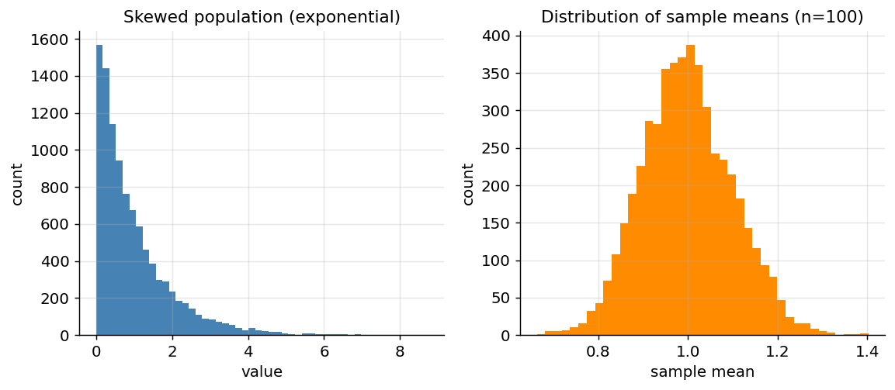

*Figure 31. The Central Limit Theorem in action; means of a skewed population look Gaussian*

### 2.5.7 Confidence Intervals

A single number estimate is fragile; a **confidence interval** reports a *range* of plausible values along with a confidence level. A 95% confidence interval is constructed by a procedure that, across many hypothetical repeated samples, would contain the true parameter 95% of the time. Using the CLT, an approximate 95% interval for a mean is

``` math
\bar{x} \pm 1.96 \cdot \frac{s}{\sqrt{n}},
```

where $`s`$ is the sample standard deviation and $`1.96`$ is the number of standard errors that captures the central 95% of a normal distribution. The interval widens with more variability and narrows with more data. A crucial subtlety: the 95% refers to the *procedure*, not to any single interval — a particular computed interval either does or does not contain the truth, and it is wrong to say “there is a 95% probability the parameter lies in this specific interval.” Reporting intervals rather than bare point estimates is a hallmark of honest empirical work, including when you report model accuracy.

``` python
rng = np.random.default_rng(3)
sample = rng.normal(loc=50, scale=10, size=200)
xbar = sample.mean()
se = sample.std(ddof=1) / np.sqrt(sample.size)      # standard error
lo, hi = xbar - 1.96 * se, xbar + 1.96 * se
print(round(xbar, 2), (round(lo, 2), round(hi, 2)))  # ~50, interval brackets 50
```

### 2.5.8 Hypothesis Testing and p-values

When you observe a pattern — say, model B beats model A on a test set — you want to know: *could this just be luck?* Hypothesis testing formalizes the question. You state a **null hypothesis** $`H_{0}`$, the “nothing-is-happening” baseline (e.g., “the two models are equally good”), and an alternative. You then compute a **test statistic** from the data and ask how surprising it would be under the null.

The **p-value** is the probability of seeing data *at least as extreme* as what you observed *if the null hypothesis were true*. A small p-value (conventionally below the **significance level** $`\alpha = 0.05`$) means your observation would be surprising under the null, so you reject it — the result is called *statistically significant*. A large p-value means the data is consistent with mere chance and you fail to reject the null.

Critical cautions, because p-values are among the most misused quantities in science:

- A p-value is **not** the probability that the null hypothesis is true, nor the probability your result happened by chance. It is a statement about data assuming the null.
- **Statistical significance is not practical importance.** With enough data, a trivially small, meaningless effect becomes “significant.”
- Testing many hypotheses inflates false positives (the **multiple-comparisons** problem); running 20 tests at $`\alpha = 0.05`$ yields about one spurious “discovery” on average.
- Two error types matter: a **Type I error** is a false positive (rejecting a true null), controlled by $`\alpha`$; a **Type II error** is a false negative (missing a real effect), related to statistical **power**.

Treat p-values as one piece of evidence, reported alongside effect sizes and confidence intervals, never as a verdict.

| Concept | Question it answers | ML use |
|----|----|----|
| Mean / variance | Where is the data centered and how spread out? | Standardization, feature scaling |
| Correlation | Do two variables move together? | Feature selection, detecting redundancy |
| Estimator bias/variance | Is my estimate off-center or jittery? | The bias-variance tradeoff, model complexity |
| MLE / MAP | Which parameters best explain the data? | Fitting nearly every parametric model, regularization |
| Sampling / CLT / LLN | How reliable is an estimate from a sample? | Confidence in metrics, train/test splits |
| Confidence interval | What is the plausible range of the estimate? | Reporting metrics honestly |
| p-value | Could this result be due to chance? | Comparing models, A/B tests |

### 2.5.9 Correlation versus Causation

**Correlation** measures how two variables move together, on a scale from $`- 1`$ (perfect inverse) through $`0`$ (no linear relationship) to $`+ 1`$ (perfect direct). The **Pearson correlation coefficient** is the covariance normalized by the product of the standard deviations:

``` math
r = \frac{\sum_{i}^{}(x_{i} - \bar{x})(y_{i} - \bar{y})}{\sqrt{\sum_{i}^{}(x_{i} - \bar{x})^{2}}\,\sqrt{\sum_{i}^{}(y_{i} - \bar{y})^{2}}}.
```

The cardinal rule: **correlation does not imply causation.** Ice cream sales correlate with drowning deaths, but neither causes the other — hot weather (a *confounder*) drives both. Models learn correlations effortlessly; establishing causation requires controlled experiments or careful causal inference. Confusing the two is one of the most common and costly mistakes in applied ML, a point we revisit in the chapter on Responsible AI.

``` python
rng = np.random.default_rng(0)
x = rng.normal(size=500)
y = 2 * x + rng.normal(scale=0.5, size=500)    # y strongly depends on x
z = rng.normal(size=500)                         # z is unrelated to x

print(round(np.corrcoef(x, y)[0, 1], 3))   # ~0.97  strong positive correlation
print(round(np.corrcoef(x, z)[0, 1], 3))   # ~0.01  essentially no correlation
```

## 2.6 Information Theory: Measuring Surprise

Information theory, founded by Claude Shannon, quantifies *uncertainty* and *information*. Several of its quantities — entropy, cross-entropy, KL divergence, and mutual information — become loss functions and feature-selection criteria throughout ML, so they deserve a place in your foundations.

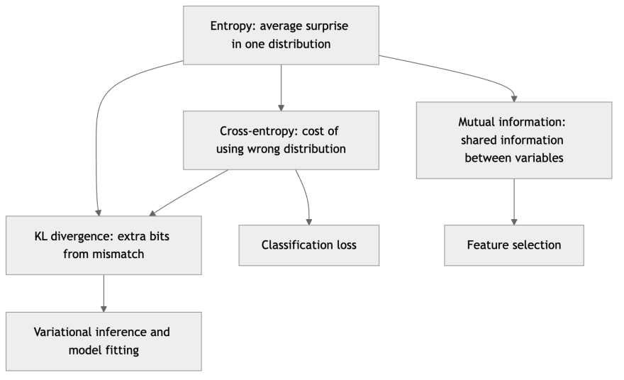

*Figure 32. How the information-theoretic quantities relate and where they are used*

### 2.6.1 Entropy

**Entropy** $`H`$ measures the average uncertainty, or “surprise,” in a probability distribution. A fair coin (50/50) is maximally uncertain; a biased coin that almost always lands heads is nearly predictable, so it has low entropy. For a discrete distribution with probabilities $`p_{i}`$, entropy (in bits, using $`\log_{2}`$) is:

``` math
H(p) = - \sum_{i}^{}p_{i}\log_{2}p_{i}.
```

The intuition: rare events ($`p_{i}`$ small) carry more information when they occur (the $`- logp_{i}`$ term is large), but they occur rarely (weighted by $`p_{i}`$). Entropy is the expected information content. It also drives the **information gain** criterion used to split nodes in decision trees, covered in the chapter on Decision Trees.

``` python
def entropy(p):
    p = np.asarray(p)
    p = p[p > 0]                      # avoid log(0)
    return -np.sum(p * np.log2(p))

print(round(entropy([0.5, 0.5]), 3))        # 1.000 bit  (max uncertainty, fair coin)
print(round(entropy([0.9, 0.1]), 3))        # 0.469 bits (biased coin, less surprise)
print(round(entropy([1.0]), 3))             # 0.000 bits (certain outcome, no surprise)
```

### 2.6.2 Cross-Entropy and Classification Loss

**Cross-entropy** measures the difference between two distributions: the *true* distribution $`p`$ (the correct labels) and a *predicted* distribution $`q`$ (the model’s output probabilities). It quantifies how many extra bits you waste, on average, when you encode outcomes using the wrong distribution $`q`$ instead of the true $`p`$:

``` math
H(p,q) = - \sum_{i}^{}p_{i}\log q_{i}.
```

This is precisely the **cross-entropy loss** (also called log loss) that nearly every classifier minimizes. For a binary problem with true label $`y \in \{ 0,1\}`$ and predicted probability $`\widehat{y}`$, it simplifies to the **binary cross-entropy**:

``` math
J = - \left\lbrack \, y\log\widehat{y} + (1 - y)log(1 - \widehat{y})\, \right\rbrack.
```

Why this loss? It heavily punishes a model that is *confidently wrong* — predicting $`\widehat{y} = 0.01`$ when the truth is $`y = 1`$ sends $`\log\widehat{y}`$ to a large negative value, producing a huge loss. That steep penalty for arrogant errors is exactly the training signal we want. And as noted under MLE, minimizing cross-entropy is identical to maximizing the likelihood of the labels — the loss is not arbitrary but the negative log-likelihood of a Bernoulli model.

``` python
def binary_cross_entropy(y_true, y_pred):
    eps = 1e-12                                   # clip to avoid log(0)
    y_pred = np.clip(y_pred, eps, 1 - eps)
    return -(y_true * np.log(y_pred) + (1 - y_true) * np.log(1 - y_pred))

print(round(binary_cross_entropy(1, 0.99), 4))   # 0.0101  confident & correct -> tiny loss
print(round(binary_cross_entropy(1, 0.50), 4))   # 0.6931  unsure              -> moderate loss
print(round(binary_cross_entropy(1, 0.01), 4))   # 4.6052  confident & WRONG   -> huge loss
```

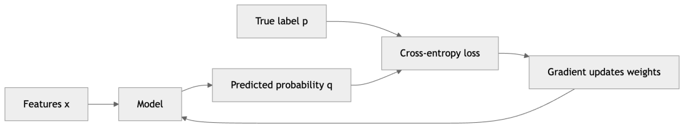

*Figure 33. How a classifier output is scored by cross-entropy loss during training*

### 2.6.3 KL Divergence

The **Kullback-Leibler (KL) divergence** measures how far a predicted distribution $`q`$ is from a true distribution $`p`$ — the extra bits wasted by using $`q`$, above the irreducible minimum:

``` math
D_{KL}(p\, \parallel \, q) = \sum_{i}^{}p_{i}\log\frac{p_{i}}{q_{i}} = H(p,q) - H(p).
```

That last identity is illuminating: **cross-entropy equals entropy plus KL divergence.** Since the entropy $`H(p)`$ of the true labels is fixed, minimizing cross-entropy loss is exactly minimizing the KL divergence between the true and predicted distributions — you are driving the model’s beliefs toward the truth. KL divergence is always $`\geq 0`$, and zero only when $`p = q`$, but it is **not symmetric**: $`D_{KL}(p \parallel q) \neq D_{KL}(q \parallel p)`$, so it is a divergence, not a true distance. It is the central objective in variational autoencoders, in variational inference, and in the regularization term of many generative models.

``` python
def kl_divergence(p, q):
    p, q = np.asarray(p), np.asarray(q)
    mask = p > 0
    return np.sum(p[mask] * np.log2(p[mask] / q[mask]))

p = [0.5, 0.5]
print(round(kl_divergence(p, [0.5, 0.5]), 3))   # 0.000  identical -> no divergence
print(round(kl_divergence(p, [0.9, 0.1]), 3))   # 0.737  q is far from p
print(round(kl_divergence(p, [0.6, 0.4]), 3))   # 0.029  q is close to p
```

### 2.6.4 Mutual Information

**Mutual information** $`I(X;Y)`$ measures how much knowing one variable reduces uncertainty about another — the amount of information they share:

``` math
I(X;Y) = \sum_{x,y}^{}P(x,y)log\frac{P(x,y)}{P(x)P(y)} = D_{KL}\left( P(x,y)\, \parallel \, P(x)P(y) \right).
```

It is zero exactly when $`X`$ and $`Y`$ are independent (the joint equals the product of marginals) and grows as they become more dependent. Unlike correlation, mutual information captures *any* kind of relationship, linear or not, which makes it a powerful **feature-selection** criterion: rank candidate features by how much information each shares with the target and keep the most informative. It also appears in the information-bottleneck view of deep learning and in the objectives of some representation-learning methods.

### 2.6.5 The Math in the Wild: Three Case Studies

To see how these threads weave together, consider three systems you likely used today. A **search or recommendation engine** represents every document and query as a vector (linear algebra), compares them with cosine similarity built from the dot product, and factorizes a giant user-item matrix with SVD to surface latent tastes. A **medical-imaging classifier** passes an image tensor through layers of matrix multiplications, is trained by gradient descent using the chain rule, minimizes a cross-entropy loss that is the negative log-likelihood of the labels, and reports its accuracy with a confidence interval whose width the Central Limit Theorem determines. A **fraud-detection model** confronts extreme class imbalance, so its designers lean on Bayes’ theorem and base-rate reasoning to interpret a flagged transaction, choose a threshold using information-theoretic and statistical criteria, and validate improvements with hypothesis tests rather than eyeballing a single number. None of these systems uses exotic mathematics — each is the handful of ideas in this chapter, combined.

## 2.7 Optimization: Finding the Best Parameters

Training a model is an optimization problem: adjust parameters to make an **objective function** as good as possible. Gradient descent, introduced under calculus, is the dominant method, but it helps to see the broader landscape.

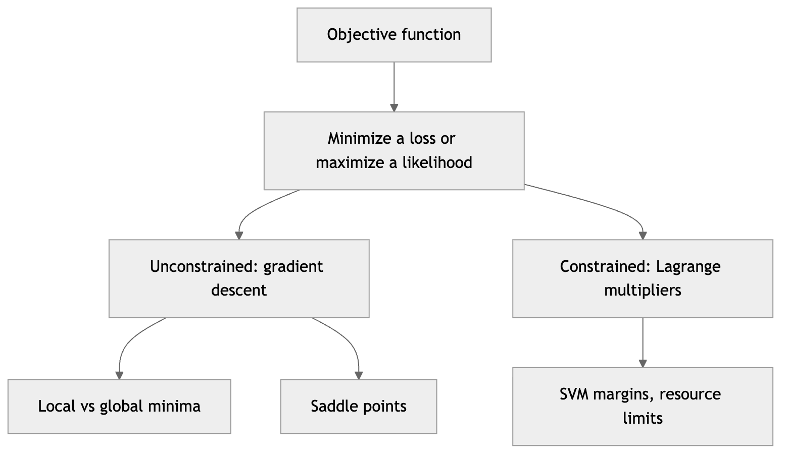

*Figure 34. The vocabulary of optimization problems in machine learning*

### 2.7.1 Objective Functions, Minima, and Maxima

An **objective function** (also cost, loss, or — when we maximize — utility or likelihood) maps parameters to a single number measuring how good they are. By convention we usually *minimize* a loss; maximizing a function $`f`$ is the same as minimizing $`- f`$, so the two are interchangeable. A point where the gradient is zero is a **critical point** (or stationary point). Critical points come in three flavors, distinguished by the curvature (the Hessian): a **local minimum** (bowl up in every direction, positive-definite Hessian), a **local maximum** (bowl down everywhere), and a **saddle point** (up in some directions, down in others). The **global minimum** is the lowest point anywhere.

For convex objectives every local minimum is global, so finding a zero-gradient point solves the problem. For the non-convex objectives of deep learning, the surface is dominated not by bad local minima but by vast numbers of saddle points and flat regions — which is why momentum and adaptive optimizers, which help escape flat saddles, matter so much in the chapter on Training Deep Networks.

### 2.7.2 Gradient Descent Intuition, Revisited

Gradient descent works because the negative gradient is the locally steepest-downhill direction (from the first-order Taylor expansion). The learning rate sets how far to trust that local linear approximation before recomputing. Practical pathologies follow directly from the math: on a stretched, valley-shaped surface (an ill-conditioned Hessian) plain gradient descent zig-zags slowly, motivating momentum; near a saddle the gradient nearly vanishes and progress stalls; and too large a learning rate can send the parameters uphill and diverge. Everything you will tune in a training loop — learning rate, momentum, batch size, schedules — is a response to the geometry described in this chapter.

### 2.7.3 Constrained Optimization and Lagrange Multipliers

Sometimes we must optimize subject to a **constraint** — minimize a loss while keeping the parameters on a surface or within a budget. The method of **Lagrange multipliers** handles equality constraints elegantly. To minimize $`f(\mathbf{x})`$ subject to $`g(\mathbf{x}) = 0`$, form the **Lagrangian**

``` math
\mathcal{L}(\mathbf{x},\lambda) = f(\mathbf{x}) - \lambda\, g(\mathbf{x}),
```

and set its gradient (with respect to both $`\mathbf{x}`$ and the multiplier $`\lambda`$) to zero. The condition $`\nabla f = \lambda\nabla g`$ captures the geometric insight that at the constrained optimum, the objective’s gradient is parallel to the constraint’s gradient — you cannot improve $`f`$ without leaving the constraint surface. The multiplier $`\lambda`$ also has meaning: it measures how much the optimum would improve if the constraint were relaxed slightly (its “shadow price”).

Constrained optimization is not a side topic in ML. The **Support Vector Machine** is derived exactly this way — maximizing the margin subject to correct-classification constraints, using the generalization to inequality constraints (the Karush-Kuhn-Tucker conditions), as developed in the chapter on Support Vector Machines. Regularization can also be read as constrained optimization: L2 regularization is equivalent to minimizing the loss subject to a budget on $`\parallel \mathbf{w} \parallel_{2}`$, which is why it shrinks weights toward zero.

## 2.8 Summary

This chapter assembled the mathematical toolkit that the rest of the book assumes. **Linear algebra** gave us the objects (scalars, vectors, matrices, tensors) and operations (dot products, matrix multiplication, norms) that represent data and models, plus the deeper structure — rank, determinant, inverse, eigenvalues and eigenvectors, eigendecomposition, SVD, positive definiteness, and projections — that powers dimensionality reduction, recommender systems, and least-squares fitting. **Calculus** explained how models learn: derivatives and gradients point downhill, the chain rule powers backpropagation, the Jacobian and Hessian describe first- and second-order behavior, Taylor expansions justify taking steps, and convexity determines whether optimization is easy or fraught. **Probability** built the language of uncertainty, from sample spaces and random variables through the key distributions (Bernoulli, binomial, Poisson, uniform, Gaussian, exponential, Beta), expectation and variance, joint/marginal/conditional relationships, independence, and Bayes’ theorem, whose medical-test example showed how badly intuition fails on base rates. **Statistics** turned data back into knowledge: populations versus samples, estimators and the pivotal bias-variance decomposition, maximum likelihood and its Bayesian cousin MAP (which is exactly regularization), confidence intervals, hypothesis testing and the much-abused p-value, and the twin guarantees of the law of large numbers and the Central Limit Theorem. **Information theory** supplied entropy, cross-entropy, KL divergence, and mutual information — the principled origins of classification losses and feature-selection criteria. And **optimization** framed training as minimizing an objective, with gradient descent for the unconstrained case and Lagrange multipliers for the constrained case that underlies SVMs.

You will not need to hold all of this in your head at once. The goal is recognition: when a later chapter says “minimize the cross-entropy,” “take the gradient,” “project onto the principal components,” or “the estimator is biased,” you now know precisely what those words mean and why they are the right tools.

## 2.9 Key Takeaways

- **Everything is arrays.** Represent data and computation as vectorized operations on whole arrays, never as Python loops; the dot product and matrix multiplication are the two operations you will use most.
- **Shapes are truth.** Most practical ML bugs are shape mismatches. Print shapes constantly.
- **The gradient points uphill; descend against it.** Gradient descent, $`\mathbf{w} \leftarrow \mathbf{w} - \eta\nabla J`$, is the universal training algorithm, and the learning rate governs everything about its behavior.
- **Eigenvectors and SVD reveal hidden structure.** The eigenvectors of a covariance matrix are the directions of maximum variance (PCA), and SVD gives the best low-rank approximation of any matrix — the basis of compression and recommendation.
- **Bayes’ theorem flips conditionals, and base rates dominate.** A “99% accurate” test for a 1%-prevalent disease is right only 50% of the time when positive.
- **Almost every loss is a negative log-likelihood.** Maximum likelihood unifies model fitting; MAP adds a prior and *is* regularization; squared error assumes Gaussian noise and cross-entropy assumes Bernoulli labels.
- **Trust estimates with humility.** The bias-variance decomposition explains overfitting, the CLT and LLN say why more data helps (and only as $`\sqrt{n}`$), confidence intervals report ranges, and p-values are evidence, not verdicts.
- **Cross-entropy = entropy + KL divergence.** Minimizing classification loss is driving the model’s distribution toward the truth; mutual information generalizes correlation to any relationship.
- **Convexity decides difficulty.** Convex losses (linear/logistic regression, linear SVM) train to the global optimum; the non-convex surfaces of deep networks are full of saddle points, which is why advanced optimizers exist.

## 2.10 Exercises

1.  **(Conceptual)** Explain in your own words why the gradient points in the direction of steepest *ascent* and why gradient descent therefore subtracts it. What happens to training if the learning rate $`\eta`$ is set far too large? Relate your answer to the first-order Taylor expansion.

2.  **(Conceptual)** A spam filter is “98% accurate.” Only 2% of incoming email is actually spam. Using Bayes’ theorem reasoning, explain qualitatively why an email flagged as spam might still have a low probability of truly being spam. Which quantity drives this counterintuitive result?

3.  **(Conceptual)** State the bias-variance decomposition of an estimator’s expected squared error and explain, using it, why a very flexible model can generalize worse than a simpler one even though it fits the training data better.

4.  **(Coding)** Write a `numpy` function `manual_matmul(A, B)` that multiplies two matrices using explicit loops, then verify it matches `A @ B` on random $`3 \times 4`$ and $`4 \times 2`$ matrices with `np.allclose`. Time both versions on $`200 \times 200`$ matrices and report the speedup.

5.  **(Coding)** Compute the eigenvalues and eigenvectors of $`\mathbf{A} = \begin{pmatrix}
    4 & 1 \\
    2 & 3
    \end{pmatrix}`$ with `np.linalg.eig`. Verify $`\mathbf{Av} = \lambda\mathbf{v}`$ for each eigenpair, and confirm that reconstructing $`\mathbf{V}\mathbf{\Lambda}\mathbf{V}^{- 1}`$ returns the original matrix.

6.  **(Coding)** Implement gradient descent to minimize $`f(w_{1},w_{2}) = (w_{1} - 3)^{2} + (w_{2} + 1)^{2}`$. Use the analytic gradient $`\nabla f = \lbrack 2(w_{1} - 3),\, 2(w_{2} + 1)\rbrack`$, start from $`\lbrack 0,0\rbrack`$, and run 50 steps with $`\eta = 0.1`$. Confirm the parameters converge to $`\lbrack 3, - 1\rbrack`$. Then try $`\eta = 1.1`$ and describe what happens.

7.  **(Coding)** Draw 5,000 samples from a Bernoulli distribution with $`p = 0.7`$ using `numpy`, and empirically estimate its mean and variance. Compare them to the theoretical values $`p`$ and $`p(1 - p)`$. Then derive the maximum-likelihood estimate of $`p`$ from your sample and confirm it matches the sample mean.

8.  **(Coding)** Demonstrate the Central Limit Theorem: draw many samples of size $`n = 30`$ from a uniform distribution on $`\lbrack 0,1\rbrack`$, compute each sample’s mean, and histogram the means. Verify the histogram is approximately bell-shaped and that its standard deviation is close to $`\sigma/\sqrt{n}`$ where $`\sigma = 1/\sqrt{12}`$.

9.  **(Coding/Conceptual)** Compute the binary cross-entropy loss for predicted probabilities $`\widehat{y} \in \{ 0.1,0.3,0.5,0.7,0.9\}`$ when the true label is $`y = 1`$. Plot loss versus $`\widehat{y}`$ and explain, in terms of “punishing confident mistakes,” why the curve has the shape it does. Then compute the KL divergence between $`p = \lbrack 1,0\rbrack`$ and each predicted distribution $`\lbrack\widehat{y},1 - \widehat{y}\rbrack`$ and relate it to the cross-entropy values.

10. **(Conceptual)** The method of Lagrange multipliers finds a point where $`\nabla f = \lambda\nabla g`$. Draw or describe the geometry of a circular constraint and elliptical objective contours, and explain why the optimum occurs where the contour is tangent to the constraint. Name one ML algorithm whose derivation uses this idea.

---

[← 1 Introduction to Artificial Intelligence and Machine Learning](ch01-introduction.md) · [Contents](../README.md#contents) · [3 The Machine Learning Workflow and Data Preparation →](ch03-ml-workflow.md)
