[← 2 Mathematical and Statistical Foundations](ch02-math-foundations.md) · [Contents](../README.md#contents) · [4 Python Tooling for Machine Learning →](ch04-python-tooling.md)

---

# 3 The Machine Learning Workflow and Data Preparation

Most newcomers imagine that machine learning is mostly about choosing a clever algorithm. In practice, a working data scientist spends the majority of their time somewhere else entirely: understanding the problem, wrangling messy data, and building a disciplined process that produces honest results. A mediocre algorithm fed clean, well-prepared data routinely beats a state-of-the-art model fed garbage. This chapter teaches the *workflow* — the repeatable lifecycle that turns a vague business question into a deployed, monitored model — and then drills deep into the phases where projects are actually won or lost: framing, data understanding, data preparation, honest evaluation, and the disciplined loop that carries a model from prototype to production and keeps it healthy afterward. By the end you will know how to frame a problem, inspect and clean data, encode and scale features, engineer signal, split data without fooling yourself, detect and prevent leakage, choose a baseline, iterate deliberately, perform error analysis, and think clearly about deployment, monitoring, and reproducibility.

The earlier chapter on Mathematical and Statistical Foundations gave you the vocabulary of vectors, distributions, and gradients; this chapter is where that vocabulary first meets real, imperfect data. The detailed treatment of evaluation metrics and cross-validation theory belongs to the chapter on Supervised Learning and Model Evaluation, so here we focus on the *mechanics* of the workflow — how the pieces fit together, in what order, and where the traps lie — while pointing forward to the chapters that develop each algorithm in depth.

A single idea runs through everything that follows. Machine learning is an exercise in *generalization*: you want a system that performs well on data it has never seen. Every rule in this chapter — split before you preprocess, fit transforms on training data only, respect time, hold out a test set for a single final measurement — is a corollary of that one goal. Keep it in mind and the rules will feel less like arbitrary ritual and more like the natural consequences they are.

## 3.1 The End-to-End Machine Learning Lifecycle

A machine learning project is not a straight line; it is a loop with a loop inside it. The outer loop is the project lifecycle — from framing a problem to deploying and monitoring a model. The inner loop is the iterative experimentation you do while modeling: train, evaluate, tune, repeat. Understanding the full shape of the process keeps you from the two classic failure modes: jumping straight to modeling before you understand the data, and shipping a model without any plan to watch it degrade.

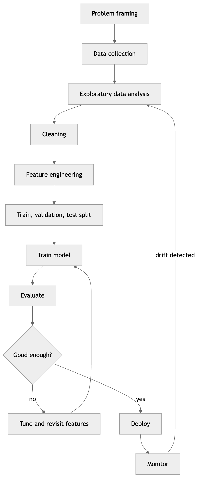

*Figure 35. The end-to-end machine learning lifecycle, an outer loop with an inner experimentation loop.*

Let us walk the stages at a glance; each gets a full section of its own later in the chapter.

**Problem framing.** Before any data is touched, you translate a human question into a machine learning task. This fixes the target, the unit of prediction, and the success metric — and asks whether ML is even the right tool.

**Data collection.** You gather the raw material: database extracts, logs, third-party APIs, sensor feeds, labeled images. The key discipline is *provenance* — knowing where each column came from and, for supervised learning, how labels were assigned.

**Exploratory data analysis (EDA).** You look at the data before modeling it: distributions, correlations, missingness, obvious errors, class balance. EDA is where you build intuition and catch disasters early.

**Cleaning.** You fix the problems EDA revealed: missing values, outliers, duplicates, inconsistent categories (“NY” vs “New York” vs “new york”), wrong types.

**Feature engineering.** You transform raw columns into informative inputs: encoding categoricals, scaling numerics, creating ratios and date parts, selecting the features that matter.

**Split.** You partition the data into training, validation, and test sets *before* fitting anything that learns from the data. This ordering is not optional; getting it wrong is the most common cause of inflated, dishonest results.

**Train, evaluate, tune.** The inner loop. You fit a model on training data, measure it on validation data, adjust hyperparameters or features, and repeat — touching the test set only once, at the very end.

**Deploy.** You wrap the trained model in a service, batch job, or embedded artifact so it can score new data. (The chapter on MLOps covers this in depth.)

**Monitor.** You watch live performance and input distributions. When the world shifts — a phenomenon called *data drift* or *concept drift* — performance decays and you loop back with fresh data.

A practical rule of thumb, repeatedly confirmed across the industry: roughly 60–80% of project effort lands in collection, EDA, cleaning, and feature engineering. The modeling everyone romanticizes is the small bright tip of a large iceberg.

### 3.1.1 CRISP-DM and Other Lifecycle Models

The loop above is our working model, but it is worth knowing the named frameworks that formalize the same ideas, because you will encounter them in industry documents and job descriptions. The most enduring is **CRISP-DM** (Cross-Industry Standard Process for Data Mining), published in 1999 and still the most widely used process model for data projects. It defines six phases arranged as a cycle, with feedback arrows that let you jump backward whenever a later phase reveals a flaw in an earlier one.

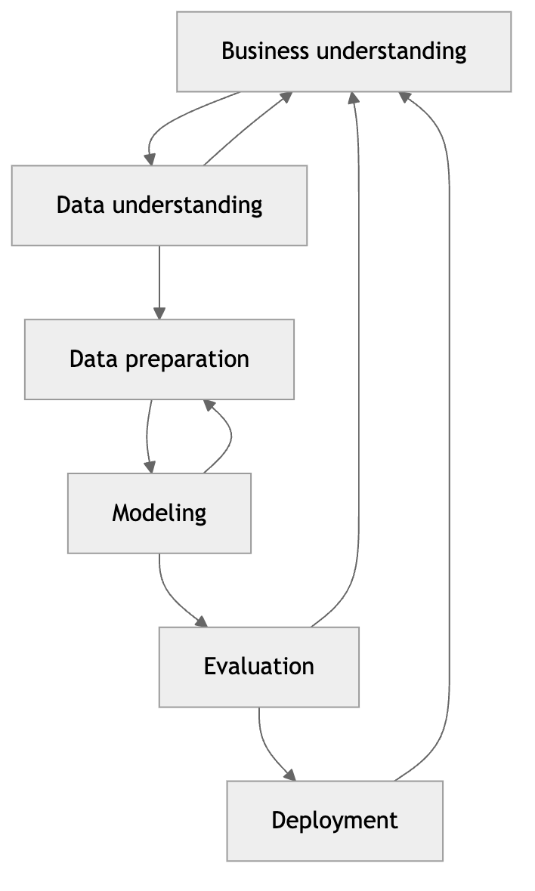

*Figure 36. The six phases of CRISP-DM, a cyclic process with feedback between adjacent phases.*

- **Business understanding.** Define objectives and success criteria in business terms, assess the situation and resources, and produce a project plan. This is where you decide whether the problem is worth solving and what “solved” means.
- **Data understanding.** Collect initial data, describe and explore it, and verify its quality. This overlaps with our EDA stage. The two-way arrow with business understanding is deliberate: what you find in the data often reshapes the objective.
- **Data preparation.** Select, clean, construct, integrate, and format the data. CRISP-DM notes this is typically the most time-consuming phase — consistent with the 60–80% rule above.
- **Modeling.** Select techniques, design a test, build models, and assess them. The two-way arrow with data preparation captures the reality that modeling reveals new preparation needs (a model may demand scaled inputs or a differently encoded feature).
- **Evaluation.** Assess whether the model meets the *business* objectives, not just the statistical ones. A model with excellent accuracy that cannot be deployed within the latency budget has failed evaluation.
- **Deployment.** Plan deployment and monitoring, produce a final report, and review the project. Deployment loops back to business understanding for the next iteration.

Several successor and complementary frameworks are worth naming. **SEMMA** (Sample, Explore, Modify, Model, Assess), from SAS, is narrower and modeling-centric — it assumes the business framing is already done. **TDSP** (Team Data Science Process), from Microsoft, extends CRISP-DM with modern software engineering: version control, defined team roles, and a standardized project structure. **ML Ops lifecycle** models (from cloud vendors and the MLOps community) add the operational realities CRISP-DM barely touched in 1999 — continuous integration and delivery of models, automated retraining, feature stores, and production monitoring. The lesson across all of them is the same: real projects are cyclic, business-anchored, and dominated by data work. Pick a framework as shared vocabulary for your team; do not treat any of them as a rigid waterfall.

| Framework | Origin | Emphasis | Notable addition |
|----|----|----|----|
| CRISP-DM | Cross-industry, 1999 | General data mining lifecycle | Business framing, cyclic feedback |
| SEMMA | SAS | Modeling mechanics | Structured sampling and assessment |
| TDSP | Microsoft | Team engineering discipline | Roles, git, project templates |
| MLOps lifecycle | Cloud/DevOps community | Production operations | CI/CD, retraining, monitoring |

## 3.2 Problem Framing: From Business Goal to ML Objective

The most expensive mistakes in machine learning are made before a single model is trained. They are framing mistakes: solving the wrong problem, optimizing the wrong metric, or predicting something that is either unavailable at decision time or useless once predicted. Framing is the act of translating a fuzzy human goal into a precise, measurable, feasible learning task.

Start with the **business objective** in plain language, then interrogate it. “We want to reduce customer churn” is a goal, not a task. Converting it into an ML objective forces four decisions:

1.  **The target — what you predict.** “Predict, for each active customer, the probability they will cancel within the next 30 days.” This is a binary classification problem with a probability output. Note how specific this is compared to the original sentence: it names the outcome (cancel), the horizon (30 days), and the output type (probability).
2.  **The unit of prediction.** Per customer? Per subscription? Per account? A household with three subscriptions is one churn decision or three, and the answer changes how you build labels and how the business acts on the score.
3.  **The decision the prediction feeds.** A churn score is worthless unless someone does something with it — a retention offer, a phone call, a discount. Framing must connect the prediction to an action and its cost. If the only lever is a \$50 retention coupon, you care about ranking the customers most likely to churn *and* most likely to be swayed, not about calibrated probabilities across the whole base.
4.  **The success metric.** How will you know it worked? An offline metric (ROC-AUC, precision at the top 5%) is a proxy; the real metric is a business outcome (net retained revenue after coupon cost). The chapter on Model Evaluation covers offline metrics in depth; framing’s job is to choose the offline metric that best tracks the business outcome and to state the target performance up front.

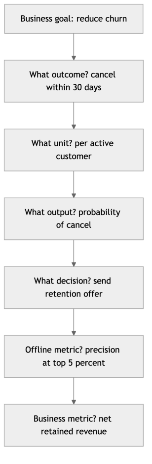

*Figure 37. Translating a business goal into a concrete, measurable machine learning task.*

Framing also decides the *learning paradigm*. Is this supervised (you have labeled outcomes), unsupervised (you seek structure without labels), or reinforcement (you learn a policy from rewards)? Within supervised learning, is it classification (discrete label), regression (continuous value), or ranking (relative order)? These distinctions, developed in the chapters on Supervised and Unsupervised Learning, are settled during framing, not discovered during modeling.

Two more framing disciplines separate professionals from amateurs.

**Ask whether ML is the right tool at all.** Machine learning earns its complexity when the mapping from inputs to outputs is genuinely hard to specify by hand, the pattern is stable enough to learn, and you have (or can get) representative data. If a three-line SQL rule — “flag any transaction over \$10,000 from a new account” — solves 95% of the problem, use the rule. ML adds latency, opacity, maintenance burden, and failure modes; it should buy you enough accuracy to be worth all of that.

**Define the feasibility envelope.** What data is available at prediction time, with what latency, at what cost, with what freshness? A feature that requires a slow third-party API call may be predictive but unusable in a system that must respond in 50 milliseconds. A label that takes 90 days to observe (did the loan default?) constrains how quickly you can retrain. Framing that ignores these operational realities produces models that work in the notebook and die in production.

The output of good framing is a short, written **project charter**: the business goal, the ML task and paradigm, the target and unit, the features available at decision time, the offline and business metrics, the target performance, and the constraints. Everything downstream refers back to it.

## 3.3 Data Collection and Sources

With the problem framed, you gather raw material. Where data comes from shapes everything about how you must treat it.

**Internal operational databases.** Transactional systems (orders, users, events) are the richest source for most business ML. They are usually clean-ish and well-typed but were designed for operations, not analysis — you will join across many tables and reconstruct history. Beware that operational systems *overwrite* state: a customer’s current address tells you nothing about where they lived when they made a purchase two years ago. If you train on today’s snapshot to predict a past event, you have committed temporal leakage before you have written a line of modeling code.

**Event logs and clickstreams.** High-volume, append-only records of user behavior. Enormous signal, enormous noise, and enormous volume. Sessionization, bot filtering, and careful timestamp handling dominate the work.

**Third-party and purchased data.** Enrichment sources (demographics, credit scores, weather, firmographics). Watch licensing terms, freshness, coverage gaps, and — critically — whether you will have the same data at prediction time in production, at acceptable latency and cost.

**Public and open datasets.** Government statistics, academic benchmarks, open data portals. Useful for prototyping and benchmarking; rarely a perfect match for your specific decision.

**Sensor and IoT feeds.** Continuous numeric streams with missing readings, drift, and calibration issues. Time alignment across sensors is the central challenge.

**Human-labeled data.** For supervised learning you often must *create* labels — human annotators, crowdsourcing, or programmatic labeling. Label quality caps model quality: a classifier can never be more accurate than its labels are consistent. Track inter-annotator agreement, write a labeling guide, and treat ambiguous cases explicitly rather than letting each annotator guess.

Two collection disciplines deserve emphasis. First, **provenance**: for every column, record where it came from, how it was computed, its units, and its refresh cadence. This metadata is what lets you audit for leakage later. Second, **representativeness**: the data you train on must resemble the data you will predict on. A fraud model trained only on transactions that a *previous* rules system flagged has never seen the fraud that slipped past those rules — a subtle and severe **selection bias**. Ask constantly: what population does this sample actually represent, and does it match the population at decision time?

Sample size also matters. A useful heuristic is that you want enough examples of the *rarest thing you care about* — the minority class, the rare failure mode — not merely a large row count. A million-row dataset with 40 fraud cases is a small dataset for the purpose of learning fraud.

## 3.4 Knowing Your Data: Data Types

Every preparation decision flows from the *type* of each variable, and “type” here means something richer than a programming language’s `int` or `str`. It means the *measurement semantics* — what operations are meaningful on the values. This maps onto the classic levels of measurement: **nominal** (labels, no order), **ordinal** (ordered, unequal or unknown spacing), **interval** (ordered, equal spacing, no true zero — like temperature in Celsius), and **ratio** (equal spacing with a true zero, so ratios are meaningful — like income or count).

| Data type | Description | Examples | Typical handling |
|----|----|----|----|
| Numeric (continuous) | Real-valued measurements; arithmetic is meaningful | height, price, temperature | scaling, binning, transforms |
| Numeric (discrete) | Integer counts | number of logins, items in cart | scaling, or treat as is |
| Categorical (nominal) | Unordered labels | country, color, device type | one-hot or target encoding |
| Ordinal | Ordered categories with no fixed spacing | “low/medium/high”, star rating | ordinal encoding that preserves order |
| Text | Free-form natural language | reviews, support tickets | tokenization, embeddings |
| Image | Pixel grids | photos, scans | normalization, CNNs |
| Time series | Values indexed by time, with temporal order | stock prices, sensor logs | lag features, time-aware splits |
| Geospatial | Coordinates or regions | lat/long, ZIP, polygons | distance features, spatial joins |

The most consequential distinction for beginners is **nominal vs ordinal**. Encoding the ordinal variable “satisfaction” as low=0, medium=1, high=2 is correct because the order carries information. Encoding the nominal variable “country” as France=0, Germany=1, Japan=2 secretly tells the model that Japan is “greater than” France and that Germany is the midpoint — a fabricated, harmful ordering. The encoding section below shows the right tool for each.

Beware **types in disguise**. A ZIP code stored as an integer is nominal, not numeric — the arithmetic mean of two ZIP codes is meaningless. A phone number, a product ID, a year-as-category: all integers that must not be treated as quantities. Conversely, a rating stored as the string “3 stars” is really ordinal numeric. Reading the schema is not enough; you must read the *meaning*.

Text, image, and time series each deserve their own treatment and get it in later chapters (Sequence Models, Convolutional Neural Networks, and the natural language chapters). Here we concentrate on tabular numeric, categorical, and ordinal data, which dominate classical ML and underpin everything else.

## 3.5 Exploratory Data Analysis

EDA is the deliberate act of understanding a dataset before you model it. Its purpose is threefold: build intuition about the relationships in the data, surface data-quality problems while they are still cheap to fix, and generate hypotheses about which features will matter. Skipping EDA is how people end up training on a target that is 99% one class, or on a “future” timestamp, or on a column that is 90% null — and only discovering it after weeks of modeling.

Work through EDA in layers, from single variables outward to relationships.

**Univariate analysis — one variable at a time.** For each numeric column, compute the five-number summary (min, Q1, median, Q3, max), the mean, and the standard deviation, and look at a histogram. You are looking for the *shape* (symmetric, skewed, bimodal), the *spread*, and *anomalies* (a spike at zero that really means “missing,” a physically impossible negative age, a suspicious cluster at exactly 999). For each categorical column, tabulate the value counts and the cardinality (number of distinct values). High cardinality flags an encoding decision ahead; a category that appears once flags a potential typo or a rare class to bucket.

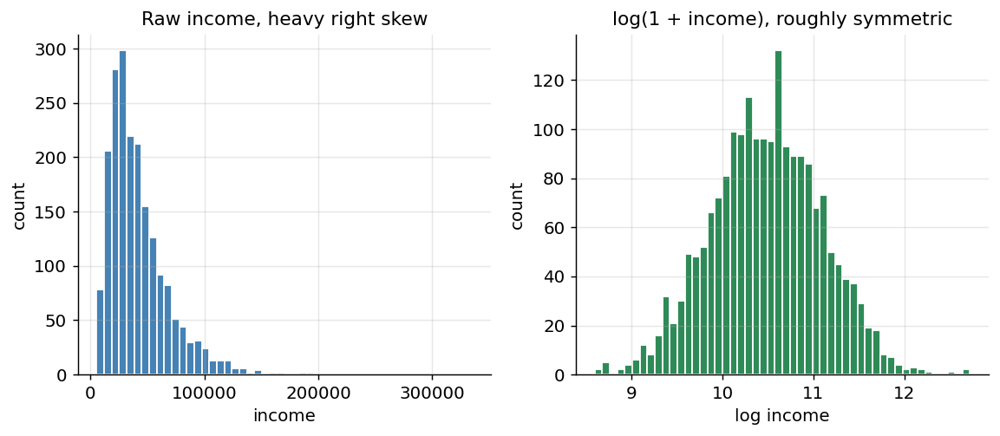

*Figure 38. A univariate EDA panel: a right-skewed distribution shown as a histogram, and the same data after a log transform reveals near-normality.*

**Missingness analysis.** Compute the fraction missing per column and, crucially, look for *patterns* in missingness. Are the same rows missing across several columns (a broken join)? Does missingness correlate with the target (a strong signal, and a warning about the MNAR mechanism discussed below)? A missingness heatmap — rows on one axis, columns on the other, a mark where values are absent — often reveals structure invisible in per-column percentages.

**Target analysis.** Look hard at the thing you are predicting. For classification, examine the **class balance**: a 99/1 split changes your metric choice, your validation strategy, and possibly your whole approach. For regression, examine the target’s distribution and consider whether a transform (log for skewed targets) is warranted. Check for impossible or sentinel target values.

**Bivariate and multivariate analysis — relationships.** Now look at how variables relate to each other and to the target. For numeric–numeric, scatter plots and the **correlation matrix** reveal linear associations and, importantly, *redundancy*: two features correlated at 0.98 carry nearly the same information, and one may be droppable. For categorical–target, grouped bar charts of the target rate per category expose which categories are predictive. For numeric–target in classification, overlaid histograms or box plots by class show separability.

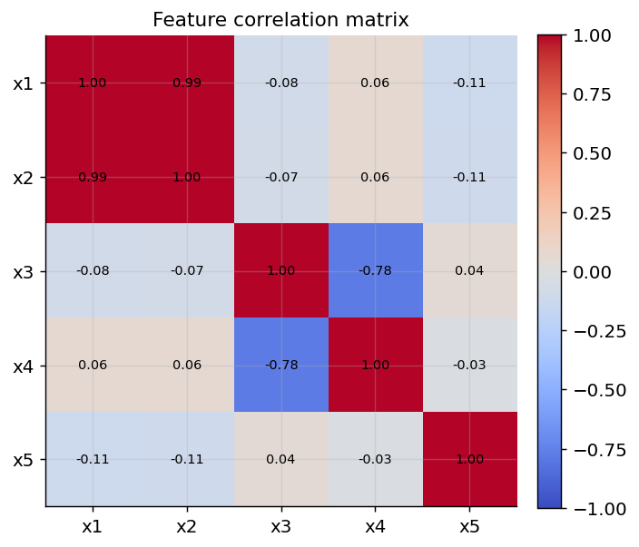

*Figure 39. A correlation heatmap of five synthetic features; strong off-diagonal color flags redundant, highly correlated features.*

A caution about EDA and leakage: EDA is *exploration*, and it is easy to let it become *decision-making on the full dataset*. Looking at distributions and correlations to build intuition is fine. But if you select features, choose transforms, or tune thresholds based on relationships you measured over the *entire* dataset including what will become your test set, you have quietly leaked information. The clean discipline is to do serious, decision-affecting EDA on the training split, or to treat EDA findings as hypotheses that the split-then-fit pipeline will validate honestly. When a dataset is large, some practitioners set aside the test set *before* EDA and never look at it — a strong form of the same discipline.

Here is a compact EDA starter in pandas that covers the essentials on a new dataset.

``` python
import pandas as pd

df = pd.read_csv("data.csv")

print(df.shape)                       # rows, columns
print(df.dtypes)                      # types in disguise? IDs stored as int?
print(df.describe(include="all").T)   # summary stats for numeric + categorical
print(df.isna().mean().sort_values(ascending=False))   # fraction missing per column
print(df["target"].value_counts(normalize=True))       # class balance

# Cardinality of object columns
for c in df.select_dtypes("object"):
    print(c, df[c].nunique())

# Correlations among numeric features (spot redundancy)
print(df.select_dtypes("number").corr()["target"].sort_values())
```

## 3.6 Cleaning: Missing Data, Outliers, Duplicates, and Types

### 3.6.1 Missing Data

Missing values are not all alike, and the right fix depends on *why* the value is missing. Statisticians distinguish three mechanisms:

- **MCAR** (Missing Completely At Random): the missingness is unrelated to anything — a sensor randomly dropped a reading. Dropping or imputing is relatively safe.
- **MAR** (Missing At Random): missingness depends on *other observed* variables — older users skip the “income” field more often, but you can see their age. Conditional imputation works.
- **MNAR** (Missing Not At Random): missingness depends on the *unobserved value itself* — high earners refuse to report income. This is the dangerous case; the fact of missingness is itself information, and you should often add a “was missing” indicator column.

The practical toolkit:

| Strategy | When to use | Caution |
|----|----|----|
| Drop rows | Few rows affected, MCAR | Throws away data; biases results if not MCAR |
| Drop column | Column is mostly missing (\>50–70%) | May discard a useful signal |
| Mean/median imputation | Numeric, roughly MCAR/MAR | Median resists outliers; both shrink variance |
| Mode imputation | Categorical | Over-represents the majority category |
| Constant / “Unknown” | Categorical where absence is meaningful | Creates a distinct category the model can use |
| Model-based (KNN, iterative) | MAR with informative predictors | Slower; risk of leakage if done before split |
| Add “missing” indicator | MNAR or when missingness is signal | Adds a column; combine with imputation |

Two subtleties matter. First, imputation **shrinks variance** and distorts relationships: filling 20% of a column with its mean creates an artificial spike at the mean and weakens correlations. Adding a binary “was missing” indicator alongside the imputed value lets the model recover the information that the value was absent — often more valuable than the imputed number itself. Second, the cardinal rule: **fit imputation on the training set only.** If you compute the median over the entire dataset and then split, the training rows have “seen” information from the test rows, leaking statistics across the boundary. We enforce this automatically with pipelines, shown later.

### 3.6.2 Outliers

An outlier is a value far from the bulk of the data. Outliers are not automatically errors — a genuine billionaire in an income dataset is a real, important data point — so the first question is always “is this a data error or a real extreme value?” Two common detection methods follow.

The **z-score** flags points whose standardized distance from the mean exceeds a threshold (commonly 3):

``` math
z_{i} = \frac{x_{i} - \mu}{\sigma},\quad\quad\text{flag if}|z_{i}| > 3.
```

The z-score assumes roughly normal data and is itself sensitive to outliers (they inflate $`\sigma`$). The **interquartile range (IQR)** method is more robust. With $`Q_{1}`$ and $`Q_{3}`$ the 25th and 75th percentiles and $`\text{IQR} = Q_{3} - Q_{1}`$, a point is an outlier if

``` math
x_{i} < Q_{1} - 1.5\,\text{IQR}\quad\text{or}\quad x_{i} > Q_{3} + 1.5\,\text{IQR}.
```

Worked example. Suppose a small feature has sorted values with $`Q_{1} = 20`$ and $`Q_{3} = 40`$, so $`\text{IQR} = 20`$. The fences are $`20 - 1.5 \times 20 = - 10`$ and $`40 + 1.5 \times 20 = 70`$. A value of 95 lies above the upper fence and is flagged; a value of 68 is not. Notice the fences depend only on quartiles, so a single monstrous value cannot move them the way it would move the mean and standard deviation — that robustness is the whole point.

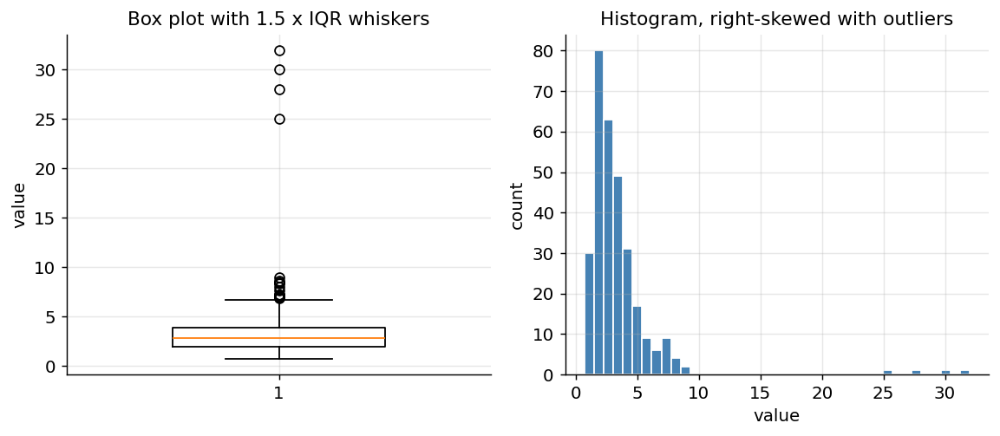

*Figure 40. A box plot and histogram of a right-skewed distribution with injected outliers; the box plot whiskers mark the 1.5 x IQR fences.*

Once detected, options are: **remove** (if a confirmed error), **cap/winsorize** (clip to a percentile, e.g. the 1st and 99th), **transform** (a log transform pulls in a long right tail), or **keep and use a robust model** (tree-based models barely care about outliers; linear models and distance-based models care a great deal). The choice is a judgment call driven by the earlier question: error or signal? Deleting real extreme values because they are inconvenient is a form of quietly lying to your model about the world it will face.

### 3.6.3 Duplicates

Duplicate rows quietly corrupt results: they over-weight repeated examples during training and, worse, can place copies of the same record on both sides of a train/test split, inflating your scores. Always check for and usually drop exact duplicates. Be careful with *near*-duplicates and with legitimately repeated records — two different customers can share an age and a city without being the same row. De-duplicate on a meaningful key, not blindly on every column.

### 3.6.4 Types and Consistency

The quiet cleaning work is fixing types and normalizing categories. Numbers stored as strings (“1,234”), dates stored as text in three different formats, booleans encoded as “Y”/“N”/“yes”/“1”, and categories with inconsistent capitalization and whitespace (“NY”, “ny”, ” NY “,”New York”) all sabotage downstream steps. Coerce numeric columns, parse dates into real datetime types, standardize category spellings, and strip whitespace. Decide on a canonical representation for each concept and map everything to it.

``` python
import pandas as pd

df = pd.DataFrame({
    "id":     [1, 2, 2, 3, 4],
    "age":    [34, 51, 51, None, 29],
    "city":   ["NY", "LA", "LA", "SF", "ny"],
    "spend":  ["1,200", "980", "980", "3,000", "540"],
})

# Inspect
print(df.isna().sum())            # missing per column: age -> 1
print(df.duplicated().sum())      # exact duplicate rows -> 1

# Clean
df = df.drop_duplicates()                              # remove the repeated id=2 row
df["city"] = df["city"].str.strip().str.upper()        # normalize "ny" -> "NY"
df["spend"] = df["spend"].str.replace(",", "").astype(float)  # "1,200" -> 1200.0
df["age"] = df["age"].fillna(df["age"].median())       # impute (demo only; do this in a pipeline)
print(df)
```

## 3.7 Feature Engineering

Feature engineering is the craft of turning raw columns into representations that expose the signal to the model. It is where domain knowledge pays off most, and it remains, for tabular data, the single highest-leverage activity in the workflow — more so than model choice. This section develops the major techniques in turn.

### 3.7.1 Scaling and Normalization

Many algorithms are sensitive to the *scale* of features. Consider a dataset with `age` (0–100) and `income` (0–500,000). Any method based on Euclidean distance — k-nearest neighbors, k-means, RBF-kernel SVMs — will be dominated almost entirely by income, because a difference of a few thousand dollars dwarfs the entire range of age. Gradient-descent optimizers also converge slowly when features have wildly different scales, because the loss surface becomes a long, narrow valley. Regularization (L1/L2) penalizes coefficients, so it implicitly assumes features are comparably scaled, or it penalizes the large-scale feature’s coefficient unfairly.

The two workhorse transforms follow.

**Standardization (z-score scaling)** centers each feature to mean 0 and scales to unit variance:

``` math
x' = \frac{x - \mu}{\sigma}.
```

It does not bound the output range and handles roughly Gaussian data well. It is the safe default for linear models, SVMs, and neural networks.

**Normalization (min-max scaling)** rescales each feature to a fixed range, usually $`\lbrack 0,1\rbrack`$:

``` math
x' = \frac{x - x_{\min}}{x_{\max} - x_{\min}}.
```

It preserves the shape of the distribution and bounds the range, which is handy for some neural network inputs and image pixels, but it is highly sensitive to outliers — a single extreme value squashes everything else toward zero. When outliers are present, **robust scaling** (subtract the median, divide by the IQR) is a sturdier choice. For heavily skewed features, a **power or log transform** applied before scaling often does more good than any scaler alone.

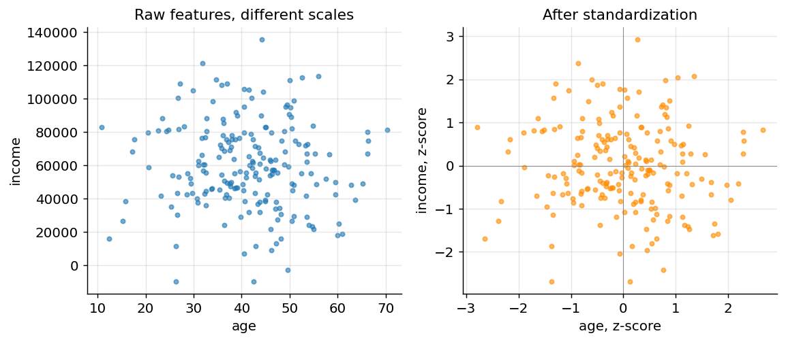

*Figure 41. The same two-feature data before scaling and after standardization; standardizing makes both features comparable.*

Which models need scaling? A quick guide: scaling is **essential** for k-NN, k-means, SVM, PCA, and neural networks; it **helps** linear/logistic regression (especially with regularization) and speeds gradient descent; it is **unnecessary** for decision trees, random forests, and gradient-boosted trees, which split on thresholds and are invariant to monotonic rescaling.

Like imputation, scalers must be **fit on the training set only.** The scaler learns $`\mu`$ and $`\sigma`$ from training data and then *applies* those same numbers to the validation and test data. Fitting on all the data leaks test-set statistics into training.

### 3.7.2 Encoding Categorical Variables

Models consume numbers, so every categorical column must become numeric. The choice of encoding is one of the highest-leverage decisions in feature engineering.

**Label / ordinal encoding** maps each category to an integer. This is *correct for ordinal data* because the integers preserve the order. Applying it to nominal data injects a fake ordering, which misleads linear and distance-based models (though tree-based models can tolerate it because they split on thresholds rather than assuming linear spacing).

**One-hot encoding** creates one binary column per category. It makes no ordering assumption and is the default for nominal variables. Its cost is dimensionality: a column with 10,000 distinct values (high *cardinality*, like ZIP codes) explodes into 10,000 columns. To control this, drop one column to avoid the *dummy-variable trap* (perfect collinearity), group rare categories into an “other” bucket, or switch encoders.

**Target (mean) encoding** replaces each category with a statistic of the target for that category — for example, the average churn rate among customers in each country. It keeps dimensionality at one column and shines for high-cardinality features, but it is *extremely* prone to leakage: if you compute the per-category target mean using rows that later serve as training labels, the feature has peeked at the answer. The defenses are to compute it with out-of-fold schemes and to *smooth* toward the global mean for rare categories:

``` math
\text{enc}(c) = \frac{n_{c}\,{\bar{y}}_{c} + m\,\bar{y}}{n_{c} + m}
```

where $`{\bar{y}}_{c}`$ is the target mean within category $`c`$, $`n_{c}`$ its count, $`\bar{y}`$ the global mean, and $`m`$ a smoothing strength. Rare categories (small $`n_{c}`$) are pulled toward the safe global average. Worked example: with a global churn rate $`\bar{y} = 0.10`$, a category with $`n_{c} = 4`$ customers of whom 3 churned has raw mean $`{\bar{y}}_{c} = 0.75`$, which is almost certainly overfit to four people. With smoothing $`m = 10`$, the encoded value is $`(4 \times 0.75 + 10 \times 0.10)/(4 + 10) = (3 + 1)/14 \approx 0.29`$ — pulled sharply toward the global rate, exactly because four observations cannot support a confident 0.75.

Other encoders worth knowing: **frequency encoding** replaces a category with its count or frequency (cheap, sometimes surprisingly useful); **hashing** (the “hashing trick”) maps categories into a fixed number of columns via a hash function, bounding dimensionality at the cost of collisions; and **binary encoding**, a compromise between label and one-hot that represents each category’s integer in base-2 across a few columns.

| Encoder | Best for | Output width | Main risk |
|----|----|----|----|
| Label/Ordinal | Ordinal data; tree models | 1 column | Fake order on nominal data |
| One-hot | Low-cardinality nominal | k columns | Dimensionality blow-up |
| Target/Mean | High-cardinality nominal | 1 column | Target leakage if naive |
| Frequency | High-cardinality, tree models | 1 column | Conflates different categories with equal counts |
| Hashing | Very high-cardinality, streaming | fixed d columns | Hash collisions merge categories |

``` python
import pandas as pd
from sklearn.preprocessing import OneHotEncoder, OrdinalEncoder

df = pd.DataFrame({
    "size":   ["small", "large", "medium", "small"],   # ordinal
    "color":  ["red", "blue", "green", "blue"],         # nominal
})

# Ordinal: declare the order explicitly so small < medium < large
ord_enc = OrdinalEncoder(categories=[["small", "medium", "large"]])
print(ord_enc.fit_transform(df[["size"]]).ravel())   # [0. 2. 1. 0.]

# One-hot for the nominal color; handle_unknown protects against unseen categories at predict time
oh = OneHotEncoder(sparse_output=False, handle_unknown="ignore")
print(oh.fit_transform(df[["color"]]))
print(oh.get_feature_names_out())   # ['color_blue' 'color_green' 'color_red']
```

### 3.7.3 Binning (Discretization)

**Binning** converts a continuous variable into discrete bands — turning `age` into “18–25”, “26–40”, “41–65”, “65+”. It can help simple linear models capture non-linear effects (each band gets its own coefficient) and can tame the influence of outliers, at the cost of discarding fine-grained information within each band. Bins can be **equal-width** (fixed value ranges), **equal-frequency** (quantile bins, each holding the same number of rows), or **domain-driven** (legal age thresholds, income brackets). Equal-frequency binning is robust to skew; equal-width is easier to interpret but can leave nearly-empty bins in the tails. Tree-based models effectively bin on their own by choosing split thresholds, so explicit binning helps them less.

### 3.7.4 Interaction and Polynomial Features

Linear models see each feature in isolation; they cannot, on their own, learn that a high value of A matters *only when* B is also high. **Interaction features** — products like `price * quantity` or `is_weekend * hour` — hand the model those combinations explicitly. **Polynomial features** extend this by adding powers ($`x^{2}`$, $`x^{3}`$) and cross-terms, letting a linear model fit curved relationships. The danger is combinatorial explosion and overfitting: degree-3 polynomials over 20 features produce thousands of columns, most of them noise. Use interactions guided by domain knowledge rather than blindly expanding, and pair polynomial features with regularization.

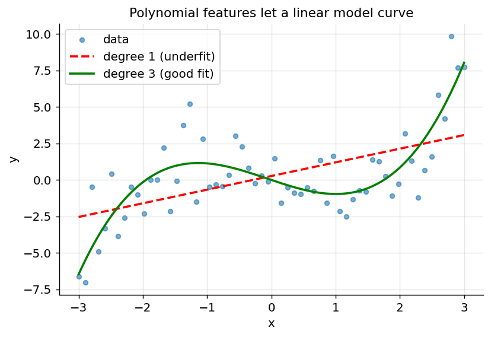

*Figure 42. A linear fit versus a degree-3 polynomial fit on curved data; polynomial features let a linear model bend.*

### 3.7.5 Datetime, Text, and Image Features

**Datetime.** A raw timestamp is nearly useless to a tree; decompose it into year, month, day-of-month, day-of-week, hour, is-weekend, and is-holiday. Cyclical features (hour, month, day-of-week) are often encoded with sine and cosine so that the wrap-around is respected — hour 23 sits next to hour 0 rather than 23 units away:

``` math
x_{\sin} = sin\left( \frac{2\pi h}{24} \right),\quad\quad x_{\cos} = cos\left( \frac{2\pi h}{24} \right).
```

Elapsed-time features (“days since last purchase,” “account age in days”) are frequently among the most predictive features in behavioral models.

**Text.** Free text becomes numeric through tokenization and vectorization. The classic tabular-friendly representations are **bag-of-words** counts and **TF-IDF** (term frequency times inverse document frequency), which up-weights words that are frequent in a document but rare across the corpus. Simple engineered text features — length, word count, punctuation counts, presence of keywords — are cheap and often useful. Modern embeddings from pretrained language models capture semantics far better and are developed in the natural language chapters.

**Image.** Pixels are normalized (scaled to $`\lbrack 0,1\rbrack`$ or standardized per channel) and, in classical pipelines, summarized by hand-crafted descriptors; in modern practice, convolutional networks learn features directly, as the Convolutional Neural Networks chapter details. Even then, engineered metadata (image dimensions, aspect ratio, brightness) can supplement the learned features.

### 3.7.6 Aggregations and Ratios

For transactional or relational data, the highest-value features are usually **aggregations** that summarize a group’s history into one row: per-customer mean spend, transaction count, standard deviation of order size, days since last activity, count of distinct products. **Ratios** encode relationships that raw values hide — `debt / income`, `clicks / impressions`, `errors / requests` — and are frequently more predictive than either component alone because they normalize away scale. Aggregations over time windows (spend in the last 7 vs 30 vs 90 days) capture trends and are staples of churn, fraud, and recommendation models. Be scrupulous that every aggregation uses only data available *before* the prediction time — aggregating over a window that includes the future is a common temporal leak.

## 3.8 Feature Selection

More features are not always better. Irrelevant or redundant features add noise, slow training, increase overfitting risk, and hurt interpretability — a phenomenon related to the **curse of dimensionality** covered in the chapter on Dimensionality Reduction. As dimensionality grows, data becomes sparse, distances become less meaningful, and the number of examples needed to cover the space grows exponentially. Feature selection fights back by keeping only the features that carry signal. Three families of selection methods:

| Method family | How it works | Examples | Trade-off |
|----|----|----|----|
| Filter | Score each feature against the target independently | correlation, chi-square, mutual information, variance threshold | Fast; ignores feature interactions |
| Wrapper | Search subsets by training the model repeatedly | recursive feature elimination, forward/backward selection | Accurate; computationally expensive |
| Embedded | Selection happens during model training | L1 (Lasso) sparsity, tree feature importance | Efficient; model-specific |

**Filter** methods are fast and model-agnostic: rank features by correlation or mutual information with the target, drop near-zero-variance columns, and remove one of each pair of highly correlated features. Their blind spot is interactions — a feature useless alone but powerful in combination will be discarded. **Wrapper** methods evaluate subsets by actually training the model (recursive feature elimination repeatedly drops the weakest feature and refits); they capture interactions but cost many model fits. **Embedded** methods get selection for free during training: L1 regularization drives some coefficients exactly to zero, and tree ensembles report feature importances. A pragmatic default is to start with embedded methods — fit an L1-regularized linear model or a gradient-boosted tree and read off the features it relies on.

Feature selection, too, must respect the train/test boundary. Selecting features using the whole dataset (including the target on test rows) is a subtle but real form of leakage; selection belongs *inside* the cross-validation loop, refit on each fold’s training portion. This is one of the most commonly overlooked leaks, precisely because feature selection feels like “preprocessing” rather than “learning” — but any step that consults the target is learning.

## 3.9 Data Leakage: The Silent Killer

**Data leakage** is when information that would not be available at prediction time sneaks into training, producing scores that look spectacular in development and collapse in production. It is the single most common reason a “great” model fails after deployment, and it is worth its own extended treatment because it wears so many disguises. The unifying definition: a model leaks whenever it is trained on any information it will not legitimately have at the moment it must make a real prediction.

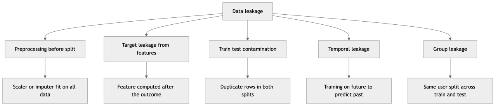

*Figure 43. The many forms of data leakage all violate one rule: train only on information available before the prediction moment.*

Let us examine each form with a concrete example.

**Preprocessing before splitting.** Computing a scaler’s mean, an imputer’s median, or a target-encoding statistic over the *entire* dataset leaks test-set information into training. Even a mean computed over rows that later become the test set gives the model a faint preview of the test distribution. *Fix:* fit every transform on training folds only — pipelines do this for you.

**Target leakage from features.** A feature that is a proxy for, or computed after, the target. The textbook example: predicting whether a patient has a disease using a column “treatment prescribed” that only exists *after* diagnosis. The model achieves near-perfect accuracy in development and is useless in production, because at prediction time no treatment has been prescribed yet. Another: predicting loan default using “total payments received,” which is only known after the loan concludes. *Fix:* audit each feature by asking, “Would I genuinely have this value, populated, at the instant I must predict?” If not, drop it.

**Train/test contamination via duplicates.** Duplicate or near-duplicate rows split across train and test mean the model effectively sees test answers during training. This is rampant in image datasets (the same photo under two filenames) and in de-normalized tabular exports. *Fix:* de-duplicate before splitting, and split on a key that keeps related records together.

**Temporal leakage.** Training on data from *after* the event you are predicting. Using a customer’s current lifetime-value to predict a purchase they made last year; aggregating a feature over a window that extends past the prediction date; shuffling time-ordered data so future rows land in the training fold for a past validation row. *Fix:* time-aware splits and windowed features that only look backward.

**Group leakage.** Multiple rows belong to the same patient, user, device, or session; random splitting puts some of their rows in train and some in test, so the model learns to recognize the *individual* rather than the *pattern*. A model that has seen ten of a patient’s scans in training will do suspiciously well on the eleventh in test — and fail on a genuinely new patient. *Fix:* group-aware splitting (`GroupKFold`) so all of a group’s rows stay together.

The illustration below shows leakage’s signature: a leaky pipeline reports a validation curve far above its true, honest performance, and the gap only reveals itself in production.

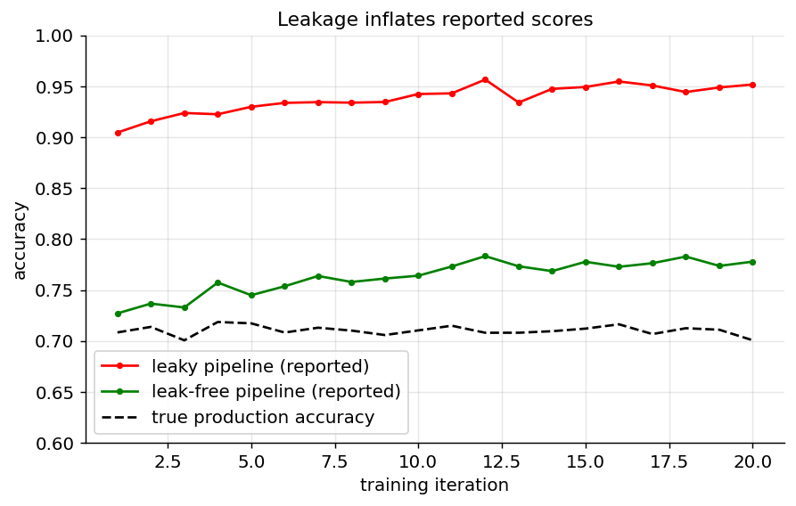

*Figure 44. The signature of leakage: reported validation accuracy sits far above true production accuracy, and the gap appears only after deployment.*

If a model’s validation score looks too good to be true, suspect leakage first. A reliable diagnostic: inspect which features the model relies on most (via coefficients or importances), and interrogate the top ones. A single feature carrying almost all the predictive power is very often a leak in disguise.

## 3.10 Splitting Data Without Fooling Yourself

The entire credibility of a machine learning result rests on one idea: **the model must be evaluated on data it has never seen.** To make that possible we partition the data.

The classic three-way split:

- **Training set** (≈60–70%): the model learns its parameters here.
- **Validation set** (≈15–20%): you tune hyperparameters and make modeling choices here.
- **Test set** (≈15–20%): touched **once**, at the very end, to estimate real-world performance.

The validation set exists because the moment you tune to a set, you start overfitting to *it*. The test set is held in reserve so that your final number is honest. A useful mantra: *the test set is not for making decisions; it is for the final, single measurement.* Every time you peek at the test set and change something in response, you have converted it into a validation set and lost your unbiased estimate.

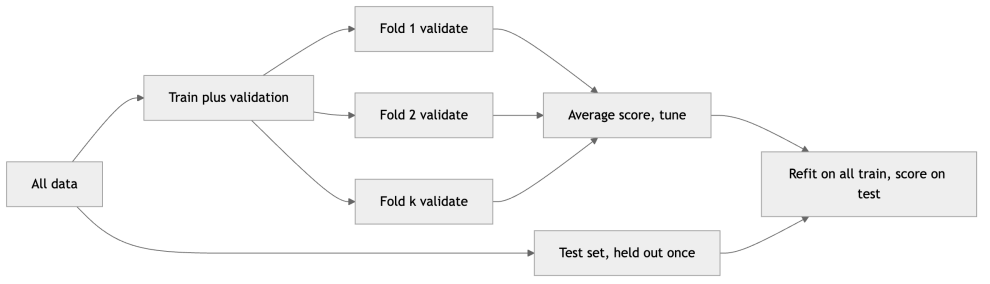

*Figure 45. A three-way split, with cross-validation replacing a fixed validation set inside the training portion.*

### 3.10.1 Cross-Validation

When data is limited, a single fixed validation set is wasteful and noisy — your estimate depends heavily on which rows happened to land in it. **k-fold cross-validation** uses the data more efficiently: split the training portion into $`k`$ equal folds, then train $`k`$ times, each time holding out a different fold for validation and training on the other $`k - 1`$. The reported score is the average across folds, with a standard deviation that tells you how stable the estimate is. Common choices are $`k = 5`$ or $`k = 10`$; larger $`k`$ gives a less biased but higher-variance and more expensive estimate. The chapter on Model Evaluation treats the theory in full; here we note the practical variants and when each applies.

**Stratified k-fold** preserves the class proportions in every fold. For classification — especially imbalanced classification — this is essential. With a 95/5 class split and plain k-fold, a fold might end up with almost no minority examples, producing wildly unstable metrics. Stratification fixes that.

**Time-series split** must respect temporal order. You can never train on the future to predict the past, so folds expand forward in time: train on weeks 1–4, validate on week 5; train on weeks 1–5, validate on week 6; and so on. Shuffling time-series data destroys its structure and produces meaningless, optimistic scores.

**Group k-fold** keeps all rows sharing a group key (patient, user, device) within a single fold, defeating the group leakage described earlier.

**Leave-one-out** cross-validation takes $`k`$ equal to the number of rows — training on all but one example each time. It is nearly unbiased but extremely expensive and high-variance; reserve it for very small datasets.

| Strategy | Use when | Guards against |
|----|----|----|
| Plain k-fold | i.i.d. data, balanced target | Overfitting to one split |
| Stratified k-fold | Classification, imbalance | Empty/skewed minority folds |
| Group k-fold | Repeated units (users, patients) | Group leakage |
| Time-series split | Temporal / forecasting data | Temporal leakage |
| Leave-one-out | Very small datasets | Wasting scarce data |

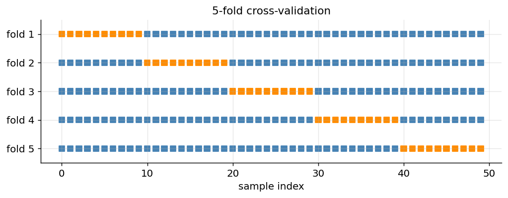

*Figure 46. Visualizing 5-fold cross-validation; each row is one fold, blue is training and orange is the held-out validation block.*

The expanding-window scheme for time series deserves its own picture, since it is the split people most often get wrong.

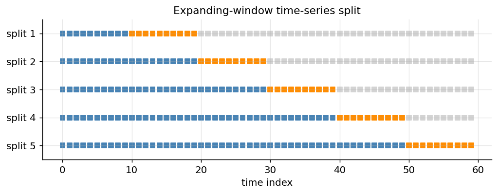

*Figure 47. Expanding-window time-series cross-validation; the training window grows forward and validation is always a future block.*

## 3.11 scikit-learn Pipelines and ColumnTransformer

Everything above — impute, encode, scale, select, then model — must be applied in the right order and, critically, *fit only on training data within each cross-validation fold*. Doing this by hand is tedious and leak-prone. scikit-learn’s `Pipeline` and `ColumnTransformer` automate it correctly.

A `Pipeline` chains transforms and a final estimator into one object with a single `fit`/`predict` interface. When you call `pipe.fit(X_train, y_train)`, each step’s `fit_transform` runs in sequence; when used inside `cross_val_score`, the transforms are re-fit on each fold’s training portion only — leakage is prevented by construction. A `ColumnTransformer` applies different pipelines to different columns: scale the numerics, one-hot the categoricals, in parallel, then concatenate.

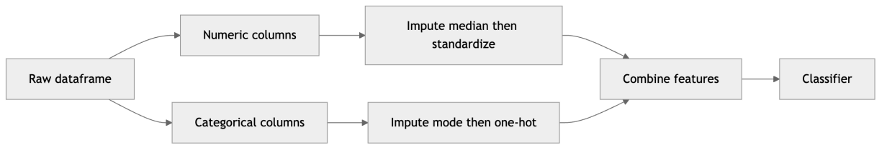

*Figure 48. A ColumnTransformer routes numeric and categorical columns through separate sub-pipelines before the model.*

Here is a complete, runnable example on a synthetic mixed-type dataset.

``` python
# --- Build a synthetic mixed dataset with missing values ---
import numpy as np, pandas as pd
from sklearn.compose import ColumnTransformer
from sklearn.pipeline import Pipeline
from sklearn.impute import SimpleImputer
from sklearn.preprocessing import StandardScaler, OneHotEncoder
from sklearn.linear_model import LogisticRegression
from sklearn.model_selection import train_test_split, cross_val_score, StratifiedKFold
rng = np.random.default_rng(42)
n = 1000
df = pd.DataFrame({
    "age":      rng.normal(40, 12, n),
    "income":   rng.lognormal(10.5, 0.4, n),
    "city":     rng.choice(["NY", "LA", "SF", "CHI"], n, p=[.4, .3, .2, .1]),
    "plan":     rng.choice(["basic", "pro", "enterprise"], n),
})
# Inject missingness
df.loc[rng.choice(n, 80, replace=False), "age"] = np.nan
df.loc[rng.choice(n, 50, replace=False), "city"] = np.nan
# A target that depends on the features (plus noise)
logit = (df["income"] / 60000) + (df["plan"] == "enterprise") * 1.5 - 1.0
y = (1 / (1 + np.exp(-logit)) > rng.uniform(size=n)).astype(int)

numeric_features = ["age", "income"]
categorical_features = ["city", "plan"]

# --- Sub-pipelines per column type ---
numeric_pipe = Pipeline([
    ("impute", SimpleImputer(strategy="median")),
    ("scale", StandardScaler()),
])
categorical_pipe = Pipeline([
    ("impute", SimpleImputer(strategy="most_frequent")),
    ("onehot", OneHotEncoder(handle_unknown="ignore")),
])

preprocess = ColumnTransformer([
    ("num", numeric_pipe, numeric_features),
    ("cat", categorical_pipe, categorical_features),
])

# --- Full model pipeline ---
model = Pipeline([
    ("prep", preprocess),
    ("clf", LogisticRegression(max_iter=1000)),
])

# Split FIRST, then everything below is leak-free
X_train, X_test, y_train, y_test = train_test_split(
    df, y, test_size=0.2, stratify=y, random_state=0)

# Cross-validation re-fits all transforms within each fold's training data only
cv = StratifiedKFold(n_splits=5, shuffle=True, random_state=0)
scores = cross_val_score(model, X_train, y_train, cv=cv, scoring="roc_auc")
print(f"CV ROC-AUC: {scores.mean():.3f} +/- {scores.std():.3f}")

# Fit once on all training data, evaluate ONCE on the held-out test set
model.fit(X_train, y_train)
print(f"Test accuracy: {model.score(X_test, y_test):.3f}")
```

Notice what the pipeline buys us: the median for imputation, the scaler’s mean and variance, and the one-hot vocabulary are all learned from each fold’s *training* rows and merely applied to the validation rows. There is no path by which test statistics can contaminate training, even across five folds. This single structural guarantee eliminates the most common leakage bug in practice. As a bonus, the entire pipeline can be serialized and deployed as one object, so the exact preprocessing used in training is reproduced at inference time — no risk of the notorious “training/serving skew,” where preprocessing differs subtly between the training script and the production service.

## 3.12 Choosing a Baseline

Before celebrating a model’s score, you must answer “compared to what?” A **baseline** is the simplest reasonable predictor, and it calibrates your expectations. Without one, an 80% accuracy sounds great — until you learn the majority class is 82%, meaning your model is *worse than always guessing the majority*.

Common baselines:

- **Classification:** predict the most frequent class (`DummyClassifier(strategy="most_frequent")`), or predict the class prior probabilities.
- **Regression:** predict the mean or median of the target (`DummyRegressor(strategy="mean")`).
- **Time series:** predict the last observed value (“persistence” or naive forecast), or a seasonal naive (same day last week).
- **Simple model:** a single decision-tree split or a logistic regression, before reaching for gradient boosting or deep learning.
- **Existing system:** the rules engine or heuristic currently in production. Beating the incumbent is the bar that actually matters to the business.

``` python
from sklearn.dummy import DummyClassifier

baseline = DummyClassifier(strategy="most_frequent")
baseline.fit(X_train, y_train)
print(f"Baseline accuracy: {baseline.score(X_test, y_test):.3f}")
# A real model is only worth its complexity if it clearly beats this number.
```

A model that cannot beat a one-line baseline does not deserve the operational cost, latency, and risk it adds. Baselines also surface problems early: if your sophisticated model barely edges out “always predict the mean,” either the features lack signal or something in the pipeline is broken. Establish the baseline first, then earn every point of improvement over it. Baselines serve a second purpose too — they define the *ceiling worth chasing*. If a trivial model already reaches 91% and the theoretical maximum given label noise is around 94%, the three points of headroom tell you how much effort is even available to win.

## 3.13 The Iterative Model-Building Loop

With clean data, honest splits, and a baseline in hand, modeling begins — and it is a loop, not a single shot. The discipline that separates productive iteration from thrashing is *changing one thing at a time and measuring against the same validation protocol every time*.

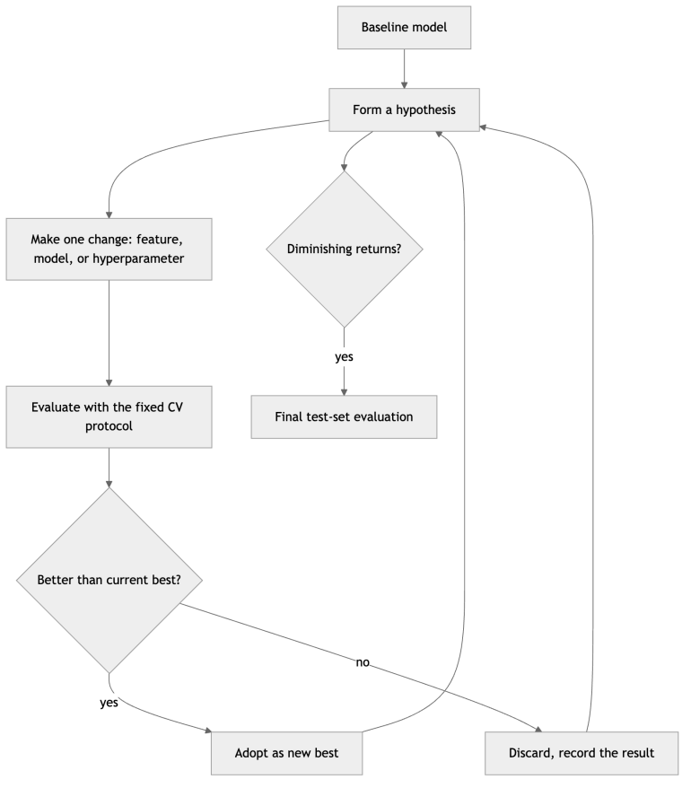

*Figure 49. The inner modeling loop: form a hypothesis, make one change, measure on validation, keep or discard, repeat.*

A sensible progression: start with a strong-but-simple model (regularized linear or logistic regression, or a single gradient-boosted tree) to establish a real modeling baseline above the dummy. Then iterate along three axes, roughly in this order of leverage for tabular data:

1.  **Features.** Better features beat better models. Add the ratios, aggregations, and datetime parts your EDA suggested; remove noise; try an interaction you have a reason to believe in.
2.  **Model family.** Move from linear to tree ensembles (random forests, gradient boosting) if the relationships are non-linear; consider neural networks when data is abundant and structure is complex.
3.  **Hyperparameters.** Tune the chosen model with grid, random, or Bayesian search — always with cross-validation, never against the test set. Hyperparameter tuning is developed in the chapters on specific algorithms and on Model Evaluation.

Throughout, watch the gap between training and validation performance — the **bias–variance** signal. A model that scores poorly on both training and validation is **underfitting** (high bias): it is too simple, or the features lack signal; the cure is a more expressive model or richer features. A model that scores well on training but poorly on validation is **overfitting** (high variance): it has memorized noise; the cure is regularization, more data, fewer features, or a simpler model. The chapter on Model Evaluation formalizes this trade-off; in the loop, it is your compass for which lever to pull next.

Keep an **experiment log** from the first iteration: for each run, record the change made, the code version, the data version, the CV score with its standard deviation, and a one-line takeaway. Without a log you will re-run experiments you have already done, misremember which change helped, and be unable to reproduce your best result. Tools such as MLflow or Weights & Biases automate this; a disciplined spreadsheet works too.

## 3.14 Error Analysis

Aggregate metrics tell you *how much* your model is wrong; **error analysis** tells you *where* and *why* — and it is often more valuable than another round of tuning. The practice is simple and unglamorous: collect the examples your model got wrong on the validation set, read them, and look for patterns.

For classification, start with the **confusion matrix** to see which classes are confused for which. Then group errors by feature values and compute per-segment metrics: does accuracy collapse for a particular country, a particular device type, new users, or a specific value range? A model with 90% overall accuracy that scores 55% on the segment the business cares most about has a targeted problem no global metric would reveal. Sorting misclassified examples by model confidence is especially revealing: confident-but-wrong predictions often expose label errors, leakage, or a systematic blind spot.

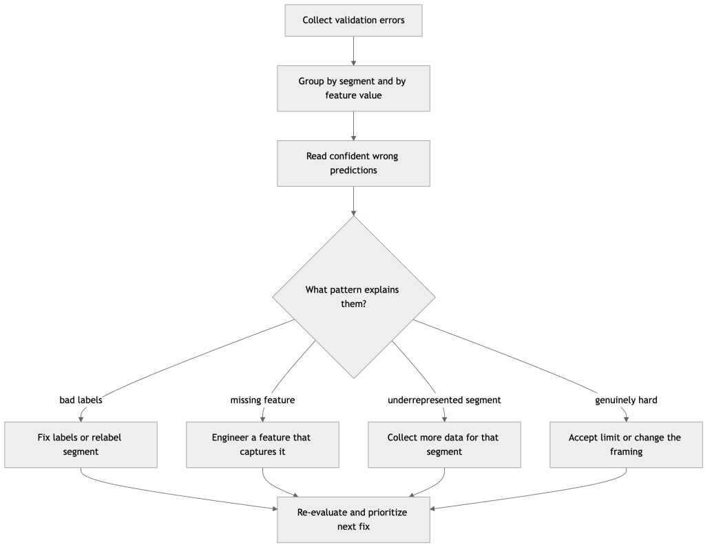

*Figure 50. Error analysis turns wrong predictions into prioritized fixes by finding patterns in the mistakes.*

Error analysis feeds directly back into the loop. Each pattern suggests a concrete, prioritized action: a common failure mode caused by a missing feature is worth engineering that feature; errors concentrated in an underrepresented segment argue for collecting more data there; confident errors on mislabeled examples send you back to the labeling process. Crucially, error analysis lets you *prioritize by impact* — fix the failure mode that affects the most valuable decisions first, rather than uniformly chasing the aggregate metric. Categorize a sample of errors, tally the categories, and you have a ranked backlog of improvements grounded in evidence rather than intuition.

## 3.15 From Prototype to Production: Deployment and Monitoring

A model that lives only in a notebook creates no value. Deployment is the act of making the trained pipeline available to score new data reliably, and monitoring is the discipline of noticing when it stops working. The MLOps chapter treats this in depth; here we establish the concepts that shape earlier choices.

**Deployment patterns.** The main modes are **batch scoring** (score a large set of records on a schedule and write predictions to a table — suitable when decisions are not needed in real time, such as nightly churn scores), **online/real-time serving** (a service responds to individual requests within a latency budget — needed for fraud checks at checkout or ranking on page load), and **embedded/edge** (the model ships inside a device or application and runs locally — needed for offline or privacy-sensitive settings). The pattern you will deploy into is a *framing* constraint: it dictates the latency budget and therefore which features are feasible.

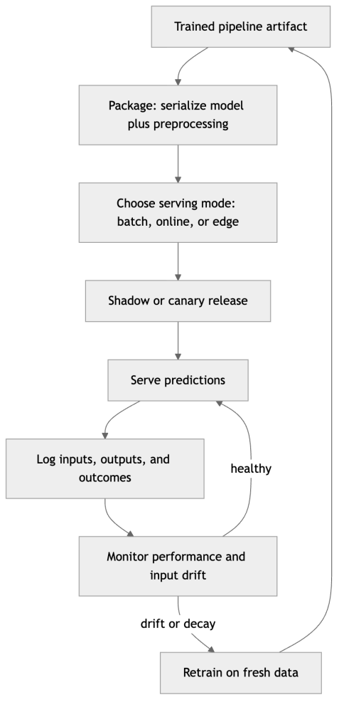

*Figure 51. The path from a trained pipeline to a monitored production model.*

**Packaging.** Serialize the *entire* pipeline — preprocessing plus model — as one artifact, so production applies exactly the transforms training used. Record the training data snapshot, the code version, and the library versions alongside it. Mismatched preprocessing between training and serving (training/serving skew) is a leading cause of production failures that no offline metric predicts.

**Safe release.** Do not flip all traffic to a new model at once. **Shadow mode** runs the new model alongside the old, logging its predictions without acting on them, so you can compare against reality risk-free. **Canary** releases send a small fraction of traffic to the new model and watch before ramping up. **A/B tests** measure the actual business metric — the ultimate arbiter that offline metrics only approximate.

**Monitoring.** Once live, watch three things. First, **operational health**: latency, error rate, throughput. Second, **input drift**: the distribution of incoming features versus training (a feature whose mean or category mix shifts signals that the world has changed). Third, **prediction and outcome quality**: the distribution of predictions and, once ground truth arrives, the live performance metric. Two failure modes recur. **Data drift** (or covariate shift) is a change in the input distribution — a new device type, a marketing campaign that changes the user mix. **Concept drift** is a change in the input-to-target relationship itself — fraud tactics evolve, so the same features now imply different risk. Both degrade performance and both eventually demand retraining. The monitoring loop closes the outer lifecycle loop from the start of this chapter: detected drift sends you back to fresh data.

A subtle point often missed in framing: the availability and *latency* of ground-truth labels governs how fast you can detect concept drift and retrain. If a loan’s default outcome takes months to observe, you cannot measure live accuracy monthly; you must lean on input-drift monitoring and leading indicators in the meantime. Plan the label-feedback loop during framing, not after the model is live.

### 3.15.1 A Case Study: Churn from Framing to Monitoring

To see the whole workflow move as one, follow a single realistic project end to end. A subscription business wants to reduce churn. Framing converts this into “predict the probability each active subscriber cancels within 30 days,” per subscriber, feeding a retention-offer decision, with offline metric *precision in the top 5% of scores* (because the team can only call so many people) and business metric *net retained revenue after coupon cost*.

Data collection pulls subscription events, billing history, product usage logs, and support tickets. Immediately a provenance problem surfaces: the CRM stores only the customer’s *current* plan, overwriting history — a temporal-leakage trap if used naively, so the team reconstructs plan-at-time from the event log instead. EDA reveals a 6% churn base rate (severe imbalance, so metrics and stratified folds are mandatory), a “days since last login” column with a suspicious spike at exactly zero that turns out to encode missing logins, and a support-ticket count strongly correlated with churn.

Cleaning reconstructs the zero-login sentinel as missing with an indicator, standardizes messy plan-name spellings, and drops a handful of duplicate event rows. Feature engineering builds the high-value behavioral aggregates — logins in the last 7/30/90 days, trend of usage, days since last purchase, ticket count and average sentiment — all windowed to look strictly backward from the prediction date. A tempting feature, “cancellation reason,” is caught in a leakage audit: it exists only *after* the customer cancels, so it is dropped.

Splitting uses a time-aware scheme (train on earlier months, validate on later ones) because churn behavior drifts seasonally, plus grouping so a subscriber never appears in both train and validation. The baseline “always predict no churn” scores 94% accuracy but 0% recall — worthless — which immediately reframes the team around top-5% precision. A regularized logistic model beats it meaningfully; gradient-boosted trees on the behavioral aggregates beat that. Error analysis shows the model is nearly blind to *new* subscribers (little history to aggregate), so the team adds onboarding-completion features aimed at that segment. Deployment is nightly batch scoring writing a table the retention team works each morning; monitoring watches input drift and, once outcomes arrive 30 days later, live top-5% precision — which triggers a retrain when a pricing change shifts the user mix. Every stage in this chapter appears, in order, doing real work.

## 3.16 Reproducibility

A result you cannot reproduce is not a result; it is an anecdote. Reproducibility is what lets you trust a number, debug a regression, hand a project to a colleague, and satisfy an auditor. It rests on controlling every source of variation between one run and the next.

**Set and record random seeds.** Data shuffling, train/test splits, weight initialization, dropout, and stochastic optimizers all draw on random number generators. Seed them (`random_state` / `np.random.default_rng(seed)` / framework seeds) and record the seed. Report results across several seeds when the variance matters — a single lucky seed is not evidence.

**Version everything, not just code.** Code goes in git as a matter of course, but reproducibility also demands versioning the **data** (a snapshot or a hash and query that regenerates the exact rows), the **environment** (pinned library versions via a lockfile or container — a scikit-learn version bump can change defaults and shift results), and the **model artifacts and configuration** (hyperparameters, feature lists). A run is reproducible only if all four — code, data, environment, config — are pinned together.

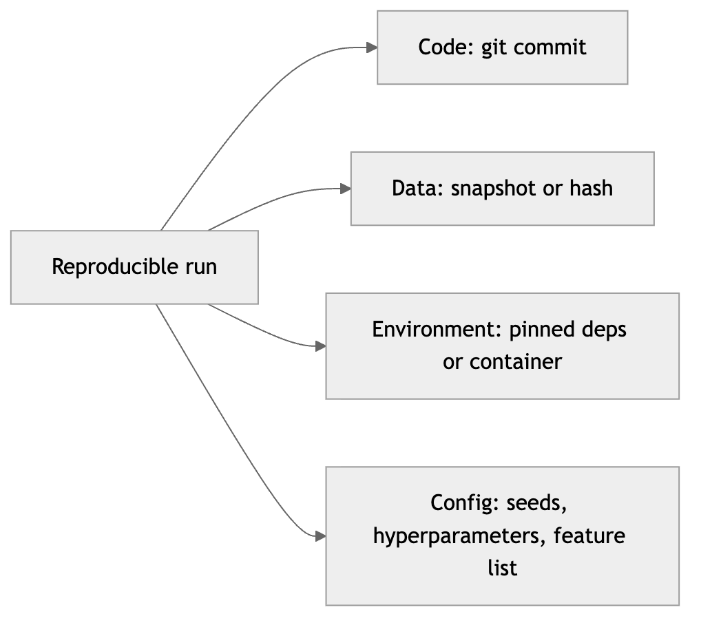

*Figure 52. The four pillars of a reproducible machine learning run.*

**Track experiments.** The experiment log from the modeling loop is also a reproducibility tool: each logged run should carry enough metadata (commit hash, data version, config, seed, metrics) to be re-executed. Experiment-tracking systems store artifacts and parameters automatically and let you retrieve the exact conditions of any past result.

**Make the pipeline deterministic and end-to-end.** Prefer a single command that goes from raw data to trained artifact, rather than a sequence of manual notebook cells run in a particular order that only you remember. Beware nondeterminism you did not intend: unordered set or dictionary iteration feeding a model, parallelism that changes floating-point summation order, and GPU operations that are not bit-reproducible. Where exactness matters, enable deterministic modes even at a small speed cost.

Reproducibility is not bureaucracy; it is leverage. It turns “I think this helped” into “this helped, here is the run, here is the diff,” and that is the difference between a science and a guess.

## 3.17 Summary

The machine learning workflow is a lifecycle, not a one-shot algorithm choice: problem framing, data collection, EDA, cleaning, feature engineering, splitting, training, evaluation, tuning, deployment, and monitoring — an outer loop driven by drift, with an inner experimentation loop driven by hypotheses. Named frameworks such as CRISP-DM formalize the same cyclic, business-anchored, data-dominated shape. The overwhelming majority of project effort lives in understanding and preparing data, not in modeling, and every rule in the chapter is a consequence of one goal: honest generalization to unseen data.

Framing translates a vague business goal into a precise task — target, unit, decision, and metric — and decides whether ML is even warranted. Data collection demands provenance and representativeness. EDA builds intuition and catches disasters early, working from univariate summaries out to relationships, while resisting the temptation to make decisions on the full dataset. Cleaning handles missing values by mechanism (MCAR/MAR/MNAR), distinguishes outliers that are errors from those that are signal, removes true duplicates, and fixes types. Feature engineering — scaling, encoding, binning, interactions, datetime and text features, aggregations, and selection — is the highest-leverage activity for tabular data, and every step must respect the train/test boundary.

Data leakage, in all its disguises, is the silent killer; splitting before preprocessing and using pipelines defeats most of it, while time-aware and group-aware splits defeat the rest. A baseline calibrates every claim of success. The modeling loop advances one deliberate change at a time, guided by the bias–variance signal, and error analysis turns aggregate metrics into prioritized, evidence-based fixes. Deployment mode is a framing constraint; monitoring watches for data and concept drift and closes the outer loop. Reproducibility — seeds, versioned data and environments, tracked experiments, deterministic end-to-end pipelines — is what makes any of it trustworthy.

## 3.18 Key Takeaways

- Machine learning is a cyclic **lifecycle**; roughly 60–80% of effort is data work, not modeling. Frameworks like **CRISP-DM** encode this shape.
- **Frame first:** define target, unit of prediction, the decision the prediction feeds, and both an offline and a business metric — and confirm ML is the right tool at all.
- **Provenance and representativeness** decide whether your data can support the task; a large row count is not the same as enough of the rare thing you care about.
- **EDA** before modeling: distributions, missingness patterns, class balance, and correlations. Explore freely, but make decision-affecting choices on training data only.
- Clean by cause: choose missing-data strategies by mechanism (**MCAR/MAR/MNAR**), decide whether outliers are error or signal (IQR is robust), drop true duplicates, and fix types.
- **Feature engineering** is the top lever for tabular data: scale for distance/gradient models (trees do not need it), encode nominal vs ordinal correctly, and build ratios, aggregations, and datetime features. Select features *inside* the CV loop.
- **Data leakage** takes many forms — preprocessing before split, target leakage, duplicates, temporal, and group. All violate one rule: train only on information available before the prediction moment.
- Split into train/validation/test; use **stratified** k-fold for classification, **group** k-fold for repeated units, and **time-aware** splits for temporal data. Touch the test set exactly once.
- Establish a **baseline**, iterate **one change at a time** against a fixed CV protocol, read the bias–variance gap, and use **error analysis** to prioritize fixes by impact.
- Deployment mode is a **framing constraint**; monitor for **data drift** and **concept drift**, and plan the label-feedback loop up front.
- **Reproducibility** rests on four pillars: versioned code, data, environment, and config — plus recorded seeds and tracked experiments.

## 3.19 Exercises

1.  **Conceptual — framing.** A retailer says “we want to stock the right amount of each product.” Turn this into a precise ML task: name the target, the unit of prediction, the decision the prediction feeds, a reasonable offline metric, and the business metric it should track. Identify one feature that might be predictive but unavailable at decision time.

2.  **Conceptual — leakage hunt.** You build a model to predict 30-day customer churn and achieve 99% validation accuracy. List four specific places leakage could be hiding, name the *category* of each (preprocessing, target, temporal, group, or duplicate), and describe how you would test for it.

3.  **Conceptual — encoding choices.** For each variable, name the best encoding and justify it: (a) “education level” with values none/high-school/bachelor/master/PhD; (b) “browser” with 8 values; (c) “ZIP code” with 30,000 values; (d) a binary “is_subscriber” flag.

4.  **Conceptual — CV strategy.** For each dataset, pick a cross-validation strategy and justify it: (a) 200 patients with 5–20 scans each; (b) daily electricity demand for 3 years; (c) a balanced image classification set; (d) a 98/2 imbalanced fraud dataset.

5.  **Coding — EDA report.** Load any tabular dataset and produce an EDA summary that reports, per column: type, fraction missing, and cardinality (for categoricals) or five-number summary (for numerics). Add the target’s class balance and a correlation-with-target ranking. Flag any column that looks like a “type in disguise.”

6.  **Coding — robust cleaning.** Generate a synthetic dataframe with one numeric column containing missing values and outliers. Write a function that (a) reports the percentage missing, (b) flags outliers using the 1.5×IQR rule, and (c) returns a cleaned copy that median-imputes and winsorizes to the 1st/99th percentiles. Verify the cleaned column’s range.

7.  **Coding — leak-proof pipeline.** Using a synthetic mixed dataset, build a `ColumnTransformer` + `Pipeline` that imputes and scales numerics and imputes and one-hot encodes categoricals, ending in a classifier. Report 5-fold stratified cross-validation ROC-AUC and compare against a `DummyClassifier` baseline.

8.  **Coding — demonstrate leakage.** Build the same task two ways: (a) scale and impute over the *entire* dataset before splitting, and (b) inside a pipeline that fits only on training folds. Compare the reported CV score to a genuinely held-out test score for each, and explain the gap.

9.  **Coding — scaling matters.** Train a k-NN classifier on a two-feature dataset where one feature has a 1000× larger scale than the other, once without scaling and once with `StandardScaler` inside a pipeline. Compare cross-validated accuracy and explain the difference.

10. **Coding — error analysis.** Train a classifier, collect its validation errors, and compute per-segment accuracy across the values of one categorical feature. Identify the worst segment and propose one concrete fix (a feature to engineer, data to collect, or labels to review) justified by what you observe.

11. **Conceptual — time-series splits.** Explain why standard shuffled k-fold cross-validation gives dishonest results on time-series forecasting, and sketch (in words or pseudocode) the expanding-window split that fixes it.

12. **Conceptual — reproducibility audit.** A colleague reports a great result from a notebook. List the specific things you would need from them to reproduce the exact number, organized by the four reproducibility pillars, and name two sources of nondeterminism that could still make the number vary.

---

[← 2 Mathematical and Statistical Foundations](ch02-math-foundations.md) · [Contents](../README.md#contents) · [4 Python Tooling for Machine Learning →](ch04-python-tooling.md)
