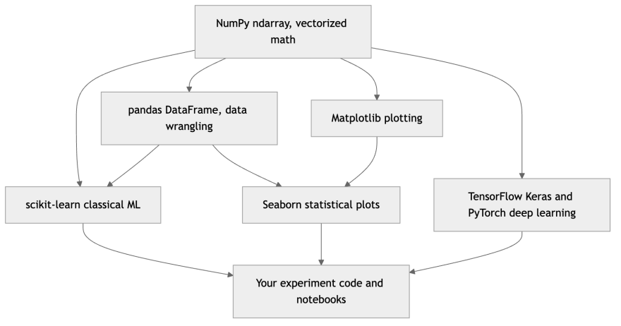
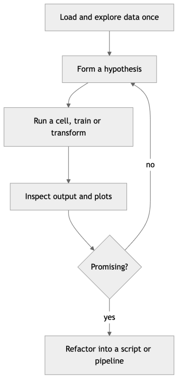
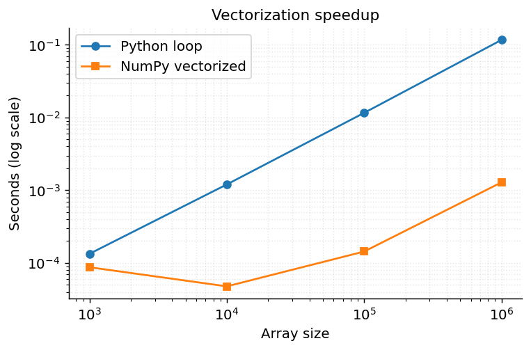
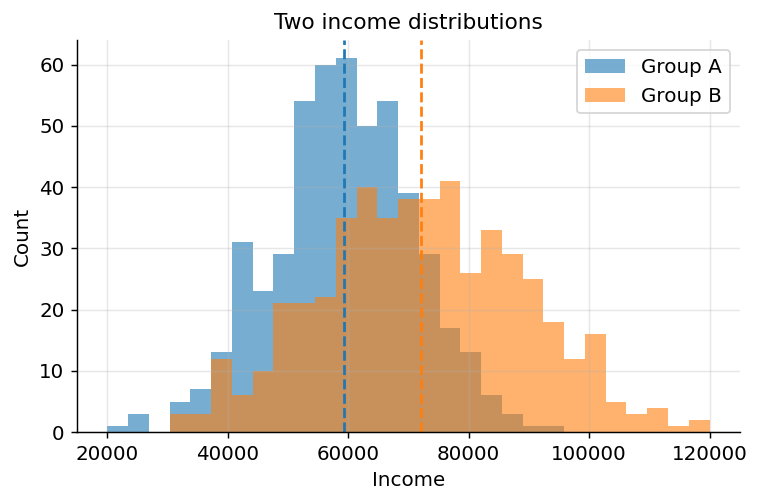
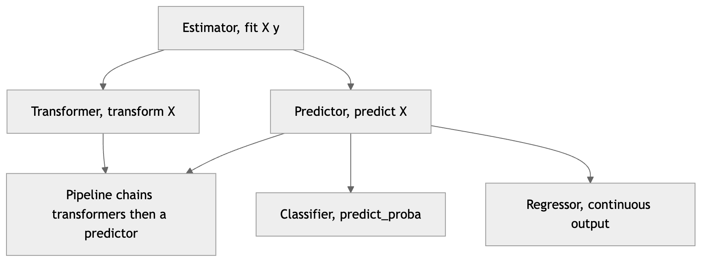
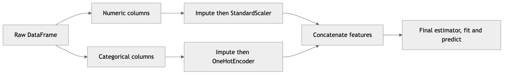
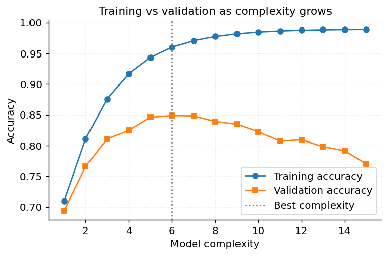
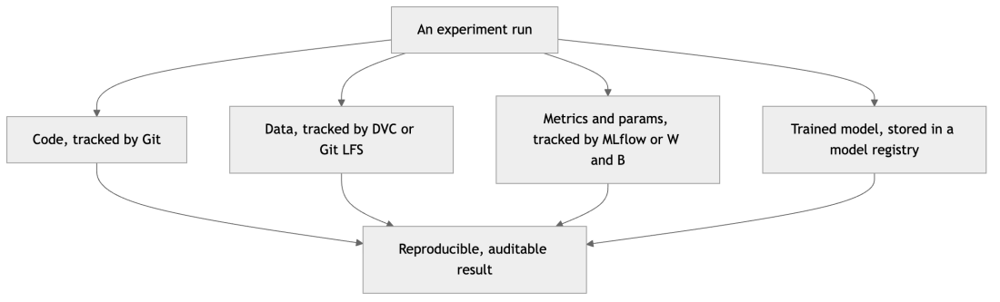

[← 3 The Machine Learning Workflow and Data Preparation](ch03-ml-workflow.md) · [Contents](../README.md#contents) · [5 Supervised Learning and Model Evaluation →](ch05-supervised-eval.md)

---

# 4 Python Tooling for Machine Learning

Machine learning is a deeply empirical discipline, and the speed at which you can move from an idea to a measured result determines how much you ultimately learn. Python earned its place at the center of ML not because it is the fastest language — it is not — but because a remarkably coherent stack of libraries lets you express numerical ideas concisely and run them on highly optimized native code underneath. This chapter is your practical orientation to that stack: how to set up reproducible environments, how to work in notebooks and editors, how to compute with NumPy and wrangle data with pandas, how to visualize with Matplotlib and Seaborn, and how the elegant scikit-learn API ties the classical-ML world together. We then introduce the two dominant deep-learning frameworks, TensorFlow/Keras and PyTorch, cover the accelerators they run on, survey the tools that track and version your experiments, distill reproducibility into a checklist, and close with a complete mini-project that exercises the whole toolkit end to end.

Think of this chapter as the workshop tour you take before building anything serious. You will not master every tool here — mastery comes from projects — but you will learn where each tool sits, what it is for, how the pieces snap together, and which mistakes silently corrupt results. Everything downstream in this book, from the linear models to the transformers, is expressed in this vocabulary.

## 4.1 Why Python, and Why This Stack

It is worth being precise about *why* Python won, because the reasons explain the shape of everything that follows. Raw Python is an interpreted, dynamically typed language whose per-operation overhead is enormous compared to C, C++, or Rust. A naive Python loop over a million numbers can be a hundred times slower than the equivalent C loop. If ML were about writing tight numerical loops by hand, Python would be a terrible choice.

But ML is not about writing loops by hand. It is about composing large array operations — matrix multiplies, convolutions, elementwise nonlinearities, reductions — and dispatching them to code written in C, Fortran, and CUDA. Python’s real strength is that it is an outstanding *glue language*: easy to read, quick to write, and equipped with a mature C interface (the CPython API) that lets libraries push the heavy lifting down to compiled kernels. NumPy calls into BLAS and LAPACK; pandas builds on NumPy; PyTorch and TensorFlow dispatch to cuDNN and hand-tuned GPU kernels. The Python you write is a thin, expressive script that orchestrates seconds of native computation. You get the readability of a scripting language and the throughput of compiled code, provided you keep the hot loops inside the libraries rather than in your own Python.

Three further factors cemented Python’s dominance. First, an unusually **coherent ecosystem**: the core libraries agree on the `ndarray` as a common data currency, so data flows between them without conversion friction. Second, the **interactive workflow** — the REPL, IPython, and Jupyter — matches the iterative, exploratory nature of data work. Third, **community gravity**: papers ship PyTorch code, tutorials assume pandas, employers expect scikit-learn. Network effects compound, and today the practical cost of choosing anything else is steep.

A useful mental model of the stack is a layered pyramid. At the base sits NumPy, which provides the n-dimensional array (`ndarray`) and fast vectorized operations implemented in C and Fortran. Almost everything above it speaks NumPy. pandas builds labeled, heterogeneous tables (DataFrames) on top of NumPy arrays for data loading and cleaning. Matplotlib renders arrays into plots, and Seaborn adds a statistical, DataFrame-aware layer over Matplotlib. scikit-learn consumes NumPy arrays and pandas DataFrames to fit classical models through one consistent interface. The deep-learning frameworks — TensorFlow/Keras and PyTorch — provide their own array types (**tensors**) with automatic differentiation and GPU acceleration, but they interoperate cleanly with NumPy.



*Figure 53. The Python machine learning stack as a dependency pyramid.*

The reason this matters in practice is that data flows between layers without friction. You load a CSV with pandas, hand the numeric columns to scikit-learn as a NumPy array, plot the results with Matplotlib, and — when a problem outgrows classical methods — pass the same arrays to PyTorch. Learning the *seams* between these tools is as important as learning any single one of them, because the seams are where bugs and inefficiencies hide.

## 4.2 Setting Up Reproducible Environments

The single most common source of “it works on my machine” pain is dependency drift. Two projects need different versions of the same library; an upgrade silently breaks an older notebook; a colleague cannot reproduce your results because their NumPy is a year newer than yours and changed a default. The cure is to **isolate each project in its own environment with pinned dependencies**. This is not bureaucracy; it is the difference between an experiment you can rerun in six months and one you cannot.

Three concepts underpin everything in this section. A **package** is a distributable unit of code (NumPy, pandas). An **environment** is an isolated collection of a Python interpreter plus a specific set of installed packages. A **lockfile** is an exact, machine-generated manifest of every package and version in an environment, transitive dependencies included, so the environment can be reconstructed byte-for-byte elsewhere.

There are several mainstream approaches, and you should understand the trade-offs rather than cargo-culting one.

### 4.2.1 venv and pip

A **virtual environment** is just a directory containing a private Python interpreter and its own `site-packages`. `venv` ships with Python itself, and `pip` is the standard installer that pulls packages from the **Python Package Index (PyPI)**. You create an environment, activate it, install into it, and freeze the exact versions so others can reconstruct it.

``` bash
# Create and activate a virtual environment (Python 3.9+)
python -m venv .venv
source .venv/bin/activate          # macOS / Linux
# .venv\Scripts\activate           # Windows PowerShell

# Install the core stack
pip install numpy pandas matplotlib seaborn scikit-learn jupyter

# Freeze exact versions for reproducibility
pip freeze > requirements.txt

# A teammate later reconstructs the environment:
pip install -r requirements.txt
```

A `requirements.txt` with pinned versions (for example `numpy==1.26.4`) is your contract for reproducibility. But note a subtlety: `pip freeze` records what *happened* to get installed, not what you *asked for*. It flattens your intentional top-level dependencies together with their transitive dependencies, and it does not capture the resolution logic. If you later add a package, pip may silently upgrade something else. That is where lockfiles and separated dependency specs come in.

### 4.2.2 Direct versus transitive dependencies, and lockfiles

A mature workflow distinguishes two files:

- A short, human-authored list of **direct dependencies** — the handful of libraries you actually import — often with loose version constraints (`numpy>=1.26,<2.0`).
- A machine-generated **lockfile** that pins the fully resolved dependency graph, including transitive packages you never named, each at an exact version and often with a cryptographic hash.

`pip-tools` popularized this split: you write `requirements.in` by hand and run `pip-compile` to produce a fully pinned `requirements.txt`. The modern successor, discussed below, is `uv`. The principle is universal across ecosystems (npm’s `package-lock.json`, Cargo’s `Cargo.lock`): humans declare intent loosely; a resolver freezes reality exactly.

``` text
# requirements.in  (human-authored, direct deps only)
numpy>=1.26,<2.0
pandas
scikit-learn

# requirements.txt (generated: every transitive dep pinned + hashed)
# ... dozens of exact pins produced by pip-compile / uv pip compile
```

### 4.2.3 conda

**conda** (via Miniconda or the larger Anaconda distribution) is a separate package *and* environment manager. Its distinguishing feature is that it can install **non-Python binaries** — compiled BLAS libraries, CUDA toolkits, C and Fortran libraries, even other language runtimes — because conda packages bundle their own compiled artifacts and a solver that reconciles them. This is why conda is popular for data science and especially GPU work, where getting a compatible CUDA/cuDNN/driver combination via pip alone can be painful.

``` bash
# Create a named environment with a specific Python version
conda create -n ultimate-ml python=3.11
conda activate ultimate-ml

# Install from the community-run conda-forge channel
conda install -c conda-forge numpy pandas matplotlib seaborn scikit-learn jupyterlab

# Export an exact, shareable specification
conda env export > environment.yml

# Reconstruct elsewhere
conda env create -f environment.yml
```

One caution: `conda env export` includes platform-specific build strings, so a file exported on macOS may not solve on Linux. For cross-platform sharing, export only what you asked for with `conda env export --from-history`, or maintain a hand-written `environment.yml` with loose pins.

### 4.2.4 uv: the fast modern option

**uv** is a newer Rust-based tool that unifies environment creation, package installation, and lockfile generation, and does so an order of magnitude faster than pip because of aggressive caching and a parallel resolver. It is a drop-in accelerator for pip workflows and a full project manager in its own right.

``` bash
# Create an environment and install, all much faster than pip
uv venv
uv pip install numpy pandas scikit-learn

# Or manage a whole project with a lockfile (uv.lock)
uv init myproject && cd myproject
uv add numpy pandas scikit-learn   # updates pyproject.toml + uv.lock
uv sync                            # reproduce the locked environment exactly
uv run python train.py             # run inside the managed env
```

`uv` writes a `pyproject.toml` (your declared intent) and a `uv.lock` (the frozen resolution), giving you the direct/transitive split for free. For new projects it is fast becoming the default recommendation.

The table below summarizes when to reach for each tool.

| Concern | venv + pip | conda | uv |
|----|----|----|----|
| Ships with Python | Yes | No, install Miniconda first | No, one binary install |
| Manages non-Python binaries (CUDA, BLAS) | No | Yes | No |
| Package source | PyPI | conda channels (+ pip) | PyPI |
| Lockfile support | Via pip-tools | environment.yml (partial) | Native (uv.lock) |
| Speed | Baseline | Slow solver at times | Very fast |
| Best for | Simple app/library work | GPU and scientific stacks | Modern reproducible projects |

A practical rule: reach for **uv** or `venv`+`pip` for most work, and switch to **conda** the moment you fight with compiled GPU dependencies. Whichever you choose, never install packages into your system-wide Python — always work inside an activated environment — and always record versions so an experiment you run today can be reproduced months from now. Reproducibility, introduced as a discipline in the chapter on the Machine Learning Workflow, begins here at the environment layer and is revisited as a checklist at the end of this chapter.

For fully hermetic reproducibility — pinning even the operating system and system libraries — teams wrap their environment in a **Docker** container. A `Dockerfile` that starts from a fixed base image, copies in a lockfile, and installs from it produces an artifact that runs identically on a laptop, a CI server, and a cloud GPU. That is the gold standard for production and for published research, and it is developed further in the chapter on MLOps.

## 4.3 Notebooks and IDEs: Where You Actually Work

Most ML exploration happens in **Jupyter notebooks** (or JupyterLab), an interactive document that interleaves executable code cells, their outputs, plots, and Markdown narrative. A notebook is backed by a long-lived process called a **kernel** that holds your variables in memory between cell executions. Notebooks suit ML because the work is iterative and visual: you load a large dataset once into memory, then run cheap experiments against it cell by cell without paying the loading cost each time. You can plot inline, tweak a hyperparameter, rerun one cell, and see the effect in seconds.



*Figure 54. The iterative notebook experiment loop.*

Notebooks are excellent for exploration but carry real hazards you must respect:

- **Out-of-order execution.** Cells can be run in any order, so the visible top-to-bottom code may not reflect the state that produced the outputs. A deleted cell can leave a variable alive in the kernel, giving you results that vanish on restart.
- **Hidden, accumulating state.** Long sessions build up stale variables and monkey-patched globals that quietly change behavior.
- **Poor version control.** The `.ipynb` format is JSON that mixes code, outputs, and binary image blobs, so diffs are noisy and merge conflicts are painful. Tools like `nbstripout` (strip outputs before commit) or Jupytext (pair the notebook with a plain `.py` file) mitigate this.

The disciplined workflow is: explore freely in a notebook, but once an experiment proves itself, **promote the code into a versioned** `.py` **module or a scikit-learn pipeline** that runs top to bottom deterministically. A useful habit is to periodically choose “Restart Kernel and Run All” — if your notebook does not survive that, it is not reproducible.

Beyond Jupyter, most practitioners keep a real **IDE** for serious code: **VS Code** (with the Python and Jupyter extensions, it runs notebooks inline and offers a debugger, linting, and Git integration), **PyCharm** (a heavier, feature-rich Python IDE), and hosted notebooks like **Google Colab** (free GPUs, zero setup) and **Kaggle Kernels**. A pragmatic setup pairs a notebook or Colab for exploration with VS Code for turning discoveries into tested, versioned modules. Alongside the editor, adopt the standard code-quality tools early: **Black** or **ruff format** for automatic formatting, **ruff** or **flake8** for linting, and **mypy** for optional static type checking. They cost nothing to run and catch a surprising fraction of bugs before you ever execute a cell.

## 4.4 NumPy: Arrays and Vectorized Computation

NumPy is the foundation. Its central object is the `ndarray`, a contiguous block of memory holding elements of a single **dtype**, indexed by a **shape** tuple. Because the data is dense and typed, NumPy can dispatch whole-array operations to optimized C loops rather than interpreting a Python `for` loop element by element. This is **vectorization**, and it is typically one to two orders of magnitude faster than the equivalent pure-Python loop.

### 4.4.1 Creating and Inspecting Arrays

``` python
import numpy as np

a = np.array([1, 2, 3, 4])              # 1-D array, dtype inferred as int64
b = np.zeros((2, 3))                    # 2x3 array of zeros (float64)
c = np.arange(0, 1, 0.25)               # [0.   0.25 0.5  0.75]
d = np.linspace(0, 1, 5)                # 5 points evenly spaced in [0, 1]
e = np.random.default_rng(0).normal(size=(3, 3))  # seeded random 3x3
f = np.eye(3)                           # 3x3 identity matrix
g = np.full((2, 2), 7)                  # constant array

print(a.shape, a.dtype)                 # (4,) int64
print(b.ndim, b.size)                   # 2 6
print(d)                                # [0.   0.25 0.5  0.75 1.  ]
```

Four attributes you will reach for constantly are `shape` (the size along each dimension), `ndim` (number of dimensions), `size` (total number of elements), and `dtype` (the element type). Many bugs are shape bugs; printing shapes is the fastest debugging habit you can build.

### 4.4.2 dtypes and Memory

The `dtype` controls both precision and memory footprint. Numeric ML data is usually `float64` (double precision, 8 bytes) or `float32` (single precision, 4 bytes). Deep learning overwhelmingly uses `float32` — and increasingly `float16` or `bfloat16` on GPUs — because halving the bytes doubles throughput and memory capacity at a precision cost the models tolerate well.

``` python
x = np.array([1, 2, 3], dtype=np.float32)
print(x.dtype, x.nbytes)                # float32 12   (3 elements x 4 bytes)

big = np.ones((1000, 1000))             # float64 by default
print(big.nbytes / 1e6, "MB")           # 8.0 MB
small = big.astype(np.float32)
print(small.nbytes / 1e6, "MB")         # 4.0 MB

# Overflow is silent with fixed-width integers!
z = np.array([127], dtype=np.int8)
print(z + 1)                            # [-128]  wrapped around
```

That last example is a classic footgun: fixed-width integer types wrap around on overflow without warning. When in doubt, prefer `float64` for intermediate math and choose narrow types deliberately.

### 4.4.3 Vectorized Operations and Broadcasting

Arithmetic on arrays is element-wise, and **broadcasting** lets arrays of different but compatible shapes combine without explicit loops. When NumPy aligns two shapes, it compares dimensions from the right; two dimensions are compatible when they are equal or one of them is 1, and a size-1 (or missing) dimension is *stretched* to match.

``` math
\underset{(m,\, n)}{\underbrace{X}} - \underset{(n,)}{\underbrace{\mu}}\mspace{6mu} \Rightarrow \mspace{6mu}\text{subtract the length-}n\text{vector from every one of the}m\text{rows}
```

The rules, stated precisely:

1.  Right-align the two shapes.
2.  For each dimension, they are compatible if equal, or if one is 1.
3.  The result dimension is the maximum of the two; a size-1 axis is broadcast (repeated logically, not copied in memory).
4.  If any pair is incompatible, NumPy raises a `ValueError`.

``` python
X = np.array([[1.0, 2.0, 3.0],
              [4.0, 5.0, 6.0]])        # shape (2, 3)

mu = X.mean(axis=0)                    # column means, shape (3,)
sigma = X.std(axis=0)                  # column stds,  shape (3,)

Z = (X - mu) / sigma                   # broadcasting: standardize each column
print(Z.mean(axis=0).round(6))         # [ 0. -0.  0.]  (each column ~zero mean)

# A column vector times a row vector -> outer product via broadcasting
col = np.array([[1], [2], [3]])        # shape (3, 1)
row = np.array([10, 20, 30])           # shape (3,) -> treated as (1, 3)
print(col * row)
# [[10 20 30]
#  [20 40 60]
#  [30 60 90]]
```

That four-line standardization is exactly what scikit-learn’s `StandardScaler` does internally, and it shows the power of broadcasting: no loops, no temporaries you manage by hand, and the work happens in native code. Broadcasting is not merely convenient — internalizing its rules is what lets you read and write the array code that pervades ML.

The performance gap between vectorized and looped code is dramatic. The figure below contrasts a pure-Python loop summing squares against the vectorized NumPy equivalent across array sizes.



*Figure 55. Vectorized NumPy versus a pure-Python loop for summing squares.*

### 4.4.4 Indexing, Slicing, and Reductions

NumPy supports basic slicing (which returns **views**, not copies), boolean masking, and fancy integer indexing.

``` python
M = np.arange(12).reshape(3, 4)
# [[ 0  1  2  3]
#  [ 4  5  6  7]
#  [ 8  9 10 11]]

print(M[1, 2])            # 6         single element
print(M[:, 0])            # [0 4 8]   first column
print(M[0:2, 1:3])        # [[1 2] [5 6]]  sub-block
print(M[M > 5])           # [ 6  7  8  9 10 11]  boolean mask
print(M.sum(axis=1))      # [ 6 22 38]  row sums
print(M.mean(axis=0))     # [4. 5. 6. 7.]  column means

# Fancy indexing: pick specific rows in any order
print(M[[2, 0]])          # rows 2 then 0

# Reductions with keepdims for clean broadcasting afterwards
row_sums = M.sum(axis=1, keepdims=True)   # shape (3, 1)
print((M / row_sums).round(2))            # normalize each row to sum to 1
```

The `axis` argument is worth internalizing: `axis=0` collapses rows (operating *down* columns), `axis=1` collapses columns (operating *across* rows). Reductions like `sum`, `mean`, `max`, `min`, `argmax`, and `std` all take it. Passing `keepdims=True` retains the reduced axis as size 1, which makes the subsequent broadcast back against the original array trivial.

Linear algebra lives in the `@` operator and the `np.linalg` module, the workhorses of nearly every ML algorithm, as developed in the chapter on Mathematical and Statistical Foundations.

``` python
A = np.random.default_rng(1).normal(size=(3, 2))
w = np.array([0.5, -1.0])
print((A @ w).shape)               # (3,)   a prediction vector y = A w

# Solve a small linear system A x = b (never invert explicitly)
Asq = np.array([[3.0, 1.0], [1.0, 2.0]])
b = np.array([9.0, 8.0])
x = np.linalg.solve(Asq, b)
print(x.round(3))                  # [2. 3.]

# Eigenvalues, norms, and the pseudo-inverse are all here
print(np.linalg.norm(w).round(3))  # 1.118
```

### 4.4.5 Reshaping, Stacking, and Universal Functions

Beyond indexing, you constantly change an array’s shape and combine arrays. `reshape` reinterprets the same data under a new shape (it returns a view when possible); a `-1` in one position tells NumPy to infer that dimension. `ravel`/`flatten` collapse to 1-D, `transpose`/`.T` swap axes, and `np.newaxis` (or `None`) inserts a length-1 axis to set up broadcasting.

``` python
v = np.arange(6)
print(v.reshape(2, 3))          # [[0 1 2] [3 4 5]]
print(v.reshape(3, -1))         # 3 rows, columns inferred as 2
print(v[:, np.newaxis].shape)   # (6, 1)  turn a row into a column

# Stacking combines arrays along new or existing axes
a = np.array([1, 2, 3])
b = np.array([4, 5, 6])
print(np.vstack([a, b]))        # stack as rows -> shape (2, 3)
print(np.hstack([a, b]))        # concatenate  -> shape (6,)
print(np.stack([a, b], axis=1)) # new axis -> shape (3, 2), pairs as columns
```

**Universal functions** (ufuncs) are the vectorized elementwise operations — `np.exp`, `np.log`, `np.sqrt`, `np.maximum`, comparison operators — that apply to whole arrays at native speed and broadcast automatically. They are how you write mathematics without loops.

``` python
scores = np.array([-1.0, 0.5, 2.0])
# The softmax function, entirely in ufuncs and reductions
exp = np.exp(scores - scores.max())        # subtract max for numerical stability
softmax = exp / exp.sum()
print(softmax.round(3))                     # [0.038 0.169 0.793]  (sums to 1)

# ReLU in one vectorized call
relu = np.maximum(0.0, np.array([-2.0, -0.5, 1.5]))
print(relu)                                 # [0.  0.  1.5]
```

Notice the “subtract the max” trick in the softmax: computing `exp` of large numbers overflows to infinity, so shifting by the maximum (which does not change the result mathematically) keeps every exponent at most zero. Numerical-stability tricks like this are pervasive in ML code, and NumPy’s `np.logaddexp`, `np.clip`, and `np.nan_to_num` exist precisely to manage them.

### 4.4.6 A Worked Broadcasting Example

To make broadcasting concrete, compute the pairwise squared Euclidean distances between three 2-D points and two centroids — the inner loop of k-means clustering — with no explicit loops. Points have shape `(3, 2)` and centroids `(2, 2)`; inserting axes turns them into `(3, 1, 2)` and `(1, 2, 2)`, which broadcast to `(3, 2, 2)`, and summing the last axis yields a `(3, 2)` distance matrix.

``` python
points    = np.array([[0.0, 0.0], [1.0, 1.0], [2.0, 0.0]])   # (3, 2)
centroids = np.array([[0.0, 0.0], [2.0, 2.0]])               # (2, 2)

diff = points[:, np.newaxis, :] - centroids[np.newaxis, :, :]  # (3, 2, 2)
dist2 = (diff ** 2).sum(axis=2)                                # (3, 2)
print(dist2)
# [[0. 8.]
#  [2. 2.]
#  [4. 4.]]
print(dist2.argmin(axis=1))     # [0 0 0] -> nearest centroid index per point
```

Each entry `dist2[i, j]` is the squared distance from point `i` to centroid `j`, and `argmin(axis=1)` assigns each point to its nearest centroid — the assignment step of k-means expressed in three vectorized lines. This is the pattern you will reach for again and again: add axes, let broadcasting form the full grid, reduce.

Two pitfalls deserve emphasis. First, slices are **views** that share memory with the original array, so mutating a slice mutates the parent; use `.copy()` when you need an independent array. Boolean-mask and fancy indexing, by contrast, return copies. Second, integer arrays silently truncate when you assign floats into them, so create arrays with the dtype you intend (`np.zeros(n, dtype=float)`). Below is the view-versus-copy trap made concrete.

``` python
original = np.array([10, 20, 30, 40])
view = original[1:3]        # a VIEW, shares memory
view[0] = 999
print(original)             # [ 10 999  30  40]   <-- parent changed!

safe = original[1:3].copy()
safe[0] = -1
print(original)             # unchanged this time
```

### 4.4.7 Random Number Generation

Reproducible randomness matters throughout ML — for train/test splits, weight initialization, and data shuffling. Modern NumPy uses a `Generator` object seeded explicitly, which is preferred over the legacy global `np.random.seed` / `np.random.rand` interface because it is thread-safe and does not rely on hidden global state.

``` python
rng = np.random.default_rng(seed=42)   # a local, seeded generator
print(rng.normal(size=3).round(3))     # reproducible Gaussian samples
print(rng.integers(0, 10, size=5))     # reproducible integers
print(rng.choice(["a", "b", "c"], size=4))

# Same seed -> same stream, every run, on every machine
rng2 = np.random.default_rng(42)
assert np.allclose(rng2.normal(size=3), np.random.default_rng(42).normal(size=3))
```

### 4.4.8 NumPy at a glance

| Aspect | Detail |
|----|----|
| **Strengths** | Blazing vectorized math; the lingua franca array; rich linear algebra; tiny memory overhead |
| **Weaknesses** | Homogeneous dtype only; no labels; awkward for heterogeneous or missing data |
| **When to use** | Any dense numeric computation; the layer beneath everything else |
| **Pitfalls** | View-vs-copy aliasing; silent integer overflow/truncation; forgetting `axis`; shape mismatches |

## 4.5 pandas: Labeled Data Wrangling

Where NumPy gives you fast homogeneous arrays, pandas gives you labeled, heterogeneous tables. The two core objects are the `Series` (a labeled 1-D column with an index) and the `DataFrame` (a 2-D table of columns that may each have a different dtype, sharing a common row index). pandas is where most real ML projects spend their time: loading, inspecting, cleaning, joining, aggregating, and reshaping data before any model sees it. The rule of thumb that data scientists spend eighty percent of their time on data preparation is, if anything, an underestimate — and nearly all of it happens here.

### 4.5.1 Series and DataFrame Fundamentals

``` python
import pandas as pd
import numpy as np

# A Series is values + an index
s = pd.Series([10, 20, 30], index=["a", "b", "c"], name="counts")
print(s["b"])          # 20     label-based lookup
print(s.mean())        # 20.0   NumPy-style reductions work

# A DataFrame is a dict of aligned Series
df = pd.DataFrame({
    "city":   ["NYC", "LA", "Chicago"],
    "age":    [34, 28, 45],
    "income": [72000.0, 65000.0, 80000.0],
})
print(df.dtypes)
# city       object
# age         int64
# income    float64
```

The **index** is pandas’ defining feature: operations align on labels, not positions, so adding two Series matches entries by index even if their order differs. This automatic alignment prevents a whole class of silent off-by-one bugs, but it also surprises newcomers, so keep the index in mind.

### 4.5.2 Loading and Inspecting Data

``` python
# In practice: pd.read_csv("data.csv"). Here we synthesize a small frame.
rng = np.random.default_rng(42)
df = pd.DataFrame({
    "city":   rng.choice(["NYC", "LA", "Chicago"], size=8),
    "age":    rng.integers(20, 60, size=8),
    "income": rng.normal(60_000, 15_000, size=8).round(0),
})
df.loc[2, "income"] = np.nan          # inject a missing value

print(df.head(3))                      # first rows
print(df.shape)                        # (8, 3)
df.info()                              # dtypes and non-null counts
print(df.describe())                   # summary stats for numeric columns
```

`read_csv` (and its siblings `read_parquet`, `read_json`, `read_sql`, `read_excel`) is your entry point from disk or a database. For large datasets prefer the columnar **Parquet** format over CSV — it is compressed, typed, and far faster to read. The trio `head`, `info`, and `describe` is the first thing to run on any new dataset: it answers “what columns, what types, how many missing, what ranges” in seconds, which is the heart of exploratory data analysis from the Machine Learning Workflow chapter.

### 4.5.3 Indexing: loc, iloc, and Boolean Selection

pandas separates **label-based** indexing (`.loc`) from **position-based** indexing (`.iloc`), and supports boolean masks just like NumPy. Conflating the two is the most common beginner error, so the library forces you to be explicit.

``` python
print(df.loc[0, "city"])               # label-based: index label 0, column "city"
print(df.iloc[0, 0])                   # position-based: first row, first column
print(df.loc[df["age"] > 40, "city"])  # boolean mask + column select

# Boolean selection with combined conditions (parenthesize each!)
mask = (df["income"] > 50_000) & (df["age"] < 50)
subset = df[mask]

# Assign a derived column
df["age_decade"] = (df["age"] // 10) * 10

# Chained assignment is a trap; use .loc for assignment
df.loc[df["city"] == "LA", "income"] *= 1.05   # a 5% raise for LA rows
```

A recurring pitfall is the `SettingWithCopyWarning`, triggered by chained indexing like `df[df.age > 40]["income"] = 0`, which may assign into a temporary copy rather than the original. Always assign through a single `.loc` call, as above.

### 4.5.4 Cleaning: Missing Values and Types

Real data is messy. pandas represents missing values as `NaN` (and, in newer nullable dtypes, `pd.NA`) and gives you explicit tools to detect and handle them.

``` python
print(df["income"].isna().sum())                 # count of missing incomes

# Strategy 1: drop rows with any missing value
clean = df.dropna()

# Strategy 2: impute with the column median (often safer than the mean)
df["income"] = df["income"].fillna(df["income"].median())

# Strategy 3: forward/backward fill (useful for ordered/time data)
# df["income"] = df["income"].ffill()

# Fix dtypes and declare categoricals (saves memory, speeds groupby)
df["city"] = df["city"].astype("category")
df["age"] = df["age"].astype("int32")
```

Choosing between dropping and imputing is a modeling decision, not a mechanical one — dropping rows discards information and can bias your sample, while imputing fabricates values and can leak information if done before the train/test split. The right place for imputation is *inside a pipeline* (see the scikit-learn section) so that statistics are learned from training data only. The chapter on the Machine Learning Workflow treats this trade-off in depth; pandas simply gives you the levers.

### 4.5.5 groupby: Split-Apply-Combine

The `groupby` operation is the analytical heart of pandas. It implements the **split-apply-combine** pattern: split rows into groups by some key, apply an aggregation to each group, and combine the results into a new frame.


*Figure 56. The split-apply-combine pattern behind groupby.*

``` python
summary = (
    df.groupby("city", observed=True)
      .agg(mean_income=("income", "mean"),
           median_age=("age", "median"),
           n=("city", "size"))
      .reset_index()
)
print(summary)
# Each row is one city with its aggregated statistics.

# Transform (not aggregate): broadcast a group statistic back to every row
df["income_vs_city_mean"] = (
    df["income"] - df.groupby("city", observed=True)["income"].transform("mean")
)
```

The distinction between `agg` (one row per group) and `transform` (same shape as input, group statistic broadcast back) is worth memorizing: `transform` is how you add “deviation from group mean” style features without a manual join.

### 4.5.6 Joins and Merges

Combining tables on a shared key mirrors SQL joins. `pd.merge` supports inner, left, right, and outer joins.

``` python
regions = pd.DataFrame({
    "city": ["NYC", "LA", "Chicago"],
    "region": ["East", "West", "Midwest"],
})

joined = df.merge(regions, on="city", how="left")
print(joined[["city", "region", "income"]].head(3))
```

A **left join** keeps every row of the left frame and attaches matching columns from the right, filling `NaN` where no match exists. An **inner join** keeps only rows with a match on both sides; an **outer join** keeps all rows from both. Choosing the wrong join type is a frequent and silent source of dropped or duplicated rows. Two defensive habits: always check `joined.shape` against your expectation after a merge, and pass `validate="many_to_one"` (or the appropriate cardinality) so pandas raises if the key is not unique where you assumed it was.

The table below maps common SQL and spreadsheet ideas onto pandas methods.

| Task | SQL | pandas |
|----|----|----|
| Select columns | `SELECT a, b` | `df[["a", "b"]]` |
| Filter rows | `WHERE x > 5` | `df[df["x"] > 5]` |
| Aggregate by group | `GROUP BY g` | `df.groupby("g").agg(...)` |
| Join tables | `JOIN ... ON k` | `df.merge(other, on="k")` |
| Sort | `ORDER BY x DESC` | `df.sort_values("x", ascending=False)` |
| Distinct | `DISTINCT` | `df.drop_duplicates()` |
| Reshape long to wide | `PIVOT` | `df.pivot_table(...)` |

### 4.5.7 Apply, Map, and Method Chaining

For transformations that do not have a built-in vectorized form, pandas offers `map` (elementwise on a Series), `apply` (a function over rows, columns, or groups), and `assign` (add columns functionally). Prefer built-in vectorized operations where they exist — `apply` with a Python function falls back to slow per-row iteration — but for genuinely custom logic these are indispensable.

``` python
# map: elementwise recode a Series
df["city_code"] = df["city"].map({"NYC": 0, "LA": 1, "Chicago": 2})

# apply across rows (axis=1) to compute a derived feature
df["income_per_year_of_age"] = df.apply(
    lambda r: r["income"] / r["age"], axis=1
)

# Method chaining: a readable top-to-bottom transformation pipeline
result = (
    df
    .query("age > 25")                       # filter rows
    .assign(income_k=lambda d: d["income"] / 1000)   # add a column
    .groupby("city", observed=True)["income_k"]
    .mean()
    .round(1)
    .sort_values(ascending=False)
)
print(result)
```

Method chaining — stringing operations together with `.` inside parentheses — produces code that reads like a recipe and avoids a litter of intermediate variables. It has become the idiomatic modern pandas style, and `query`, `assign`, and `pipe` exist to make whole workflows chainable.

### 4.5.8 Reshaping: pivot, melt, and Categorical Encoding

Data arrives in either **wide** form (one row per entity, many measurement columns) or **long/tidy** form (one row per observation). `pivot_table` reshapes long to wide with aggregation; `melt` goes the other way; and `pd.get_dummies` performs one-hot encoding of categoricals for models that need numeric input.

``` python
# pivot_table: cities as rows, age-decade as columns, mean income in cells
pt = df.pivot_table(values="income", index="city",
                    columns="age_decade", aggfunc="mean", observed=True)

# get_dummies: one-hot encode a categorical column into 0/1 indicator columns
encoded = pd.get_dummies(df[["city"]], prefix="city")
print(encoded.head(2))
# One boolean column per city value; feed straight into a model.
```

For modeling, prefer scikit-learn’s `OneHotEncoder` (shown later) over `get_dummies` inside a real workflow, because the encoder *remembers* the training categories and handles unseen values at predict time, whereas `get_dummies` recomputes columns each call and can silently produce mismatched features between train and test.

### 4.5.9 Time Series

pandas grew out of financial data analysis, and its time-series support is exceptional. A `DatetimeIndex` unlocks partial-string slicing, resampling to different frequencies, and rolling-window statistics.

``` python
# Build a daily series across three months
idx = pd.date_range("2024-01-01", periods=90, freq="D")
ts = pd.Series(
    np.random.default_rng(0).normal(100, 5, size=90).cumsum() / 10 + 100,
    index=idx, name="price",
)

# Partial-string slicing: just name the month
print(ts["2024-02"].mean().round(2))       # mean price in February

# Resample: daily -> weekly mean (downsampling)
weekly = ts.resample("W").mean()
print(weekly.head(3).round(2))

# Rolling window: 7-day moving average (a classic smoothing feature)
ts_smooth = ts.rolling(window=7).mean()

# Time deltas and shifting for lag features
returns = ts.pct_change()                  # day-over-day percentage change
lag1 = ts.shift(1)                         # yesterday's value as a feature
```

Resampling and rolling windows are the bread and butter of feature engineering for forecasting, and `shift` is how you build lag features without leaking the future into the past — a subtle but critical concern discussed in the chapter on the Machine Learning Workflow.

### 4.5.10 pandas at a glance

| Aspect | Detail |
|----|----|
| **Strengths** | Labeled heterogeneous data; expressive cleaning/joining/grouping; superb time-series and I/O |
| **Weaknesses** | Memory-hungry; single-threaded by default; API has many ways to do one thing |
| **When to use** | Loading, cleaning, joining, aggregating tabular data before modeling |
| **Pitfalls** | `SettingWithCopyWarning` from chained indexing; silent wrong-join row changes; leaking stats across the split |

For datasets that exceed memory or a single core, the same conceptual API is offered by **Polars** (a fast Rust-based DataFrame library) and **Dask** (parallel/distributed pandas). Learn pandas first; reach for those when it becomes a bottleneck.

## 4.6 Visualization: Matplotlib and Seaborn

You cannot understand data you have not looked at, and you cannot communicate a result you cannot chart. **Matplotlib** is the foundational plotting library — verbose but infinitely controllable. **Seaborn** sits on top of it, offering concise, attractive statistical charts that understand DataFrames directly.

The core Matplotlib mental model is the **Figure** (the whole canvas) containing one or more **Axes** (individual plots, each with its own coordinate system, ticks, and labels). The object-oriented style — explicitly creating `fig, ax = plt.subplots()` and calling methods on `ax` — is strongly preferred over the implicit, stateful `plt.plot` style, because it scales cleanly to multi-panel figures and leaves no ambiguity about which plot you are modifying.

``` python
import matplotlib.pyplot as plt
import numpy as np

x = np.linspace(0, 10, 200)
fig, ax = plt.subplots(figsize=(6, 4))
ax.plot(x, np.sin(x), label="sin")
ax.plot(x, np.cos(x), label="cos", linestyle="--")
ax.set_xlabel("x")
ax.set_ylabel("value")
ax.set_title("Trig functions")
ax.legend()
# In a script: fig.savefig("trig.png", dpi=150, bbox_inches="tight")
```

For multiple panels, `subplots` returns an array of axes you index into — the pattern that makes the OO style pay off:

``` python
fig, axes = plt.subplots(1, 2, figsize=(10, 4))
data = np.random.default_rng(0).normal(size=1000)
axes[0].hist(data, bins=30)
axes[0].set_title("Histogram")
axes[1].boxplot(data)
axes[1].set_title("Boxplot")
fig.tight_layout()
```

The figure below uses Matplotlib alone to show the kind of distribution comparison that Seaborn’s `histplot` produces with a single line.



*Figure 57. Comparing two synthetic income distributions with overlaid histograms.*

Seaborn reduces common statistical plots to one call and is DataFrame-native, so you reference columns by name and it handles the legend, color mapping, and statistical estimation for you.

``` python
import seaborn as sns
sns.set_theme()

# Distribution by category, with kernel density overlay
sns.histplot(data=df, x="income", hue="city", kde=True)

# Relationship with a fitted regression line and confidence band
sns.regplot(data=df, x="age", y="income")

# Pairwise relationships across all numeric columns, colored by class
sns.pairplot(df, hue="city")

# Correlation heatmap: instantly see multicollinearity
import numpy as np
corr = df.select_dtypes("number").corr()
sns.heatmap(corr, annot=True, cmap="coolwarm", vmin=-1, vmax=1)
```

Know which chart answers which question: **histograms and KDE** show a single variable’s distribution; **scatter plots** show the relationship between two; **box and violin plots** compare distributions across categories; **line plots** show trends over an ordered axis; **heatmaps** reveal structure in a matrix such as a correlation table or confusion matrix. Choosing the right encoding is half of good visualization.

The practical workflow is: use **Seaborn** to generate insightful plots quickly during exploration, and drop down to raw **Matplotlib** `ax` calls when you need precise control over a figure destined for a report, a paper, or this very book. The chapter on data visualization principles goes deeper into perceptual encoding and honest charts; here the point is that both libraries share the same `Figure`/`Axes` substrate, so skills transfer.

## 4.7 scikit-learn: One API to Rule Classical ML

scikit-learn is the reference library for classical machine learning, and its greatest contribution is not any single algorithm but a **consistent object-oriented API**. Once you learn the interface, every one of the hundreds of estimators behaves the same way. This consistency is what makes the library composable and what lets you swap a logistic regression for a random forest by changing one line.

### 4.7.1 Estimators, Transformers, and Predictors

Every scikit-learn object is an **estimator** — anything that learns parameters from data via a `fit(X, y)` method. Estimators specialize into roles:

- **Transformers** implement `transform(X)` (and the convenience `fit_transform`) to produce a modified version of the data — scalers, encoders, imputers, and dimensionality reducers such as PCA.
- **Predictors** implement `predict(X)` to produce outputs for new inputs — classifiers and regressors. Classifiers additionally offer `predict_proba` (calibrated-ish class probabilities) or `decision_function` (raw scores).

The conventions are rigid and deliberate: features go in `X` (a 2-D array of shape `(n_samples, n_features)`), targets go in `y` (a 1-D array of length `n_samples`), learned attributes end in a **trailing underscore** (`model.coef_`, `scaler.mean_`), and **hyperparameters are set in the constructor** and readable via `get_params`. This uniformity is what lets meta-tools operate on any estimator.



*Figure 58. The scikit-learn estimator interface and its specializations.*

``` python
from sklearn.preprocessing import StandardScaler
from sklearn.linear_model import LogisticRegression
import numpy as np

rng = np.random.default_rng(0)
X = rng.normal(size=(100, 3))
y = (X[:, 0] + X[:, 1] > 0).astype(int)

scaler = StandardScaler()
Xs = scaler.fit_transform(X)           # transformer: learn mean/std, then apply
print(scaler.mean_.round(3))           # learned attribute, trailing underscore

clf = LogisticRegression()
clf.fit(Xs, y)                         # predictor: learn coefficients
print(clf.predict(Xs[:5]))             # class predictions, e.g. [1 0 1 1 0]
print(clf.predict_proba(Xs[:2]).round(3))  # class probabilities
print(clf.coef_.round(2))              # learned weights
```

### 4.7.2 Pipelines: Composing Steps Safely

Because transformers and predictors share an interface, scikit-learn can chain them into a `Pipeline` that itself behaves like a single estimator with one `fit` and one `predict`. This is not a convenience nicety — it is the correct way to prevent **data leakage**, the cardinal sin in which information from the test set influences training. When a pipeline is used inside cross-validation, it refits each transformer using *only the training fold*, never peeking at the held-out fold. Scaling the whole dataset before splitting, by contrast, lets the test set’s mean and variance leak into training and inflates your reported score.

``` python
from sklearn.pipeline import make_pipeline
from sklearn.preprocessing import StandardScaler
from sklearn.linear_model import LogisticRegression
from sklearn.model_selection import cross_val_score

pipe = make_pipeline(StandardScaler(), LogisticRegression())
scores = cross_val_score(pipe, X, y, cv=5)
print(f"CV accuracy: {scores.mean():.3f} +/- {scores.std():.3f}")
# CV accuracy: 0.960 +/- 0.037
```

### 4.7.3 ColumnTransformer: Heterogeneous Columns

Real tabular data mixes numeric and categorical columns that need different preprocessing: standardize the numbers, one-hot encode the categories. `ColumnTransformer` applies different transformers to different column subsets and concatenates the results, all inside a single leak-free estimator.

``` python
from sklearn.compose import ColumnTransformer
from sklearn.pipeline import Pipeline
from sklearn.preprocessing import StandardScaler, OneHotEncoder
from sklearn.impute import SimpleImputer
from sklearn.ensemble import RandomForestClassifier

numeric_features = ["age", "income"]
categorical_features = ["city"]

numeric_pipe = Pipeline([
    ("impute", SimpleImputer(strategy="median")),
    ("scale", StandardScaler()),
])
categorical_pipe = Pipeline([
    ("impute", SimpleImputer(strategy="most_frequent")),
    ("onehot", OneHotEncoder(handle_unknown="ignore")),
])

preprocess = ColumnTransformer([
    ("num", numeric_pipe, numeric_features),
    ("cat", categorical_pipe, categorical_features),
])

model = Pipeline([
    ("prep", preprocess),
    ("clf", RandomForestClassifier(random_state=0)),
])
# model.fit(X_df, y)  ->  one object handles impute + scale + encode + fit
```

The figure below shows how data flows through such a pipeline: a `ColumnTransformer` splits columns down two preprocessing branches, recombines them, and feeds the estimator — all as one composable object.



*Figure 59. Data flow through a ColumnTransformer feeding a final estimator.*

### 4.7.4 Model Selection: Cross-Validation and Hyperparameter Search

The same `fit`/`predict` interface that an individual estimator exposes is what `cross_val_score`, `GridSearchCV`, and `RandomizedSearchCV` rely on. Because the whole pipeline is an estimator, you tune preprocessing and model hyperparameters *together*, referencing nested parameters with the `step__param` double-underscore syntax.

``` python
from sklearn.model_selection import GridSearchCV

param_grid = {
    "clf__n_estimators": [100, 300],
    "clf__max_depth": [None, 5, 10],
}
search = GridSearchCV(model, param_grid, cv=5, scoring="accuracy", n_jobs=-1)
# search.fit(X_df, y)
# print(search.best_params_, search.best_score_)
# best_params_ names the winning combination; best_estimator_ is refit on all data
```

`GridSearchCV` exhaustively tries every combination; `RandomizedSearchCV` samples a fixed budget from distributions, which scales far better when the grid is large. Both wrap cross-validation, so the leakage protection of pipelines carries through automatically. This is the payoff of API consistency: tooling written once works with every model. The chapter on Supervised Learning and Model Evaluation builds heavily on these constructs.

The figure below sketches the kind of curve a hyperparameter sweep produces: as model complexity grows, training accuracy climbs monotonically while validation accuracy peaks and then declines — the visual signature of overfitting that cross-validated search is designed to locate.



*Figure 60. A stylized validation curve showing the bias-variance sweet spot.*

### 4.7.5 Writing Your Own Transformer

Because the API is just a convention, you can drop a **custom transformer** into any pipeline by implementing `fit` and `transform`. Inheriting from `BaseEstimator` and `TransformerMixin` gives you `fit_transform` and parameter introspection for free. The rule that keeps it leak-free is simple: learn every statistic in `fit`, apply it in `transform`.

``` python
from sklearn.base import BaseEstimator, TransformerMixin
import numpy as np

class Log1pScaler(BaseEstimator, TransformerMixin):
    """Log-transform skewed positive features, then standardize."""
    def fit(self, X, y=None):
        Xl = np.log1p(X)                 # log(1 + x), safe at x = 0
        self.mean_ = Xl.mean(axis=0)     # learned on TRAINING data only
        self.std_ = Xl.std(axis=0) + 1e-8
        return self

    def transform(self, X):
        return (np.log1p(X) - self.mean_) / self.std_

# It now composes like any built-in step:
# make_pipeline(Log1pScaler(), LogisticRegression())
```

Trailing-underscore attributes (`mean_`, `std_`) mark quantities learned during `fit`, exactly matching the library convention — which is why this homemade object slots into `Pipeline`, `cross_val_score`, and `GridSearchCV` with zero special casing.

### 4.7.6 scikit-learn at a glance

| Aspect | Detail |
|----|----|
| **Strengths** | Uniform API; excellent classical algorithms; leak-safe pipelines; superb docs |
| **Weaknesses** | No GPU; not for deep learning; assumes data fits in memory |
| **When to use** | Tabular data, classical models, baselines, preprocessing, model selection |
| **Pitfalls** | Fitting transformers on the full data before splitting (leakage); confusing `fit`/`fit_transform` on test data |

## 4.8 Deep Learning Frameworks: PyTorch and TensorFlow/Keras

When problems involve very large parameter counts, unstructured data like images, audio, and text, or architectures that must be trained by gradient descent through many layers, you graduate from scikit-learn to a deep-learning framework. Two dominate the field. Both represent computation as operations on **tensors** (NumPy-like n-dimensional arrays that can live on CPU or GPU) and both provide **automatic differentiation** — the ability to compute gradients of any scalar output with respect to any tensor by recording operations into a computation graph and applying the chain rule in reverse. That reverse pass, **backpropagation**, is the engine behind training. The chapter on Neural Networks: Fundamentals develops these ideas fully; here we orient you to the tooling.

Before the frameworks diverge, they agree on the tensor. A **tensor** generalizes the scalar (0-D), vector (1-D), and matrix (2-D) to arbitrary dimensions, and in ML the leading axis is almost always the **batch** — a stack of independent examples processed together. A batch of 32 RGB images of size 28 by 28 is a 4-D tensor of shape `(32, 3, 28, 28)`; a batch of 16 sentences of 100 tokens embedded in 512 dimensions is `(16, 100, 512)`. Tensors behave like NumPy arrays — same indexing, broadcasting, and reductions — but add two superpowers: they can live on a GPU, and they can track the operations applied to them so gradients can flow back through.

``` python
import torch

t = torch.tensor([[1.0, 2.0], [3.0, 4.0]])
print(t.shape, t.dtype)                 # torch.Size([2, 2]) torch.float32
print(t @ t)                            # matrix multiply, like NumPy
print(t.mean(dim=0))                    # reductions take dim, not axis

# requires_grad turns on autodiff bookkeeping
x = torch.tensor(3.0, requires_grad=True)
y = x ** 2 + 2 * x                       # build a computation graph
y.backward()                             # differentiate y w.r.t. x
print(x.grad)                            # tensor(8.)  since dy/dx = 2x + 2 = 8
```

That tiny `backward` example *is* automatic differentiation: you write the forward computation as ordinary code, and the framework records a graph and applies the chain rule to fill `.grad`. Everything else in training is scaling this up to millions of parameters.

**PyTorch** is Meta’s framework, favored in research for its imperative, Pythonic “define-by-run” style that makes a model feel like ordinary Python and debugging feel like ordinary debugging. **TensorFlow** is Google’s framework; **Keras** is its high-level API (now also multi-backend), optimized for fast, readable model definition and production deployment (TensorFlow Serving, TensorFlow Lite for mobile, TensorFlow.js for browsers). The two have converged substantially — TensorFlow adopted eager execution, PyTorch added graph compilation via `torch.compile` — but the cultural and ergonomic differences persist.

| Aspect | PyTorch | TensorFlow / Keras |
|----|----|----|
| High-level API | `torch.nn` + manual loop, or Lightning | Keras (`model.fit`) |
| Programming style | Imperative, explicit | Declarative, concise |
| Debugging | Native Python, very direct | Improved, historically harder |
| Production / mobile | Strong (TorchServe, ExecuTorch) | Strong (TF Serving, TF Lite, TF.js) |
| Research popularity | Very high | Moderate |
| GPU / autodiff | Yes | Yes |

A simple guideline: choose **Keras** when you want the fastest path from idea to a trained, deployable model and you like a high-level API that hides the training loop; choose **PyTorch** when you want maximal control, are doing research, or are following tutorials and papers (most of which now ship PyTorch). The same small binary classifier in both frameworks looks like this.

``` python
# Keras / TensorFlow version
import tensorflow as tf
from tensorflow import keras

keras.utils.set_random_seed(0)         # reproducibility

model = keras.Sequential([
    keras.layers.Input(shape=(3,)),
    keras.layers.Dense(16, activation="relu"),
    keras.layers.Dense(1, activation="sigmoid"),
])
model.compile(optimizer="adam", loss="binary_crossentropy", metrics=["accuracy"])
# X, y are NumPy arrays; Keras runs the training loop internally.
model.fit(X, y, epochs=10, batch_size=16, verbose=0)
preds = (model.predict(X[:5]) > 0.5).astype(int)
# PyTorch version (equivalent model, explicit training loop)
import torch
import torch.nn as nn

torch.manual_seed(0)                   # reproducibility
Xt = torch.tensor(X, dtype=torch.float32)
yt = torch.tensor(y, dtype=torch.float32).unsqueeze(1)

model = nn.Sequential(
    nn.Linear(3, 16), nn.ReLU(),
    nn.Linear(16, 1), nn.Sigmoid(),
)
loss_fn = nn.BCELoss()
opt = torch.optim.Adam(model.parameters(), lr=1e-3)

for epoch in range(10):
    opt.zero_grad()                    # clear old gradients
    out = model(Xt)                    # forward pass
    loss = loss_fn(out, yt)            # compute loss
    loss.backward()                    # autodiff: fill .grad on every parameter
    opt.step()                         # gradient-descent update

preds = (model(Xt[:5]) > 0.5).int()
```

Notice the philosophical contrast. Keras hides the training loop behind `model.fit`; PyTorch makes the forward pass, loss, backward pass, and optimizer step explicit. The four-line PyTorch loop — `zero_grad`, forward, `backward`, `step` — *is* gradient descent, and once you internalize it you understand every training script you will ever read. The `zero_grad` call matters: PyTorch *accumulates* gradients by default, so forgetting to zero them sums gradients across iterations and silently corrupts training. That explicitness is more code but exposes every step, which is exactly why researchers prefer it and why it is so instructive for learning what training actually does.

The deep-learning ecosystem extends well beyond the two frameworks. **PyTorch Lightning** and **Keras** both remove training-loop boilerplate; **Hugging Face Transformers** provides thousands of pretrained models with a uniform interface; **JAX** offers NumPy-compatible arrays with composable transformations (`grad`, `jit`, `vmap`) and is popular for research at scale. These are covered where relevant in later chapters; for now, know that PyTorch and TensorFlow/Keras are the two poles most work orbits.

## 4.9 GPUs and Accelerators

Deep learning is feasible today largely because the core operation — dense matrix multiplication — maps beautifully onto hardware built for massive parallelism. A **GPU** (graphics processing unit) has thousands of simple cores that execute the same operation across many data elements at once, which is exactly the shape of a matrix multiply or a convolution. A model that takes hours to train on a CPU can train in minutes on a GPU. NVIDIA’s **CUDA** platform and its **cuDNN** deep-learning primitives are the de facto standard that PyTorch and TensorFlow build on, though AMD (ROCm), Apple (Metal/MPS), and Google’s custom **TPUs** (tensor processing units) are alternatives.

The programming model is straightforward: **tensors and the model must live on the same device**, and you move them explicitly.

``` python
import torch

# Pick the best available device
device = (
    "cuda" if torch.cuda.is_available()
    else "mps" if torch.backends.mps.is_available()   # Apple Silicon
    else "cpu"
)
print(f"Using {device}")

model = model.to(device)               # move parameters to the GPU
Xt = Xt.to(device)                     # inputs must be on the same device
yt = yt.to(device)
out = model(Xt)                        # compute now runs on the GPU
result = out.detach().cpu().numpy()    # bring results back to host for NumPy
```

A “tensors on different devices” error is one of the most common beginner frustrations; the fix is always to `.to(device)` whatever was left behind. Practical performance lessons follow from how GPUs work: **use large batches** to keep the thousands of cores busy; **minimize host-device transfers**, which cross a slow PCIe bus; and **use mixed precision** (`float16`/`bfloat16` for most math, `float32` for the sensitive parts) via `torch.cuda.amp` or Keras mixed-precision policies to roughly double throughput and halve memory on modern hardware. GPU memory, not compute, is often the binding constraint — the dreaded “CUDA out of memory” — and the levers are smaller batches, gradient checkpointing, and lower precision.

Because GPUs are expensive, most learning and much production training happens on rented cloud accelerators (AWS, GCP, Azure) or free-tier hosted notebooks like **Google Colab** and **Kaggle**, which is the fastest way to get GPU hours without buying hardware. The chapter on Neural Networks: Fundamentals returns to how these accelerators shape architecture and batch-size choices.

## 4.10 Experiment Tracking and Versioning

A research notebook full of print statements does not scale. Once you are running dozens of experiments — sweeping hyperparameters, comparing architectures, tuning preprocessing — you need to systematically record *what you ran, on what data and code, and what came out*. This is the domain of **experiment tracking** and **versioning**, and it is what separates reproducible ML from a folder of mystery model files named `final_v3_really_final.pkl`.

Four distinct things want tracking, and confusing them causes grief:

- **Code** — versioned with **Git**, exactly as any software. Tag or record the commit hash for every run.
- **Data** — often too large for Git. Tools like **DVC** (Data Version Control) or **Git LFS** store large files in remote storage while keeping small pointer files in Git, so a commit references an exact dataset version. lakeFS and cloud object versioning serve the same need at scale.
- **Experiments** — the metrics, hyperparameters, and artifacts of each training run. Tools such as **MLflow**, **Weights & Biases (W&B)**, **TensorBoard**, and **Neptune** log these and give you dashboards to compare runs.
- **Models** — the trained artifacts and their metadata, kept in a **model registry** (MLflow Model Registry, W&B Artifacts) that tracks lineage, stage (staging/production), and versions.



*Figure 61. The four things an ML experiment must version, and typical tools.*

The logging pattern is nearly identical across trackers: open a run, log parameters and metrics, log artifacts, close the run. Here is MLflow, the most widely used open-source option.

``` python
import mlflow
from sklearn.ensemble import RandomForestClassifier
from sklearn.metrics import accuracy_score

with mlflow.start_run():
    params = {"n_estimators": 300, "max_depth": 10}
    mlflow.log_params(params)

    clf = RandomForestClassifier(**params, random_state=0).fit(X_train, y_train)
    acc = accuracy_score(y_test, clf.predict(X_test))

    mlflow.log_metric("test_accuracy", acc)
    mlflow.sklearn.log_model(clf, "model")   # artifact + registry entry
    # The MLflow UI now shows this run, its params, metric, and model,
    # side by side with every other run for easy comparison.
```

Even before adopting a full tracker, three habits pay off immediately: commit code before every serious run and record the hash; write hyperparameters and the resulting metrics to a CSV or JSON per run; and never overwrite a saved model — append a timestamp or run ID. These practices connect directly to the production discipline covered in the chapter on MLOps, where tracking, registries, and pipelines become the backbone of deployment.

## 4.11 Reproducibility: Seeds, Determinism, and Discipline

Everything in this chapter converges on a single professional value: **a result you cannot reproduce is not a result**. Reproducibility is not a nice-to-have; it is what makes an experiment scientific, a bug fixable, and a paper trustworthy. It has layers, and you should address each.

**Random seeds.** Almost every ML step involves randomness — data shuffling, train/test splits, weight initialization, dropout, data augmentation, stochastic optimizers. Each source has its own generator, and you must seed *all* of them. In scikit-learn, pass `random_state` to every estimator and split function that accepts it. In NumPy, use a seeded `Generator`. In the frameworks, seed the framework too.

``` python
import os, random
import numpy as np

def set_all_seeds(seed: int = 42) -> None:
    os.environ["PYTHONHASHSEED"] = str(seed)   # stabilize hash-based ordering
    random.seed(seed)                          # Python's random module
    np.random.seed(seed)                       # legacy global NumPy RNG
    try:
        import torch
        torch.manual_seed(seed)
        torch.cuda.manual_seed_all(seed)
        # Force deterministic GPU kernels (may cost speed):
        torch.use_deterministic_algorithms(True, warn_only=True)
    except ImportError:
        pass

set_all_seeds(42)
# scikit-learn: still pass random_state explicitly, e.g.
# train_test_split(X, y, random_state=42); RandomForestClassifier(random_state=42)
```

**Determinism beyond seeds.** Seeding is necessary but not always sufficient. GPU operations can be nondeterministic because parallel floating-point reductions sum in a hardware-dependent order, and floating-point addition is not associative. PyTorch’s `use_deterministic_algorithms` and setting `cudnn.deterministic = True` force reproducible kernels at some speed cost. Multi-threaded data loading can also reorder results; fix worker seeds if exact reproduction matters.

**Environment and data.** A seed reproduces your run only against the *same code, same library versions, and same data*. This is why the earlier sections matter: pin your dependencies in a lockfile (or a Docker image), version your data (DVC/Git LFS), and record the Git commit of the code. A complete reproducibility bundle is: fixed seeds + pinned environment + versioned data + committed code + logged hyperparameters. Miss any one and “reproducible” becomes “usually similar.”

**Reproducibility checklist.**

| Layer | Action |
|----|----|
| Randomness | Seed Python, NumPy, and the framework; pass `random_state` everywhere |
| GPU determinism | Enable deterministic algorithms when exactness is required |
| Environment | Lockfile or Docker image; never rely on latest |
| Data | Version datasets; record which snapshot a run used |
| Code | Commit before each run; log the commit hash |
| Experiment | Log all hyperparameters and metrics to a tracker |

Perfect bit-for-bit determinism is sometimes impractical, especially on GPUs at scale, and that is acceptable *if you are explicit about it* — report results as means and standard deviations over several seeds rather than a single lucky number. What is never acceptable is not knowing why two runs differ.

## 4.12 The Seams: How the Tools Interoperate

The stack’s real value is that data crosses between layers almost for free, and knowing exactly how those crossings work saves you from subtle bugs and needless copies. A pandas DataFrame is backed by NumPy arrays, so `df.to_numpy()` (or `df.values`) hands the raw block to any NumPy or scikit-learn code, and `pd.DataFrame(array, columns=...)` wraps it back with labels. scikit-learn accepts DataFrames directly and, with `set_output(transform="pandas")`, can even return DataFrames from transformers so column names survive a pipeline. The deep-learning frameworks bridge just as cleanly: `torch.from_numpy(a)` and `tensor.numpy()` convert without copying when the data lives on the CPU, and Keras consumes NumPy arrays natively.

``` python
import numpy as np, pandas as pd, torch

df = pd.DataFrame({"a": [1.0, 2.0], "b": [3.0, 4.0]})
arr = df.to_numpy()                 # DataFrame -> NumPy (shares the block)
back = pd.DataFrame(arr, columns=df.columns)   # NumPy -> DataFrame

t = torch.from_numpy(arr)           # NumPy -> tensor (zero-copy on CPU)
arr2 = t.numpy()                    # tensor -> NumPy (shares memory!)
arr2[0, 0] = 99.0
print(t[0, 0])                      # tensor(99.) -- they share storage
```

Two seams bite people. First, zero-copy conversions *share memory*, so mutating one side mutates the other — convenient until it is a bug; call `.copy()` to sever the link when needed. Second, moving a tensor to a GPU breaks the NumPy bridge, because NumPy only understands host memory; you must `tensor.detach().cpu().numpy()` to come back. Internalize these crossings and the whole stack feels like one language rather than five.

## 4.13 A Mini-Project: End-to-End on a Built-In Dataset

Let us tie the tools together on a complete, self-contained workflow using the Wine dataset bundled with scikit-learn. The task is multiclass classification: predict which of three cultivars a wine came from based on thirteen chemical measurements. We will load, explore, build a baseline, train a real model in a leak-free pipeline, and evaluate it — the same rhythm you will follow on every serious project.

### 4.13.1 Step 1: Load and Explore

``` python
import numpy as np
import pandas as pd
from sklearn.datasets import load_wine

data = load_wine(as_frame=True)
df = data.frame                          # features plus a "target" column
print(df.shape)                          # (178, 14)
print(df["target"].value_counts().sort_index())
# target counts: 0 -> 59, 1 -> 71, 2 -> 48  (mildly imbalanced)
print(df[["alcohol", "color_intensity", "proline"]].describe().round(2))
```

Exploration tells us we have 178 samples, 13 numeric features on wildly different scales (proline is in the hundreds while many features are below ten), and three classes. The differing scales immediately signal that we must standardize features before any distance- or gradient-based model, or the large-magnitude columns will dominate.

### 4.13.2 Step 2: A Baseline

Never report a model’s score without a baseline to beat. The simplest honest baseline always predicts the majority class. With 71 of 178 samples in the largest class, that baseline scores about 40 percent accuracy — anything we build must clear that bar comfortably, or it has learned nothing.

``` python
from sklearn.model_selection import train_test_split
from sklearn.dummy import DummyClassifier
from sklearn.metrics import accuracy_score

X = data.data        # DataFrame of 13 features
y = data.target      # Series of class labels 0/1/2

X_train, X_test, y_train, y_test = train_test_split(
    X, y, test_size=0.25, random_state=0, stratify=y
)

dummy = DummyClassifier(strategy="most_frequent").fit(X_train, y_train)
print(f"Baseline accuracy: {accuracy_score(y_test, dummy.predict(X_test)):.3f}")
# Baseline accuracy: 0.400
```

The `stratify=y` argument preserves the class proportions across the split, which matters for imbalanced data, as the Machine Learning Workflow chapter explains. Setting `random_state` makes the split reproducible — the reproducibility discipline in action.

### 4.13.3 Step 3: Train a Real Model in a Pipeline

We chain standardization and a logistic-regression classifier into a single pipeline so that scaling parameters are learned only from training data, and we validate with cross-validation *before* touching the test set.

``` python
from sklearn.pipeline import make_pipeline
from sklearn.preprocessing import StandardScaler
from sklearn.linear_model import LogisticRegression
from sklearn.model_selection import cross_val_score

pipe = make_pipeline(
    StandardScaler(),
    LogisticRegression(max_iter=1000),
)

cv = cross_val_score(pipe, X_train, y_train, cv=5)
print(f"CV accuracy: {cv.mean():.3f} +/- {cv.std():.3f}")   # ~0.98 +/- 0.02

pipe.fit(X_train, y_train)                                   # refit on all training data
```

### 4.13.4 Step 4: Evaluate on the Held-Out Test Set

Only now, after model selection is complete, do we score the test set — exactly once — to get an unbiased estimate of generalization.

``` python
from sklearn.metrics import classification_report, confusion_matrix

y_pred = pipe.predict(X_test)
print(f"Test accuracy: {accuracy_score(y_test, y_pred):.3f}")  # ~0.98
print(confusion_matrix(y_test, y_pred))
print(classification_report(y_test, y_pred, target_names=data.target_names))
```

The pipeline lifts accuracy from the 40 percent baseline to roughly 98 percent, and the confusion matrix and per-class precision/recall confirm the model handles all three cultivars well rather than excelling on the majority class alone. The metrics themselves — precision, recall, F1, the confusion matrix — are the subject of the chapter on Supervised Learning and Model Evaluation. What this mini-project demonstrates is the *tooling flow*: pandas to load and explore, NumPy under the hood, a baseline for honesty, a leak-free scikit-learn pipeline, cross-validation for model selection, a single final test-set evaluation, and reproducible seeds throughout. That loop, run inside a notebook and promoted to a versioned script, is the rhythm of practical machine learning.

## 4.14 Summary

This chapter mapped the practical toolkit that every ML project runs on. Python dominates not for raw speed but as an expressive glue language over highly optimized native kernels, wrapped in an unusually coherent, interoperable ecosystem. That ecosystem is a layered pyramid: **NumPy** supplies the typed, vectorized `ndarray`; **pandas** adds labeled, heterogeneous tables with rich cleaning, grouping, joining, and time-series tools; **Matplotlib** and **Seaborn** turn arrays into charts; **scikit-learn** unifies classical modeling behind a single estimator/transformer/predictor API whose pipelines are the correct defense against data leakage; and **PyTorch** and **TensorFlow/Keras** carry you into deep learning with tensors, automatic differentiation, and GPU acceleration.

Around those libraries sits the discipline that makes results trustworthy. **Isolated, pinned environments** (venv/pip, conda, or the fast modern uv, with lockfiles and optionally Docker) defeat dependency drift. **Notebooks and IDEs** accelerate the experiment loop but demand the discipline of promoting proven code to versioned scripts. **GPUs and accelerators** make deep learning tractable, at the cost of device management and memory budgeting. **Experiment tracking and data/model versioning** turn a pile of runs into an auditable record. And **reproducibility** — seeds, determinism, pinned environments, versioned data, committed code — is the value that ties the entire toolchain together. Master the seams between these tools, and the rest of the book has a workshop to be built in.

## 4.15 Key Takeaways

- **Python is glue over native code.** Keep the hot loops inside NumPy, pandas, and the frameworks; your Python should orchestrate, not iterate element by element.
- **Isolate and pin every project.** Use uv or venv+pip for most work, conda for compiled GPU stacks, and always produce a lockfile so an experiment reruns months later.
- **NumPy’s power is vectorization and broadcasting**, which replace slow Python loops with fast native operations. Watch for view-vs-copy aliasing, silent integer overflow, and the `axis` argument.
- **pandas is where data work lives:** `Series`/`DataFrame`, label-vs-position indexing with `.loc`/`.iloc`, missing-value handling, split-apply-combine `groupby`, SQL-style merges, and first-class time series.
- **Visualize before and after modeling.** Use the object-oriented `fig, ax` Matplotlib style for control and Seaborn for fast DataFrame-native statistical plots; match the chart type to the question.
- **scikit-learn’s consistent API** — `fit`, `transform`, `predict`, trailing-underscore attributes, constructor hyperparameters — makes pipelines, `ColumnTransformer`, cross-validation, and grid search compose cleanly, and pipelines prevent data leakage.
- **Choose PyTorch for control and research, Keras for the fastest path to a deployable model**; both rest on tensors and automatic differentiation, and both run on GPUs you must manage explicitly with `.to(device)`.
- **Track and version everything** — code with Git, data with DVC/LFS, experiments with MLflow or W&B, models in a registry — and **make results reproducible** by seeding all randomness, pinning the environment, and reporting across seeds when exact determinism is impractical.

## 4.16 Exercises

1.  **Conceptual.** Explain broadcasting in your own words and predict the result shape of adding an array of shape `(4, 1)` to one of shape `(1, 3)`. What single operation does this enable that would otherwise require nested loops?

2.  **Conceptual.** Describe the estimator/transformer/predictor hierarchy in scikit-learn. Why does wrapping a scaler and a classifier in a `Pipeline` prevent data leakage during cross-validation, whereas scaling the whole dataset before splitting does not?

3.  **Conceptual.** You are told a colleague’s model “gets 94 percent accuracy” but cannot be reproduced on your machine. List every layer at which the run could differ, and describe the minimal bundle of artifacts that would make it reproducible.

4.  **Coding (NumPy).** Without using any Python loop, write a function `standardize(X)` that returns the column-standardized version of a 2-D array (each column zero mean, unit variance), then verify on a random `(1000, 5)` array that the output columns have mean approximately 0 and standard deviation approximately 1. As a second part, demonstrate the view-vs-copy distinction by mutating a slice and showing the effect on the parent array.

5.  **Coding (pandas).** Load the Wine dataset via `load_wine(as_frame=True)`, inject 10 random missing values into one column, then (a) report the count of missing values, (b) impute them with the column median, and (c) produce a `groupby` table of the mean of two features grouped by `target`. As a bonus, build a small `DatetimeIndex` Series and compute its 7-period rolling mean.

6.  **Coding (scikit-learn).** Reproduce the mini-project but swap `LogisticRegression` for a `RandomForestClassifier`. Compare cross-validated accuracy and decide whether the extra model complexity is justified over the logistic baseline. Does the random forest still need the `StandardScaler` step? Explain why or why not. Then use `GridSearchCV` to tune `n_estimators` and `max_depth`, referencing the parameters with the `step__param` syntax.

7.  **Coding (ColumnTransformer).** Construct a synthetic DataFrame with two numeric columns and one categorical column, and build a single `Pipeline` that imputes and scales the numeric columns, imputes and one-hot encodes the categorical column via a `ColumnTransformer`, and fits a classifier — all as one leak-free estimator. Confirm it trains and predicts end to end.

8.  **Coding (frameworks).** Re-implement the small binary classifier from the deep-learning section in both Keras and PyTorch on synthetic data, seed both frameworks, train each for 50 epochs, and compare final training loss. Move the PyTorch model and data to a GPU if one is available with `.to(device)`, and note one ergonomic difference you experienced between the two APIs.

---

[← 3 The Machine Learning Workflow and Data Preparation](ch03-ml-workflow.md) · [Contents](../README.md#contents) · [5 Supervised Learning and Model Evaluation →](ch05-supervised-eval.md)
