[← 4 Python Tooling for Machine Learning](ch04-python-tooling.md) · [Contents](../README.md#contents) · [6 Regression Algorithms →](ch06-regression.md)

---

# 5 Supervised Learning and Model Evaluation

Supervised learning is the workhorse of practical machine learning: you show an algorithm labeled examples and it learns a function that maps inputs to outputs. But fitting a model is the easy part — the hard, decisive question is *how good is it, really?* A model that scores 99% on the data it was trained on may be worthless on tomorrow’s data, and a 95%-accurate classifier can be dangerously broken if the problem is imbalanced. This chapter formalizes the supervised setup, explains the bias-variance tradeoff that governs every model’s behavior, surveys the loss functions models optimize and the regularizers that keep them honest, and then dives deep into evaluation: the metrics, curves, validation protocols, tuning strategies, and statistical tests you will use in every subsequent chapter. It is the measurement backbone of the entire book. We assume the probability, linear algebra, and calculus notation from the chapter on Mathematical and Statistical Foundations, and the data-splitting hygiene introduced in the chapter on the Machine Learning Workflow.

A recurring theme deserves stating up front. Almost every mistake in applied machine learning is a *measurement* mistake, not a modeling mistake. Teams rarely fail because their gradient descent diverged; they fail because they trusted a number that was measured wrong — a leaked feature, an optimistic split, an accuracy score on imbalanced data, a hyperparameter tuned on the test set. The algorithms in the later chapters are interchangeable to a first approximation; the evaluation discipline in *this* chapter is what separates a model that works in a slide deck from one that works in production. Read it as the chapter that teaches you not to fool yourself.

## 5.1 The Supervised Learning Setup

In supervised learning we are given a training set of $`m`$ labeled examples,

``` math
\mathcal{D} = \{(\mathbf{x}^{(1)},y^{(1)}),(\mathbf{x}^{(2)},y^{(2)}),\ldots,(\mathbf{x}^{(m)},y^{(m)})\},
```

where each $`\mathbf{x}^{(i)} \in \mathbb{R}^{n}`$ is a **feature vector** (the inputs, also called predictors or covariates) and each $`y^{(i)}`$ is the **label** or **target**. We assume these pairs are drawn independently from some fixed but unknown joint distribution $`P(\mathbf{x},y)`$ — the **i.i.d. assumption** (independent and identically distributed). This assumption is doing enormous quiet work: it is what licenses us to believe that performance measured on one sample predicts performance on another. When it breaks — the deployment distribution drifts, examples are correlated in time, the test set is collected differently from training — every estimate in this chapter becomes suspect. Keep that caveat in the back of your mind; we return to it when discussing time-series and group cross-validation.

The goal is to learn a function $`f:\mathcal{X} \rightarrow \mathcal{Y}`$ — drawn from a chosen **hypothesis class** $`\mathcal{H}`$ — that predicts $`y`$ well for *new* examples sampled from the same distribution. The hypothesis class is the set of all functions the algorithm is allowed to consider: all linear functions, all decision trees of depth at most 8, all neural networks of a given architecture. Choosing $`\mathcal{H}`$ is the first and most consequential modeling decision, because it fixes the *ceiling* on how well you can possibly do and the *floor* on how badly you can overfit.

“Well” is made precise by a **loss function** $`L(y,\widehat{y})`$ that measures how bad a prediction $`\widehat{y} = f(\mathbf{x})`$ is when the truth is $`y`$. What we ultimately care about is the **expected risk** (also called generalization error or true risk), the average loss over the whole distribution:

``` math
R(f) = \mathbb{E}_{(\mathbf{x},y) \sim P}\left\lbrack L(y,f(\mathbf{x})) \right\rbrack.
```

We cannot compute $`R(f)`$ because we do not know $`P`$. So we minimize a proxy, the **empirical risk** — the average loss on the training set:

``` math
\widehat{R}(f) = \frac{1}{m}\sum_{i = 1}^{m}L\left( y^{(i)},f(\mathbf{x}^{(i)}) \right).
```

This principle is called **empirical risk minimization (ERM)**. The entire art of supervised learning lives in the gap between $`\widehat{R}(f)`$ (what we can measure) and $`R(f)`$ (what we want). Driving the training loss to zero is trivial — memorize the data — but that gap can be enormous. Everything in this chapter is, in one way or another, about controlling and honestly estimating that gap.

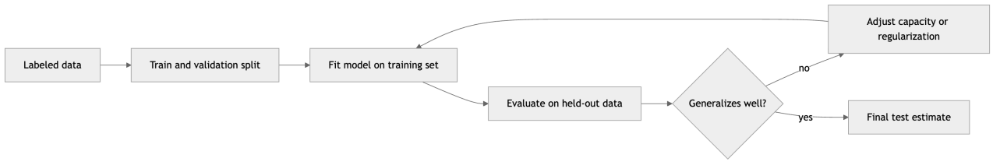

*Figure 62. The supervised learning pipeline from data to a generalization estimate.*

### 5.1.1 Decomposing Generalization Error: Approximation and Estimation

It helps to see *why* the gap exists by decomposing the excess risk of our learned model $`\widehat{f}`$ relative to the best possible predictor. Let $`f^{\star}`$ be the **Bayes-optimal** predictor — the function that minimizes $`R`$ over *all* possible functions, achievable only if we knew $`P`$ exactly. Let $`f_{\mathcal{H}}^{\star}`$ be the best predictor *within* our hypothesis class. Then

``` math
\underset{\text{excess risk}}{\underbrace{R(\widehat{f}) - R(f^{\star})}} = \underset{\text{approximation error}}{\underbrace{\left( R(f_{\mathcal{H}}^{\star}) - R(f^{\star}) \right)}} + \underset{\text{estimation error}}{\underbrace{\left( R(\widehat{f}) - R(f_{\mathcal{H}}^{\star}) \right)}}.
```

**Approximation error** is the price of restricting attention to $`\mathcal{H}`$: if the truth is a wiggly curve and $`\mathcal{H}`$ contains only straight lines, no amount of data closes this gap. It is reduced by enlarging $`\mathcal{H}`$ (more capacity). **Estimation error** is the price of having only finite, noisy data: even the best-in-class function is hard to *find* from $`m`$ examples, and richer classes are harder to search reliably. It is reduced by *shrinking* $`\mathcal{H}`$ or gathering more data. These two forces pull in opposite directions on the size of $`\mathcal{H}`$, which is exactly the bias-variance tradeoff seen through a different lens. There is no single hypothesis class that is best for all problems — a formal statement known as the **no-free-lunch theorem** — which is why the practitioner’s job is to choose $`\mathcal{H}`$ to match the structure of the problem at hand.

### 5.1.2 How Much Data Is Enough? A Word on Sample Complexity

A natural question: how large must $`m`$ be before the empirical risk reliably tracks the true risk? For a *finite* hypothesis class of size $`|\mathcal{H}|`$ with a bounded loss, a Hoeffding-plus-union-bound argument gives, with probability at least $`1 - \delta`$ over the draw of the training set and simultaneously for every $`f \in \mathcal{H}`$,

``` math
R(f) \leq \widehat{R}(f) + \sqrt{\frac{ln|\mathcal{H}| + ln(1/\delta)}{2m}}.
```

Read the formula qualitatively rather than plugging in numbers. The gap between true and empirical risk shrinks like $`1/\sqrt{m}`$ — quadrupling the data halves the gap — and *grows* with $`ln|\mathcal{H}|`$, the richness of the model class. For infinite classes, $`ln|\mathcal{H}|`$ is replaced by a capacity measure such as the **VC dimension** or Rademacher complexity, but the moral is identical: more capacity demands more data to control the same generalization gap. This is the theoretical spine beneath everything practical that follows.

### 5.1.3 Regression versus Classification

Supervised problems split by the type of the target $`y`$.

- **Regression**: $`y`$ is a continuous real number — a house price, a temperature, a patient’s blood pressure. The output space is $`\mathbb{R}`$ (or $`\mathbb{R}^{k}`$ for multi-output regression). Algorithms are covered in the chapter on Regression Algorithms.
- **Classification**: $`y`$ is a discrete category — spam or not, the digit 0 through 9, the species of an iris. With two classes it is **binary classification**; with more it is **multiclass**. When an example can carry several labels at once, it is **multilabel**.

The setup is identical; what changes is the loss function and the evaluation metrics. A regression model is judged on how close its numbers are; a classifier on how often it picks the right bucket and how well-calibrated its confidence is. We treat both throughout this chapter side by side.

| Aspect | Regression | Classification |
|----|----|----|
| Target type | Continuous $`y \in \mathbb{R}`$ | Discrete $`y \in \{ 1,\ldots,K\}`$ |
| Typical output | A number | A class label and/or probabilities |
| Common loss | Squared error, absolute error | Cross-entropy, hinge |
| Core metrics | RMSE, MAE, $`R^{2}`$ | Accuracy, precision, recall, F1, AUC |
| Example task | Forecast demand | Detect fraud |

## 5.2 The Bias-Variance Tradeoff

Why can’t we just pick the most flexible model and let it fit everything? Because flexibility cuts both ways. The **bias-variance tradeoff** is the single most important conceptual lens for understanding model error, and it explains underfitting, overfitting, and why every algorithm has knobs.

### 5.2.1 Decomposing the Error — Full Derivation

Consider regression with squared-error loss and suppose the true relationship is $`y = g(\mathbf{x}) + \varepsilon`$, where $`\varepsilon`$ is zero-mean noise with variance $`\sigma^{2}`$, independent of $`\mathbf{x}`$. Our learning algorithm produces a different model $`\widehat{f}`$ each time we train it on a fresh random dataset $`\mathcal{D}`$. Fix a single test point $`\mathbf{x}_{0}`$ and abbreviate $`\widehat{f} = \widehat{f}(\mathbf{x}_{0})`$, $`g = g(\mathbf{x}_{0})`$, and $`\bar{f} = \mathbb{E}_{\mathcal{D}}\lbrack\widehat{f}\rbrack`$, the average prediction across all training sets. We want the expected squared error at $`\mathbf{x}_{0}`$, averaged over both the noise $`\varepsilon`$ in the fresh test label and the randomness in $`\mathcal{D}`$:

``` math
\mathbb{E}\left\lbrack (y - \widehat{f})^{2} \right\rbrack = \mathbb{E}\left\lbrack (g + \varepsilon - \widehat{f})^{2} \right\rbrack.
```

Expand around the constant $`g`$ and the random $`\varepsilon`$. Because $`\varepsilon`$ is independent of the training set and has mean zero, all cross terms involving $`\varepsilon`$ vanish, leaving

``` math
\mathbb{E}\left\lbrack (y - \widehat{f})^{2} \right\rbrack = \underset{\text{model error}}{\underbrace{\mathbb{E}\left\lbrack (g - \widehat{f})^{2} \right\rbrack}} + \underset{\sigma^{2}}{\underbrace{\mathbb{E}\lbrack\varepsilon^{2}\rbrack}}.
```

Now split the model-error term by adding and subtracting the mean prediction $`\bar{f}`$:

``` math
\mathbb{E}\left\lbrack (g - \widehat{f})^{2} \right\rbrack = \mathbb{E}\left\lbrack (g - \bar{f} + \bar{f} - \widehat{f})^{2} \right\rbrack = (g - \bar{f})^{2} + \mathbb{E}\left\lbrack (\bar{f} - \widehat{f})^{2} \right\rbrack + 2(g - \bar{f})\,\mathbb{E}\lbrack\bar{f} - \widehat{f}\rbrack.
```

The last cross term is zero because $`\mathbb{E}\lbrack\bar{f} - \widehat{f}\rbrack = \bar{f} - \bar{f} = 0`$. What remains is the celebrated three-term decomposition:

``` math
\mathbb{E}\left\lbrack (y - \widehat{f}(\mathbf{x}_{0}))^{2} \right\rbrack = \underset{\text{Bias}^{2}}{\underbrace{(g(\mathbf{x}_{0}) - \bar{f})^{2}}} + \underset{\text{Variance}}{\underbrace{\mathbb{E}\left\lbrack (\widehat{f}(\mathbf{x}_{0}) - \bar{f})^{2} \right\rbrack}} + \underset{\text{Irreducible}}{\underbrace{\sigma^{2}}}.
```

The three pieces have clean interpretations:

- **Bias** is error from wrong assumptions. A model too simple to capture the real pattern — fitting a straight line to a curve — is biased: on average it misses, no matter how much data you give it.
- **Variance** is error from sensitivity to the particular training sample. A model so flexible that it chases noise will produce wildly different fits from one dataset to the next; on any given dataset it tracks quirks that won’t recur.
- **Irreducible error** $`\sigma^{2}`$ is the noise floor. No model can beat it because the target genuinely is not a deterministic function of the features.

You cannot minimize bias and variance simultaneously by turning a single knob — reducing one typically raises the other. The best total error sits at an interior sweet spot.

### 5.2.2 Underfitting, Overfitting, and Capacity

The knob that trades bias for variance is **model capacity**: the richness of the hypothesis class — polynomial degree, tree depth, number of neural-network parameters, how weak the regularization is.

- **Underfitting** (high bias, low variance): capacity is too low; the model is too rigid to capture the signal. Both training and test error are high.
- **Overfitting** (low bias, high variance): capacity is too high; the model memorizes training noise. Training error is tiny but test error is large.
- The goal is the middle: enough capacity to capture the real structure, not so much that it captures noise.

The diagnostic signature is the **train/test gap**. A small gap with high error means underfitting; a large gap means overfitting. We visualize the classic U-shaped tradeoff below.

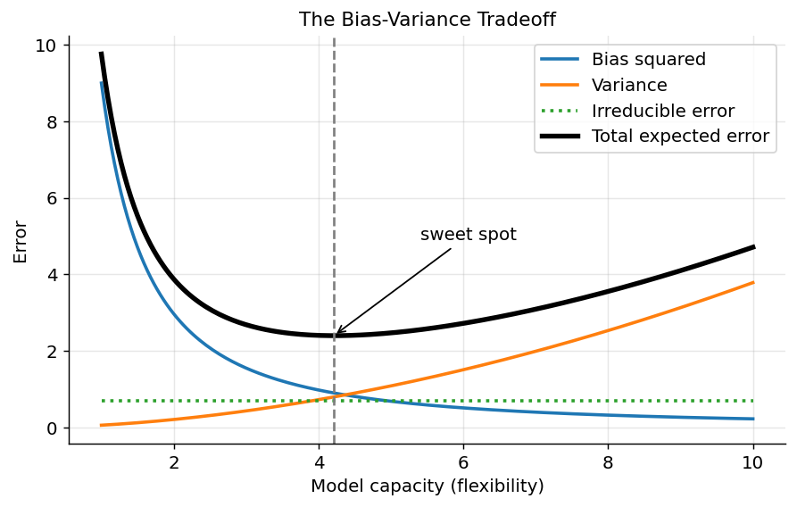

*Figure 63. Bias-variance tradeoff. As model capacity grows, bias falls and variance rises; total error is U-shaped with a sweet spot.*

Variance is easiest to *see* by refitting the same flexible model on many different random samples and overlaying the fits. Where the fits fan out, variance is high; where they cluster, it is low. The figure below fits a high-degree polynomial to many small noisy samples of the same underlying curve — the spray of wildly different high-degree fits is variance made visible, while the true function stays fixed underneath.

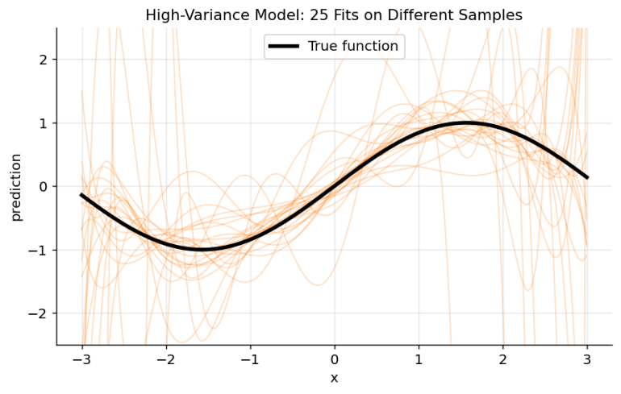

*Figure 64. Variance made visible. A high-capacity fit trained on many random samples of the same curve produces wildly different predictions, especially at the edges.*

A concrete demonstration with polynomial regression makes the U-shape tangible. We fit polynomials of increasing degree to a noisy curve and watch the train/test gap explode.

``` python
import numpy as np
from sklearn.pipeline import make_pipeline
from sklearn.preprocessing import PolynomialFeatures
from sklearn.linear_model import LinearRegression
from sklearn.model_selection import train_test_split
from sklearn.metrics import mean_squared_error

rng = np.random.default_rng(0)
X = np.sort(rng.uniform(-3, 3, size=120)).reshape(-1, 1)
y = np.sin(X).ravel() + rng.normal(0, 0.3, size=X.shape[0])  # true signal + noise
Xtr, Xte, ytr, yte = train_test_split(X, y, test_size=0.4, random_state=0)

for degree in [1, 3, 15]:
    model = make_pipeline(PolynomialFeatures(degree), LinearRegression())
    model.fit(Xtr, ytr)
    tr = mean_squared_error(ytr, model.predict(Xtr))
    te = mean_squared_error(yte, model.predict(Xte))
    print(f"degree={degree:2d}  train MSE={tr:.3f}  test MSE={te:.3f}")
# degree= 1  train MSE high, test MSE high   -> underfitting (high bias)
# degree= 3  train MSE low,  test MSE low    -> good fit
# degree=15  train MSE tiny, test MSE large  -> overfitting (high variance)
```

### 5.2.3 A Modern Footnote: Double Descent

The classic U-curve is the right mental model for most models you will build, but it is not the whole story for very over-parameterized models such as large neural networks. Empirically, as capacity grows *past* the point of interpolating the training data (zero training error), test error can rise to a peak near the interpolation threshold and then *fall again* — a phenomenon called **double descent**. The extra parameters, combined with the implicit regularization of gradient descent, let the model choose among the many zero-training-error solutions a particularly smooth one. This does not repeal the bias-variance tradeoff; it refines it for the heavily over-parameterized regime, and we revisit it in the deep-learning chapters. For classical models — linear/tree/SVM — plan around the U-curve.

## 5.3 Loss Functions

The loss function defines what “good” means before any metric is computed. Different losses encode different priorities — robustness to outliers, calibrated probabilities, wide margins. Here are the workhorses; later chapters reuse them. Note the distinction, easy to blur: the **loss** is what the model *optimizes* during training (it must usually be smooth and differentiable); the **metric** is what you *report* to judge the result (it can be anything, including non-differentiable things like accuracy). They are often different functions on purpose.

### 5.3.1 Regression Losses

**Mean Squared Error (MSE)** squares each residual:

``` math
L_{\text{MSE}} = \frac{1}{m}\sum_{i = 1}^{m}(y^{(i)} - {\widehat{y}}^{(i)})^{2}.
```

Squaring makes the loss smooth and differentiable everywhere, and it penalizes large errors disproportionately — a residual of 10 costs 100× a residual of 1. That sensitivity is a feature when big misses are truly bad, and a bug when outliers should not dominate. The minimizer of MSE is the conditional **mean** $`\mathbb{E}\lbrack y \mid \mathbf{x}\rbrack`$.

**Mean Absolute Error (MAE)** uses absolute residuals:

``` math
L_{\text{MAE}} = \frac{1}{m}\sum_{i = 1}^{m}|y^{(i)} - {\widehat{y}}^{(i)}|.
```

MAE treats all errors proportionally, so it is far more robust to outliers. Its minimizer is the conditional **median**. The cost: it is not differentiable at zero, complicating gradient-based optimization. The **Huber loss** splits the difference — quadratic for small residuals within a threshold $`\delta`$, linear for large ones — giving robustness with a smooth elbow. A close relative, the **log-cosh** loss, is smooth everywhere and behaves like MSE for small errors and MAE for large ones. Choose your regression loss by asking how much you want a single catastrophic miss to dominate the fit.

### 5.3.2 Classification Losses

**Cross-entropy (log loss)** is the default for probabilistic classifiers. For binary labels $`y \in \{ 0,1\}`$ with predicted probability $`\widehat{p} = P(y = 1 \mid \mathbf{x})`$:

``` math
L_{\text{CE}} = - \frac{1}{m}\sum_{i = 1}^{m}\left\lbrack y^{(i)}\log{\widehat{p}}^{(i)} + (1 - y^{(i)})log(1 - {\widehat{p}}^{(i)}) \right\rbrack.
```

Cross-entropy is the negative log-likelihood under a Bernoulli model, so minimizing it is maximum-likelihood estimation. It punishes confident wrong predictions ferociously: predicting $`\widehat{p} = 0.01`$ when $`y = 1`$ contributes $`- log(0.01) \approx 4.6`$ to the loss. The multiclass form (**categorical cross-entropy**) sums $`- log{\widehat{p}}_{\text{true class}}`$ over examples. This loss is central to logistic regression and every neural classifier, as the chapter on Neural Network Fundamentals develops further.

**Hinge loss** is the loss behind support vector machines. With labels encoded $`y \in \{ - 1, + 1\}`$ and a raw score $`s = f(\mathbf{x})`$:

``` math
L_{\text{hinge}} = \frac{1}{m}\sum_{i = 1}^{m}\max\left( 0,\mspace{6mu} 1 - y^{(i)}s^{(i)} \right).
```

Hinge loss is zero once an example is correctly classified with a margin of at least 1, and grows linearly inside the margin. It does not produce probabilities but encourages a wide separating margin, as the chapter on Support Vector Machines explores.

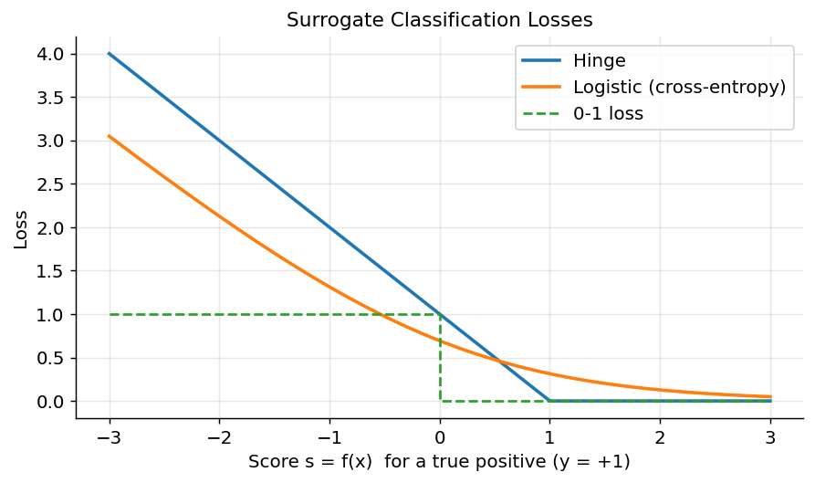

*Figure 65. Classification loss as a function of the score for a positive example. Cross-entropy and hinge both push predictions toward confident correctness.*

Notice that both hinge and log loss sit *above* the 0-1 loss everywhere: they are **convex surrogates** for the discontinuous, non-differentiable count of mistakes we actually care about. We optimize the smooth surrogate because we can take its gradient, and we report the 0-1-based metric (accuracy) because that is what the world cares about. This surrogate-versus-metric split is the reason a model tuned to minimize log loss is not automatically the one with the best F1 at your chosen threshold — a subtlety that reappears in the threshold-selection section.

## 5.4 Regularization

Regularization is the most direct lever on the bias-variance tradeoff. The idea: add a penalty on model complexity to the loss, so the optimizer must trade fit against simplicity. The regularized objective is

``` math
J(\mathbf{\theta}) = \underset{\text{data fit}}{\underbrace{\frac{1}{m}\sum_{i = 1}^{m}L\left( y^{(i)},f_{\mathbf{\theta}}(\mathbf{x}^{(i)}) \right)}} + \lambda\,\Omega(\mathbf{\theta}),
```

where $`\Omega`$ measures complexity and $`\lambda \geq 0`$ controls its strength. Larger $`\lambda`$ shrinks the weights, lowering variance at the cost of some bias.

- **L2 regularization (ridge)** penalizes the squared norm, $`\Omega = \sum_{j}^{}\theta_{j}^{2}`$. It shrinks all weights smoothly toward zero but rarely to exactly zero, and it is the standard cure for multicollinearity and overfitting. In neural networks this is **weight decay**.
- **L1 regularization (lasso)** penalizes the absolute norm, $`\Omega = \sum_{j}^{}|\theta_{j}|`$. Its geometry has sharp corners on the axes, so the optimum often lands with many weights exactly zero — performing automatic **feature selection** and yielding sparse, interpretable models.
- **Elastic Net** blends both: $`\Omega = \alpha\sum_{j}^{}|\theta_{j}| + (1 - \alpha)\sum_{j}^{}\theta_{j}^{2}`$. It keeps lasso’s sparsity while handling correlated features more gracefully (lasso tends to arbitrarily pick one of a correlated group; elastic net keeps them together).

Why does shrinking weights fight overfitting? An overfit model uses large, finely tuned coefficients to thread through every training point. The penalty makes large coefficients expensive, so the model can only spend “weight budget” on features that genuinely reduce the data-fit loss. The result is a smoother function with lower variance. Regularization is not confined to the norm penalty above: **early stopping** (halting training when validation loss stops improving), **dropout** in neural networks, **bagging** in ensembles, and simply **collecting more data** are all variance-reducing regularizers in the broad sense. Anything that constrains the effective richness of the fitted function belongs to this family.

``` python
import numpy as np
from sklearn.datasets import make_regression
from sklearn.linear_model import Ridge, Lasso, ElasticNet
from sklearn.preprocessing import StandardScaler
from sklearn.pipeline import make_pipeline
from sklearn.model_selection import cross_val_score

X, y = make_regression(n_samples=200, n_features=40, n_informative=8,
                       noise=15.0, random_state=0)

for name, est in [("Ridge (L2)", Ridge(alpha=10.0)),
                  ("Lasso (L1)", Lasso(alpha=1.0)),
                  ("ElasticNet", ElasticNet(alpha=1.0, l1_ratio=0.5))]:
    pipe = make_pipeline(StandardScaler(), est)
    pipe.fit(X, y)
    nonzero = np.sum(np.abs(pipe[-1].coef_) > 1e-6)
    r2 = cross_val_score(pipe, X, y, cv=5, scoring="r2").mean()
    print(f"{name:12s}  nonzero coefs={nonzero:2d}/40  CV R^2={r2:.3f}")
# Lasso and ElasticNet zero out many of the 32 useless features; Ridge keeps all.
```

## 5.5 The Train / Validation / Test Protocol

Before any metric means anything, you must decide *which data* it is computed on. The single most common way to produce a misleadingly good number is to evaluate on data the model has already seen, directly or indirectly. The remedy is a disciplined three-way split, and understanding the distinct job of each part is non-negotiable.

- The **training set** is what the model’s parameters are fit on. Performance here measures *memorization capacity*, not generalization, and is expected to be optimistic.
- The **validation set** (also development or “dev” set) is used to make *modeling decisions*: which algorithm, which hyperparameters, when to stop training, which features. Because you make many decisions against it, you slowly, implicitly overfit to it — every choice that helps the validation score a little may be partly luck. The validation score is therefore mildly optimistic too, and the more configurations you try, the more optimistic it becomes.
- The **test set** exists to give one final, honest estimate of generalization. It must be touched *exactly once*, at the very end, after every decision is frozen. The instant you use the test set to make a choice, it becomes a validation set and stops being a fair estimate. Guard it like evidence in a trial.

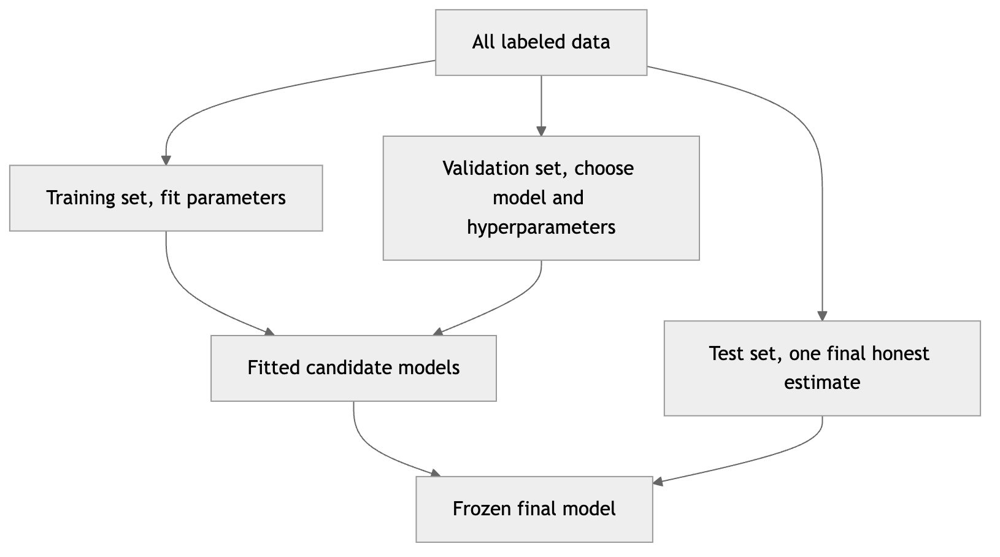

*Figure 66. The three-way data split and the distinct job each part performs.*

### 5.5.1 Data Leakage: The Silent Killer

**Data leakage** is any situation where information that would not be available at prediction time sneaks into training, inflating measured performance and then vanishing in production. It is the number-one cause of models that “worked in the notebook” and failed on deployment. Classic forms:

- **Preprocessing leakage.** Fitting a scaler, imputer, feature selector, or PCA on the *whole* dataset before splitting lets statistics from the test set leak into training. The fix: fit every transform on the training fold only, inside a `Pipeline`, and apply it to validation/test.
- **Target leakage.** A feature that is a proxy for the label because it was recorded *after* the outcome — for example, “number of late-payment reminders sent” when predicting default. The model looks brilliant offline and is useless (or circular) live.
- **Temporal leakage.** Shuffling time-ordered data so the model trains on the future to predict the past.
- **Group leakage.** The same patient, user, or document appearing in both train and test, so the model memorizes the entity rather than the pattern.

The defense is always the same principle: *simulate deployment exactly.* Ask, at every step, “would this information genuinely be available at the moment of prediction?” If not, it must not touch the model.

## 5.6 Cross-Validation for Honest Estimates

A single train/test split gives a *noisy* estimate of generalization error: get a lucky or unlucky split and the number swings, especially on small datasets. **Cross-validation (CV)** reduces that noise by reusing data systematically, so that every example serves for evaluation at some point.

In **k-fold cross-validation** the data is partitioned into $`k`$ equal folds. The model is trained $`k`$ times; each time one fold is held out for validation and the other $`k - 1`$ are used for training. The $`k`$ validation scores are averaged. Every example serves in validation exactly once, so the estimate uses all the data and reports a mean *and* a standard deviation — a measure of how stable the model is. Typical choices are $`k = 5`$ or $`k = 10`$: larger $`k`$ means more training data per fold (lower bias in the estimate) but more compute and more correlated, higher-variance fold estimates.

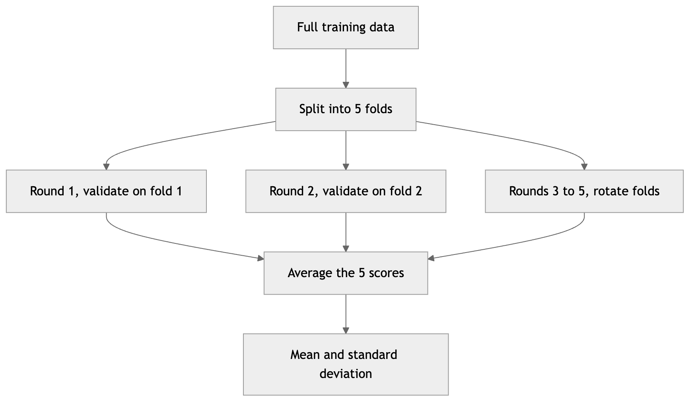

*Figure 67. Five-fold cross-validation. Each fold takes a turn as the validation set; scores are averaged.*

### 5.6.1 The Cross-Validation Family

No single CV scheme is right for every dataset — the correct choice depends on the structure of your data and how it will be used in deployment. The table and notes below cover the variants you will actually reach for.

| Variant | Splitting rule | Use when |
|----|----|----|
| Plain k-fold | Random equal partitions | I.i.d. data, regression or balanced classes |
| Stratified k-fold | Preserve class proportions per fold | Classification, especially imbalanced |
| Leave-One-Out (LOO) | $`k = m`$; one example out each time | Very small datasets, near-unbiased estimate wanted |
| Leave-P-Out | Every subset of size $`p`$ held out | Tiny datasets, exhaustive study |
| Group k-fold | Whole groups kept together | Repeated entities (patients, users) must not leak |
| Stratified Group k-fold | Groups intact *and* class balance | Grouped data that is also imbalanced |
| Time-series split | Train on past, validate on future | Temporal data with autocorrelation |
| Repeated k-fold | k-fold repeated with new shuffles | Need a tighter estimate of the mean |
| Nested CV | Inner loop tunes, outer loop scores | Unbiased estimate *with* tuning |

- **Stratified k-fold** preserves the class proportions in every fold — essential for imbalanced classification, and the default for classifiers in scikit-learn. Without it, a rare class might be absent from a fold entirely, making that fold’s score meaningless.
- **Leave-One-Out (LOO)** sets $`k = m`$: each model trains on all but one example. It is nearly unbiased for the true risk but expensive ($`m`$ fits) and, counterintuitively, has *high variance* because the $`m`$ training sets are almost identical, so the fold scores are strongly correlated. **Leave-P-Out** generalizes it and is only feasible for tiny $`m`$.
- **Group k-fold** ensures that all examples sharing a group label (the same patient across visits, the same user across sessions) land in the same fold. This prevents the group leakage described above; without it you measure memorization of entities, not generalization to new ones. **Stratified Group k-fold** additionally balances classes.
- **Repeated k-fold** runs k-fold several times with different random shuffles and averages, shrinking the variance of the estimate at linear extra cost.

### 5.6.2 Time-Series and Rolling Validation

Temporal data breaks the i.i.d. assumption: today’s value is correlated with yesterday’s, and in deployment you will always predict the future from the past. Random shuffling here is a form of leakage — it lets the model peek at the future. Instead use **time-series split** (expanding window) or **rolling-window** validation: always train on a contiguous past block and validate on the immediately following block, marching forward through time. An optional **gap** (embargo) between train and validation blocks prevents leakage through features that span a window (like a 7-day moving average). Two common shapes:

- **Expanding window:** the training set grows each round (all history up to time $`t`$), validating on $`\lbrack t,t + h\rbrack`$. Uses all data, mimics accumulating history.
- **Rolling (sliding) window:** the training window is fixed-length and slides forward, discarding the distant past. Useful when the process drifts and old data is misleading.

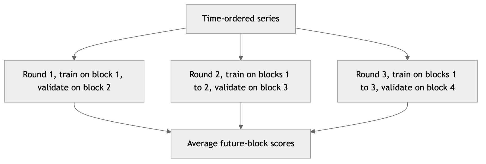

*Figure 68. Expanding-window time-series cross-validation always trains on the past and validates on the immediate future.*

A critical discipline runs through all of these: keep a **final test set** completely untouched until the very end. Use CV on the training data for model selection and tuning; touch the test set once, to report the final honest number. Any preprocessing fit (scaling, imputation) must happen *inside* each CV fold via a `Pipeline`, or information leaks across folds and inflates the score.

``` python
import numpy as np
from sklearn.datasets import load_breast_cancer
from sklearn.pipeline import make_pipeline
from sklearn.preprocessing import StandardScaler
from sklearn.linear_model import LogisticRegression
from sklearn.model_selection import (StratifiedKFold, GroupKFold,
                                     TimeSeriesSplit, cross_val_score)

X, y = load_breast_cancer(return_X_y=True)
pipe = make_pipeline(StandardScaler(), LogisticRegression(max_iter=5000))
cv = StratifiedKFold(n_splits=5, shuffle=True, random_state=0)
scores = cross_val_score(pipe, X, y, cv=cv, scoring="roc_auc")
print("Per-fold AUC:", np.round(scores, 3))
print(f"CV AUC = {scores.mean():.3f} +/- {scores.std():.3f}")
# Reporting mean +/- std is far more trustworthy than a single split.

# GroupKFold and TimeSeriesSplit swap in wherever the data structure demands:
# cross_val_score(pipe, X, y, groups=patient_id, cv=GroupKFold(5))
# cross_val_score(model, X, y, cv=TimeSeriesSplit(n_splits=5))
```

## 5.7 Evaluation Metrics for Regression

Once a regression model is trained, we summarize its error with a single number. Each metric tells a slightly different story, and reporting two or three together is almost always wiser than betting on one.

**Mean Squared Error (MSE)** and its square root **RMSE** are the most common:

``` math
\text{RMSE} = \sqrt{\frac{1}{m}\sum_{i = 1}^{m}(y^{(i)} - {\widehat{y}}^{(i)})^{2}}.
```

RMSE is in the same units as the target (dollars, degrees) so it is interpretable, but because it squares residuals it is dominated by large errors and sensitive to outliers.

**Mean Absolute Error (MAE)** is the average absolute residual. It is in target units too, robust to outliers, and answers “how far off is a typical prediction?” Comparing RMSE and MAE is diagnostic: $`\text{RMSE} \geq \text{MAE}`$ always, and a large gap signals a few big errors inflating the RMSE.

**Mean Absolute Percentage Error (MAPE)** expresses error as a fraction of the true value:

``` math
\text{MAPE} = \frac{100\%}{m}\sum_{i = 1}^{m}\left| \frac{y^{(i)} - {\widehat{y}}^{(i)}}{y^{(i)}} \right|.
```

MAPE is scale-free and intuitive for business audiences (“we’re off by 8% on average”), which is why it dominates demand forecasting. But it has sharp teeth: it is undefined when any $`y^{(i)} = 0`$, explodes for near-zero targets, and is *asymmetric* — it penalizes over-prediction more heavily than under-prediction, which can quietly bias a model that is tuned against it. Symmetric variants (sMAPE) and the **weighted MAPE** patch some of this. Use MAPE for communication, not as your optimization target on data with small or zero values.

**Coefficient of determination (**$`R^{2}`$**)** measures the fraction of variance explained, relative to the trivial baseline of always predicting the mean $`\bar{y}`$:

``` math
R^{2} = 1 - \frac{\sum_{i}^{}(y^{(i)} - {\widehat{y}}^{(i)})^{2}}{\sum_{i}^{}(y^{(i)} - \bar{y})^{2}}.
```

An $`R^{2}`$ of 1 is perfect; 0 means no better than predicting the mean; negative means *worse* than the mean (common on a badly fit test set). $`R^{2}`$ is unitless and comparable across problems, but it can only ever *increase* when you add features — even useless ones — which is why **adjusted** $`R^{2}`$ penalizes feature count:

``` math
R_{\text{adj}}^{2} = 1 - (1 - R^{2})\,\frac{m - 1}{m - n - 1},
```

where $`m`$ is the number of observations and $`n`$ the number of features. Adjusted $`R^{2}`$ rises only if a new feature helps *more* than a random feature would, so it is the honest metric when comparing models with different numbers of predictors.

| Metric | Units | Outlier sensitivity | Interpretation |
|----|----|----|----|
| MSE | Target$`^{2}`$ | High | Penalizes big errors heavily |
| RMSE | Target | High | Typical error magnitude, big-error-weighted |
| MAE | Target | Low | Typical error magnitude, robust |
| MAPE | Percent | Medium | Relative error, undefined at zero, asymmetric |
| $`R^{2}`$ | None | Medium | Fraction of variance explained |
| Adjusted $`R^{2}`$ | None | Medium | Variance explained, penalized for feature count |

### 5.7.1 Worked Example: Reading the Metrics by Hand

Take five predictions so you can follow every arithmetic step:

``` math
y = \lbrack 3.0,\  - 0.5,\ 2.0,\ 7.0,\ 4.2\rbrack,\quad\quad\widehat{y} = \lbrack 2.5,\ 0.0,\ 2.1,\ 7.8,\ 3.6\rbrack.
```

The residuals $`y - \widehat{y}`$ are $`\lbrack 0.5,\  - 0.5,\  - 0.1,\  - 0.8,\ 0.6\rbrack`$. Then:

- Squared residuals: $`\lbrack 0.25,\ 0.25,\ 0.01,\ 0.64,\ 0.36\rbrack`$, summing to $`1.51`$, so $`\text{MSE} = 1.51/5 = 0.302`$ and $`\text{RMSE} = \sqrt{0.302} \approx 0.549`$.
- Absolute residuals: $`\lbrack 0.5,\ 0.5,\ 0.1,\ 0.8,\ 0.6\rbrack`$, summing to $`2.5`$, so $`\text{MAE} = 2.5/5 = 0.500`$.
- For $`R^{2}`$: $`\bar{y} = (3.0 - 0.5 + 2.0 + 7.0 + 4.2)/5 = 3.14`$. The total sum of squares is $`\sum(y_{i} - 3.14)^{2} = 0.0196 + 13.25 + 1.30 + 14.90 + 1.12 = 30.59`$. Then $`R^{2} = 1 - 1.51/30.59 \approx 0.951`$.

The RMSE ($`0.549`$) sitting modestly above the MAE ($`0.500`$) tells you there is one somewhat larger error (the $`- 0.8`$ residual) but no wild outlier. The high $`R^{2}`$ confirms the model explains almost all the variance around the mean. Reading these three together — not any one alone — is how you diagnose a regression fit.

``` python
import numpy as np
from sklearn.metrics import (mean_squared_error, mean_absolute_error,
                             mean_absolute_percentage_error, r2_score)

y_true = np.array([3.0, -0.5, 2.0, 7.0, 4.2])
y_pred = np.array([2.5,  0.0, 2.1, 7.8, 3.6])
mse  = mean_squared_error(y_true, y_pred)
print(f"MSE  = {mse:.3f}")
print(f"RMSE = {np.sqrt(mse):.3f}")
print(f"MAE  = {mean_absolute_error(y_true, y_pred):.3f}")
print(f"MAPE = {mean_absolute_percentage_error(y_true, y_pred):.3f}")
print(f"R^2  = {r2_score(y_true, y_pred):.3f}")
# MSE = 0.302  RMSE = 0.549  MAE = 0.500  MAPE ~ 0.44 (skewed by y=-0.5)  R^2 = 0.951
```

## 5.8 Evaluation Metrics for Classification

Classification metrics are richer and trickier than regression metrics, because a single accuracy number hides crucial structure. We build them up from the confusion matrix.

### 5.8.1 The Confusion Matrix

For binary classification, every prediction falls into one of four cells comparing predicted versus actual:

- **True Positive (TP)**: predicted positive, actually positive.
- **True Negative (TN)**: predicted negative, actually negative.
- **False Positive (FP)**: predicted positive, actually negative — a *false alarm* (Type I error).
- **False Negative (FN)**: predicted negative, actually positive — a *miss* (Type II error).

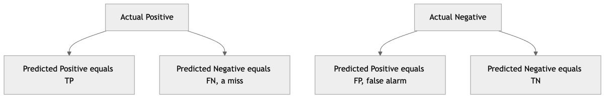

*Figure 69. The binary confusion matrix. Rows are actual class, columns are predicted class.*

Every scalar metric is a ratio of these four counts. Deciding *which* of the four errors hurts more — a false alarm or a miss — is a business and ethical decision, not a statistical one, and it should be made before you pick a metric.

### 5.8.2 The Full Family of Confusion-Matrix Metrics

**Accuracy** is the fraction correct:

``` math
\text{Accuracy} = \frac{TP + TN}{TP + TN + FP + FN}.
```

It is intuitive but, as we will see, dangerously misleading under class imbalance.

**Precision** asks: of the examples I flagged positive, how many really were?

``` math
\text{Precision} = \frac{TP}{TP + FP}.
```

**Recall** (sensitivity, true positive rate) asks: of the actual positives, how many did I catch?

``` math
\text{Recall} = \frac{TP}{TP + FN}.
```

**Specificity** (true negative rate) is recall’s mirror image for the negative class — of the actual negatives, how many did I correctly clear?

``` math
\text{Specificity} = \frac{TN}{TN + FP}.
```

Specificity matters whenever the cost of a false positive falls on the negative population (needlessly alarming healthy patients, blocking legitimate transactions). Note that $`1 - \text{Specificity}`$ is exactly the false positive rate plotted on the ROC curve.

These trade off. A cancer screen tuned for high recall flags many patients (catching nearly every case) but with low precision (many false alarms). A spam filter tuned for high precision rarely misclassifies real mail but lets some spam through (lower recall). The **F1 score** is the harmonic mean of precision and recall, rewarding balance:

``` math
F_{1} = 2 \cdot \frac{\text{Precision} \cdot \text{Recall}}{\text{Precision} + \text{Recall}}.
```

The harmonic mean punishes lopsidedness: you cannot get a high F1 by maxing one at the other’s expense. The generalized $`F_{\beta}`$ weights recall $`\beta`$ times as important as precision:

``` math
F_{\beta} = (1 + \beta^{2}) \cdot \frac{\text{Precision} \cdot \text{Recall}}{\beta^{2}\,\text{Precision} + \text{Recall}}.
```

Use $`\beta > 1`$ (say $`F_{2}`$) when misses are costlier than false alarms, and $`\beta < 1`$ (say $`F_{0.5}`$) when false alarms are worse. Both F1 and $`F_{\beta}`$ share a blind spot: they *ignore true negatives entirely*, so they say nothing about performance on the negative class.

**Matthews Correlation Coefficient (MCC)** repairs that blind spot. It uses all four cells and behaves like a correlation coefficient between predicted and actual labels, ranging from $`- 1`$ (total disagreement) through $`0`$ (no better than random) to $`+ 1`$ (perfect):

``` math
\text{MCC} = \frac{TP \cdot TN - FP \cdot FN}{\sqrt{(TP + FP)(TP + FN)(TN + FP)(TN + FN)}}.
```

MCC is high only when the classifier does well on *both* classes, which makes it the most trustworthy single-number summary for imbalanced binary problems — a model that games F1 by ignoring the negatives cannot game MCC.

| Metric | Uses TN? | Question it answers | When it matters most |
|----|----|----|----|
| Accuracy | Yes | Overall fraction correct | Balanced classes, equal error costs |
| Precision | No | Of flagged positives, how many correct | False alarms are costly (spam, alerts) |
| Recall | No | Of true positives, how many caught | Misses are costly (disease, fraud) |
| Specificity | Yes | Of true negatives, how many cleared | False positives burden the negative class |
| F1 / F-beta | No | Balance of precision and recall | Imbalanced data, single-number tradeoff |
| MCC | Yes | Correlation of prediction and truth | Imbalanced data, want one honest number |

### 5.8.3 A Fully Worked Confusion Matrix

Concreteness cements this. Suppose a disease screen is evaluated on 1,000 patients, of whom 100 truly have the disease. The classifier produces this confusion matrix:

|                     | Predicted Positive | Predicted Negative | Row total |
|---------------------|--------------------|--------------------|-----------|
| **Actual Positive** | TP = 80            | FN = 20            | 100       |
| **Actual Negative** | FP = 50            | TN = 850           | 900       |
| **Column total**    | 130                | 870                | 1000      |

Now compute every metric by hand from the four cells $`TP = 80`$, $`FN = 20`$, $`FP = 50`$, $`TN = 850`$:

- **Accuracy** $`= (80 + 850)/1000 = 0.930`$. Looks excellent.
- **Precision** $`= 80/(80 + 50) = 80/130 = 0.615`$. Of everyone we flagged, only 62% actually have the disease — many false alarms.
- **Recall** $`= 80/(80 + 20) = 80/100 = 0.800`$. We caught 80% of true cases and missed 20 sick patients.
- **Specificity** $`= 850/(850 + 50) = 850/900 = 0.944`$. We correctly cleared 94% of healthy people.
- **F1** $`= 2 \cdot (0.615 \cdot 0.800)/(0.615 + 0.800) = 2 \cdot 0.492/1.415 \approx 0.696`$.
- $`F_{2}`$ (misses matter more, so recall weighted higher) $`= 5 \cdot (0.615 \cdot 0.800)/(4 \cdot 0.615 + 0.800) = 5 \cdot 0.492/3.260 \approx 0.755`$ — higher than F1 because recall is the stronger number.
- **MCC** $`= \frac{80 \cdot 850 - 50 \cdot 20}{\sqrt{130 \cdot 100 \cdot 900 \cdot 870}} = \frac{68000 - 1000}{\sqrt{1.0179 \times 10^{10}}} = \frac{67000}{100892} \approx 0.664.`$

The story these numbers tell together is far richer than the 93% accuracy alone. Accuracy is flattered by the 850 easy true negatives. The precision of 0.62 warns that most positive flags are false alarms — a real problem if follow-up testing is expensive or invasive. The recall of 0.80 says one in five sick patients slips through — potentially unacceptable for an aggressive disease. MCC’s moderate 0.66 is the honest overall grade. *This* is why you never report accuracy alone.

``` python
import numpy as np
from sklearn.metrics import (confusion_matrix, precision_score, recall_score,
                             f1_score, fbeta_score, matthews_corrcoef)

# Reconstruct the worked example as label arrays.
y_true = np.array([1]*100 + [0]*900)
y_pred = np.array([1]*80 + [0]*20 + [1]*50 + [0]*850)  # TP,FN,FP,TN
tn, fp, fn, tp = confusion_matrix(y_true, y_pred).ravel()
print("TN,FP,FN,TP =", tn, fp, fn, tp)                 # 850 50 20 80
print(f"precision={precision_score(y_true,y_pred):.3f}")   # 0.615
print(f"recall   ={recall_score(y_true,y_pred):.3f}")      # 0.800
print(f"specificity={tn/(tn+fp):.3f}")                     # 0.944
print(f"F1  ={f1_score(y_true,y_pred):.3f}")               # 0.696
print(f"F2  ={fbeta_score(y_true,y_pred,beta=2):.3f}")     # 0.755
print(f"MCC ={matthews_corrcoef(y_true,y_pred):.3f}")      # 0.664
```

### 5.8.4 Class Imbalance and Why Accuracy Misleads

Suppose 1% of credit-card transactions are fraudulent. A model that predicts “not fraud” for *every* transaction achieves 99% accuracy — and is utterly useless, catching zero fraud. This is the central trap: under class imbalance, accuracy is dominated by the majority class and rewards a model that ignores the minority. Precision, recall, F1, MCC, and the ROC/PR curves below are designed precisely to expose this failure. The rule of thumb: **never report accuracy alone on imbalanced data.** Pair it with recall on the minority class (did we catch the rare events?) and precision (at what false-alarm cost?), and consider resampling, class weights, or threshold tuning, as the chapter on the Machine Learning Workflow discusses.

``` python
import numpy as np
from sklearn.metrics import confusion_matrix, classification_report

# 1000 examples, 1% positive (fraud). A lazy model predicts all-negative.
y_true = np.array([1]*10 + [0]*990)
y_pred_lazy = np.zeros(1000, dtype=int)
print("Lazy 'all negative' accuracy:",
      (y_true == y_pred_lazy).mean())          # 0.99 -- looks great, is useless
print(confusion_matrix(y_true, y_pred_lazy))   # zero TP: catches no fraud
print(classification_report(y_true, y_pred_lazy,
      target_names=["legit", "fraud"], zero_division=0))
# recall for 'fraud' is 0.00 -- the metric that exposes the failure
```

### 5.8.5 The ROC Curve and AUC

Most classifiers output a score or probability, and we choose a **threshold** to convert it into a hard label. Different thresholds yield different precision/recall tradeoffs, so summarizing a classifier at a *single* threshold throws away information. The **ROC curve** (Receiver Operating Characteristic) sweeps the threshold from high to low and plots the **true positive rate** (recall) against the **false positive rate**, $`FPR = FP/(FP + TN) = 1 - \text{Specificity}`$.

- The bottom-left corner is a strict threshold: nothing flagged, no false positives but no true positives.
- The top-right is a permissive threshold: everything flagged.
- A perfect classifier hugs the top-left corner (high TPR, zero FPR).
- The diagonal is random guessing.

**AUC** (Area Under the ROC Curve) collapses the whole curve to one number in $`\lbrack 0,1\rbrack`$. It has a beautiful probabilistic meaning: AUC equals the probability that a randomly chosen positive example is scored higher than a randomly chosen negative one. AUC of 0.5 is random; 1.0 is perfect. Because it is threshold-independent and ranking-based, AUC is a robust summary of *discrimination* — but on heavily imbalanced data it can look optimistically high because the abundant true negatives inflate the denominator of FPR, so a curve can look great while the precision at any usable threshold is poor.

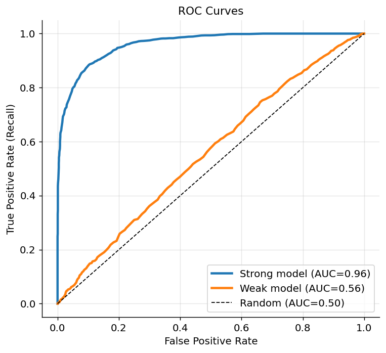

*Figure 70. ROC curves for two classifiers versus the random-guessing diagonal. Higher and more top-left is better; AUC is the area underneath.*

### 5.8.6 Precision-Recall Curves and When to Prefer Them

When positives are rare, the **precision-recall (PR) curve** is more informative than ROC. It plots precision against recall as the threshold varies. Because precision involves only positives and predicted-positives — never the swarm of true negatives — it stays honest under imbalance. A model can have a deceptively good ROC AUC but a poor PR curve when positives are scarce; reach for PR (and its summary, **average precision**, the area under the PR curve) for needle-in-a-haystack problems like fraud or rare-disease detection.

The reason is arithmetic. FPR has $`TN`$ in its denominator, and when negatives vastly outnumber positives, even a large *count* of false positives is a small *rate*, so the ROC curve barely moves — it looks flattering. Precision has $`FP`$ in its denominator directly, with no dilution by the easy negatives, so it registers the pain of false alarms honestly. The baseline also differs: a random classifier sits at AUC $`= 0.5`$ on ROC regardless of imbalance, but on a PR curve the baseline precision equals the positive class prevalence (e.g. $`0.02`$ at 2% positives), so a PR curve must be read relative to that floor. The figure below contrasts the two views on the same imbalanced scores.

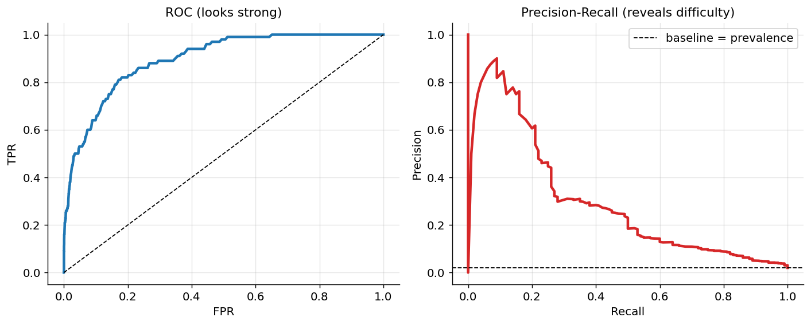

*Figure 71. On imbalanced data, the ROC curve looks strong while the precision-recall curve reveals the real difficulty. Both are computed from the same scores.*

### 5.8.7 Threshold Selection

The ROC and PR curves make explicit that a probabilistic classifier is not one model but a *family* of decision rules, one per threshold. The default cutoff of $`0.5`$ is rarely optimal — it is optimal only when the classes are balanced and false positives and false negatives cost the same, which is almost never true. Choosing the operating threshold is a distinct step *after* training, and it should be driven by the costs of the two error types.

Several principled strategies:

- **Cost-sensitive threshold.** Assign a cost $`c_{FP}`$ to a false positive and $`c_{FN}`$ to a false negative. The expected-cost-minimizing rule flags positive when the predicted probability exceeds $`t^{\star} = c_{FP}/(c_{FP} + c_{FN})`$. If a miss is nine times worse than a false alarm, flag when $`\widehat{p} > 0.1`$, not $`0.5`$.
- **Maximize a metric on validation data.** Sweep the threshold and pick the one that maximizes F1, $`F_{\beta}`$, or MCC on the validation set. Report the chosen threshold; do not re-tune it on the test set.
- **Fix an operating constraint.** “Keep false-positive rate below 1%” or “guarantee at least 90% recall,” then read off the threshold that satisfies it — common in medicine and security where a regulator or SLA fixes one axis.
- **Youden’s J statistic** picks the ROC point that maximizes $`\text{TPR} - \text{FPR}`$, a reasonable default when the two error costs are genuinely comparable.

Crucially, the threshold is a hyperparameter like any other: choose it on validation data, freeze it, and only then measure the test set.

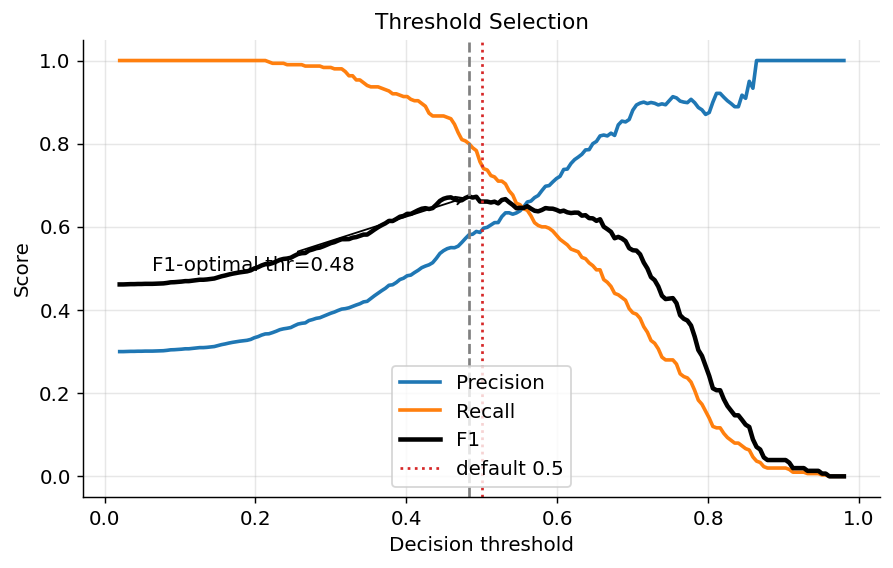

*Figure 72. Metrics as a function of the decision threshold. F1 and cost-weighted objectives usually peak away from 0.5.*

### 5.8.8 Probability Calibration

Discrimination (does the model rank positives above negatives?) and **calibration** (are the predicted probabilities *numerically* trustworthy?) are different virtues. A model is **well-calibrated** if, among all cases it labels “70% likely,” about 70% are truly positive. Calibration matters whenever you *act on the probability itself* — computing expected value, ranking by risk, setting insurance premiums, feeding the number into a downstream Bayesian decision — rather than just taking the top-1 label. A model can have excellent AUC yet be badly miscalibrated, and one that is miscalibrated will make systematically wrong expected-value decisions even while ranking correctly.

The diagnostic tool is the **reliability diagram** (calibration curve): bin predictions by their stated probability, and plot the *mean predicted probability* in each bin against the *observed fraction of positives* in that bin. Perfect calibration lies on the diagonal. A curve sagging below the diagonal means the model is **overconfident** (says 90%, delivers 70%); bowing above means **underconfident**. The scalar summary is the **Expected Calibration Error (ECE)**, the average gap between confidence and accuracy across bins, weighted by bin population. Tree ensembles and SVMs are notoriously miscalibrated (boosting pushes probabilities toward 0/1; bagging pulls them toward the middle); logistic regression and properly trained neural nets tend to be better but not automatically perfect.

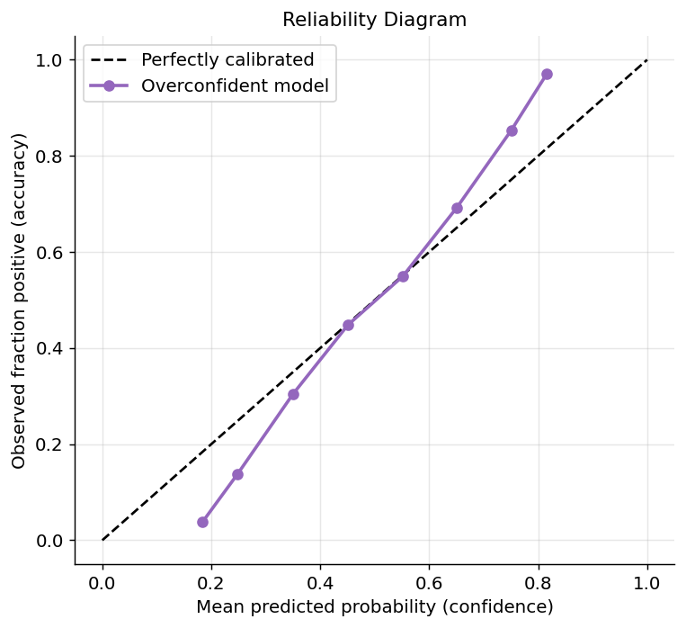

*Figure 73. A reliability diagram. The overconfident model sags below the diagonal; recalibration would pull it back toward it.*

Two standard post-hoc recalibration methods fix the mapping without retraining the base model, fit on a held-out calibration set:

- **Platt scaling** fits a one-dimensional logistic regression to the model’s scores, learning $`{\widehat{p}}_{\text{cal}} = \sigma(a\, s + b)`$. It is parametric, needs little data, and works well when the miscalibration is roughly sigmoidal — the classic remedy for SVM scores.
- **Isotonic regression** fits a free-form monotonic (non-decreasing) step function from scores to probabilities. It is non-parametric and can correct any monotonic distortion, but it is data-hungry and prone to overfit on small calibration sets, producing a jagged staircase.

| Method | Form | Data needed | Best when |
|----|----|----|----|
| Platt scaling | Sigmoid $`\sigma(as + b)`$ | Little | Sigmoidal distortion (e.g. SVMs) |
| Isotonic regression | Monotonic step function | More | Arbitrary monotonic distortion, ample data |

``` python
import numpy as np
from sklearn.datasets import make_classification
from sklearn.ensemble import RandomForestClassifier
from sklearn.calibration import CalibratedClassifierCV
from sklearn.model_selection import train_test_split
from sklearn.metrics import brier_score_loss

X, y = make_classification(n_samples=8000, n_features=20, random_state=0)
Xtr, Xte, ytr, yte = train_test_split(X, y, test_size=0.3, random_state=0)
base = RandomForestClassifier(n_estimators=200, random_state=0).fit(Xtr, ytr)

# Recalibrate with Platt (sigmoid) and isotonic on a cross-validated inner split.
platt = CalibratedClassifierCV(base, method="sigmoid",  cv=5).fit(Xtr, ytr)
iso   = CalibratedClassifierCV(base, method="isotonic", cv=5).fit(Xtr, ytr)
for name, m in [("raw RF", base), ("Platt", platt), ("Isotonic", iso)]:
    p = m.predict_proba(Xte)[:, 1]
    print(f"{name:9s} Brier={brier_score_loss(yte, p):.4f}")  # lower = better calibrated
# Recalibrated models usually show a lower Brier score than the raw forest.
```

The **Brier score** — the mean squared error between predicted probability and the 0/1 outcome — is the standard scalar metric for probability quality; it decomposes neatly into calibration and refinement (discrimination) components.

### 5.8.9 Multiclass Metrics and Averaging

With $`K > 2`$ classes the confusion matrix becomes $`K \times K`$, and precision/recall/F1 are defined *per class* by treating that class as positive and all others as negative (**one-vs-rest**). To get a single headline number you must **average** the per-class scores, and the averaging scheme changes the story dramatically under imbalance:

- **Macro averaging** takes the unweighted mean of the per-class metrics. Every class counts equally regardless of size, so a tiny class weighs as much as a huge one. Use macro when you care about rare classes as much as common ones (e.g. detecting each rare disease equally).
- **Weighted averaging** takes the mean weighted by each class’s support (its number of true instances). Large classes dominate, so the number tracks overall performance but can hide poor accuracy on rare classes.
- **Micro averaging** pools the TP, FP, FN counts across *all* classes and then computes the metric once from the totals. Each *instance* counts equally, so micro-averaged precision, recall, and F1 all equal overall accuracy in the single-label multiclass case. Use micro when every prediction matters equally regardless of class.

| Averaging | Weights by | Emphasizes | Rare classes |
|----|----|----|----|
| Macro | Nothing (equal per class) | Per-class balance | Fully visible |
| Weighted | Class support | Overall population | Diluted by big classes |
| Micro | Per-instance | Total predictions | Diluted by big classes |

The practical rule: if the minority classes are the whole point (fraud types, rare diagnoses), report **macro** F1; if you only care about aggregate throughput, **micro** or **weighted** is fine. Always state which you used — an unlabeled “F1 = 0.86” on multiclass data is ambiguous.

``` python
import numpy as np
from sklearn.metrics import f1_score, classification_report

# 3 classes, heavily imbalanced: class 2 is rare and predicted poorly.
y_true = np.array([0]*70 + [1]*25 + [2]*5)
y_pred = np.array([0]*68 + [1,1] + [1]*23 + [2,2] + [0]*2 + [1])  # class 2 mostly missed
print("macro   F1:", round(f1_score(y_true, y_pred, average="macro"), 3))
print("weighted F1:", round(f1_score(y_true, y_pred, average="weighted"), 3))
print("micro   F1:", round(f1_score(y_true, y_pred, average="micro"), 3))
# macro F1 is much lower -- it refuses to let the rare class's failure hide.
print(classification_report(y_true, y_pred, zero_division=0))
```

Finally, **log loss** (cross-entropy, the same formula as the training loss above) evaluates probability quality across all classes and is the natural multiclass counterpart to the Brier score.

## 5.9 Learning Curves and Validation Curves

Metrics tell you *how well* a model does; diagnostic curves tell you *why*, and what to do next. Two curves are indispensable, and they answer different questions.

A **learning curve** plots training and validation score against the *amount of training data*. It diagnoses whether you are data-limited or capacity-limited:

- If training and validation scores **converge to a high value**, the model is well-matched to the problem; more data won’t help much.
- If they converge to a **low value with a small gap**, the model is **underfitting** (high bias). More data will not help — you need a richer model or better features.
- If a **large gap persists** (high training score, much lower validation score), the model is **overfitting** (high variance). Here more data *will* help, as will stronger regularization or a simpler model.

That last distinction is the practical payoff: a learning curve tells you whether the money is better spent labeling more data or changing the model. Do not guess — plot it.

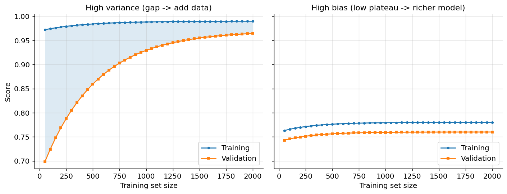

*Figure 74. Learning curves. A persistent gap signals variance (more data helps); a low plateau signals bias (more data will not help).*

A **validation curve** (also called a complexity curve) instead fixes the data and plots training and validation score against a *single hyperparameter* — polynomial degree, tree depth, regularization strength $`\lambda`$. It is the empirical, per-model realization of the bias-variance U-curve: as complexity rises, training score keeps climbing while validation score rises, peaks, and then falls as overfitting sets in. The peak of the validation curve is your hyperparameter setting, and the widening train/validation gap to its right is overfitting appearing before your eyes.

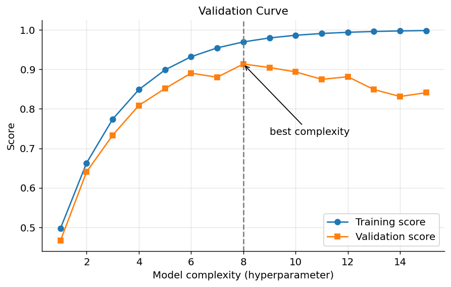

*Figure 75. A validation curve over model complexity. Validation score peaks at intermediate complexity; the growing gap to the right is overfitting.*

``` python
import numpy as np
from sklearn.datasets import load_digits
from sklearn.svm import SVC
from sklearn.model_selection import learning_curve, validation_curve

X, y = load_digits(return_X_y=True)

# Learning curve: score vs training-set size.
sizes, tr, va = learning_curve(SVC(gamma=0.001), X, y, cv=5,
                               train_sizes=np.linspace(0.1, 1.0, 6))
print("val score by size:", np.round(va.mean(1), 3))

# Validation curve: score vs the gamma hyperparameter.
gammas = np.logspace(-5, -1, 7)
tr2, va2 = validation_curve(SVC(), X, y, param_name="gamma",
                            param_range=gammas, cv=5)
print("val score by gamma:", np.round(va2.mean(1), 3))
# The gamma with the peak validation score is your choice; higher gamma overfits.
```

## 5.10 Hyperparameter Tuning

Models have two kinds of knobs. **Parameters** (weights, coefficients) are learned from data during training. **Hyperparameters** — regularization strength $`\lambda`$, tree depth, the number of neighbors $`k`$, learning rate — are set *before* training and control capacity. Tuning them is itself a model-selection problem, and we must evaluate each candidate honestly via cross-validation, never on the final test set.

### 5.10.1 Grid Search

**Grid search** enumerates a Cartesian product of candidate values and evaluates every combination by CV. It is exhaustive and reproducible and trivially parallel, but suffers the curse of dimensionality: cost grows multiplicatively with the number of hyperparameters, and most of the grid is wasted on dimensions that don’t matter. A 3-hyperparameter grid with 5 values each is already 125 fits *per CV fold*.

### 5.10.2 Random Search

**Random search** samples hyperparameter combinations at random from specified distributions for a fixed budget of trials. Counterintuitively, it often beats grid search at equal cost. The reason, shown by Bergstra and Bengio, is that performance usually depends strongly on only a few hyperparameters; random search explores *many distinct values* of each important dimension instead of revisiting the same handful that a grid forces, so it covers the influential axes far more densely. It also lets you set a fixed compute budget and sample continuous distributions (use log-uniform for scale parameters like $`C`$ and learning rate).

``` python
import numpy as np
from scipy.stats import loguniform
from sklearn.datasets import load_breast_cancer
from sklearn.pipeline import Pipeline
from sklearn.preprocessing import StandardScaler
from sklearn.svm import SVC
from sklearn.model_selection import GridSearchCV, RandomizedSearchCV

X, y = load_breast_cancer(return_X_y=True)
pipe = Pipeline([("scale", StandardScaler()), ("svc", SVC())])

# Grid search: every combination on a fixed lattice.
grid = {"svc__C": [0.1, 1, 10, 100], "svc__gamma": [1e-3, 1e-2, 1e-1]}
gs = GridSearchCV(pipe, grid, cv=5, scoring="roc_auc").fit(X, y)
print("Grid best AUC:", round(gs.best_score_, 4), gs.best_params_)

# Random search: sample from continuous distributions for a fixed budget.
dist = {"svc__C": loguniform(1e-1, 1e3), "svc__gamma": loguniform(1e-4, 1e0)}
rs = RandomizedSearchCV(pipe, dist, n_iter=20, cv=5,
                        scoring="roc_auc", random_state=0).fit(X, y)
print("Random best AUC:", round(rs.best_score_, 4), rs.best_params_)
```

### 5.10.3 Successive Halving and Hyperband

Both grid and random search are wasteful in a specific way: they spend the *full* training budget on every candidate, including obviously bad ones. **Successive halving** fixes this with a tournament. Start many configurations on a small budget (few training examples, few boosting rounds, or few epochs); keep the top fraction (say the best half or third); give the survivors more budget; repeat until one champion remains under the full budget. Most poor configurations are eliminated cheaply, so the search finds strong settings using a fraction of the total compute. **Hyperband** wraps successive halving in an outer loop that hedges over how aggressively to prune, trading between “many configs, little budget each” and “few configs, lots of budget each” — robust when you do not know in advance how much budget candidates need to reveal their quality. In scikit-learn these are `HalvingGridSearchCV` and `HalvingRandomSearchCV`.

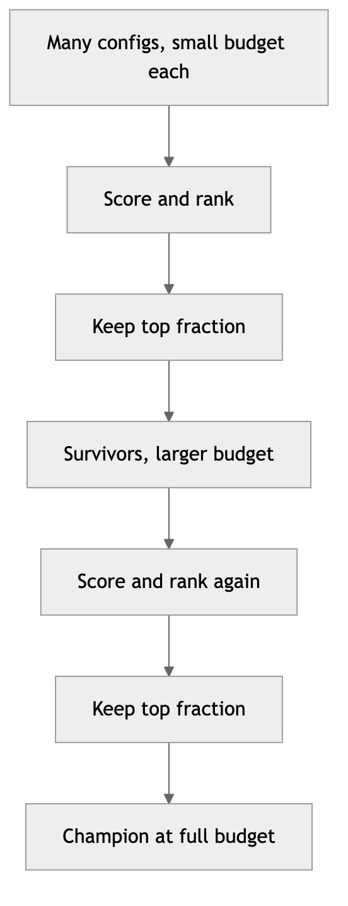


*Figure 76. Successive halving runs a tournament, spending little budget on many configs and promoting only the survivors.*

### 5.10.4 Bayesian Optimization

When each training run is expensive (large models, deep networks), spending trials at random is wasteful in a different way — it does not *learn* from what it has already tried. **Bayesian optimization** treats the validation score as an unknown function of the hyperparameters and builds a probabilistic **surrogate model** of it — typically a Gaussian process or a tree-based estimator. After each evaluation it updates the surrogate, then uses an **acquisition function** (such as Expected Improvement) to pick the next configuration that best balances **exploration** (regions of high uncertainty) against **exploitation** (regions predicted to score well). Because it learns from past trials, it usually finds strong configurations in far fewer evaluations than grid or random search. Libraries such as Optuna, scikit-optimize, and Hyperopt implement this; modern AutoML stacks build on it, and some (like Optuna) combine it with Hyperband-style pruning. We revisit large-scale tuning in the chapter on MLOps.


*Figure 77. The Bayesian optimization loop balances exploration and exploitation to tune costly models efficiently.*

| Method | Cost model | Strengths | Weaknesses |
|----|----|----|----|
| Grid search | Exhaustive lattice | Simple, reproducible, parallel | Curse of dimensionality, wasteful |
| Random search | Fixed random budget | Better coverage of key dimensions | No learning across trials |
| Successive halving / Hyperband | Adaptive budget tournament | Eliminates weak configs cheaply | Assumes early budget predicts final rank |
| Bayesian optimization | Sequential, model-guided | Few evaluations, great for costly models | Sequential, more complex setup |

### 5.10.5 Nested Cross-Validation: Tuning Without Cheating

A subtle but important warning: tuning hyperparameters against a validation set and then *also* reporting that same validation score overstates performance, because you have implicitly fit to it — the more configurations you try, the more the winning score benefits from luck. The clean protocol is **nested cross-validation** — an inner CV loop for tuning and an outer loop for the unbiased estimate. For each outer fold, the entire tuning process runs only on that fold’s training portion, and the tuned model is scored once on the untouched outer-fold validation data. The outer scores, averaged, are an honest estimate of “the performance of *the whole procedure*, including its tuning.” A cheaper alternative is a three-way split into train, validation, and a held-out test set touched exactly once.

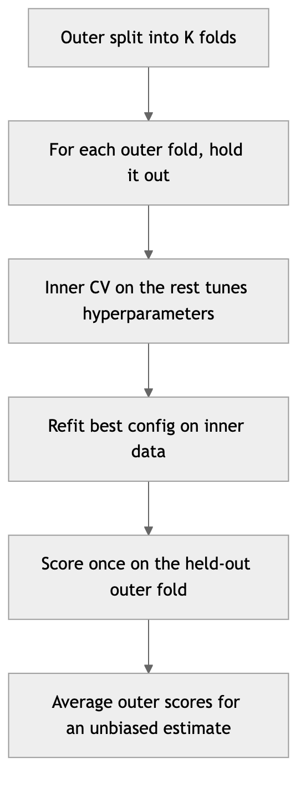

*Figure 78. Nested cross-validation. The inner loop tunes hyperparameters; the outer loop gives an unbiased performance estimate.*

``` python
import numpy as np
from sklearn.datasets import load_breast_cancer
from sklearn.svm import SVC
from sklearn.preprocessing import StandardScaler
from sklearn.pipeline import Pipeline
from sklearn.model_selection import GridSearchCV, cross_val_score, StratifiedKFold

X, y = load_breast_cancer(return_X_y=True)
pipe = Pipeline([("s", StandardScaler()), ("svc", SVC())])
grid = {"svc__C": [0.1, 1, 10, 100], "svc__gamma": [1e-3, 1e-2, 1e-1]}
inner = StratifiedKFold(5, shuffle=True, random_state=1)
outer = StratifiedKFold(5, shuffle=True, random_state=2)

search = GridSearchCV(pipe, grid, cv=inner, scoring="roc_auc")
nested = cross_val_score(search, X, y, cv=outer, scoring="roc_auc")
print(f"Nested CV AUC = {nested.mean():.3f} +/- {nested.std():.3f}")
# This is typically LOWER than search.best_score_ -- and it is the honest number.
```

## 5.11 Statistically Comparing Models

Model B scores 0.912 in cross-validation; model A scores 0.905. Is B genuinely better, or did it win by luck of the folds? Declaring a winner from a single mean difference is one of the most common ways to be fooled, because CV scores carry uncertainty. Statistical tests turn “B looks a bit higher” into a defensible claim.

The key wrinkle is that CV fold scores are **not independent** — the training sets overlap heavily across folds — which violates the assumption behind a naive paired $`t`$-test and makes it *over-optimistic*, understating the true variance and declaring significance too readily. Use tests designed for this setting:

- **Paired difference on matched folds.** Run both models on the *same* CV splits and work with the per-fold score differences $`d_{i}`$. Pairing removes the fold-to-fold difficulty that both models share, isolating the model effect.
- **Corrected resampled** $`t`$**-test (Nadeau & Bengio).** Inflates the variance estimate of the paired $`t`$-test to account for the train/test overlap in repeated CV, giving far better-calibrated $`p`$-values. This is the recommended default for comparing two models over repeated $`k`$-fold CV.
- $`5 \times 2`$ **cross-validation** $`t`$**-test (Dietterich).** Repeat 2-fold CV five times and combine the differences with a variance estimate tailored to that design — a well-studied, low-Type-I-error protocol for comparing two algorithms.
- **McNemar’s test.** For two classifiers on a *single* shared test set, build the $`2 \times 2`$ table of *disagreements* — cases where A is right and B is wrong ($`n_{01}`$) versus B right and A wrong ($`n_{10}`$) — and test whether $`n_{01}`$ and $`n_{10}`$ differ more than chance. It needs only one test set (no retraining) and is ideal when models are expensive to train.
- **Wilcoxon signed-rank test.** A non-parametric alternative to the paired $`t`$-test that does not assume normally distributed differences; the recommended choice when comparing many models across many datasets.

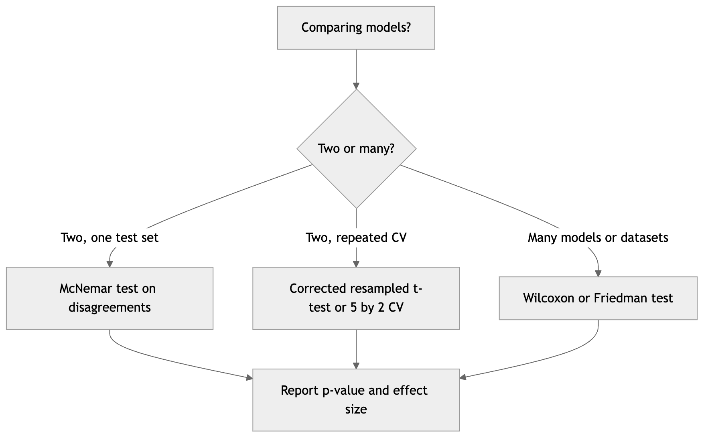

*Figure 79. Choosing a statistical test for comparing models depends on how many models and datasets are involved.*

A worked comparison over shared folds shows the mechanics of the paired approach; in practice, prefer the variance-corrected version for repeated CV.

``` python
import numpy as np
from scipy import stats
from sklearn.datasets import load_breast_cancer
from sklearn.linear_model import LogisticRegression
from sklearn.ensemble import RandomForestClassifier
from sklearn.preprocessing import StandardScaler
from sklearn.pipeline import make_pipeline
from sklearn.model_selection import cross_val_score, StratifiedKFold

X, y = load_breast_cancer(return_X_y=True)
cv = StratifiedKFold(10, shuffle=True, random_state=0)   # SAME splits for both
a = cross_val_score(make_pipeline(StandardScaler(), LogisticRegression(max_iter=5000)),
                    X, y, cv=cv, scoring="roc_auc")
b = cross_val_score(RandomForestClassifier(n_estimators=300, random_state=0),
                    X, y, cv=cv, scoring="roc_auc")
d = a - b
print(f"LogReg={a.mean():.4f}  RF={b.mean():.4f}  mean diff={d.mean():+.4f}")
# Paired t-test on matched folds (naive -- corrected/Wilcoxon preferred in practice):
t, p = stats.ttest_rel(a, b)
print(f"paired t={t:.3f}, p={p:.3f}")
w, pw = stats.wilcoxon(a, b)
print(f"Wilcoxon p={pw:.3f}")
# If p > 0.05, the difference is not statistically significant -- do not crown a winner.
```

Two habits will keep you honest. First, always report an **effect size and uncertainty** (the mean difference and its confidence interval), not just a $`p`$-value — a statistically significant 0.001 AUC gain is practically meaningless. Second, apply a **multiple-comparisons correction** (Bonferroni, Holm) when you test many models against each other, or you will “discover” a spurious winner simply by running enough comparisons.

## 5.12 A Real-World Evaluation Case Study

To see the whole toolkit act together, walk through a realistic fraud-detection project — the setting where every trap in this chapter lies waiting. The data is 2 million transactions, 0.3% of them fraudulent, arriving in time order over eighteen months. A first team reports a “97% accurate” model and is quietly congratulated. An evaluation-literate reviewer immediately asks the right questions, and every one exposes a problem.

*“97% of what?”* At 0.3% prevalence, predicting “never fraud” scores 99.7%. Accuracy is meaningless here; the reviewer demands the confusion matrix, precision, recall, and MCC on the minority class. Recall turns out to be 0.34 — the model misses two-thirds of fraud.

*“How was it validated?”* The team used random k-fold on time-ordered data. That is temporal leakage: the model trained on future transactions to score past ones, and card-level patterns from a fraud ring leaked across the shuffle. Re-running with a **time-series split** *and* **group k-fold on card ID** (so no card appears in both train and validation) drops the reported AUC from 0.98 to 0.91 — the honest number. The gap between 0.98 and 0.91 was pure leakage, and it would have vanished in production, exactly the kind of “worked in the notebook” failure this chapter is written to prevent.

*“Which curve, and at what threshold?”* ROC AUC of 0.91 sounds strong, but at 0.3% positives the reviewer insists on the **precision-recall** view; average precision is 0.28, with a baseline of 0.003. The team had been decisioning at the default 0.5 threshold. Because a missed fraud costs roughly 20× a false alarm (a blocked legitimate purchase annoys a customer; a completed fraud is a chargeback), the cost-optimal threshold is near $`1/(1 + 20) \approx 0.048`$. Moving the threshold there lifts recall to 0.71 at an acceptable precision, and the operating point is now chosen on validation data and frozen before the test set is ever touched.

*“Are the probabilities trustworthy?”* The downstream system multiplies the fraud probability by the transaction amount to prioritize a human review queue, so calibration matters as much as ranking. The reliability diagram shows the gradient-boosted model is overconfident; **isotonic regression** on a held-out calibration slice halves the Brier score and makes the expected-loss ranking sensible.

*“Is the new model actually better than the old one?”* The champion-versus-challenger comparison uses **McNemar’s test** on a single held-out month of transactions (retraining is expensive), and the improvement is significant with a meaningful effect size — not a 0.001 AUC mirage. Only now, with leakage removed, the right curve read at a cost-justified threshold, calibrated probabilities, and a real significance test, does the team ship. The lesson is the chapter in miniature: the modeling was fine all along; the *evaluation* was where the truth lived.

> **Evaluation pitfalls checklist.** **Strengths of doing it right:** decisions you can defend, numbers that survive contact with production, and honest comparisons between candidates. **Common weaknesses to hunt for:** reporting accuracy on imbalanced data; a single train/test split masquerading as an estimate; preprocessing fit before splitting; entities or time leaking across folds. **When to escalate rigor:** high-stakes decisions (medicine, credit, safety), heavy imbalance, temporal or grouped data, and any close model comparison. **Pitfalls that bite hardest:** tuning on the test set, defaulting to a 0.5 threshold, trusting uncalibrated probabilities, and crowning a winner from a single unadjusted mean difference.

## 5.13 Summary

Supervised learning is the task of learning a function from labeled examples by minimizing empirical risk, but the real goal is low expected risk on unseen data — and the entire discipline of this chapter exists to estimate and control the gap between the two honestly. We formalized that gap through the approximation/estimation decomposition and the bias-variance decomposition, deriving the latter from first principles: expected squared error splits exactly into bias, variance, and an irreducible noise floor, and model capacity is the single knob that trades the first against the second. Underfitting is high bias; overfitting is high variance; the sweet spot is in between, and modern over-parameterized models add a double-descent twist.

We then built the measurement toolkit. Loss functions define what “good” means during training (MSE toward the mean, MAE toward the median, cross-entropy for probabilities, hinge for margins), while regularization — L1, L2, elastic net, early stopping, and more — directly lowers variance by penalizing complexity. On the evaluation side, regression is summarized by RMSE, MAE, MAPE, and (adjusted) $`R^{2}`$, while classification flows entirely from the confusion matrix into accuracy, precision, recall, specificity, F1, $`F_{\beta}`$, and MCC — with the standing warning that accuracy is a trap under class imbalance. Threshold-independent views (ROC/AUC) and imbalance-honest views (precision-recall, average precision) answer different questions, threshold selection turns a probabilistic model into a decision rule tuned to error costs, and calibration (reliability diagrams, Platt scaling, isotonic regression) governs whether the probabilities themselves can be trusted. Multiclass problems require an explicit averaging choice — macro, micro, or weighted — that must always be stated.

Finally we covered the protocols that make all of these numbers believable: the sacred train/validation/test split and the leakage that destroys it; the cross-validation family from stratified k-fold through group and time-series variants; learning and validation curves as the diagnostic instruments that tell you whether to gather data or change the model; the hyperparameter-tuning ladder from grid and random search through successive halving to Bayesian optimization, wrapped in nested CV to tune without cheating; and the statistical tests that decide whether one model is really better than another. Master this chapter and you will trust your numbers — and trust is the whole point.

## 5.14 Key Takeaways

- The goal is low **expected risk**, not low training error. Everything reduces to estimating and controlling the train/test gap honestly.
- **Bias-variance** decomposes expected error exactly into bias², variance, and irreducible noise. Capacity trades bias for variance; diagnose with the train/validation gap.
- Choose the **loss** to match what a mistake costs (robustness, probabilities, margins), and remember the loss you optimize differs from the metric you report.
- **Regularization** (L1 for sparsity, L2 for shrinkage, elastic net, early stopping) reduces variance by penalizing complexity.
- Guard the **test set** with your life — touch it once. Fit all preprocessing inside CV folds. **Data leakage** is the number-one cause of models that fail in production.
- Match the **cross-validation** scheme to the data: stratified for imbalance, group to prevent entity leakage, time-series/rolling for temporal data, nested for honest tuning.
- Regression: report **RMSE, MAE, and** $`R^{2}`$ together; use **adjusted** $`R^{2}`$ to compare models with different feature counts and treat **MAPE** as a communication tool, not an objective.
- Classification: build everything from the **confusion matrix**. **Never report accuracy alone on imbalanced data** — pair it with precision, recall, F1/$`F_{\beta}`$, and especially **MCC**.
- Use **ROC/AUC** for threshold-independent ranking, **precision-recall/average precision** when positives are rare. Select the **threshold** from error costs, not by defaulting to 0.5.
- **Calibrate** probabilities (reliability diagram, Platt, isotonic) whenever you act on the probability itself; check with the Brier score.
- State your **multiclass averaging** (macro vs micro vs weighted) — it changes the number and the story.
- Read **learning curves** to decide between more data (high variance) and a richer model (high bias); read **validation curves** to set complexity.
- Climb the **tuning ladder** — grid → random → successive halving/Hyperband → Bayesian — as runs get costlier, and use **nested CV** to avoid tuning on the test set.
- Prove a model is better with a **statistical test** built for correlated CV folds (corrected resampled $`t`$-test, $`5 \times 2`$ CV, McNemar, Wilcoxon), and always report effect size and uncertainty, not just a $`p`$-value.

## 5.15 Exercises

1.  **Conceptual — bias vs variance.** A deep decision tree achieves 0.99 training accuracy and 0.71 test accuracy; a shallow one achieves 0.74 and 0.73. Diagnose each in terms of bias and variance, and propose one concrete change to improve each model. Which one would benefit from collecting more data, and why?

2.  **Conceptual — the decomposition.** Starting from $`y = g(\mathbf{x}) + \varepsilon`$ with $`\mathbb{E}\lbrack\varepsilon\rbrack = 0`$ and $`Var(\varepsilon) = \sigma^{2}`$, reproduce the derivation of the bias-variance decomposition, justifying at each step why the cross terms vanish. Then explain in words why leave-one-out cross-validation has *low bias but high variance* as an estimator of the true risk.

3.  **Conceptual — metric choice.** For each scenario, name the single most appropriate metric and justify: (a) screening for a rare aggressive cancer where missing a case is catastrophic; (b) a spam filter where flagging real email as spam is unacceptable; (c) ranking ads by click likelihood; (d) a balanced 3-class image classifier; (e) an insurance model whose predicted probabilities feed directly into premium pricing. Explain why accuracy is wrong for at least two of them, and name the one where *calibration* matters most.

4.  **Worked by hand — confusion matrix.** A classifier on 500 examples (120 positive) yields TP = 90, FN = 30, FP = 60, TN = 320. Compute accuracy, precision, recall, specificity, F1, $`F_{2}`$, and MCC by hand, showing each ratio. Which single metric best summarizes performance, and what does the gap between F1 and accuracy tell you?

5.  **Coding — the imbalance trap.** Using `make_classification` with `weights=[0.95, 0.05]`, train a default `LogisticRegression` and a second one with `class_weight="balanced"`. Report accuracy, precision, recall, F1, MCC, and ROC AUC for both, and plot both the ROC and precision-recall curves on the same imbalanced test set. Explain in two sentences which metrics exposed the difference and why accuracy did not.

6.  **Coding — regularization path.** On a high-dimensional regression dataset, fit `Lasso` for a range of `alpha` values from $`10^{- 3}`$ to $`10^{2}`$. Plot the number of non-zero coefficients and the cross-validated $`R^{2}`$ against `alpha` (log scale). Identify the `alpha` that best balances sparsity and accuracy, and explain the tradeoff you observe.

7.  **Coding — calibration.** Train a `RandomForestClassifier`, then recalibrate it with both Platt scaling and isotonic regression via `CalibratedClassifierCV`. Plot reliability diagrams for all three and report their Brier scores. Which base-model pathology (overconfidence or underconfidence) do random forests typically show, and which recalibration method won on your data?

8.  **Coding — threshold and cost.** Take a trained probabilistic classifier and a cost structure where a false negative costs 10 and a false positive costs 1. Sweep the decision threshold, compute expected total cost at each, and find the cost-minimizing threshold. Compare it to both the default 0.5 and the F1-optimal threshold, and reconcile the answer with the rule $`t^{\star} = c_{FP}/(c_{FP} + c_{FN})`$.

9.  **Coding — learning and validation curves.** For an `SVC` on a dataset of your choice, plot a learning curve (score vs training size) and a validation curve (score vs `gamma`). State from each plot whether the model is currently bias- or variance-limited and what you would do next.

10. **Coding — honest tuning.** Tune an `SVC`’s `C` and `gamma` using `GridSearchCV`, `RandomizedSearchCV`, and `HalvingRandomSearchCV` at comparable budgets. Compare their best scores and wall-clock time. Then implement nested cross-validation and explain how the nested estimate differs from the inner best score, and why the difference is the point.

11. **Coding — statistical comparison.** Compare logistic regression and a random forest with 10-fold CV on shared splits. Run a paired $`t`$-test and a Wilcoxon signed-rank test on the fold differences, and separately run McNemar’s test on a single held-out test set. Do the tests agree? Explain why the naive paired $`t`$-test on CV folds tends to be over-optimistic and what you would use instead.

12. **Conceptual — ROC versus PR.** A fraud model reports ROC AUC = 0.94 but average precision = 0.31 on data that is 2% positive. Explain how both numbers can be “correct” simultaneously, which one better reflects deployment value, what the baseline of each curve is at 2% prevalence, and what threshold-selection strategy you would use before shipping.

---

[← 4 Python Tooling for Machine Learning](ch04-python-tooling.md) · [Contents](../README.md#contents) · [6 Regression Algorithms →](ch06-regression.md)
