[← 5 Supervised Learning and Model Evaluation](ch05-supervised-eval.md) · [Contents](../README.md#contents) · [7 Classification I: Logistic Regression, k-NN, and Naive Bayes →](ch07-classification-1.md)

---

# 6 Regression Algorithms

Regression is the art of predicting a continuous number — a house price, a temperature, a patient’s blood pressure, the demand for electricity tomorrow afternoon. Where classification answers *which category*, regression answers *how much* or *how many*. This chapter is a thorough tour of the regression toolbox, and it begins where every serious practitioner begins: with the linear model, understood not as a black box but as a set of equations you can derive, an optimization problem you can solve two different ways, and a bundle of statistical assumptions you can check. From there we build outward — through regularization, diagnostics, generalized linear models, and robust methods — and finally to the kernel methods, trees, and gradient-boosted ensembles that quietly win most tabular-data competitions. For each method we build the intuition first, write down the math, derive it where a derivation clarifies, run the code, and then discuss honestly when it shines and when it fails.

Linear regression deserves the lion’s share of our attention not because it is the most accurate model — it usually is not — but because it is the one you must *understand* to reason about all the others. The bias–variance trade-off, the meaning of a coefficient, the cost of correlated features, the geometry of a penalty term: these ideas are cleanest in the linear world and carry everywhere else.

## 6.1 The Regression Problem

We are given a dataset of $`m`$ examples, each with a feature vector $`\mathbf{x}^{(i)} \in \mathbb{R}^{n}`$ and a continuous target $`y^{(i)} \in \mathbb{R}`$. We want to learn a function $`f`$ such that $`f(\mathbf{x}) \approx y`$ for unseen inputs. The “best” $`f`$ is the one that minimizes some measure of error — usually the mean squared error — while generalizing beyond the training data.

It helps to keep two goals distinct, because they demand different things of a model. **Prediction** asks only that $`\widehat{y} = f(\mathbf{x})`$ be close to the truth on new data; you may not care *why* the model works. **Inference** asks what the relationship between features and target actually *is* — how much does the target change when one feature moves, and how confident are we in that number? Inference imposes stricter conditions (the Gauss–Markov assumptions and normality, discussed below) because confidence intervals and p-values are only trustworthy when those conditions roughly hold. A model can be an excellent predictor and a terrible instrument for inference, or vice versa. Know which you are after.

Throughout this chapter we lean on ideas owned by earlier chapters. The bias–variance trade-off, train/validation/test splits, and metrics like RMSE, MAE, and $`R^{2}`$ are developed in the chapter on Supervised Learning and Model Evaluation; we use them here freely. The mathematical machinery of gradients, matrix algebra, and probability comes from the chapter on Mathematical and Statistical Foundations.

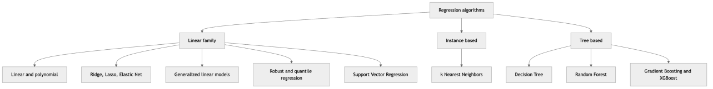

*Figure 80. A taxonomy of the regression algorithms covered in this chapter*

## 6.2 Simple and Multiple Linear Regression

### 6.2.1 Intuition

Linear regression assumes the target is, up to noise, a weighted sum of the features. With one feature it is the line of best fit through a scatter plot. With many features it is a hyperplane in feature space. The model is simple, interpretable, fast to train, and — crucially — a baseline every serious regression project should beat before reaching for anything fancier. If a gradient-boosted forest cannot outperform a well-fit ridge regression on your data, that is valuable information: your signal is probably linear, and the simpler model will be cheaper, faster, and easier to explain.

### 6.2.2 Simple linear regression: one feature

Start with the smallest case, a single feature $`x`$ and a target $`y`$. We posit

``` math
\widehat{y} = \theta_{0} + \theta_{1}x,
```

where $`\theta_{0}`$ is the **intercept** (the predicted value when $`x = 0`$) and $`\theta_{1}`$ is the **slope** (the change in $`\widehat{y}`$ for a one-unit change in $`x`$). We choose $`\theta_{0},\theta_{1}`$ to minimize the sum of squared residuals, and calculus gives closed forms you can compute by hand:

``` math
\theta_{1} = \frac{\sum_{i = 1}^{m}(x^{(i)} - \bar{x})(y^{(i)} - \bar{y})}{\sum_{i = 1}^{m}(x^{(i)} - \bar{x})^{2}} = \frac{Cov(x,y)}{Var(x)},\quad\quad\theta_{0} = \bar{y} - \theta_{1}\bar{x}.
```

The slope is the covariance of $`x`$ and $`y`$ divided by the variance of $`x`$; the intercept then anchors the line so it passes through the point of means $`(\bar{x},\bar{y})`$ — a fact worth remembering, because it means the fitted line *always* goes through the centroid of the data.

**Worked numeric example.** Take three points: $`(1,2),(2,2),(3,4)`$. Then $`\bar{x} = 2`$ and $`\bar{y} = 8/3 \approx 2.667`$. Compute the pieces:

``` math
\sum(x^{(i)} - \bar{x})(y^{(i)} - \bar{y}) = ( - 1)( - 0.667) + (0)( - 0.667) + (1)(1.333) = 0.667 + 0 + 1.333 = 2.0,
```

``` math
\sum(x^{(i)} - \bar{x})^{2} = 1 + 0 + 1 = 2.0.
```

So $`\theta_{1} = 2.0/2.0 = 1.0`$ and $`\theta_{0} = 2.667 - (1.0)(2) = 0.667`$. The line of best fit is $`\widehat{y} = 0.667 + x`$. You can verify it passes through $`(2,2.667)`$, the centroid, exactly as promised.

### 6.2.3 Multiple linear regression: the model

With $`n`$ features we fold the bias into the weight vector by prepending a constant feature $`x_{0} = 1`$, so the prediction for a single example is

``` math
\widehat{y} = h_{\mathbf{\theta}}(\mathbf{x}) = \theta_{0} + \theta_{1}x_{1} + \ldots + \theta_{n}x_{n} = \mathbf{\theta}^{\top}\mathbf{x},\quad\quad\mathbf{x} = (1,x_{1},\ldots,x_{n})^{\top}.
```

Each weight $`\theta_{j}`$ is the predicted change in $`y`$ per unit change in feature $`j`$, *holding all other features fixed* — a phrase we will unpack carefully when we discuss interpretation. Stacking the $`m`$ examples row-wise gives the **design matrix** $`\mathbf{X} \in \mathbb{R}^{m \times (n + 1)}`$ (first column all ones) and the target vector $`\mathbf{y} \in \mathbb{R}^{m}`$, so all predictions at once are $`\widehat{\mathbf{y}} = \mathbf{X\theta}`$.

### 6.2.4 The OLS objective

We fit by minimizing the **mean squared error** (the factor $`\frac{1}{2}`$ is a convenience that cancels in the gradient):

``` math
J(\mathbf{\theta}) = \frac{1}{2m}\sum_{i = 1}^{m}\left( h_{\mathbf{\theta}}(\mathbf{x}^{(i)}) - y^{(i)} \right)^{2} = \frac{1}{2m}\, \parallel \mathbf{X\theta} - \mathbf{y} \parallel^{2}.
```

This is **ordinary least squares** (OLS). Why squared error and not, say, absolute error? Three reasons. First, it is differentiable everywhere, so calculus applies cleanly. Second, it has a unique closed-form minimizer (below). Third, and most importantly, minimizing squared error is exactly **maximum likelihood estimation** under the assumption that the noise is Gaussian with constant variance: if $`y = \mathbf{\theta}^{\top}\mathbf{x} + \varepsilon`$ with $`\varepsilon \sim \mathcal{N}(0,\sigma^{2})`$, the log-likelihood of the data is a negative constant times the sum of squared errors, so maximizing likelihood and minimizing MSE are the same act. Squared error is not an arbitrary choice; it is the correct one when noise is Gaussian, and it over-punishes outliers precisely because Gaussian noise makes large deviations extremely unlikely.

### 6.2.5 Solution 1: the normal equation (full derivation)

The cost is a quadratic bowl in $`\mathbf{\theta}`$, so its unique minimum is where the gradient vanishes. Expand the squared norm:

``` math
2m\, J(\mathbf{\theta}) = (\mathbf{X\theta} - \mathbf{y})^{\top}(\mathbf{X\theta} - \mathbf{y}) = \mathbf{\theta}^{\top}\mathbf{X}^{\top}\mathbf{X\theta} - 2\,\mathbf{\theta}^{\top}\mathbf{X}^{\top}\mathbf{y} + \mathbf{y}^{\top}\mathbf{y}.
```

Take the gradient with respect to $`\mathbf{\theta}`$, using the matrix-calculus identities $`\nabla_{\mathbf{\theta}}(\mathbf{\theta}^{\top}\mathbf{A\theta}) = 2\mathbf{A\theta}`$ for symmetric $`\mathbf{A}`$ and $`\nabla_{\mathbf{\theta}}(\mathbf{\theta}^{\top}\mathbf{b}) = \mathbf{b}`$:

``` math
\nabla_{\mathbf{\theta}}\,(2m\, J) = 2\,\mathbf{X}^{\top}\mathbf{X\theta} - 2\,\mathbf{X}^{\top}\mathbf{y}.
```

Set it to zero and divide by 2. The result is the **normal equations**:

``` math
\mathbf{X}^{\top}\mathbf{X}\,\mathbf{\theta} = \mathbf{X}^{\top}\mathbf{y}\quad \Rightarrow \quad\boxed{\mspace{6mu}\mathbf{\theta} = (\mathbf{X}^{\top}\mathbf{X})^{- 1}\mathbf{X}^{\top}\mathbf{y}.\mspace{6mu}}
```

They are called “normal” equations because of their geometry. Rearrange the zero-gradient condition to $`\mathbf{X}^{\top}(\mathbf{X\theta} - \mathbf{y}) = \mathbf{0}`$, i.e. $`\mathbf{X}^{\top}\mathbf{r} = \mathbf{0}`$ where $`\mathbf{r} = \widehat{\mathbf{y}} - \mathbf{y}`$ is the residual vector. This says the residuals are **orthogonal** (normal) to every column of $`\mathbf{X}`$. In words: least squares projects $`\mathbf{y}`$ onto the column space of $`\mathbf{X}`$, and $`\widehat{\mathbf{y}}`$ is the point in that subspace closest to $`\mathbf{y}`$; whatever is left over (the residual) sticks out perpendicular to the subspace. The projection is $`\widehat{\mathbf{y}} = \mathbf{X}(\mathbf{X}^{\top}\mathbf{X})^{- 1}\mathbf{X}^{\top}\mathbf{y} = \mathbf{Hy}`$, and the matrix $`\mathbf{H}`$ — the **hat matrix**, because it puts the hat on $`\mathbf{y}`$ — is exactly the orthogonal projector onto the column space. We will meet $`\mathbf{H}`$ again when we measure leverage.

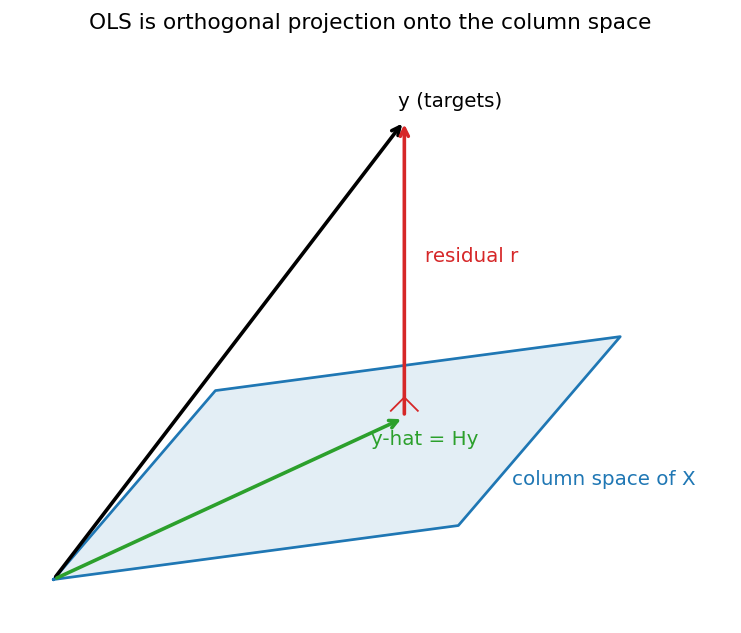

*Figure 81. Least squares as orthogonal projection: the fitted values lie in the column space of X, and the residual is perpendicular to it.*

The closed form is exact and requires no learning rate or iteration. Its cost is dominated by forming and factoring the $`(n + 1) \times (n + 1)`$ matrix $`\mathbf{X}^{\top}\mathbf{X}`$, roughly $`O(mn^{2} + n^{3})`$, which is fine for hundreds of features but painful for tens of thousands. It also breaks down when $`\mathbf{X}^{\top}\mathbf{X}`$ is singular — which happens when features are perfectly collinear or when $`n + 1 > m`$ (more features than examples). This is one reason regularization, below, is so useful: adding $`\lambda\mathbf{I}`$ makes the matrix invertible again. In practice, robust libraries never literally invert; they solve the least-squares problem via QR decomposition or the SVD-based pseudo-inverse, which is numerically stable even when the matrix is ill-conditioned. When you call `numpy.linalg.solve` rather than `numpy.linalg.inv`, or `scipy.linalg.lstsq`, you are getting this stability for free.

### 6.2.6 Solution 2: gradient descent (iterative)

When $`n`$ is large, when $`\mathbf{X}^{\top}\mathbf{X}`$ is too big to factor, or when data streams in and cannot be held in memory at once, we abandon the closed form and iterate downhill. The gradient of the cost, which we derived above, is

``` math
\nabla_{\mathbf{\theta}}J = \frac{1}{m}\mathbf{X}^{\top}(\mathbf{X\theta} - \mathbf{y}),
```

and we step opposite the gradient with a **learning rate** $`\alpha`$:

``` math
\mathbf{\theta} \leftarrow \mathbf{\theta} - \alpha\,\nabla_{\mathbf{\theta}}J.
```

Because $`J`$ is convex (a bowl), gradient descent with a small enough $`\alpha`$ is guaranteed to converge to the global minimum — the same $`\mathbf{\theta}`$ the normal equation gives. There is no risk of local minima for linear regression. We treat gradient descent in full in the next section, including its stochastic and mini-batch variants and the crucial role of feature scaling.

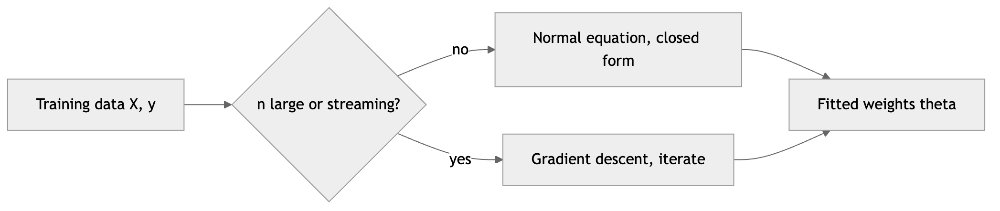

*Figure 82. Two routes to the same least-squares solution*

### 6.2.7 Worked example: both solutions agree

``` python
import numpy as np
from sklearn.linear_model import LinearRegression, SGDRegressor
from sklearn.preprocessing import StandardScaler

rng = np.random.default_rng(0)
m = 200
X = rng.uniform(0, 10, size=(m, 1))
y = 3.0 + 2.0 * X[:, 0] + rng.normal(0, 1.5, size=m)   # true: intercept 3, slope 2

# --- Normal equation, by hand ---
Xb = np.c_[np.ones(m), X]                      # add bias column
theta = np.linalg.solve(Xb.T @ Xb, Xb.T @ y)   # solve, do not invert explicitly
print("Normal equation theta:", theta.round(3))   # ~ [3.0, 2.0]

# --- scikit-learn (also closed form via SVD) ---
lr = LinearRegression().fit(X, y)
print("sklearn intercept, slope:", round(lr.intercept_, 3), lr.coef_.round(3))

# --- Gradient descent (SGD) needs scaling ---
scaler = StandardScaler().fit(X)
sgd = SGDRegressor(max_iter=1000, eta0=0.01, random_state=0)
sgd.fit(scaler.transform(X), y)
print("SGD predicts at x=5:", sgd.predict(scaler.transform([[5.0]])).round(3))
```

The figure below shows the fitted line over the noisy data and the descent of the cost as batch gradient descent iterates.

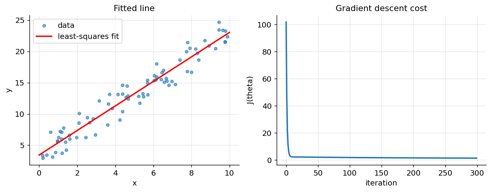

*Figure 83. Left, the least-squares line through noisy data. Right, the cost falling during gradient descent.*

### 6.2.8 A worked numeric example with two features

To make the matrix machinery concrete, fit a two-feature model by hand on four points. Let the features and target be

``` math
\mathbf{X} = \begin{bmatrix}
1 & 1 & 1 \\
1 & 2 & 1 \\
1 & 3 & 2 \\
1 & 4 & 2
\end{bmatrix},\quad\quad\mathbf{y} = \begin{bmatrix}
3 \\
4 \\
8 \\
9
\end{bmatrix},
```

where the first column is the bias. Form the two pieces of the normal equation:

``` math
\mathbf{X}^{\top}\mathbf{X} = \begin{bmatrix}
4 & 10 & 6 \\
10 & 30 & 17 \\
6 & 17 & 10
\end{bmatrix},\quad\quad\mathbf{X}^{\top}\mathbf{y} = \begin{bmatrix}
24 \\
71 \\
43
\end{bmatrix}.
```

Solving $`\mathbf{X}^{\top}\mathbf{X}\,\mathbf{\theta} = \mathbf{X}^{\top}\mathbf{y}`$ (by elimination or `np.linalg.solve`) gives $`\mathbf{\theta} \approx (1.0,\ 1.0,\ 1.0)^{\top}`$, i.e. $`\widehat{y} = 1 + x_{1} + x_{2}`$. Check the first row: $`1 + 1 + 1 = 3 = y_{1}`$ exactly. This tiny example fits perfectly because the data were built to, but the mechanics — assemble $`\mathbf{X}^{\top}\mathbf{X}`$ and $`\mathbf{X}^{\top}\mathbf{y}`$, then solve the linear system — are identical at any scale. Notice you never invert a matrix; solving the system directly is both faster and numerically safer.

### 6.2.9 Goodness of fit: R² and the variance decomposition

Once fitted, how good is the model? The classic answer decomposes the variation in $`y`$. Define the **total sum of squares** $`\text{SS}_{\text{tot}} = \sum_{i}^{}(y_{i} - \bar{y})^{2}`$ (variation to be explained), the **residual sum of squares** $`\text{SS}_{\text{res}} = \sum_{i}^{}(y_{i} - {\widehat{y}}_{i})^{2}`$ (variation left unexplained), and the **explained sum of squares** $`\text{SS}_{\text{reg}} = \sum_{i}^{}({\widehat{y}}_{i} - \bar{y})^{2}`$. For OLS with an intercept these satisfy the Pythagorean identity $`\text{SS}_{\text{tot}} = \text{SS}_{\text{reg}} + \text{SS}_{\text{res}}`$ — a direct consequence of the residual being orthogonal to the fitted values. The **coefficient of determination** is the fraction explained:

``` math
R^{2} = 1 - \frac{\text{SS}_{\text{res}}}{\text{SS}_{\text{tot}}}.
```

An $`R^{2}`$ of 1 means every point is hit exactly; 0 means the model does no better than predicting the mean $`\bar{y}`$; negative values (possible on held-out data) mean it does worse than the mean. The catch is that $`R^{2}`$ never decreases when you add features, even useless ones, so it rewards overfitting. **Adjusted** $`R^{2}`$ penalizes extra parameters,

``` math
R_{\text{adj}}^{2} = 1 - (1 - R^{2})\,\frac{m - 1}{m - n - 1},
```

and can fall when a feature earns its place less than it costs in degrees of freedom. Report adjusted $`R^{2}`$ (or, better, cross-validated error) when comparing models of different size. Always pair $`R^{2}`$ with an absolute-error metric like RMSE — a high $`R^{2}`$ on a low-variance target can still be a useless predictor in real units.

> **Linear regression at a glance.** **Strengths:** fast to fit (closed form), fully interpretable coefficients, no hyperparameters, exact under Gaussian noise, and an honest baseline for every problem. **Weaknesses:** cannot model curvature or interactions without engineered features, sensitive to outliers because errors are squared, and unstable when features are collinear. **When to use:** as the first model on any regression task; whenever interpretability or inference matters; when the signal is plausibly linear. **Pitfalls:** reading a coefficient causally; trusting inference without checking assumptions; forgetting that “holding others constant” is fiction under collinearity.

**A real-world application.** Linear regression remains the backbone of quantitative fields precisely because of this interpretability. Epidemiologists use it (and its GLM cousins) to isolate a risk factor’s association with an outcome while adjusting for confounders; economists estimate demand elasticities and the effect of schooling on wages; sports analysts value players by regressing team outcomes on individual contributions. In each case the *coefficient*, with its confidence interval, is the deliverable — not the prediction. That is why the assumptions and diagnostics in this chapter are not academic niceties: they are the difference between a number you can defend and one you cannot.

## 6.3 The Gauss–Markov Assumptions

OLS is not merely *a* way to fit a line; under a specific set of conditions it is provably the *best* linear unbiased estimator — the celebrated **Gauss–Markov theorem**. “Best” here means minimum variance among all estimators that are both linear in $`\mathbf{y}`$ and unbiased; the acronym is **BLUE** (Best Linear Unbiased Estimator). Understanding the assumptions matters because they tell you exactly what goes wrong, and what to do about it, when reality misbehaves.

Write the true data-generating process as $`\mathbf{y} = \mathbf{X\beta} + \mathbf{\varepsilon}`$, where $`\mathbf{\beta}`$ is the true coefficient vector and $`\mathbf{\varepsilon}`$ is noise. The classical assumptions are:

1.  **Linearity in parameters.** The mean of $`y`$ is a linear function of the coefficients: $`\mathbb{E}\lbrack y \mid \mathbf{x}\rbrack = \mathbf{x}^{\top}\mathbf{\beta}`$. Note this permits nonlinear *features* (like $`x^{2}`$); it forbids only nonlinearity in the $`\mathbf{\beta}`$’s.
2.  **Full column rank (no perfect multicollinearity).** The columns of $`\mathbf{X}`$ are linearly independent, so $`\mathbf{X}^{\top}\mathbf{X}`$ is invertible and $`\mathbf{\theta}`$ is uniquely defined.
3.  **Exogeneity (zero conditional mean of errors).** $`\mathbb{E}\lbrack\mathbf{\varepsilon} \mid \mathbf{X}\rbrack = \mathbf{0}`$. The noise is unrelated to the features; there is no lurking variable correlated with both $`\mathbf{X}`$ and $`y`$.
4.  **Homoscedasticity.** The errors have constant variance: $`Var(\varepsilon_{i} \mid \mathbf{X}) = \sigma^{2}`$ for all $`i`$. The spread of the noise does not depend on the inputs.
5.  **No autocorrelation.** Errors for different observations are uncorrelated: $`Cov(\varepsilon_{i},\varepsilon_{j} \mid \mathbf{X}) = 0`$ for $`i \neq j`$.

Under assumptions 1–5, OLS is BLUE. If you additionally assume the errors are **normally distributed**, $`\mathbf{\varepsilon} \sim \mathcal{N}(\mathbf{0},\sigma^{2}\mathbf{I})`$, then OLS coincides with maximum likelihood and the usual t-tests, F-tests, and confidence intervals are exact. Normality is *not* needed for BLUE; it is needed for small-sample inference.

The following table is the practical payoff — what each violation costs and what you do about it.

| Assumption violated | Are estimates still unbiased? | Consequence | Remedy |
|----|----|----|----|
| Linearity | No | Systematic misfit; residuals show a pattern | Add polynomial or interaction terms; transform; use a nonlinear model |
| Full rank | Estimates undefined | $`\mathbf{X}^{\top}\mathbf{X}`$ singular; infinite solutions | Drop redundant features; use ridge; use pseudo-inverse |
| Exogeneity | No (biased) | Omitted-variable bias, endogeneity; coefficients meaningless | Add the confounder; instrumental variables; better design |
| Homoscedasticity | Yes | Inefficient; standard errors wrong, so p-values misleading | Robust (Huber–White) standard errors; weighted least squares; transform $`y`$ |
| No autocorrelation | Yes | Inefficient; standard errors understated | Newey–West errors; generalized least squares; model the time structure |
| Normality (for inference) | Yes | Small-sample intervals/tests inexact | Larger $`n`$ (CLT rescues it); bootstrap; robust methods |

Two of these deserve emphasis because beginners conflate bias and efficiency. Heteroscedasticity and autocorrelation do **not** bias the coefficients — OLS still estimates the right slope on average — but they make it *inefficient* (a lower-variance estimator exists) and, worse, they corrupt the standard errors, so your confidence intervals lie. By contrast, violating exogeneity (an omitted confounder) biases the coefficients themselves, which is far more dangerous: no amount of data fixes it, and the model will confidently mislead. The diagnostics section teaches you to detect these violations from residuals.

### 6.3.1 Standard errors and confidence intervals

Under the classical assumptions with normal errors, the fitted coefficients are themselves random — a different sample would give slightly different numbers — and their sampling distribution is known exactly. The covariance matrix of $`\mathbf{\theta}`$ is

``` math
Cov(\mathbf{\theta}) = \sigma^{2}(\mathbf{X}^{\top}\mathbf{X})^{- 1},
```

which we estimate by plugging in $`{\widehat{\sigma}}^{2} = \text{SS}_{\text{res}}/(m - n - 1)`$, the residual variance corrected for the degrees of freedom spent on the $`n + 1`$ coefficients. The square root of diagonal entry $`j`$ is the **standard error** $`\text{SE}(\theta_{j})`$ — the typical wobble in that coefficient across resamples. From it, a 95% confidence interval is $`\theta_{j} \pm t_{0.975,\, m - n - 1} \cdot \text{SE}(\theta_{j})`$, and the **t-statistic** $`t_{j} = \theta_{j}/\text{SE}(\theta_{j})`$ tests the null hypothesis that the true coefficient is zero; its p-value is what regression software reports beside each coefficient.

Three consequences follow directly from the formula. First, more data (larger $`m`$) shrinks $`(\mathbf{X}^{\top}\mathbf{X})^{- 1}`$ and tightens the intervals — precision improves. Second, collinearity inflates the diagonal of $`(\mathbf{X}^{\top}\mathbf{X})^{- 1}`$, which is *exactly* the variance inflation the VIF measures: correlated features give wide, unreliable intervals even when prediction is fine. Third, because the formula assumes homoscedastic, uncorrelated, normal errors, it is only as trustworthy as those assumptions — which is why heteroscedasticity-robust standard errors exist for when they fail. Libraries like `statsmodels` (via `sm.OLS(y, X).fit().summary()`) print the full table of coefficients, standard errors, t-statistics, p-values, and intervals; scikit-learn deliberately omits them, because its focus is prediction rather than inference.

## 6.4 Gradient Descent for Regression

The closed form is elegant but does not scale, and it teaches nothing that transfers to models without a closed form (neural networks, most of deep learning). Gradient descent does. Here we study its three variants and the practical knobs that make it work.

### 6.4.1 Batch, stochastic, and mini-batch

The three variants differ only in how many examples they use to estimate the gradient at each step.

- **Batch gradient descent** uses all $`m`$ examples per step: $`\nabla J = \frac{1}{m}\mathbf{X}^{\top}(\mathbf{X\theta} - \mathbf{y})`$. The gradient is exact, so the path to the minimum is smooth and monotone, but every step touches the entire dataset — expensive when $`m`$ is large.
- **Stochastic gradient descent (SGD)** uses a single random example per step: $`\nabla J_{i} = (\,\mathbf{\theta}^{\top}\mathbf{x}^{(i)} - y^{(i)})\,\mathbf{x}^{(i)}`$. Each step is cheap and the method can start improving before it has even seen all the data, so it scales to enormous and streaming datasets. The price is noise: the estimate bounces around the true gradient, so the cost curve is jagged and the iterate rattles around the minimum rather than settling exactly on it. A **decreasing learning rate** (a “schedule”) anneals this noise away over time.
- **Mini-batch gradient descent** is the pragmatic middle ground, using a small batch of, say, 32–256 examples per step. It reduces gradient noise relative to pure SGD, exploits vectorized hardware (GPUs) efficiently, and is the workhorse of modern machine learning.

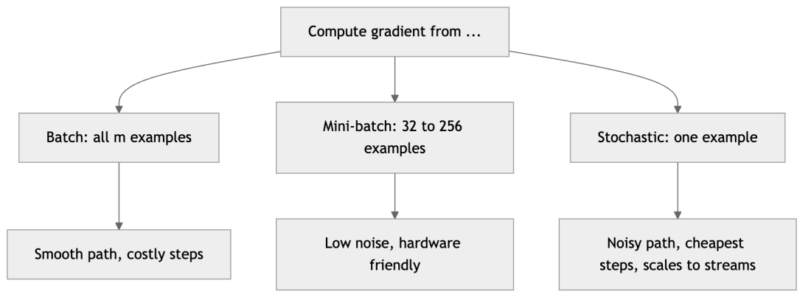

*Figure 84. The three gradient descent variants trade gradient accuracy against per-step cost*

The figure below overlays the cost trajectories of all three on the same problem. Batch descends smoothly; mini-batch is slightly noisy; pure SGD is the jagged line that descends fastest early but never fully settles.

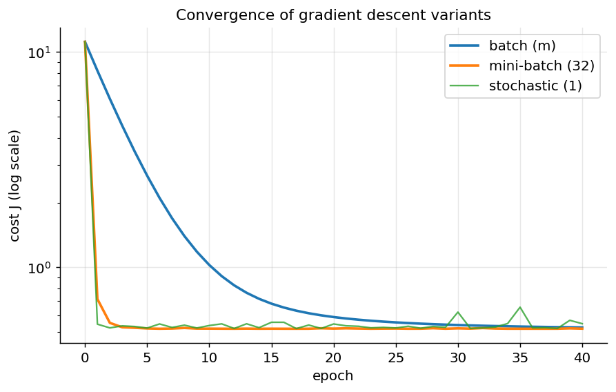

*Figure 85. Convergence of batch, mini-batch, and stochastic gradient descent on the same regression problem.*

### 6.4.2 The learning rate and feature scaling

Two settings decide whether gradient descent works at all. The **learning rate** $`\alpha`$ controls step size: too small and convergence crawls; too large and the iterate overshoots the minimum and diverges to infinity. There is a critical value above which even a convex problem diverges. The figure below shows three regimes on the same cost bowl.

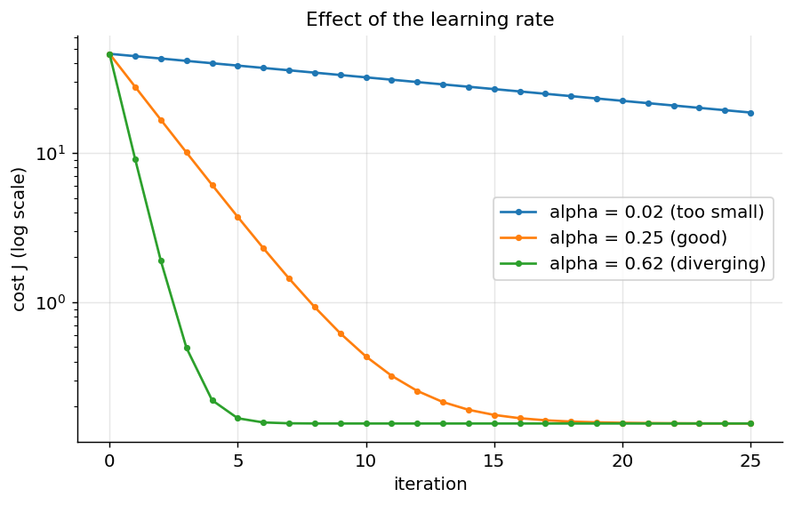

*Figure 86. Learning rate regimes: too small crawls, well-tuned converges, too large diverges.*

**Feature scaling matters enormously** for gradient descent. The condition number of $`\mathbf{X}^{\top}\mathbf{X}`$ — the ratio of its largest to smallest eigenvalue — controls how elongated the cost bowl is. If features live on wildly different scales (one in millimeters, one in kilometers), the bowl is a long, thin ravine; gradient descent zig-zags across the narrow direction and creeps along the long one, taking thousands of steps. Standardizing each feature to zero mean and unit variance rounds the bowl toward a sphere, and descent heads almost straight for the minimum. The closed-form normal equation does not care about scaling (it solves the system exactly regardless), but every iterative method does, and — as we will see — every regularized method does too, for a different reason.

## 6.5 Interpreting Coefficients

A fitted linear model is a story about the world, and reading it correctly is a skill. The coefficient $`\theta_{j}`$ is the expected change in the target for a one-unit increase in feature $`j`$, **holding all other features constant** — the *ceteris paribus* clause. That last phrase is where most misreadings occur.

- **Units.** A coefficient carries units of (target units) per (feature units). If income is in dollars and the target is house price in dollars, a coefficient of $`3.2`$ on income means each extra dollar of income associates with \$3.2 dollars of price. Change income to thousands of dollars and the coefficient becomes $`3200`$. The number is meaningless without its units.
- **The intercept** is the prediction when *all* features are zero. Often that point is nonsensical (a house with zero rooms and zero area), so the intercept is not independently interpretable; it simply positions the hyperplane. Centering features (subtracting their means) makes the intercept equal to the prediction at the average input, which is more meaningful.
- **“Holding others constant” can be fictional.** If two features are strongly correlated — say, house area and number of rooms — you cannot really move one while freezing the other, because the data never do so. OLS will still hand you two coefficients, but they may be large, opposite in sign, and individually meaningless while remaining jointly fine for prediction. This is the fingerprint of multicollinearity, diagnosed with VIF below.
- **Standardized (beta) coefficients.** To compare importance across features on different scales, refit on standardized features (each with unit standard deviation). Then $`\theta_{j}`$ is the change in $`y`$ (in units of $`y`$’s standard deviation, if you also standardize $`y`$) per one-standard-deviation change in feature $`j`$, making magnitudes directly comparable. This is also what regularization implicitly assumes.
- **Categorical features** become one-hot indicator columns; each coefficient is the offset of that category relative to the omitted reference category. **Interaction terms** ($`x_{1}x_{2}`$) let the slope on one feature depend on another; their coefficients are changes in a slope, not in the target directly.
- **Log transforms** change the story to percentages. If you regress $`\log y`$ on $`x`$, then $`\theta_{j}`$ is approximately the fractional change in $`y`$ per unit of $`x`$; a coefficient of $`0.05`$ means about a 5% increase. Regress $`\log y`$ on $`\log x`$ and $`\theta_{j}`$ becomes an elasticity — the percent change in $`y`$ per percent change in $`x`$.

The overarching pitfall: **a regression coefficient is an association, not a cause.** Only careful experimental design or causal-inference machinery (beyond this chapter) licenses causal language. A positive coefficient on “number of firefighters” for “fire damage” does not mean firefighters cause damage; both rise with fire size, the omitted confounder.

## 6.6 Polynomial Regression and the Bias–Variance Trade-off

A straight line cannot bend, but we can let it bend by feeding it powers of the features. **Polynomial regression** of degree $`d`$ augments the feature set with $`x,x^{2},\ldots,x^{d}`$ (and cross terms like $`x_{1}x_{2}`$ for multiple features) and then runs ordinary linear regression on the expanded set. The model is still *linear in the parameters* — that is why it is fit with the same normal equation or gradient descent. Only the feature map is nonlinear.

The degree $`d`$ is a **capacity knob**, and turning it exposes the bias–variance trade-off with unusual clarity. A degree-1 fit is rigid: it cannot follow curvature, so it is **biased** — wrong in a systematic, repeatable way regardless of the training sample. A degree-15 fit is flexible enough to wiggle through every training point, driving training error to near zero, but its shape swings wildly with each new sample; it has high **variance**. Expected test error decomposes as $`\text{bias}^{2} + \text{variance} + \text{irreducible noise}`$, and it is minimized at an intermediate degree where the two are balanced.

``` python
import numpy as np
from sklearn.pipeline import make_pipeline
from sklearn.preprocessing import PolynomialFeatures
from sklearn.linear_model import LinearRegression
from sklearn.model_selection import cross_val_score

rng = np.random.default_rng(1)
X = np.sort(rng.uniform(-3, 3, 60)).reshape(-1, 1)
y = 0.5 * X[:, 0] ** 3 - X[:, 0] + rng.normal(0, 2, 60)

for d in [1, 3, 12]:
    model = make_pipeline(PolynomialFeatures(d), LinearRegression())
    rmse = -cross_val_score(model, X, y, cv=5,
                            scoring="neg_root_mean_squared_error").mean()
    print(f"degree {d:2d}  CV RMSE = {rmse:.2f}")
# degree 1 underfits (high RMSE), degree 3 is about right, degree 12 overfits (RMSE rises again)
```

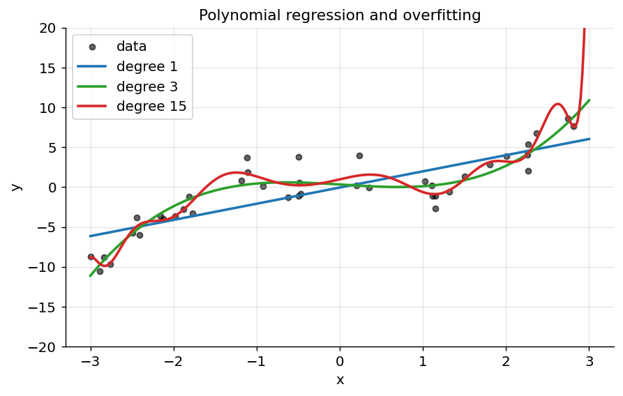

*Figure 87. Underfitting, a good fit, and overfitting as polynomial degree increases.*

The clean way to *see* the trade-off is a **validation curve**: plot training error and cross-validation error against degree on the same axes. Training error falls monotonically as capacity grows (a more flexible model always fits the training data at least as well). Validation error is U-shaped: it falls while added capacity reduces bias, bottoms out at the sweet spot, then rises as added capacity feeds variance. The gap between the two curves *is* the variance; the height of the training curve reflects the bias.

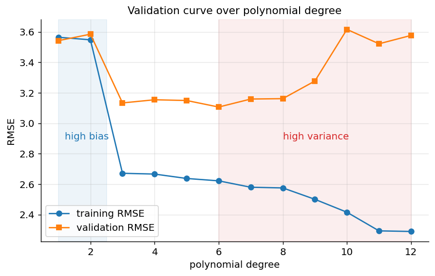

*Figure 88. Validation curve: training error falls with degree while validation error is U-shaped, its minimum marking the bias-variance sweet spot.*

The fix is either to choose the degree by cross-validation or to keep the flexibility but penalize wild coefficients — which leads us to regularization. In fact, a high-degree polynomial *with* regularization is often better than a hand-picked low degree, because the penalty smoothly discourages the coefficients that cause the wiggling without forcing you to guess the exact capacity.

## 6.7 Regularized Linear Models: Ridge, Lasso, Elastic Net

Regularization adds a penalty on the size of the coefficients to the cost, discouraging the model from relying too heavily on any feature. This shrinks variance at the price of a little bias — a deliberate move to the left on the bias–variance curve — and it tames the instability of OLS under collinearity. It is one of the highest-leverage ideas in all of machine learning, and it appears in nearly every model that follows.

### 6.7.1 Ridge regression (L2)

Ridge adds the squared L2 norm of the weights (excluding the intercept, which we never penalize — shrinking the intercept would just bias every prediction):

``` math
J_{\text{ridge}}(\mathbf{\theta}) = \frac{1}{2m}\sum_{i = 1}^{m}(h_{\mathbf{\theta}}(\mathbf{x}^{(i)}) - y^{(i)})^{2} + \frac{\lambda}{2m}\sum_{j = 1}^{n}\theta_{j}^{2}.
```

It has a clean closed form obtained by repeating the normal-equation derivation with the extra penalty term, whose gradient is $`\frac{\lambda}{m}\mathbf{\theta}`$:

``` math
\mathbf{\theta} = (\mathbf{X}^{\top}\mathbf{X} + \lambda\mathbf{I})^{- 1}\mathbf{X}^{\top}\mathbf{y}.
```

The added $`\lambda\mathbf{I}`$ inflates the diagonal, which guarantees the matrix is invertible **even when features are perfectly collinear** — this is precisely the cure for the singularity that breaks OLS. As $`\lambda \rightarrow 0`$ ridge reduces to OLS; as $`\lambda \rightarrow \infty`$ all coefficients are driven toward (but never exactly to) zero. Ridge shrinks smoothly and keeps every feature, so it is the right tool when you believe many features contribute a little and you want to stabilize a collinear design rather than prune it.

### 6.7.2 Lasso regression (L1)

Lasso (“least absolute shrinkage and selection operator”) swaps the squared penalty for the absolute value:

``` math
J_{\text{lasso}}(\mathbf{\theta}) = \frac{1}{2m}\sum_{i = 1}^{m}(h_{\mathbf{\theta}}(\mathbf{x}^{(i)}) - y^{(i)})^{2} + \frac{\lambda}{m}\sum_{j = 1}^{n}|\theta_{j}|.
```

The absolute value is not differentiable at zero, so there is no closed form; lasso is solved by coordinate descent or least-angle regression. Its defining virtue is **automatic feature selection**: for large enough $`\lambda`$ it sets some coefficients *exactly* to zero, producing a sparse model that ignores irrelevant features entirely. We explain the geometry of why in a moment. The trade-off: among a group of highly correlated features, lasso tends to keep one arbitrarily and zero the rest, and it can select at most $`m`$ features when $`n > m`$.

### 6.7.3 Elastic Net (L1 + L2)

Elastic Net blends both penalties with a mixing ratio $`r \in \lbrack 0,1\rbrack`$:

``` math
J_{\text{enet}} = \text{MSE} + r\lambda\sum_{j}^{}|\theta_{j}| + \frac{(1 - r)\lambda}{2}\sum_{j}^{}\theta_{j}^{2}.
```

At $`r = 1`$ it is lasso; at $`r = 0`$ it is ridge. It inherits lasso’s sparsity while handling correlated features more gracefully — the L2 term encourages correlated predictors to be selected or dropped *together* as a group, rather than one being chosen at random. Elastic Net is a sensible default when you have many features, some correlated, and suspect only a subset matters.

### 6.7.4 The geometry: why L1 induces sparsity

Every penalized regression can be recast as a *constrained* one: minimize the RSS subject to the coefficient vector lying inside a budget region — a ball for ridge, a diamond for lasso. Picture the two-coefficient case. The RSS forms concentric elliptical contours centered on the unconstrained OLS solution. The constrained optimum is the point where the smallest ellipse that still touches the budget region meets it. The lasso’s budget region $`|\theta_{1}| + |\theta_{2}| \leq t`$ is a diamond with **sharp corners on the axes**; an expanding ellipse is very likely to first touch a corner, and a corner has one coordinate equal to zero — hence a sparse solution. The ridge region $`\theta_{1}^{2} + \theta_{2}^{2} \leq t`$ is a smooth circle with no corners, so the tangency point almost never lands exactly on an axis, and no coefficient is set to zero. That single picture, below, is the whole intuition.

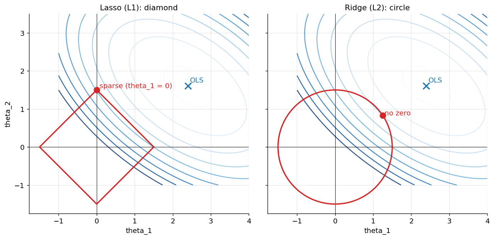

*Figure 89. Constraint geometry. Lasso’s diamond (left) meets the RSS contours at a corner on the axis, zeroing a coefficient; ridge’s circle (right) does not.*

### 6.7.5 The regularization path

As you sweep $`\lambda`$ from small to large, each coefficient traces a path. Ridge paths shrink smoothly and simultaneously; lasso paths hit zero one after another and stay there, so a plot of the path doubles as a feature-selection ranking (the last features standing are the most important). The figure below computes both paths from scratch — ridge in closed form, lasso by coordinate descent — to make the contrast concrete.

``` python
import numpy as np
from sklearn.linear_model import Ridge, Lasso, ElasticNet, LinearRegression
from sklearn.preprocessing import StandardScaler

rng = np.random.default_rng(2)
m, n = 100, 8
X = rng.normal(size=(m, n))
true = np.array([5, -4, 0, 0, 2, 0, 0, 0.0])     # only 3 features truly matter
y = X @ true + rng.normal(0, 1, m)
Xs = StandardScaler().fit_transform(X)

for name, model in [("OLS", LinearRegression()),
                    ("Ridge", Ridge(alpha=10.0)),
                    ("Lasso", Lasso(alpha=0.3)),
                    ("ElasticNet", ElasticNet(alpha=0.3, l1_ratio=0.5))]:
    model.fit(Xs, y)
    print(f"{name:11s}", np.round(model.coef_, 2))
# Lasso/ElasticNet zero out the irrelevant features; Ridge shrinks but keeps all.
```

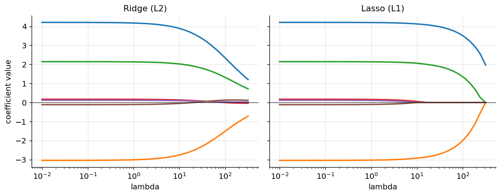

*Figure 90. Coefficient shrinkage paths. Ridge (left) shrinks smoothly; Lasso (right) drives coefficients to exactly zero one by one.*

### 6.7.6 Feature scaling is mandatory for regularization

Here is a rule with no exceptions: **always scale features before regularizing.** The penalty $`\sum_{j}^{}\theta_{j}^{2}`$ (or $`\sum_{j}^{}|\theta_{j}|`$) treats all coefficients on equal footing, but a coefficient’s magnitude depends on its feature’s scale. A feature measured in millimeters gets a coefficient a thousand times larger than the same feature in kilometers, so the penalty would clobber the millimeter feature and barely touch the kilometer one — an arbitrary bias driven by units, not importance. Standardizing every feature to zero mean and unit variance puts the coefficients on a common footing so the penalty is applied fairly. Choose $`\lambda`$ (called `alpha` in scikit-learn) by cross-validation — `RidgeCV`, `LassoCV`, and `ElasticNetCV` do this efficiently along the whole path.

| Model | Penalty | Coefficients to zero? | Closed form? | Best when |
|----|----|----|----|----|
| OLS | none | no | yes | few features, no collinearity |
| Ridge | $`\lambda\sum\theta_{j}^{2}`$ | no (shrinks) | yes | many correlated features, keep all |
| Lasso | $`\lambda\sum \parallel \theta_{j} \parallel`$ | yes (sparse) | no | want feature selection, few true predictors |
| Elastic Net | both | yes | no | many features, correlated groups |

## 6.8 Regression Diagnostics

A fitted regression is a hypothesis, and the residuals are the evidence for or against it. Diagnostics are the practice of interrogating the residuals — the leftover $`r_{i} = y_{i} - {\widehat{y}}_{i}`$ — to check the assumptions, spot bad points, and decide whether to trust the model. A model with a great $`R^{2}`$ and pathological residuals is a trap. This section is a checklist you should run on every serious linear model.

### 6.8.1 The residual plot

Plot residuals against fitted values. Under a correct model with homoscedastic noise, you should see a **structureless horizontal band** centered on zero — a “night sky” of points with no pattern. Departures are diagnostic:

- A **curve or U-shape** means the true relationship is nonlinear; you need polynomial terms, a transform, or a nonlinear model.
- A **funnel** (spread growing or shrinking with the fitted value) means **heteroscedasticity** — non-constant error variance, violating a Gauss–Markov assumption.
- **Isolated points far from the band** are outliers worth investigating.

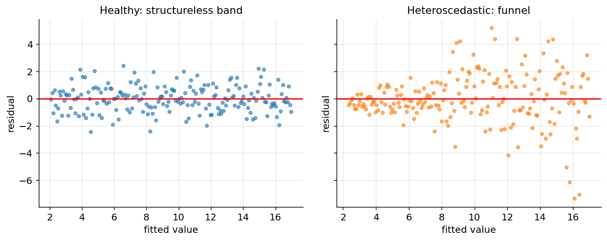

*Figure 91. Residual plots. Left, a healthy structureless band. Right, a funnel revealing heteroscedasticity.*

Heteroscedasticity can be tested formally with the **Breusch–Pagan** or **White** tests (regress squared residuals on the features and check for significance). It does not bias the coefficients, but it invalidates the standard errors; the remedies are heteroscedasticity-robust (Huber–White) standard errors, weighted least squares that down-weights high-variance observations, or a variance-stabilizing transform of the target such as $`\log y`$ or $`\sqrt{y}`$.

### 6.8.2 The Q–Q plot and normality

To check whether residuals are approximately normal — needed for exact inference — use a **quantile–quantile (Q–Q) plot**: sort the standardized residuals and plot them against the quantiles you would expect from a standard normal. If the residuals are normal, the points fall on the diagonal line. Systematic curvature at the ends reveals heavy tails (points below the line on the left, above on the right) or skew. The figure below contrasts normal residuals with heavy-tailed ones.

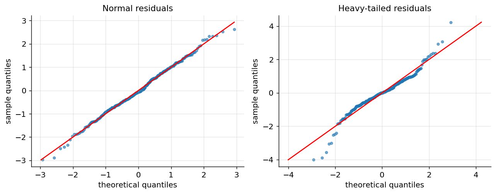

*Figure 92. Q-Q plots. Normal residuals (left) hug the diagonal; heavy-tailed residuals (right) bend away at the extremes.*

### 6.8.3 Multicollinearity and the VIF

When features are strongly correlated, the design matrix is near-singular, $`\mathbf{X}^{\top}\mathbf{X}`$ is nearly non-invertible, and coefficient estimates become wildly unstable — large in magnitude, sensitive to tiny data changes, and often nonsensical in sign. The standard diagnostic is the **variance inflation factor (VIF)**. For feature $`j`$, regress it on all the other features, obtain the $`R_{j}^{2}`$ of that auxiliary regression, and compute

``` math
\text{VIF}_{j} = \frac{1}{1 - R_{j}^{2}}.
```

A VIF of 1 means feature $`j`$ is uncorrelated with the rest; the variance of its coefficient estimate is exactly what it would be with orthogonal features. A VIF of 10 means that variance is inflated tenfold (rule of thumb: VIF above 5–10 warrants attention). The remedies are to drop or combine redundant features, to build composite features (e.g., via PCA), or to use ridge regression, which is designed precisely to stabilize estimates under collinearity.

``` python
import numpy as np
import pandas as pd
# VIF via the R^2 of each feature regressed on the others
def vif(X):
    X = np.asarray(X, float)
    vals = []
    for j in range(X.shape[1]):
        others = np.delete(X, j, axis=1)
        others = np.c_[np.ones(len(others)), others]
        beta, *_ = np.linalg.lstsq(others, X[:, j], rcond=None)
        pred = others @ beta
        ss_res = ((X[:, j] - pred) ** 2).sum()
        ss_tot = ((X[:, j] - X[:, j].mean()) ** 2).sum()
        r2 = 1 - ss_res / ss_tot
        vals.append(1.0 / (1.0 - r2))
    return np.array(vals)

rng = np.random.default_rng(0)
a = rng.normal(size=500)
X = np.c_[a, a + rng.normal(0, 0.05, 500), rng.normal(size=500)]  # cols 0,1 nearly identical
print(vif(X).round(1))   # -> large VIF for the two collinear columns, ~1 for the independent one
```

### 6.8.4 Leverage, influence, and Cook’s distance

Not all points affect the fit equally. **Leverage** measures how unusual a point’s *feature* values are; it is the diagonal entry $`h_{ii}`$ of the hat matrix $`\mathbf{H} = \mathbf{X}(\mathbf{X}^{\top}\mathbf{X})^{- 1}\mathbf{X}^{\top}`$. Leverage lies in $`\lbrack 0,1\rbrack`$, averages $`(n + 1)/m`$, and a value more than two or three times that average flags a point sitting far out in feature space — a point with the *potential* to swing the fit. High leverage alone is not damning; a high-leverage point that happens to fall on the trend line does no harm.

What matters is **influence**: the combination of high leverage *and* a large residual. **Cook’s distance** quantifies exactly this, measuring how much all the fitted values move if point $`i`$ is deleted:

``` math
D_{i} = \frac{r_{i}^{2}}{(n + 1)\, s^{2}} \cdot \frac{h_{ii}}{(1 - h_{ii})^{2}},
```

where $`r_{i}`$ is the residual and $`s^{2}`$ the residual variance. The first factor is the (squared, standardized) residual; the second blows up as leverage $`h_{ii} \rightarrow 1`$. A common flag is $`D_{i} > 4/m`$. A single high-influence point can rotate the entire regression line, so influential points must be investigated — is it a data-entry error, a genuine but rare case, or a sign the model is missing a feature? The figure below shows an influence plot: leverage on the x-axis, standardized residual on the y-axis, and bubble area proportional to Cook’s distance, so the dangerous points (large bubbles, upper-right) leap out.

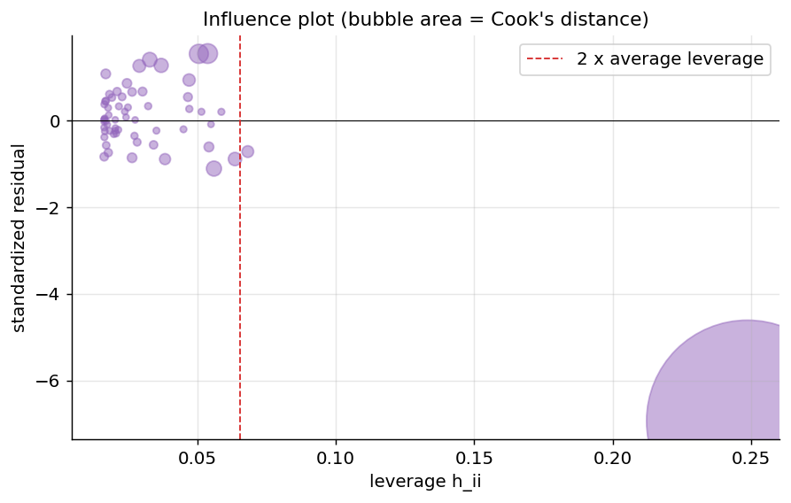

*Figure 93. An influence plot. High leverage plus a large residual gives high Cook’s distance (large bubbles), marking points that dominate the fit.*

## 6.9 Generalized Linear Models

Ordinary least squares assumes the target is continuous, unbounded, and Gaussian around a mean that is a *linear* function of the features. Real targets often violate this: counts are non-negative integers, probabilities live in $`\lbrack 0,1\rbrack`$, waiting times are positive and skewed. **Generalized linear models (GLMs)** extend linear regression to these cases while keeping the interpretable linear core. A GLM has three components:

1.  A **random component**: the target follows some distribution from the **exponential family** (Gaussian, Bernoulli, Poisson, Gamma, …), with mean $`\mu = \mathbb{E}\lbrack y \mid \mathbf{x}\rbrack`$.
2.  A **systematic component**: the **linear predictor** $`\eta = \mathbf{\theta}^{\top}\mathbf{x}`$, exactly as in ordinary regression.
3.  A **link function** $`g`$ that connects the two: $`g(\mu) = \eta`$. The link maps the (possibly bounded) mean onto the whole real line so a linear predictor can target it. We predict by inverting: $`\mu = g^{- 1}(\eta)`$.

Ordinary linear regression is the special case with a Gaussian random component and the **identity link** $`g(\mu) = \mu`$. Changing the pair (distribution, link) produces a family of models fit by the same maximum-likelihood machinery — typically iteratively reweighted least squares.

| Target type | Distribution | Link $`g(\mu)`$ | Inverse link (prediction) |
|----|----|----|----|
| Continuous, unbounded | Gaussian | identity: $`\mu`$ | $`\eta`$ |
| Binary (0/1) | Bernoulli | logit: $`\log\frac{\mu}{1 - \mu}`$ | $`\frac{1}{1 + e^{- \eta}}`$ (sigmoid) |
| Count (0,1,2,…) | Poisson | log: $`\log\mu`$ | $`e^{\eta}`$ |
| Positive, skewed | Gamma | log (or inverse) | $`e^{\eta}`$ |

Two cases matter most in practice. **Poisson regression** models count data — number of website visits, insurance claims, disease cases — with the log link. Because $`\mu = e^{\eta} = e^{\theta_{0}}\prod_{j}^{}e^{\theta_{j}x_{j}}`$, a unit increase in feature $`j`$ *multiplies* the expected count by $`e^{\theta_{j}}`$: coefficients act on a multiplicative, percentage scale, and predictions are guaranteed positive. The log link is exactly what prevents the nonsensical negative counts a plain linear model would produce near zero. **Logistic regression** is the Bernoulli–logit GLM; despite its name it is a *classification* algorithm (the target is a category, not a quantity), which is why it is covered in full in the chapter on Classification I: Logistic Regression, k-NN, and Naive Bayes. We preview it here only to place it in the GLM family: it feeds the linear predictor through the sigmoid inverse-link to produce a probability, and is trained by maximizing the Bernoulli likelihood (equivalently, minimizing cross-entropy). If your target is a category, reach for logistic regression; if it is a continuous quantity, the methods in *this* chapter apply.

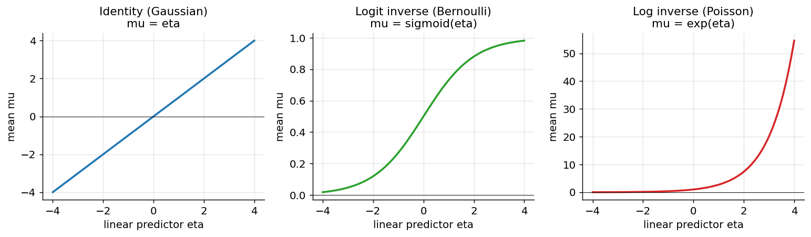

*Figure 94. Three link functions and their inverse-link response curves mapping the linear predictor to the target’s natural range.*

``` python
import numpy as np
from sklearn.linear_model import PoissonRegressor

rng = np.random.default_rng(0)
X = rng.uniform(0, 3, size=(500, 2))
# true log-mean is linear; counts are Poisson around exp(eta)
eta = 0.3 + 0.8 * X[:, 0] - 0.5 * X[:, 1]
y = rng.poisson(np.exp(eta))

model = PoissonRegressor(alpha=0.0, max_iter=300).fit(X, y)
print("intercept:", round(model.intercept_, 3))     # ~ 0.3
print("coefs    :", model.coef_.round(3))            # ~ [0.8, -0.5]
# exp(coef) is the multiplicative effect on the expected count per unit of the feature
print("rate ratio for feature 0:", round(np.exp(model.coef_[0]), 3))
```

## 6.10 Robust and Quantile Regression

OLS minimizes squared error, and squaring makes it exquisitely sensitive to outliers: a single wild point contributes a residual that, when squared, can dominate the entire cost and drag the fitted line toward it. When your data contain outliers you cannot clean away — sensor glitches, fraud, heavy-tailed noise — you need estimators that refuse to be bullied. Three approaches matter.

### 6.10.1 Huber regression

The **Huber loss** is a hybrid: quadratic for small residuals (so it behaves like OLS in the well-behaved middle) and linear for large residuals (so outliers contribute proportionally, not quadratically). With a threshold $`\delta`$,

``` math
L_{\delta}(r) = \left\{ \begin{matrix}
\frac{1}{2}r^{2} & |r| \leq \delta, \\
\delta\left( |r| - \frac{1}{2}\delta \right) & |r| > \delta.
\end{matrix} \right.\ 
```

Because the loss grows only linearly past $`\delta`$, a far-off outlier exerts a bounded pull on the fit. Huber regression keeps most of OLS’s efficiency under clean Gaussian noise while gaining robustness; $`\delta`$ (scikit-learn’s `epsilon`, default 1.35) tunes the crossover. It is differentiable everywhere, so it is fast to optimize.

### 6.10.2 RANSAC

**RANSAC** (RANdom SAmple Consensus) takes a different, combinatorial tack. Repeatedly: sample a minimal random subset of points, fit a model to just those, and count how many of *all* points agree with it within a tolerance (the **inliers**). Keep the model with the largest inlier set, then refit on those inliers. RANSAC can tolerate a large fraction of outliers — even a majority in favorable cases — because a random clean subset eventually yields a model the other clean points endorse. It shines in computer vision (fitting geometry to noisy feature matches) and anywhere outliers are gross and numerous, but it is stochastic and its tolerance threshold needs tuning.

The figure below fits OLS, Huber, and RANSAC to data with a cluster of outliers. OLS bends toward the outliers; Huber resists; RANSAC ignores them almost entirely.

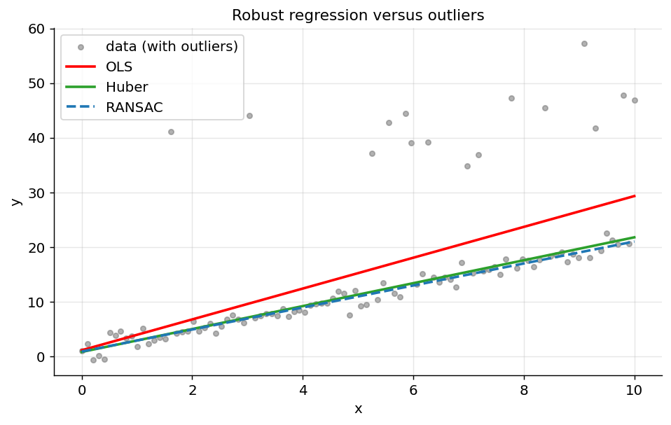

*Figure 95. OLS is dragged by outliers; Huber resists them; RANSAC fits the inlier majority and ignores them.*

### 6.10.3 Quantile regression

Every method so far models the *mean* of $`y`$. **Quantile regression** instead models a chosen **quantile** — the median, the 10th percentile, the 90th percentile — of the conditional distribution. This is invaluable when you care about the spread or the tails, not just the center: forecasting a plausible *range* of demand, setting a service-level guarantee (“95% of deliveries within this time”), or understanding whether a feature affects the poor differently from the rich. It is fit by minimizing the asymmetric **pinball (check) loss**, which for target quantile $`\tau \in (0,1)`$ penalizes under- and over-prediction unequally:

``` math
L_{\tau}(r) = \left\{ \begin{matrix}
\tau\, r & r \geq 0, \\
(\tau - 1)\, r & r < 0,
\end{matrix} \right.\ \quad\quad r = y - \widehat{y}.
```

At $`\tau = 0.5`$ the two arms are symmetric and the loss reduces to absolute error, so median regression (also called least-absolute-deviations, LAD) is the special case — and, being absolute rather than squared, it is itself robust to outliers. For $`\tau = 0.9`$ the loss punishes under-prediction nine times as hard as over-prediction, pushing the fitted line up so that about 90% of points fall below it. Fitting several $`\tau`$ values gives a fan of lines that describes the whole conditional distribution, and their vertical gaps widen wherever the data are heteroscedastic — a bonus diagnostic. The figure below shows the asymmetric loss and a fan of fitted quantiles on heteroscedastic data.

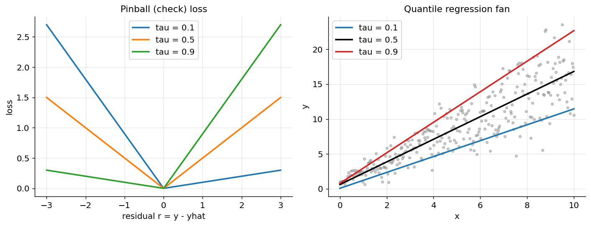

*Figure 96. Left, the asymmetric pinball loss for three quantiles. Right, fitted quantile lines fanning out where the noise grows.*

``` python
import numpy as np
from sklearn.linear_model import QuantileRegressor, HuberRegressor

rng = np.random.default_rng(0)
X = rng.uniform(0, 10, size=(400, 1))
y = 1 + 1.5 * X[:, 0] + rng.normal(0, 0.4 * X[:, 0] + 0.3, 400)

for q in [0.1, 0.5, 0.9]:
    m = QuantileRegressor(quantile=q, alpha=0.0, solver="highs").fit(X, y)
    print(f"tau={q}: intercept={m.intercept_:.2f}, slope={m.coef_[0]:.2f}")

hub = HuberRegressor(epsilon=1.35).fit(X, y)
print("Huber slope (robust mean):", round(hub.coef_[0], 2))
```

**Strengths / weaknesses / when to use.** *Huber* — strengths: robust yet efficient, differentiable, fast; weakness: needs the scale threshold $`\delta`$; use when noise is heavy-tailed but mostly mild. *RANSAC* — strengths: survives a large outlier fraction; weaknesses: stochastic, threshold-sensitive, models the majority only; use when outliers are gross and numerous. *Quantile* — strengths: models tails and full distribution, median variant is robust; weakness: one fit per quantile, no closed form; use when you need intervals or care about tails. Pitfall shared by all: robustness is not a license to ignore data quality — always look at the points you are down-weighting.

## 6.11 Support Vector Regression

### 6.11.1 Intuition

Support Vector Regression (SVR) adapts the support vector machine — developed for classification in the chapter on Support Vector Machines and Kernel Methods — to predict continuous values. Instead of fitting a line that minimizes squared error to every point, SVR fits a tube of half-width $`\varepsilon`$ around the function and only penalizes points that fall *outside* the tube. Errors smaller than $`\varepsilon`$ cost nothing. This $`\varepsilon`$**-insensitive loss** makes SVR robust to small noise and, through the kernel trick, capable of flexible nonlinear fits.

### 6.11.2 The math

For a linear SVR we solve

``` math
\min_{\mathbf{w},b}\mspace{6mu}\frac{1}{2} \parallel \mathbf{w} \parallel^{2} + C\sum_{i = 1}^{m}\left( \xi_{i} + \xi_{i}^{\ast} \right)
```

subject to the predictions lying within $`\varepsilon`$ of the targets up to slack variables $`\xi_{i},\xi_{i}^{\ast} \geq 0`$:

``` math
y^{(i)} - (\mathbf{w}^{\top}\mathbf{x}^{(i)} + b) \leq \varepsilon + \xi_{i},\quad\quad(\mathbf{w}^{\top}\mathbf{x}^{(i)} + b) - y^{(i)} \leq \varepsilon + \xi_{i}^{\ast}.
```

The constant $`C`$ controls the trade-off between flatness (small $`\parallel \mathbf{w} \parallel`$, more regularization) and tolerance of out-of-tube errors. Replacing dot products with a kernel $`K(\mathbf{x}_{i},\mathbf{x}_{j})`$ — typically the RBF kernel $`exp( - \gamma \parallel \mathbf{x}_{i} - \mathbf{x}_{j} \parallel^{2})`$ — lets SVR bend into nonlinear shapes without ever forming the high-dimensional features explicitly.

``` python
import numpy as np
from sklearn.svm import SVR
from sklearn.pipeline import make_pipeline
from sklearn.preprocessing import StandardScaler
from sklearn.metrics import mean_squared_error

rng = np.random.default_rng(3)
X = np.sort(rng.uniform(0, 6, 120)).reshape(-1, 1)
y = np.sin(X[:, 0]) + rng.normal(0, 0.1, 120)

model = make_pipeline(StandardScaler(), SVR(kernel="rbf", C=10, epsilon=0.1, gamma=0.5))
model.fit(X, y)
pred = model.predict(X)
print("RBF-SVR train RMSE:", round(mean_squared_error(y, pred) ** 0.5, 3))
```

Strengths: robust to outliers (thanks to the flat-bottomed loss), effective in high dimensions, flexible via kernels. Weaknesses: scales poorly to very large datasets (training is roughly quadratic to cubic in $`m`$), three coupled hyperparameters ($`C`$, $`\varepsilon`$, $`\gamma`$) demand careful tuning, and predictions are not interpretable. **Always scale the features** — SVR is distance-based and falls apart on unscaled data.

## 6.12 Decision Tree Regression

### 6.12.1 Intuition

A regression tree partitions the feature space into rectangular regions and predicts a constant (the mean target) within each region. It learns greedily: at each node it searches for the feature and threshold that best splits the data into two more homogeneous groups, then recurses.

### 6.12.2 How a split is chosen

Unlike classification trees that use Gini or entropy, regression trees minimize the sum of squared residuals. For a candidate split of node data into left set $`L`$ and right set $`R`$, the cost is

``` math
\text{Cost} = \sum_{i \in L}^{}\left( y^{(i)} - {\bar{y}}_{L} \right)^{2} + \sum_{i \in R}^{}\left( y^{(i)} - {\bar{y}}_{R} \right)^{2},
```

where $`{\bar{y}}_{L},{\bar{y}}_{R}`$ are the mean targets of each side. The algorithm picks the split with the lowest cost, then repeats until a stopping rule fires (max depth, minimum samples per leaf, or no improvement). The prediction for a new point is the mean target of the leaf it lands in — which is why a single tree’s prediction surface is a staircase of flat steps, not a smooth curve.

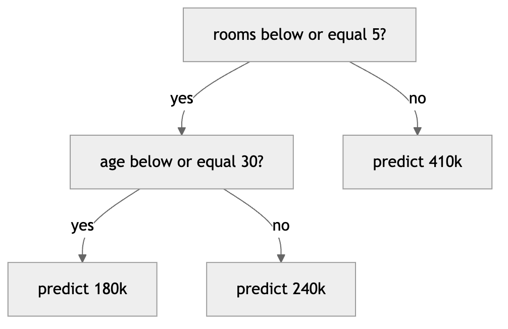

*Figure 97. A small regression tree partitioning by feature thresholds, predicting a constant per leaf*

``` python
import numpy as np
from sklearn.tree import DecisionTreeRegressor
from sklearn.metrics import mean_absolute_error

rng = np.random.default_rng(4)
X = np.sort(rng.uniform(0, 6, 200)).reshape(-1, 1)
y = np.sin(X[:, 0]) + rng.normal(0, 0.15, 200)

shallow = DecisionTreeRegressor(max_depth=3).fit(X, y)
deep = DecisionTreeRegressor(max_depth=None).fit(X, y)
print("depth 3   train MAE:", round(mean_absolute_error(y, shallow.predict(X)), 3))
print("unlimited train MAE:", round(mean_absolute_error(y, deep.predict(X)), 3))
# The unlimited tree memorizes the noise (near-zero train MAE) — a classic overfit signal.
```

Strengths: handles nonlinearity and feature interactions automatically, needs no scaling, tolerates mixed data types, and is interpretable when shallow. Weaknesses: a single tree is high-variance — small data changes can reshuffle the whole tree — and it cannot extrapolate beyond the range of the training targets. These weaknesses are exactly what ensembles fix.

## 6.13 Ensemble Regression

Ensembles combine many trees so that their errors partially cancel. Two strategies dominate: **bagging** (train many trees in parallel on bootstrap samples and average them, reducing variance) and **boosting** (train trees sequentially, each correcting the previous ensemble’s residuals, reducing bias).

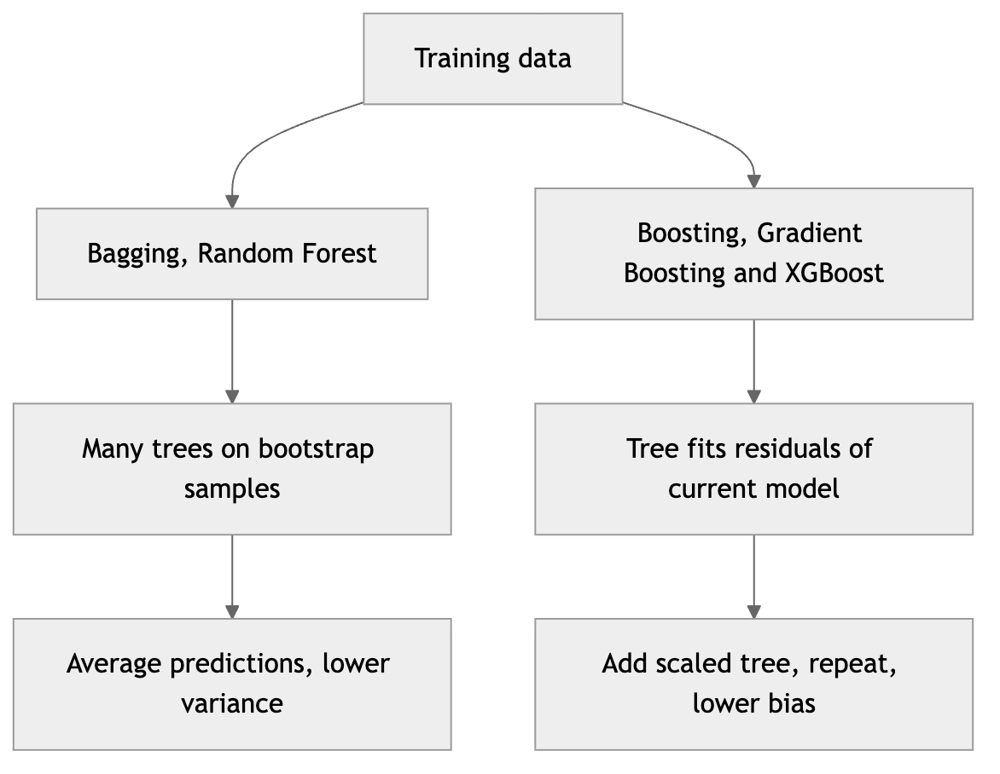

*Figure 98. Bagging averages parallel trees, boosting adds sequential corrections*

### 6.13.1 Random Forest

A random forest is bagging plus a twist: at each split, only a random subset of features is considered. This **decorrelates** the trees so that averaging them removes more variance. Each tree is grown deep (low bias, high variance); averaging hundreds of them yields a low-variance estimator.

The prediction is simply the mean over the $`B`$ trees:

``` math
\widehat{y} = \frac{1}{B}\sum_{b = 1}^{B}T_{b}(\mathbf{x}).
```

A free bonus is the **out-of-bag (OOB) estimate**: each tree leaves out about a third of the data, which can serve as a built-in validation set.

``` python
import numpy as np
from sklearn.ensemble import RandomForestRegressor
from sklearn.datasets import fetch_california_housing
from sklearn.model_selection import cross_val_score

X, y = fetch_california_housing(return_X_y=True)
rf = RandomForestRegressor(n_estimators=300, max_features=1/3,
                           n_jobs=-1, random_state=0)
rmse = -cross_val_score(rf, X, y, cv=3,
                        scoring="neg_root_mean_squared_error").mean()
print("Random Forest CV RMSE:", round(rmse, 3))
```

Strengths: strong out-of-the-box accuracy, little tuning, no scaling, robust to outliers and irrelevant features, parallelizable, and it reports feature importances. Weaknesses: large models (hundreds of deep trees) are memory-heavy and slow to predict, less interpretable than one tree, and still cannot extrapolate.

### 6.13.2 Gradient Boosting

Gradient boosting builds the model in stages. Start with a constant prediction $`F_{0}(\mathbf{x}) = \bar{y}`$. At each stage $`t`$, compute the negative gradient of the loss with respect to the current predictions — for squared error these are just the residuals $`r_{i} = y^{(i)} - F_{t - 1}(\mathbf{x}^{(i)})`$ — fit a small tree $`h_{t}`$ to those residuals, and add a shrunken version to the model:

``` math
F_{t}(\mathbf{x}) = F_{t - 1}(\mathbf{x}) + \eta\, h_{t}(\mathbf{x}),
```

where the **learning rate** $`\eta`$ (typically 0.01–0.3) controls how much each tree contributes. Smaller $`\eta`$ needs more trees but generalizes better. Because each tree corrects the leftover errors of the whole ensemble, boosting drives down bias and usually edges out random forests on accuracy — at the cost of being sequential and more sensitive to hyperparameters.

``` python
import numpy as np
from sklearn.ensemble import GradientBoostingRegressor
from sklearn.datasets import fetch_california_housing
from sklearn.model_selection import cross_val_score

X, y = fetch_california_housing(return_X_y=True)
gb = GradientBoostingRegressor(n_estimators=400, learning_rate=0.05,
                               max_depth=3, subsample=0.8, random_state=0)
rmse = -cross_val_score(gb, X, y, cv=3,
                        scoring="neg_root_mean_squared_error").mean()
print("Gradient Boosting CV RMSE:", round(rmse, 3))
```

### 6.13.3 XGBoost

XGBoost (“extreme gradient boosting”) is a highly optimized implementation of gradient boosting that has become the default for tabular competitions. Its key refinements over vanilla boosting are: a **regularized objective** that penalizes tree complexity (number of leaves and leaf weights), a second-order Taylor approximation of the loss (using both gradient and Hessian) for better splits, built-in handling of missing values, column and row subsampling, and engineering for speed and parallelism. The regularized objective at step $`t`$ is

``` math
\mathcal{L}^{(t)} = \sum_{i = 1}^{m}\ell\left( y^{(i)},F_{t - 1}(\mathbf{x}^{(i)}) + h_{t}(\mathbf{x}^{(i)}) \right) + \gamma T + \frac{1}{2}\lambda\sum_{k = 1}^{T}w_{k}^{2},
```

where $`T`$ is the number of leaves and $`w_{k}`$ their output values. The penalty $`\gamma`$ controls pruning and $`\lambda`$ shrinks leaf weights, which is why XGBoost often generalizes better than unregularized boosting.

``` python
# pip install xgboost
import numpy as np
from xgboost import XGBRegressor
from sklearn.datasets import fetch_california_housing
from sklearn.model_selection import train_test_split
from sklearn.metrics import mean_squared_error, r2_score

X, y = fetch_california_housing(return_X_y=True)
Xtr, Xte, ytr, yte = train_test_split(X, y, test_size=0.2, random_state=0)

xgb = XGBRegressor(n_estimators=600, learning_rate=0.05, max_depth=4,
                   subsample=0.8, colsample_bytree=0.8,
                   reg_lambda=1.0, random_state=0)
xgb.fit(Xtr, ytr)
pred = xgb.predict(Xte)
print("XGBoost test RMSE:", round(mean_squared_error(yte, pred) ** 0.5, 3))
print("XGBoost test R^2 :", round(r2_score(yte, pred), 3))
```

Modern alternatives worth knowing are **LightGBM** (leaf-wise growth, very fast on large data) and **CatBoost** (excellent with categorical features). They share the gradient-boosting core and differ mainly in tree-growth strategy and categorical handling. For most tabular regression problems, a tuned gradient-boosting model is the strongest single choice.

### 6.13.4 k-Nearest Neighbors Regression

k-NN regression is the simplest idea in the chapter: to predict for a new point, find its $`k`$ closest training points and average their targets:

``` math
\widehat{y}(\mathbf{x}) = \frac{1}{k}\sum_{i \in N_{k}(\mathbf{x})}^{}y^{(i)},
```

optionally weighting nearer neighbors more heavily. It is **non-parametric** and **lazy** — there is no training beyond storing the data; all the work happens at prediction time. Small $`k`$ gives a jagged, high-variance fit; large $`k`$ smooths toward the global mean (high bias). It needs feature scaling because it relies on distances, suffers in high dimensions (the curse of dimensionality makes “nearest” meaningless), and is slow to query on large datasets without spatial indexing. It is a useful baseline and shines when the target varies smoothly and locally with the features.

``` python
import numpy as np
from sklearn.neighbors import KNeighborsRegressor
from sklearn.pipeline import make_pipeline
from sklearn.preprocessing import StandardScaler
from sklearn.datasets import fetch_california_housing
from sklearn.model_selection import cross_val_score

X, y = fetch_california_housing(return_X_y=True)
knn = make_pipeline(StandardScaler(),
                    KNeighborsRegressor(n_neighbors=10, weights="distance"))
rmse = -cross_val_score(knn, X, y, cv=3,
                        scoring="neg_root_mean_squared_error").mean()
print("k-NN CV RMSE:", round(rmse, 3))
```

## 6.14 Comparing the Regressors

The table below summarizes the trade-offs. “Scaling needed” means feature standardization materially affects results.

| Algorithm | Key assumption | Scaling needed | Strengths | Weaknesses | Use when |
|----|----|----|----|----|----|
| Linear / OLS | linear relationship | helps GD | fast, interpretable | underfits curvature, outlier-sensitive | baseline, linear signal |
| Polynomial | poly relationship | yes | captures curvature | overfits at high degree | known smooth nonlinearity |
| Ridge | linear, all features matter | yes | stable under collinearity | keeps all features | many correlated features |
| Lasso | linear, sparse signal | yes | feature selection | erratic with correlated features | want a sparse model |
| Elastic Net | linear, grouped signal | yes | sparsity plus stability | two hyperparameters | many features, some correlated |
| Huber / RANSAC | linear with outliers | yes | robust to outliers | thresholds to tune | contaminated data |
| Quantile | conditional quantile linear | yes | models tails, intervals | one fit per quantile | need prediction intervals |
| GLM (Poisson etc.) | exponential-family target | yes | correct for counts, rates | link choice, MLE fit | counts, positive skewed targets |
| SVR (RBF) | smooth function | yes | robust, nonlinear, high-dim | slow on big data, 3 hyperparams | small or medium, robust fit |
| Decision Tree | piecewise-constant | no | interpretable, nonlinear | high variance, no extrapolation | quick interpretable model |
| Random Forest | piecewise-constant | no | accurate, robust, low tuning | large, less interpretable | strong general default |
| Gradient Boost / XGBoost | piecewise-constant | no | top accuracy on tabular | tuning, sequential training | maximize tabular accuracy |
| k-NN | local smoothness | yes | simple, non-parametric | curse of dimensionality, slow query | smooth local target, small data |

A pragmatic workflow: start with a regularized linear model as an interpretable baseline, run the diagnostics on it, then fit a gradient-boosting model to see how much nonlinear structure exists. If the gap is large, the relationship is nonlinear and the boosted model likely wins; if small, prefer the simpler linear model — and trust its coefficients, since you have already checked its assumptions.

## 6.15 A Worked End-to-End Example

Let us run several regressors on the **California Housing** dataset — predicting median house value (in \$100,000s) from features like median income, house age, and location — and evaluate them with the metrics from the chapter on Supervised Learning and Model Evaluation: RMSE, MAE, and $`R^{2}`$.

``` python
import numpy as np
from sklearn.datasets import fetch_california_housing
from sklearn.model_selection import train_test_split
from sklearn.pipeline import make_pipeline
from sklearn.preprocessing import StandardScaler
from sklearn.linear_model import Ridge
from sklearn.ensemble import RandomForestRegressor, GradientBoostingRegressor
from sklearn.neighbors import KNeighborsRegressor
from sklearn.svm import SVR
from sklearn.metrics import mean_squared_error, mean_absolute_error, r2_score

X, y = fetch_california_housing(return_X_y=True)
Xtr, Xte, ytr, yte = train_test_split(X, y, test_size=0.2, random_state=42)

models = {
    "Ridge":          make_pipeline(StandardScaler(), Ridge(alpha=1.0)),
    "k-NN (k=10)":    make_pipeline(StandardScaler(),
                                    KNeighborsRegressor(n_neighbors=10, weights="distance")),
    "SVR (RBF)":      make_pipeline(StandardScaler(),
                                    SVR(kernel="rbf", C=10, gamma=0.1)),
    "Random Forest":  RandomForestRegressor(n_estimators=300, n_jobs=-1, random_state=42),
    "Gradient Boost": GradientBoostingRegressor(n_estimators=400, learning_rate=0.05,
                                                max_depth=3, random_state=42),
}

print(f"{'Model':16s} {'RMSE':>7s} {'MAE':>7s} {'R^2':>7s}")
for name, model in models.items():
    model.fit(Xtr, ytr)
    p = model.predict(Xte)
    rmse = mean_squared_error(yte, p) ** 0.5
    mae = mean_absolute_error(yte, p)
    r2 = r2_score(yte, p)
    print(f"{name:16s} {rmse:7.3f} {mae:7.3f} {r2:7.3f}")

# Typical ordering: Gradient Boost and Random Forest lead on RMSE/R^2,
# SVR and k-NN are mid-pack, Ridge trails — confirming nonlinear structure.
```

Reading the results, the boosted trees and random forest usually post the lowest RMSE and highest $`R^{2}`$, the kernel and instance-based methods sit in the middle, and the linear model lags — telling us the housing relationship has real nonlinearity and interactions (income times location, for instance) that trees capture and a plain line cannot. From here, the next steps are hyperparameter tuning (grid or randomized search with cross-validation), inspecting feature importances or SHAP values for interpretability, and — crucially — checking residual plots to confirm no systematic bias remains, exactly as the diagnostics section prescribes.

## 6.16 Summary

- **Regression predicts continuous targets**, and the linear model is the foundation for understanding every method that follows. Distinguish prediction (accuracy on new data) from inference (trustworthy coefficients), because inference demands the Gauss–Markov assumptions.
- **OLS minimizes squared error**, which is maximum likelihood under Gaussian noise. Its minimizer is the closed-form normal equation $`\mathbf{\theta} = (\mathbf{X}^{\top}\mathbf{X})^{- 1}\mathbf{X}^{\top}\mathbf{y}`$, derived by setting the gradient to zero; geometrically it projects $`\mathbf{y}`$ onto the column space of $`\mathbf{X}`$, leaving residuals orthogonal to it.
- **Gradient descent** solves the same problem iteratively and scales where the closed form cannot. Batch, mini-batch, and stochastic variants trade gradient accuracy for per-step cost; the learning rate and feature scaling decide whether it converges.
- **The Gauss–Markov theorem** says OLS is the best linear unbiased estimator under linearity, full rank, exogeneity, homoscedasticity, and no autocorrelation. Each violation has a signature and a remedy — and only broken exogeneity biases the coefficients themselves.
- **Interpret coefficients carefully**: units, the *ceteris paribus* clause, standardization for comparison, and the discipline never to read association as causation.
- **Polynomial features add flexibility but invite overfitting**; the validation curve makes the bias–variance trade-off visible, and cross-validation or regularization picks the sweet spot.
- **Regularization** trades a little bias for much less variance. Ridge (L2) shrinks smoothly and stabilizes collinear designs; lasso (L1) zeroes coefficients for sparse, self-selecting models — its diamond-shaped constraint region is *why* it induces sparsity; elastic net blends both. Always scale features first.
- **Diagnostics** turn residuals into evidence: residual plots for nonlinearity and heteroscedasticity, Q–Q plots for normality, VIF for multicollinearity, and leverage plus Cook’s distance for influential points.
- **Generalized linear models** extend the linear core to non-Gaussian targets via link functions — log link for Poisson counts, logit for the (classification) logistic case.
- **Robust methods** resist outliers: Huber blends squared and absolute loss, RANSAC fits the inlier consensus, and quantile regression models the median or tails via the pinball loss.
- **Beyond linear**, SVR fits a tolerance tube, trees partition space into constant regions, and ensembles — random forests by averaging, boosting by sequential correction — deliver the best tabular accuracy. Choose by problem structure and evaluate honestly on held-out data.

## 6.17 Key Takeaways

- The normal equation and gradient descent find the *same* least-squares solution; use the closed form for small problems and gradient descent when features are many or data streams.
- Squared error is not arbitrary — it is maximum likelihood under Gaussian noise, which also explains its outlier sensitivity.
- Heteroscedasticity and autocorrelation do not bias coefficients but corrupt their standard errors; omitted confounders bias the coefficients and no amount of data fixes it.
- Scale your features before any iterative or regularized method; the closed-form OLS is the only method that is scale-invariant.
- Lasso’s sparsity comes from geometry: the L1 diamond’s corners lie on the axes, so the optimum snaps a coefficient to exactly zero; ridge’s smooth circle never does.
- Always look at the residuals. A high $`R^{2}`$ with a patterned residual plot is a model you should not trust.
- Match the model to the target: GLMs for counts and rates, quantile regression for intervals and tails, robust regression for contaminated data, ensembles for maximum tabular accuracy.
- A coefficient is an association, not a cause. Reserve causal language for causal designs.

## 6.18 Exercises

1.  **Conceptual.** Starting from $`J(\mathbf{\theta}) = \frac{1}{2m} \parallel \mathbf{X\theta} - \mathbf{y} \parallel^{2}`$, expand the quadratic, take the gradient, and derive the normal equation step by step. Then show that the residual vector $`\mathbf{r} = \mathbf{X\theta} - \mathbf{y}`$ is orthogonal to every column of $`\mathbf{X}`$, and explain what this means geometrically.

2.  **Conceptual.** Explain why adding $`\lambda\mathbf{I}`$ (ridge) guarantees $`\mathbf{X}^{\top}\mathbf{X} + \lambda\mathbf{I}`$ is invertible even when features are perfectly collinear. What happens to the coefficients as $`\lambda \rightarrow 0`$ and as $`\lambda \rightarrow \infty`$?

3.  **Conceptual.** Lasso can set coefficients exactly to zero but ridge cannot. Using the constraint-region picture (diamond versus circle), explain geometrically why the L1 penalty produces sparse solutions while the L2 penalty does not.

4.  **Conceptual.** For each Gauss–Markov assumption, state one realistic scenario that violates it, say whether the violation biases the coefficients or merely their standard errors, and name a remedy.

5.  **Coding.** Generate data from $`y = 1.5x^{2} - 2x + \text{noise}`$. Fit polynomial regressions of degrees 1 through 15, plot training and cross-validation RMSE versus degree, and identify the degree where overfitting begins. Annotate the bias-dominated and variance-dominated regions.

6.  **Coding.** Implement batch, mini-batch, and stochastic gradient descent for linear regression from scratch on the same synthetic dataset. Plot the cost per epoch for all three on one log-scale axis and compare their convergence. Then multiply one feature by 1000, refit without scaling, and observe how convergence degrades.

7.  **Coding.** Fit an OLS model, then compute and plot: (a) a residuals-versus-fitted plot, (b) a Q–Q plot of the residuals, (c) the VIF of every feature, and (d) an influence plot with Cook’s distance. Deliberately inject one high-leverage outlier and show how it moves the fitted line and its Cook’s distance.

8.  **Coding.** On a dataset with 20 features where only 5 are informative (use `sklearn.datasets.make_regression` with `n_informative=5`), fit ridge, lasso, and elastic net. Compare which features each model selects and how close the recovered coefficients are to the truth. Use `LassoCV` to choose $`\lambda`$ by cross-validation.

9.  **Coding.** Simulate count data with a log-linear mean and Poisson noise. Fit both an ordinary `LinearRegression` and a `PoissonRegressor`, and compare their predictions near zero — show that the linear model predicts impossible negative counts while the Poisson model does not.

10. **Coding.** Take clean linear data and corrupt 20% of the points with large outliers. Fit OLS, `HuberRegressor`, and `RANSACRegressor`, overlay the three lines, and quantify how far each slope has drifted from the true value. Then fit `QuantileRegressor` at $`\tau = 0.1,0.5,0.9`$ on heteroscedastic data and interpret the widening fan.

---

[← 5 Supervised Learning and Model Evaluation](ch05-supervised-eval.md) · [Contents](../README.md#contents) · [7 Classification I: Logistic Regression, k-NN, and Naive Bayes →](ch07-classification-1.md)
