[← 6 Regression Algorithms](ch06-regression.md) · [Contents](../README.md#contents) · [8 Classification II: Support Vector Machines and Kernel Methods →](ch08-classification-svm.md)

---

# 7 Classification I: Logistic Regression, k-NN, and Naive Bayes

Classification is the most widely deployed task in all of machine learning. Every spam filter, fraud detector, medical triage tool, sentiment analyzer, and image tagger is, at heart, answering the question *which category does this belong to?* This chapter opens by carefully defining the kinds of classification problems you will encounter — binary, multiclass, multilabel, and imbalanced — together with the standard strategies for reducing harder cases to simpler ones. It then teaches three foundational algorithm families in depth: **logistic regression**, a linear probabilistic model; **k-nearest neighbors (k-NN)**, a non-parametric instance-based method; and **naive Bayes**, a fast generative classifier built directly from Bayes’ theorem. We assume you have met the general supervised-learning setup and the evaluation metrics — accuracy, precision, recall, the confusion matrix, ROC and PR curves — from the chapter on Supervised Learning and Model Evaluation, and the probability notation from the chapter on Mathematical and Statistical Foundations. The support vector machines and tree-based classifiers that round out the toolkit live in the next two chapters.

These three algorithms are not merely a historical starting point. They span the three great paradigms of classification. Logistic regression is **discriminative**: it models the decision boundary directly, learning $`P(y \mid \mathbf{x})`$ without ever describing what the data looks like. Naive Bayes is **generative**: it models how each class *produces* data, learning $`P(\mathbf{x} \mid y)`$ and $`P(y)`$, then inverts to a decision. k-NN is neither — it is **instance-based**, storing the data itself and deferring all reasoning to query time. Understanding how these three philosophies differ, and when each pays off, is worth far more than memorizing any single formula. Master them and you will recognize their fingerprints in almost every classifier you meet later, from softmax layers in neural networks to the Gaussian mixtures behind many probabilistic models.

## 7.1 Types of Classification Problems

Before choosing an algorithm, you must name the problem precisely. The structure of the label space dictates everything downstream — the loss function, the output layer, the evaluation metric, and even which algorithms are eligible. Getting this wrong is one of the most common and most expensive mistakes a practitioner can make; it is far easier than it sounds to accidentally train a multiclass model on what is really a multilabel problem, and to spend weeks confused by mediocre metrics as a result.

**Binary classification** has exactly two mutually exclusive classes, conventionally labeled $`0`$ (negative) and $`1`$ (positive): spam vs. not-spam, malignant vs. benign, churn vs. retain. The model typically outputs a single probability $`P(y = 1 \mid \mathbf{x})`$ and a threshold (default $`0.5`$) converts it to a hard label. Binary classification is the atom of the field: almost every harder structure is built by composing binary decisions, and almost every metric you know is defined first for the binary case and then generalized. The choice of which class is “positive” is a modeling decision with real consequences — by convention the positive class is the rarer, costlier, or more interesting one (fraud, disease, defect), because precision and recall are defined with respect to it.

**Multiclass classification** has $`K > 2`$ mutually exclusive classes — exactly one label per example. Classifying a handwritten digit as one of $`\{ 0,\ldots,9\}`$, or a news article as *sports*, *politics*, or *tech*, are multiclass problems. The model produces a probability distribution over the $`K`$ classes that sums to one, and you predict the arg-max. The defining property is *mutual exclusivity*: a digit is a 7 or a 1, never both. This is what lets the outputs form a single distribution.

**Multilabel classification** drops the mutual-exclusivity assumption: each example may carry *any subset* of the labels simultaneously. A photo can be tagged *beach* AND *sunset* AND *dog*; a movie can be both *comedy* and *romance*; a clinical note can list several diagnoses at once. Here the output is $`K`$ independent probabilities (one per label, each its own binary decision), not a single distribution that sums to one. The natural decomposition is **binary relevance** — train one independent binary classifier per label. Its weakness is that it ignores *label correlations* (comedy and romance co-occur; horror and children’s do not), which more advanced methods such as **classifier chains** (feed each label prediction as a feature into the next) attempt to recover. Evaluation shifts too: you no longer report a single accuracy but per-label metrics aggregated by **micro-** or **macro-averaging**, plus set-based measures such as **Hamming loss** (the fraction of individual label bits predicted wrong) and **subset accuracy** (the far stricter fraction of examples whose *entire* label set is exactly right). A model can have excellent Hamming loss yet poor subset accuracy if it reliably gets most labels right but rarely nails every label on a single example.

**Multiclass-multioutput** (also *multi-output* or *multi-task*) classification generalizes further: each example is assigned a value for several categorical variables at once — for instance, predicting both the *make* and the *color* of a car in one shot. It is best thought of as several multiclass problems solved jointly.

**Ordinal classification** sits between classification and regression: the classes have a natural order but no meaningful spacing — a star rating from 1 to 5, or disease severity *mild/moderate/severe*. Treating it as plain multiclass throws away the ordering (predicting 5 when the truth is 1 is treated as no worse than predicting 2); treating it as regression pretends the gaps are equal. Specialized ordinal models thread this needle, but in practice many teams approximate it with either extreme.

**Imbalanced classification** is an orthogonal property, not a separate label structure: one class vastly outnumbers the others (e.g., 0.1% of credit-card transactions are fraudulent). Imbalance breaks naive accuracy — a model that predicts “not fraud” every time scores 99.9% accuracy while being useless. Because it cuts across all the structures above (you can have imbalanced binary, imbalanced multiclass, and imbalanced multilabel problems), we treat it separately and return to mitigation strategies at the end of the chapter.

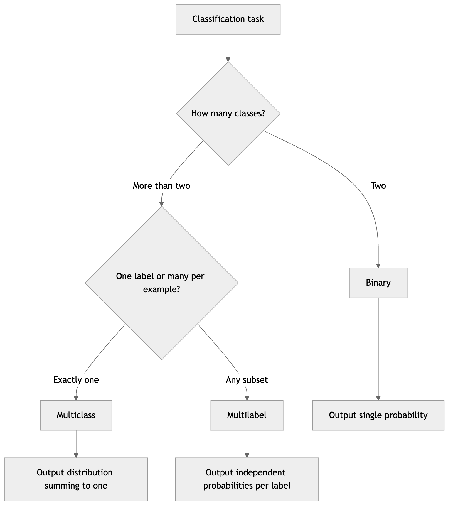

*Figure 99. The label structure determines the problem type and output form.*

### 7.1.1 Reducing Multiclass to Binary: OvR, OvO, and Softmax

Some algorithms (logistic regression, support vector machines) are natively binary. Three strategies extend them to $`K`$ classes.

**One-vs-Rest (OvR)**, also called one-vs-all, trains $`K`$ binary classifiers. Classifier $`k`$ learns to separate class $`k`$ (positive) from *all other classes lumped together* (negative). At prediction time, each classifier emits a score and you pick the class with the highest score. OvR needs only $`K`$ models and is the scikit-learn default for most linear classifiers, but the “rest” class is often large and imbalanced, and the scores from independently trained classifiers are not guaranteed to be comparable — one classifier may be systematically overconfident. In practice this is mitigated by calibrating each classifier’s output before comparing.

**One-vs-One (OvO)** trains a classifier for every *pair* of classes — $`\left( \frac{K}{2} \right) = K(K - 1)/2`$ of them. Each votes for one of its two classes, and the class with the most votes wins. OvO trains more models but each on a smaller, cleaner two-class subset, which is why SVMs (whose training cost grows super-linearly with sample size) favor it. For $`K = 10`$ that means 45 classifiers, but each sees on average only $`2/K`$ of the data.

A quick worked example makes the voting concrete. Suppose $`K = 4`$ classes (A, B, C, D), giving $`\left( \frac{4}{2} \right) = 6`$ pairwise classifiers. On a query point they vote:

| Match  | Winner |
|--------|--------|
| A vs B | A      |
| A vs C | A      |
| A vs D | D      |
| B vs C | C      |
| B vs D | D      |
| C vs D | C      |

Tallying: A gets 2 votes, B gets 0, C gets 2, D gets 2. This is a three-way tie, which is exactly the failure mode of OvO — ties are common and must be broken (scikit-learn falls back to summing the underlying decision-function confidences, so the class whose margins were largest wins). This fragility of naive vote-counting is one reason softmax is preferred whenever available.

**Softmax (multinomial)** sidesteps the reduction entirely by generalizing logistic regression to output a single joint distribution over all $`K`$ classes at once. This is usually the most accurate and best-calibrated option when the algorithm supports it, and it is what neural networks use universally. There is no voting, no tie-breaking, and the probabilities are mutually consistent by construction because they are normalized together.

A fourth, less common strategy deserves a mention because it generalizes the first two: **error-correcting output codes (ECOC)**. Each class is assigned a unique binary “codeword” of length $`L`$, and $`L`$ binary classifiers are trained, one per bit. At prediction time the $`L`$ outputs form a bit-string that you match to the *closest* codeword by Hamming distance. Because the codewords are chosen to be far apart, a few individual classifier errors can be corrected — the redundancy provides fault tolerance that plain OvR and OvO lack. OvR is simply the special case where the code is the identity matrix (one bit per class). ECOC is rarely the first thing you try, but it is a reminder that the reduction of multiclass to binary is a design space, not a fixed recipe.

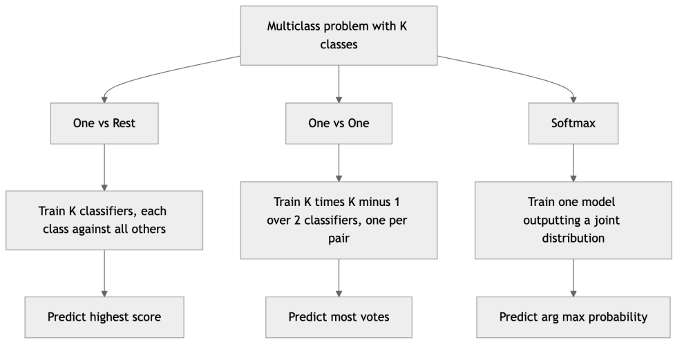

*Figure 100. One-vs-Rest trains K classifiers against the rest, One-vs-One trains a classifier per pair.*

| Strategy | Models trained | Best when |
|----|----|----|
| One-vs-Rest | $`K`$ | Many classes, cheap training, want probabilities |
| One-vs-One | $`K(K - 1)/2`$ | Per-model training cost is super-linear (SVM) |
| Softmax | 1 | Algorithm natively supports a joint distribution |

## 7.2 Logistic Regression

Despite its name, logistic regression is a *classification* algorithm. It is the workhorse linear classifier: fast to train, interpretable, well-calibrated, and a mandatory baseline before you reach for anything fancier. If you remember one habit from this chapter, let it be this: fit a logistic regression first, on every classification problem, before touching a gradient-boosted forest or a neural network. It sets a floor you must beat to justify the added complexity, and surprisingly often it is not beaten by much.

### 7.2.1 Intuition

Linear regression predicts an unbounded real number, but a probability must live in $`\lbrack 0,1\rbrack`$. Logistic regression fixes this by computing a linear score $`z = \mathbf{w}^{\top}\mathbf{x} + b`$ and then squashing it through the **sigmoid** (logistic) function into a probability. The linear score positions each point relative to a hyperplane — its sign says which side, its magnitude says how far — and the sigmoid maps “far on the positive side” to probabilities near 1 and “far on the negative side” to near 0. Think of $`z`$ as a signed distance-like quantity: a point sitting right on the boundary gets $`z = 0`$ and a maximally uncertain probability of $`0.5`$; a point buried deep in positive territory gets a large positive $`z`$ and a probability crushed up against 1.

### 7.2.2 The Sigmoid and the Model

The sigmoid function is

``` math
\sigma(z) = \frac{1}{1 + e^{- z}},\quad\quad\sigma:\mathbb{R} \rightarrow (0,1).
```

It is monotonic, S-shaped, passes through $`0.5`$ at $`z = 0`$, and saturates toward 0 and 1 at the extremes. It has a beautifully simple derivative that we will lean on when deriving the gradient:

``` math
\sigma'(z) = \sigma(z)\left( 1 - \sigma(z) \right).
```

That the slope is expressible purely in terms of the output value itself is not a coincidence of algebra but the reason the sigmoid is so computationally convenient. The full model is

``` math
P(y = 1 \mid \mathbf{x}) = \sigma(\mathbf{w}^{\top}\mathbf{x} + b) = \frac{1}{1 + e^{- (\mathbf{w}^{\top}\mathbf{x} + b)}},\quad\quad P(y = 0 \mid \mathbf{x}) = 1 - P(y = 1 \mid \mathbf{x}).
```

By convention we often fold the bias $`b`$ into $`\mathbf{w}`$ by prepending a constant $`1`$ feature to $`\mathbf{x}`$, so that $`z = \mathbf{w}^{\top}\mathbf{x}`$ with $`x_{0} = 1`$; this keeps the notation clean and is exactly what happens under the hood in most implementations.

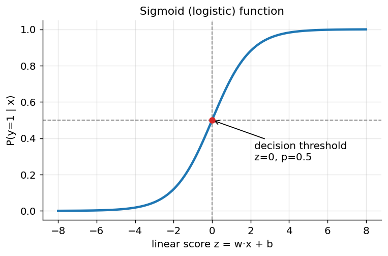

*Figure 101. The sigmoid squashes any real score into a probability between 0 and 1.*

### 7.2.3 The Decision Boundary

We predict class 1 when $`P(y = 1 \mid \mathbf{x}) \geq 0.5`$, which happens exactly when $`z = \mathbf{w}^{\top}\mathbf{x} + b \geq 0`$. The set $`\{\mathbf{x}:\mathbf{w}^{\top}\mathbf{x} + b = 0\}`$ is a **hyperplane** — a line in 2D, a plane in 3D, a flat $`(n - 1)`$-dimensional surface in general. Logistic regression therefore produces a *linear* decision boundary. Its flexibility comes only from feature engineering: add polynomial or interaction terms and the boundary becomes curved in the original space while remaining linear in the expanded feature space. This is the same trick that, taken to its logical extreme with kernels, produces support vector machines.

The weight vector $`\mathbf{w}`$ is orthogonal (perpendicular) to the decision boundary and points toward the positive class; its magnitude $`\parallel \mathbf{w} \parallel`$ controls how sharply the probability transitions across the boundary. A large $`\parallel \mathbf{w} \parallel`$ means the sigmoid is steep — the model is very confident just a short distance from the boundary — while a small $`\parallel \mathbf{w} \parallel`$ produces a gentle, cautious ramp. This is precisely the quantity that regularization reins in.

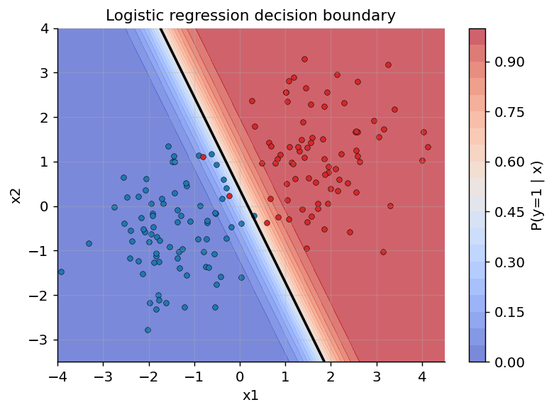

*Figure 102. Logistic regression draws a linear boundary; color shows predicted probability.*

#### 7.2.3.1 Nonlinear Boundaries via Feature Engineering

The linearity of the boundary is a limitation only in the *original* feature space. Because logistic regression is linear in its *inputs*, you can hand it richer inputs. Append squared terms $`x_{1}^{2},x_{2}^{2}`$, cross terms $`x_{1}x_{2}`$, or any nonlinear transform, and the model fits a linear boundary in the expanded space that projects down to a *curved* boundary — an ellipse, a parabola, a wavy separator — in the original one. This is the same idea kernels formalize for support vector machines, done here by explicit feature construction. The figure below fits logistic regression to two classes arranged in concentric rings; on the raw two features it can only draw a useless straight line, but after adding the single feature $`x_{1}^{2} + x_{2}^{2}`$ (radius squared) it separates them cleanly with what appears as a circle in the original plane.

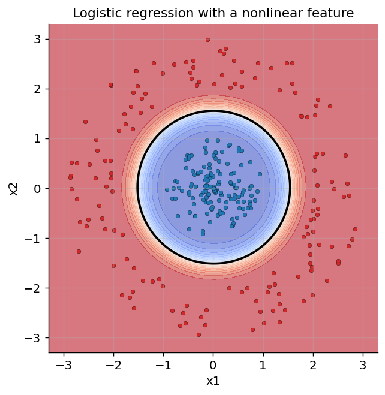

*Figure 103. Adding a radius-squared feature lets logistic regression carve a circular boundary.*

A useful interpretation comes from the **log-odds**. The *odds* of an event with probability $`p`$ are $`p/(1 - p)`$ — the ratio of the chance it happens to the chance it does not. Rearranging the model,

``` math
\log\frac{P(y = 1 \mid \mathbf{x})}{P(y = 0 \mid \mathbf{x})} = \mathbf{w}^{\top}\mathbf{x} + b.
```

The left side is the log of the odds (the *logit*). So each weight $`w_{j}`$ is the change in log-odds per unit increase in feature $`x_{j}`$; equivalently, $`e^{w_{j}}`$ is the multiplicative change in the odds — the **odds ratio** — for a one-unit change in that feature. If a credit-scoring model has $`w_{j} = 0.7`$ for “number of late payments,” then each additional late payment multiplies the odds of default by $`e^{0.7} \approx 2.0`$: each late payment roughly doubles the odds. This direct, quotable interpretation is why logistic regression dominates in medicine, epidemiology, and credit scoring, where regulators and domain experts demand an explanation for every decision, not just an accurate one.

### 7.2.4 The Loss Function: Log-Loss

We fit $`\mathbf{w},b`$ by **maximum likelihood estimation (MLE)**: choose the parameters under which the observed labels are most probable. For a single example with true label $`y \in \{ 0,1\}`$ and predicted probability $`\widehat{p} = \sigma(z)`$, the probability of that label is compactly written

``` math
P(y \mid \mathbf{x}) = {\widehat{p}}^{\, y}\,(1 - \widehat{p})^{1 - y},
```

a clever encoding: when $`y = 1`$ the second factor is $`{\widehat{p}}^{1}(1 - \widehat{p})^{0} = \widehat{p}`$, and when $`y = 0`$ it collapses to $`1 - \widehat{p}`$. Assuming the $`m`$ training examples are independent, the likelihood of the whole dataset is the product $`\prod_{i}^{}{\widehat{p}}^{(i)\, y^{(i)}}(1 - {\widehat{p}}^{(i)})^{1 - y^{(i)}}`$. Products of many probabilities underflow numerically and are awkward to differentiate, so we take the logarithm (which turns products into sums and, being monotonic, does not move the maximum), negate it to turn maximization into minimization, and average over $`m`$ examples. This yields the **binary cross-entropy**, or **log-loss**:

``` math
J(\mathbf{w},b) = - \frac{1}{m}\sum_{i = 1}^{m}\left\lbrack \, y^{(i)}\log{\widehat{p}}^{(i)} + (1 - y^{(i)})log\left( 1 - {\widehat{p}}^{(i)} \right) \right\rbrack.
```

The loss for a single example rewards confident correct predictions and punishes confident wrong ones with unbounded severity. If the truth is $`y = 1`$ and the model says $`\widehat{p} = 0.99`$, the loss is $`- log0.99 \approx 0.01`$; if it confidently says $`\widehat{p} = 0.01`$, the loss is $`- log0.01 \approx 4.6`$. Predict $`\widehat{p} \rightarrow 0`$ when the truth is 1 and the loss diverges to $`+ \infty`$ — the loss makes it catastrophically expensive to be both confident and wrong.

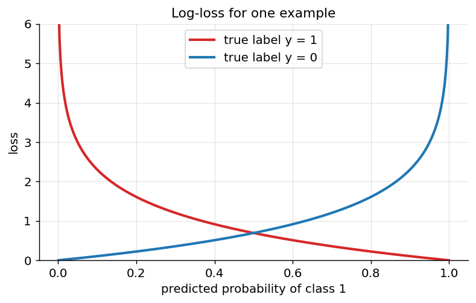

*Figure 104. Log-loss for a single example explodes as a confident prediction turns out wrong.*

Why not just use squared error? Because squared error composed with the sigmoid is *non-convex* — gradient descent can get stuck in local minima. Log-loss, by contrast, is convex in $`(\mathbf{w},b)`$, so there is a single global optimum that any decent optimizer will find. Its gradient is strikingly clean. Differentiating $`J`$ with respect to the weights and using $`\sigma'(z) = \sigma(z)(1 - \sigma(z))`$, the chain rule gives

``` math
\frac{\partial J}{\partial\mathbf{w}} = \frac{1}{m}\sum_{i = 1}^{m}\left( {\widehat{p}}^{(i)} - y^{(i)} \right)\,\mathbf{x}^{(i)},\quad\quad\frac{\partial J}{\partial b} = \frac{1}{m}\sum_{i = 1}^{m}\left( {\widehat{p}}^{(i)} - y^{(i)} \right).
```

The gradient is the average prediction error times the input — identical in form to linear regression’s gradient. There is no closed-form solution (the equations are nonlinear in $`\mathbf{w}`$), so we optimize iteratively with gradient descent, or in practice with faster second-order-aware solvers like L-BFGS, Newton’s method, or the coordinate-descent used by scikit-learn’s `liblinear`.

It is worth dwelling on *why* this elegant gradient appears. Two effects could each create a large gradient: a large prediction error $`(\widehat{p} - y)`$ or a steep sigmoid slope. With squared-error loss, the chain rule multiplies in the sigmoid’s derivative $`\sigma'(z) = \sigma(z)(1 - \sigma(z))`$, which is near zero whenever the model is confident (predictions close to 0 or 1). A confidently *wrong* prediction would therefore produce a near-zero gradient and learning would stall. Log-loss is constructed precisely so that this troublesome $`\sigma'(z)`$ factor cancels: a confidently wrong prediction yields a large gradient and gets corrected quickly. This cancellation is the mathematical reason cross-entropy is the standard loss for every probabilistic classifier, logistic regression and neural networks alike.

### 7.2.5 A Worked Numeric Example

Let us make one gradient-descent step by hand on a toy dataset so the machinery is fully concrete. Take three one-feature examples (plus a bias):

| $`i`$ | $`x`$   | $`y`$ |
|-------|---------|-------|
| 1     | $`1.0`$ | $`0`$ |
| 2     | $`2.0`$ | $`0`$ |
| 3     | $`3.0`$ | $`1`$ |

Start from $`w = 0,\ b = 0`$, learning rate $`\eta = 0.5`$. With $`z = 0`$ for every point, $`\widehat{p} = \sigma(0) = 0.5`$ for all three. The per-example errors $`(\widehat{p} - y)`$ are $`0.5,\ 0.5,\  - 0.5`$.

The bias gradient is the mean error: $`\frac{1}{3}(0.5 + 0.5 - 0.5) = 0.1\overline{6}`$. The weight gradient is the mean of error times $`x`$: $`\frac{1}{3}(0.5 \cdot 1 + 0.5 \cdot 2 - 0.5 \cdot 3) = \frac{1}{3}(0.5 + 1.0 - 1.5) = 0`$. Interesting — at this symmetric starting point the weight gradient happens to vanish, but the bias gradient does not. Updating:

``` math
b \leftarrow 0 - 0.5 \cdot 0.1\overline{6} = - 0.083,\quad\quad w \leftarrow 0 - 0.5 \cdot 0 = 0.
```

After this step the model predicts $`\widehat{p} = \sigma( - 0.083) \approx 0.479`$ for every point — it has learned only that the base rate leans slightly negative (two of three labels are 0). On the next iteration the weight gradient becomes non-zero (because the predictions now differ from the labels in an $`x`$-correlated way) and $`w`$ begins to grow, tilting the boundary so that larger $`x`$ maps to higher probability. Iterate a few thousand times and the fit converges to a boundary near $`x = 2.5`$, correctly separating the classes. Working even one step by hand demystifies what the solver is doing: nudging $`(\mathbf{w},b)`$ downhill on a smooth convex bowl.

### 7.2.6 Multinomial / Softmax Regression

For $`K`$ mutually exclusive classes we keep one weight vector $`\mathbf{w}_{k}`$ per class, compute a score $`z_{k} = \mathbf{w}_{k}^{\top}\mathbf{x} + b_{k}`$ for each, and normalize with the **softmax** function:

``` math
P(y = k \mid \mathbf{x}) = \frac{e^{z_{k}}}{\sum_{j = 1}^{K}e^{z_{j}}}.
```

Softmax outputs a proper distribution (non-negative, sums to one). The exponential guarantees positivity and, importantly, exaggerates differences: a class whose score leads by a couple of units gets the lion’s share of the probability mass. The loss generalizes to **categorical cross-entropy**, $`J = - \frac{1}{m}\sum_{i}^{}\log P(y = y^{(i)} \mid \mathbf{x}^{(i)})`$, and its gradient retains the same clean $`(\widehat{\mathbf{p}} - \mathbf{y})\mathbf{x}`$ form when $`\mathbf{y}`$ is the one-hot encoded label. This is the native multiclass form used by neural networks throughout the deep-learning chapters.

A worked micro-example: suppose for some input the three class scores are $`z = (2.0,\ 1.0,\ 0.1)`$. Exponentiating gives $`(7.39,\ 2.72,\ 1.11)`$, summing to $`11.22`$. Dividing, the probabilities are $`(0.659,\ 0.242,\ 0.099)`$ — class 0 wins with about two-thirds of the mass. Note how the modest one-unit score lead of class 0 over class 1 translates into a nearly 3:1 probability ratio; that is the exponential at work.

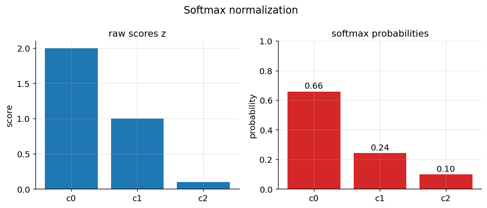

*Figure 105. Softmax converts three raw class scores into a normalized probability distribution.*

A subtle point: softmax is over-parameterized. Adding the same constant vector to every $`\mathbf{w}_{k}`$ leaves all the probabilities unchanged, because the constant cancels between numerator and denominator. Only *differences* between class weight vectors matter. Regularization resolves this redundancy by pinning down a unique solution (it prefers the smallest weights consistent with the data), which is one more reason a regularized fit is the practical default. Notice also that binary logistic regression is exactly the two-class special case of softmax once you fix one class’s weights to zero — the two formulations are not separate algorithms but the same idea at different values of $`K`$.

For numerical stability, implementations subtract the maximum score before exponentiating: $`e^{z_{k} - \max_{j}z_{j}}`$. This is mathematically identical (it is precisely the constant-shift invariance just described) but prevents $`e^{z_{k}}`$ from overflowing when scores are large.

### 7.2.7 Regularization

Logistic regression overfits when features are numerous or correlated, sending weights to extreme values. Worse, under **perfect separation** — when a hyperplane can classify the training data flawlessly — the unregularized likelihood is maximized by pushing $`\parallel \mathbf{w} \parallel \rightarrow \infty`$, so the optimizer never converges and probabilities collapse to exactly 0 and 1. We tame this by adding a penalty on weight magnitude:

- **L2 (ridge)**: add $`\frac{\lambda}{2} \parallel \mathbf{w} \parallel_{2}^{2}`$. Shrinks weights smoothly toward zero without eliminating any; the default in scikit-learn, and the fix for perfect separation.
- **L1 (lasso)**: add $`\lambda \parallel \mathbf{w} \parallel_{1}`$. Drives some weights to *exactly* zero, performing automatic feature selection — valuable when you suspect many features are irrelevant.
- **Elastic net**: a weighted blend of both, combining L1’s sparsity with L2’s stability under correlated features.

The bias term $`b`$ is conventionally *not* penalized, because shrinking it would bias predictions toward $`0.5`$ regardless of the data. In scikit-learn the strength is set by `C`, the *inverse* of $`\lambda`$: small `C` means strong regularization, large `C` means weak. This inversion trips up newcomers constantly — remember that `C` for “capacity,” so bigger `C` means a more flexible, less constrained model. We covered the bias–variance trade-off these knobs control in the chapter on Supervised Learning and Model Evaluation.

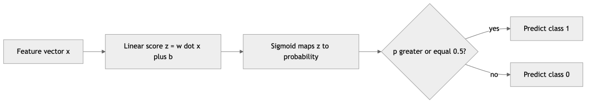

*Figure 106. How logistic regression turns features into a class decision.*

### 7.2.8 Probability Calibration

A classifier is **calibrated** when its stated probabilities match observed frequencies: among all the cases where it says “70% chance of class 1,” about 70% really are class 1. Calibration matters enormously when the probability itself feeds a downstream decision — expected-value calculations in lending, triage thresholds in medicine, bidding in ad auctions — rather than just the ranking.

Logistic regression, because it is fit by maximizing likelihood under a probabilistic model, tends to be well-calibrated out of the box, and this is one of its underrated virtues. Many other classifiers are not: naive Bayes is famously overconfident (probabilities squashed toward 0 and 1), and margin-based methods like SVMs produce scores that are not probabilities at all. For those, you calibrate as a post-processing step, typically with **Platt scaling** (fit a small logistic regression on the classifier’s scores) or **isotonic regression** (fit a non-decreasing step function, more flexible but data-hungry). You assess calibration with a **reliability diagram**: bin predictions by their stated probability and plot the observed frequency in each bin against the bin’s midpoint; a perfectly calibrated model traces the diagonal.

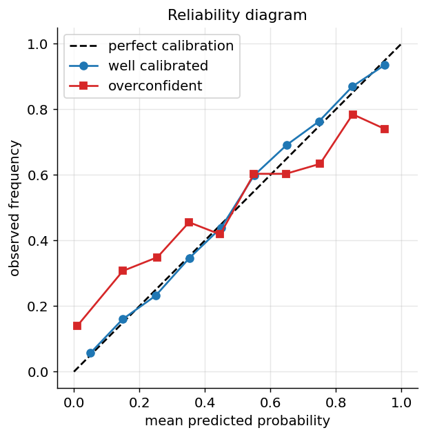

*Figure 107. A reliability diagram compares stated probabilities to observed frequencies.*

### 7.2.9 Logistic Regression in scikit-learn

``` python
from sklearn.datasets import load_breast_cancer
from sklearn.model_selection import train_test_split
from sklearn.preprocessing import StandardScaler
from sklearn.linear_model import LogisticRegression
from sklearn.pipeline import make_pipeline
from sklearn.metrics import classification_report, roc_auc_score

X, y = load_breast_cancer(return_X_y=True)   # 569 samples, 30 features, binary
X_tr, X_te, y_tr, y_te = train_test_split(
    X, y, test_size=0.25, stratify=y, random_state=42)

# Scaling matters: it speeds convergence and makes the L2 penalty fair across features.
clf = make_pipeline(StandardScaler(),
                    LogisticRegression(C=1.0, max_iter=1000))
clf.fit(X_tr, y_tr)

proba = clf.predict_proba(X_te)[:, 1]
print(classification_report(y_te, clf.predict(X_te), digits=3))
print("ROC AUC:", round(roc_auc_score(y_te, proba), 4))
# Typical output: precision/recall ~0.97-0.99, ROC AUC ~0.995

# Inspect the coefficients as odds ratios (after scaling).
import numpy as np
coefs = clf.named_steps["logisticregression"].coef_[0]
print("largest odds ratios:", np.round(np.exp(np.sort(coefs)[-3:]), 2))
```

For multiclass, scikit-learn’s `LogisticRegression` uses the multinomial softmax formulation by default; one-vs-rest is available via the `OneVsRestClassifier` wrapper or the `multi_class` argument in older versions. If your probabilities need to be trusted numerically, wrap the fitted model in `CalibratedClassifierCV` and check a reliability diagram.

#### 7.2.9.1 Reading and Trusting the Coefficients

The interpretability of logistic regression is genuine but must be handled with care. First, coefficients are only comparable across features if the features were **scaled** to a common range beforehand; a large coefficient on an unscaled feature that varies by tiny amounts may matter less than a small coefficient on a feature that swings widely. Report standardized coefficients, or odds ratios per standard deviation, if you want an honest importance ranking. Second, **multicollinearity** — strongly correlated features — destabilizes the coefficients: two features that carry nearly the same information can have their shared weight split arbitrarily between them, sometimes with opposite signs, making individual coefficients meaningless even while predictions stay accurate. L2 regularization tames this by spreading weight smoothly across correlated features; if you need to *select* one, use L1. Third, a coefficient’s sign can flip when you add or remove other features (this is the confounding phenomenon behind Simpson’s paradox), so never interpret a single coefficient in isolation from the rest of the model. **Categorical** features must be one-hot encoded before fitting, and the resulting per-level coefficients are read relative to the dropped reference level. These caveats do not undermine logistic regression’s interpretability; they are the price of taking it seriously.

> **Logistic Regression at a glance**
>
> **Strengths**: fast, scalable to millions of examples, interpretable coefficients (odds ratios), well-calibrated probabilities, convex objective with a unique optimum, and a mature ecosystem of solvers. **Weaknesses**: only linear boundaries without feature engineering, sensitive to outliers and to highly correlated features, and it cannot capture feature interactions unless you add them explicitly. **When to use**: as your first baseline on any classification problem, and as the production model whenever interpretability and calibrated probabilities matter (medicine, credit, risk). **Pitfalls**: forgetting to scale features (slows convergence, distorts the regularization penalty); reading raw probabilities as calibrated without checking; perfect separation, which sends weights to infinity unless regularized; misremembering that small `C` means *strong* regularization.

## 7.3 k-Nearest Neighbors (k-NN)

k-NN is the simplest classifier imaginable and a perfect foil to logistic regression. It is **non-parametric** and **instance-based** (a “lazy learner”): it does no training beyond memorizing the dataset, and all computation happens at prediction time. Where logistic regression compresses the entire training set into a handful of weights and then discards the data, k-NN keeps every example and does no compression at all. The two sit at opposite ends of a spectrum, and comparing them teaches you what “learning” can mean.

### 7.3.1 Intuition

To classify a new point, find the $`k`$ training examples closest to it and let them vote. The label held by the majority of those neighbors becomes the prediction. The governing assumption is locality: points near each other in feature space tend to share a label — the *smoothness* or *manifold* assumption that underlies an enormous amount of machine learning. There is no model, no equation to fit — just the data and a notion of distance. This is also why k-NN is sometimes described as the classifier that “lets the data speak for itself.”

### 7.3.2 How It Works, Step by Step

1.  Choose $`k`$ and a distance metric.
2.  For a query point $`\mathbf{x}_{q}`$, compute its distance to every training point.
3.  Select the $`k`$ smallest distances — the $`k`$ nearest neighbors.
4.  Take a majority vote (classification) or average (regression) of their labels.
5.  Optionally weight votes by $`1/\text{distance}`$ so closer neighbors count more.


*Figure 108. k-NN classifies a query by majority vote among its nearest neighbors.*

### 7.3.3 Distance Metrics

The notion of “near” is defined by the metric, and choosing it well is the single most important modeling decision in k-NN. The general **Minkowski** distance of order $`p`$ between vectors $`\mathbf{a}`$ and $`\mathbf{b}`$ in $`n`$ dimensions is

``` math
d_{p}(\mathbf{a},\mathbf{b}) = (\sum_{j = 1}^{n}|a_{j} - b_{j}|^{\, p})^{1/p}.
```

- $`p = 2`$ gives **Euclidean** distance — ordinary straight-line distance, the default and the right choice for most continuous, comparably-scaled features.
- $`p = 1`$ gives **Manhattan** (city-block, or taxicab) distance — the sum of absolute coordinate differences. It is more robust to outliers and often behaves better in high dimensions, where the squaring in Euclidean distance lets a single large-difference feature dominate.
- $`p \rightarrow \infty`$ gives the **Chebyshev** distance, the maximum single-coordinate difference.
- **Cosine** distance, $`1 - \frac{\mathbf{a} \cdot \mathbf{b}}{\parallel \mathbf{a} \parallel \, \parallel \mathbf{b} \parallel}`$, ignores magnitude and compares only *direction*; it is the standard for text (TF-IDF vectors) and embeddings, where the length of a document should not determine its topic.
- **Hamming** distance counts the positions at which two equal-length categorical or binary vectors differ; it is the natural metric for one-hot encoded categorical data, DNA sequences, or binary fingerprints.

The shape of a metric’s “unit ball” — the set of points exactly distance 1 from the origin — reveals its personality: Euclidean gives a circle, Manhattan a diamond, Chebyshev a square. The following figure draws these unit balls, which is the clearest way to see why the same two points can be “close” under one metric and “far” under another.

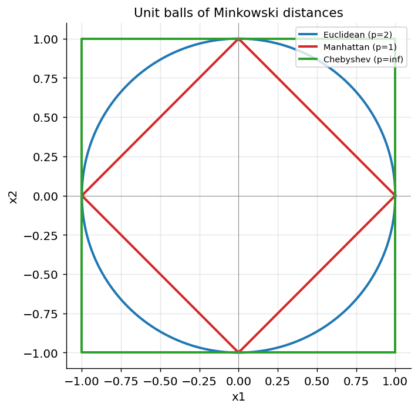

*Figure 109. Unit balls for Manhattan, Euclidean, and Chebyshev distances have distinct shapes.*

Because every one of these metrics (except cosine and Hamming) sums contributions across features, **feature scaling is mandatory**: a feature measured in thousands (e.g., annual income) will otherwise dwarf one measured in single digits (e.g., age), silently dominating the distance and making the small-scale feature invisible. Standardizing each feature to zero mean and unit variance, or scaling to $`\lbrack 0,1\rbrack`$, restores a fair contribution from every dimension. The choice of metric is itself a modeling decision: Euclidean distance treats all directions symmetrically, while a *learned* metric (as in metric-learning methods, or the Mahalanobis distance that accounts for feature covariance) can stretch the space so that label-relevant directions count more — but for a first pass, standardized Euclidean distance is the sensible default.

### 7.3.4 A Worked Numeric Example

Consider a query point $`\mathbf{x}_{q} = (3,3)`$ and five scaled training points:

| Point | Coordinates | Label | Euclidean dist. to $`(3,3)`$ |
|-------|-------------|-------|------------------------------|
| P1    | $`(2,2)`$   | A     | $`\sqrt{1 + 1} = 1.41`$      |
| P2    | $`(4,4)`$   | A     | $`\sqrt{1 + 1} = 1.41`$      |
| P3    | $`(1,3)`$   | B     | $`\sqrt{4 + 0} = 2.00`$      |
| P4    | $`(3,6)`$   | B     | $`\sqrt{0 + 9} = 3.00`$      |
| P5    | $`(6,3)`$   | B     | $`\sqrt{9 + 0} = 3.00`$      |

With $`k = 3`$, the three nearest are P1 (A, 1.41), P2 (A, 1.41), and P3 (B, 2.00). Majority vote: two A’s beat one B, so predict **A**.

Now switch on **distance weighting**, giving each neighbor a vote of $`1/d`$. Class A’s weight is $`1/1.41 + 1/1.41 = 1.42`$; class B’s is $`1/2.00 = 0.50`$. A still wins, and more decisively — the two close A neighbors outweigh the more distant B. But observe what would happen at $`k = 5`$ with plain voting: three B’s versus two A’s would flip the prediction to B, even though the two nearest points are both A. This is exactly the tension distance weighting resolves, and exactly why the choice of $`k`$ changes answers.

### 7.3.5 Weighting and Choosing k

Two schemes govern how neighbors combine. **Uniform** weighting gives every one of the $`k`$ neighbors an equal vote — simple, but a neighbor barely inside the cutoff counts as much as the nearest point. **Distance weighting** weights each vote by $`1/d`$ (or a kernel of the distance), so nearby points dominate; this softens the sensitivity to $`k`$ and usually helps, and it is what you should reach for by default.

$`k`$ itself controls the bias–variance trade-off. Small $`k`$ (e.g., 1) yields a jagged, high-variance boundary that fits noise — a single mislabeled point creates its own little region of wrong predictions. Large $`k`$ smooths the boundary, raising bias; in the extreme $`k = m`$ always predicts the majority class and ignores the input entirely. Choose $`k`$ by cross-validation, and prefer an **odd** $`k`$ in binary problems to avoid tie votes. A common rule of thumb is to start near $`k \approx \sqrt{m}`$ and search around it.

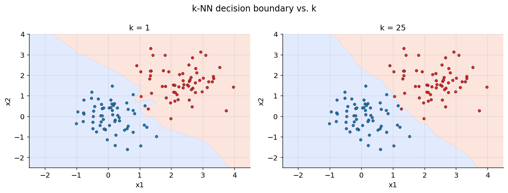

*Figure 110. k-NN decision boundaries - small k overfits (jagged), large k smooths.*

The bias–variance story is also visible if you plot cross-validated error against $`k`$: error is high at $`k = 1`$ (variance), falls to a sweet spot, then climbs again as large $`k`$ over-smooths (bias). The following figure sketches this characteristic U-shape.

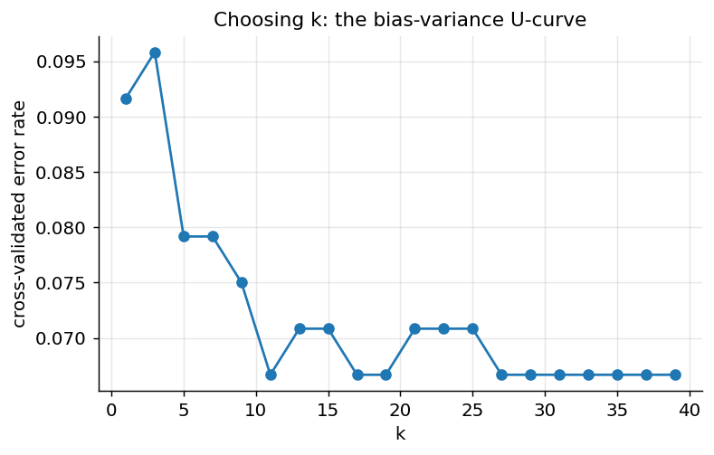

*Figure 111. Cross-validated error against k traces a U shape - the sweet spot balances bias and variance.*

### 7.3.6 k-NN for Regression, and a Theoretical Guarantee

k-NN is not confined to classification. For **regression**, the identical procedure applies but the final step averages the neighbors’ target values (or takes a distance-weighted average) instead of voting. The result is a piecewise-constant surface for uniform weighting, or a smoother interpolation for distance weighting — useful for quick nonparametric fits when you have no reason to assume any particular functional form.

There is also a surprising theoretical result worth knowing. As the training set grows without bound, the error rate of the simple **1-nearest-neighbor** classifier is provably at most *twice* the **Bayes error rate** — the irreducible error of the theoretically optimal classifier that knows the true class-conditional distributions. In other words, memorizing the data and copying your single nearest neighbor’s label, with no learning at all, is asymptotically never worse than twice the best any method could possibly do. This “Cover and Hart” bound is a reminder that locality is a remarkably powerful prior, and it partly explains why so simple an algorithm remains competitive on well-behaved, low-dimensional problems.

### 7.3.7 The Curse of Dimensionality

k-NN’s reliance on distance breaks down as the number of features grows. In high dimensions, the volume of space explodes, data becomes exponentially sparse, and a counterintuitive fact emerges: the distance to the nearest neighbor approaches the distance to the farthest neighbor. When all points are roughly equidistant, “nearest” loses meaning and k-NN degrades toward random guessing. The following figure makes this concrete by plotting the ratio of the nearest to the farthest pairwise distance as dimensionality climbs — a ratio near 1 means the metric can no longer tell neighbors apart.

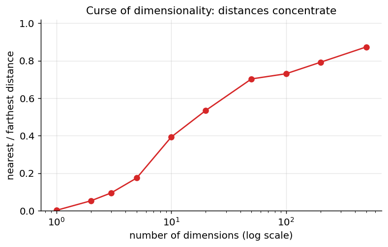

*Figure 112. As dimensionality grows, nearest and farthest neighbor distances converge - the curse.*

Mitigate this with dimensionality reduction (see the chapter on Dimensionality Reduction and Feature Extraction), aggressive feature selection to strip irrelevant dimensions, or a switch to cosine distance when the data is high-dimensional but sparse (as text is). k-NN is at its best in low-dimensional, dense, well-scaled feature spaces.

### 7.3.8 Efficient Neighbor Search: KD-Trees and Ball-Trees

The naive algorithm compares the query to all $`m`$ training points — $`O(mn)`$ per query — which is untenable for large datasets queried at speed. Spatial data structures accelerate the search by organizing the training points so that whole regions can be ruled out without examining their contents.

A **KD-tree** recursively splits the feature space with axis-aligned hyperplanes, cycling through dimensions: split on feature 1, then feature 2, and so on, each split partitioning the points into two halves. Searching then prunes branches whose bounding region is provably farther than the current best neighbor, achieving roughly $`O(logm)`$ per query in low dimensions. Its weakness is dimensionality: past roughly 20 features the pruning stops helping and it degrades to brute force. A **ball-tree** instead partitions points into nested hyperspheres (“balls”) defined by a centroid and radius; because balls adapt to the data’s shape rather than the axes, ball-trees tolerate moderately higher dimensions and non-Euclidean metrics better. scikit-learn’s `KNeighborsClassifier` chooses among `brute`, `kd_tree`, and `ball_tree` automatically when you leave `algorithm='auto'`.

For truly large-scale or high-dimensional problems — nearest-neighbor search over millions of embedding vectors, as in semantic search and recommendation — exact methods give way to **approximate nearest neighbor (ANN)** indexes such as **HNSW** (hierarchical navigable small-world graphs), **IVF**, and product quantization, which trade a small, tunable amount of recall for orders-of-magnitude speedups.

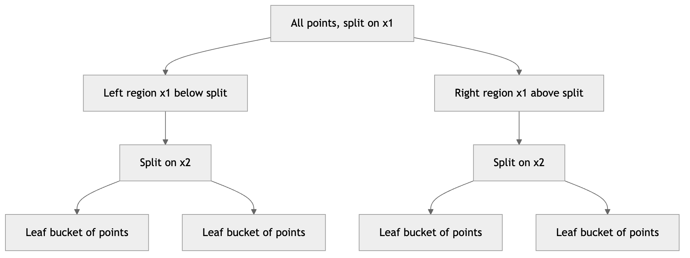

*Figure 113. A KD-tree recursively splits space on alternating axes to prune the neighbor search.*

### 7.3.9 k-NN in scikit-learn

``` python
from sklearn.datasets import load_wine
from sklearn.model_selection import train_test_split, cross_val_score
from sklearn.preprocessing import StandardScaler
from sklearn.neighbors import KNeighborsClassifier
from sklearn.pipeline import make_pipeline

X, y = load_wine(return_X_y=True)            # 178 samples, 13 features, 3 classes
X_tr, X_te, y_tr, y_te = train_test_split(
    X, y, test_size=0.25, stratify=y, random_state=0)

# Pick k by cross-validation on the training set.
best_k, best_score = 1, 0.0
for k in range(1, 21, 2):
    pipe = make_pipeline(StandardScaler(),
                         KNeighborsClassifier(n_neighbors=k, weights="distance"))
    s = cross_val_score(pipe, X_tr, y_tr, cv=5).mean()
    if s > best_score:
        best_k, best_score = k, s

final = make_pipeline(StandardScaler(),
                      KNeighborsClassifier(n_neighbors=best_k, weights="distance"))
final.fit(X_tr, y_tr)
print(f"best k = {best_k}, CV acc = {best_score:.3f}, test acc = {final.score(X_te, y_te):.3f}")
# Typical output: best k around 5-9, test accuracy ~0.95+
```

### 7.3.10 Mixed Features, Missing Data, and Irrelevant Dimensions

Real datasets rarely hand you clean, uniformly-scaled continuous features, and k-NN is unusually sensitive to how you cope. **Categorical features** cannot go straight into a Euclidean distance — you must either one-hot encode them (after which Hamming or a mixed metric such as **Gower distance** behaves sensibly) or use a metric designed for mixed types. **Missing values** are awkward because a distance cannot be computed over an absent coordinate; common fixes are to impute before the distance step or to compute distances over only the shared present features and rescale. Above all, k-NN has no built-in defense against **irrelevant features**: because every dimension contributes to the distance, a handful of noise features can swamp the few that carry signal, dragging genuinely similar points apart. Logistic regression can simply assign an irrelevant feature a near-zero weight and move on; k-NN cannot, so upstream feature selection matters far more for it. This vulnerability is the same phenomenon as the curse of dimensionality, seen from the angle of feature *quality* rather than feature *count*, and it is the single most common reason a k-NN model underperforms in practice.

> **k-Nearest Neighbors at a glance**
>
> **Strengths**: trivially simple, no training phase, naturally multiclass and multi-output, makes zero assumptions about the data’s functional form, and the boundary can be arbitrarily complex; also doubles as a “find similar items” engine. **Weaknesses**: prediction is slow and memory-heavy (it stores and scans all data); suffers badly from the curse of dimensionality; requires scaling; sensitive to irrelevant features and to the choice of $`k`$ and metric. **When to use**: small-to-medium, low-dimensional, well-scaled datasets; as a baseline; and for recommendation-style similarity search (with an ANN index at scale). **Pitfalls**: forgetting to scale; choosing even $`k`$ in binary problems; applying it to high-dimensional data without reduction; letting a few irrelevant features corrupt every distance.

## 7.4 Naive Bayes

Naive Bayes is a **generative** probabilistic classifier derived directly from Bayes’ theorem. It is astonishingly fast, needs little data, and despite a blatantly unrealistic assumption, performs remarkably well — especially on text. It was the engine behind the first generation of practical spam filters, and it remains a hard-to-beat baseline for document classification.

### 7.4.1 Bayes’ Theorem Applied to Classification

We want $`P(y = c \mid \mathbf{x})`$, the probability that example $`\mathbf{x}`$ belongs to class $`c`$. **Bayes’ theorem** rewrites this **posterior** in terms of quantities we can estimate from data:

``` math
P(c \mid \mathbf{x}) = \frac{P(\mathbf{x} \mid c)\, P(c)}{P(\mathbf{x})}.
```

Here $`P(c)`$ is the **prior** (how common the class is, before seeing any features), $`P(\mathbf{x} \mid c)`$ is the **likelihood** (how typical the features are for that class), and $`P(\mathbf{x}) = \sum_{c'}^{}P(\mathbf{x} \mid c')P(c')`$ is the **evidence**, a normalizing constant identical across classes. Since we only compare classes and take the arg-max, the denominator — being the same for every class — cannot change which class wins, so we drop it:

``` math
\widehat{y} = arg\max_{c}\mspace{6mu} P(c)\, P(\mathbf{x} \mid c).
```

That the classifier models $`P(\mathbf{x} \mid c)`$ — a description of how each class *generates* its data — is what makes it *generative*, in contrast to logistic regression’s *discriminative* modeling of $`P(c \mid \mathbf{x})`$ directly. A generative model can, in principle, sample new synthetic examples of a class; a discriminative one cannot.

### 7.4.2 The Naive Conditional-Independence Assumption

The likelihood $`P(\mathbf{x} \mid c) = P(x_{1},x_{2},\ldots,x_{n} \mid c)`$ is hopeless to estimate directly — with $`n`$ features it requires modeling every interaction among them, an exponential number of parameters. The “naive” leap assumes all features are **conditionally independent given the class**:

``` math
P(x_{1},\ldots,x_{n} \mid c) = \prod_{j = 1}^{n}P(x_{j} \mid c).
```

This collapses the problem from one impossible joint distribution to $`n`$ easy one-dimensional ones, each estimated from simple counts or means. It is almost never literally true (in text, “machine” and “learning” co-occur far more than independence predicts), yet the classifier still works because for *ranking* classes we need only the relative ordering of posteriors, not accurate probabilities. The assumption does inflict a real cost: when features are correlated, naive Bayes effectively double-counts the shared evidence, which is why its probabilities are typically pushed toward 0 or 1 (over-confident). But the *direction* of the decision — which class scores highest — is often correct even when the magnitude of confidence is badly off. This explains the algorithm’s enduring reputation as a strong, cheap baseline despite an assumption that is, strictly speaking, false on almost every real dataset. The final decision rule, computed in log-space to avoid numerical underflow from multiplying many small probabilities, is

``` math
\widehat{y} = arg\max_{c}\mspace{6mu}\left\lbrack \log P(c) + \sum_{j = 1}^{n}\log P(x_{j} \mid c) \right\rbrack.
```

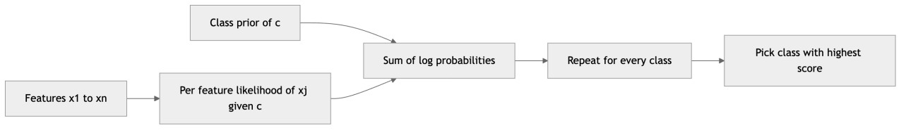

*Figure 114. Naive Bayes scores each class by combining its prior with per-feature likelihoods.*

### 7.4.3 The Three Common Variants

The variants differ only in how they model the per-feature likelihood $`P(x_{j} \mid c)`$, which depends on the feature type. Choosing the wrong variant for your feature type is the most common naive-Bayes mistake, so the following diagram maps feature type to variant.

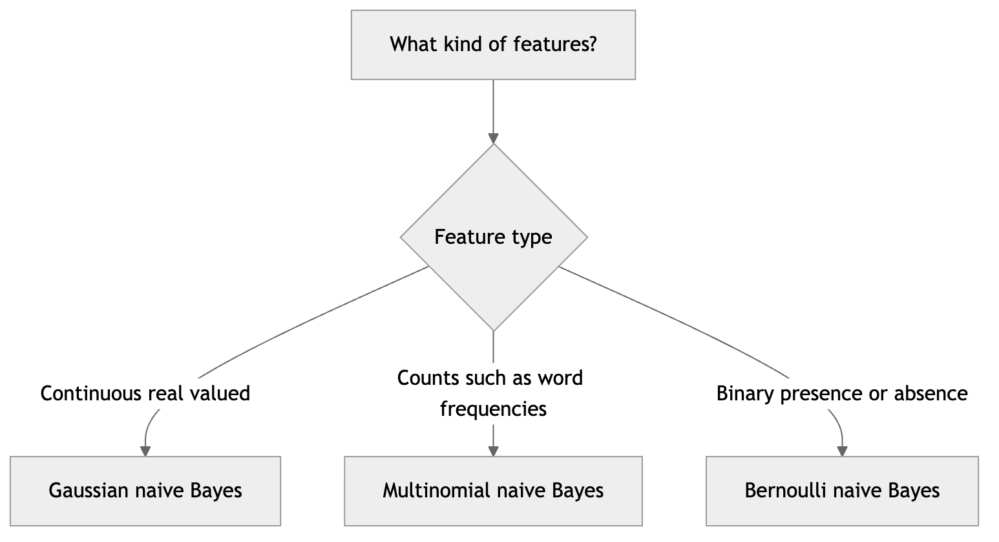

*Figure 115. Pick the naive Bayes variant that matches your feature type.*

**Gaussian naive Bayes** handles continuous features by assuming each follows a normal distribution within each class, with class-specific mean $`\mu_{c,j}`$ and variance $`\sigma_{c,j}^{2}`$ estimated from the training data:

``` math
P(x_{j} \mid c) = \frac{1}{\sqrt{2\pi\sigma_{c,j}^{2}}}\exp\left( - \frac{(x_{j} - \mu_{c,j})^{2}}{2\sigma_{c,j}^{2}} \right).
```

Fitting is a single pass computing per-class, per-feature means and variances — essentially free. The resulting decision boundary is quadratic in general (linear when the class variances are shared). The following figure shows the per-class Gaussian bumps that Gaussian NB fits to a single feature.

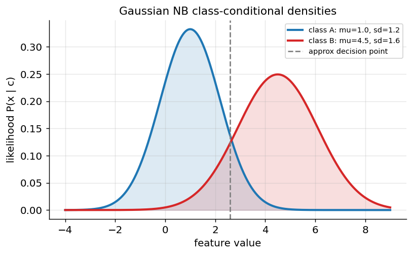

*Figure 116. Gaussian naive Bayes fits one bell curve per class per feature.*

**Multinomial naive Bayes** models *counts* — how many times each word appears in a document. $`P(x_{j} \mid c)`$ is the probability of term $`j`$ in class $`c`$, estimated as a smoothed relative frequency of that term across all documents of the class. It is the standard choice for text classification with bag-of-words or TF-IDF features, and it handles the enormous, sparse vocabularies of text gracefully.

**Bernoulli naive Bayes** models *binary* features — whether each word is present or absent, ignoring counts entirely. It differs from multinomial in one important way: it explicitly models *non-occurrence*, multiplying in a $`(1 - P(x_{j} \mid c))`$ factor for every vocabulary word absent from the document. This penalizes documents that lack a class’s characteristic words and can outperform multinomial on short texts (tweets, subject lines) where presence matters more than frequency.

### 7.4.4 Laplace Smoothing

If a word never appears in class $`c`$ during training, its estimated likelihood is zero, and one zero in the product annihilates the entire posterior — a single unseen word would veto an otherwise perfect match. **Laplace (add-**$`\alpha`$**) smoothing** prevents this by adding a pseudo-count $`\alpha`$ (usually 1) to every count:

``` math
P(x_{j} \mid c) = \frac{\text{count}(x_{j},c) + \alpha}{\text{count}(c) + \alpha\, n},
```

where $`n`$ is the vocabulary size and $`\text{count}(c)`$ is the total token count in class $`c`$. This guarantees no probability is ever exactly zero. The pseudo-count $`\alpha`$ acts as a regularizer: $`\alpha = 1`$ is full Laplace smoothing, small values ($`\alpha = 0.01`$) trust the data more, and it is a hyperparameter worth tuning. Conceptually, smoothing encodes a mild prior belief that any word *could* appear in any class, even if the training sample happened not to show it.

### 7.4.5 A Text-Classification Worked Example by Hand

Nothing cements naive Bayes like grinding through a tiny example. Suppose we classify short messages as **spam** or **ham** (not spam). Our training set has 8 spam and 12 ham messages, so the priors are $`P(\text{spam}) = 8/20 = 0.4`$ and $`P(\text{ham}) = 12/20 = 0.6`$. After tokenizing, the total word counts and the counts of two words of interest are:

|      | total words | count of “free” | count of “meeting” |
|------|-------------|-----------------|--------------------|
| spam | 40          | 6               | 0                  |
| ham  | 90          | 1               | 9                  |

Take the vocabulary size to be $`n = 30`$ and use $`\alpha = 1`$. The smoothed likelihoods for the word “free” are

``` math
P(\text{free} \mid \text{spam}) = \frac{6 + 1}{40 + 30} = \frac{7}{70} = 0.100,\quad\quad P(\text{free} \mid \text{ham}) = \frac{1 + 1}{90 + 30} = \frac{2}{120} = 0.0167.
```

For “meeting”:

``` math
P(\text{meeting} \mid \text{spam}) = \frac{0 + 1}{40 + 30} = \frac{1}{70} = 0.0143,\quad\quad P(\text{meeting} \mid \text{ham}) = \frac{9 + 1}{90 + 30} = \frac{10}{120} = 0.0833.
```

Note that without smoothing, $`P(\text{meeting} \mid \text{spam})`$ would have been $`0/40 = 0`$, and any message containing “meeting” could *never* be classified as spam no matter what else it contained — the zero-probability trap that smoothing exists to fix.

Now score the message **“free free meeting”** (the word “free” twice, “meeting” once). Working in log-space with natural logs:

``` math
\log P(\text{spam} \mid x) \propto log0.4 + 2\log 0.100 + log0.0143 = - 0.916 - 4.605 - 4.248 = - 9.769.
```

``` math
\log P(\text{ham} \mid x) \propto log0.6 + 2\log 0.0167 + log0.0833 = - 0.511 - 8.187 - 2.485 = - 11.183.
```

Spam scores higher ($`- 9.77 > - 11.18`$), so we predict **spam** — the two occurrences of “free” outweigh the single “meeting.” To recover actual probabilities, exponentiate and normalize: $`e^{- 9.769} = 5.71 \times 10^{- 5}`$ and $`e^{- 11.183} = 1.39 \times 10^{- 5}`$, giving $`P(\text{spam} \mid x) = 5.71/(5.71 + 1.39) = 0.804`$. The model is about 80% confident. This entire calculation — counting, smoothing, summing logs — is exactly what the library does, just over thousands of words at once.

### 7.4.6 The Decision Boundary of Naive Bayes

It is illuminating to see what shape of boundary the naive assumption actually produces. For **Gaussian** naive Bayes, the log-posterior of each class is a quadratic function of $`\mathbf{x}`$ (the $`(x_{j} - \mu_{c,j})^{2}`$ terms), so the boundary where two classes tie is generally a **quadratic** surface — an ellipse, parabola, or hyperbola. In the special case where the two classes share the same per-feature variances, those quadratic terms cancel when you subtract the two log-posteriors, and the boundary collapses to a **straight line**. This is a beautiful and underappreciated fact: with shared variances, Gaussian naive Bayes is a *linear* classifier, and in fact it becomes the generative counterpart of logistic regression, fitting the very same functional form by a different estimation route.

For **multinomial** and **Bernoulli** naive Bayes the log-posterior is *linear* in the feature counts, so those variants are linear classifiers in count space — the same broad family as logistic regression, which is why the two so often perform comparably on text. The difference is philosophical: naive Bayes reaches its linear boundary by modeling each class’s generation independently and inverting with Bayes’ theorem, while logistic regression carves the boundary directly by optimization. Understanding this shared endpoint from two opposite directions is one of the most clarifying insights in introductory classification.

### 7.4.7 Naive Bayes in scikit-learn

``` python
from sklearn.datasets import fetch_20newsgroups
from sklearn.feature_extraction.text import TfidfVectorizer
from sklearn.naive_bayes import MultinomialNB
from sklearn.pipeline import make_pipeline
from sklearn.metrics import classification_report

cats = ["rec.sport.hockey", "sci.space", "talk.politics.mideast"]
train = fetch_20newsgroups(subset="train", categories=cats,
                           remove=("headers", "footers", "quotes"))
test = fetch_20newsgroups(subset="test", categories=cats,
                          remove=("headers", "footers", "quotes"))

# TF-IDF turns documents into weighted word-count vectors; MultinomialNB consumes them.
model = make_pipeline(TfidfVectorizer(stop_words="english"),
                      MultinomialNB(alpha=0.1))
model.fit(train.data, train.target)

pred = model.predict(test.data)
print(classification_report(test.target, pred, target_names=cats, digits=3))
# Typical output: macro F1 ~0.90+, trained in well under a second.

print(model.predict(["NASA launches a new rocket to orbit the moon"]))   # -> sci.space
print(model.predict(["The goalie made an incredible save in overtime"])) # -> rec.sport.hockey
```

Notice naive Bayes trained on thousands of high-dimensional sparse documents in a fraction of a second — its training is a single pass of counting. For a continuous-feature problem, `GaussianNB` is a drop-in replacement on datasets like the iris or breast-cancer data, and `BernoulliNB` suits binary presence/absence features.

### 7.4.8 Why It Works Despite the Naive Assumption

It is worth stating plainly the paradox at the heart of naive Bayes: its defining assumption is false on essentially every real dataset, yet it is one of the most reliable baselines in the field. Three reasons reconcile this. First, **classification needs only the arg-max**, not accurate probabilities; correlated features corrupt the *magnitude* of the posterior but frequently leave the *ordering* of classes intact. Second, the **errors from redundant features often push all classes in the same direction**, partially cancelling when you compare them. Third, with limited data, naive Bayes’ extreme simplicity is a **bias–variance advantage**: a model that estimates only $`n`$ one-dimensional distributions has far lower variance than one attempting to capture all feature interactions, and on small datasets that stability beats the flexibility it lacks. The lesson generalizes: a wrong-but-simple model that captures the dominant signal often outperforms a right-but-complex one that cannot be estimated well from the data you have.

### 7.4.9 Where Naive Bayes Shines in Practice

Naive Bayes earned its reputation in the trenches. The first widely successful **spam filters** of the early 2000s were multinomial and Bernoulli naive Bayes over word presence, and the approach remains a strong default: it trains incrementally, so a filter can update itself the moment a user flags a message, and it degrades gracefully as spammers invent new vocabulary. **Sentiment analysis**, **language identification**, **news and email routing**, and **medical or legal document triage** all lean on the same strengths — high-dimensional sparse text, limited labeled data, and a need for instant retraining. Naive Bayes is also a natural fit for **streaming and online settings** because its parameters are just running counts that can be updated in a single pass without revisiting old data (scikit-learn exposes this via `partial_fit`). Even when a heavier model ultimately wins, naive Bayes is the baseline that tells you within seconds whether the problem is easy or hard, and how much signal the raw words carry before any clever modeling. That diagnostic role — a near-instant read on a problem’s difficulty — is reason enough to keep it in your toolkit permanently.

> **Naive Bayes at a glance**
>
> **Strengths**: extremely fast to train and predict (a single counting pass), works with tiny datasets, handles thousands of sparse features gracefully (independence actually *helps* in high dimensions), naturally multiclass, and an exceptionally strong text baseline. **Weaknesses**: the independence assumption makes its probability estimates poorly calibrated (pushed toward 0 or 1); it cannot learn feature interactions; and the Gaussian variant is hurt by strongly non-normal features. **When to use**: text and document classification, spam filtering, real-time and streaming prediction, and any setting needing a fast, low-data baseline. **Pitfalls**: forgetting smoothing (the zero-probability trap); using `MultinomialNB` on negative or continuous features (use `GaussianNB`); trusting its raw probabilities as calibrated without calibration.

## 7.5 Putting the Three Together

These algorithms span the spectrum from parametric and eager (logistic regression) to non-parametric and lazy (k-NN) to generative and probabilistic (naive Bayes). Internalizing their contrasts is more valuable than any single technique, because it gives you a mental map for reaching for the right tool.

| Property | Logistic Regression | k-Nearest Neighbors | Naive Bayes |
|----|----|----|----|
| Paradigm | Discriminative, parametric | Instance-based, non-parametric | Generative, parametric |
| What it models | $`P(y \mid \mathbf{x})`$ directly | The data itself | $`P(\mathbf{x} \mid y)`$ and $`P(y)`$ |
| Training cost | Moderate (iterative) | None (lazy) | Very low (counting) |
| Prediction cost | Very low | High (scan all data) | Very low |
| Decision boundary | Linear | Arbitrary, local | Quadratic / linear-ish |
| Needs feature scaling | Yes (helps) | Yes (mandatory) | No |
| Probability calibration | Good | Moderate | Poor |
| Handles many features | Yes (with regularization) | Poorly (curse of dim.) | Excellently |
| Interpretability | High (coefficients) | Low | Moderate |
| Key assumption | Log-odds linear in features | Locality | Conditional independence |

``` python
from sklearn.datasets import load_breast_cancer
from sklearn.model_selection import cross_val_score
from sklearn.preprocessing import StandardScaler
from sklearn.pipeline import make_pipeline
from sklearn.linear_model import LogisticRegression
from sklearn.neighbors import KNeighborsClassifier
from sklearn.naive_bayes import GaussianNB

X, y = load_breast_cancer(return_X_y=True)
models = {
    "LogReg":  make_pipeline(StandardScaler(), LogisticRegression(max_iter=1000)),
    "k-NN":    make_pipeline(StandardScaler(), KNeighborsClassifier(n_neighbors=7)),
    "GaussNB": make_pipeline(StandardScaler(), GaussianNB()),
}
for name, m in models.items():
    s = cross_val_score(m, X, y, cv=5, scoring="roc_auc")
    print(f"{name:8s} ROC AUC = {s.mean():.3f} +/- {s.std():.3f}")
# Typical: LogReg ~0.995, k-NN ~0.98, GaussNB ~0.99
```

### 7.5.1 Generative versus Discriminative: A Deeper Contrast

Naive Bayes and logistic regression form a famous **generative–discriminative pair**: given enough features, both can express a linear boundary, but they *learn* it from opposite philosophies, and the difference has practical consequences. The generative model (naive Bayes) estimates the full data-generating story $`P(\mathbf{x} \mid c)`$ and $`P(c)`$; the discriminative model (logistic regression) estimates only the boundary $`P(c \mid \mathbf{x})`$. A classic result by Ng and Jordan captures the trade-off precisely: the generative model has *higher asymptotic error* (its independence assumption caps how well it can ever fit) but *converges faster* — it reaches its best performance with far fewer training examples. The discriminative model is more accurate in the limit of abundant data but needs more of it to get there. The crossover means naive Bayes often *wins on small datasets* and loses on large ones, which is exactly what practitioners observe. When you are data-starved, a strong prior structure is an asset; when data is plentiful, that same structure is a straitjacket.

k-NN, being neither generative nor discriminative but instance-based, occupies a third corner: it makes essentially no assumptions and can fit any boundary, at the price of needing dense data and paying its full cost at every prediction. The three algorithms thus map cleanly onto the field’s three great answers to the question “what should a learner assume?” — model the boundary, model the generator, or assume only smoothness.

### 7.5.2 A Decision Guide

The following diagram distills when to reach for each. Treat it as a starting heuristic, not a law — always validate empirically.

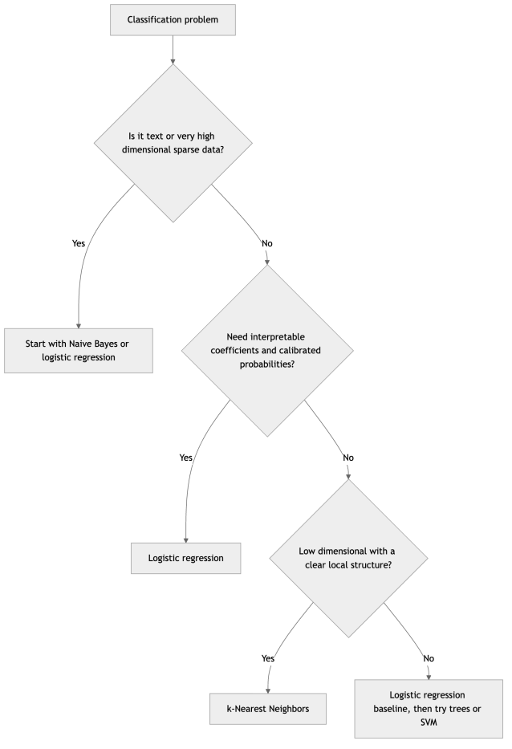

*Figure 117. A rough guide to choosing among the three classifiers.*

### 7.5.3 A Real-World Case Study

Consider a hospital building a sepsis early-warning system from vital-sign and lab features. **Logistic regression** is the natural production choice: clinicians and regulators demand to know *why* an alarm fired, and its coefficients translate directly into statements like “each 10-point rise in heart rate multiplies the odds of sepsis by 1.4,” while its calibrated probabilities feed directly into a risk threshold. A **k-NN** model, though possibly comparable in raw accuracy, is a non-starter here — it offers no explanation, and its predictions shift with the reference population. For the hospital’s *separate* task of routing free-text triage notes into complaint categories, **multinomial naive Bayes** on TF-IDF features is the pragmatic first system: it trains in seconds on the note archive, handles the huge vocabulary, and sets a baseline that a heavier transformer model must justify beating. One institution, three tasks, three different right answers — that is the real lesson of this chapter.

## 7.6 Handling Imbalanced Classification

When one class dominates, three families of remedies apply, none mutually exclusive, and the best solutions usually combine them.

1.  **Pick the right metric.** Abandon accuracy — it rewards the majority-class-always predictor. Use precision, recall, F1, the precision–recall curve, or ROC AUC, all from the chapter on Supervised Learning and Model Evaluation. For fraud or disease, recall on the rare class is usually paramount, and the precision–recall curve is more informative than ROC under heavy imbalance.
2.  **Reweight or resample.** Set `class_weight='balanced'` (logistic regression and many classifiers support this directly) to make each minority error cost as much as the class imbalance ratio — a principled way to rebalance without touching the data. Alternatively, rebalance the data itself: random oversampling of the minority, random undersampling of the majority, or synthetic oversampling with **SMOTE**, which creates new minority points by interpolating between existing ones and their neighbors. Resample *inside* cross-validation folds, never before splitting, or you leak information and overstate performance.
3.  **Move the decision threshold.** The default $`0.5`$ is rarely optimal under imbalance. Because a well-calibrated model still ranks correctly, you can sweep the threshold and choose the operating point that meets your precision/recall target — often the cheapest and most effective single fix.

``` python
from sklearn.datasets import make_classification
from sklearn.linear_model import LogisticRegression
from sklearn.model_selection import train_test_split
from sklearn.metrics import f1_score

X, y = make_classification(n_samples=5000, weights=[0.97, 0.03],
                           n_informative=5, random_state=0)  # 3% positive
X_tr, X_te, y_tr, y_te = train_test_split(X, y, stratify=y, random_state=0)

plain = LogisticRegression(max_iter=1000).fit(X_tr, y_tr)
weighted = LogisticRegression(max_iter=1000,
                              class_weight="balanced").fit(X_tr, y_tr)
print("plain    F1:", round(f1_score(y_te, plain.predict(X_te)), 3))
print("weighted F1:", round(f1_score(y_te, weighted.predict(X_te)), 3))
# class_weight='balanced' typically lifts minority-class F1 substantially.
```

The idea behind SMOTE is worth picturing. Rather than duplicating minority points (which teaches the model nothing new and invites overfitting to those exact points), it draws a line between a minority point and one of its minority neighbors and plants a *new* synthetic point somewhere along that segment. This fills in the minority region rather than merely thickening existing dots, giving the classifier a smoother, more generalizable sense of where the rare class lives. The figure below contrasts the original sparse minority with the densified cloud after synthetic interpolation.

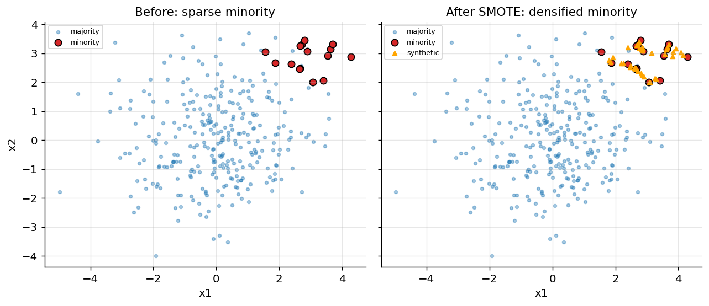

*Figure 118. SMOTE fills the minority region with synthetic points interpolated between neighbors.*

### 7.6.1 Cost-Sensitive Classification

Reweighting and threshold-moving are really both approximations of a more principled idea: **cost-sensitive learning**, where you specify the real-world cost of each type of error and minimize *expected cost* rather than error count. Under imbalance the costs are almost always asymmetric — missing a fraudulent transaction (a false negative) may cost the average transaction value, while a false alarm (false positive) costs only a few seconds of a reviewer’s time.

Formalize this with a **cost matrix**. Suppose a false negative costs 100 and a false positive costs 5. Given a calibrated probability $`\widehat{p} = P(y = 1 \mid \mathbf{x})`$, the expected cost of predicting *positive* is $`5\,(1 - \widehat{p})`$ (you pay 5 only if the case was really negative), and the expected cost of predicting *negative* is $`100\,\widehat{p}`$. You should predict positive whenever $`100\,\widehat{p} > 5\,(1 - \widehat{p})`$, i.e. whenever $`\widehat{p} > 5/105 \approx 0.048`$. So the cost-optimal threshold is not $`0.5`$ but about $`0.05`$ — the model should raise an alarm on even a 5% chance of fraud, precisely because a miss is twenty times costlier than a false alarm. This is why threshold-moving is not a hack but the correct response to asymmetric costs, and why calibrated probabilities (a logistic-regression strength) are so valuable: only a trustworthy probability lets you compute the expected costs that set the optimal threshold.

## 7.7 Summary

This chapter built the foundation of classification from three complementary angles. We began by naming the problem precisely, because the structure of the label space governs every downstream choice. **Binary** problems output a single probability; **multiclass** problems output one distribution over mutually exclusive classes; **multilabel** problems output independent per-label probabilities; and **imbalance** is an orthogonal property that quietly breaks accuracy. Natively binary algorithms scale up through **one-vs-rest**, **one-vs-one**, or a native **softmax**, with softmax preferred wherever the algorithm supports a joint distribution.

We then studied three algorithms that between them cover the discriminative, instance-based, and generative paradigms. **Logistic regression** computes a linear score, squashes it through the **sigmoid**, and is fit by minimizing the convex **log-loss** derived from maximum likelihood; its clean gradient, interpretable log-odds coefficients, and good calibration make it the mandatory first baseline, and **softmax regression** extends it to many classes. **k-NN** stores the data and votes among the $`k`$ nearest points under a chosen **distance metric**; it demands feature scaling, trades bias for variance through $`k`$, collapses under the **curse of dimensionality**, and leans on spatial indexes like **KD-trees** and **ball-trees** for speed. **Naive Bayes** applies **Bayes’ theorem** under a **conditional-independence** assumption that is false yet effective, with **Gaussian**, **Multinomial**, and **Bernoulli** variants for continuous, count, and binary features, **Laplace smoothing** to avoid the zero-probability trap, and log-space arithmetic for numerical safety. We closed with the three-pronged strategy for imbalance: right metric, reweight or resample, and tune the threshold.

## 7.8 Key Takeaways

- **Name the problem before choosing a model.** Binary, multiclass, multilabel, and imbalanced problems each demand different outputs, losses, and metrics.
- **Reduce multiclass with softmax when you can, OvR/OvO when you must.** Softmax gives one consistent, calibrated distribution; the reductions are workarounds for natively binary algorithms.
- **Logistic regression is the baseline you must beat.** It is fast, interpretable via odds ratios, well-calibrated, and convex. Always scale features and regularize; remember small `C` means strong regularization.
- **Log-loss is not arbitrary.** It is the maximum-likelihood objective, it is convex where squared error is not, and its gradient is clean precisely because the sigmoid’s derivative cancels — which is why it is the universal loss for probabilistic classifiers.
- **k-NN is only as good as its distances.** Scale every feature, pick $`k`$ and the metric by cross-validation, prefer distance weighting, and never trust it in high dimensions without reduction.
- **Naive Bayes wins by being cheap and stable.** The independence assumption is wrong but rank-preserving; match the variant to the feature type, always smooth, and never read its probabilities as calibrated.
- **Under imbalance, accuracy lies.** Switch metrics, reweight or resample (inside CV folds), and move the threshold to your target operating point.

## 7.9 Exercises

1.  **(Conceptual)** Explain why logistic regression uses log-loss rather than mean squared error as its training objective. What property of the resulting optimization problem is lost if you use MSE with a sigmoid, and what happens to the gradient of a confidently wrong prediction under each loss?

2.  **(Conceptual)** A colleague trains a k-NN classifier on a dataset with 500 features and gets near-random accuracy, even though logistic regression does well. Name the phenomenon responsible, explain in one sentence why nearest-neighbor voting fails, and propose two concrete fixes.

3.  **(Conceptual)** You must classify triage notes (free text) and separately predict patient deterioration from vital signs, and both models will be reviewed by clinicians. Which of the three algorithms would you reach for in each case, and why? Address interpretability and feature type explicitly.

4.  **(Math)** Starting from the logistic model $`P(y = 1 \mid \mathbf{x}) = \sigma(\mathbf{w}^{\top}\mathbf{x} + b)`$, derive the log-odds expression $`\log\frac{P(y = 1)}{P(y = 0)} = \mathbf{w}^{\top}\mathbf{x} + b`$. Then interpret the meaning of $`e^{w_{j}}`$ and state what a coefficient of $`w_{j} = - 0.5`$ implies about the corresponding feature.

5.  **(Math)** For the three class scores $`z = (3.0,1.0,0.0)`$, compute the softmax probabilities by hand. Then add the constant $`5`$ to every score and recompute, confirming the probabilities are unchanged. What property of softmax does this demonstrate, and how do implementations exploit it for numerical stability?

6.  **(Math/Worked)** Using the spam/ham counts from the worked example in the naive Bayes section, classify the message **“meeting meeting free”** by hand in log-space, and report the posterior probability of ham. Show every smoothed likelihood you use.

7.  **(Coding)** Load the digits dataset (`sklearn.datasets.load_digits`, 10 classes). Train multinomial logistic regression and k-NN, both inside a scaling pipeline. Report each model’s accuracy and confusion matrix, and identify which digit pairs are most often confused.

8.  **(Coding)** Using `fetch_20newsgroups` with four categories, compare `MultinomialNB`, `BernoulliNB`, and a `TfidfVectorizer`+`MultinomialNB` pipeline. Which performs best, and why might TF-IDF help or hurt naive Bayes? Vary the smoothing parameter `alpha` and report its effect.

9.  **(Coding)** For the wine dataset, sweep $`k`$ from 1 to 40 for a `KNeighborsClassifier` and plot cross-validated accuracy against $`k`$ for both uniform and distance weighting. Identify the bias-dominated and variance-dominated regions of the curve.

10. **(Coding/Analysis)** Create a 95/5 imbalanced dataset with `make_classification`. Train logistic regression with and without `class_weight='balanced'`, then sweep the decision threshold from 0.05 to 0.95 and plot precision and recall versus threshold. Choose a threshold that achieves at least 0.80 recall on the minority class and report the resulting precision.

11. **(Coding/Analysis)** Take any classifier that is poorly calibrated (try `GaussianNB` on the breast-cancer data), plot its reliability diagram, then wrap it in `CalibratedClassifierCV` with both Platt scaling and isotonic regression. Re-plot the reliability diagrams and quantify the improvement with the Brier score.

---

[← 6 Regression Algorithms](ch06-regression.md) · [Contents](../README.md#contents) · [8 Classification II: Support Vector Machines and Kernel Methods →](ch08-classification-svm.md)
