[← 7 Classification I: Logistic Regression, k-NN, and Naive Bayes](ch07-classification-1.md) · [Contents](../README.md#contents) · [9 Decision Trees and Ensemble Learning →](ch09-trees-ensembles.md)

---

# 8 Classification II: Support Vector Machines and Kernel Methods

In the chapter on Logistic Regression, k-NN, and Naive Bayes we met our first classifiers. Each draws *some* boundary between classes, but none of them asks a deeper question: of all the boundaries that separate the data, which one is *best*? The **Support Vector Machine (SVM)** answers this with a beautifully geometric idea — choose the boundary that sits as far as possible from the nearest points of every class. From that single principle flows a remarkably powerful family of algorithms, and through the *kernel trick* the same machinery learns wildly nonlinear boundaries without ever leaving the comfort of linear algebra. SVMs dominated applied machine learning for over a decade, and they remain the method of choice for many small-to-medium tabular and text problems today.

This chapter builds the SVM from the ground up. We start with the geometric intuition of the margin, then derive the hard-margin optimization problem, relax it into the practical soft-margin problem, and reinterpret both through the lens of the hinge loss. We then open the hood on the *primal* and *dual* formulations — the Lagrangian, the KKT conditions, and why they make support vectors “support” the model — because that machinery is exactly what makes the kernel trick possible. From there we cover the standard kernels and their hyperparameters, support vector regression, multiclass strategies, and the computational realities that decide whether you reach for `SVC`, `LinearSVC`, or a stochastic gradient method. Throughout, we favor intuition first, then formalism, then a worked example you can check by hand, then runnable code.

## 8.1 The Maximum-Margin Intuition

Imagine two clouds of points on a plane, one class red and one class blue, that can be cleanly separated by a straight line. There are infinitely many such lines — tilt or shift any separating line slightly and it still separates the data. Logistic regression would happily settle on any of them depending on initialization and regularization. The SVM insists on something stronger: the line that leaves the *widest possible gap* on either side before touching a data point.

That gap is called the **margin**, and the points that just touch its edges — the ones that pin the boundary in place — are the **support vectors**. Remarkably, the entire model is determined by these few points; you could delete every other training example and recover exactly the same boundary. This is why SVMs are often memory-efficient at prediction time and why they generalize well: a wide margin is a form of built-in regularization, expressing a preference for confident, robust separation over a boundary that skims dangerously close to the training data.

The idea has a satisfying statistical justification. Vapnik’s *structural risk minimization*, the theory from which SVMs grew, shows that the capacity of a linear classifier to overfit is bounded not by the dimensionality of the space but by the inverse of the margin: fat-margin classifiers form a smaller, less flexible hypothesis class and therefore generalize better for a given amount of data. Maximizing the margin is thus not an aesthetic choice — it is a principled way to control model complexity.

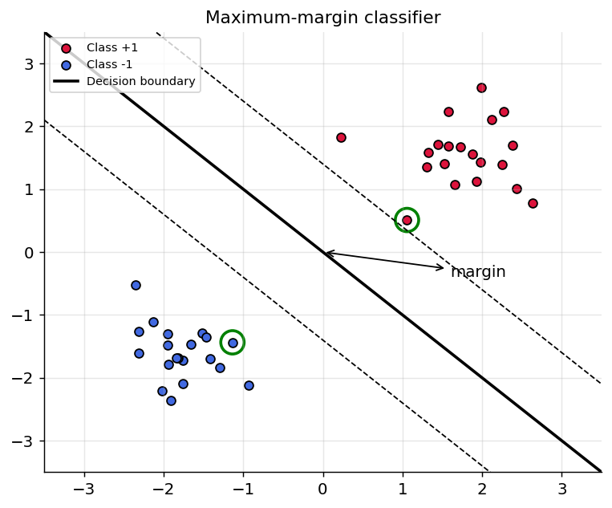

*Figure 119. Maximum-margin separator with margin band and circled support vectors*

### 8.1.1 Formalizing the margin

Let each example be $`(\mathbf{x}^{(i)},y^{(i)})`$ with labels encoded as $`y^{(i)} \in \{ - 1, + 1\}`$. Note that SVMs use $`\pm 1`$, not the $`0/1`$ encoding of logistic regression, because it makes the algebra symmetric: the product $`y^{(i)}f(\mathbf{x}^{(i)})`$ is positive exactly when the prediction is correct, regardless of class. A linear classifier is defined by a weight vector $`\mathbf{w}`$ and bias $`b`$, predicting the sign of the *decision function*

``` math
f(\mathbf{x}) = \mathbf{w}^{\top}\mathbf{x} + b.
```

The set $`\{\mathbf{x}:\mathbf{w}^{\top}\mathbf{x} + b = 0\}`$ is a **hyperplane** — a line in two dimensions, a plane in three, a flat $`(n - 1)`$-dimensional surface in $`n`$ dimensions. The vector $`\mathbf{w}`$ is normal (perpendicular) to this hyperplane, and $`b`$ shifts it away from the origin.

The signed distance from any point $`\mathbf{x}`$ to the hyperplane is

``` math
\text{dist}(\mathbf{x}) = \frac{\mathbf{w}^{\top}\mathbf{x} + b}{\left\| \mathbf{w} \right\|}.
```

Here is a short derivation of why. Project $`\mathbf{x}`$ onto the hyperplane; the displacement must be along the unit normal $`\mathbf{w}/\left\| \mathbf{w} \right\|`$, so write $`\mathbf{x} = \mathbf{x}_{\perp} + t\,\mathbf{w}/\left\| \mathbf{w} \right\|`$ where $`\mathbf{x}_{\perp}`$ lies on the hyperplane and $`t`$ is the signed distance. Applying $`\mathbf{w}^{\top}( \cdot ) + b`$ and using $`\mathbf{w}^{\top}\mathbf{x}_{\perp} + b = 0`$ gives $`f(\mathbf{x}) = t\,\left\| \mathbf{w} \right\|`$, hence $`t = f(\mathbf{x})/\left\| \mathbf{w} \right\|`$. Multiplying by the label, the *functional margin* $`y^{(i)}f(\mathbf{x}^{(i)})`$ times $`1/\left\| \mathbf{w} \right\|`$ is the *geometric margin* — the true perpendicular distance to the boundary, signed so that correctly classified points have positive margin.

We are free to rescale $`\mathbf{w}`$ and $`b`$ together by any positive constant without changing the boundary or which side a point falls on. We use this freedom to fix the scale by demanding that the closest points on each side satisfy $`|\mathbf{w}^{\top}\mathbf{x} + b| = 1`$. These closest points are the support vectors, and this convention is called the **canonical form** of the hyperplane. The two margin lines are then $`\mathbf{w}^{\top}\mathbf{x} + b = + 1`$ and $`\mathbf{w}^{\top}\mathbf{x} + b = - 1`$.

What is the distance between those two parallel lines? Take a point $`\mathbf{x}_{+}`$ on the $`+ 1`$ line and step along the unit normal to reach the $`- 1`$ line at $`\mathbf{x}_{-} = \mathbf{x}_{+} - \rho\,\mathbf{w}/\left\| \mathbf{w} \right\|`$. Requiring $`\mathbf{w}^{\top}\mathbf{x}_{-} + b = - 1`$ while $`\mathbf{w}^{\top}\mathbf{x}_{+} + b = + 1`$ gives $`- \rho\left\| \mathbf{w} \right\| = - 2`$, so $`\rho = 2/\left\| \mathbf{w} \right\|`$. The full **margin width** is therefore

``` math
\rho = \frac{2}{\left\| \mathbf{w} \right\|}.
```

Maximizing $`\frac{2}{\left\| \mathbf{w} \right\|}`$ is the same as minimizing $`\frac{1}{2}\left\| \mathbf{w} \right\|^{2}`$ (the square and the factor $`\frac{1}{2}`$ are cosmetic — they make the derivative clean), which gives the clean **hard-margin** optimization problem:

``` math
\min_{\mathbf{w},b}\mspace{6mu}\frac{1}{2}\left\| \mathbf{w} \right\|^{2}\quad\text{subject to}\quad y^{(i)}(\mathbf{w}^{\top}\mathbf{x}^{(i)} + b) \geq 1\mspace{6mu}\mspace{6mu}\text{for all}i.
```

The constraint says every point must lie on the correct side *and* on or beyond its margin line. This is a **convex quadratic program**: a quadratic objective with linear constraints. Convexity is a gift — it guarantees a unique global optimum with no local minima to trap the optimizer, in sharp contrast to the non-convex landscapes of neural networks.

### 8.1.2 A worked hard-margin example by hand

Take a deliberately tiny problem so we can solve it with pencil and paper. Two points in the plane: $`\mathbf{x}_{+} = (3,3)`$ with label $`+ 1`$, and $`\mathbf{x}_{-} = (1,1)`$ with label $`- 1`$. By symmetry, the optimal boundary is the perpendicular bisector of the segment joining them, which passes through the midpoint $`(2,2)`$ with normal direction along $`(1,1)`$. So write $`\mathbf{w} = (a,a)`$.

The canonical-form constraints, tight at both points because both are support vectors, read

``` math
\mathbf{w}^{\top}\mathbf{x}_{+} + b = + 1\mspace{6mu} \Rightarrow \mspace{6mu} 6a + b = 1,\quad\quad\mathbf{w}^{\top}\mathbf{x}_{-} + b = - 1\mspace{6mu} \Rightarrow \mspace{6mu} 2a + b = - 1.
```

Subtracting, $`4a = 2`$, so $`a = \frac{1}{2}`$ and $`b = - 1 - 2(\frac{1}{2}) = - 2`$. Thus $`\mathbf{w} = (\frac{1}{2},\frac{1}{2})`$, $`b = - 2`$, giving $`\left\| \mathbf{w} \right\| = \sqrt{1/2} \approx 0.707`$ and a margin width $`\rho = 2/\left\| \mathbf{w} \right\| = 2\sqrt{2} \approx 2.83`$ — exactly the distance between the two points, as it must be when they are the only support vectors. You can verify the decision function: $`f(3,3) = 0.5 \cdot 3 + 0.5 \cdot 3 - 2 = + 1`$ and $`f(1,1) = - 1`$, both on their margins. This little example is worth internalizing: the SVM’s answer is completely pinned by the support vectors, and everything else is geometry.

## 8.2 Hard Margin vs. Soft Margin: the C Parameter

The hard-margin formulation has a fatal flaw: it assumes the data is perfectly linearly separable. A single mislabeled point, or any real-world overlap between classes, makes the constraints unsatisfiable and the problem has *no solution at all*. Worse, even when the data is separable, a hard margin will contort itself dramatically to accommodate one outlier sitting near the boundary, squeezing the margin to almost nothing and destroying generalization.

The **soft-margin** SVM, introduced by Cortes and Vapnik in 1995, fixes this by allowing violations but charging for them. We introduce a **slack variable** $`\xi_{i} \geq 0`$ for each point measuring how far it intrudes into (or past) its margin, and add the total slack to the objective:

``` math
\min_{\mathbf{w},b,\mathbf{\xi}}\mspace{6mu}\frac{1}{2}\left\| \mathbf{w} \right\|^{2} + C\sum_{i = 1}^{m}\xi_{i}\quad\text{s.t.}\quad y^{(i)}(\mathbf{w}^{\top}\mathbf{x}^{(i)} + b) \geq 1 - \xi_{i},\mspace{6mu}\mspace{6mu}\xi_{i} \geq 0.
```

The slack loosens each constraint by $`\xi_{i}`$: instead of demanding the point sit beyond its margin, we only demand it not fall more than $`\xi_{i}`$ short. Reading off the geometry:

- $`\xi_{i} = 0`$: the point is correctly classified and on or beyond its margin — a well-behaved point.
- $`0 < \xi_{i} \leq 1`$: the point is inside the margin band but still on the correct side of the boundary — a *margin violation* that is not yet an error.
- $`\xi_{i} > 1`$: the point is on the wrong side of the boundary — a genuine misclassification.

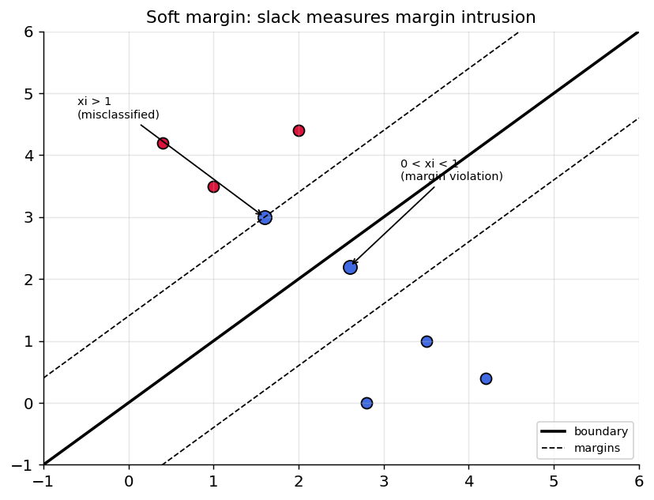

*Figure 120. Soft-margin geometry showing slack variables for points inside the margin and misclassified*

The hyperparameter $`C > 0`$ controls the trade-off. It is the price you pay per unit of margin violation:

- **Large** $`C`$ — violations are very expensive, so the optimizer prioritizes classifying every training point correctly. The margin shrinks, the model fits the training data tightly, and you risk **overfitting** (high variance). In the limit $`C \rightarrow \infty`$ you recover the hard margin.
- **Small** $`C`$ — violations are cheap, so the optimizer is willing to misclassify some points in exchange for a wider, smoother margin. This is stronger regularization and risks **underfitting** (high bias).

Thus $`C`$ is the SVM’s regularization knob, playing a role analogous to (the inverse of) the regularization strength in ridge regression and logistic regression from earlier chapters. In fact, matching the hinge-loss form below, $`C`$ is inversely proportional to the $`\ell_{2}`$ penalty weight: large $`C`$ means weak regularization, small $`C`$ means strong regularization. Tuning it well is one of the two most important decisions in practice (the other being the kernel and its parameters).

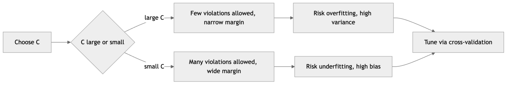

*Figure 121. How the C parameter trades margin width against training errors*

### 8.2.1 A worked soft-margin intuition

Suppose you have two well-separated clusters plus one blue point that has wandered deep into the red cluster. With very large $`C`$, the optimizer refuses to misclassify that stray point, so it tilts and shrinks the boundary to carve it out — a narrow, contorted margin that will misjudge future points. With a moderate $`C`$, the optimizer compares the cost of one unit of slack ($`C \cdot \xi`$) against the benefit of a wider margin ($`\frac{1}{2}\left\| \mathbf{w} \right\|^{2}`$ shrinking), decides the stray point is not worth the distortion, pays its slack, and keeps a clean wide boundary. This is precisely the behavior you want: the SVM treats a lone outlier as noise rather than signal. The art is that “moderate” is data-dependent, which is why $`C`$ must be tuned rather than guessed.

## 8.3 The Hinge Loss and Regularized Risk Minimization

There is a second, illuminating way to view the soft-margin SVM that connects it to the loss-function perspective used throughout this book. If we solve the slack constraints for $`\xi_{i}`$, the smallest feasible slack for point $`i`$ is $`\xi_{i} = max(0,\mspace{6mu} 1 - y^{(i)}f(\mathbf{x}^{(i)}))`$ — zero if the point already satisfies its margin, otherwise exactly the shortfall. Substituting back eliminates the slack variables and the constraints, turning the constrained problem into an unconstrained **regularized risk minimization**:

``` math
\min_{\mathbf{w},b}\mspace{6mu}\underset{\text{empirical hinge risk}}{\underbrace{\sum_{i = 1}^{m}\max\left( 0,\mspace{6mu} 1 - y^{(i)}(\mathbf{w}^{\top}\mathbf{x}^{(i)} + b) \right)}}\mspace{6mu} + \mspace{6mu}\frac{1}{2C}\left\| \mathbf{w} \right\|^{2}.
```

Divide through by $`C`$ if you prefer the equivalent “loss plus $`\lambda`$-penalty” form with $`\lambda = 1/(2C)`$; the minimizer is identical. Either way, the SVM is now recognizable as an instance of the universal recipe **data-fit term + regularizer** that underlies ridge regression, logistic regression, and much of the rest of the book.

The term $`\ell(z) = max(0,1 - z)`$, where $`z = y \cdot f(\mathbf{x})`$ is the *functional margin* of a single point, is the **hinge loss**. Read it carefully:

- If a point is correctly classified *and* beyond the margin ($`z \geq 1`$), the loss is exactly **zero** — the SVM is completely indifferent to points it already classifies confidently. This flat region is the source of sparsity: only points with $`z < 1`$ (the support vectors) contribute to the gradient and hence to the solution.
- If $`z < 1`$, the loss grows linearly with how badly the margin is violated. The linear (rather than quadratic) growth makes the SVM robust to outliers: a wildly misclassified point contributes a large but only *linearly* large penalty, not a runaway squared one.

Compare this to the logistic (cross-entropy) loss, which never reaches zero — it always wants points pushed further from the boundary, however slightly. The hinge’s flat region is precisely what makes the SVM care only about the boundary, not about the bulk of easy points.

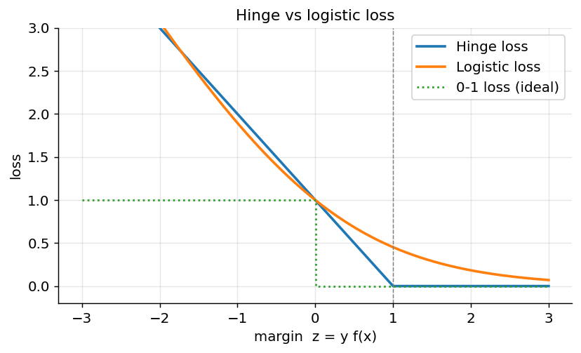

*Figure 122. Hinge loss versus logistic loss as functions of the margin z = y*f(x)\*

Both hinge and logistic loss are convex upper bounds on the ideal but non-differentiable **0-1 loss** (which simply counts errors and is impossible to optimize directly because its gradient is zero almost everywhere). Optimizing a convex surrogate is what makes both methods tractable. The hinge loss has one further quirk: it is not differentiable at the kink $`z = 1`$. Optimizers handle this with a **subgradient** — any value between the left and right slopes is valid at the kink — which is exactly what stochastic subgradient methods like `SGDClassifier(loss="hinge")` exploit to train linear SVMs at scale.

A variant, the **squared hinge loss** $`max(0,1 - z)^{2}`$, penalizes violations quadratically. It is differentiable everywhere, often trains a hair faster, and is the default in scikit-learn’s `LinearSVC`. It is slightly less robust to outliers than the plain hinge because large violations are squared.

## 8.4 The Primal and Dual Formulations

Everything so far has been the **primal** problem: optimize over $`\mathbf{w}`$, $`b`$, and $`\mathbf{\xi}`$ directly. There is an equivalent **dual** problem, and understanding it is the price of admission for the kernel trick. The tool that connects them is the method of **Lagrange multipliers**, which converts a constrained optimization into an unconstrained one by folding the constraints into the objective with penalty terms.

### 8.4.1 Building the Lagrangian

Attach a multiplier $`\alpha_{i} \geq 0`$ to each margin constraint $`y^{(i)}(\mathbf{w}^{\top}\mathbf{x}^{(i)} + b) \geq 1 - \xi_{i}`$ and a multiplier $`\mu_{i} \geq 0`$ to each non-negativity constraint $`\xi_{i} \geq 0`$. The **Lagrangian** is

``` math
\mathcal{L}(\mathbf{w},b,\mathbf{\xi},\mathbf{\alpha},\mathbf{\mu}) = \frac{1}{2}\left\| \mathbf{w} \right\|^{2} + C\sum_{i}^{}\xi_{i} - \sum_{i}^{}\alpha_{i}\left\lbrack y^{(i)}(\mathbf{w}^{\top}\mathbf{x}^{(i)} + b) - 1 + \xi_{i} \right\rbrack - \sum_{i}^{}\mu_{i}\xi_{i}.
```

The primal solution is a saddle point: minimize over the primal variables $`(\mathbf{w},b,\mathbf{\xi})`$, maximize over the multipliers. Setting the partial derivatives to zero — the **stationarity conditions** — gives three clean identities:

``` math
\frac{\partial\mathcal{L}}{\partial\mathbf{w}} = \mathbf{0}\mspace{6mu} \Rightarrow \mspace{6mu}\boxed{\mathbf{w} = \sum_{i}^{}\alpha_{i}y^{(i)}\mathbf{x}^{(i)}},
```

``` math
\frac{\partial\mathcal{L}}{\partial b} = 0\mspace{6mu} \Rightarrow \mspace{6mu}\sum_{i}^{}\alpha_{i}y^{(i)} = 0,\quad\quad\frac{\partial\mathcal{L}}{\partial\xi_{i}} = 0\mspace{6mu} \Rightarrow \mspace{6mu}\alpha_{i} = C - \mu_{i}.
```

The first is the single most important equation in this section: **the weight vector is a linear combination of the training points**, weighted by $`\alpha_{i}y^{(i)}`$. Points with $`\alpha_{i} = 0`$ contribute nothing; the model literally *is* its support vectors. The third identity, combined with $`\mu_{i} \geq 0`$, forces $`0 \leq \alpha_{i} \leq C`$ — the multipliers are *box-constrained*, and the upper bound $`C`$ is where the regularization parameter re-enters the dual.

### 8.4.2 The dual problem

Substitute those identities back into $`\mathcal{L}`$. The $`\xi`$ and $`b`$ terms vanish, and after simplification the Lagrangian depends only on the multipliers, yielding the **dual problem**:

``` math
\max_{\mathbf{\alpha}}\mspace{6mu}\sum_{i}^{}\alpha_{i} - \frac{1}{2}\sum_{i,j}^{}\alpha_{i}\alpha_{j}\, y^{(i)}y^{(j)}\,\mathbf{x}^{(i)\top}\mathbf{x}^{(j)}\quad\text{s.t.}\mspace{6mu} 0 \leq \alpha_{i} \leq C,\mspace{6mu}\sum_{i}^{}\alpha_{i}y^{(i)} = 0.
```

This is again a convex quadratic program, now in the $`m`$ variables $`\mathbf{\alpha}`$ instead of the $`n + 1`$ variables $`(\mathbf{w},b)`$. Two features are decisive. First, the data enters **only through inner products** $`\mathbf{x}^{(i)\top}\mathbf{x}^{(j)}`$ — the individual vectors never appear alone. This is the crack through which the kernel trick will slip. Second, the solution is sparse: at the optimum most $`\alpha_{i}`$ are exactly zero. Recovering the decision function from $`\mathbf{w} = \sum_{i}^{}\alpha_{i}y^{(i)}\mathbf{x}^{(i)}`$ gives

``` math
f(\mathbf{x}) = \sum_{i}^{}\alpha_{i}y^{(i)}\,\mathbf{x}^{(i)\top}\mathbf{x} + b = \sum_{i \in \text{SV}}^{}\alpha_{i}y^{(i)}\,\mathbf{x}^{(i)\top}\mathbf{x} + b,
```

a sum over support vectors only.

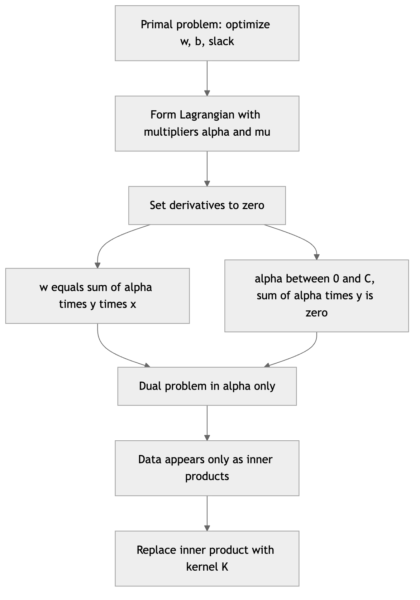

*Figure 123. From the primal SVM to the dual, and why the dual enables kernels*

### 8.4.3 KKT conditions and the three kinds of point

The **Karush-Kuhn-Tucker (KKT) conditions** are the necessary-and-sufficient optimality conditions for this convex problem. Beyond stationarity and the constraints, they include **complementary slackness**: at the optimum, each multiplier is zero *unless* its constraint is tight. Concretely,

``` math
\alpha_{i}\left\lbrack y^{(i)}f(\mathbf{x}^{(i)}) - 1 + \xi_{i} \right\rbrack = 0,\quad\quad\mu_{i}\xi_{i} = (C - \alpha_{i})\xi_{i} = 0.
```

Reading these two equations together partitions every training point into exactly one of three categories, and this partition is the operational meaning of “support vector”:

| $`\alpha_{i}`$ value | KKT consequence | Geometric position | Role |
|----|----|----|----|
| $`\alpha_{i} = 0`$ | $`\xi_{i} = 0`$, margin satisfied | Correctly classified, beyond the margin | **Not** a support vector; deletable |
| $`0 < \alpha_{i} < C`$ | $`\xi_{i} = 0`$ and $`y_{i}f(x_{i}) = 1`$ | Exactly on the margin line | **Free / margin support vector** |
| $`\alpha_{i} = C`$ | $`\xi_{i} \geq 0`$ allowed | Inside the margin or misclassified | **Bounded support vector** |

The free support vectors (those with $`0 < \alpha_{i} < C`$) are especially useful: because they sit exactly on the margin with $`\xi_{i} = 0`$, each one satisfies $`y^{(i)}f(\mathbf{x}^{(i)}) = 1`$ exactly, which lets us **solve for the bias** $`b`$. Pick any free support vector $`i`$ and compute $`b = y^{(i)} - \sum_{j \in \text{SV}}^{}\alpha_{j}y^{(j)}\,\mathbf{x}^{(j)\top}\mathbf{x}^{(i)}`$; in practice one averages over all free support vectors for numerical stability.

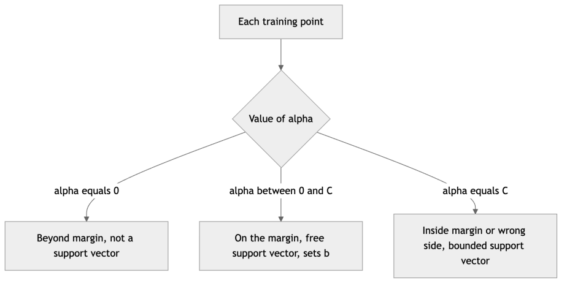

*Figure 124. The three categories of training point according to their dual coefficient*

### 8.4.4 Why bother with the dual?

Three reasons. First and foremost, the dual is expressed purely in inner products, which is what makes kernels possible — you cannot kernelize the primal directly because it needs the explicit $`\mathbf{w}`$. Second, the dual has $`m`$ variables (one per sample) rather than depending on the feature dimension, so when features vastly outnumber samples — infinite-dimensional kernel spaces included — the dual stays finite and tractable. Third, the sparsity of $`\mathbf{\alpha}`$ makes prediction cheap: you store and dot-product against only the support vectors. The trade-off is that the dual scales with the *number of samples* $`m`$, which is exactly why kernel SVMs struggle on very large datasets, as we quantify later. For the linear kernel with many samples the situation reverses, and solving the primal (as `LinearSVC` does) is far faster.

## 8.5 The Kernel Trick

So far the SVM is just a particularly principled linear classifier. Its real magic appears when the data is *not* linearly separable in its original space — and the resolution is one of the most elegant ideas in machine learning.

### 8.5.1 Intuition: lift, then separate

Consider one-dimensional points where the positive class sits in the middle ($`- 1 < x < 1`$) and the negative class on the outside. No single threshold separates them. But map each point up to two dimensions via $`\phi(x) = (x,x^{2})`$, and suddenly the positives cluster low and the negatives sit high — a horizontal line now separates them perfectly. The trick generalizes: data that is tangled in low dimensions often becomes linearly separable once lifted into a higher-dimensional **feature space** through a nonlinear map $`\phi`$.

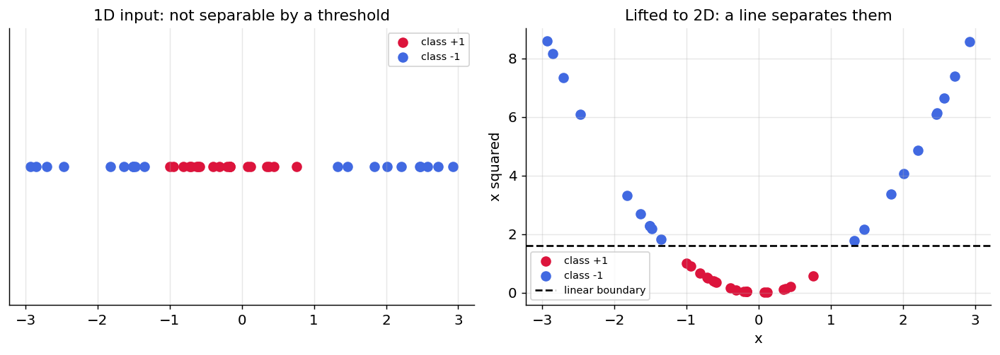

*Figure 125. One-dimensional data that is not separable becomes separable after lifting with phi of x equals x and x squared*

The catch: explicitly computing $`\phi(\mathbf{x})`$ can be expensive or even impossible. A degree-$`d`$ polynomial map of $`n`$ features produces combinatorially many terms; some useful maps (like the Gaussian) are *infinite*-dimensional. Constructing those vectors directly is hopeless.

### 8.5.2 The trick itself

Here is the key fact, and it rests on the dual formulation we just derived. The training data appears there *only* through inner products $`\mathbf{x}^{(i)\top}\mathbf{x}^{(j)}`$, and the decision function is likewise a sum of inner products against support vectors. Now suppose we work in the lifted space. Everywhere $`\mathbf{x}^{(i)\top}\mathbf{x}^{(j)}`$ appears we would write $`\phi(\mathbf{x}^{(i)})^{\top}\phi(\mathbf{x}^{(j)})`$. The **kernel trick** observes that for many useful maps $`\phi`$ there is a function $`K`$ that computes this inner product *directly from the original vectors*, without ever forming $`\phi`$:

``` math
K(\mathbf{x}^{(i)},\mathbf{x}^{(j)}) = \phi(\mathbf{x}^{(i)})^{\top}\phi(\mathbf{x}^{(j)}).
```

We simply replace every inner product by $`K`$. We get all the expressive power of the high-dimensional space at the computational cost of the original. The kernelized decision function becomes

``` math
f(\mathbf{x}) = \sum_{i \in \text{SV}}^{}\alpha_{i}y^{(i)}\, K(\mathbf{x}^{(i)},\mathbf{x}) + b.
```

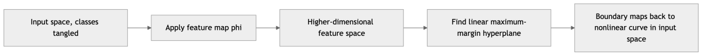

*Figure 126. Lifting non-separable data into a higher-dimensional space where a linear boundary works*

### 8.5.3 Mercer’s condition: which functions are valid kernels

Not every similarity function is a legal kernel. A function $`K`$ is a valid kernel if and only if it corresponds to an inner product in *some* feature space. **Mercer’s theorem** makes this checkable: $`K`$ is a valid (Mercer) kernel exactly when it is symmetric — $`K(\mathbf{u},\mathbf{v}) = K(\mathbf{v},\mathbf{u})`$ — and **positive semi-definite**, meaning that for any finite set of points the **Gram matrix** $`\mathbf{G}`$ with entries $`G_{ij} = K(\mathbf{x}^{(i)},\mathbf{x}^{(j)})`$ satisfies $`\mathbf{c}^{\top}\mathbf{G}\,\mathbf{c} \geq 0`$ for every vector $`\mathbf{c}`$. Positive semi-definiteness is what guarantees the dual stays convex and a genuine feature map $`\phi`$ exists behind the scenes.

You rarely check Mercer’s condition by hand, because valid kernels compose nicely: sums of kernels, positive scalar multiples of kernels, products of kernels, and $`K(\mathbf{u},\mathbf{v})\, g(\mathbf{u})g(\mathbf{v})`$ for any function $`g`$ are all valid kernels. This closure lets practitioners build custom kernels (for example, string kernels for text or graph kernels for molecules) with confidence that the optimization remains well-posed.

### 8.5.4 A concrete check

Take the kernel $`K(\mathbf{u},\mathbf{v}) = (\mathbf{u}^{\top}\mathbf{v})^{2}`$ in two dimensions. Expanding:

``` math
(\mathbf{u}^{\top}\mathbf{v})^{2} = (u_{1}v_{1} + u_{2}v_{2})^{2} = u_{1}^{2}v_{1}^{2} + 2u_{1}u_{2}v_{1}v_{2} + u_{2}^{2}v_{2}^{2} = \phi(\mathbf{u})^{\top}\phi(\mathbf{v}),
```

with $`\phi(\mathbf{x}) = (x_{1}^{2},\mspace{6mu}\sqrt{2}\, x_{1}x_{2},\mspace{6mu} x_{2}^{2})`$. So this kernel silently performs classification in the space of all quadratic feature combinations, yet costs one dot product and one squaring. The $`\sqrt{2}`$ is not optional decoration — it is exactly what makes the explicit feature-space inner product reproduce the kernel value, and it illustrates how a compact kernel formula hides a specific, carefully weighted feature map.

### 8.5.5 The common kernels

| Kernel | Formula $`K(\mathbf{u},\mathbf{v})`$ | Key hyperparameters | Use when |
|----|----|----|----|
| Linear | $`\mathbf{u}^{\top}\mathbf{v}`$ | none (just $`C`$) | many features, text, near-linear problems |
| Polynomial | $`(\gamma\,\mathbf{u}^{\top}\mathbf{v} + r)^{d}`$ | degree $`d`$, $`\gamma`$, coef $`r`$ | known polynomial interactions |
| RBF / Gaussian | $`exp( - \gamma\left\| \mathbf{u} - \mathbf{v} \right\|^{2})`$ | $`\gamma`$ (and $`C`$) | default for nonlinear, smooth boundaries |
| Sigmoid | $`tanh(\gamma\,\mathbf{u}^{\top}\mathbf{v} + r)`$ | $`\gamma`$, $`r`$ | rarely; mimics a shallow neural net |

The **linear kernel** is the plain SVM with no lifting; its feature map is the identity. It is the right choice when the data is already high-dimensional (so extra lifting only invites overfitting) and when you want the interpretable weight vector $`\mathbf{w}`$ back, which the linear case alone provides explicitly.

The **polynomial kernel** of degree $`d`$ implicitly generates all monomials up to degree $`d`$. The offset $`r`$ (called `coef0` in scikit-learn) controls the influence of lower-order terms: with $`r = 0`$ only pure degree-$`d`$ terms survive; with $`r > 0`$ the map mixes in all lower degrees too. Higher $`d`$ increases flexibility but also the risk of numerical blow-up, since kernel values can grow like $`( \cdot )^{d}`$.

The **RBF (Gaussian) kernel** deserves special attention because it is the sensible default. It measures similarity that decays with distance: nearby points have $`K \approx 1`$, distant points $`K \approx 0`$. Its feature space is infinite-dimensional (the Taylor expansion of the exponential produces monomials of every degree), so it can represent extremely flexible boundaries. The parameter $`\gamma`$ controls the *reach* of each support vector:

- **Large** $`\gamma`$ — similarity decays fast, each point influences only its immediate neighborhood, boundaries become wiggly and local. Overfitting risk. In the extreme, every point becomes its own support vector and the model memorizes the training set.
- **Small** $`\gamma`$ — broad influence, smoother boundaries approaching linear. Underfitting risk.

A useful default is $`\gamma = 1/(n \cdot \text{Var}(X))`$ — scikit-learn’s `gamma="scale"` — which adapts the reach to the number of features and their spread. Notice that $`\gamma`$ and $`C`$ interact, which is why they are almost always tuned *jointly* on a grid.

The **sigmoid kernel** is included for historical completeness; it is only a valid Mercer kernel for certain parameter ranges and the RBF usually dominates it. Mention it, then reach for RBF.

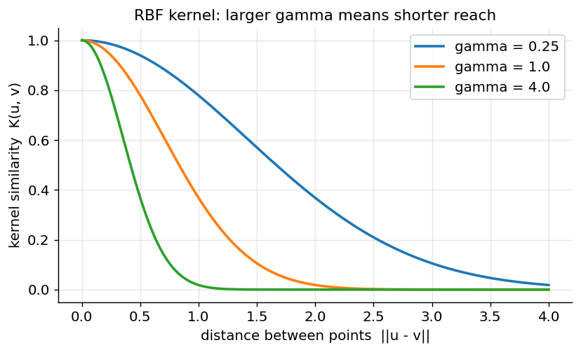

*Figure 127. RBF kernel similarity as a function of distance, for several gamma values*

To see the effect on an actual decision function, the figure below sums Gaussian “bumps” centered on a handful of support vectors — exactly what $`f(\mathbf{x}) = \sum_{i}^{}\alpha_{i}y^{(i)}K(\mathbf{x}^{(i)},\mathbf{x})`$ does in one dimension. With small $`\gamma`$ the bumps are broad and the decision function is smooth; with large $`\gamma`$ each bump is a narrow spike and the function becomes jagged and local — the visual signature of overfitting.

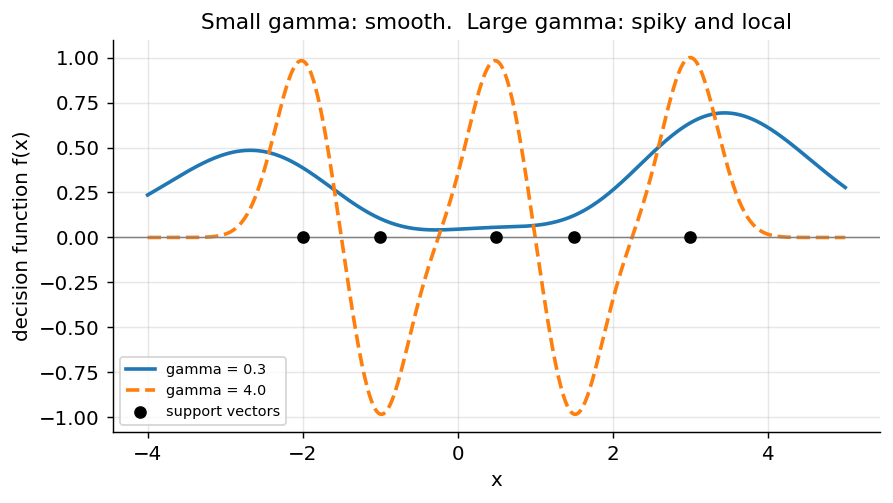

*Figure 128. One-dimensional SVM decision function as a sum of RBF bumps for small versus large gamma*

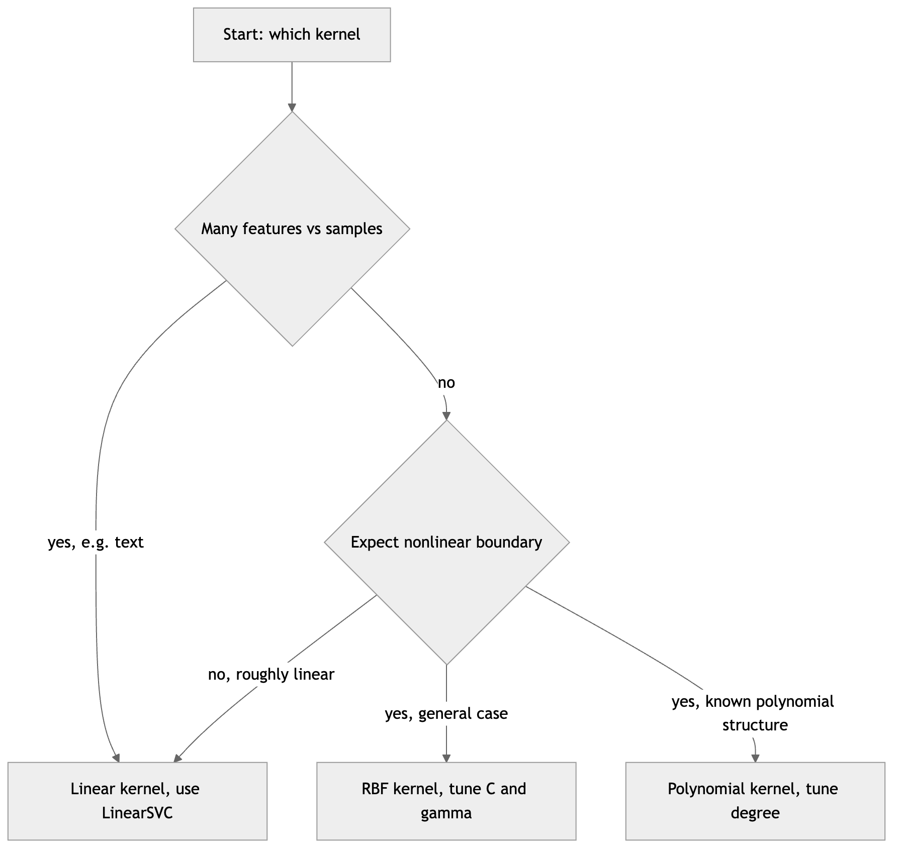

*Figure 129. A practical decision flow for choosing an SVM kernel*

## 8.6 A First Runnable Example with Decision Boundaries

Let us see kernels reshape boundaries on a classic non-linearly-separable dataset. We will train SVMs with linear, polynomial, and RBF kernels and plot what each learns. Note the mandatory feature scaling, wrapped into a pipeline.

``` python
import numpy as np
import matplotlib.pyplot as plt
from sklearn.datasets import make_moons
from sklearn.pipeline import make_pipeline
from sklearn.preprocessing import StandardScaler
from sklearn.svm import SVC

X, y = make_moons(n_samples=300, noise=0.25, random_state=42)

kernels = [
    ("Linear", SVC(kernel="linear", C=1.0)),
    ("Polynomial (d=3)", SVC(kernel="poly", degree=3, C=1.0, coef0=1)),
    ("RBF (gamma=1)", SVC(kernel="rbf", gamma=1.0, C=1.0)),
]

# Mesh for plotting boundaries
xx, yy = np.meshgrid(np.linspace(-2, 3, 300), np.linspace(-1.5, 2, 300))
grid = np.c_[xx.ravel(), yy.ravel()]

fig, axes = plt.subplots(1, 3, figsize=(15, 4.5))
for ax, (name, clf) in zip(axes, kernels):
    model = make_pipeline(StandardScaler(), clf)
    model.fit(X, y)
    Z = model.predict(grid).reshape(xx.shape)
    ax.contourf(xx, yy, Z, alpha=0.25, cmap="coolwarm")
    ax.scatter(X[:, 0], X[:, 1], c=y, cmap="coolwarm", edgecolor="k", s=25)
    ax.set_title(f"{name}  acc={model.score(X, y):.2f}")
plt.tight_layout()
# Expected: linear ~0.86, polynomial ~0.92, RBF ~0.96 — RBF curves around the moons.
```

The linear kernel can only draw a straight line and fails on the interleaving moons; the polynomial bends; the RBF wraps the boundary cleanly around each crescent. This visual is the single best way to build intuition for what a kernel *is*.

### 8.6.1 Inspecting the support vectors

Because the fitted model *is* its support vectors, it is worth learning to read them off. A trained `SVC` exposes `support_vectors_` (the vectors themselves), `dual_coef_` (the products $`\alpha_{i}y^{(i)}`$), and `n_support_` (how many per class). Watching the support-vector count respond to $`C`$ and $`\gamma`$ is a fast diagnostic:

``` python
from sklearn.svm import SVC
from sklearn.datasets import make_moons
from sklearn.preprocessing import StandardScaler

X, y = make_moons(n_samples=300, noise=0.25, random_state=42)
Xs = StandardScaler().fit_transform(X)

for C in [0.1, 1.0, 100.0]:
    clf = SVC(kernel="rbf", gamma=1.0, C=C).fit(Xs, y)
    print(f"C={C:6}:  {clf.support_vectors_.shape[0]} support vectors")
# Expected: fewer support vectors as C grows — a tighter fit leans on fewer points.
# C=   0.1: ~180 support vectors
# C=   1.0: ~90  support vectors
# C= 100.0: ~55  support vectors
```

A model that turns nearly every training point into a support vector is a warning sign: it is memorizing rather than generalizing, usually because $`\gamma`$ is too large or $`C`$ is small on noisy data.

## 8.7 The Effect of C and Gamma, Visualized

The two RBF hyperparameters are best understood as a two-dimensional landscape of behaviors. Along the $`\gamma`$ axis you move from smooth (small $`\gamma`$, near-linear) to jagged and local (large $`\gamma`$). Along the $`C`$ axis you move from wide-margin tolerant (small $`C`$) to narrow-margin intolerant (large $`C`$). Cross-validation accuracy over this grid typically shows a broad plateau of good combinations flanked by cliffs where the model under- or over-fits. The schematic below sketches that characteristic surface; on real data you produce the same picture from `GridSearchCV` results.

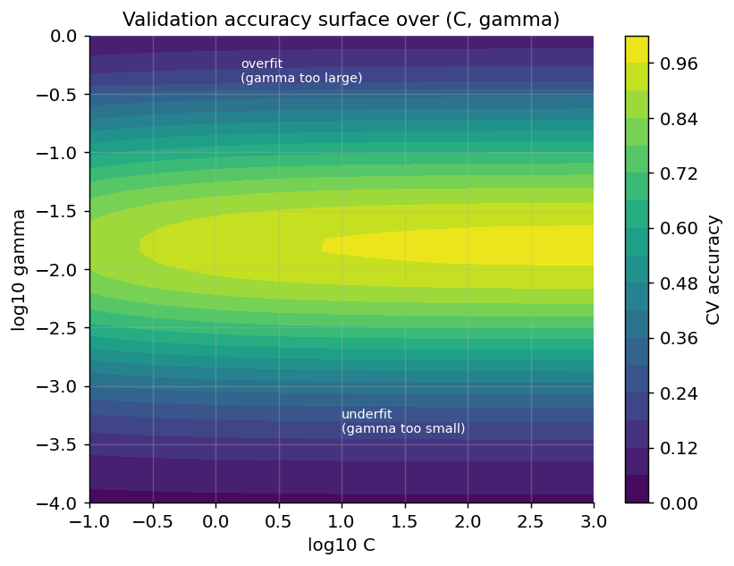

*Figure 130. Schematic cross-validation accuracy over the C and gamma grid, showing the good plateau and the overfitting and underfitting cliffs*

## 8.8 Multiclass SVM

The optimization we derived is fundamentally **binary** — it separates $`+ 1`$ from $`- 1`$. To handle $`K > 2`$ classes we reduce the multiclass problem to many binary ones, exactly the strategies introduced in the previous chapter.

**One-vs-Rest (OvR).** Train $`K`$ SVMs, the $`k`$-th separating class $`k`$ from all others. Predict the class whose decision function $`f_{k}(\mathbf{x})`$ is largest. Requires $`K`$ classifiers and is the more economical choice when $`K`$ is large. A subtlety: the $`K`$ decision functions are trained independently and their scores are not perfectly comparable, but taking the argmax works well in practice.

**One-vs-One (OvO).** Train one SVM for every *pair* of classes — $`\left( \frac{K}{2} \right) = \frac{K(K - 1)}{2}`$ of them — and let them vote. Each classifier trains on only the two relevant classes’ data, so individual problems are small, which matters because kernel-SVM training scales superlinearly with sample count. Even though OvO trains more classifiers, each sees far fewer samples, so the total cost is often competitive. This is why **scikit-learn’s** `SVC` **uses OvO internally** (via the underlying LIBSVM), while `LinearSVC` uses OvR.

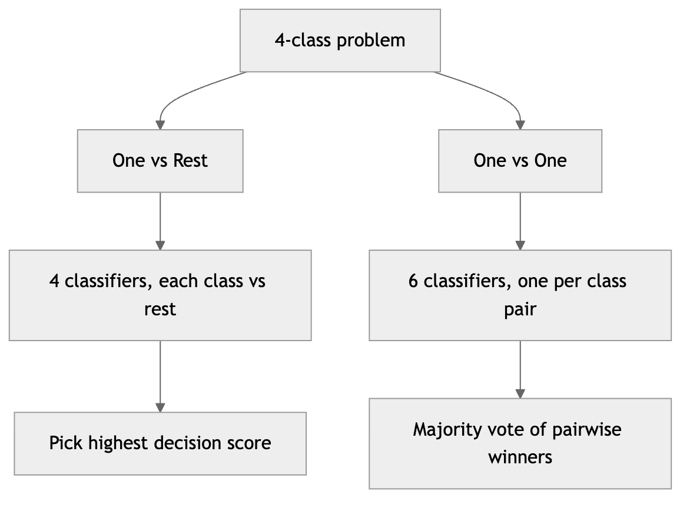

*Figure 131. One-vs-Rest versus One-vs-One reductions for a four-class problem*

For a 10-class problem such as handwritten digits, OvR trains 10 models while OvO trains 45. For most users this is transparent — you call `.fit` and `.predict` on multiclass labels and scikit-learn handles the reduction. Just be aware of the cost: OvO’s classifier count grows quadratically with $`K`$, so for many classes with a large dataset it can dominate runtime, and `LinearSVC`’s OvR (or a dedicated multinomial method) may be preferable.

## 8.9 SVM for Regression (SVR)

The same maximum-margin philosophy extends to regression, called **Support Vector Regression (SVR)**. Instead of a margin that separates classes, SVR fits a tube of half-width $`\epsilon`$ around the regression function and ignores any error smaller than $`\epsilon`$. Errors inside the tube cost nothing; only points falling outside — again, the support vectors — incur a penalty and shape the fit.

The loss that produces this behavior is the $`\epsilon`$**-insensitive loss**:

``` math
L_{\epsilon}(y,f(\mathbf{x})) = max\left( 0,\mspace{6mu}|y - f(\mathbf{x})| - \epsilon \right).
```

It is a flat-bottomed cousin of the absolute-error loss: zero within $`\pm \epsilon`$, then growing linearly. The flat bottom is what makes the solution sparse (only out-of-tube points become support vectors), and the linear arms make SVR robust to outliers in the same way the hinge loss makes classification robust. The corresponding primal problem introduces two slacks per point, $`\xi_{i}`$ for overshooting the tube above and $`\xi_{i}^{\ast}`$ for below:

``` math
\min_{\mathbf{w},b,\mathbf{\xi},\mathbf{\xi}^{\ast}}\frac{1}{2}\left\| \mathbf{w} \right\|^{2} + C\sum_{i}^{}(\xi_{i} + \xi_{i}^{\ast})\mspace{6mu}\mspace{6mu}\text{s.t.}\mspace{6mu}\mspace{6mu}\left\{ \begin{matrix}
y_{i} - f(\mathbf{x}_{i}) \leq \epsilon + \xi_{i} \\
f(\mathbf{x}_{i}) - y_{i} \leq \epsilon + \xi_{i}^{\ast} \\
\xi_{i},\xi_{i}^{\ast} \geq 0.
\end{matrix} \right.\ 
```

Here $`\epsilon`$ sets how much error you are willing to ignore (a form of regularization — larger $`\epsilon`$ means fewer support vectors and a simpler model) while $`C`$ still trades tube violations against flatness. The same kernels apply, giving nonlinear regression with identical machinery.

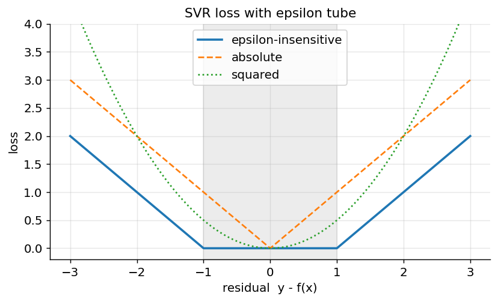

*Figure 132. The epsilon-insensitive loss ignores errors inside the tube, unlike squared or absolute loss*

We introduced regression broadly in the chapter on Regression Algorithms; here it suffices to note that `sklearn.svm.SVR` mirrors `SVC` and shares the same $`C`$, $`\gamma`$, and kernel choices, adding only $`\epsilon`$. Use it when you want a kernelized, regularized regressor robust to small errors, on modestly sized datasets.

``` python
import numpy as np
from sklearn.svm import SVR
from sklearn.pipeline import make_pipeline
from sklearn.preprocessing import StandardScaler

rng = np.random.RandomState(0)
X = np.sort(5 * rng.rand(120, 1), axis=0)
y = np.sin(X).ravel() + 0.1 * rng.randn(120)

svr = make_pipeline(StandardScaler(), SVR(kernel="rbf", C=10, gamma=0.5, epsilon=0.1))
svr.fit(X, y)
print("R^2 on training data:", round(svr.score(X, y), 3))
# Expected R^2 around 0.95 — the RBF SVR tracks the sine wave smoothly.
```

Scikit-learn also offers `NuSVR` (and `NuSVC` for classification), which replaces $`\epsilon`$ (or the raw $`C`$ trade-off) with a parameter $`\nu \in (0,1\rbrack`$ that directly bounds the fraction of support vectors and margin errors. Some practitioners find $`\nu`$ more intuitive to set than $`\epsilon`$ because it has a concrete interpretation, though the two parameterizations describe the same underlying models.

## 8.10 Computational Complexity and Scalability

The single most important practical fact about SVMs is how their cost scales, because it dictates which implementation you should reach for.

**Kernel** `SVC` **(LIBSVM).** Training solves the dual quadratic program over $`m`$ variables, and the Gram matrix alone is $`m \times m`$. In practice training time scales between roughly $`O(m^{2}n)`$ and $`O(m^{3}n)`$ depending on $`C`$ and how separable the data is, where $`n`$ is the feature count (or the cost of a kernel evaluation). Memory scales like $`O(m^{2})`$ for the kernel cache. This is fine up to tens of thousands of samples and becomes painful beyond about $`10^{5}`$. Prediction costs $`O(n_{\text{SV}} \cdot n)`$ per point, and a theorem of Steinwart shows the number of support vectors tends to grow *linearly* with $`m`$ on noisy data — so both training and prediction degrade as data grows.

`LinearSVC` **(liblinear).** For the linear kernel there is no need for the dual or a Gram matrix; you can optimize the primal (hinge or squared-hinge loss plus $`\ell_{2}`$ penalty) directly. Cost is roughly $`O(m \cdot n)`$ — linear in samples and features — and it exploits sparse feature matrices, making it the default for high-dimensional text with hundreds of thousands of features and many samples. The trade-off: `LinearSVC` supports only the linear kernel, uses OvR for multiclass, and penalizes the bias term slightly differently, so its numbers will not match `SVC(kernel="linear")` exactly.

`SGDClassifier(loss="hinge")`**.** For truly large or streaming data, stochastic (sub)gradient descent on the hinge loss trains a linear SVM online, one mini-batch at a time, at $`O(m \cdot n)`$ cost with $`O(n)`$ memory. It scales to millions of rows and supports `partial_fit` for out-of-core learning, at the price of more hyperparameter fiddling (learning rate, number of epochs) and no kernels.

**Kernel approximation.** To get RBF-like nonlinearity at linear-model speed, map features through an explicit approximate feature map — `Nystroem` or `RBFSampler` (random Fourier features) — and feed the result to `LinearSVC` or `SGDClassifier`. This recovers much of the RBF kernel’s power while scaling to large $`m`$, and is the standard escape hatch when kernel `SVC` is too slow.

| Implementation | Kernels | Rough training cost | Good up to | Multiclass |
|----|----|----|----|----|
| `SVC` (LIBSVM) | any | $`O(m^{2}n)`$ to $`O(m^{3}n)`$ | ~$`10^{5}`$ samples | OvO |
| `LinearSVC` (liblinear) | linear only | $`O(mn)`$ | millions (sparse) | OvR |
| `SGDClassifier` hinge | linear only | $`O(mn)`$, online | unbounded / streaming | OvR |
| `Nystroem` + linear model | approx. RBF etc. | $`O(mn)`$ after mapping | large $`m`$ | via base model |

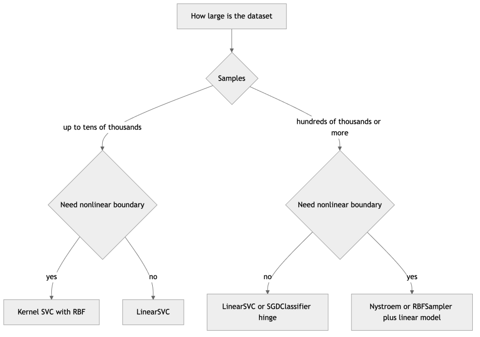

*Figure 133. Choosing an SVM implementation based on data size and kernel needs*

## 8.11 Practical Guidance

### 8.11.1 Scaling is mandatory

This cannot be overstated. SVMs depend on distances and inner products, so a feature measured in thousands (income) will swamp a feature measured in tenths (interest rate). The RBF kernel’s $`\left\| \mathbf{u} - \mathbf{v} \right\|^{2}`$ and the linear kernel’s dot product are both dominated by large-magnitude features, and the single $`\gamma`$ cannot compensate per-feature. **Always standardize** (zero mean, unit variance) or min-max scale your features before training, and always fit the scaler on the training fold only — wrap it in a `Pipeline` so cross-validation does this correctly. Skipping scaling is the single most common reason a beginner’s SVM performs terribly.

### 8.11.2 Choosing the kernel

A reasonable default workflow:

1.  **Start with the linear kernel** if you have many features relative to samples (e.g. text/TF-IDF with tens of thousands of features) or if the problem looks roughly linear. `LinearSVC` scales to large datasets far better than kernel `SVC`.
2.  **Use the RBF kernel** as the go-to for general nonlinear problems with a moderate number of features. It is flexible and almost always competitive.
3.  **Try polynomial** only when you have a prior belief in polynomial feature interactions; it has more hyperparameters and is fiddlier to tune.
4.  **Skip sigmoid** in practice.

### 8.11.3 Tuning C and gamma

For the RBF kernel, $`C`$ and $`\gamma`$ are tuned **together** on a logarithmic grid via cross-validation. A typical search:

``` python
import numpy as np
from sklearn.datasets import load_breast_cancer
from sklearn.model_selection import GridSearchCV, train_test_split
from sklearn.pipeline import Pipeline
from sklearn.preprocessing import StandardScaler
from sklearn.svm import SVC

X, y = load_breast_cancer(return_X_y=True)
X_tr, X_te, y_tr, y_te = train_test_split(X, y, test_size=0.25,
                                          stratify=y, random_state=0)

pipe = Pipeline([("scale", StandardScaler()), ("svc", SVC(kernel="rbf"))])
param_grid = {
    "svc__C":     np.logspace(-1, 3, 5),   # 0.1 ... 1000
    "svc__gamma": np.logspace(-4, 0, 5),   # 0.0001 ... 1
}
search = GridSearchCV(pipe, param_grid, cv=5, scoring="accuracy", n_jobs=-1)
search.fit(X_tr, y_tr)

print("Best params:", search.best_params_)
print("CV accuracy:", round(search.best_score_, 3))
print("Test accuracy:", round(search.score(X_te, y_te), 3))
# Expected test accuracy around 0.97 on this well-separated dataset.
```

The pattern of a plateau-with-cliffs validation surface over the $`(C,\gamma)`$ grid is universal: too-large $`\gamma`$ overfits, too-small underfits, and $`C`$ shifts the balance. Visualizing the CV scores as a heatmap over the grid is a good diagnostic habit — start coarse and logarithmic, then refine around the best region. For larger searches, `RandomizedSearchCV` or `HalvingGridSearchCV` finds good regions with far fewer fits.

### 8.11.4 Getting probabilities out of an SVM

An SVM’s natural output is the signed score `decision_function`, not a probability. If you truly need calibrated probabilities, `SVC(probability=True)` fits a **Platt scaling** model — a logistic regression on the SVM scores via internal cross-validation. Be warned: it is slow (it retrains with cross-validation), and its probabilities can be inconsistent with `predict` on small datasets. When you only need a ranking or a threshold, use `decision_function` directly; reserve probability calibration for when downstream decisions genuinely require it, and consider `CalibratedClassifierCV` as a more flexible alternative.

### 8.11.5 Handling class imbalance

On imbalanced problems the majority class can dominate the margin. Set `class_weight="balanced"` to automatically weight the per-class slack penalty inversely to class frequency, effectively raising $`C`$ for the rare class. Combine this with imbalance-aware metrics (precision, recall, F1, ROC-AUC) rather than raw accuracy, as discussed in the Model Evaluation chapter.

## 8.12 Real-World Applications

SVMs earned their reputation on problems where data is scarce but features are rich, and several of those remain textbook use cases.

- **Text and document classification.** With bag-of-words or TF-IDF features, documents live in a space of tens of thousands of sparse dimensions where classes are often nearly linearly separable. A linear SVM (`LinearSVC`) on TF-IDF was for years the strongest baseline for spam filtering, sentiment analysis, and topic categorization, and it remains a fast, robust option that trains in seconds and is hard to beat without large labeled corpora.
- **Bioinformatics.** Gene-expression and mass-spectrometry datasets routinely have thousands of features but only dozens or hundreds of samples — precisely the regime where margin-based regularization shines and deep nets starve. SVMs (often with linear or RBF kernels, sometimes custom string kernels for sequences) are a staple for cancer-subtype classification and protein function prediction.
- **Image recognition, pre-deep-learning.** Before convolutional networks, the dominant recipe was hand-crafted features (SIFT, HOG) fed into an RBF SVM; this powered face detection and object recognition benchmarks for a decade.
- **Handwriting and OCR.** LIBSVM with an RBF kernel achieved famously strong results on the MNIST digits, and SVMs remain a fine choice for small, clean recognition tasks.
- **Anomaly and novelty detection.** The **one-class SVM** (`OneClassSVM`) learns a boundary around the “normal” data and flags points outside it, useful for fault detection and intrusion detection when only normal examples are plentiful.

The common thread: SVMs are the tool to reach for when you have a *small-to-medium, high-dimensional, relatively clean* problem and want strong accuracy with modest tuning and no GPU.

### 8.12.1 Strengths, weaknesses, and when to use SVMs

| Aspect | Support Vector Machines |
|----|----|
| Strengths | Strong accuracy on small-to-medium data; effective in high dimensions; kernel trick gives nonlinear power with convex (global) optimization; sparse solution depends only on support vectors; robust margin-based regularization |
| Weaknesses | Training scales roughly $`O(m^{2})`$ to $`O(m^{3})`$ in samples, poor for very large $`m`$; sensitive to feature scaling and hyperparameters; no native probability output; less interpretable than trees; choosing the kernel is an art |
| Native multiclass | No — uses OvO or OvR reductions |
| Probability output | Not directly; via Platt scaling (`probability=True`), which is slow |
| Data size sweet spot | Hundreds to around 100k samples |

**When SVMs beat the alternatives.** On *small, clean, high-dimensional* problems — classic text classification, bioinformatics with many features and few samples, small tabular datasets — a well-tuned RBF or linear SVM frequently matches or beats both tree ensembles and neural networks, while needing far less data and tuning than a deep net. The maximum-margin principle is genuinely good regularization when data is scarce.

**When they don’t.** On *large* datasets (millions of rows), kernel SVMs become computationally impractical, and gradient-boosted trees (see the chapter on Decision Trees and Ensemble Learning) usually win on heterogeneous tabular data with mixed feature types and missing values, which they handle natively while SVMs do not. On perceptual data — images, audio, raw text at scale — deep neural networks dominate decisively because they learn the feature representation itself rather than relying on a fixed kernel. SVMs also give no calibrated probabilities out of the box and are harder to interpret than a single tree.

### 8.12.2 Common pitfalls

- **Forgetting to scale features.** The number-one mistake; always use a pipeline.
- **Tuning** $`C`$ **and** $`\gamma`$ **separately.** They interact; search jointly on a log grid.
- **Using a kernel SVM on a million rows.** Switch to `LinearSVC`, `SGDClassifier` with hinge loss, or a kernel approximation plus a linear model.
- **Expecting probabilities.** `decision_function` gives a signed score, not a probability; enable `probability=True` only if you truly need calibrated outputs and can afford the cost.
- **Leaking the test set into the scaler.** Fit the scaler inside cross-validation, never on the full dataset.
- **Ignoring class imbalance.** Use `class_weight="balanced"` and appropriate metrics, as discussed in the Model Evaluation chapter.
- **Setting** `gamma` **blindly.** The default `gamma="scale"` adapts to feature variance; an absolute value tuned on unscaled data will be wrong once you scale.
- **Reading** `dual_coef_` **as** $`\alpha`$**.** Scikit-learn stores the *products* $`\alpha_{i}y^{(i)}`$, already signed — a frequent source of confusion when inspecting a fitted model.

## 8.13 Summary

The Support Vector Machine turns a simple geometric wish — separate the classes with the widest possible gap — into a rigorous, convex learning algorithm. That wish becomes the hard-margin quadratic program, which minimizes $`\frac{1}{2}\left\| \mathbf{w} \right\|^{2}`$ subject to every point lying beyond its margin; the margin width $`2/\left\| \mathbf{w} \right\|`$ is what maximizing does. Because real data overlaps, the soft-margin version admits slack, and the single hyperparameter $`C`$ trades margin width against training violations — the SVM’s regularization dial. Viewed through the loss lens, the same model is hinge loss plus an $`\ell_{2}`$ penalty, an instance of the regularized-risk recipe that recurs throughout the book, and the hinge’s flat region is exactly what makes the solution depend only on the support vectors.

The dual formulation, reached through the Lagrangian and characterized by the KKT conditions, rewrites everything in terms of inner products between training points, sorts those points into non-support-vectors, free support vectors, and bounded support vectors, and thereby unlocks the kernel trick. Replacing inner products with a Mercer kernel lets a linear algorithm draw arbitrarily nonlinear boundaries — linearly with the polynomial kernel’s monomials, infinitely flexibly with the RBF’s Gaussian bumps — at the cost of the original space. From there the same ideas extend to regression through the $`\epsilon`$-insensitive tube and to many classes through One-vs-One and One-vs-Rest reductions. What remains is engineering judgment: scale your features, tune $`C`$ and $`\gamma`$ jointly, and pick the implementation — `SVC`, `LinearSVC`, or an SGD/approximation route — that matches your data’s size.

## 8.14 Key Takeaways

- The SVM finds the **maximum-margin** hyperplane; the margin width is $`2/\left\| \mathbf{w} \right\|`$, so maximizing the margin means minimizing $`\frac{1}{2}\left\| \mathbf{w} \right\|^{2}`$. Only the **support vectors** determine the boundary.
- **Hard margin** requires perfect separability; **soft margin** adds slack variables and the cost parameter $`C`$. Large $`C`$ fits tightly (overfitting risk); small $`C`$ regularizes more (underfitting risk).
- The soft-margin SVM equals **hinge loss plus an** $`\ell_{2}`$ **penalty** — regularized risk minimization. The hinge loss is exactly zero for confidently correct points, producing the sparse support-vector solution.
- The **dual** problem depends on the data only through inner products and box-constrains the multipliers to $`\lbrack 0,C\rbrack`$; the **KKT conditions** sort points into non-, free-, and bounded support vectors and let you recover $`b`$.
- The **kernel trick** replaces $`\mathbf{x}^{\top}\mathbf{x}'`$ with a valid (Mercer, positive semi-definite) kernel $`K`$. Standard kernels: **linear, polynomial, RBF/Gaussian, sigmoid**; RBF is the default, with $`\gamma`$ setting each support vector’s reach — large $`\gamma`$ overfits, small $`\gamma`$ underfits.
- **Always scale features**, and tune $`C`$ **and** $`\gamma`$ **jointly** on a logarithmic grid by cross-validation.
- **SVR** extends the method to regression via the $`\epsilon`$-insensitive tube; multiclass uses **OvO** (`SVC`) or **OvR** (`LinearSVC`).
- Kernel `SVC` scales roughly $`O(m^{2})`$–$`O(m^{3})`$ in samples; for large data use `LinearSVC`, `SGDClassifier(loss="hinge")`, or a **kernel approximation** (`Nystroem`/`RBFSampler`) with a linear model.
- SVMs shine on **small-to-medium, high-dimensional, clean** data; gradient-boosted trees win on large mixed tabular data, and deep nets win on perceptual data at scale.

## 8.15 Exercises

1.  **Conceptual — margin and support vectors.** Explain why deleting a non-support-vector training point leaves the SVM decision boundary unchanged, but deleting a support vector generally changes it. What does this imply about the SVM’s sensitivity to outliers near the boundary versus far from it?

2.  **Conceptual — the C parameter.** A colleague reports that their RBF SVM achieves 100% training accuracy but only 70% test accuracy. Describe how adjusting $`C`$ and $`\gamma`$ would likely help, and explain the bias-variance reasoning behind each adjustment.

3.  **Math — margin width.** Starting from the canonical-form conditions $`\mathbf{w}^{\top}\mathbf{x} + b = + 1`$ and $`\mathbf{w}^{\top}\mathbf{x} + b = - 1`$ on the two margin lines, derive that the distance between them is $`2/\left\| \mathbf{w} \right\|`$. Then redo the two-point worked example in the text with $`\mathbf{x}_{+} = (4,0)`$, $`\mathbf{x}_{-} = (0,0)`$ and find $`\mathbf{w}`$, $`b`$, and the margin.

4.  **Math — kernel validity.** Show by expansion that $`K(\mathbf{u},\mathbf{v}) = (\mathbf{u}^{\top}\mathbf{v} + 1)^{2}`$ in two dimensions corresponds to an explicit feature map $`\phi`$, and write out $`\phi(\mathbf{x})`$. How many features does the lifted space contain?

5.  **Math — dual and KKT.** Using the stationarity condition $`\mathbf{w} = \sum_{i}^{}\alpha_{i}y^{(i)}\mathbf{x}^{(i)}`$ and complementary slackness, explain why a point with $`0 < \alpha_{i} < C`$ must lie exactly on its margin. Show how this gives a formula for the bias $`b`$.

6.  **Coding — kernel comparison.** Using `sklearn.datasets.make_circles(noise=0.1, factor=0.4)`, train linear, polynomial, and RBF SVMs (inside a scaling pipeline) and plot their decision boundaries on a meshgrid. Which kernels separate concentric circles, and why does the linear one fail?

7.  **Coding — joint hyperparameter search.** On the `load_digits` dataset, run a `GridSearchCV` over `C` and `gamma` for an RBF SVM with a `StandardScaler` pipeline. Plot the mean cross-validation accuracy as a heatmap over the $`(C,\gamma)`$ grid and identify the overfitting and underfitting regions.

8.  **Coding — support-vector count.** For the breast-cancer dataset, fit RBF SVMs across a range of $`C`$ and $`\gamma`$ values and record `n_support_.sum()` for each. Plot how the number of support vectors changes, and relate the extremes to overfitting and underfitting.

9.  **Coding — scalability.** Generate a synthetic dataset with 200,000 samples (`make_classification`) and compare wall-clock training time and accuracy of `SVC(kernel="rbf")`, `LinearSVC`, and `Nystroem` + `LinearSVC`. What do you observe about the kernel `SVC`, and at what sample size does it become impractical on your machine?

10. **Conceptual — method selection.** For each scenario, state whether you would first reach for an SVM, a gradient-boosted tree ensemble, or a deep neural network, and justify in one or two sentences: (a) 800 gene-expression samples with 20,000 features; (b) 5 million rows of mixed numeric and categorical tabular transaction data; (c) classifying 256 by 256 photographs into 50 object categories.

---

[← 7 Classification I: Logistic Regression, k-NN, and Naive Bayes](ch07-classification-1.md) · [Contents](../README.md#contents) · [9 Decision Trees and Ensemble Learning →](ch09-trees-ensembles.md)
