[← 8 Classification II: Support Vector Machines and Kernel Methods](ch08-classification-svm.md) · [Contents](../README.md#contents) · [10 Clustering →](ch10-clustering.md)

---

# 9 Decision Trees and Ensemble Learning

A single decision tree is one of the most intuitive models in all of machine learning: it asks a sequence of yes/no questions about the data, exactly as a human expert might when triaging a problem. A doctor narrows a diagnosis by asking about symptoms one at a time; a loan officer walks down a checklist; a naturalist keys out a species by branching questions. A decision tree formalizes that very process and learns the questions automatically from data. Yet on their own, trees are notoriously unstable and prone to overfitting. The great insight of the last three decades — and the engine behind countless winning solutions on tabular data — is that combining *many* trees through **ensembles** produces models that are accurate, robust, and remarkably hard to beat.

This chapter builds decision trees from first principles, then develops the two great families of ensemble methods, **bagging** and **boosting**, culminating in Random Forests and the gradient-boosting libraries (XGBoost, LightGBM, CatBoost) that dominate applied practice. We work through the splitting mathematics with small numeric examples you can reproduce by hand, derive AdaBoost’s reweighting rule and gradient boosting’s function-space view, and close with concrete tuning guidance and case studies. By the end you should be able to reason about *why* each method behaves as it does, not merely which scikit-learn class to call.

## 9.1 Decision Trees: Learning by Asking Questions

A decision tree partitions the feature space into rectangular regions and assigns a prediction to each region. Internally it is a flowchart: each **internal node** tests one feature against a threshold, each **branch** is an outcome of that test, and each **leaf** (or terminal node) holds a prediction — a class label (or class-probability vector) for classification, or a numeric value for regression.

Suppose we want to decide whether to play tennis based on the weather. A tree might first ask “Is it raining?”; if no, it asks “Is the humidity above 70%?”; and so on until it reaches a leaf that says *play* or *don’t play*. The appeal is transparency — you can read the model as a set of `if/else` rules — and the fact that trees handle nonlinear relationships and feature interactions automatically, with no need for the feature scaling required by the distance- and gradient-based methods in the chapters on Classification and Regression. A tree does not care whether income is measured in dollars or thousands of dollars, and it will happily discover that a drug helps young patients but harms old ones (an interaction) without being told to look for it.

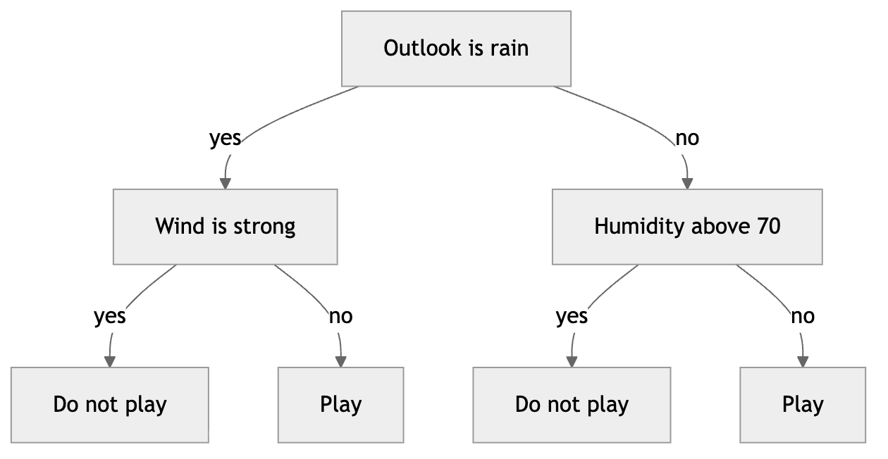

*Figure 134. A small classification tree partitioning the feature space by recursive yes/no questions.*

### 9.1.1 The Anatomy and Geometry of a Tree

It helps to fix vocabulary and picture what a tree does geometrically. The **root** is the top node holding all training data. **Depth** is the number of edges from the root to a node; the root has depth 0. A node’s **children** are the nodes directly below it; a node with no children is a **leaf**. The path from the root to a leaf is a conjunction of tests — an `AND` of simple threshold conditions — and every training (and test) example follows exactly one such path.

Geometrically, each internal node with a test of the form “feature $`j \leq t`$” draws a hyperplane perpendicular to axis $`j`$, slicing the current region into two half-boxes. Because every test involves a single feature, the boundaries are always **axis-aligned**: the feature space is carved into a set of non-overlapping axis-parallel hyperrectangles (boxes), one per leaf. Within a box the prediction is constant. This is the defining strength and weakness of trees at once: the model is a piecewise-constant function that can approximate any decision boundary given enough splits, but it approximates a diagonal boundary with a jagged staircase of little rectangles.

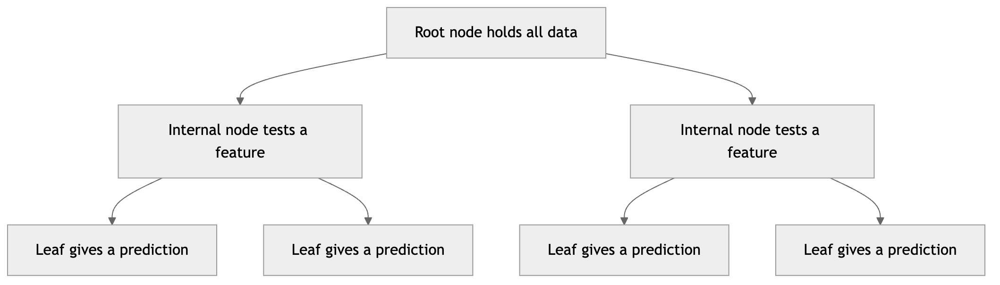

*Figure 135. Terminology of a decision tree from root to leaves.*

The following figure shows the axis-aligned regions a shallow tree induces on a two-feature problem. Notice how the boundary is built from horizontal and vertical segments only — a diagonal true boundary would require many small steps to approximate.

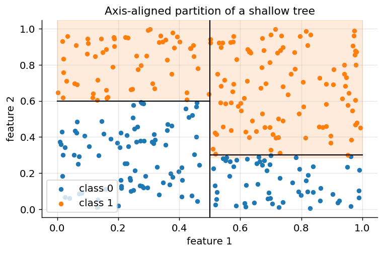

*Figure 136. A depth-2 tree carves the plane into axis-aligned boxes, each with a constant label.*

### 9.1.2 Recursive Partitioning: How a Tree Is Built

Trees are grown top-down with a greedy algorithm usually called **recursive partitioning** (the classic implementation is CART — Classification And Regression Trees). Starting with all the training data at the root, the algorithm:

1.  Considers every feature and every candidate split point.
2.  Scores each candidate by how much it improves the *purity* of the resulting child nodes.
3.  Chooses the single best split, creating two child nodes.
4.  Recurses independently on each child.
5.  Stops when a stopping criterion is met (pure node, minimum samples, maximum depth), turning the node into a leaf.

The word *greedy* is important: the tree picks the locally best split at each step without looking ahead, so it is not guaranteed to find the globally optimal tree. Finding the smallest tree consistent with the data is in fact NP-hard, so essentially all practical learners use this greedy heuristic — and in practice it works remarkably well. Occasionally the greedy choice is suboptimal: a feature that looks useless in isolation may be invaluable in combination with another (the classic XOR problem), and a purely greedy learner can miss it at the first split. Feature subsampling in Random Forests, discussed later, partly mitigates this.

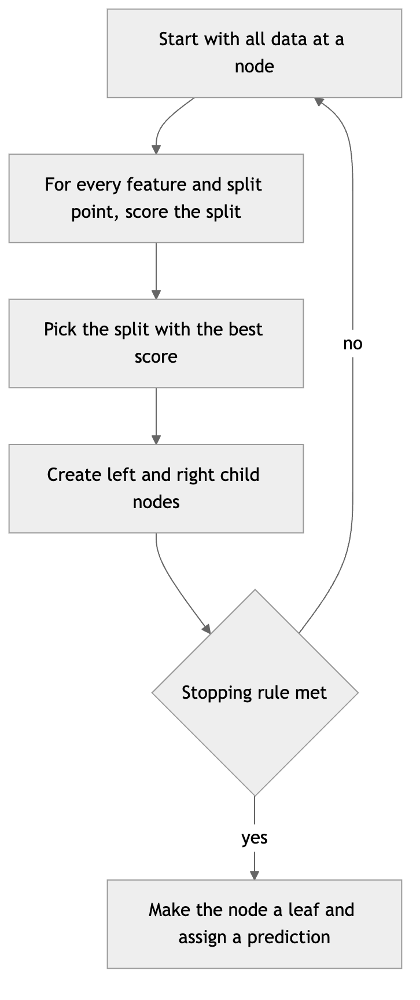

*Figure 137. The greedy recursive-partitioning loop used by CART.*

How many candidate splits are there? For a continuous feature with $`v`$ distinct values, there are $`v - 1`$ meaningful thresholds (conventionally placed at the midpoints between adjacent sorted values). Summed over $`p`$ features and evaluated at every node, this is the dominant cost of training. Sorting each feature once and streaming statistics along the sorted order brings the per-node work to roughly $`O(p\, n\log n)`$, and the histogram methods used by modern libraries reduce it further by pre-binning values.

### 9.1.3 Measuring Impurity: Gini and Entropy

Everything hinges on how we score a split. For classification we want each leaf to be as *pure* as possible — ideally containing examples of only one class. Two impurity measures dominate.

Let a node contain examples from $`K`$ classes, where $`p_{k}`$ is the proportion of examples belonging to class $`k`$. The **Gini impurity** is

``` math
G = \sum_{k = 1}^{K}p_{k}(1 - p_{k}) = 1 - \sum_{k = 1}^{K}p_{k}^{2}.
```

Gini is the probability that a randomly chosen example would be misclassified if we labeled it by drawing a class at random according to the node’s class distribution. It is $`0`$ for a pure node and maximal when classes are evenly mixed (for $`K = 2`$, its maximum is $`0.5`$).

The **entropy** of a node, borrowed from information theory, is

``` math
H = - \sum_{k = 1}^{K}p_{k}\log_{2}p_{k},
```

with the convention $`0\log_{2}0 = 0`$. Entropy measures the average number of bits needed to encode the class of an example drawn from the node. It is $`0`$ for a pure node and maximal for a uniform mix. For a two-class node entropy peaks at $`1`$ bit when $`p = 0.5`$.

To score a split that partitions a parent node into children $`L`$ and $`R`$ with $`n_{L}`$ and $`n_{R}`$ examples ($`n = n_{L} + n_{R}`$), we compute the **weighted impurity of the children** and compare it to the parent. When the criterion is entropy, the reduction is called **information gain**:

``` math
\text{IG} = H(\text{parent}) - \left( \frac{n_{L}}{n}H(L) + \frac{n_{R}}{n}H(R) \right).
```

The tree picks the split with the largest information gain (or the largest Gini decrease). The weights $`n_{L}/n`$ and $`n_{R}/n`$ matter: a split that produces a tiny pure child and a large impure child is worth less than one that cleanly separates the bulk of the data. Gini and entropy almost always agree on which split is best; entropy penalizes uncertain nodes slightly more aggressively, and Gini is marginally cheaper to compute (no logarithm), which is why it is the scikit-learn default.

A third measure, the **misclassification rate** $`1 - \max_{k}p_{k}`$, is intuitive but rarely used for *growing* trees because it is insensitive to changes that do not flip the majority class — its flat regions give zero gain to splits that nonetheless purify a node. It is, however, sometimes used for pruning. The figure below plots all three for a two-class node; notice how Gini and entropy are smooth and strictly concave, while misclassification is piecewise-linear.

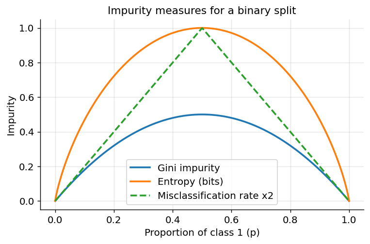

*Figure 138. Gini impurity, entropy, and misclassification rate for a two-class node versus p.*

#### 9.1.3.1 A split scored by hand

Concreteness cements intuition. Suppose a parent node holds 10 examples, 5 positive and 5 negative — a perfectly balanced, maximally impure node. Its Gini impurity is $`1 - ({0.5}^{2} + {0.5}^{2}) = 0.5`$ and its entropy is $`- (0.5\log_{2}0.5 + 0.5\log_{2}0.5) = 1`$ bit.

Consider a candidate split. The **left** child receives 4 examples: 4 positive, 0 negative. The **right** child receives 6 examples: 1 positive, 5 negative.

*Left child.* $`p_{+} = 1`$, so it is pure: $`G_{L} = 1 - (1^{2} + 0^{2}) = 0`$ and $`H_{L} = 0`$.

*Right child.* $`p_{+} = 1/6 \approx 0.167`$, $`p_{-} = 5/6 \approx 0.833`$. $`G_{R} = 1 - ({0.167}^{2} + {0.833}^{2}) = 1 - (0.028 + 0.694) = 0.278`$. $`H_{R} = - (0.167\log_{2}0.167 + 0.833\log_{2}0.833) = - (0.167 \cdot - 2.585 + 0.833 \cdot - 0.263) = 0.431 + 0.219 = 0.650`$ bits.

*Weighted child impurity.* Gini: $`\frac{4}{10}(0) + \frac{6}{10}(0.278) = 0.167`$. Entropy: $`\frac{4}{10}(0) + \frac{6}{10}(0.650) = 0.390`$ bits.

*Improvement.* Gini decrease $`= 0.5 - 0.167 = 0.333`$. Information gain $`= 1.0 - 0.390 = 0.610`$ bits.

Both criteria report a large, positive improvement, and both would prefer this split to one that, say, left both children balanced. If you compute the numbers for a competing split and this one has the larger decrease, CART chooses it. That is the entire inner loop of tree growing, repeated over every feature and threshold at every node.

### 9.1.4 Splitting for Regression

For regression trees the prediction in a leaf is the mean of the targets there, and impurity is replaced by **variance** (equivalently, mean squared error). A split is scored by the reduction in the sum of squared errors:

``` math
\text{SSE} = \sum_{i \in L}^{}(y_{i} - {\bar{y}}_{L})^{2} + \sum_{i \in R}^{}(y_{i} - {\bar{y}}_{R})^{2},
```

and the algorithm chooses the split *minimizing* this quantity (equivalently, *maximizing* the variance reduction relative to the parent). Because the leaf value that minimizes squared error is the mean, this is internally consistent: fit the mean, measure the residual spread, split to shrink it.

**Worked example.** A parent node holds five targets: $`\{ 2,4,6,8,20\}`$, with mean $`8`$. Its SSE is $`(2 - 8)^{2} + (4 - 8)^{2} + (6 - 8)^{2} + (8 - 8)^{2} + (20 - 8)^{2} = 36 + 16 + 4 + 0 + 144 = 200`$. Consider splitting into $`L = \{ 2,4,6,8\}`$ (mean $`5`$) and $`R = \{ 20\}`$ (mean $`20`$). Then $`\text{SSE}_{L} = (2 - 5)^{2} + (4 - 5)^{2} + (6 - 5)^{2} + (8 - 5)^{2} = 9 + 1 + 1 + 9 = 20`$ and $`\text{SSE}_{R} = 0`$. Total child SSE $`= 20`$, a reduction of $`180`$ from the parent’s $`200`$. The split isolates the outlier into its own leaf — which is exactly why unconstrained regression trees are so sensitive to extreme values and so eager to give them private leaves.

The result of regression-tree fitting is a piecewise-constant function: the feature space is carved into boxes, each predicting its own constant. A consequence worth remembering is that regression trees **cannot extrapolate** — outside the range of the training data they simply repeat the nearest leaf’s constant, producing a flat prediction where a linear model would keep trending. The figure below shows a regression tree (emulated by binning) chasing a sine curve; note the flat steps and the flat extrapolation at the edges.

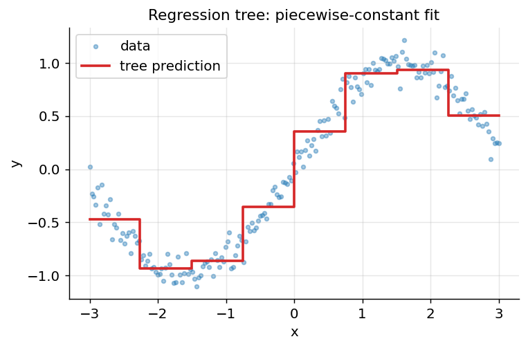

*Figure 139. A regression tree fits a piecewise-constant staircase and cannot extrapolate.*

### 9.1.5 The Classic Algorithms: ID3, C4.5, and CART

Three algorithms shaped how trees are built, and their differences still surface in software defaults and interview questions.

**ID3** (Iterative Dichotomiser 3, Ross Quinlan, 1986) is the ancestor. It grows a classification tree using **information gain** on **categorical** features only, creating one child per category value (a multiway split), and it does not prune. ID3 has two notable weaknesses. First, it handles only discrete attributes. Second, information gain is **biased toward high-cardinality features**: a feature like a customer ID, with a unique value per row, splits the data into perfectly pure singletons and scores maximal gain — while being useless for prediction.

**C4.5** (Quinlan, 1993) is ID3’s successor and fixes those weaknesses. It handles **continuous** features by searching for the best binary threshold; it handles **missing values** by distributing an example fractionally down all branches according to their observed frequencies; and it corrects the cardinality bias by maximizing the **gain ratio** rather than raw information gain:

``` math
\text{GainRatio} = \frac{\text{IG}}{\text{SplitInfo}},\quad\quad\text{SplitInfo} = - \sum_{c}^{}\frac{n_{c}}{n}\log_{2}\frac{n_{c}}{n},
```

where the sum runs over the child branches $`c`$. SplitInfo is the entropy of the *partition sizes* themselves; a split into many small pieces has large SplitInfo, which divides down its gain and penalizes the ID-like features. C4.5 also performs **error-based post-pruning**. Its commercial successor **C5.0** adds speed, memory efficiency, and native boosting.

**CART** (Breiman, Friedman, Olshen, and Stone, 1984) is the version implemented (in optimized form) by scikit-learn. It differs from the Quinlan lineage in several ways: it produces **strictly binary** trees (every split has exactly two children, even for categorical features, by testing membership in a subset of categories); it uses **Gini impurity** by default for classification and **variance reduction** for regression; and it prunes with **cost-complexity pruning** (below). CART handles both classification and regression in one framework, which is why the acronym mentions both.

| Aspect | ID3 | C4.5 | CART |
|----|----|----|----|
| Split criterion | Information gain | Gain ratio | Gini / variance |
| Feature types | Categorical only | Categorical + continuous | Categorical + continuous |
| Split arity | Multiway | Multiway | Binary |
| Missing values | Not handled | Fractional distribution | Surrogate splits |
| Pruning | None | Error-based | Cost-complexity |
| Task | Classification | Classification | Classification + regression |

### 9.1.6 Handling Categorical and Continuous Features

**Continuous features** are handled by threshold search, as described: sort the values, consider midpoints between adjacent distinct values, and score each. Only order matters, so any monotone transformation of a feature (log, square root, standardization) leaves the tree unchanged — one reason trees need no feature scaling.

**Categorical features** are trickier. A categorical feature with $`q`$ levels can, in principle, be split by assigning each subset of levels to the left child. There are $`2^{q - 1} - 1`$ non-trivial such partitions — exponential in $`q`$. Three practical strategies exist. (1) *Multiway splits* (ID3/C4.5) create one branch per level, which fragments the data fast and forbids reusing the feature deeper down. (2) *Binary subset splits* (CART) search over subsets; for binary classification there is an elegant shortcut — sort the categories by their mean target value and consider only the $`q - 1`$ contiguous cut points, which provably contains the optimum. (3) *Encoding* the categories numerically (label, one-hot, or target encoding) and treating them as continuous; this is what most gradient-boosting libraries expect, though LightGBM and CatBoost handle categoricals natively and more cleverly (covered later).

A word of warning on **one-hot encoding** inside trees: exploding a high-cardinality feature into many binary columns forces the tree to peel off one category at a time, producing deep, imbalanced, low-signal splits. Native categorical handling or target-based encoding usually works far better.

### 9.1.7 Missing Values and Surrogate Splits

Real data has holes. CART’s answer is **surrogate splits**: at each node, alongside the primary split it records backup splits on other features that best mimic the primary split’s partition. When an example arrives missing the primary feature, the best available surrogate decides its direction. C4.5 instead sends the example down *all* branches with fractional weights and combines the leaf predictions. Modern boosting libraries take a third route — they learn a **default direction** for missing values at each node, effectively treating “missing” as its own informative signal, which is both fast and often more accurate because missingness itself frequently carries meaning.

### 9.1.8 Overfitting, Pre-pruning, and Post-pruning

A tree grown until every leaf is pure will memorize the training set — including its noise — producing a model with low bias but enormous variance. Such a tree might have a single example per leaf and generalize terribly. Controlling tree complexity is therefore essential, and it is the single most important decision when using a lone tree. There are two strategies.

**Pre-pruning (early stopping)** halts growth using hyperparameters:

- `max_depth` — the maximum number of levels.
- `min_samples_split` — the minimum examples a node must hold to be eligible for splitting.
- `min_samples_leaf` — the minimum examples every leaf must retain (a strong, intuitive regularizer that directly bounds how granular predictions can get).
- `max_leaf_nodes` — a cap on total leaves.
- `min_impurity_decrease` — refuse a split whose weighted impurity reduction falls below a threshold.

Pre-pruning is simple and fast but can stop too early — it is *myopic*, potentially rejecting a mediocre split that would have enabled an excellent split just below it (the horizon effect).

**Post-pruning** sidesteps that myopia by growing a large tree first, then pruning it back. The standard method is **cost-complexity pruning** (also called weakest-link pruning), which minimizes

``` math
R_{\alpha}(T) = R(T) + \alpha\,|T|,
```

where $`R(T)`$ is the tree’s training error (or total leaf impurity), $`|T|`$ is the number of leaves, and $`\alpha \geq 0`$ is a complexity penalty. Larger $`\alpha`$ yields smaller trees. The algorithm generates a *nested sequence* of trees by repeatedly collapsing the subtree whose removal increases error least per leaf removed — the “weakest link” — producing a finite set of candidate $`\alpha`$ values. The optimal $`\alpha`$ is chosen by cross-validation (often with the “1-SE rule”: pick the smallest tree within one standard error of the best). Scikit-learn exposes this as the `ccp_alpha` parameter and gives you the full path via `cost_complexity_pruning_path`.

The figure below illustrates the characteristic overfitting signature: as a tree deepens, training accuracy climbs toward 1 while test accuracy rises, peaks, then declines. The gap between the curves *is* the variance you are paying for.

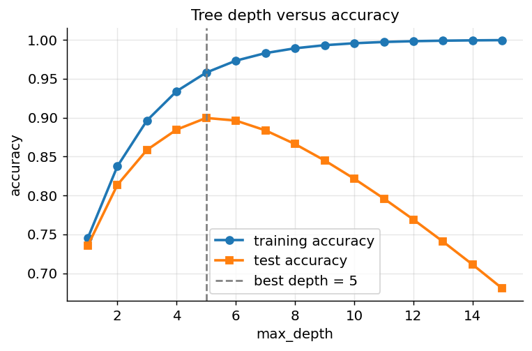

*Figure 140. Deepening a tree overfits: training accuracy rises but test accuracy peaks then falls.*

``` python
# A decision tree on the Iris dataset, with and without depth control.
from sklearn.datasets import load_iris
from sklearn.tree import DecisionTreeClassifier
from sklearn.model_selection import train_test_split

X, y = load_iris(return_X_y=True)
Xtr, Xte, ytr, yte = train_test_split(X, y, test_size=0.3, random_state=0)

deep = DecisionTreeClassifier(random_state=0).fit(Xtr, ytr)
shallow = DecisionTreeClassifier(max_depth=3, random_state=0).fit(Xtr, ytr)

print("Unrestricted  train:", deep.score(Xtr, ytr),  "test:", deep.score(Xte, yte))
print("max_depth=3   train:", shallow.score(Xtr, ytr), "test:", shallow.score(Xte, yte))
# Unrestricted  train: 1.0  test: ~0.978
# max_depth=3   train: ~0.971 test: ~0.978   (simpler, generalizes as well)
# Cost-complexity pruning: sweep ccp_alpha and pick the value that generalizes best.
from sklearn.datasets import load_breast_cancer
from sklearn.tree import DecisionTreeClassifier
from sklearn.model_selection import train_test_split

X, y = load_breast_cancer(return_X_y=True)
Xtr, Xte, ytr, yte = train_test_split(X, y, test_size=0.3, random_state=0)

base = DecisionTreeClassifier(random_state=0)
path = base.cost_complexity_pruning_path(Xtr, ytr)
alphas = path.ccp_alphas[:-1]        # drop the trivial root-only tree

best_alpha, best_acc = 0.0, 0.0
for a in alphas:
    t = DecisionTreeClassifier(random_state=0, ccp_alpha=a).fit(Xtr, ytr)
    acc = t.score(Xte, yte)
    if acc > best_acc:
        best_acc, best_alpha = acc, a
print(f"best ccp_alpha={best_alpha:.5f}  test accuracy={best_acc:.3f}")
# The pruned tree is far smaller than the unpruned one with equal or better test accuracy.
```

### 9.1.9 Feature Importance and Interpretability

A single tree tells you not only *what* it predicts but *why*. Two complementary readouts matter.

**Feature importance.** The impurity-based (Gini) importance of a feature is the total weighted impurity decrease of all splits that use it, normalized to sum to one across features. It is instantaneous to compute but has a well-known bias: it inflates the importance of high-cardinality and continuous features, because such features offer more candidate thresholds and thus more chances to be selected. This bias motivates the **permutation importance** introduced with Random Forests below.

**Interpretability.** For a shallow tree you can literally print the rules and hand them to a domain expert. Scikit-learn’s `export_text` and `plot_tree` render the full logic; each leaf reports its class distribution and sample count. This glass-box quality is why trees remain popular in regulated settings (credit, healthcare) where decisions must be explained. The caveat is that interpretability degrades quickly with depth — a depth-20 tree with thousands of leaves is no more human-readable than a neural network — and that the *specific* splits are unstable (see below), so the story a tree tells can change substantially when you refit on slightly different data.

### 9.1.10 Strengths, Weaknesses, and Pitfalls

| Property | Decision trees |
|----|----|
| Interpretability | Excellent for shallow trees — readable rules |
| Feature scaling | Not required (only order matters) |
| Handles mixed feature types | Yes (categorical and numeric) |
| Captures nonlinearities and interactions | Yes, automatically |
| Robust to monotone feature transforms | Yes |
| Bias | Low (can fit complex shapes) |
| Variance | **High** — tiny data changes reshape the tree |
| Extrapolation | Poor — constant outside training range |
| Handles missing values | Yes (surrogates / fractional / default direction) |

**Strengths.** Transparent, fast to train and predict, need no scaling, handle heterogeneous data and interactions natively, and tolerate irrelevant features gracefully.

**Weaknesses.** The dominant weakness is **high variance**: trees are unstable, and a single tree rarely competes with strong models. Boundaries are blocky and axis-aligned, so diagonal or smooth relationships are approximated crudely. Trees cannot extrapolate, and greedy growth can miss interaction-only signal.

**When to use.** As an interpretable baseline, a diagnostic tool for understanding feature interactions, or — most importantly — as the *base learner* inside an ensemble.

**Pitfalls.** Letting a tree grow unboundedly (guaranteed overfitting); trusting impurity-based importances when features are correlated (they can be misleading); assuming the decision boundary is smooth (it is always a staircase); and reading too much into the exact splits of a single tree (they are unstable). These limitations motivate everything that follows: we will average many trees, or chain them, to slash variance and boost accuracy.

## 9.2 Ensemble Learning: Wisdom of Many Models

An **ensemble** combines the predictions of several base models — often called *weak learners* — into one stronger model. The intuition is the “wisdom of crowds”: if individual models make *independent* errors, averaging their votes cancels much of the error while preserving the signal. Formalizing that intuition reveals both the promise and the fine print.

### 9.2.1 Why Ensembles Work: Three Complementary Explanations

**1. The statistical / variance argument.** Consider $`B`$ models each producing an estimate with the same variance $`\sigma^{2}`$. If their errors were perfectly independent, the variance of the average would be $`\sigma^{2}/B`$ — shrinking to zero as $`B`$ grows. Errors are never fully independent, but any decorrelation helps, as the formula in the bagging section makes precise. This is the engine of bagging: reduce variance by averaging.

**2. The Condorcet jury theorem (wisdom of crowds).** Suppose each of $`B`$ independent binary classifiers is correct with probability $`p > 0.5`$. A majority vote is correct with probability given by the tail of a binomial distribution, which tends to $`1`$ as $`B \rightarrow \infty`$. So a crowd of mediocre-but-better-than-chance, independent voters becomes nearly infallible in aggregate. The two crucial conditions are $`p > 0.5`$ (each voter beats a coin flip) and *independence* — if the voters all make the same mistakes, the crowd inherits them. The figure below shows majority-vote accuracy climbing with the number of voters for several individual accuracies.

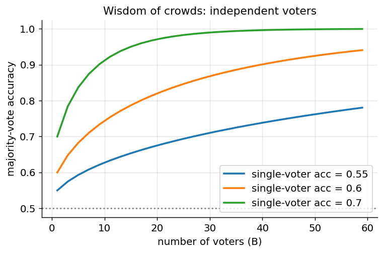

*Figure 141. Condorcet effect: majority-vote accuracy of independent voters versus ensemble size.*

**3. The representational / bias argument.** A weighted combination of simple functions can represent a far richer hypothesis class than any single member. A sum of shallow trees can express a smooth, high-order function no single stump could. This is the engine of boosting: reduce bias by adding correction terms.

### 9.2.2 Bias, Variance, and Decorrelation

The bias-variance decomposition (introduced in the chapter on Model Evaluation) frames the two ensemble families cleanly. Expected test error decomposes into bias squared, variance, and irreducible noise. **Bagging** targets the variance term: it averages many low-bias, high-variance trees, and averaging cannot raise bias while it drives variance down. **Boosting** targets the bias term: it adds terms that reduce systematic error, at some risk of raising variance if run too long.

The word **decorrelation** is the hinge for bagging. Averaging identical models does nothing; averaging *diverse* models that err in different places is what cancels error. Every trick in Random Forests — bootstrap sampling, feature subsampling, extra randomization — exists to lower the pairwise correlation between trees so that averaging bites harder. There are two principal ways to build ensembles, distinguished by how the base models relate to one another.

- **Bagging** (parallel): train many models *independently* on different random samples of the data and average them. This primarily reduces **variance**.
- **Boosting** (sequential): train models *one after another*, each correcting the mistakes of its predecessors. This primarily reduces **bias**.

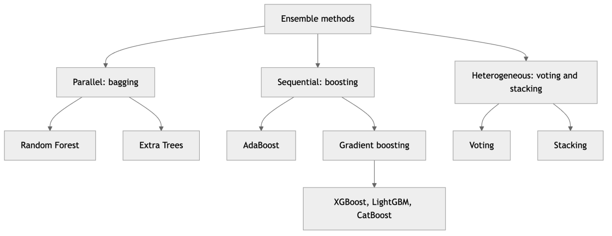

*Figure 142. A taxonomy of the ensemble methods covered in this chapter.*

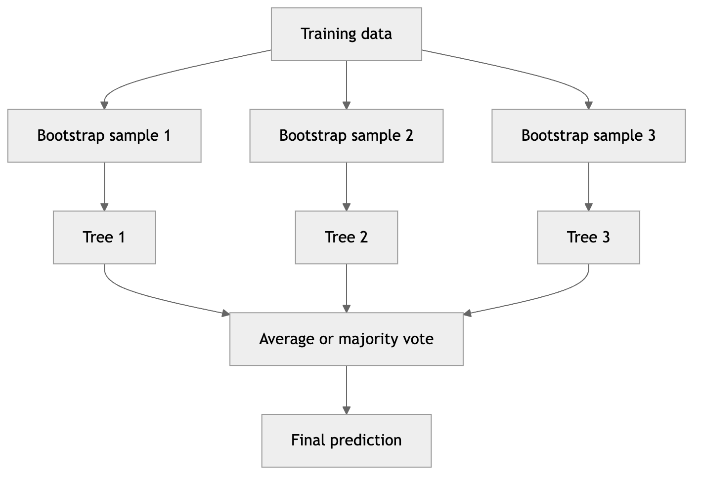

*Figure 143. Bagging trains independent models on bootstrap samples in parallel, then aggregates.*


*Figure 144. Boosting trains models sequentially, each focusing on the previous model errors.*

### 9.2.3 The Bootstrap and Bagging

**Bagging** stands for **b**ootstrap **agg**regat**ing**, introduced by Leo Breiman in 1996. The bootstrap is a resampling technique: from a dataset of $`n`$ examples, draw $`n`$ examples *with replacement*. Some examples appear multiple times, others not at all. Each bootstrap sample is a slightly different view of the data, so a model trained on it differs slightly from its siblings.

A neat fact: the probability that a given example is *never* selected in one bootstrap sample of size $`n`$ is

``` math
\left( 1 - \frac{1}{n} \right)^{n}\overset{n \rightarrow \infty}{\rightarrow}e^{- 1} \approx 0.368.
```

So each bootstrap sample omits about 37% of the original data on average. Those left-out examples are the **out-of-bag (OOB)** examples, and they provide a free validation set — more on that shortly. (For a finite $`n = 50`$, the omission probability is $`(1 - 1/50)^{50} \approx 0.364`$, already close to the limit.)

Bagging trains $`B`$ models $`{\widehat{f}}^{(1)},\ldots,{\widehat{f}}^{(B)}`$ on $`B`$ bootstrap samples and aggregates: for regression it averages, $`{\widehat{f}}_{\text{bag}}(x) = \frac{1}{B}\sum_{b}^{}{\widehat{f}}^{(b)}(x)`$; for classification it takes a majority vote (hard) or averages class probabilities (soft). Why does this help? If each model has variance $`\sigma^{2}`$ and the models are pairwise correlated with correlation $`\rho`$, the variance of their average is

``` math
\rho\,\sigma^{2} + \frac{1 - \rho}{B}\,\sigma^{2}.
```

As $`B`$ grows the second term vanishes, leaving $`\rho\sigma^{2}`$. So averaging helps most when the base models are both high-variance and *weakly correlated*. This single formula is the theoretical heart of the whole chapter — it tells you that beyond a point, adding models cannot push variance below the correlation floor $`\rho\sigma^{2}`$, and that the way to lower that floor is to *decorrelate* the models. Deep decision trees are perfect base learners for bagging: they have high variance, and the bootstrap decorrelates them. Crucially, averaging does not increase bias, so we can use fully grown, low-bias trees. The figure below plots the variance-reduction formula and makes the correlation floor visible.

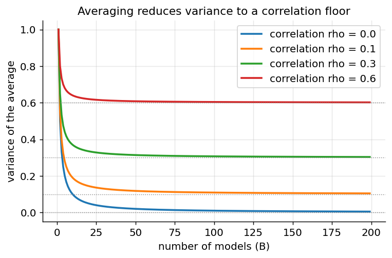

*Figure 145. Variance of an average of B correlated models; correlation sets an irreducible floor.*

Bagging is not limited to trees — you can bag any high-variance learner — but the pairing with unpruned trees is so effective that it became a method in its own right: the Random Forest.

### 9.2.4 Random Forests

A **Random Forest** is bagging applied to decision trees with one extra twist that further decorrelates them. At every split, instead of considering all $`p`$ features, the tree considers only a random subset of $`m`$ features (typically $`m = \sqrt{p}`$ for classification or $`m = p/3`$ for regression). This **feature subsampling** (also called the random-subspace method) prevents a few dominant features from being chosen by every tree, so the trees disagree more — lowering $`\rho`$ in the variance formula above and thereby lowering the ensemble’s variance. This is the crucial improvement over plain tree bagging: without it, if one feature is very strong, nearly every bagged tree splits on it first and the trees stay highly correlated.

The full Random Forest recipe:

1.  For $`b = 1,\ldots,B`$: draw a bootstrap sample, then grow a tree, choosing each split from a random subset of $`m`$ features, with little or no pruning.
2.  Aggregate by voting (classification) or averaging (regression).

**Out-of-bag error.** Because each tree omits ~37% of examples, we can predict every training example using only the trees that did *not* see it during training. Averaging the error over all examples gives the **OOB error**, an almost unbiased estimate of test error obtained without a separate validation set or cross-validation. This is one of the most convenient properties of Random Forests: you get a generalization estimate essentially for free as a byproduct of training.

**Feature importance.** Random Forests offer two ways to rank features. The classic *impurity-based* importance sums the impurity decrease attributable to each feature across all trees (Gini importance). It is fast but biased toward high-cardinality and continuous features. The more reliable *permutation importance* measures how much a performance score drops when a feature’s values are randomly shuffled — breaking its relationship with the target while preserving its marginal distribution. Prefer permutation importance, especially when features are correlated; and note its own caveat — when two features are strongly correlated, permuting one alone may barely hurt accuracy because the other carries the same information, so both can look unimportant. In such cases, permute correlated groups together or cluster features first.

**Number of trees.** Unlike depth, `n_estimators` is not a bias-variance knob to be tuned carefully — more trees only stabilize the estimate and never overfit. You pick as many as your compute budget allows and diminishing returns permit. The figure below shows OOB error falling and then flattening as trees are added.

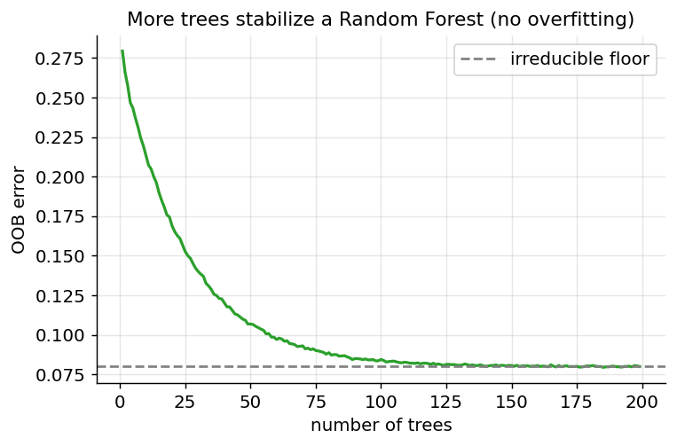

*Figure 146. Random Forest OOB error falls quickly and then plateaus as trees are added.*

``` python
# Random Forest with OOB estimate and both kinds of feature importance.
from sklearn.ensemble import RandomForestClassifier
from sklearn.datasets import load_wine
from sklearn.inspection import permutation_importance
from sklearn.model_selection import train_test_split

data = load_wine()
X, y, names = data.data, data.target, data.feature_names
Xtr, Xte, ytr, yte = train_test_split(X, y, test_size=0.3, random_state=0)

rf = RandomForestClassifier(
    n_estimators=300, max_features="sqrt",
    oob_score=True, random_state=0, n_jobs=-1
).fit(Xtr, ytr)

print("OOB score :", round(rf.oob_score_, 3))   # ~0.97, close to test accuracy
print("Test score:", round(rf.score(Xte, yte), 3))

perm = permutation_importance(rf, Xte, yte, n_repeats=20, random_state=0)
order = perm.importances_mean.argsort()[::-1][:5]
for i in order:
    print(f"{names[i]:<28} impurity={rf.feature_importances_[i]:.3f}  "
          f"perm={perm.importances_mean[i]:.3f}")
```

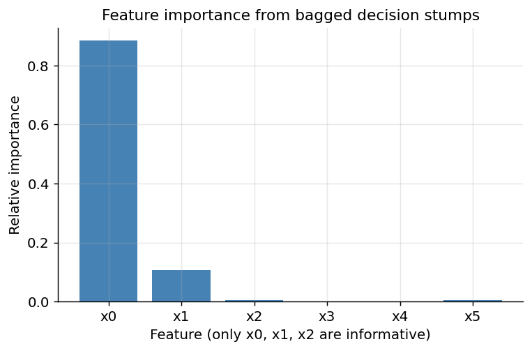

*Figure 147. Feature importances from bagged decision stumps; only x0, x1, x2 carry signal.*

#### 9.2.4.1 Extremely Randomized Trees

**Extremely Randomized Trees** (Extra Trees, Geurts et al., 2006) push the decorrelation idea one step further. They differ from Random Forests in two ways: they typically train each tree on the *whole* dataset (no bootstrap), and — the key change — at each node they do not search for the *best* threshold on each candidate feature. Instead they draw a *random* threshold for each candidate feature and pick the best among those random cuts. This extra randomness raises the bias of each tree slightly but lowers variance and correlation further, and it makes training faster because no threshold optimization is needed. On many problems Extra Trees match Random Forests; they can edge ahead when the data is noisy and the best-split search is overfitting to the noise.

#### 9.2.4.2 Random Forest: Strengths, Weaknesses, and Pitfalls

**Strengths.** An outstanding default — strong accuracy with almost no tuning; robust to noise and outliers; resists overfitting as you add trees; parallelizes trivially; provides OOB error and feature importances for free; handles mixed feature types.

**Weaknesses.** Larger memory and slower inference than a single tree; reduced interpretability (a forest is a black box compared to one readable tree); still cannot extrapolate; can be outperformed by well-tuned gradient boosting on the hardest tabular problems; the individual trees are large because they are grown deep.

**When to use.** As a first strong baseline on any tabular problem, when you want reliability over the last few tenths of a percent of accuracy, or when you need OOB feedback without a separate validation split.

**Pitfalls.** Trusting impurity importances with correlated features; forgetting that `max_features` (not `n_estimators`) is the real regularizer; and expecting extrapolation. Also, on very high-dimensional sparse data (text bag-of-words), linear models or boosting often beat forests.

## 9.3 Boosting

Boosting attacks the problem from the opposite direction. Rather than averaging independent low-bias, high-variance trees, boosting builds an **additive sequence of weak learners** — typically shallow trees — where each new learner concentrates on the examples the current ensemble gets wrong. Boosting reduces **bias**, turning a collection of weak models (each only slightly better than chance) into a strong one. The models are trained *sequentially* and are *dependent*: model $`m`$ cannot be built until models $`1,\ldots,m - 1`$ exist.

### 9.3.1 AdaBoost: Reweighting Hard Examples

**AdaBoost** (Adaptive Boosting, Freund and Schapire, 1997) was the first practical boosting algorithm and won its inventors the 2003 Gödel Prize. It maintains a weight $`w_{i}`$ on each training example, initially uniform ($`w_{i} = 1/n`$). In each round $`m`$ it:

1.  Trains a weak learner $`h_{m}`$ on the weighted data.
2.  Computes its weighted error $`\varepsilon_{m} = \sum_{i}^{}w_{i}\,\mathbb{1}\lbrack h_{m}(x_{i}) \neq y_{i}\rbrack`$.
3.  Computes the learner’s weight $`\alpha_{m} = \frac{1}{2}\ln\left( \frac{1 - \varepsilon_{m}}{\varepsilon_{m}} \right)`$.
4.  Updates example weights, *increasing* the weight of misclassified examples: $`w_{i} \leftarrow w_{i}\, e^{- \alpha_{m}y_{i}h_{m}(x_{i})}`$ (with labels $`y_{i} \in \{ - 1, + 1\}`$), then renormalizes so the weights sum to one.

The final prediction is a weighted vote: $`H(x) = \text{sign}\left( \sum_{m}^{}\alpha_{m}h_{m}(x) \right)`$. Accurate learners get a large $`\alpha_{m}`$; learners barely better than chance get $`\alpha_{m} \approx 0`$; a learner worse than chance would get a negative weight (its vote is flipped). Successive rounds focus ever more on the stubborn, hard-to-classify examples.

**Where does** $`\alpha_{m}`$ **come from?** It is not arbitrary — it is the step that minimizes the training exponential loss at round $`m`$. AdaBoost is exactly **forward stagewise additive modeling** under the exponential loss $`L(y,F) = e^{- yF(x)}`$. At round $`m`$ we seek the coefficient $`\alpha`$ and learner $`h`$ minimizing

``` math
\sum_{i}^{}w_{i}\, e^{- \alpha\, y_{i}h(x_{i})},\quad\quad w_{i} = e^{- y_{i}F_{m - 1}(x_{i})}.
```

Splitting the sum into correctly and incorrectly classified points (where $`y_{i}h(x_{i}) = + 1`$ or $`- 1`$) gives $`e^{- \alpha}\sum_{\text{correct}}^{}w_{i} + e^{\alpha}\sum_{\text{wrong}}^{}w_{i} = e^{- \alpha}(1 - \varepsilon_{m}) + e^{\alpha}\varepsilon_{m}`$ after normalization. Differentiating with respect to $`\alpha`$ and setting to zero yields precisely $`\alpha_{m} = \frac{1}{2}\ln\frac{1 - \varepsilon_{m}}{\varepsilon_{m}}`$. So AdaBoost’s mysterious weight formula falls straight out of a one-line minimization — it is coordinate descent on exponential loss.

**Worked example.** Start with $`n = 10`$ examples, $`w_{i} = 0.1`$. Suppose the first stump misclassifies 3 of them, so $`\varepsilon_{1} = 0.3`$. Then $`\alpha_{1} = \frac{1}{2}\ln\frac{0.7}{0.3} = \frac{1}{2}ln(2.333) = 0.424`$. Misclassified points are multiplied by $`e^{\alpha_{1}} = e^{0.424} = 1.528`$ and correct points by $`e^{- \alpha_{1}} = 0.654`$. Before normalizing, the 3 wrong points weigh $`0.1 \times 1.528 = 0.1528`$ each and the 7 right ones $`0.1 \times 0.654 = 0.0654`$ each. The unnormalized total is $`3(0.1528) + 7(0.0654) = 0.4584 + 0.4578 = 0.9162`$. After renormalizing, each wrong point holds $`0.1528/0.9162 = 0.167`$ and each right point $`0.0654/0.9162 = 0.0714`$. The three hard points now carry $`3 \times 0.167 = 0.50`$ of the total weight — half the mass on the 30% the model got wrong. The next stump is trained to attend to exactly those.

AdaBoost with decision stumps (depth-1 trees) was famously the core of the Viola-Jones real-time face detector. Its Achilles heel is **noisy data and label errors**: because misclassified points get ever more weight, AdaBoost can obsess over mislabeled examples and outliers, which is one reason gradient boosting with robust losses often supersedes it.

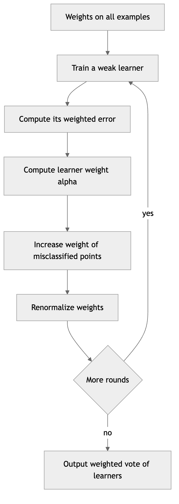

*Figure 148. One round of AdaBoost, reweighting the data toward misclassified points.*

### 9.3.2 Gradient Boosting: Fitting the Residuals

**Gradient Boosting** (Friedman, 2001) generalizes boosting to any differentiable loss by treating the problem as gradient descent in *function space*. The idea is beautifully simple for squared-error regression: build an additive model

``` math
F_{M}(x) = F_{0}(x) + \nu\sum_{m = 1}^{M}h_{m}(x),
```

where $`F_{0}`$ is an initial guess (e.g., the mean of $`y`$ for regression, or the log-odds for classification), each $`h_{m}`$ is a small tree, and $`\nu \in (0,1\rbrack`$ is the **learning rate** (shrinkage). At each stage we fit the new tree to the **residuals** — what the current model still gets wrong:

``` math
r_{i}^{(m)} = y_{i} - F_{m - 1}(x_{i}).
```

We fit $`h_{m}`$ to predict these residuals, then update $`F_{m} = F_{m - 1} + \nu\, h_{m}`$. Each tree nudges the prediction toward the truth.

**The function-space view.** Why call it “gradient” boosting? Think of the training predictions $`F(x_{1}),\ldots,F(x_{n})`$ as a single point in an $`n`$-dimensional space, and the total loss $`\sum_{i}^{}L(y_{i},F(x_{i}))`$ as a surface over that space. Ordinary gradient descent would step in the direction of the negative gradient of the loss with respect to each prediction. Gradient boosting does exactly that — but because we need a *function* defined everywhere (not just at training points), it fits a tree to approximate the negative gradient and takes a step of size $`\nu`$ in that direction. Formally the **pseudo-residuals** are

``` math
r_{i}^{(m)} = - \left\lbrack \frac{\partial L(y_{i},F(x_{i}))}{\partial F(x_{i})} \right\rbrack_{F = F_{m - 1}}.
```

For squared error $`L = \frac{1}{2}(y - F)^{2}`$, this gradient is exactly $`y_{i} - F_{m - 1}(x_{i})`$ — the ordinary residual, recovering the intuition above. For the logistic loss used in binary classification, the pseudo-residual is $`y_{i} - p_{i}`$ where $`p_{i}`$ is the current predicted probability — the tree fits the gap between truth and current probability. The same machinery covers absolute error, Huber (robust regression), quantile (prediction intervals), Poisson (counts), and ranking losses. This generality is what makes gradient boosting a framework rather than a single algorithm.

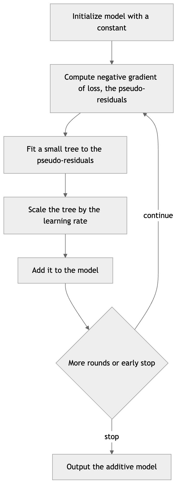

*Figure 149. Gradient boosting as gradient descent in function space.*

**Key hyperparameters** trade off bias and variance:

- **Learning rate** $`\nu`$ (shrinkage). A small $`\nu`$ with **many trees** $`M`$ generalizes better but costs more compute; the two are coupled — halving $`\nu`$ roughly doubles the $`M`$ you need. Typical values are $`0.01`$ to $`0.1`$.
- **Number of trees** $`M`$. Unlike Random Forests, adding *too many* boosting rounds **will** overfit, so early stopping on a validation set is standard.
- **Tree depth / leaves.** Trees are kept **shallow** (depth 3-8, or a small `num_leaves`) so each is a weak learner. Depth controls the highest-order interaction the model can capture: depth-1 stumps capture only main effects, depth-2 trees capture pairwise interactions, and so on.
- **Subsampling** rows (stochastic gradient boosting) and columns adds regularization and speed, and injects the same decorrelation benefit that helps Random Forests.

``` python
# Gradient boosting from scratch (regression) to expose the residual-fitting loop.
import numpy as np
from sklearn.tree import DecisionTreeRegressor

rng = np.random.default_rng(0)
X = np.sort(rng.uniform(-3, 3, size=(200, 1)), axis=0)
y = np.sin(X).ravel() + 0.2 * rng.standard_normal(200)

F = np.full_like(y, y.mean())   # F_0: predict the mean
nu, trees = 0.3, []
for m in range(100):
    residual = y - F                       # negative gradient for squared error
    t = DecisionTreeRegressor(max_depth=2).fit(X, residual)
    F += nu * t.predict(X)                  # shrunken step
    trees.append(t)

def predict(Xnew):
    out = np.full(Xnew.shape[0], y.mean())
    for t in trees:
        out += nu * t.predict(Xnew)
    return out

print("Final train MSE:", round(np.mean((y - predict(X))**2), 4))  # ~0.04
# The same idea with scikit-learn's HistGradientBoosting (fast, built-in).
from sklearn.ensemble import HistGradientBoostingClassifier
from sklearn.datasets import make_classification
from sklearn.model_selection import train_test_split

X, y = make_classification(n_samples=4000, n_features=20, n_informative=8, random_state=0)
Xtr, Xte, ytr, yte = train_test_split(X, y, test_size=0.25, random_state=0)

gb = HistGradientBoostingClassifier(
    learning_rate=0.1, max_iter=300, max_depth=4,
    early_stopping=True, validation_fraction=0.15, random_state=0
).fit(Xtr, ytr)
print("Test accuracy:", round(gb.score(Xte, yte), 3))   # ~0.91
print("Iterations used (after early stopping):", gb.n_iter_)
```

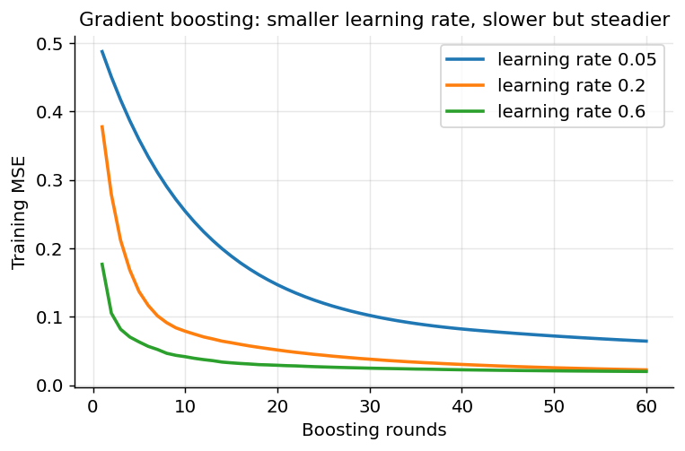

*Figure 150. Training loss versus boosting rounds for several learning rates.*

The next figure contrasts the two families’ error trajectories: bagging error falls to a floor and stays there, while boosting’s *test* error falls, reaches a minimum, then creeps back up as the model begins to overfit — the visual signature that tells you to stop early.

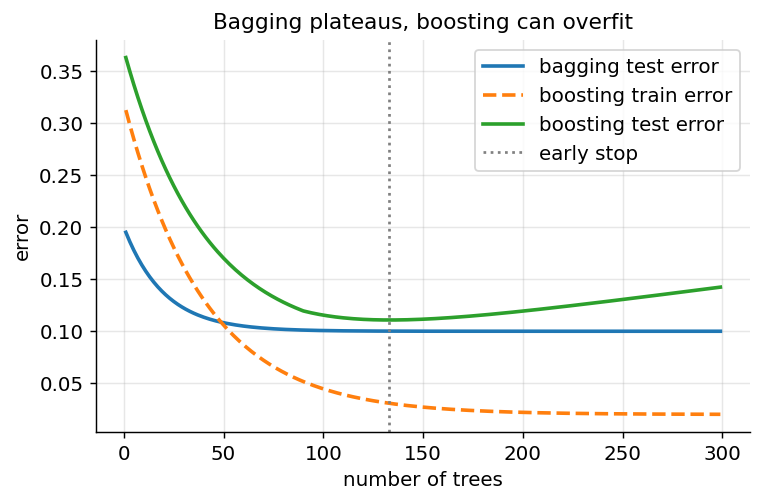

*Figure 151. Bagging error plateaus while boosting test error eventually rises, motivating early stopping.*

#### 9.3.2.1 Gradient Boosting: Strengths, Weaknesses, and Pitfalls

**Strengths.** Frequently the most accurate model on tabular data; flexible loss functions (classification, regression, ranking, quantiles, survival); handles mixed features and missing values; regularization knobs for fine control.

**Weaknesses.** Sequential training limits parallelism; more hyperparameters to tune than a forest; can overfit without early stopping; sensitive to noisy labels (less than AdaBoost, but still); slower to iterate on than a forest.

**When to use.** When you want maximum accuracy on structured/tabular data and can afford to tune learning rate, depth, and rounds with a validation set.

**Pitfalls.** Running too many rounds without early stopping; setting the learning rate too high (unstable, overfits); using deep trees that turn each learner strong and defeat the boosting logic; and forgetting that the row/column subsampling knobs are cheap, effective regularizers.

### 9.3.3 Modern Gradient-Boosting Libraries

Three libraries dominate competitive and production tabular ML. All implement gradient boosting but add engineering and algorithmic tricks that make them faster and often more accurate than the textbook version.

**XGBoost** (Extreme Gradient Boosting, Chen and Guestrin, 2016) popularized boosting in the mid-2010s and powered a remarkable share of Kaggle wins. Its advances: a **regularized objective** that adds an explicit penalty on the number of leaves and the magnitude of leaf weights,

``` math
\Omega(f) = \gamma T + \frac{1}{2}\lambda\sum_{j}^{}w_{j}^{2},
```

folded directly into the split-gain computation; a **second-order (Newton) approximation** of the loss using both the gradient $`g_{i}`$ and Hessian $`h_{i}`$, so the optimal leaf weight is $`- \sum g_{i}/(\sum h_{i} + \lambda)`$ and split gain is scored more accurately than with first-order methods; **sparsity-aware** split finding that learns a default direction for missing values; a **weighted quantile sketch** for approximate split finding on huge data; and cache-aware, parallelized, out-of-core training. XGBoost also offers histogram (`hist`) and GPU modes that close much of the speed gap with LightGBM.

**LightGBM** (Microsoft, 2017) is built for speed and scale. Its signature ideas: **histogram-based** split finding (bucket continuous features into a few hundred discrete bins, so split search is over bins not raw values — a large constant-factor speedup and memory saving); **leaf-wise (best-first) growth** instead of level-wise, which grows the leaf with the largest loss reduction and reaches lower error with fewer leaves (at some overfitting risk on small data, controlled by `num_leaves` and `min_child_samples`); **GOSS** (Gradient-based One-Side Sampling), which keeps the large-gradient examples and randomly subsamples the small-gradient ones, focusing computation on the informative points; and **EFB** (Exclusive Feature Bundling), which merges mutually exclusive sparse features into single columns. LightGBM is usually the fastest of the three on large, mostly-numeric datasets.

**CatBoost** (Yandex, 2017) specializes in **categorical features**. Instead of requiring one-hot encoding, it uses **ordered target statistics** to encode categories — replacing a category with a smoothed average of the target over the rows seen *before* the current one in a random permutation, which prevents a row’s own label from leaking into its encoding. It combines this with **ordered boosting** to combat the same *target leakage* (a subtle bias where a sample’s own target influences the gradient estimate used to fit it), using separate models trained on prefixes of a permutation. It builds **symmetric (oblivious) trees** — the same split is used across an entire level — which act as a strong regularizer and make inference extremely fast (a leaf index is computed with a few vectorized comparisons). CatBoost often gives the best out-of-the-box accuracy with minimal preprocessing, especially on data rich in categorical variables.

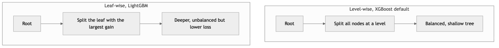

*Figure 152. Level-wise growth versus leaf-wise growth of boosted trees.*

| Library | Tree growth | Split finding | Categorical handling | Headline strength |
|----|----|----|----|----|
| XGBoost | Level-wise (depth-wise) | Exact or histogram | Manual encoding | Regularization, second-order splits, maturity |
| LightGBM | Leaf-wise (best-first) | Histogram + GOSS/EFB | Native (integer-coded) | Speed on large data |
| CatBoost | Symmetric / oblivious | Histogram | Native, ordered target stats | Categorical accuracy, robust defaults |

**When to prefer each.** Reach for **LightGBM** when data is large and mostly numeric and you want the fastest iteration; watch `num_leaves` on small data to avoid overfitting. Reach for **CatBoost** when you have many categorical features or want the strongest result with minimal tuning and preprocessing. Reach for **XGBoost** when you want a battle-tested default with the richest ecosystem, fine-grained regularization, and broad platform support. In practice their tuned accuracies are usually within a hair of one another; the differences that matter day to day are training speed, categorical convenience, and default robustness. A common professional workflow is to tune all three and ensemble them.

``` python
# Drop-in comparison; each library's sklearn-style API. (pip install xgboost lightgbm catboost)
from sklearn.datasets import make_classification
from sklearn.model_selection import train_test_split

X, y = make_classification(n_samples=6000, n_features=25, n_informative=10, random_state=0)
Xtr, Xte, ytr, yte = train_test_split(X, y, test_size=0.25, random_state=0)

from xgboost import XGBClassifier
from lightgbm import LGBMClassifier
from catboost import CatBoostClassifier

models = {
    "XGBoost":  XGBClassifier(n_estimators=400, learning_rate=0.05, max_depth=4,
                              subsample=0.8, colsample_bytree=0.8, eval_metric="logloss"),
    "LightGBM": LGBMClassifier(n_estimators=400, learning_rate=0.05, num_leaves=31,
                               subsample=0.8, colsample_bytree=0.8, verbose=-1),
    "CatBoost": CatBoostClassifier(iterations=400, learning_rate=0.05, depth=4, verbose=0),
}
for name, m in models.items():
    m.fit(Xtr, ytr)
    print(f"{name:<9} test accuracy: {m.score(Xte, yte):.3f}")
# All three typically land around 0.92-0.94 here; differences grow on real, messy data.
```

## 9.4 Combining Heterogeneous Models: Voting, Blending, and Stacking

Bagging and boosting combine many copies of the *same* base learner. We can also combine *different* model families, which helps when their errors are uncorrelated — a linear model, a kernel SVM, and a boosted-tree model tend to fail on different examples, so pooling them recovers some of the Condorcet gains.

**Voting** ensembles aggregate predictions from diverse fitted models. *Hard voting* takes the majority class label; *soft voting* averages predicted probabilities (usually better, since it uses each model’s confidence, not just its top guess). A soft-voting blend of, say, a logistic regression, an SVM, and a Random Forest can beat any one of them, provided the members are individually competent and genuinely diverse.

**Stacking** (stacked generalization, Wolpert, 1992) goes further: it trains a **meta-model** (also called the blender or level-1 model) to learn *how* to combine the base models’ predictions. The base models (level-0) are trained on the data; their **out-of-fold** predictions become the features for the meta-model, which learns the optimal weighting — possibly nonlinear. Using out-of-fold predictions is essential to avoid leakage: a base model must not generate the training feature for an example it was itself trained on, or the meta-model will overrate it. The standard recipe uses $`k`$-fold cross-validation to produce clean out-of-fold predictions for every training row, then refits each base model on all data for inference.

**Blending** is a simpler, lighter-weight cousin of stacking: instead of $`k`$-fold out-of-fold predictions, you hold out a single validation split, train base models on the rest, and fit the meta-model on their predictions over that holdout. Blending is easier to implement and leak-proof by construction, but it wastes data (the meta-model sees only the holdout) and is higher-variance than full stacking. The two terms are sometimes used interchangeably; the distinction is whether the meta-features come from cross-validation (stacking) or a single holdout (blending).

Keep the meta-model **simple** — a logistic regression or a shallow model — because its input features (the base predictions) are already highly informative and a complex blender easily overfits them. Stacking’s gains over the best single model are usually modest (a fraction of a percent) but real, which is why it is a staple of the closing stretch of competitions and rarely worth the operational complexity in production unless that last fraction matters.

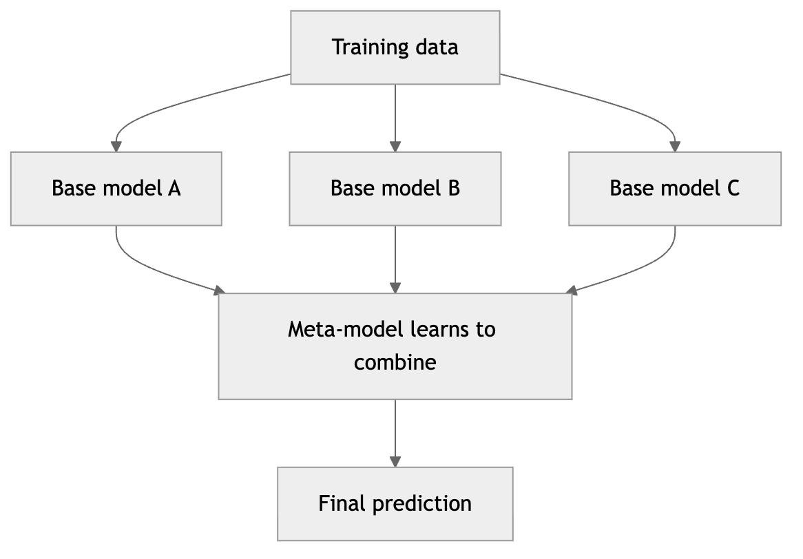

*Figure 153. Stacking uses out-of-fold base model predictions as inputs to a meta-model.*

``` python
# Voting and stacking with scikit-learn.
from sklearn.datasets import load_breast_cancer
from sklearn.model_selection import cross_val_score
from sklearn.linear_model import LogisticRegression
from sklearn.svm import SVC
from sklearn.ensemble import (RandomForestClassifier, VotingClassifier,
                              StackingClassifier, HistGradientBoostingClassifier)
from sklearn.pipeline import make_pipeline
from sklearn.preprocessing import StandardScaler

X, y = load_breast_cancer(return_X_y=True)
base = [
    ("lr",  make_pipeline(StandardScaler(), LogisticRegression(max_iter=5000))),
    ("svc", make_pipeline(StandardScaler(), SVC(probability=True))),
    ("rf",  RandomForestClassifier(n_estimators=200, random_state=0)),
    ("gb",  HistGradientBoostingClassifier(random_state=0)),
]
vote  = VotingClassifier(base, voting="soft")
stack = StackingClassifier(base, final_estimator=LogisticRegression(max_iter=5000), cv=5)
print("Voting   CV accuracy:", round(cross_val_score(vote,  X, y, cv=5).mean(), 3))
print("Stacking CV accuracy:", round(cross_val_score(stack, X, y, cv=5).mean(), 3))
```

## 9.5 The Bias-Variance View: Bagging vs Boosting

The bias-variance decomposition introduced in the chapter on Model Evaluation explains *why* the two ensemble families behave so differently. Recall that expected test error decomposes into bias squared, variance, and irreducible noise.

**Bagging reduces variance, not bias.** It averages many low-bias, high-variance models. Averaging cannot lower bias (the average of unbiased estimators is still unbiased), but it shrinks variance toward $`\rho\sigma^{2}`$. Hence the base learners should be *deep, low-bias* trees, and adding more of them is safe — it monotonically reduces variance and never overfits.

**Boosting reduces bias (and, with care, variance too).** It starts from weak, high-bias learners (shallow trees) and reduces bias by adding terms that target the residual error. Because each round fits the data more closely, boosting *can* drive variance up and overfit if run too long — which is why learning-rate shrinkage, subsampling, and early stopping matter. The base learners should be *shallow, high-bias* stumps or small trees.

| Aspect | Bagging / Random Forest | Boosting (GBM, XGBoost, etc.) |
|----|----|----|
| Training | Parallel, independent | Sequential, dependent |
| Base learner | Deep, low-bias trees | Shallow, high-bias trees |
| Primarily reduces | Variance | Bias (and some variance) |
| More estimators | Always safe (stabilizes) | Can overfit — use early stopping |
| Key hyperparameters | `n_estimators`, `max_features` | `learning_rate`, `n_estimators`, `max_depth` |
| Sensitivity to noisy labels | Robust | Sensitive (chases hard/noisy points) |
| Parallelizable | Trivially | Limited (sequential) |
| Typical accuracy on tabular data | Strong, low-tuning | Often best, more tuning |
| Free validation estimate | Yes (OOB) | No (use a holdout) |

A practical rule of thumb: reach for a **Random Forest** when you want a strong, low-maintenance baseline with minimal tuning and built-in OOB feedback; reach for **gradient boosting** (XGBoost/LightGBM/CatBoost) when you want maximum accuracy on tabular data and are willing to tune the learning rate, depth, and number of rounds with early stopping. On most structured/tabular problems, a well-tuned gradient-boosting model is still the model to beat — frequently outperforming deep neural networks, which shine instead on the unstructured data (images, audio, text) covered in the deep-learning chapters.

## 9.6 Practical Tuning Guidance

Knowing the algorithms is half the battle; using them well is the other half. Here is a pragmatic playbook.

**Start with a strong default.** For a new tabular problem, fit a Random Forest (or a gradient-boosting model with library defaults) first. It gives you a credible accuracy target and — for the forest — a free OOB estimate and feature ranking, all within minutes and with essentially no tuning.

**Tune boosting in the right order.** The knobs are not equally important. A sensible sequence:

1.  Fix a **moderate learning rate** (e.g., 0.1) so tuning is fast, and use **early stopping** with a validation set to choose the number of trees automatically. Never tune `n_estimators` by hand when early stopping can do it for you.
2.  Tune **tree complexity** — `max_depth` (XGBoost/CatBoost) or `num_leaves` and `min_child_samples` (LightGBM). This is usually the highest-leverage setting after the learning rate.
3.  Tune **row and column subsampling** (`subsample`, `colsample_bytree`) — cheap regularization that also speeds training.
4.  Tune **explicit regularization** (`reg_lambda`, `reg_alpha`, `gamma`/`min_split_gain`).
5.  Finally, **lower the learning rate** (e.g., to 0.03 or 0.01) and re-run with early stopping for a last accuracy bump — trading compute for a smoother descent.

**Use the right search.** Grid search wastes budget on unimportant dimensions; prefer **random search** or **Bayesian optimization** (Optuna, Hyperopt) which spend evaluations where they matter. Always evaluate with **cross-validation**, and if the data is time-ordered use time-aware splits to avoid leakage from the future.

**Handle imbalance and calibration deliberately.** For skewed classes, use `class_weight`/`scale_pos_weight` or resampling, and evaluate with metrics beyond accuracy (AUC, F1, precision-recall). Tree ensembles’ probability estimates are often poorly calibrated; wrap them in isotonic or Platt calibration when you need trustworthy probabilities.

**Diagnose with importances and partial dependence.** Permutation importance tells you which features carry signal; partial-dependence and SHAP plots tell you *how* a feature affects predictions. Use these both to sanity-check the model (is it leaking a proxy for the label?) and to explain it to stakeholders.

The following diagram sketches the decision flow from a fresh tabular problem to a tuned model.

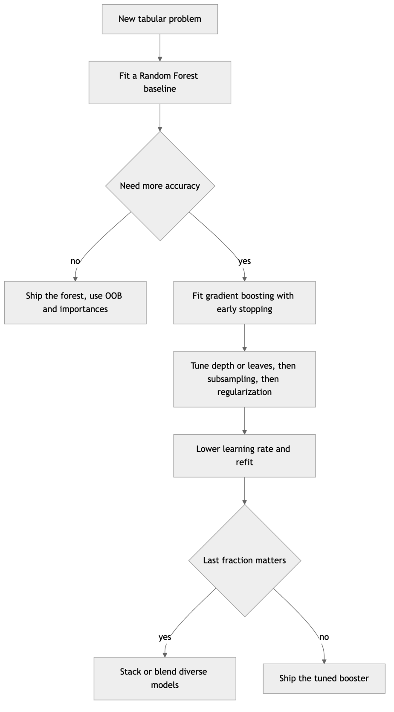

*Figure 154. A practical workflow for choosing and tuning a tree-based model.*

## 9.7 Case Studies and Applications

Tree ensembles are not merely tournament winners; they underpin production systems across industries precisely because they are accurate, robust, and quick to train on the tabular data that dominates business.

**Credit scoring and fraud detection.** Banks and payment networks lean on gradient-boosted trees to score transactions and loan applications. The models ingest heterogeneous features (amounts, merchant categories, velocities, device fingerprints), tolerate missing values, and — critically for regulators — can be explained with SHAP attributions showing which factors drove a decision. Their resistance to feature scaling and monotone transforms makes feature engineering forgiving.

**Web search and recommendation ranking.** Learning-to-rank with gradient boosting (LambdaMART, built on the same machinery with a ranking loss) has long powered commercial search engines and recommender re-ranking layers. Boosted trees handle thousands of sparse relevance features and optimize ranking metrics directly.

**Click-through-rate prediction and ad tech.** High-cardinality categorical features (user, ad, publisher IDs) are the norm; CatBoost’s ordered target statistics and LightGBM’s native categorical handling shine here, and the models retrain cheaply as distributions drift.

**Scientific and industrial tabular prediction.** In genomics, remote sensing, materials discovery, and manufacturing quality control, Random Forests remain a favorite for their robustness and their honest feature-importance readouts, while gradient boosting is chosen when the last bit of accuracy pays off. The Higgs boson machine-learning challenge, won with gradient-boosted trees, is a famous example from physics.

**Why not always deep learning?** On unstructured data — images, audio, natural language — neural networks dominate. But on medium-sized, heterogeneous *tabular* data, tree ensembles frequently match or beat deep nets while training faster, needing less tuning, and offering better interpretability. Several rigorous benchmarks in recent years have reaffirmed that for tabular problems, gradient-boosted trees remain the model to beat.

## 9.8 Summary

- A **decision tree** recursively partitions the feature space using greedy splits chosen to maximize purity, measured by **Gini impurity** or **entropy/information gain** (variance reduction for regression). The classic algorithms — **ID3** (information gain, categorical), **C4.5** (gain ratio, continuous, missing values), and **CART** (Gini/variance, binary, cost-complexity pruning) — established the field. Trees are interpretable and scale-free but have **high variance** and overfit without depth limits or **cost-complexity pruning**.
- **Ensembles** combine many models. Three complementary arguments — variance reduction, the Condorcet jury theorem, and richer representation — explain why they work, all hinging on the base models being individually competent and mutually **decorrelated**.
- **Bagging** trains base learners independently on **bootstrap** samples and averages them, reducing **variance**; about 37% of data is **out-of-bag** per sample and yields a free error estimate. The variance of an average of correlated models falls only to a floor of $`\rho\sigma^{2}`$, so decorrelation is everything.
- **Random Forests** add **feature subsampling** at each split to decorrelate trees, and provide **OOB error** and **feature importances** (prefer permutation importance over impurity-based when features are correlated). **Extra Trees** randomize thresholds for even more decorrelation.
- **Boosting** trains learners sequentially to fix prior errors, reducing **bias**. **AdaBoost** reweights misclassified examples (its weight rule falls out of minimizing exponential loss); **Gradient Boosting** fits each new tree to the **negative gradient (pseudo-residuals)** of any differentiable loss — gradient descent in function space — with a **learning rate** controlling step size.
- **XGBoost** (regularization, second-order splits), **LightGBM** (histograms, leaf-wise growth, GOSS/EFB), and **CatBoost** (ordered target encoding, ordered boosting, symmetric trees) are the dominant modern boosting libraries, and their tuned accuracies are usually close.
- **Voting**, **blending**, and **stacking** blend heterogeneous models; stacking trains a simple meta-model on out-of-fold base predictions.
- Through the **bias-variance** lens: bagging wants deep low-bias trees and never overfits with more estimators; boosting wants shallow high-bias trees and needs early stopping. On tabular data, tuned gradient boosting is usually the strongest model.

## 9.9 Key Takeaways

- Prefer order over exactness: a lone tree is a diagnostic and a base learner, not usually a final model.
- Control tree complexity deliberately — `min_samples_leaf`, `max_depth`, and `ccp_alpha` are your levers against overfitting.
- Bagging and Random Forests reduce variance; more trees are always safe. Feature subsampling (`max_features`), not the tree count, is the real regularizer.
- Boosting reduces bias; more trees can overfit, so always use early stopping and a validation set.
- The variance-of-an-average formula $`\rho\sigma^{2} + (1 - \rho)\sigma^{2}/B`$ is the mental model for every ensemble: decorrelate to lower the floor.
- Choose permutation importance over impurity-based importance when features are correlated, and remember correlated features can mask each other.
- For maximum tabular accuracy, tune a gradient-boosting library (LightGBM for speed, CatBoost for categoricals, XGBoost for maturity); for a robust baseline, use a Random Forest.
- Keep stacking meta-models simple and their features out-of-fold to avoid leakage.

## 9.10 Exercises

1.  **Impurity by hand.** A node contains 30 examples: 18 of class A and 12 of class B. Compute its Gini impurity and its entropy. Then a split sends all 18 A’s and 2 B’s to the left child and the remaining 10 B’s to the right child. Compute the information gain of the split.

2.  **Regression split by hand.** A node holds the targets $`\{ 1,3,3,9,10\}`$. Compute its SSE. Find the binary split (by threshold on the sorted values) that minimizes the total child SSE, and report the variance reduction it achieves.

3.  **Bootstrap probability.** Show algebraically that the probability an example is omitted from a bootstrap sample of size $`n`$ tends to $`e^{- 1}`$ as $`n \rightarrow \infty`$. For $`n = 50`$, what fraction of examples do you expect to be out-of-bag?

4.  **Cardinality bias.** Explain why raw information gain favors a high-cardinality feature like a customer ID, and show how C4.5’s gain ratio corrects it. Construct a tiny example where information gain and gain ratio disagree on the best split.

5.  **AdaBoost weight update by hand.** Ten equally weighted examples are given to a stump that misclassifies 4 of them. Compute $`\varepsilon_{1}`$, $`\alpha_{1}`$, and the normalized weights of the correct and incorrect examples after one round. What total weight now sits on the misclassified points?

6.  **Pruning experiment (coding).** Load `sklearn.datasets.load_breast_cancer`. Fit a full `DecisionTreeClassifier`, extract the cost-complexity pruning path with `cost_complexity_pruning_path`, and plot train and test accuracy as a function of `ccp_alpha`. Identify the value of $`\alpha`$ that maximizes test accuracy and explain the shape of the curves.

7.  **Random Forest vs gradient boosting (coding).** On a dataset of your choice, compare a `RandomForestClassifier` against `HistGradientBoostingClassifier`. Plot test accuracy versus `n_estimators` for both. Which one’s curve keeps improving with more trees, and which plateaus or eventually degrades? Relate your finding to the bias-variance discussion.

8.  **Learning rate and number of trees.** Using a gradient-boosting library, train models with learning rates 0.01, 0.1, and 0.5, each with early stopping on a validation set. Report the number of trees selected and the final accuracy for each. Explain the trade-off you observe between learning rate and the number of rounds.

9.  **Extra Trees vs Random Forest (coding).** Compare `ExtraTreesClassifier` and `RandomForestClassifier` on a noisy dataset (add label noise to a clean one). Which generalizes better, and how do their training times compare? Explain in terms of the bias-variance trade-off and threshold randomization.

10. **Build a stacking ensemble (coding).** Construct a `StackingClassifier` with at least three diverse base models and a logistic-regression meta-learner. Compare its cross-validated accuracy to (a) the best single base model and (b) a soft `VotingClassifier` over the same bases. Under what conditions does stacking beat voting?

11. **Feature importance under correlation (coding).** Duplicate an informative feature (add a near-copy) in a dataset, refit a Random Forest, and compare impurity-based and permutation importances for the original and its copy. Explain what you observe and how you would report importance for correlated feature groups.

---

[← 8 Classification II: Support Vector Machines and Kernel Methods](ch08-classification-svm.md) · [Contents](../README.md#contents) · [10 Clustering →](ch10-clustering.md)
