[← 9 Decision Trees and Ensemble Learning](ch09-trees-ensembles.md) · [Contents](../README.md#contents) · [11 Dimensionality Reduction and Feature Extraction →](ch11-dimensionality-reduction.md)

---

# 10 Clustering

Imagine you are handed a spreadsheet of one hundred thousand customers — their ages, purchase histories, browsing patterns — but no labels telling you who belongs to which “type.” No marketing team has tagged anyone as a “bargain hunter” or a “loyal premium buyer.” Yet you suspect such groups exist, hidden in the geometry of the data. Clustering is the family of unsupervised algorithms that surfaces these latent groups automatically, organizing unlabeled observations into clusters whose members resemble each other more than they resemble members of other clusters. This chapter surveys the major clustering algorithms — how they work, the mathematics that powers them, when each shines and when it fails, and how to judge whether the clusters you found are any good.

Unlike the supervised methods of Part II, clustering has no ground-truth target to optimize against. That freedom is also its difficulty: there is no single “correct” answer, and the notion of a good cluster depends on assumptions you bake into the algorithm — assumptions about cluster shape, density, and number. Understanding those assumptions is the key to choosing the right tool. By the end of the chapter you should be able to look at a scatter of points, form a hypothesis about their latent structure, pick an algorithm whose built-in assumptions match that hypothesis, tune its parameters deliberately rather than by superstition, and defend the result with a validation metric.

We will build the material in layers. First we make the clustering problem precise and dwell on the single most consequential decision you make — the choice of distance or similarity. Then we work through the four great families of clustering: **partitional** methods (k-means and its relatives), **hierarchical** methods (agglomerative and divisive), **density-based** methods (DBSCAN, OPTICS, HDBSCAN, mean-shift), and **model-based** methods (Gaussian mixtures fit by expectation-maximization). We add spectral clustering as a graph-theoretic bridge between families. Finally we treat validation — how to score a clustering when, by definition, you have no answer key — and close with a decision guide, worked comparisons, real applications, and exercises.

## 10.1 What Clustering Is and Why It Is Hard

Formally, clustering takes a dataset of $`n`$ points $`\{ x_{1},x_{2},\ldots,x_{n}\}`$, each $`x_{i} \in \mathbb{R}^{d}`$, and produces an assignment of points to groups. In **hard clustering** the assignment is a function $`c:\{ 1,\ldots,n\} \rightarrow \{ 1,\ldots,k\}`$ sending each point to exactly one of $`k`$ clusters. In **soft** (or **fuzzy**) **clustering** the assignment is a distribution: each point receives a vector of membership weights $`(\gamma_{i1},\ldots,\gamma_{ik})`$ with $`\sum_{j}^{}\gamma_{ij} = 1`$, expressing partial membership in several clusters. The goal in both cases is to make points within a cluster similar and points in different clusters dissimilar — but “similar” is not handed to you. You must choose a distance or similarity measure, and that choice silently determines what kinds of structure the algorithm can even perceive.

It helps to see the four families laid out before we dive in. They differ in what a “cluster” fundamentally *is*: a region around a prototype, a node in a merge tree, a connected dense region, or a component of a generative probability model.

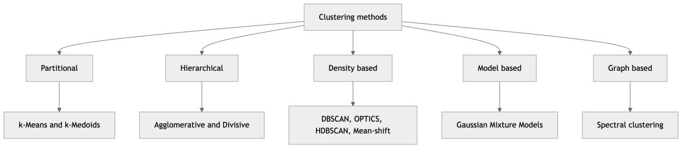

*Figure 155. The four major families of clustering methods and representative algorithms.*

### 10.1.1 Similarity, Distance, and Why the Metric Is Everything

A **distance metric** $`D(x_{i},x_{j})`$ quantifies how far apart two points are; a **similarity measure** does the opposite, growing as points resemble each other. A proper metric satisfies four axioms: non-negativity $`D(x,y) \geq 0`$, identity $`D(x,y) = 0 \Leftrightarrow x = y`$, symmetry $`D(x,y) = D(y,x)`$, and the triangle inequality $`D(x,z) \leq D(x,y) + D(y,z)`$. Not every useful dissimilarity is a true metric (cosine dissimilarity, for instance, violates the triangle inequality), but the metric axioms are a good sanity check.

The workhorse is the **Minkowski distance** of order $`p`$:

``` math
D_{p}(x_{i},x_{j}) = \left( \sum_{m = 1}^{d}|x_{im} - x_{jm}|^{p} \right)^{1/p}
```

Three special cases dominate practice:

- **Euclidean distance** ($`p = 2`$): $`\parallel x_{i} - x_{j} \parallel_{2}`$, the ordinary straight-line distance. This is the default and the one k-means, Ward linkage, and GMMs are built around. Its “unit ball” — the set of points at distance $`1`$ from the origin — is a circle (a sphere in higher dimensions).
- **Manhattan distance** ($`p = 1`$): $`\sum_{m}^{}|x_{im} - x_{jm}|`$, the sum of absolute coordinate differences, also called city-block or taxicab distance. Its unit ball is a diamond. It is more robust to outliers than Euclidean because it does not square the differences.
- **Chebyshev distance** ($`p = \infty`$): $`\max_{m}|x_{im} - x_{jm}|`$, the largest single-coordinate gap. Its unit ball is a square.

The following figure shows these three unit balls together. The shape of the ball is the shape of “equally close” — and therefore the shape of the clusters a metric prefers to carve out. Change the metric and you change the geometry the algorithm sees.

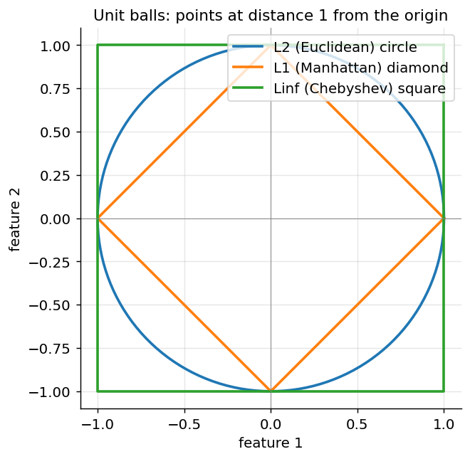

*Figure 156. Unit balls for the L1, L2, and Linf norms; the metric determines the shape of nearness.*

Beyond the Minkowski family, several other measures matter:

- **Cosine similarity** measures the angle between two vectors, ignoring their magnitude: $`cos(x_{i},x_{j}) = \frac{x_{i} \cdot x_{j}}{\parallel x_{i} \parallel \, \parallel x_{j} \parallel}`$. It is the standard for high-dimensional sparse data like text (bag-of-words or TF-IDF vectors) and embeddings, where the *direction* of a vector carries meaning and its length does not. The corresponding dissimilarity is $`1 - cos(x_{i},x_{j})`$.
- **Mahalanobis distance** accounts for feature correlations and scales: $`D_{M}(x_{i},x_{j}) = \sqrt{(x_{i} - x_{j})^{\top}\Sigma^{- 1}(x_{i} - x_{j})}`$, where $`\Sigma`$ is the data covariance. It effectively whitens the space, so an elongated correlated cloud is treated as if it were spherical. Gaussian mixtures use a per-cluster Mahalanobis distance implicitly.
- **Jaccard distance** compares sets: $`1 - \frac{|A \cap B|}{|A \cup B|}`$, natural for binary or categorical presence/absence data.
- **Hamming distance** counts positions at which two equal-length categorical strings differ.

The single most common beginner mistake follows directly from all this: **distance-based clustering is acutely sensitive to feature scaling**. A feature measured in thousands (annual income) will dominate a feature measured in single digits (number of children) in any Euclidean computation, because the squared income differences dwarf everything else. The income feature effectively becomes the only feature. Always standardize (subtract the mean, divide by the standard deviation) or normalize your features before clustering with a distance-based method, unless the raw scales are genuinely commensurable and you want them weighted as-is. Because clustering is unsupervised, the workflow described in the chapter on the Machine Learning Workflow still applies in full: clean, scale, and, in high dimensions, consider reducing dimensionality (with PCA or a manifold method) before you cluster.

### 10.1.2 The Three Recurring Difficulties

Three difficulties recur throughout the chapter, and it is worth keeping a mental scorecard for every method along these axes.

First, **the number of clusters is usually unknown**. Some algorithms (k-means, GMM, spectral) demand you specify $`k`$ in advance; others (DBSCAN, mean-shift, hierarchical with a distance threshold) discover it from the data. When $`k`$ must be supplied, you need a principled way to choose it, which we develop with the elbow method, the silhouette score, and information criteria.

Second, **clusters come in different shapes**. Some methods assume compact, roughly spherical blobs (k-means, Ward). Some assume elliptical, oriented blobs (GMM). Some make no shape assumption at all and follow arbitrary curved structure — crescents, rings, spirals — as long as it is dense and connected (DBSCAN, spectral, mean-shift). Applying a blob-assuming method to ring-shaped data produces confident nonsense.

Third, **real data contains noise and outliers**. Methods built on means (k-means, Ward, GMM) are pulled around by outliers because the mean is not robust. Density-based methods can instead label sparse points as noise and exclude them, which is often exactly what you want.

The overall workflow reflects these tensions: fit, inspect, and iterate, because you rarely get the algorithm and its parameters right on the first try.

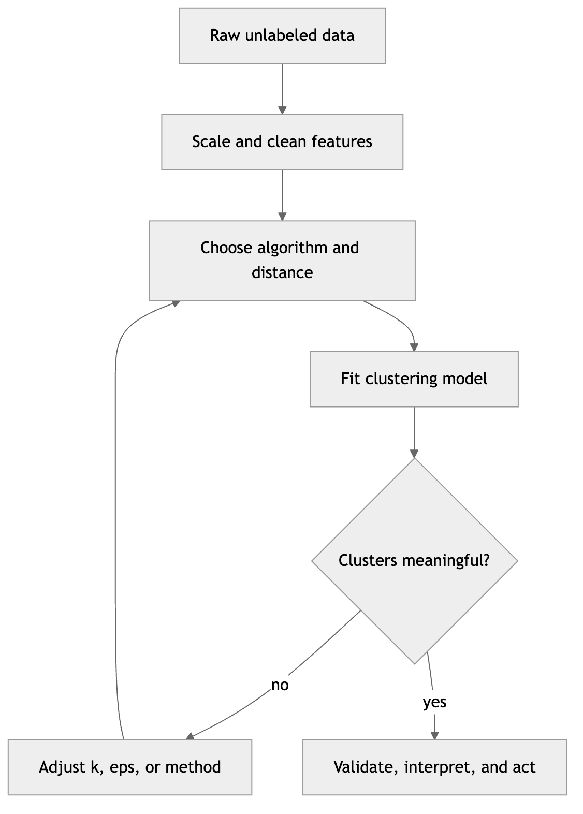

*Figure 157. A typical clustering workflow from raw data to validated clusters.*

## 10.2 k-Means: The Workhorse of Clustering

k-Means is the algorithm most people meet first, and for good reason: it is simple, fast, and scales to large datasets. It partitions $`n`$ points into exactly $`k`$ clusters by minimizing the total within-cluster variance, also called **inertia** or the within-cluster sum of squares (WCSS):

``` math
J = \sum_{j = 1}^{k}{\sum_{x_{i} \in C_{j}}^{} \parallel}x_{i} - \mu_{j} \parallel^{2}
```

Here $`C_{j}`$ is the set of points assigned to cluster $`j`$, and $`\mu_{j}`$ is that cluster’s **centroid** — the mean of its points. Intuitively, k-means tries to place $`k`$ centers so that every point is as close as possible to its nearest center. The objective is a sum of squared *Euclidean* distances, which is not an arbitrary choice: it is exactly what makes the cluster mean the optimal center. Given a fixed set of points, the single point $`\mu`$ minimizing $`\sum_{i}^{} \parallel x_{i} - \mu \parallel^{2}`$ is their arithmetic mean (set the gradient $`\sum_{i}^{}2(\mu - x_{i})`$ to zero and solve). That fact is the mathematical engine of the update step below.

### 10.2.1 Lloyd’s Algorithm, Step by Step

The standard procedure for k-means is **Lloyd’s algorithm**, an alternating optimization that repeats two steps until convergence:

1.  **Initialize** $`k`$ centroids (we discuss how below).
2.  **Assignment step**: assign each point to the nearest centroid, forming $`k`$ clusters. Point $`x_{i}`$ joins cluster $`j^{\ast} = arg\min_{j} \parallel x_{i} - \mu_{j} \parallel^{2}`$.
3.  **Update step**: recompute each centroid as the mean of the points now assigned to it: $`\mu_{j} = \frac{1}{|C_{j}|}\sum_{x_{i} \in C_{j}}^{}x_{i}`$.
4.  **Repeat** steps 2 and 3 until assignments stop changing (or change less than a tolerance).

Why does this converge? Each step can only decrease the objective $`J`$ (or leave it unchanged). The assignment step decreases $`J`$ because reassigning a point to a *closer* centroid can only shrink its contribution. The update step decreases $`J`$ because, as we just argued, the mean is the WCSS-minimizing center for a fixed assignment. Since $`J \geq 0`$ is bounded below and there are only finitely many possible hard assignments, the algorithm must reach a fixed point in a finite number of iterations. The catch: it converges to a *local* minimum, not necessarily the global one. Different initializations can yield different final clusterings, some much worse than others.

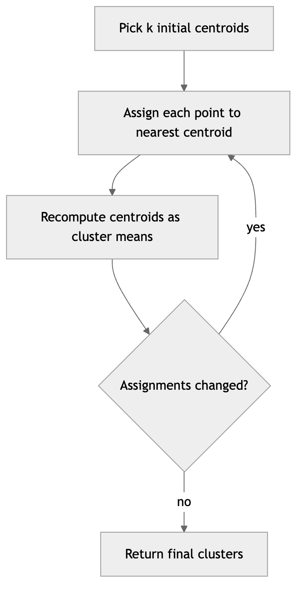

*Figure 158. Lloyd’s algorithm alternates assignment and update until centroids stabilize.*

### 10.2.2 A Worked Numeric Example You Can Follow by Hand

Nothing demystifies k-means faster than running it on tiny numbers. Take four one-dimensional points, $`\{ 1,2,10,11\}`$, and ask for $`k = 2`$ clusters. Suppose we initialize the centroids at $`\mu_{1} = 1`$ and $`\mu_{2} = 2`$ (a deliberately lopsided start).

**Iteration 1, assignment.** Compute each point’s distance to each centroid and pick the nearer. Point $`1`$ is distance $`0`$ from $`\mu_{1}`$, so it joins cluster 1. Point $`2`$ is distance $`0`$ from $`\mu_{2}`$, joins cluster 2. Point $`10`$ is $`|10 - 1| = 9`$ from $`\mu_{1}`$ and $`|10 - 2| = 8`$ from $`\mu_{2}`$, so it joins cluster 2. Point $`11`$ likewise joins cluster 2. Now $`C_{1} = \{ 1\}`$ and $`C_{2} = \{ 2,10,11\}`$.

**Iteration 1, update.** Recompute the means: $`\mu_{1} = 1`$ and $`\mu_{2} = (2 + 10 + 11)/3 = 7.67`$.

**Iteration 2, assignment.** Point $`1`$: distance $`0`$ vs $`6.67`$, stays in cluster 1. Point $`2`$: $`|2 - 1| = 1`$ vs $`|2 - 7.67| = 5.67`$, so it *switches* to cluster 1. Points $`10`$ and $`11`$ stay in cluster 2. Now $`C_{1} = \{ 1,2\}`$, $`C_{2} = \{ 10,11\}`$.

**Iteration 2, update.** $`\mu_{1} = 1.5`$, $`\mu_{2} = 10.5`$.

**Iteration 3, assignment.** Points $`1,2`$ are nearer $`1.5`$; points $`10,11`$ are nearer $`10.5`$. No assignment changes — the algorithm has converged. The final inertia is $`J = (1 - 1.5)^{2} + (2 - 1.5)^{2} + (10 - 10.5)^{2} + (11 - 10.5)^{2} = 0.25 \times 4 = 1.0`$. This is the global optimum for these points: the intuitive split $`\{ 1,2\}`$ versus $`\{ 10,11\}`$.

Now appreciate why initialization matters. Had we instead seeded both centroids inside the left group — say $`\mu_{1} = 1`$, $`\mu_{2} = 2`$ but with a dataset of three well-separated groups — the two seeds would fight over one true group while a distant true group, having no nearby seed, gets absorbed into whichever centroid drifts toward it. The result is a stable but poor local minimum in which one real cluster is split in two and two others are merged. This is not a rare pathology; with naive random seeding it happens routinely, which is why the next two ideas exist.

### 10.2.3 k-means++ Initialization

Naive random initialization — picking $`k`$ random data points as starting centroids — often produces poor clusterings because two initial centroids may land close together. **k-means++** fixes this by spreading the initial centroids out. It picks the first centroid uniformly at random, then picks each subsequent centroid with probability proportional to its squared distance from the nearest already-chosen centroid:

``` math
P(x_{i}) = \frac{D(x_{i})^{2}}{\sum_{x}^{}D(x)^{2}},\quad\quad D(x) = \min_{\mu \in \text{chosen}} \parallel x - \mu \parallel
```

Points far from existing centers are more likely to be picked, so the seeds tend to cover the data well. This is not merely a heuristic: k-means++ carries a theoretical guarantee that its expected final inertia is within a factor of $`O(logk)`$ of the global optimum, something naive seeding cannot promise.

A tiny illustration makes the mechanism concrete. Take four points on a line: $`A = 0`$, $`B = 1`$, $`C = 5`$, $`D = 6`$, and suppose the first centroid is chosen to be $`A`$. The squared distances to the nearest chosen center are $`D(A)^{2} = 0`$, $`D(B)^{2} = 1`$, $`D(C)^{2} = 25`$, $`D(D)^{2} = 36`$, summing to $`62`$. The sampling probabilities are therefore $`0`$, $`0.016`$, $`0.403`$, and $`0.581`$. With probability $`0.98`$ the second seed is $`C`$ or $`D`$ — the far-away pair — giving us one seed in each natural group. Naive random seeding would pick the second seed uniformly and land in the *same* group as $`A`$ almost half the time. k-means++ is the default in scikit-learn (`init="k-means++"`), and you should essentially always use it, combined with several restarts via `n_init`.

### 10.2.4 Mini-Batch k-Means

Full Lloyd’s algorithm touches every point in every iteration, which is $`O(nkd)`$ per pass — fine for thousands or even millions of points, but painful for tens of millions or for streaming data. **Mini-batch k-means** trades a little accuracy for a large speedup by updating centroids from small random *batches* rather than the whole dataset. Each iteration draws a batch of $`b \ll n`$ points, assigns them to the current centroids, and nudges each centroid toward the batch points assigned to it using a per-centroid learning rate that decays as the centroid accumulates more points:

``` math
\mu_{j} \leftarrow (1 - \eta_{j})\,\mu_{j} + \eta_{j}\,{\bar{x}}_{j}^{\text{batch}},\quad\quad\eta_{j} = \frac{1}{\text{count}_{j}}
```

where $`{\bar{x}}_{j}^{\text{batch}}`$ is the mean of the batch points currently assigned to cluster $`j`$ and $`\text{count}_{j}`$ is the running total of points ever assigned to it. This gradient-like update converges much faster in wall-clock time and uses bounded memory, at the cost of slightly higher final inertia and a bit more sensitivity to batch composition. It is the tool of choice when the dataset does not fit comfortably in memory or when you need near-real-time clustering.

``` python
from sklearn.cluster import MiniBatchKMeans
import numpy as np
X = np.random.RandomState(0).randn(2_000_000, 20)   # 2M points, 20 features
mbk = MiniBatchKMeans(n_clusters=8, batch_size=4096,
                      n_init=3, random_state=0).fit(X)
print(mbk.inertia_)   # slightly higher than full KMeans, computed in a fraction of the time
```

### 10.2.5 Choosing k: Elbow and Silhouette

Because k-means requires you to fix $`k`$, you need a principled way to choose it. Two heuristics dominate.

**The elbow method** plots inertia $`J`$ against $`k`$. Inertia always decreases as $`k`$ grows (at $`k = n`$, every point is its own centroid and $`J = 0`$), but it typically drops sharply while you are still splitting genuine clusters, then flattens once you begin splitting clusters that were already coherent. The “elbow” — the point of diminishing returns — suggests a good $`k`$. The figure below shows the classic shape for four true blobs: a steep descent through $`k = 2,3,4`$ and a gentle tail thereafter.

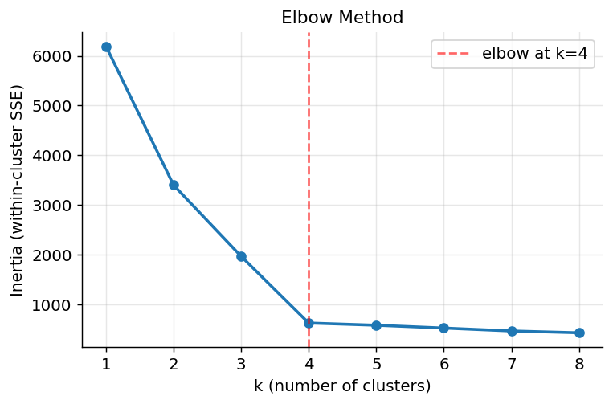

*Figure 159. The elbow method: inertia drops sharply then flattens, suggesting k = 4.*

The elbow method’s weakness is that on real data the elbow is often ambiguous or absent — the curve bends smoothly with no obvious corner. When that happens, prefer the **silhouette score** (defined fully in the evaluation section). It measures how well-separated the clusters are, is bounded in $`\lbrack - 1,1\rbrack`$, and can be compared fairly across different $`k`$. You sweep $`k`$, compute the mean silhouette for each, and pick the maximizing value. Unlike inertia, which decreases monotonically and so cannot itself indicate an optimum, the silhouette genuinely peaks when the number of clusters matches the data’s structure.

### 10.2.6 k-Means in Practice

``` python
import numpy as np
from sklearn.datasets import make_blobs
from sklearn.preprocessing import StandardScaler
from sklearn.cluster import KMeans
from sklearn.metrics import silhouette_score

X, y_true = make_blobs(n_samples=500, centers=4, cluster_std=0.9, random_state=42)
X = StandardScaler().fit_transform(X)

km = KMeans(n_clusters=4, init="k-means++", n_init=10, random_state=42)
labels = km.fit_predict(X)

print("Inertia:", round(km.inertia_, 2))
print("Silhouette:", round(silhouette_score(X, labels), 3))
print("Centroids:\n", np.round(km.cluster_centers_, 2))
# Inertia: ~290   Silhouette: ~0.66  (well-separated blobs)
```

The `n_init=10` parameter runs Lloyd’s algorithm ten times from different k-means++ seeds and keeps the best (lowest-inertia) result, mitigating the local-minimum problem. In recent scikit-learn versions the default `n_init` changed, so set it explicitly for reproducibility across environments.

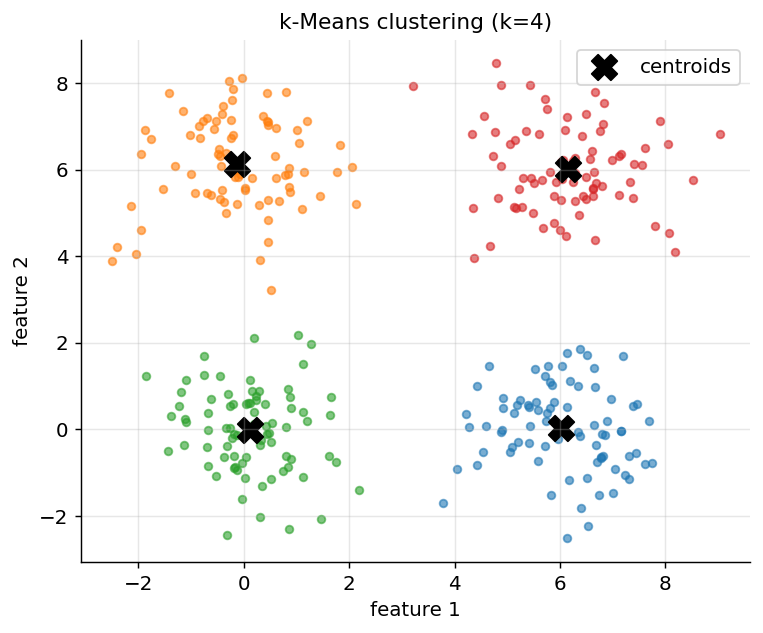

*Figure 160. k-Means recovers four compact clusters; centroids are marked with an X.*

### 10.2.7 Variants and Relatives

Two close relatives fill gaps in the basic algorithm. **k-Medoids** (the PAM algorithm) replaces the mean with an actual data point — the **medoid**, the point minimizing total distance to others in its cluster. Because the center must be a real observation and the method can use any distance matrix (not just Euclidean), k-medoids is more robust to outliers and works with non-numeric data where a mean is undefined. Its cost is higher: computing medoids is more expensive than averaging. **k-Means with cosine distance**, often called **spherical k-means**, first normalizes every vector to unit length and then clusters by angle; it is the standard for clustering text and other high-dimensional sparse data where direction matters more than magnitude.

> **k-Means at a glance**
>
> **Strengths**: fast, roughly $`O(nkd \cdot \text{iterations})`$; simple and interpretable; scales to millions of points via mini-batch; excellent when clusters are compact, roughly spherical, and of similar size.
>
> **Weaknesses**: you must choose $`k`$; it assumes isotropic (spherical) clusters of comparable size and density; the mean makes it sensitive to outliers; it cannot find non-convex shapes such as concentric rings or crescents; it always returns exactly $`k`$ clusters even when fewer are real.
>
> **When to use**: large, roughly spherical, well-scaled numeric data where you have a reasonable guess for $`k`$ and want speed.
>
> **Pitfalls**: forgetting to scale features; using a single random initialization (set `n_init` and use k-means++); over-reading an ambiguous elbow; applying it to elongated or nested clusters where it carves the data into meaningless spherical pieces.

## 10.3 Hierarchical Clustering

Where k-means produces a flat partition, **hierarchical clustering** builds a whole tree of nested clusters, exposing structure at every scale from “each point alone” to “everything together.” You then choose the scale that matters for your problem. There are two directions.

**Agglomerative** (bottom-up) clustering starts with every point as its own singleton cluster, then repeatedly merges the two closest clusters until only one remains. This is by far the more common variant. **Divisive** (top-down) clustering starts with one all-encompassing cluster and recursively splits it; it is rarer because finding the optimal split of a cluster is itself a hard combinatorial problem (an exhaustive divisive step is exponential), so divisive methods rely on heuristics such as running 2-means at each split.

The output is a **dendrogram**, a tree whose leaves are individual points and whose internal nodes represent merges, with the height of each merge indicating the distance at which it occurred. To get a flat clustering you “cut” the dendrogram at a chosen height: every subtree below the cut becomes one cluster. This means you do *not* need to commit to $`k`$ in advance — you inspect the tree and choose $`k`$ afterward, or set a distance threshold instead.

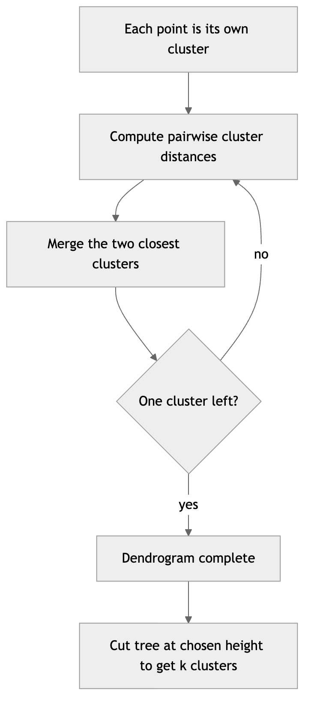

*Figure 161. Agglomerative clustering merges nearest clusters bottom-up into a dendrogram.*

### 10.3.1 Linkage Criteria

The crucial design choice is the **linkage** — how to measure the distance between two *clusters* (not just two points). The main options and their characteristic behavior:

| Linkage | Distance between clusters A and B | Tendency |
|----|----|----|
| **Single** | $`\min_{a \in A,b \in B} \parallel a - b \parallel`$ | Long, chained, “stringy” clusters; can follow non-convex shapes but suffers chaining |
| **Complete** | $`\max_{a \in A,b \in B} \parallel a - b \parallel`$ | Compact, roughly equal-diameter clusters; sensitive to outliers |
| **Average** (UPGMA) | $`\frac{1}{|A||B|}\sum_{a,b}^{} \parallel a - b \parallel`$ | A compromise between single and complete |
| **Centroid** | $`\parallel \mu_{A} - \mu_{B} \parallel`$ | Distance between cluster means; can produce non-monotonic merges (inversions) |
| **Ward** | Increase in total within-cluster variance after merging | Compact, similar-size clusters; usually the best default for Euclidean data |

Ward’s method deserves special attention because it is the most-used general-purpose linkage and connects directly to k-means. At each step Ward merges the pair of clusters whose union produces the smallest increase in total within-cluster sum of squares. The increase in SSE when merging clusters $`A`$ and $`B`$ has a clean closed form:

``` math
\Delta_{AB} = \frac{|A|\,|B|}{|A| + |B|}\, \parallel \mu_{A} - \mu_{B} \parallel^{2}
```

So Ward prefers to merge clusters that are both close (small $`\parallel \mu_{A} - \mu_{B} \parallel`$) and small (a merge of two big clusters is penalized). Minimizing SSE growth is exactly the k-means objective, which is why Ward tends to produce the same kind of compact, comparably sized clusters that k-means favors — but arranged in an interpretable hierarchy.

A practical accelerator underlies all of these: the **Lance-Williams update formula** lets you compute the distance from a newly merged cluster to every other cluster as a simple weighted combination of the pre-merge distances, without touching the original points again. Every linkage above is a special case obtained by plugging in particular coefficients, which is how libraries update the distance matrix efficiently after each merge.

### 10.3.2 A Worked Linkage Example

Consider four points on a line: $`a = 0`$, $`b = 1`$, $`c = 4`$, $`d = 5`$. The pairwise Euclidean distances are $`ab = 1`$, $`cd = 1`$, $`bc = 3`$, $`ac = 4`$, $`bd = 4`$, $`ad = 5`$.

**Single linkage.** The closest pair is $`ab`$ (distance $`1`$), so merge $`\{ a,b\}`$ at height $`1`$. (The pair $`cd`$ ties at $`1`$; merge it next, also at height $`1`$.) Now two clusters remain, $`\{ a,b\}`$ and $`\{ c,d\}`$. Single linkage takes the *minimum* cross-cluster distance: $`min(ac,ad,bc,bd) = min(4,5,3,4) = 3`$. The final merge happens at height $`3`$.

**Complete linkage.** The first two merges are identical (both at height $`1`$). But now complete linkage takes the *maximum* cross-cluster distance: $`max(4,5,3,4) = 5`$. The final merge happens at height $`5`$.

**Average linkage.** Same first merges; the final merge height is the mean $`\frac{1}{4}(4 + 5 + 3 + 4) = 4`$.

The three linkages agree on the *structure* (two tight pairs joined at the end) but disagree on the *heights*, and those heights are what a distance-threshold cut uses. Set a threshold at $`3.5`$ and single linkage gives you one cluster (it already merged everything at $`3`$) while complete linkage gives you two (its final merge is at $`5`$, above the cut). Same data, same tree topology, different answers — because the linkage changed the geometry.

### 10.3.3 Reading a Dendrogram

A dendrogram is read from the bottom up. Each leaf is a data point. As you move up, horizontal bars join clusters that merge; the vertical height of a bar is the linkage distance at that merge. Long vertical segments indicate merges that join very dissimilar clusters — cutting just below a long segment yields well-separated clusters. The number of vertical lines your horizontal cut crosses equals the number of clusters you obtain. In a clean four-cluster dataset you typically see four tight subtrees near the bottom joined by tall bars near the top; cutting through those tall bars gives $`k = 4`$.

The figure below draws a dendrogram from scratch using only line primitives, so you can see exactly how the “U” shapes encode merges. Six points fall into three obvious pairs; the pairs merge cheaply near the bottom, and the three groups merge expensively near the top. A horizontal cut anywhere in the tall region between the low and high merges yields three clusters.

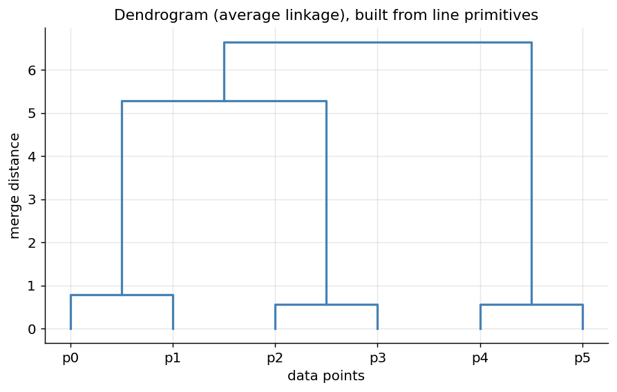

*Figure 162. A dendrogram drawn from primitives; tall bars mark the natural cut into three clusters.*

### 10.3.4 Code: Agglomerative Clustering

``` python
import numpy as np
from scipy.cluster.hierarchy import dendrogram, linkage, fcluster
from sklearn.datasets import make_blobs
import matplotlib.pyplot as plt

X, _ = make_blobs(n_samples=60, centers=4, cluster_std=0.7, random_state=0)

Z = linkage(X, method="ward")                      # the merge history
labels = fcluster(Z, t=4, criterion="maxclust")    # cut into 4 clusters

plt.figure(figsize=(8,4))
dendrogram(Z, truncate_mode="level", p=5)
plt.title("Ward dendrogram"); plt.xlabel("points"); plt.ylabel("merge distance")
plt.tight_layout()
# Reading: tall vertical bars near the top => natural cut points for k
# Equivalent flat clustering via scikit-learn, with a distance threshold instead of k
from sklearn.cluster import AgglomerativeClustering
agg = AgglomerativeClustering(n_clusters=4, linkage="ward")
labels = agg.fit_predict(X)
print(np.bincount(labels))   # cluster sizes, e.g. [15 15 15 15]

# Or let a distance threshold choose k automatically:
agg2 = AgglomerativeClustering(n_clusters=None, distance_threshold=10, linkage="ward")
agg2.fit(X)
print("clusters found:", agg2.n_clusters_)
```

> **Hierarchical clustering at a glance**
>
> **Strengths**: no need to pre-specify $`k`$; the dendrogram reveals structure at multiple scales; deterministic (no random init); works with any distance metric and even a precomputed distance matrix; single linkage can follow non-convex shapes.
>
> **Weaknesses**: $`O(n^{2})`$ memory and $`O(n^{2}\log n)`$ to $`O(n^{3})`$ time, so it does not scale past tens of thousands of points; merges are greedy and irreversible, so one bad early merge cannot be undone.
>
> **When to use**: small-to-medium datasets where you want to *explore* nested structure, use a non-Euclidean metric, or avoid committing to $`k`$ up front.
>
> **Pitfalls**: single linkage’s **chaining effect**, in which a thin bridge of intermediate points strings two unrelated clusters into one; centroid linkage’s non-monotonic inversions; and forgetting that a giant distance matrix may not fit in memory.

## 10.4 DBSCAN and Density-Based Clustering

k-means and Ward assume clusters are blobs. **DBSCAN** (Density-Based Spatial Clustering of Applications with Noise) takes a radically different view: a cluster is a *dense region* of points separated from other dense regions by sparser areas. This lets it find clusters of arbitrary shape — crescents, rings, spirals — and, crucially, to label sparse points as **noise** rather than forcing them into a cluster.

### 10.4.1 eps, minPts, and Point Types

DBSCAN has two parameters:

- $`\varepsilon`$ (**eps**): the radius defining a neighborhood around a point.
- **minPts**: the minimum number of points (including the point itself) required within radius $`\varepsilon`$ for a point to count as being in a dense region.

Every point is classified as one of three types:

- **Core point**: has at least minPts points within its $`\varepsilon`$-neighborhood.
- **Border point**: within $`\varepsilon`$ of a core point but does not itself have minPts neighbors.
- **Noise point**: neither core nor border — an outlier.

Two definitions formalize how clusters grow. A point $`q`$ is **directly density-reachable** from a core point $`p`$ if $`q`$ lies within $`\varepsilon`$ of $`p`$. A point is **density-reachable** if it is connected to a core point by a chain of directly-density-reachable core points. Finally, two points are **density-connected** if both are density-reachable from some common core point. A **cluster** is then a maximal set of density-connected points. In practice DBSCAN picks an unvisited point; if it is a core point it starts a new cluster and greedily absorbs everything density-reachable from it — expanding through neighboring core points and collecting the border points on the fringe — and any point never absorbed is labeled noise.

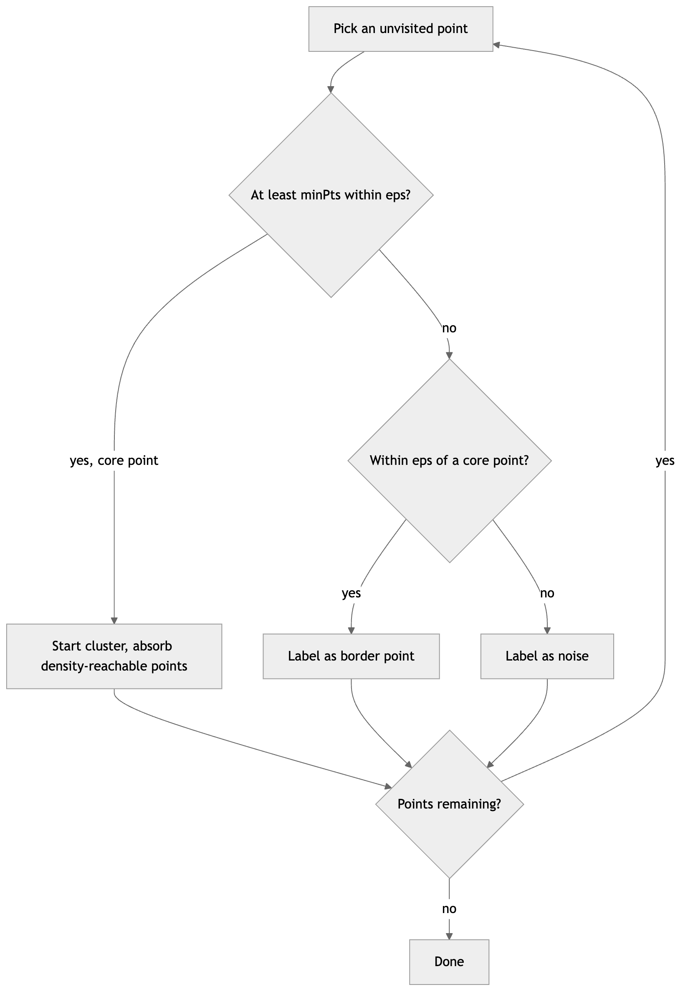

*Figure 163. DBSCAN classifies points by neighborhood density then grows clusters from core points.*

### 10.4.2 Choosing eps and minPts

A common heuristic sets **minPts** to roughly $`2d`$ (twice the dimensionality), with a floor of $`3`$ or $`4`$; larger minPts yields more points labeled noise and more robust clusters. To choose $`\varepsilon`$, compute each point’s distance to its $`k`$-th nearest neighbor (with $`k = \text{minPts}`$), sort these distances ascending, and plot them. The curve rises gently and then spikes upward at a “knee” — points to the left of the knee are in dense regions, points to the right are isolated. The distance value at the knee is a good $`\varepsilon`$. The figure below shows such a plot for three blobs plus scattered noise; the flat portion sits well below the knee, and reading the knee off the vertical axis gives the radius.

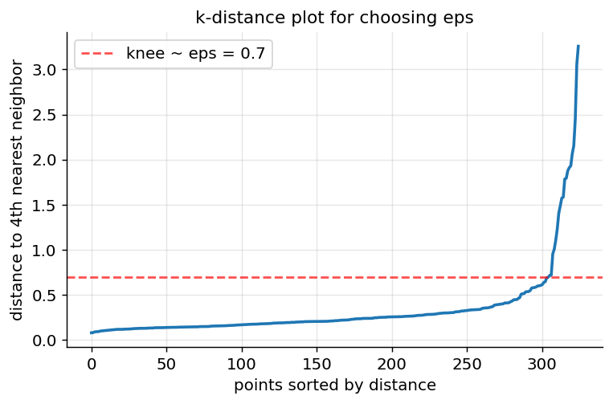

*Figure 164. The k-distance plot: the knee marks a good eps for DBSCAN.*

### 10.4.3 DBSCAN on Non-Convex Data

The following figure implements DBSCAN in plain NumPy and turns it loose on two interleaving half-moons, alongside k-means on the same data. DBSCAN follows each crescent’s density and recovers both perfectly, coloring the few bridge points as noise; k-means, forced to draw a straight boundary between two spherical clusters, slices each moon in half.

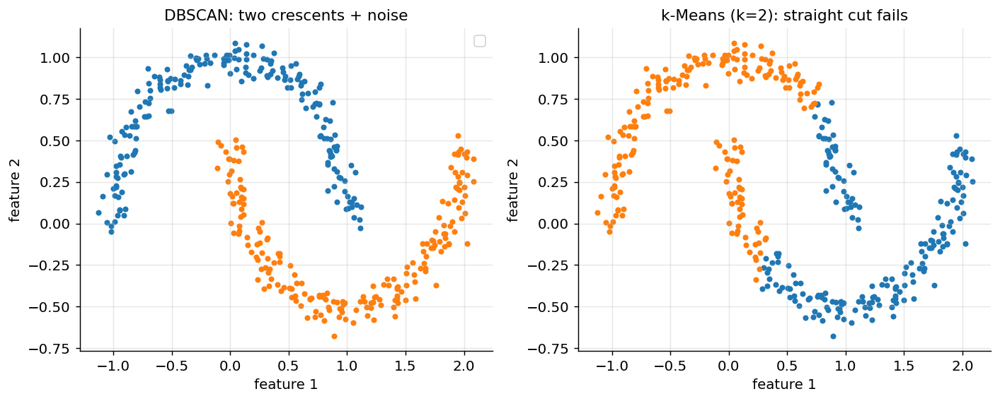

*Figure 165. DBSCAN follows the two crescents; k-Means splits them with a straight cut.*

``` python
import numpy as np
from sklearn.datasets import make_moons
from sklearn.preprocessing import StandardScaler
from sklearn.cluster import DBSCAN, KMeans
from sklearn.metrics import adjusted_rand_score

X, y = make_moons(n_samples=400, noise=0.06, random_state=0)
X = StandardScaler().fit_transform(X)

db = DBSCAN(eps=0.3, min_samples=5).fit(X)
labels = db.labels_                       # -1 marks noise
n_clusters = len(set(labels)) - (1 if -1 in labels else 0)
print("Clusters found:", n_clusters)                              # 2
print("Noise points:", list(labels).count(-1))
print("DBSCAN ARI:", round(adjusted_rand_score(y, labels), 3))    # ~0.99

km = KMeans(n_clusters=2, n_init=10, random_state=0).fit_predict(X)
print("k-Means ARI:", round(adjusted_rand_score(y, km), 3))       # ~0.24
```

### 10.4.4 OPTICS: Ordering Points to Handle Varying Density

DBSCAN’s Achilles’ heel is a *single* global $`\varepsilon`$. If one cluster is dense and another is sparse, no single radius fits both: a small $`\varepsilon`$ shatters the sparse cluster into noise, while a large $`\varepsilon`$ merges the dense clusters together. **OPTICS** (Ordering Points To Identify the Clustering Structure) sidesteps this by not committing to one $`\varepsilon`$ at all. It introduces two quantities per point: the **core distance** (the smallest radius that makes the point a core point, i.e. the distance to its minPts-th neighbor) and the **reachability distance** of one point from another (the larger of the core distance and the actual distance). OPTICS then visits points in a special order and records each point’s reachability, producing a **reachability plot** — a bar chart in which valleys correspond to clusters and peaks to the sparse gaps between them. Deep, narrow valleys are tight clusters; shallow, wide valleys are loose ones. You can extract a flat clustering by choosing a reachability threshold (recovering DBSCAN’s behavior at a chosen $`\varepsilon`$) or, better, by detecting the valleys directly, which lets clusters of very different density coexist in one result.

### 10.4.5 HDBSCAN: Hierarchical Density-Based Clustering

**HDBSCAN** (Hierarchical DBSCAN) is the modern method of choice when densities vary and you want a robust, low-fuss result. It runs DBSCAN conceptually across *all* values of $`\varepsilon`$ simultaneously, building a hierarchy of density-based clusters, and then condenses that hierarchy by keeping only clusters that persist over a wide range of density thresholds. Its key parameter, `min_cluster_size`, is far more intuitive than $`\varepsilon`$: it is simply the smallest group you are willing to call a cluster. HDBSCAN automatically selects the most stable clusters, handles variable density gracefully, and — like DBSCAN — labels genuine outliers as noise and even provides a per-point outlier score. In practice, if DBSCAN’s single $`\varepsilon`$ is fighting you, reach for HDBSCAN.

``` python
# pip install hdbscan
import hdbscan
clusterer = hdbscan.HDBSCAN(min_cluster_size=15, min_samples=5)
labels = clusterer.fit_predict(X)     # -1 = noise; number of clusters found automatically
print("clusters:", len(set(labels)) - (1 if -1 in labels else 0))
print("outlier scores available in clusterer.outlier_scores_")
```

> **Density-based clustering at a glance**
>
> **Strengths**: finds arbitrarily shaped clusters; determines the number of clusters automatically; explicitly identifies outliers as noise; needs no $`k`$.
>
> **Weaknesses**: plain DBSCAN struggles when clusters have very different densities (use OPTICS or HDBSCAN); sensitive to $`\varepsilon`$ and minPts; degrades in high dimensions as distances concentrate (the curse of dimensionality); border-point assignment can depend on visiting order.
>
> **When to use**: spatial or low-to-moderate-dimensional data with irregular shapes and meaningful outliers — anomaly detection, geographic clustering, image segmentation.
>
> **Pitfalls**: forgetting to scale features, which makes the single radius $`\varepsilon`$ meaningless; expecting good results in very high dimensions without dimensionality reduction first.

## 10.5 Mean-Shift: Mode Seeking

**Mean-shift** is a mode-seeking algorithm rooted in the idea of kernel density estimation. Picture the data as a smooth density surface built by placing a bump (kernel) of a chosen **bandwidth** $`h`$ on each point. Mean-shift asks: from where each point sits, which way is *uphill* on this density surface? It answers by placing a window of radius $`h`$ around the point and repeatedly shifting the window to the mean of the points inside it. Each shift climbs the density gradient, and every point eventually arrives at a local density peak — a **mode**. Points that converge to the same mode form a cluster. The update at each step is

``` math
x \leftarrow \frac{\sum_{i}^{}K\left( \frac{\parallel x - x_{i} \parallel}{h} \right)x_{i}}{\sum_{i}^{}K\left( \frac{\parallel x - x_{i} \parallel}{h} \right)}
```

where $`K`$ is the kernel (a flat window or a Gaussian). The name comes from the fact that the shift vector — new position minus old — points along the local mean and, it can be shown, along the estimated density gradient.

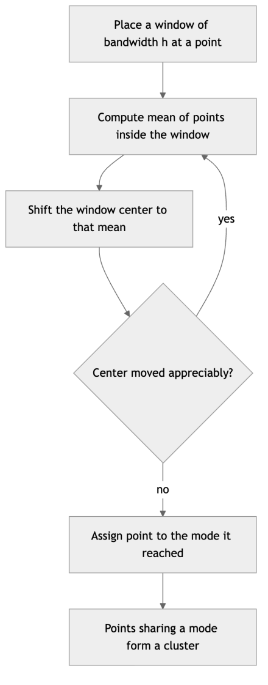

*Figure 166. Mean-shift climbs the density surface until each point reaches a mode.*

Like DBSCAN, mean-shift discovers the number of clusters automatically — it equals the number of density modes — and makes no spherical-shape assumption. Its drawbacks are cost, roughly $`O(n^{2})`$ per iteration because every window sums over nearby points, and acute sensitivity to the bandwidth $`h`$, which plays a role analogous to DBSCAN’s $`\varepsilon`$: too small and every point becomes its own mode, too large and everything collapses to one.

``` python
from sklearn.cluster import MeanShift, estimate_bandwidth
from sklearn.datasets import make_blobs
X, _ = make_blobs(n_samples=300, centers=3, cluster_std=0.6, random_state=0)
bw = estimate_bandwidth(X, quantile=0.2)     # data-driven bandwidth estimate
ms = MeanShift(bandwidth=bw).fit(X)
print("Clusters discovered:", len(set(ms.labels_)))   # 3, found automatically
```

> **Mean-shift at a glance.** **Strengths**: no $`k`$; no shape assumption; a single intuitive parameter; robust to outliers, which fail to form their own modes. **Weaknesses**: slow ($`O(n^{2})`$ per iteration); very sensitive to bandwidth; struggles in high dimensions. **When to use**: image segmentation and tracking, and moderate-sized problems where the number of clusters is genuinely unknown. **Pitfall**: guessing the bandwidth by hand — use a data-driven estimator and inspect the result.

## 10.6 Gaussian Mixture Models and the EM Algorithm

k-means makes hard assignments: each point belongs to exactly one cluster. A **Gaussian Mixture Model (GMM)** is a probabilistic generalization that makes *soft* assignments: each point belongs to every cluster with some probability. GMM assumes the data was generated by a mixture of $`k`$ multivariate Gaussian distributions, and it learns the parameters of those Gaussians. Because it is a full generative model, you can not only cluster but also compute the likelihood of new points and sample synthetic data.

### 10.6.1 The Model

The probability density of a point $`x`$ under a mixture of $`k`$ Gaussians is:

``` math
p(x) = \sum_{j = 1}^{k}\pi_{j}\,\mathcal{N}(x \mid \mu_{j},\Sigma_{j})
```

where $`\pi_{j}`$ are the **mixing weights** with $`\sum_{j}^{}\pi_{j} = 1`$, and each component $`\mathcal{N}(x \mid \mu_{j},\Sigma_{j})`$ is a Gaussian with mean $`\mu_{j}`$ and covariance matrix $`\Sigma_{j}`$. The covariance $`\Sigma_{j}`$ is what frees GMM from k-means’ spherical straitjacket: it lets each cluster be an ellipse of any size, elongation, and orientation. In fact k-means is precisely the limiting special case of a GMM in which every $`\Sigma_{j} = \sigma^{2}I`$ (spherical, equal variance), all mixing weights are equal, and $`\sigma^{2} \rightarrow 0`$ so the soft responsibilities harden into 0/1 assignments.

### 10.6.2 Expectation-Maximization

We fit a GMM with the **Expectation-Maximization (EM)** algorithm, which, like Lloyd’s, alternates two steps but works with probabilities instead of hard labels:

1.  **E-step (Expectation)**: given current parameters, compute the **responsibility** $`\gamma_{ij}`$ — the posterior probability that component $`j`$ generated point $`x_{i}`$:

``` math
\gamma_{ij} = \frac{\pi_{j}\,\mathcal{N}(x_{i} \mid \mu_{j},\Sigma_{j})}{\sum_{l = 1}^{k}\pi_{l}\,\mathcal{N}(x_{i} \mid \mu_{l},\Sigma_{l})}
```

2.  **M-step (Maximization)**: update the parameters using responsibility-weighted statistics. With $`N_{j} = \sum_{i}^{}\gamma_{ij}`$ (the effective number of points in cluster $`j`$):

``` math
\mu_{j} = \frac{1}{N_{j}}\sum_{i}^{}\gamma_{ij}x_{i},\quad\Sigma_{j} = \frac{1}{N_{j}}\sum_{i}^{}\gamma_{ij}(x_{i} - \mu_{j})(x_{i} - \mu_{j})^{\top},\quad\pi_{j} = \frac{N_{j}}{n}
```

EM repeats until the **log-likelihood** $`\sum_{i}^{}\log p(x_{i})`$ stops increasing. It is guaranteed never to decrease the likelihood, though like k-means it can land in local optima, so multiple restarts and k-means initialization (the scikit-learn default) help. The parallel to k-means is exact and worth internalizing: the E-step is a soft version of the assignment step (probabilities instead of nearest-centroid), and the M-step is a soft version of the update step (responsibility-weighted means instead of plain means).

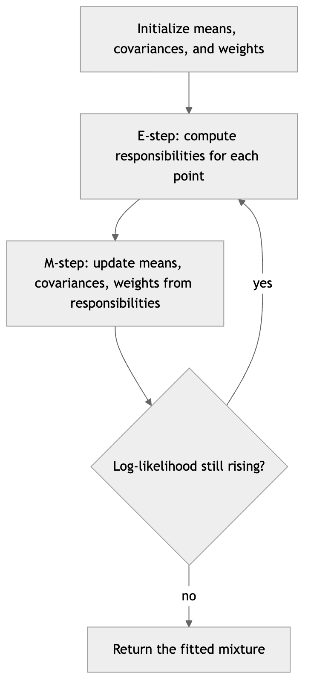

*Figure 167. EM alternates soft assignment (E-step) and weighted re-estimation (M-step).*

### 10.6.3 A Worked E-Step

One numerical E-step makes responsibilities concrete. Take a one-dimensional two-component mixture with equal weights $`\pi_{1} = \pi_{2} = 0.5`$, means $`\mu_{1} = 0`$ and $`\mu_{2} = 4`$, and unit variances. What is the responsibility of each component for the point $`x = 1`$?

Evaluate each Gaussian density. Using $`\mathcal{N}(x \mid \mu,1) = \frac{1}{\sqrt{2\pi}}e^{- (x - \mu)^{2}/2}`$: for component 1, $`e^{- 0.5}/\sqrt{2\pi} = 0.2420`$; for component 2, $`e^{- 4.5}/\sqrt{2\pi} = 0.00443`$. The point sits much closer to the first mode, so component 1 dominates. The responsibility of component 1 is

``` math
\gamma_{1} = \frac{0.5 \times 0.2420}{0.5 \times 0.2420 + 0.5 \times 0.00443} = 0.982,
```

leaving $`\gamma_{2} = 0.018`$. So $`x = 1`$ is “$`98\%`$ cluster 1, $`2\%`$ cluster 2.” A point exactly at $`x = 2`$, equidistant from both means, would split $`50/50`$. This graded membership is precisely what k-means throws away.

### 10.6.4 Code and Covariance Types

``` python
import numpy as np
from sklearn.mixture import GaussianMixture

rng = np.random.RandomState(0)
X1 = rng.randn(200,2) @ np.array([[2.0,0.5],[0.0,0.3]]) + [0,0]   # elongated
X2 = rng.randn(200,2) @ np.array([[0.4,0.0],[0.6,2.0]]) + [6,2]   # rotated
X = np.vstack([X1, X2])

gmm = GaussianMixture(n_components=2, covariance_type="full", random_state=0).fit(X)
print("Converged:", gmm.converged_)
print("Mixing weights:", np.round(gmm.weights_, 3))
print("Example responsibility:", np.round(gmm.predict_proba(X)[0], 3))   # e.g. [0.98 0.02]
```

The `covariance_type` controls the model’s flexibility and parameter count, trading bias against variance: `"full"` gives every cluster its own general covariance (most flexible, most parameters); `"tied"` forces all clusters to share one covariance; `"diag"` restricts each to axis-aligned ellipses; and `"spherical"` gives each a single variance, recovering something very close to k-means. On small clusters, prefer a simpler covariance type to avoid overfitting.

The figure below draws two elongated, rotated clusters with their fitted covariance ellipses at one and two standard deviations — the shapes a GMM captures effortlessly and k-means cannot.

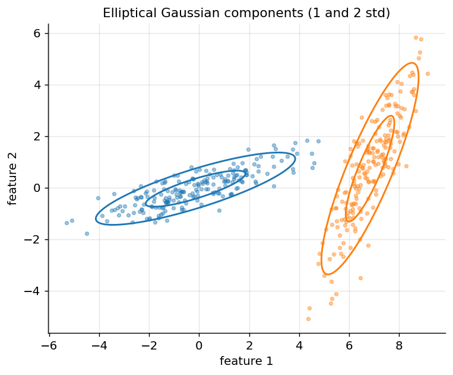

*Figure 168. A GMM models elliptical, rotated clusters that spherical k-Means cannot represent.*

### 10.6.5 Choosing the Number of Components

Because a GMM is a probabilistic model, you can select $`k`$ with **information criteria** that trade fit against complexity. The **Bayesian Information Criterion (BIC)** and **Akaike Information Criterion (AIC)** both penalize the number of free parameters $`p`$:

``` math
\text{BIC} = - 2\ln\widehat{L} + p\ln n,\quad\quad\text{AIC} = - 2\ln\widehat{L} + 2p
```

where $`\widehat{L}`$ is the maximized likelihood. BIC’s penalty grows with $`\ln n`$, so it is more conservative on large datasets and usually the safer default. Sweep $`k`$, fit a GMM for each, and choose the minimizing model — the BIC curve, like the silhouette, genuinely dips at a best $`k`$ rather than sliding monotonically.

``` python
import numpy as np
from sklearn.mixture import GaussianMixture
from sklearn.datasets import make_blobs
X, _ = make_blobs(n_samples=600, centers=4, random_state=0)
bics = [GaussianMixture(n, random_state=0).fit(X).bic(X) for n in range(1, 9)]
print("best k by BIC:", 1 + int(np.argmin(bics)))   # -> 4
```

> **Gaussian Mixture Models at a glance**
>
> **Strengths**: models elliptical, rotated clusters; gives soft probabilities and a generative model you can sample from; principled model selection via BIC/AIC; can compute densities for anomaly detection.
>
> **Weaknesses**: assumes Gaussian components, so it is poor for non-convex or heavy-tailed shapes; full covariances have many parameters and can overfit small clusters; sensitive to initialization; needs $`k`$.
>
> **When to use**: clusters you believe are roughly ellipsoidal, when you want membership probabilities, or when you need a density model as well as a clustering.
>
> **Pitfall**: a component can collapse onto a single point, driving its variance toward zero and the likelihood toward infinity. scikit-learn guards against this with a small `reg_covar` added to the covariance diagonal; keep it nonzero.

## 10.7 Spectral Clustering

**Spectral clustering** treats the data as a graph and finds clusters as well-connected communities within it, which lets it succeed on the same non-convex problems as DBSCAN but through linear algebra rather than density. The pipeline has three stages. First, build a **similarity graph**: points are nodes, and edges carry weights $`w_{ij}`$ from a similarity function, typically a Gaussian (RBF) kernel $`w_{ij} = exp( - \parallel x_{i} - x_{j} \parallel^{2}/2\sigma^{2})`$ or a $`k`$-nearest-neighbor rule. Collect these into a weighted **adjacency matrix** $`W`$ and the diagonal **degree matrix** $`Deg`$ with $`Deg_{ii} = \sum_{j}^{}w_{ij}`$.

Second, form the **graph Laplacian** $`L = Deg - W`$ (or a normalized version such as $`L_{\text{sym}} = I - Deg^{- 1/2}WDeg^{- 1/2}`$) and compute its smallest few eigenvectors. The Laplacian encodes connectivity: the number of zero eigenvalues equals the number of connected components, and the eigenvectors of the smallest nonzero eigenvalues vary smoothly within densely connected regions and jump across sparse cuts. Stacking the first $`k`$ eigenvectors as columns gives each point a new $`k`$-dimensional representation in which the clusters are pulled apart into compact blobs.

Third, run **k-means in that eigenspace**. The geometric magic is that the embedding “unrolls” curved structure — interleaving moons, concentric rings — into linearly separable clumps, so ordinary k-means finishes the job cleanly.

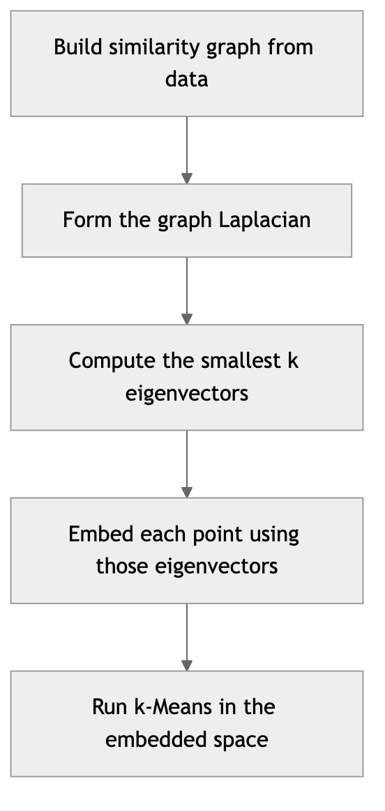

*Figure 169. Spectral clustering embeds the similarity graph, then clusters in eigenspace.*

``` python
from sklearn.cluster import SpectralClustering
from sklearn.datasets import make_moons
X, y = make_moons(n_samples=300, noise=0.06, random_state=0)
sc = SpectralClustering(n_clusters=2, affinity="nearest_neighbors", random_state=0)
labels = sc.fit_predict(X)   # cleanly separates the two interleaving moons
```

> **Spectral clustering at a glance.** **Strengths**: handles arbitrary shapes defined by connectivity; grounded in graph theory; often succeeds where k-means and GMM fail. **Weaknesses**: needs $`k`$; the eigendecomposition is $`O(n^{3})`$ in the worst case, limiting it to moderate $`n`$; results depend heavily on the affinity choice ($`\sigma`$ or the number of neighbors). **When to use**: moderate-sized non-convex data, community detection in graphs, image segmentation. **Pitfall**: a poorly scaled RBF bandwidth $`\sigma`$ can connect everything or nothing — tune it, or use a nearest-neighbor affinity.

## 10.8 Evaluating Clusters

Since clustering is unsupervised, evaluation is genuinely subtle: with no answer key, what does “good” even mean? There are two regimes. **Internal** metrics use only the data and the clustering itself, measuring geometric qualities like compactness and separation. **External** metrics compare the clustering against known labels, available only in benchmarks or validation studies where you happen to have ground truth.

### 10.8.1 Internal Metrics

**Inertia** (within-cluster sum of squares) is the k-means objective. It is useful for the elbow method but cannot fairly compare different algorithms or different $`k`$, since it decreases monotonically with more clusters and depends on scale.

The **silhouette score** is far more informative. For each point $`i`$, let $`a(i)`$ be its mean distance to other points in its own cluster (a measure of cohesion) and $`b(i)`$ the mean distance to points in the nearest *other* cluster (a measure of separation). The silhouette of point $`i`$ is

``` math
s(i) = \frac{b(i) - a(i)}{max\{ a(i),\, b(i)\}} \in \lbrack - 1,1\rbrack.
```

A value near $`+ 1`$ means the point sits comfortably inside its cluster and far from the next; near $`0`$ means it straddles a boundary; negative means it is probably misassigned. The overall silhouette is the mean of $`s(i)`$ over all points. Because it is bounded and normalized, you can compare it across $`k`$ and across algorithms, which is what makes it the single most useful tool for choosing $`k`$.

A quick numeric taste: for two tight clusters $`\{(0,0),(0,1)\}`$ and $`\{(5,0),(5,1)\}`$, the point $`(0,0)`$ has cohesion $`a = 1`$ (distance to its neighbor $`(0,1)`$) and separation $`b = \frac{1}{2}(5 + \sqrt{26}) \approx 5.05`$ (mean distance to the far cluster). Its silhouette is $`(5.05 - 1)/5.05 \approx 0.80`$ — high, as it should be for a point in a well-separated cluster.

A **silhouette plot** shows the sorted per-point silhouettes within each cluster as horizontal bars. Wide bars reaching toward $`1`$ signal healthy clusters; a cluster full of short or negative bars is suspect; and a cluster much thinner than the others reveals an imbalance. The figure below draws one for three clean blobs.

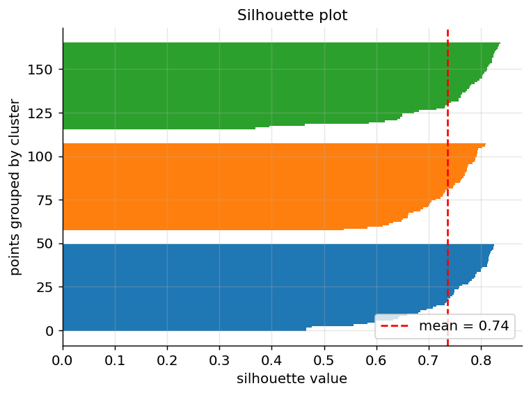

*Figure 170. A silhouette plot; bars near 1 indicate well-separated, cohesive clusters.*

Two more internal metrics round out the toolkit. The **Calinski-Harabasz index** (also called the variance-ratio criterion) is the ratio of between-cluster dispersion to within-cluster dispersion, scaled by the degrees of freedom; higher is better, and it is fast to compute. The **Davies-Bouldin index** averages, over all clusters, the worst-case ratio of within-cluster scatter to between-cluster separation for each cluster and its most similar neighbor; lower is better, with $`0`$ the ideal. Reporting several internal metrics together guards against any single one being fooled by the geometry.

### 10.8.2 External Metrics

When ground-truth labels *are* available — on a labeled benchmark used to validate a pipeline, say — you can measure agreement directly. The **Adjusted Rand Index (ARI)** counts point *pairs*: a pair “agrees” if the two clusterings both put the pair together or both put it apart. The raw Rand Index is the fraction of agreeing pairs; the *adjusted* version subtracts the agreement expected by chance and rescales so that random labelings score near $`0`$ and a perfect match scores exactly $`1`$ (negative values mean worse than chance). Crucially, ARI is invariant to label permutation — it does not matter whether your “cluster 0” is the true “cluster 3” — which is exactly right, since cluster identifiers are arbitrary.

Its formula, in terms of a contingency table with entries $`n_{ij}`$ (points in true class $`i`$ and predicted cluster $`j`$), row sums $`a_{i}`$, and column sums $`b_{j}`$, is

``` math
\text{ARI} = \frac{\sum_{ij}^{}\left( \frac{n_{ij}}{2} \right) - \left\lbrack \sum_{i}^{}\left( \frac{a_{i}}{2} \right)\sum_{j}^{}\left( \frac{b_{j}}{2} \right) \right\rbrack/\left( \frac{n}{2} \right)}{\frac{1}{2}\left\lbrack \sum_{i}^{}\left( \frac{a_{i}}{2} \right) + \sum_{j}^{}\left( \frac{b_{j}}{2} \right) \right\rbrack - \left\lbrack \sum_{i}^{}\left( \frac{a_{i}}{2} \right)\sum_{j}^{}\left( \frac{b_{j}}{2} \right) \right\rbrack/\left( \frac{n}{2} \right)}.
```

Work a small case. Six points, true classes $`X = \{ 1,2,3\}`$ and $`Y = \{ 4,5,6\}`$; a clustering puts $`\{ 1,2,3\}`$ in cluster A, $`\{ 4,5\}`$ in B, and $`\{ 6\}`$ alone in C. The contingency table has row sums $`a = (3,3)`$ and column sums $`b = (3,2,1)`$, with nonzero cells $`n_{XA} = 3`$, $`n_{YB} = 2`$, $`n_{YC} = 1`$. Then $`\sum_{ij}^{}\left( \frac{n_{ij}}{2} \right) = \left( \frac{3}{2} \right) + \left( \frac{2}{2} \right) + \left( \frac{1}{2} \right) = 3 + 1 + 0 = 4`$; the row term is $`\left( \frac{3}{2} \right) + \left( \frac{3}{2} \right) = 6`$; the column term is $`\left( \frac{3}{2} \right) + \left( \frac{2}{2} \right) + \left( \frac{1}{2} \right) = 4`$; and $`\left( \frac{6}{2} \right) = 15`$. The expected index is $`6 \times 4/15 = 1.6`$ and the maximum index is $`(6 + 4)/2 = 5`$, giving $`\text{ARI} = (4 - 1.6)/(5 - 1.6) \approx 0.71`$. The split of class $`Y`$ into two clusters costs us; a perfect recovery would score $`1.0`$.

Two other external metrics are common. **Normalized Mutual Information (NMI)** measures, in information-theoretic terms, how much knowing the cluster label tells you about the true label, normalized to $`\lbrack 0,1\rbrack`$; it too is permutation-invariant. The related **homogeneity**, **completeness**, and their harmonic mean the **V-measure** decompose agreement into “each cluster contains only one class” and “each class lands in only one cluster.” The **Fowlkes-Mallows score** is the geometric mean of pairwise precision and recall. Different metrics penalize different mistakes, so report more than one.

``` python
from sklearn.metrics import (silhouette_score, adjusted_rand_score,
                             calinski_harabasz_score, davies_bouldin_score,
                             normalized_mutual_info_score)
from sklearn.datasets import make_blobs
from sklearn.cluster import KMeans

X, y = make_blobs(n_samples=500, centers=4, random_state=42)
labels = KMeans(n_clusters=4, n_init=10, random_state=42).fit_predict(X)

print("Silhouette:", round(silhouette_score(X, labels), 3))            # internal, ~0.79
print("Calinski-Harabasz:", round(calinski_harabasz_score(X, labels))) # internal, higher better
print("Davies-Bouldin:", round(davies_bouldin_score(X, labels), 3))    # internal, lower better
print("ARI vs truth:", round(adjusted_rand_score(y, labels), 3))       # external, ~1.0
print("NMI vs truth:", round(normalized_mutual_info_score(y, labels), 3))  # external, ~1.0
```

## 10.9 Choosing an Algorithm: A Comparison

No single algorithm dominates; the right choice depends on cluster shape, scale, and whether you know $`k`$ or expect noise. The following table summarizes the trade-offs.

| Algorithm | Needs k? | Cluster shape | Handles noise? | Scales to large n? | Soft/Hard | Key parameter |
|----|----|----|----|----|----|----|
| **k-Means** | Yes | Spherical, equal size | No | Yes (mini-batch) | Hard | $`k`$ |
| **Agglomerative (Ward)** | No (cut tree) | Compact, convex | No | No, $`O(n^{2})`$ | Hard | linkage, cut height |
| **DBSCAN** | No | Arbitrary | Yes | Moderate | Hard | $`\varepsilon`$, minPts |
| **HDBSCAN** | No | Arbitrary, varying density | Yes | Moderate | Hard | min_cluster_size |
| **GMM (EM)** | Yes | Elliptical, oriented | No | Moderate | Soft | $`k`$, covariance type |
| **Mean-shift** | No | Arbitrary blobs | Somewhat | No, $`O(n^{2})`$ | Hard | bandwidth |
| **Spectral** | Yes | Arbitrary (connectivity) | No | No, $`O(n^{3})`$ | Hard | $`k`$, affinity |

A practical decision guide: start with **k-means** for large, roughly spherical, well-scaled data when you have a rough idea of $`k`$. If clusters are elongated or you want membership probabilities, use a **GMM**. If you do not know $`k`$ and the data may be noisy or oddly shaped, reach for **DBSCAN** — or **HDBSCAN** when densities vary. For small datasets where you want to *explore* structure at multiple scales, use **agglomerative** clustering and read the dendrogram. For non-convex clusters on moderate data, **spectral** clustering is the specialist.

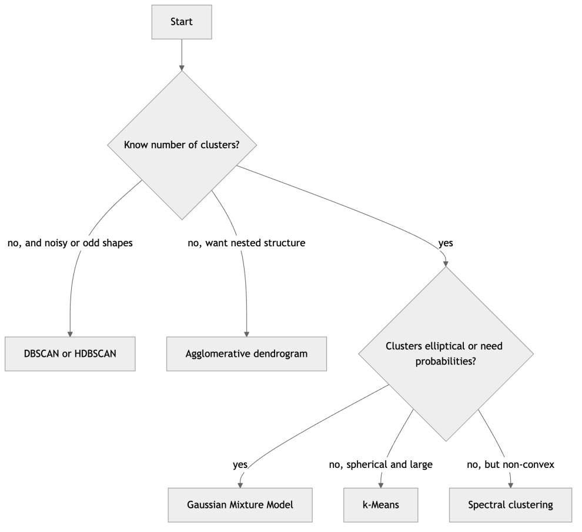

*Figure 171. A rough decision guide for picking a clustering algorithm.*

## 10.10 Worked Example: Comparing Methods on One Dataset

To consolidate, here is an end-to-end comparison applying four algorithms to the same synthetic dataset and scoring each with the silhouette and ARI metrics. We use well-separated blobs so every method has a fair chance, then report which best recovers the known structure.

``` python
import numpy as np
from sklearn.datasets import make_blobs
from sklearn.preprocessing import StandardScaler
from sklearn.cluster import KMeans, AgglomerativeClustering, DBSCAN
from sklearn.mixture import GaussianMixture
from sklearn.metrics import silhouette_score, adjusted_rand_score

X, y = make_blobs(n_samples=600, centers=4, cluster_std=[1.0,1.5,0.8,1.2],
                  random_state=7)
X = StandardScaler().fit_transform(X)

models = {
    "k-Means":       KMeans(n_clusters=4, n_init=10, random_state=7),
    "Agglomerative": AgglomerativeClustering(n_clusters=4, linkage="ward"),
    "GMM":           GaussianMixture(n_components=4, random_state=7),
    "DBSCAN":        DBSCAN(eps=0.35, min_samples=8),
}

print(f"{'Method':<14}{'Silhouette':>12}{'ARI':>8}")
for name, m in models.items():
    labels = m.fit_predict(X)
    valid = len(set(labels) - {-1}) >= 2
    sil = silhouette_score(X, labels) if valid else float("nan")
    ari = adjusted_rand_score(y, labels)
    print(f"{name:<14}{sil:>12.3f}{ari:>8.3f}")

# Typical output:
# Method          Silhouette     ARI
# k-Means              0.58    0.85
# Agglomerative        0.57    0.83
# GMM                  0.56    0.88
# DBSCAN               0.41    0.71   (some points labeled noise)
```

On clean, convex blobs all four methods perform respectably, with GMM and k-means edging ahead because the data matches their blob assumptions; DBSCAN trails here because its single $`\varepsilon`$ cannot perfectly fit clusters of differing spread and it sacrifices some points to noise. Swap in `make_moons`, and the ranking flips entirely: DBSCAN and spectral clustering soar while k-means and GMM collapse. The lesson, repeated throughout this chapter, is that the best algorithm is the one whose assumptions match your data’s geometry. Always validate with a metric like silhouette, visualize when you can, and never trust a clustering you have not inspected.

## 10.11 Real-World Applications

Clustering earns its keep across domains, and seeing where each family lands sharpens intuition for the assumptions involved.

**Customer segmentation**, the scenario that opened the chapter, is the canonical business use. Marketers cluster customers on features such as recency, frequency, and monetary value (“RFM”), then tailor campaigns per segment. k-means dominates here because the data is large and the segments are expected to be roughly convex; the segments’ centroids are directly interpretable as “the average customer of this type.”

**Anomaly and fraud detection** turns clustering on its head: the interesting points are the ones that *do not* cluster. DBSCAN and HDBSCAN naturally flag noise points as candidate anomalies, and a GMM’s density $`p(x)`$ gives a continuous outlier score — points in the low-density tails are suspect transactions, faulty sensors, or intrusions.

**Image segmentation** partitions an image’s pixels into coherent regions. Representing each pixel by its color (and optionally position) and clustering with k-means or mean-shift produces a compressed, region-labeled image; mean-shift’s mode-seeking is a classic technique in computer vision for exactly this.

**Document and text organization** groups articles, tickets, or search results by topic. Because text vectors (TF-IDF or embeddings) are high-dimensional and their magnitude is less meaningful than their direction, spherical k-means (cosine distance) or spectral methods on a similarity graph outperform plain Euclidean k-means.

**Bioinformatics** relies heavily on hierarchical clustering: grouping genes with similar expression profiles produces the familiar heatmap-with-dendrogram, and the tree itself is biologically meaningful, mirroring functional or evolutionary relationships. **Recommender systems** cluster users or items to bootstrap collaborative filtering, and **geospatial analysis** uses DBSCAN to find dense regions of events — crime hotspots, disease clusters, points of interest — precisely because the clusters are irregularly shaped and the sparse background should be discarded as noise.

## 10.12 Summary

Clustering is the unsupervised task of grouping unlabeled data so that members of a group resemble one another. Its defining feature — no ground truth — makes the *assumptions you choose* the whole game. The first assumption, hidden in plain sight, is the distance or similarity metric: Euclidean distance draws spherical neighborhoods, cosine similarity compares directions, Mahalanobis distance whitens correlated features, and the choice silently fixes what structure the algorithm can perceive. Scaling features before any distance-based method is not optional.

The methods divide into families by what they consider a cluster. **k-Means** minimizes within-cluster variance via Lloyd’s alternating algorithm, is fast and scalable (especially in mini-batch form), and assumes spherical, equal-size clusters; use k-means++ and multiple restarts, and pick $`k`$ with the elbow or, better, the silhouette. **Hierarchical** clustering builds a dendrogram by merging nearest clusters, with the linkage (single, complete, average, Ward) controlling cluster shape and Ward the best general default; you cut the tree to choose $`k`$ afterward. **Density-based** methods — DBSCAN, OPTICS, HDBSCAN, and mean-shift — define clusters as dense regions, find arbitrary shapes, discover $`k`$ automatically, and isolate noise, with HDBSCAN the robust modern choice when densities vary. **Gaussian mixtures** fit a probabilistic model by EM, giving soft assignments and elliptical clusters, with BIC/AIC for model selection; k-means is their hard, spherical limit. **Spectral** clustering embeds a similarity graph via the Laplacian’s eigenvectors and clusters there, excelling on non-convex data.

Finally, validate. Internal metrics (silhouette, Calinski-Harabasz, Davies-Bouldin) score geometry without labels; external metrics (ARI, NMI, V-measure, Fowlkes-Mallows) measure agreement with ground truth when you have it, correcting for chance and ignoring arbitrary label names. The silhouette is the most useful single tool for choosing and comparing clusterings. No algorithm is universally best — match the tool to your data’s geometry, and inspect what you get.

## 10.13 Key Takeaways

- Clustering is unsupervised: there is no single correct answer, only answers that follow from your choice of metric and assumptions about shape, number, and noise.
- The distance metric is the most consequential and most overlooked decision. Euclidean for compact blobs, cosine for text and embeddings, Mahalanobis for correlated features. Always scale first.
- k-Means is fast and the sensible default for large, spherical, well-scaled data; always use k-means++ and `n_init`, and choose $`k`$ with the silhouette rather than trusting an ambiguous elbow.
- Hierarchical clustering needs no $`k`$ up front and exposes multi-scale structure through a dendrogram; Ward linkage is the best general default, and single linkage risks chaining.
- DBSCAN finds arbitrary shapes and flags noise but hinges on a single global $`\varepsilon`$; when densities vary, use HDBSCAN (or OPTICS). Mean-shift seeks density modes and also discovers $`k`$.
- Gaussian mixtures generalize k-means to soft, elliptical clusters via EM; the E-step is soft assignment and the M-step is a weighted mean update. Choose the number of components with BIC.
- Spectral clustering solves non-convex problems by clustering in the eigenspace of the graph Laplacian.
- Validate every clustering: silhouette, Calinski-Harabasz, and Davies-Bouldin without labels; ARI and NMI with them. Report more than one metric, and visualize whenever you can.

## 10.14 Exercises

1.  **(Conceptual)** Explain why running Lloyd’s algorithm from a single random initialization can produce a worse clustering than running it ten times and keeping the lowest-inertia result. How does k-means++ reduce this risk, and what is its theoretical guarantee?

2.  **(Conceptual)** You apply k-means with $`k = 2`$ to two interleaving half-moons and get a poor result, but DBSCAN separates them perfectly. Explain, in terms of each algorithm’s notion of a cluster, why this happens. Which other algorithm in the chapter would also succeed, and why?

3.  **(Conceptual)** Describe how to read a dendrogram. If a horizontal cut crosses five vertical lines, how many clusters result? How do the heights of merges guide where to cut, and why do single and complete linkage produce different cut heights on the same data?

4.  **(By hand)** Run k-means with $`k = 2`$ on the one-dimensional points $`\{ 2,3,12,14\}`$ starting from centroids $`\mu_{1} = 2,\mu_{2} = 3`$. Show each assignment and update step, and report the final centroids and inertia.

5.  **(By hand)** For the four points $`a = (0,0)`$, $`b = (1,0)`$, $`c = (6,0)`$, $`d = (7,0)`$, compute the final merge height under single, complete, and average linkage. Explain why they differ.

6.  **(By hand)** A GMM has two equal-weight unit-variance components with means $`\mu_{1} = 0`$ and $`\mu_{2} = 3`$. Compute the responsibility of each component for the point $`x = 1`$. Which component “owns” the point, and by how much?

7.  **(By hand)** Given true classes $`\{ 1,2,3,4\}`$ and $`\{ 5,6\}`$ and a clustering $`\{ 1,2\},\{ 3,4\},\{ 5,6\}`$, build the contingency table and compute the Adjusted Rand Index. Interpret the result.

8.  **(Coding)** Using `make_blobs` with 5 centers, sweep $`k`$ from 2 to 8, compute the silhouette score for k-means at each $`k`$, and print the maximizing $`k`$. Does it recover the true number of clusters? Now repeat with the elbow method and compare.

9.  **(Coding)** Generate data with `make_circles(noise=0.05, factor=0.5)`. Cluster it with k-means ($`k = 2`$), DBSCAN, and spectral clustering. Report the ARI of each against the true labels and explain the ranking.

10. **(Coding / Analysis)** Fit GMMs with `n_components` from 1 to 8 on a blob dataset, plot BIC versus the number of components, and identify the minimizing model. Compare this choice to the elbow you would read from k-means inertia on the same data. Then refit with each `covariance_type` and discuss how the best $`k`$ changes.

11. **(Coding)** Create two blobs of very different density (one tight, one diffuse). Show that a single DBSCAN $`\varepsilon`$ cannot cluster both well, then cluster the same data with HDBSCAN and compare. Explain what HDBSCAN does differently.

---

[← 9 Decision Trees and Ensemble Learning](ch09-trees-ensembles.md) · [Contents](../README.md#contents) · [11 Dimensionality Reduction and Feature Extraction →](ch11-dimensionality-reduction.md)
