[← 10 Clustering](ch10-clustering.md) · [Contents](../README.md#contents) · [12 Association Rule Learning →](ch12-association-rules.md)

---

# 11 Dimensionality Reduction and Feature Extraction

Modern datasets are wide. A single grayscale thumbnail of a handwritten digit has 784 pixels — 784 dimensions — and a genomics table may carry tens of thousands of gene-expression columns per patient. Our intuition, honed in two and three dimensions, breaks down badly in such spaces, and so do many algorithms. **Dimensionality reduction** is the art of compressing high-dimensional data into a smaller set of informative coordinates while throwing away as little of what matters as possible. This chapter explains *why* high dimensions are harmful, then builds up the major techniques — Principal Component Analysis, Kernel PCA, Linear Discriminant Analysis, the manifold-learning methods Isomap, Locally Linear Embedding, t-SNE and UMAP, Independent Component Analysis, random projections, autoencoders, and non-negative matrix factorization — showing the intuition, the mathematics, runnable code, and the practical trade-offs of each.

By the end you will understand the difference between *selecting* a subset of your original features and *extracting* new ones, when a linear method suffices and when you need a nonlinear one, when to reduce with an eye on labels and when to stay unsupervised, and how reduced representations power visualization, compression, denoising, and faster downstream models. The clustering methods of the previous chapter and the supervised models of Part II both benefit enormously from a good low-dimensional representation, so the skills here are foundational rather than peripheral.

The following map organizes the whole chapter: every method you will meet slots into one of these branches.

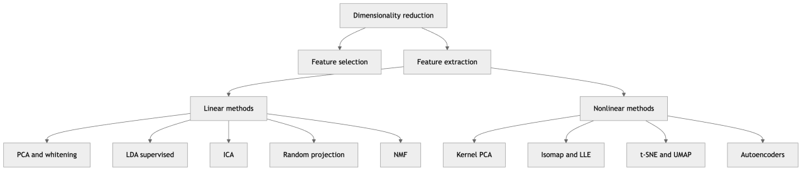

*Figure 172. A taxonomy of the dimensionality-reduction methods covered in this chapter.*

## 11.1 Why High Dimensions Hurt: The Curse of Dimensionality

The phrase **curse of dimensionality**, coined by Richard Bellman, names a cluster of counterintuitive phenomena that appear as the number of features $`d`$ grows. We met it briefly in the chapter on the Machine Learning Workflow; here we make it precise, because it is the entire motivation for this chapter.

The core problem is that **volume grows exponentially with dimension, so data becomes sparse**. Imagine sampling points uniformly in a unit hypercube. To capture a fixed fraction — say 10% — of the data within a small neighborhood, the edge length of that neighborhood must grow alarmingly. To enclose 10% of the volume in $`d`$ dimensions, a sub-cube needs an edge of $`{0.1}^{1/d}`$. In one dimension that is 0.1; in ten dimensions it is about 0.79; in fifty dimensions it is about 0.955. A “local” neighborhood that supposedly holds a tenth of your data spans almost the entire range of every feature. Locality, the assumption underlying k-NN, kernel methods, and clustering, quietly evaporates.

A second symptom is **distance concentration**. As $`d \rightarrow \infty`$, the distances between random points converge toward one another: the nearest and farthest neighbors of a query point become nearly equidistant. Formally, if $`D_{\max}`$ and $`D_{\min}`$ are the maximum and minimum distances from a fixed point to $`n`$ samples, then under broad conditions

``` math
\lim_{d \rightarrow \infty}\mathbb{E}\left\lbrack \frac{D_{\max} - D_{\min}}{D_{\min}} \right\rbrack \rightarrow 0.
```

When all points look roughly the same distance away, “nearest neighbor” loses its meaning, and any algorithm that relies on it degrades.

A third, closely related fact is that **almost all the volume of a high-dimensional body sits near its surface**. The fraction of a unit hypercube’s volume lying within a thin shell of thickness $`\epsilon`$ of the boundary is $`1 - (1 - 2\epsilon)^{d}`$, which rushes to 1 as $`d`$ grows. Equivalently, the volume of the unit hypersphere inscribed in the unit hypercube shrinks to essentially zero: in high dimensions a ball is a vanishingly small speck inside the box that contains it, so uniformly sampled points almost never land “in the middle.” Your data huddles in the corners and along the shell, not in the comfortable interior your intuition expects.

A fourth consequence is statistical: the number of samples needed to estimate a function or density reliably grows exponentially with $`d`$. With too few samples relative to dimensions, models overfit, fitting noise rather than signal. This is why a model with thousands of features and only hundreds of rows is in danger before training even begins — the regime where $`d > n`$ (“wide” data) is the natural habitat of genomics, text, and spectroscopy.

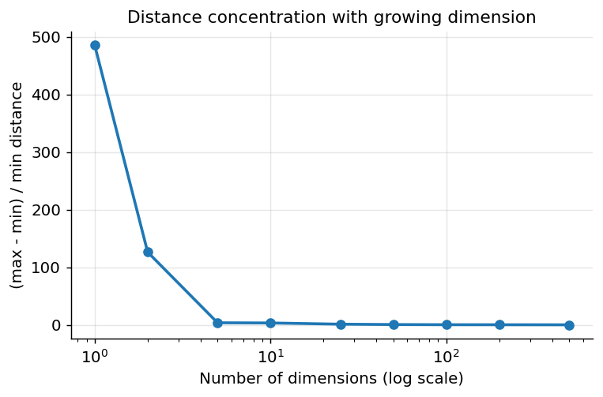

*Figure 173. Distance concentration — as dimensionality grows, the gap between nearest and farthest neighbors shrinks relative to the minimum distance.*

The next figure makes the “everything is near the boundary” phenomenon concrete, and alongside it shows how the volume of the inscribed unit ball collapses relative to its bounding cube.

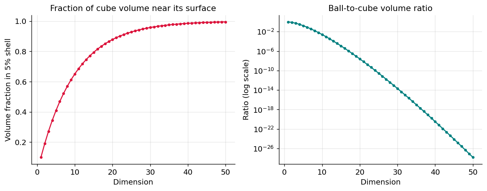

*Figure 174. In high dimensions almost all volume lies near the boundary, and the inscribed ball becomes a vanishing fraction of its bounding cube.*

The cure is rarely to gather exponentially more data. Instead we exploit a saving grace: **real data almost never fills its ambient space**. Pixels in natural images are highly correlated; gene expressions move in coordinated programs; sensor readings obey physical constraints. The data lives on or near a lower-dimensional **manifold** — a smoothly curved surface whose **intrinsic dimension** is far below the ambient $`d`$. A sheet of paper crumpled into a ball occupies three dimensions, but it is intrinsically two-dimensional; you could flatten it back out. Dimensionality reduction tries to find that manifold and re-express the data using its intrinsic coordinates.

## 11.2 Feature Selection versus Feature Extraction

Before diving into algorithms, distinguish two fundamentally different strategies for reducing dimension.

**Feature selection** keeps a subset of the original features and discards the rest. If your data has columns `age`, `income`, `zip_code`, and `last_login`, feature selection might keep `age` and `income` and drop the others. The surviving features remain interpretable — they mean exactly what they meant before. Selection methods fall into three families:

- **Filter methods** score each feature independently of any model — variance threshold (drop near-constant columns), correlation or mutual information with the target, the chi-squared statistic for categorical features, or ANOVA F-tests. They are fast and model-agnostic but blind to feature *interactions*: two features that are each useless alone yet jointly predictive (think XOR) get dropped.
- **Wrapper methods** search over feature subsets by repeatedly training a model and scoring it, treating the model as a black box. **Recursive feature elimination (RFE)** fits a model, ranks features by importance, drops the weakest, and repeats. Wrappers find interactions but are expensive — each candidate subset costs a full training run.
- **Embedded methods** perform selection as a side effect of training. **L1 (Lasso) regularization** drives coefficients to exactly zero (see the chapter on Regression Algorithms); tree ensembles expose impurity- or permutation-based feature importances. These are a good default: interaction-aware like wrappers, but nearly as cheap as fitting the model once.

**Feature extraction** creates *new* features as combinations of the originals. PCA, for example, might replace `age`, `income`, `zip_code`, `last_login` with two new axes that are weighted blends of all four. These new coordinates often capture more information in fewer dimensions, but they are typically harder to interpret — “0.4 times age plus 0.7 times income minus …” has no crisp business meaning. Extraction can also *combine* correlated features gracefully, where selection is forced to arbitrarily keep one and drop its near-duplicates.

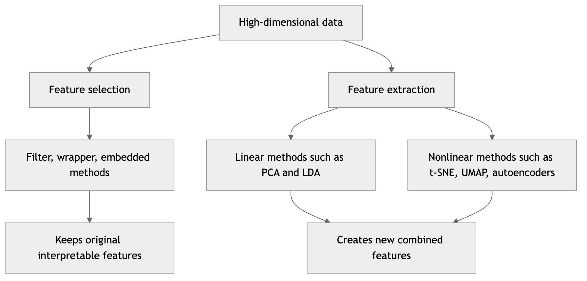

*Figure 175. Two routes to fewer dimensions, with the major methods under each.*

| Aspect | Feature selection | Feature extraction |
|----|----|----|
| Output features | Subset of originals | New combinations |
| Interpretability | High | Often low |
| Handles correlated features | Poorly without care | Naturally |
| Typical methods | Variance threshold, RFE, L1 | PCA, LDA, t-SNE, autoencoders |
| Information retained | Limited by discarded columns | Can be higher per dimension |
| Regulatory / audit friendliness | High (features keep meaning) | Low (features are abstract) |

Choose selection when interpretability, auditability, or the cost of *measuring* features matters — a medical test you no longer need to order is a real saving. Choose extraction when you want maximal information density and downstream performance, and interpretability is secondary. The rest of the chapter focuses mostly on extraction, the richer and more mathematically interesting half, while noting where selection is the better tool.

## 11.3 Principal Component Analysis in Depth

**Principal Component Analysis (PCA)** is the workhorse of linear dimensionality reduction. The intuition is simple: find the directions in which the data varies the most, and project onto them. If most of the spread of a cloud of points lies along one diagonal axis, you can describe each point well using just its coordinate along that axis, discarding the perpendicular direction with little loss. Remarkably, PCA can be derived from two seemingly different goals — maximizing retained variance and minimizing reconstruction error — that turn out to be the same optimization.

### 11.3.1 View One: Variance Maximization

Suppose we have centered data (mean subtracted from every feature) arranged as rows of a matrix $`X \in \mathbb{R}^{n \times d}`$. We seek a unit vector $`w`$ such that projecting the data onto $`w`$ maximizes the variance of the projections. The projection of point $`x_{i}`$ onto $`w`$ is the scalar $`x_{i}^{\top}w`$, and the variance of these projections is

``` math
Var(Xw) = \frac{1}{n}\sum_{i = 1}^{n}(x_{i}^{\top}w)^{2} = w^{\top}\Sigma w,\quad\quad\Sigma = \frac{1}{n}X^{\top}X,
```

where $`\Sigma`$ is the $`d \times d`$ **covariance matrix** of the data. We maximize $`w^{\top}\Sigma w`$ subject to $`\parallel w \parallel = 1`$. Using a Lagrange multiplier $`\lambda`$, the constrained objective is $`w^{\top}\Sigma w - \lambda(w^{\top}w - 1)`$, and setting its gradient to zero gives the defining equation

``` math
\Sigma w = \lambda w.
```

This is precisely an **eigenvector equation**. The directions of maximal variance are the eigenvectors of the covariance matrix, and the variance captured along each is the corresponding eigenvalue $`\lambda`$. Because $`w^{\top}\Sigma w = \lambda`$ when $`\Sigma w = \lambda w`$ and $`\parallel w \parallel = 1`$, the eigenvalue *is* the variance along that direction. The second principal component is the maximum-variance direction *orthogonal* to the first, which is the eigenvector with the second-largest eigenvalue, and so on. Because $`\Sigma`$ is symmetric and positive semi-definite, its eigenvectors are mutually orthogonal and its eigenvalues are non-negative — so the principal components form an orthonormal basis and there is never a negative “variance.”

### 11.3.2 View Two: Minimum Reconstruction Error

Now change the question. Instead of asking which projection keeps the most variance, ask which $`k`$-dimensional subspace lets us reconstruct the data with the smallest squared error. We want an orthonormal basis $`W_{k} = \lbrack w_{1},\ldots,w_{k}\rbrack`$ minimizing

``` math
\sum_{i = 1}^{n} \parallel x_{i} - W_{k}W_{k}^{\top}x_{i} \parallel^{2}.
```

The term $`W_{k}W_{k}^{\top}x_{i}`$ is the orthogonal projection of $`x_{i}`$ onto the subspace. Expanding the squared norm and using orthonormality, the total error decomposes into the total variance minus the variance captured in the subspace. Minimizing reconstruction error is therefore *identical* to maximizing captured variance — the same eigenvectors solve both. This equivalence is why PCA is simultaneously the best linear compressor (smallest reconstruction error) and the best variance-preserving projection. Keep both views in mind: the variance view explains the scree plot, and the reconstruction view explains denoising and compression.

### 11.3.3 The Algorithm Step by Step

1.  **Center** the data by subtracting the mean of each feature. (Optionally **standardize** by dividing by each feature’s standard deviation; do this when features are on different scales, otherwise the largest-scale feature dominates.)
2.  **Compute the covariance matrix** $`\Sigma = \frac{1}{n}X^{\top}X`$.
3.  **Find the eigenvectors and eigenvalues** of $`\Sigma`$. Sort eigenvectors by descending eigenvalue. The sorted eigenvectors are the **principal components** $`w_{1},w_{2},\ldots,w_{d}`$.
4.  **Select the top** $`k`$ components and stack them as columns of $`W_{k} \in \mathbb{R}^{d \times k}`$.
5.  **Project**: the reduced representation is $`Z = XW_{k} \in \mathbb{R}^{n \times k}`$.

In practice we rarely form $`\Sigma`$ explicitly. The numerically preferred route is the **Singular Value Decomposition (SVD)** of the centered data, $`X = USV^{\top}`$, where $`U \in \mathbb{R}^{n \times n}`$ and $`V \in \mathbb{R}^{d \times d}`$ are orthogonal and $`S`$ holds the non-negative **singular values** $`s_{1} \geq s_{2} \geq \ldots`$ on its diagonal. The columns of $`V`$ are exactly the principal components, and the singular values relate to eigenvalues by $`\lambda_{j} = s_{j}^{2}/n`$. The scores are $`Z = XV_{k} = U_{k}S_{k}`$. SVD is preferred because forming $`X^{\top}X`$ squares the condition number and can lose precision for nearly collinear features; SVD works on $`X`$ directly. It is what scikit-learn uses internally, and **truncated SVD** (which never centers the data) is the variant applied to large sparse matrices such as document–term counts, where it is known as **Latent Semantic Analysis**.

### 11.3.4 A Worked Numeric Example by Hand

Nothing cements PCA like grinding through small numbers. Take five already-centered two-dimensional points:

``` math
( - 2, - 1),\ ( - 1, - 1),\ (0,0),\ (1,1),\ (2,1).
```

Their means are zero in both coordinates, so no centering is needed. With $`n = 5`$, form $`\Sigma = \frac{1}{n}X^{\top}X`$ from the sums $`\sum x^{2} = 10`$, $`\sum y^{2} = 4`$, $`\sum xy = 6`$:

``` math
\Sigma = \frac{1}{5}\begin{bmatrix}
10 & 6 \\
6 & 4
\end{bmatrix} = \begin{bmatrix}
2.0 & 1.2 \\
1.2 & 0.8
\end{bmatrix}.
```

The eigenvalues solve $`det(\Sigma - \lambda I) = 0`$, i.e. $`\lambda^{2} - 2.8\lambda + 0.16 = 0`$ (trace 2.8, determinant $`2.0 \cdot 0.8 - {1.2}^{2} = 0.16`$). Thus

``` math
\lambda = \frac{2.8 \pm \sqrt{{2.8}^{2} - 4(0.16)}}{2} = \frac{2.8 \pm \sqrt{7.2}}{2} \Rightarrow \lambda_{1} \approx 2.74,\ \lambda_{2} \approx 0.06.
```

The first component explains $`2.74/2.8 \approx 97.9\%`$ of the variance. Solving $`(\Sigma - \lambda_{1}I)w = 0`$ gives $`w_{2} = 0.618\, w_{1}`$, so the first principal component points along $`(1,0.618)`$, which normalizes to $`w_{1} \approx (0.85,0.53)`$. That direction is the diagonal along which the points spread; projecting onto it retains almost all the structure, and dropping the second axis costs only about 2% of the variance. You can verify every number with a calculator — that transparency is one of PCA’s charms.

The figure below shows the same idea on a larger correlated cloud, drawing each principal axis scaled by the square root of its eigenvalue (one standard deviation of spread).

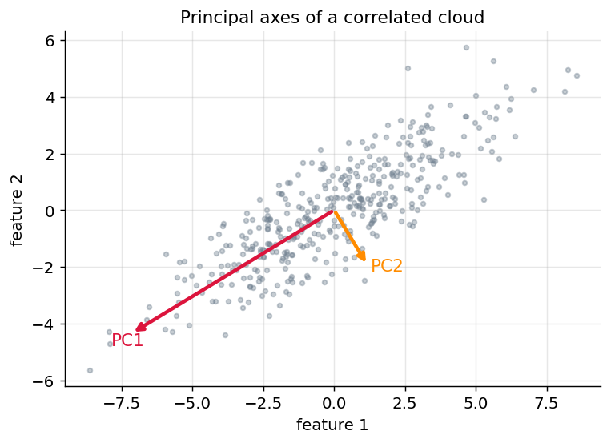

*Figure 176. A correlated 2-D cloud with its two principal axes; arrow length is proportional to the standard deviation captured along each direction.*

### 11.3.5 Explained Variance and the Scree Plot

Each component $`j`$ explains a fraction of the total variance equal to $`\lambda_{j}/\sum_{m}^{}\lambda_{m}`$. Plotting these eigenvalues (or the cumulative explained variance) against component index produces a **scree plot**, the standard tool for choosing $`k`$. You look for an “elbow” where additional components add little, or you pick the smallest $`k`$ whose cumulative explained variance crosses a threshold such as 95%.

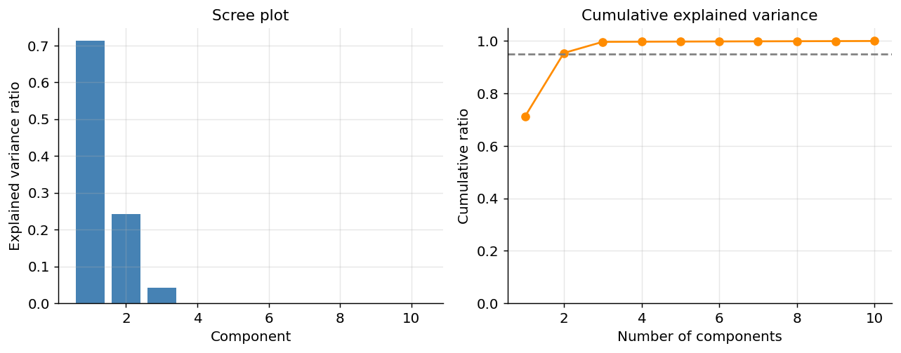

*Figure 177. Scree plot and cumulative explained variance for a synthetic correlated dataset.*

### 11.3.6 How to Choose the Number of Components

The scree elbow and a variance threshold (retain enough components for 90–99%) are the everyday tools, but several more principled criteria exist:

- **Kaiser’s rule.** On *standardized* data, keep components whose eigenvalue exceeds 1 — the intuition being that a component should explain more variance than a single original standardized feature does. It tends to over-retain, so treat it as a rough ceiling.
- **The broken-stick model.** Compare each eigenvalue to what you would expect if total variance were divided randomly among the $`d`$ axes; keep components that beat that null.
- **Cross-validated downstream performance.** If PCA feeds a supervised model, the cleanest criterion is empirical: sweep $`k`$ and pick the value that maximizes validation accuracy. This lets the task, not a heuristic, decide.
- **Parallel analysis.** Shuffle each feature independently to destroy correlations, rerun PCA, and keep only components whose real eigenvalues exceed the shuffled ones. This is the most reliable of the statistical rules.

### 11.3.7 Whitening

Sometimes you want the reduced coordinates not merely uncorrelated but also of *equal variance*. **Whitening** (or **sphering**) rescales each principal component by $`1/\sqrt{\lambda_{j}}`$, so the transformed data has an identity covariance matrix:

``` math
Z_{\text{white}} = XW_{k}\,\Lambda_{k}^{- 1/2},\quad\quad\Lambda_{k} = diag(\lambda_{1},\ldots,\lambda_{k}).
```

Whitening removes both the correlations *and* the scale differences among components, which helps algorithms that assume isotropic inputs — many neural-network initializers, and crucially ICA, which we cover below, almost always whitens as a preprocessing step. The catch: dividing by $`\sqrt{\lambda_{j}}`$ *amplifies* the low-variance directions, which are often noise, so whitening can inflate noise if you retain too many components. In scikit-learn it is a single flag, `PCA(whiten=True)`.

### 11.3.8 Reconstruction and Compression

Because the principal components are orthonormal, projecting and then “un-projecting” approximately recovers the original data:

``` math
\widehat{X} = ZW_{k}^{\top} + \mu = XW_{k}W_{k}^{\top} + \mu.
```

When $`k = d`$ the reconstruction is exact; when $`k < d`$ we lose exactly the variance of the discarded components. This makes PCA a **lossy compression** scheme: a 784-pixel digit might be represented with 50 numbers and reconstructed with little visible degradation. The reconstruction error (mean squared error, summed over features) equals the sum of the dropped eigenvalues, $`\sum_{j > k}^{}\lambda_{j}`$, which is why the scree plot directly tells you the cost of compression. This is also the mechanism behind **PCA denoising**: noise spreads its energy thinly across all directions, so the low-variance components you discard are disproportionately noise, and the reconstruction is cleaner than the input.

### 11.3.9 Worked Example: PCA on the Digits Dataset

The following example loads the 64-dimensional `digits` dataset (8×8 images), fits PCA, inspects explained variance, projects to 2-D for visualization, and reconstructs from a truncated representation.

``` python
import numpy as np
from sklearn.datasets import load_digits
from sklearn.preprocessing import StandardScaler
from sklearn.decomposition import PCA

digits = load_digits()
X, y = digits.data, digits.target          # X: (1797, 64)

# Standardize before PCA so no pixel dominates by scale
Xs = StandardScaler().fit_transform(X)

# How many components to retain 95% of the variance?
pca_full = PCA().fit(Xs)
cum = np.cumsum(pca_full.explained_variance_ratio_)
k95 = np.argmax(cum >= 0.95) + 1
print(f"Components for 95% variance: {k95}")   # ~ 40 of 64

# Project to 2-D for plotting
pca2 = PCA(n_components=2)
Z = pca2.fit_transform(Xs)
print("2-D explained variance:", pca2.explained_variance_ratio_.round(3))
# e.g. [0.121 0.092] -> first two components hold ~21% of variance

# Reconstruct from a 20-component representation and measure error
pca20 = PCA(n_components=20).fit(Xs)
X20 = pca20.inverse_transform(pca20.transform(Xs))
mse = np.mean((Xs - X20) ** 2)
print(f"Reconstruction MSE with 20 comps: {mse:.3f}")
```

### 11.3.10 Strengths, Weaknesses, and Pitfalls

> **Strengths.** Fast, deterministic, closed-form; produces orthogonal, uncorrelated components prized by downstream linear models; gives an exact variance budget and an inverse transform; scales to large data via truncated/randomized SVD. The default first thing to try.
>
> **Weaknesses.** Purely linear — it can only find flat subspaces, so it fails on curved manifolds (a Swiss roll, interleaved spirals). Unsupervised — it maximizes total variance regardless of labels, so the biggest-variance direction may be irrelevant or even harmful for classification. Sensitive to outliers, which inflate variance and can hijack a component. Components are hard to interpret.
>
> **When to use.** As a preprocessing/denoising step before k-NN, SVMs, or clustering; for compression; for a quick 2-D look at continuous, roughly linear data.
>
> **Pitfalls.** Forgetting to standardize when features have different units — the high-variance feature seizes the first component. Applying PCA to one-hot categorical data, where “variance” is meaningless. **Data leakage** — fitting PCA on the full dataset before the train/test split. Always `fit` on the training set and `transform` the test set, ideally inside a `Pipeline`.

## 11.4 Kernel PCA: PCA on a Curved World

Ordinary PCA can only carve out linear subspaces, so data arranged as two concentric rings or a spiral defeats it — no straight axis separates the structure. **Kernel PCA** applies the **kernel trick** (introduced in the chapter on Support Vector Machines) to lift the data into a high-dimensional feature space where the structure *is* linear, then runs PCA there — all without ever computing the lift explicitly.

The idea: imagine a nonlinear map $`\phi(x)`$ into a very high (possibly infinite) dimensional space. PCA there needs the covariance of the $`\phi(x_{i})`$, but every operation PCA performs can be written using only inner products $`\phi(x_{i})^{\top}\phi(x_{j})`$. A **kernel function** $`K(x_{i},x_{j}) = \phi(x_{i})^{\top}\phi(x_{j})`$ computes those inner products directly. The most common choice is the Gaussian **RBF kernel** $`K(x_{i},x_{j}) = exp( - \gamma \parallel x_{i} - x_{j} \parallel^{2})`$. We assemble the $`n \times n`$ **kernel matrix** $`K`$, **center it in feature space** with $`\widetilde{K} = K - \mathbf{1}_{n}K - K\mathbf{1}_{n} + \mathbf{1}_{n}K\mathbf{1}_{n}`$ (where $`\mathbf{1}_{n}`$ is the $`n \times n`$ matrix of $`1/n`$), and eigendecompose $`\widetilde{K}`$. The projections of the data onto the leading kernel principal components come straight from the top eigenvectors of $`\widetilde{K}`$, scaled by the square roots of their eigenvalues.

The figure below implements kernel PCA from scratch with NumPy on two concentric circles. Plain PCA cannot pull the rings apart; the leading RBF-kernel component separates them cleanly along a single axis.

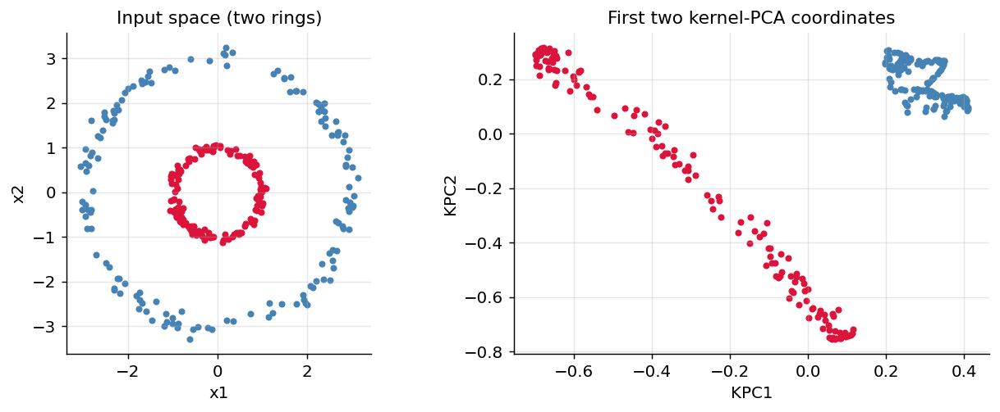

*Figure 178. Kernel PCA with an RBF kernel unfolds two concentric circles into linearly separable coordinates that ordinary PCA cannot find.*

Kernel PCA is powerful but comes with costs. The kernel matrix is $`n \times n`$, so memory and compute scale as $`O(n^{2})`$ and eigendecomposition as $`O(n^{3})`$ — it does not scale to hundreds of thousands of points without approximation (e.g., the Nyström method). Results hinge on the kernel and its hyperparameters ($`\gamma`$), which usually require a search. And unlike linear PCA, the inverse transform back to input space is only approximate (the “pre-image problem”). Use it when you know the structure is nonlinear, $`n`$ is moderate, and you want a principled, projection-style embedding rather than a purely visual one.

## 11.5 Linear Discriminant Analysis: Supervised Reduction

PCA ignores labels. When you *do* have class labels and your goal is to separate classes, **Linear Discriminant Analysis (LDA)** is often superior. Where PCA asks “which directions have the most variance?”, LDA asks “which directions best separate the classes?”

### 11.5.1 The Objective: Maximize Between-Class, Minimize Within-Class Scatter

LDA seeks a projection $`w`$ that pushes class means far apart while keeping each class tight. Define the **within-class scatter** $`S_{W}`$ and **between-class scatter** $`S_{B}`$:

``` math
S_{W} = \sum_{c}^{}{\sum_{x_{i} \in c}^{}(}x_{i} - \mu_{c})(x_{i} - \mu_{c})^{\top},\quad\quad S_{B} = \sum_{c}^{}n_{c}(\mu_{c} - \mu)(\mu_{c} - \mu)^{\top},
```

where $`\mu_{c}`$ is the mean of class $`c`$, $`\mu`$ the global mean, and $`n_{c}`$ the class size. LDA maximizes the **Fisher criterion**, the ratio of projected between-class to within-class scatter:

``` math
J(w) = \frac{w^{\top}S_{B}w}{w^{\top}S_{W}w}.
```

Setting the gradient to zero turns this into the **generalized eigenvalue problem** $`S_{B}w = \lambda S_{W}w`$, equivalently the eigenvectors of $`S_{W}^{- 1}S_{B}`$ with the largest eigenvalues. A crucial structural fact: $`S_{B}`$ has rank at most $`C - 1`$ for $`C`$ classes (the $`C`$ class means span at most a $`C - 1`$ dimensional affine subspace), so **LDA produces at most** $`C - 1`$ **components**. With three classes you get at most two LDA axes, no matter how many input features you had. When $`d > n`$, $`S_{W}`$ is singular and cannot be inverted directly; the standard fix is to run PCA first to a rank where $`S_{W}`$ is invertible, or to use **shrinkage** (regularize $`S_{W}`$ toward a scaled identity), which scikit-learn offers via `solver="lsqr", shrinkage="auto"`.

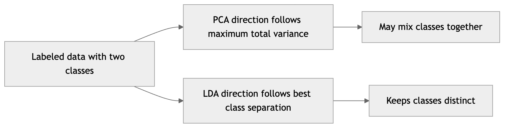

*Figure 179. PCA versus LDA on labeled data — PCA follows total spread, LDA follows class separation.*

### 11.5.2 LDA in Code, Compared with PCA

``` python
from sklearn.datasets import load_digits
from sklearn.preprocessing import StandardScaler
from sklearn.decomposition import PCA
from sklearn.discriminant_analysis import LinearDiscriminantAnalysis as LDA

digits = load_digits()
Xs = StandardScaler().fit_transform(digits.data)
y = digits.target

# PCA: unsupervised, ignores y
Zpca = PCA(n_components=2).fit_transform(Xs)

# LDA: supervised, uses y; at most C-1 = 9 components for 10 classes
Zlda = LDA(n_components=2).fit_transform(Xs, y)

print("PCA 2-D shape:", Zpca.shape)   # (1797, 2)
print("LDA 2-D shape:", Zlda.shape)   # (1797, 2), but driven by labels
```

When plotted, the LDA projection typically shows tighter, better-separated clusters by class than the PCA projection, because it was explicitly optimized for separation. LDA doubles as a classifier (it assumes Gaussian class-conditional densities with shared covariance), which we touched on in the chapter on Classification. Its weaknesses: it assumes classes are roughly Gaussian with equal covariance, it is linear, and the $`C - 1`$ ceiling can be restrictive. When the equal-covariance assumption fails, **Quadratic Discriminant Analysis (QDA)** — which gives each class its own covariance — is the natural extension, at the cost of more parameters to estimate.

| Property | PCA | LDA |
|----|----|----|
| Uses labels? | No (unsupervised) | Yes (supervised) |
| Optimizes | Total variance | Class separability |
| Max components | $`d`$ | $`C - 1`$ |
| Best for | Compression, denoising, visualization | Preprocessing for classification |
| Key assumption | Linear subspace | Gaussian, equal covariance |

## 11.6 Manifold Learning: Nonlinear Neighborhood-Preserving Methods

Linear methods fail when the data lies on a curved manifold. **Manifold learning** methods are nonlinear: they assume the data lives on a low-dimensional surface twisted through the ambient space and try to “unroll” it, preserving local neighborhood structure. The canonical thought experiment is the **Swiss roll** — a 2-D sheet rolled up in 3-D. Straight-line (Euclidean) distance through the roll is misleading; two points on opposite layers are close in space but far along the sheet. Manifold methods respect *geodesic* distance, the distance measured *along* the manifold.

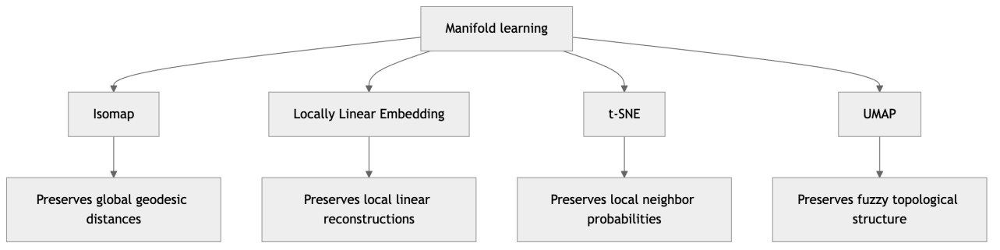

*Figure 180. The manifold-learning family, from graph-distance methods to probabilistic embeddings.*

### 11.6.1 Isomap: Geodesic Distances via a Neighborhood Graph

**Isomap (Isometric Mapping)** extends classical multidimensional scaling to curved manifolds. It works in three steps. First, build a **neighborhood graph**: connect each point to its $`k`$ nearest neighbors, weighting edges by Euclidean distance. Second, estimate the **geodesic distance** between every pair of points as the shortest path through this graph (via Dijkstra’s or the Floyd–Warshall algorithm) — walking along local hops approximates walking along the manifold. Third, apply **classical MDS** to the resulting geodesic distance matrix, finding a low-dimensional embedding whose Euclidean distances best match those geodesics. Because it tries to preserve *all* pairwise geodesic distances, Isomap is a **global** method: it aims to get the overall shape right, not just local neighborhoods. Its weaknesses are sensitivity to the neighbor count $`k`$ (too large and edges “short-circuit” across the roll, collapsing the geometry) and $`O(n^{2})`$–$`O(n^{3})`$ cost.

### 11.6.2 Locally Linear Embedding: Stitching Local Patches

**Locally Linear Embedding (LLE)** takes a different, elegant tack: it never computes global distances. It assumes each point lies on a locally flat patch, so it can be reconstructed as a weighted average of its neighbors. Step one finds weights $`W_{ij}`$ that best reconstruct each $`x_{i}`$ from its neighbors, minimizing $`\sum_{i}^{} \parallel x_{i} - \sum_{j}^{}W_{ij}x_{j} \parallel^{2}`$ with the weights for each point summing to one. These weights encode the *local geometry* and are invariant to rotation, translation, and scaling. Step two finds low-dimensional points $`z_{i}`$ that are reconstructed by the *same* weights, minimizing $`\sum_{i}^{} \parallel z_{i} - \sum_{j}^{}W_{ij}z_{j} \parallel^{2}`$ — this reduces to an eigenvector problem on a sparse matrix. LLE is a **local** method: it preserves the local linear structure and lets the global shape emerge from stitching patches together. It is fast and elegant but can be fragile — sensitive to the neighbor count, prone to collapsing regions to a point, and it struggles when sampling density varies. Variants such as Modified LLE and Hessian LLE improve stability.

### 11.6.3 t-SNE: Matching Neighborhood Probabilities

**t-Distributed Stochastic Neighbor Embedding (t-SNE)** turns distances into probabilities. In the high-dimensional space, it defines the probability that point $`i`$ would pick point $`j`$ as a neighbor using a Gaussian kernel centered on $`i`$:

``` math
p_{j|i} = \frac{exp( - \parallel x_{i} - x_{j} \parallel^{2}/2\sigma_{i}^{2})}{\sum_{k \neq i}^{}\exp( - \parallel x_{i} - x_{k} \parallel^{2}/2\sigma_{i}^{2})}.
```

These are symmetrized into joint probabilities $`p_{ij}`$. The bandwidth $`\sigma_{i}`$ is set so that each point has an effective number of neighbors equal to a user parameter called **perplexity** (typically 5–50); intuitively, perplexity is a smooth measure of how many neighbors each point “feels.” In the low-dimensional map, the analogous probability $`q_{ij}`$ uses a **Student-t distribution** with one degree of freedom (a heavy-tailed kernel):

``` math
q_{ij} = \frac{(1 + \parallel z_{i} - z_{j} \parallel^{2})^{- 1}}{\sum_{k \neq l}^{}(1 + \parallel z_{k} - z_{l} \parallel^{2})^{- 1}}.
```

t-SNE then moves the low-dimensional points by gradient descent to minimize the **Kullback–Leibler divergence** $`KL(P\, \parallel \, Q) = \sum_{ij}^{}p_{ij}\log\frac{p_{ij}}{q_{ij}}`$.

Why the Student-t distribution in the map? This is the fix for the **crowding problem**. In high dimensions there is far more “room” — a point can have many neighbors all roughly equidistant — but a 2-D map has little room, so moderately-distant points get crushed together near the center. The heavy tail of the t-distribution means that to achieve a given (small) probability $`q_{ij}`$, points must sit *farther apart* in the map than a Gaussian would require, giving distant points room to spread and preventing the pile-up. The figure below contrasts the two kernels and shows how the heavy tail pushes moderate-distance pairs outward.

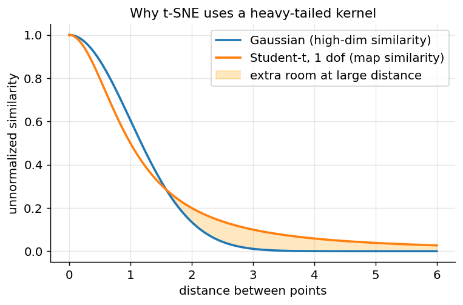

*Figure 181. The heavy-tailed Student-t kernel used in the t-SNE map assigns more probability at large distances than a Gaussian, which relieves the crowding problem.*

**Caveats are essential.** t-SNE is for visualization, not as a general-purpose feature transform: cluster *sizes* in a t-SNE plot are meaningless (the algorithm expands sparse clusters and contracts dense ones), *distances between clusters* are largely uninterpretable, and the output changes with the random seed, perplexity, learning rate, and iteration count. Running it twice gives different pictures; apparent “clusters” can appear at low perplexity even in pure noise. The classic algorithm provides no `transform` for new points (no out-of-sample mapping), and it scales poorly — $`O(n^{2})`$ naively, improved to roughly $`O(n\log n)`$ with the Barnes–Hut approximation. **How to read a t-SNE plot:** trust *what clusters with what* and rough local neighborhoods; distrust cluster size, inter-cluster distance, and absolute position. Always try several perplexities before drawing conclusions.

### 11.6.4 UMAP: Faster, with More Faithful Global Structure

**Uniform Manifold Approximation and Projection (UMAP)** is built on topological ideas (fuzzy simplicial sets) rather than probabilities, but operationally it is similar: build a weighted neighborhood graph in high dimensions, then optimize a low-dimensional layout whose graph matches, using a cross-entropy-style loss and stochastic gradient descent. Its key parameters are `n_neighbors` (local versus global emphasis, analogous to perplexity) and `min_dist` (how tightly points may pack in the map). Compared with t-SNE, UMAP is markedly faster, scales to millions of points, tends to preserve more **global** structure (relative cluster positions carry somewhat more meaning), and crucially offers a `transform` method so you can embed new data after fitting — and it can even run in a supervised mode using labels. It shares t-SNE’s caveat that exact distances and densities should not be over-interpreted, and it too can conjure spurious clusters if `n_neighbors` is small.

### 11.6.5 Runnable t-SNE and UMAP Example on Digits

``` python
import numpy as np
from sklearn.datasets import load_digits
from sklearn.preprocessing import StandardScaler
from sklearn.decomposition import PCA
from sklearn.manifold import TSNE

digits = load_digits()
Xs = StandardScaler().fit_transform(digits.data)
y = digits.target

# Best practice: PCA first to ~30-50 dims to denoise and speed up t-SNE
Xpca = PCA(n_components=30, random_state=0).fit_transform(Xs)

tsne = TSNE(n_components=2, perplexity=30, init="pca",
            learning_rate="auto", random_state=0)
Z = tsne.fit_transform(Xpca)
print("t-SNE embedding shape:", Z.shape)   # (1797, 2)

# Z now separates the 10 digit classes into visually distinct islands.
# To plot:
# import matplotlib.pyplot as plt
# plt.scatter(Z[:,0], Z[:,1], c=y, cmap="tab10", s=8); plt.colorbar()
```

If you have the `umap-learn` package installed, the UMAP equivalent is a near drop-in replacement that also supports embedding new points:

``` python
# pip install umap-learn
import umap
reducer = umap.UMAP(n_neighbors=15, min_dist=0.1, random_state=0)
Z_umap = reducer.fit_transform(Xpca)
# Unlike t-SNE, UMAP can embed unseen data:
# Z_new = reducer.transform(X_new_pca)
```

The matplotlib figure below builds a 2-D embedding of synthetic data to illustrate the *kind* of picture these methods produce — well-separated islands corresponding to true groups — without requiring t-SNE to run inside the figure harness.

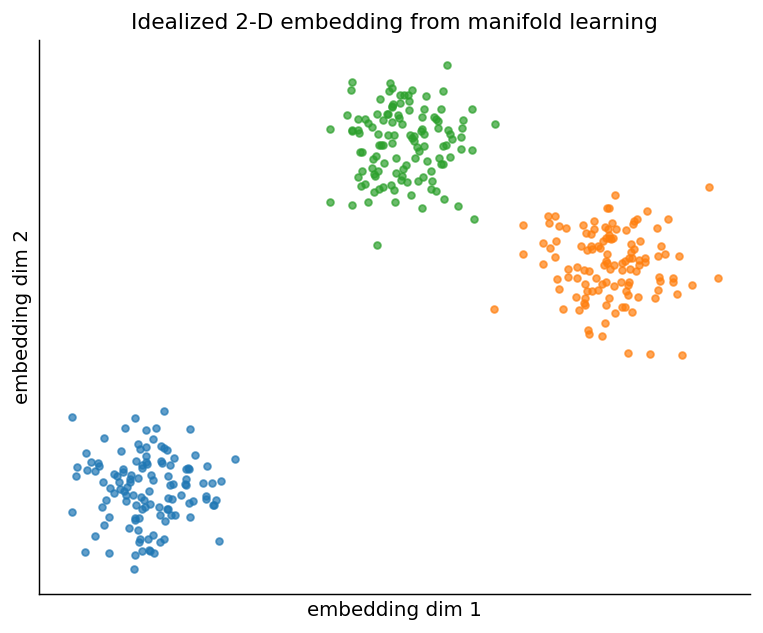

*Figure 182. An idealized 2-D embedding, the visual output manifold methods aim to produce.*

## 11.7 Independent Component Analysis: Separating Mixed Sources

PCA finds *uncorrelated* directions of maximal variance. **Independent Component Analysis (ICA)** pursues a different and stronger goal: find directions that are **statistically independent**, not merely uncorrelated. The motivating story is the **cocktail-party problem**. Several people speak at once; several microphones each record a *different linear mixture* of all the voices. ICA recovers the original, unmixed voices from the mixtures alone, knowing neither the speakers nor the mixing.

Formally, ICA models the observed signals as $`x = As`$, where $`s`$ is a vector of unknown independent **source** signals and $`A`$ is an unknown **mixing matrix**. ICA estimates an **unmixing matrix** $`W \approx A^{- 1}`$ so that $`\widehat{s} = Wx`$ recovers the sources up to permutation and scaling. The key insight that makes this possible is the **Central Limit Theorem**: a sum (mixture) of independent signals is *more Gaussian* than the individual signals. So ICA works by finding directions that are *maximally non-Gaussian* — the least Gaussian projections are, paradoxically, the original un-summed sources. Algorithms such as **FastICA** maximize a measure of non-Gaussianity (kurtosis, or the smoother “negentropy”) after first whitening the data with PCA.

Two consequences of this design: ICA **cannot recover Gaussian sources** (they have no non-Gaussian direction to find — everything looks the same), and it **cannot determine the order or amplitude** of the sources (any permutation or rescaling is equally valid). The figure below shows the setup: two structured source signals, and the tangled mixtures a set of sensors would record. ICA’s job is to invert the mixing and hand back the originals.

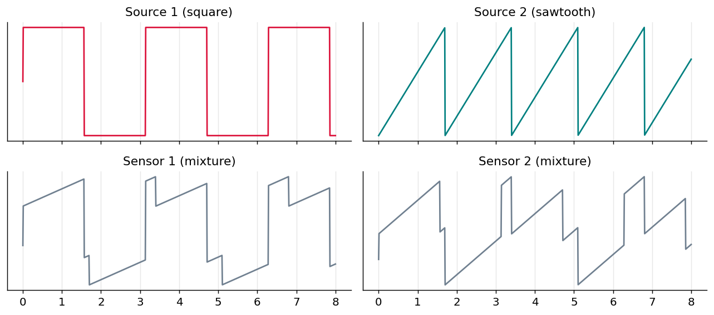

*Figure 183. The ICA problem — independent source signals (top) are linearly mixed into the entangled observations a set of sensors records (bottom).*

``` python
import numpy as np
from sklearn.decomposition import FastICA

# X: (n_samples, n_sensors) of mixed signals
ica = FastICA(n_components=2, whiten="unit-variance", random_state=0)
S_hat = ica.fit_transform(X)      # recovered independent sources
A_hat = ica.mixing_              # estimated mixing matrix
# S_hat columns match the true sources up to sign/scale/order.
```

ICA’s flagship applications are in signal processing: separating brain sources in EEG/MEG, removing eye-blink and heartbeat artifacts from neural recordings, and audio source separation. Contrast it sharply with PCA: PCA rotates to *uncorrelated, ranked-by-variance, orthogonal* axes; ICA rotates to *independent, unordered, generally non-orthogonal* axes. Use PCA to compress and denoise; use ICA to *unmix* a signal you believe is a blend of independent generators.

## 11.8 Random Projections and the Johnson–Lindenstrauss Lemma

Every method so far *looks* at the data to choose its projection. Astonishingly, you often do not need to. The **Johnson–Lindenstrauss (JL) lemma** states that a set of $`n`$ points in high-dimensional space can be projected onto a random subspace of dimension

``` math
k \geq \frac{8\ln n}{\epsilon^{2}}
```

while preserving all pairwise Euclidean distances to within a factor of $`1 \pm \epsilon`$, with high probability. The remarkable part is what is *absent*: the target dimension $`k`$ depends on the number of points $`n`$ and the tolerance $`\epsilon`$, but **not on the original dimension** $`d`$. Project a million-dimensional dataset of 10,000 points down to a few thousand dimensions and distances barely move — and you never had to compute a covariance matrix or an eigendecomposition.

The projection is simply $`Z = XR`$ where $`R \in \mathbb{R}^{d \times k}`$ has entries drawn from a Gaussian (or, for speed, a sparse $`\{ - 1,0, + 1\}`$ scheme due to Achlioptas). No fitting, no data-dependent computation — it is effectively free and trivially parallel, which is why it is a staple for streaming data, approximate nearest-neighbor search, and as a cheap preconditioner before an expensive method. The figure below projects 500-dimensional data to 50 dimensions with a random Gaussian matrix and shows that pairwise distances are preserved: the scatter of projected-vs-original distances hugs the diagonal.

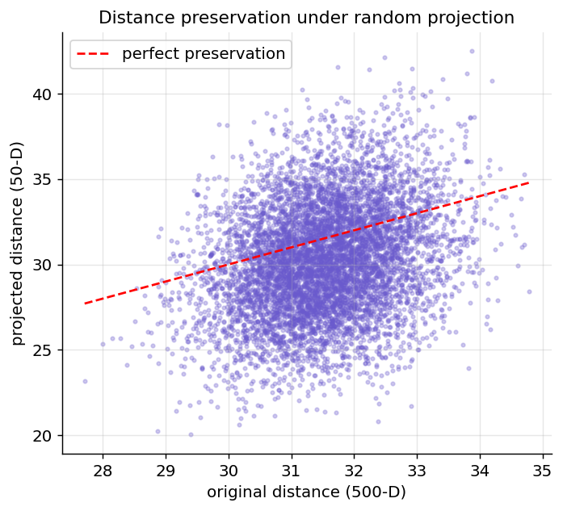

*Figure 184. A random Gaussian projection from 500 down to 50 dimensions preserves pairwise distances — the Johnson-Lindenstrauss lemma in action.*

Random projection trades optimality for speed: PCA gives the *best* linear subspace for a given $`k`$, while random projection gives a *good-enough* one for free, with a guarantee only on distances (not variance or interpretability). When $`d`$ is enormous and you mostly care about preserving neighbor relations — retrieval, LSH, clustering at scale — reach for it before the heavier machinery.

## 11.9 Autoencoders: Nonlinear Dimensionality Reduction with Neural Networks

PCA finds the best *linear* subspace. An **autoencoder** generalizes this to *nonlinear* manifolds using a neural network. The architecture is an hourglass: an **encoder** compresses the input $`x`$ into a low-dimensional **latent code** (or **bottleneck**) $`z`$, and a **decoder** reconstructs $`\widehat{x}`$ from $`z`$. The network is trained to minimize reconstruction error, typically mean squared error $`\parallel x - \widehat{x} \parallel^{2}`$. Because the bottleneck is narrow (an **undercomplete** autoencoder), the network must learn to keep only the most informative structure — exactly the dimensionality-reduction goal.

A beautiful fact ties this back to PCA: an autoencoder with a single linear layer in encoder and decoder and an MSE loss learns the same subspace as PCA (it spans the same space, though not necessarily the orthonormal axes). Adding nonlinear activations and depth lets it model curved manifolds that PCA cannot. We cover the mechanics of neural networks fully in Part V; here we use them as a tool. The full treatment of training dynamics, activation functions, and optimization lives in the chapters on Neural Network Fundamentals and Training Deep Networks.

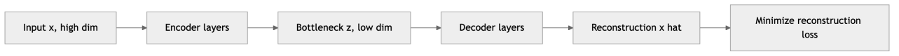

*Figure 185. Autoencoder architecture — encoder compresses to a bottleneck, decoder reconstructs.*

Variants extend the basic idea: **denoising autoencoders** add noise to the input but ask the network to reconstruct the clean original, forcing robust features; **sparse autoencoders** penalize active latent units so each represents a distinct concept; **contractive autoencoders** penalize the sensitivity of the code to input changes; and **variational autoencoders (VAEs)** impose a probabilistic structure on the latent space, enabling generation — covered in the chapter on Generative AI. For the dimensionality-reduction use case, the plain undercomplete autoencoder is the relevant one.

Below are matched **Keras/TensorFlow** and **PyTorch** implementations of a small autoencoder that compresses the 64-dimensional digits to a 2-dimensional latent space.

``` python
# --- Keras / TensorFlow version ---
import numpy as np
import tensorflow as tf
from tensorflow import keras
from sklearn.datasets import load_digits
from sklearn.preprocessing import MinMaxScaler

X = MinMaxScaler().fit_transform(load_digits().data).astype("float32")  # (1797, 64)

inp = keras.Input(shape=(64,))
h = keras.layers.Dense(32, activation="relu")(inp)
z = keras.layers.Dense(2, activation="linear", name="bottleneck")(h)   # 2-D code
h2 = keras.layers.Dense(32, activation="relu")(z)
out = keras.layers.Dense(64, activation="sigmoid")(h2)

autoencoder = keras.Model(inp, out)
encoder = keras.Model(inp, z)                 # reusable encoder for 2-D codes
autoencoder.compile(optimizer="adam", loss="mse")
autoencoder.fit(X, X, epochs=50, batch_size=64, verbose=0)

codes = encoder.predict(X)                    # (1797, 2) latent representation
print("Keras latent shape:", codes.shape)
# --- PyTorch version ---
import numpy as np
import torch
import torch.nn as nn
from sklearn.datasets import load_digits
from sklearn.preprocessing import MinMaxScaler

X = MinMaxScaler().fit_transform(load_digits().data).astype("float32")
Xt = torch.tensor(X)

class AutoEncoder(nn.Module):
    def __init__(self):
        super().__init__()
        self.encoder = nn.Sequential(nn.Linear(64, 32), nn.ReLU(), nn.Linear(32, 2))
        self.decoder = nn.Sequential(nn.Linear(2, 32), nn.ReLU(),
                                     nn.Linear(32, 64), nn.Sigmoid())
    def forward(self, x):
        z = self.encoder(x)
        return self.decoder(z), z

model = AutoEncoder()
opt = torch.optim.Adam(model.parameters(), lr=1e-3)
loss_fn = nn.MSELoss()

for epoch in range(50):
    opt.zero_grad()
    recon, _ = model(Xt)
    loss = loss_fn(recon, Xt)
    loss.backward()
    opt.step()

with torch.no_grad():
    _, codes = model(Xt)
print("PyTorch latent shape:", codes.shape)   # torch.Size([1797, 2])
```

Both networks learn a 2-D code that, unlike PCA’s, can bend to follow nonlinear structure. The trade-offs: autoencoders need more data, are slower to train, are nondeterministic, and require tuning (architecture, learning rate, epochs, regularization). For modest data and quick results, PCA usually wins; for large, complex, nonlinear data — and especially images, where convolutional encoders shine — autoencoders shine.

## 11.10 Matrix Factorization and Non-Negative Matrix Factorization

Many dimensionality-reduction methods can be viewed through one lens: **matrix factorization**, approximating a data matrix $`X \approx ZW`$ as a product of a tall “scores” matrix $`Z`$ (one low-dimensional row per sample) and a wide “components” matrix $`W`$ (the basis vectors). PCA is exactly this with an orthonormal $`W`$; the difference between methods is largely the *constraints* placed on the factors.

**Non-negative Matrix Factorization (NMF)** adds one constraint with outsized consequences: **every entry of** $`Z`$ **and** $`W`$ **must be non-negative**. We factor a non-negative $`X \in \mathbb{R}_{\geq 0}^{n \times d}`$ into $`X \approx WH`$ with $`W \geq 0`$ and $`H \geq 0`$, minimizing $`\parallel X - WH \parallel_{F}^{2}`$ (or a Kullback–Leibler divergence) via **multiplicative update** rules that keep the factors non-negative at every step. Because nothing can be negative, components can only *add*, never subtract — and this forces a **parts-based**, additive representation. On face images NMF discovers parts like noses, eyes, and mouths; PCA, free to subtract, instead produces ghostly whole-face “eigenfaces.” On text (a non-negative document–term matrix) NMF yields interpretable **topics**: each component is a bag of co-occurring words, and each document is a non-negative mix of topics — this is one of the classic topic-modeling techniques.

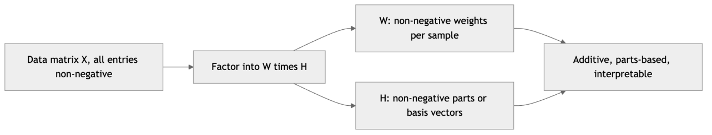

*Figure 186. NMF factors a non-negative data matrix into non-negative parts and their additive weights.*

``` python
import numpy as np
from sklearn.decomposition import NMF
from sklearn.datasets import load_digits

X = load_digits().data          # non-negative pixel intensities, (1797, 64)
nmf = NMF(n_components=10, init="nndsvda", max_iter=500, random_state=0)
W = nmf.fit_transform(X)        # (1797, 10) non-negative encodings
H = nmf.components_             # (10, 64) non-negative parts
print("reconstruction error:", nmf.reconstruction_err_)
# Each of the 10 rows of H is a "part"; each image is a non-negative sum of parts.
```

NMF’s strengths are interpretability and its natural fit to inherently non-negative data (counts, intensities, spectra, gene expression). Its weaknesses: the objective is non-convex, so results depend on initialization (hence `nndsvda`); the number of components must be chosen; and it does not apply to data with meaningful negative values. Related factorizations round out the family — **Sparse PCA** adds an L1 penalty to $`W`$ for sparse, more interpretable loadings; **Dictionary Learning** learns an overcomplete basis with sparse codes; and the same factorization idea, applied to a user–item ratings matrix, is the engine of collaborative-filtering **recommender systems** (see the chapter on Recommender Systems).

## 11.11 Choosing a Method: A Consolidated Comparison

With the full toolbox on the table, the practical question is which tool to reach for. The table below summarizes the axes that matter most — linear versus nonlinear, supervised versus unsupervised, whether it can embed new points, and whether it favors preserving local or global structure.

| Method | Linear? | Supervised? | Out-of-sample transform? | Structure preserved | Primary use |
|----|----|----|----|----|----|
| PCA | Yes | No | Yes | Global variance | Compression, denoising, preprocessing |
| Kernel PCA | No | No | Yes (approx. inverse) | Global, in kernel space | Nonlinear projection, moderate $`n`$ |
| LDA | Yes | Yes | Yes | Class separation | Classification preprocessing |
| ICA | Yes | No | Yes | Statistical independence | Source separation, artifact removal |
| Random projection | Yes | No | Yes | Pairwise distances | Very high $`d`$, fast preprocessing |
| NMF | Yes | No | Yes | Additive parts | Interpretable parts, topics, non-negative data |
| Isomap | No | No | Approximate | Global geodesic | Unrolling a single manifold |
| LLE | No | No | Approximate | Local geometry | Local manifold structure |
| t-SNE | No | No | No | Local neighborhoods | Visualization only |
| UMAP | No | No (optional) | Yes | Local, some global | Visualization, general embedding |
| Autoencoder | No | No | Yes | Learned nonlinear | Nonlinear compression, denoising, images |

A workable decision procedure: if you need interpretable *original* features, do feature selection. Otherwise, start with **PCA** — it is fast, gives a variance budget, and often suffices. If PCA’s scree plot shows variance spread across many components and downstream results disappoint, the structure may be nonlinear: use **Kernel PCA** or an **autoencoder** for a projection you can reuse, or **UMAP/t-SNE** purely to *see* the clusters. If you have labels and a classification goal, try **LDA**. If your signal is a *mixture* of independent generators, use **ICA**. If $`d`$ is astronomically large and you only care about distances, use **random projection**. If your data is non-negative and interpretability matters, use **NMF**.

## 11.12 Practical Uses of Dimensionality Reduction

Dimensionality reduction is not academic; it earns its keep in several concrete ways.

**Visualization.** Humans see in two or three dimensions. Projecting data to 2-D with PCA, t-SNE, or UMAP turns an opaque table into a picture in which clusters, outliers, and class overlap become visible. This is often the very first step of exploratory analysis on a new dataset — and a fast sanity check on whether your classes are even separable.

**Compression.** Storing or transmitting a PCA representation with $`k \ll d`$ components saves space proportionally. The reconstruction is approximate but often perceptually lossless, the same principle that underlies many media codecs.

**Denoising.** Noise tends to spread energy across all directions, while signal concentrates in a few high-variance components. Projecting onto the top components and reconstructing — PCA reconstruction or a denoising autoencoder — discards the low-variance noise directions and returns a cleaner signal. This is widely used on images and sensor data.

**Speeding up and regularizing downstream models.** Training a classifier on 50 PCA components instead of 5,000 raw features is dramatically faster and often *more* accurate, because removing low-variance noise directions reduces overfitting. PCA is a common front-end for k-NN, SVMs, and clustering, all of which suffer in high dimensions. A typical pipeline:

``` python
from sklearn.pipeline import make_pipeline
from sklearn.preprocessing import StandardScaler
from sklearn.decomposition import PCA
from sklearn.svm import SVC
from sklearn.datasets import load_digits
from sklearn.model_selection import cross_val_score

X, y = load_digits(return_X_y=True)
pipe = make_pipeline(StandardScaler(), PCA(n_components=30), SVC(kernel="rbf"))
scores = cross_val_score(pipe, X, y, cv=5)
print(f"PCA+SVM accuracy: {scores.mean():.3f}")   # ~0.98
```

Folding PCA into a `Pipeline` ensures it is refit on each training fold only, preventing the data-leakage pitfall mentioned earlier.

**Real-world case studies.** In genomics, PCA on SNP data recovers *geography*: the first two principal components of European genotypes reproduce a recognizable map of Europe, because genetic variation tracks ancestry and migration. In neuroscience, ICA cleans EEG recordings by isolating and removing eye-blink and muscle artifacts. In natural language processing, truncated SVD (LSA) and NMF extract latent topics from document–term matrices. In computer vision, autoencoders and PCA compress and denoise images, and t-SNE/UMAP embeddings of a network’s internal activations reveal how a deep model organizes its concepts. In anomaly detection, a large PCA reconstruction error flags points that do not fit the normal low-dimensional structure — a fraud transaction or a failing sensor.

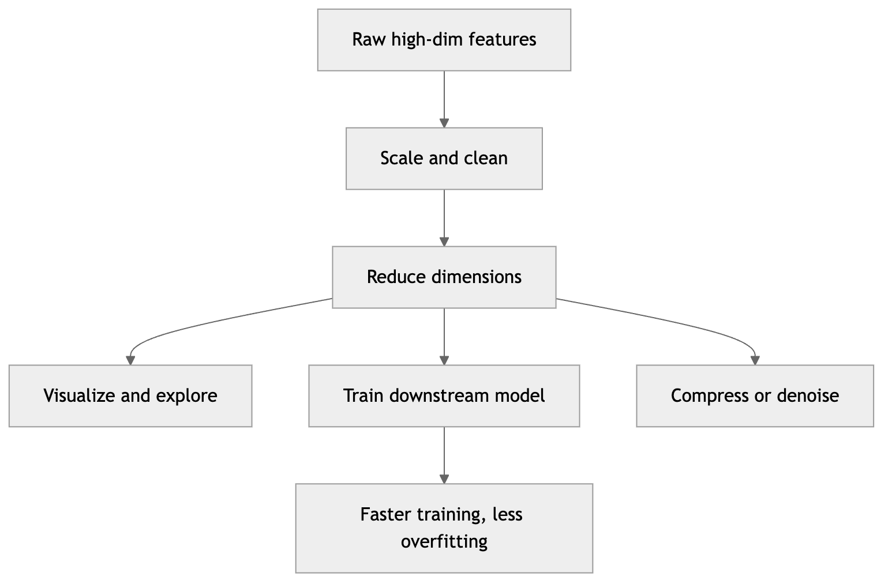

*Figure 187. Where dimensionality reduction fits in a typical machine learning pipeline.*

## 11.13 Summary

Dimensionality reduction attacks the curse of dimensionality by finding the low-dimensional structure that real data almost always possesses. The **curse of dimensionality** makes high-dimensional spaces sparse, pushes nearly all volume toward the boundary, concentrates distances so nearest-neighbor logic breaks down, and demands exponentially more data; the escape hatch is that data lives near a lower-dimensional **manifold**.

You reduce dimension either by **feature selection** — keeping a subset of original, interpretable features via filter, wrapper, or embedded methods — or by **feature extraction**, building new combined features that pack more information into fewer dimensions at the cost of interpretability. Among extraction methods, **PCA** finds orthogonal directions of maximum variance (equivalently, minimum reconstruction error) via the eigenvectors of the covariance matrix or the SVD; eigenvalues give the explained-variance budget, the scree plot guides the choice of $`k`$, whitening equalizes component scales, and truncated projection enables lossy compression and denoising. **Kernel PCA** extends this to nonlinear structure via the kernel trick. **LDA** is the supervised counterpart, maximizing the Fisher criterion to separate classes and yielding at most $`C - 1`$ components. **ICA** rotates to statistically independent, maximally non-Gaussian directions to unmix blended sources. **Random projection** exploits the Johnson–Lindenstrauss lemma to preserve distances with a data-independent random map whose target dimension does not depend on $`d`$. **Manifold methods** — Isomap (global geodesics), LLE (local geometry), and the visualization-focused t-SNE and UMAP — unroll curved manifolds but distort geometry in ways you must not over-read. **Autoencoders** generalize PCA to nonlinear manifolds with an encoder–bottleneck–decoder network, and **NMF** and its relatives factor non-negative data into interpretable, additive parts. Reduced representations power visualization, compression, denoising, and faster, better-regularized downstream models — always fit the reducer on training data only to avoid leakage.

## 11.14 Key Takeaways

- High dimensions are genuinely hostile: volume, sparsity, and distance concentration all conspire against distance-based algorithms. Reduction is a fix, not a luxury.
- **Selection** keeps interpretability; **extraction** maximizes information density. Choose by whether feature meaning or downstream performance matters more.
- **PCA** is the default: fast, closed-form, gives an explained-variance budget, and doubles as a denoiser and compressor. Standardize first, and fit only on training data.
- The variance-maximization and minimum-reconstruction-error views of PCA are the same optimization — remember both.
- Prefer the **SVD** route to forming the covariance matrix; it is more numerically stable, and truncated SVD handles huge sparse matrices (LSA).
- Reach for **LDA** when you have labels and want class separation; for **Kernel PCA / autoencoders** when structure is nonlinear; for **ICA** to unmix independent sources; for **random projection** when $`d`$ is enormous; for **NMF** when data is non-negative and you want interpretable parts.
- **t-SNE and UMAP are for seeing, not measuring.** Trust cluster membership and local neighborhoods; distrust cluster size, inter-cluster distance, and absolute position. Try several perplexity / `n_neighbors` values and seeds.
- The number of components is a real hyperparameter: use the scree elbow, a variance threshold, parallel analysis, or — best when there is a downstream task — cross-validated performance.

## 11.15 Exercises

1.  **Conceptual.** Explain in your own words why a “local” neighborhood containing 10% of the data spans nearly the full range of every feature in 100 dimensions. What does this imply for the k-NN algorithm from the chapter on Classification?

2.  **Conceptual.** PCA maximizes variance while LDA maximizes class separation. Sketch a 2-D labeled dataset where the first principal component points in a *different* direction from the first LDA discriminant, and explain why.

3.  **Conceptual.** Show, using the two views of PCA, why maximizing retained variance and minimizing squared reconstruction error give the same principal components. Where does the orthonormality of the basis enter the argument?

4.  **Conceptual.** The Johnson–Lindenstrauss bound $`k \geq 8\ln n/\epsilon^{2}`$ does not mention the original dimension $`d`$. Explain intuitively why the number of *points* matters but the ambient dimension does not. For $`n = 10,000`$ and $`\epsilon = 0.1`$, what target dimension does the bound suggest?

5.  **Coding — PCA.** Load `sklearn.datasets.load_breast_cancer`. Standardize the features, fit PCA, and produce a scree plot. How many components are needed to retain 90% of the variance? Project to 2-D and color points by the diagnosis label — are the classes visually separable?

6.  **Coding — reconstruction.** Using the digits dataset, reconstruct the images from 5, 20, and 40 PCA components. Display a few reconstructed digits at each level and compute the reconstruction MSE. At what point do the digits become reliably recognizable? Confirm numerically that the MSE equals the sum of the discarded eigenvalues.

7.  **Coding — Kernel PCA.** Generate two concentric circles with `sklearn.datasets.make_circles`. Show that `PCA(n_components=2)` fails to separate them, then that `KernelPCA(kernel="rbf", gamma=...)` does. Sweep `gamma` and describe how the embedding changes.

8.  **Coding — t-SNE versus UMAP.** Run t-SNE with perplexity values of 5, 30, and 100 on the digits dataset and plot all three embeddings side by side. Describe how the picture changes. If you have `umap-learn`, repeat with UMAP and `n_neighbors` of 5, 15, and 50, and compare runtimes.

9.  **Coding — ICA.** Build two independent source signals (e.g., a sine and a square wave), mix them with a random 2×2 matrix, and recover them with `FastICA`. Plot sources, mixtures, and recoveries. Verify that the recovery matches the sources only up to sign, scale, and order. What happens if you make both sources Gaussian noise instead?

10. **Coding — autoencoder versus PCA.** Train the 2-D autoencoder from this chapter and plot its latent codes colored by digit class. Plot the 2-D PCA projection alongside it. Which gives cleaner class separation, and why might that be? Then train a logistic-regression classifier on each 2-D representation and compare accuracy.

11. **Coding — NMF topics.** Fetch a small text corpus (e.g., `fetch_20newsgroups`), build a TF-IDF document–term matrix, and fit `NMF(n_components=10)`. Print the top words of each component. Do the components read as coherent topics? Compare with the components from `TruncatedSVD`.

---

[← 10 Clustering](ch10-clustering.md) · [Contents](../README.md#contents) · [12 Association Rule Learning →](ch12-association-rules.md)
