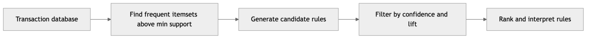
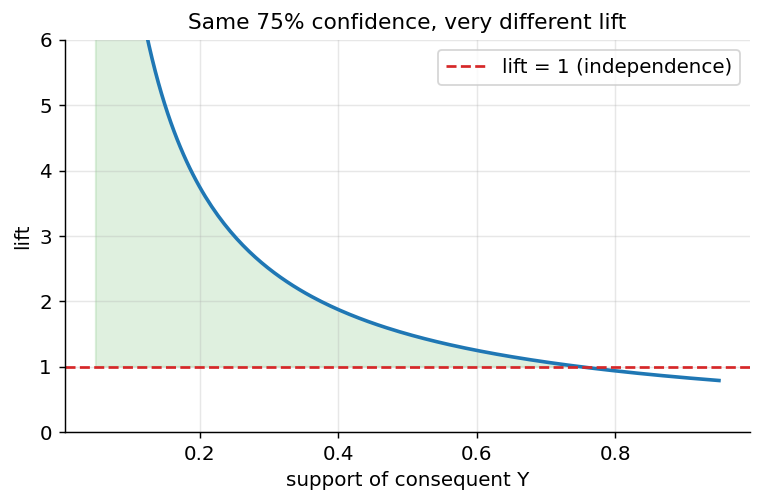
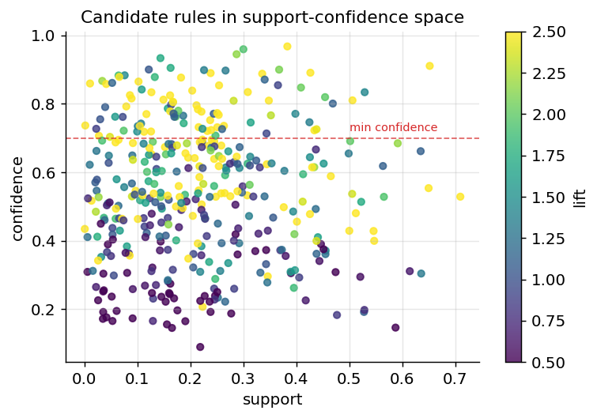
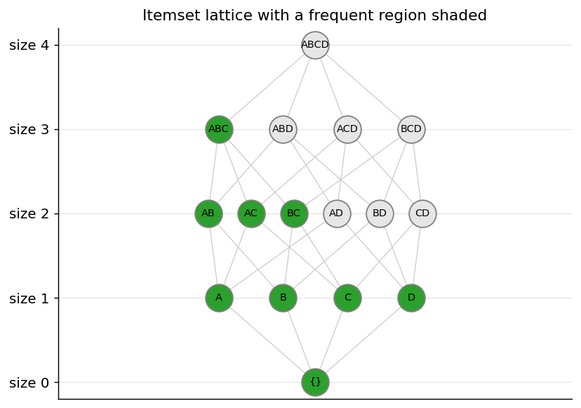
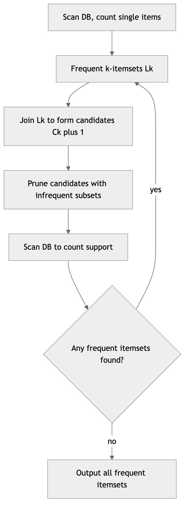
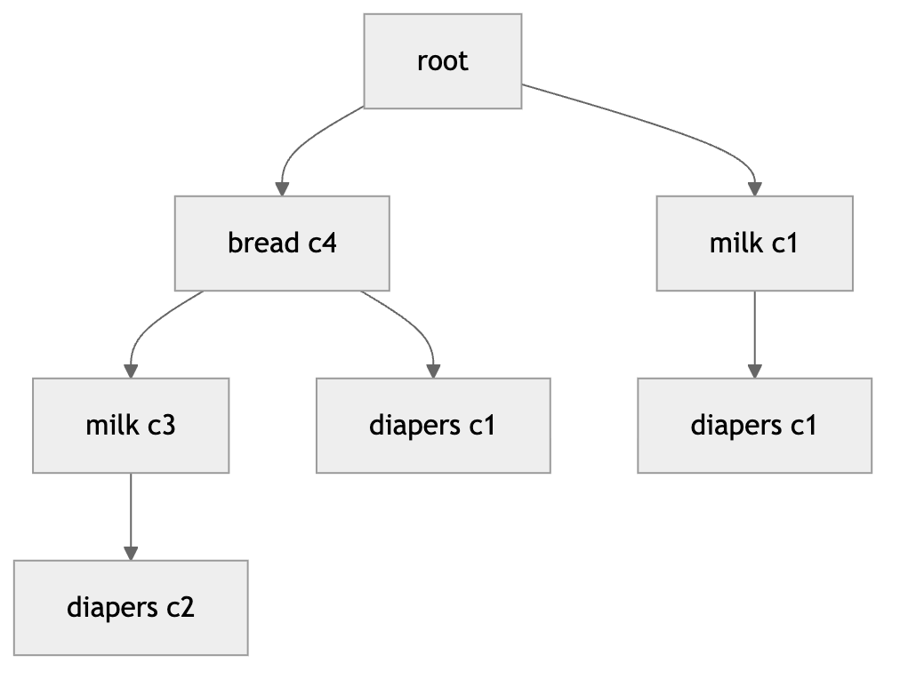
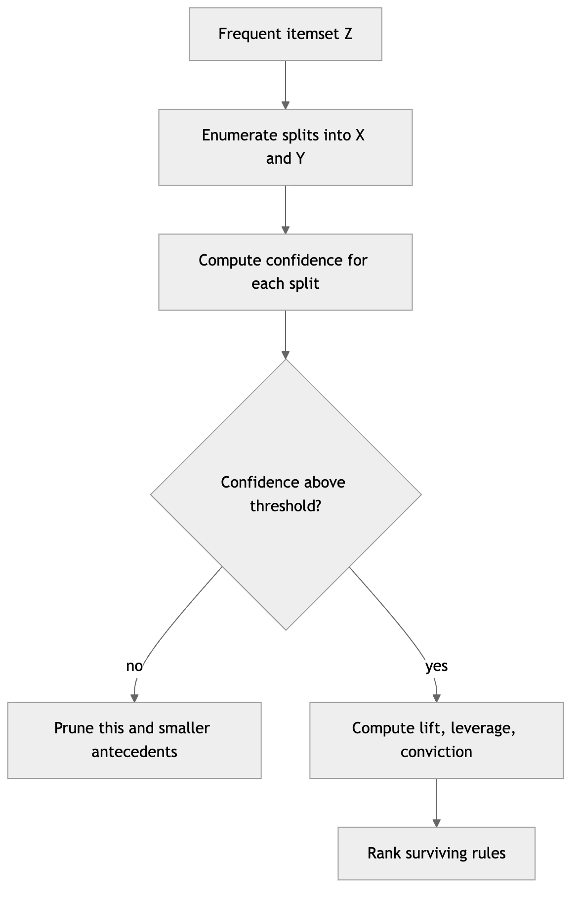
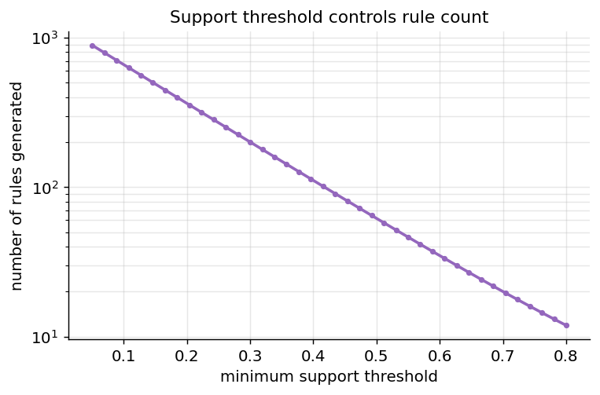
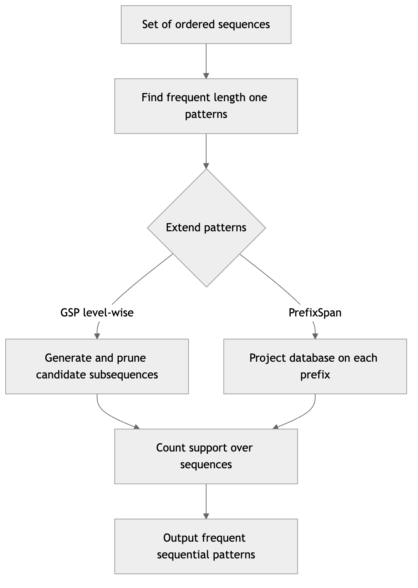
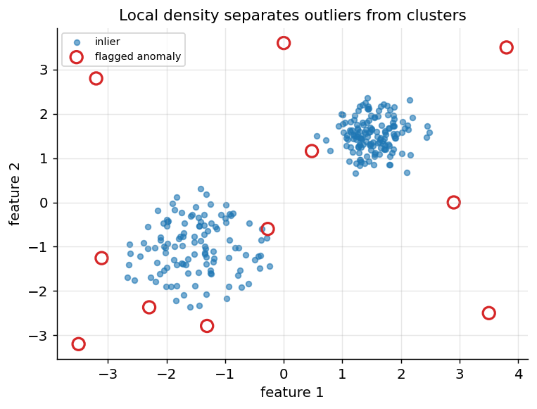

[← 11 Dimensionality Reduction and Feature Extraction](ch11-dimensionality-reduction.md) · [Contents](../README.md#contents) · [13 Time Series Analysis and Forecasting →](ch13-time-series-forecasting.md)

---

# 12 Association Rule Learning

Imagine standing at a supermarket checkout and watching thousands of receipts scroll by. Buried inside that stream of transactions are patterns: people who buy tortilla chips often buy salsa, new parents who buy diapers sometimes grab a six-pack of beer, and shoppers who add a printer to their cart rarely leave without ink. **Association rule learning** is the family of unsupervised techniques that mines these co-occurrence patterns automatically, turning piles of transaction logs into compact, human-readable rules of the form “if a customer buys X, they tend to also buy Y.” This chapter develops the core metrics that quantify how interesting a rule is, then walks through the canonical mining algorithms — Apriori, ECLAT, and FP-Growth — with worked examples, runnable code, and guidance on when to reach for each. It then extends the story to **sequential pattern mining**, where order matters, and closes with a substantial treatment of **anomaly and outlier detection**, a closely related unsupervised task that asks the mirror-image question: not “what patterns recur?” but “what does not fit any pattern at all?”

These topics belong together because they share a philosophical stance. Both are *descriptive* rather than *predictive*: there is no labeled target to fit, no accuracy score to maximize against ground truth. Instead you are extracting structure the data already contains and handing it to a human — a merchandiser, a fraud analyst, a physician — who supplies the judgment about what to do next. That places a special burden on you as the practitioner. Because there is no held-out test set to keep you honest, the discipline has to come from careful metric design, principled thresholds, and a constant guard against reading too much into coincidence.

## 12.1 From Transactions to Rules: The Market-Basket Model

Association rule learning lives in the unsupervised corner of machine learning. Unlike the clustering methods covered in the chapter on Clustering, which group whole records by similarity, association mining looks at *which items appear together* within records. There is no target variable and no notion of “correct” prediction — we are descriptively summarizing structure in the data.

The classic setting is **market-basket analysis**. We have a set of **items** $`I = \{ i_{1},i_{2},\ldots,i_{d}\}`$ (the products a store sells) and a database of **transactions** $`T = \{ t_{1},t_{2},\ldots,t_{n}\}`$, where each transaction is a subset of items, $`t_{k} \subseteq I`$. A transaction is just one shopping basket. Although the language comes from retail, the same abstraction fits many domains: items can be web pages visited in a session, genes expressed together in a sample, symptoms recorded in a patient visit, words appearing in a document, or courses a student enrolls in together. The power of the market-basket abstraction is precisely that it strips away everything except the co-membership relation — *these things showed up in the same container* — which turns out to be enough to discover a surprising amount of structure.

An **itemset** is any subset of $`I`$. An itemset containing $`k`$ items is called a $`k`$**-itemset**. An **association rule** is an implication of the form

``` math
X \Rightarrow Y,\quad\text{where}X,Y \subseteq I\text{and}X \cap Y = \varnothing.
```

Here $`X`$ is the **antecedent** (the “if” part, sometimes called the *body* or *left-hand side*) and $`Y`$ is the **consequent** (the “then” part, or *head* / *right-hand side*). The rule $`\{\text{bread},\text{butter}\} \Rightarrow \{\text{milk}\}`$ reads “baskets containing bread and butter tend to also contain milk.” Crucially, the arrow does **not** mean logical implication or causation — it is a statistical statement about co-occurrence frequency. We will return to this distinction repeatedly, because confusing correlation with causation is the single most common way these rules are misused.

### 12.1.1 Two Data Layouts

How you physically store the transaction database shapes which algorithm is natural to run over it. Two layouts dominate.

The **horizontal layout** stores one row per transaction, listing the items in that basket. This is how point-of-sale systems naturally log data and is what Apriori consumes.

| TID | Items                      |
|-----|----------------------------|
| t1  | bread, milk                |
| t2  | bread, diapers, beer, eggs |
| t3  | milk, diapers, beer, cola  |

The **vertical layout** inverts this: one row per item, listing the transaction IDs (**TIDs**) in which that item appears. This is the natural form for ECLAT.

| Item    | TID-set |
|---------|---------|
| bread   | t1, t2  |
| milk    | t1, t3  |
| diapers | t2, t3  |

A third, purely computational representation is the **one-hot (binary) matrix**: a $`n \times d`$ table where entry $`(k,j)`$ is 1 if transaction $`t_{k}`$ contains item $`i_{j}`$. Most software libraries operate on this matrix internally. Real market-basket matrices are extremely **sparse** — a grocery store might sell 50,000 products but the average basket holds a dozen — so storing them densely is wasteful and mining them naively is hopeless. Sparsity is not just an implementation detail; it is the structural fact that every efficient algorithm in this chapter exploits.



*Figure 188. The association rule mining pipeline, from raw transactions to actionable rules.*

The pipeline above splits the problem into two stages that almost every algorithm follows. First, find all **frequent itemsets** — the combinations of items that appear together often enough to matter. Second, from those frequent itemsets, generate **rules** that meet our quality thresholds. The first stage is computationally expensive and is where Apriori, ECLAT, and FP-Growth differ; the second stage is comparatively cheap and is nearly identical across algorithms. Keeping these two stages mentally separate is the key to understanding the whole field: almost all the algorithmic ingenuity goes into stage one, while almost all the *interpretive* care goes into stage two.

## 12.2 Core Metrics: Support, Confidence, Lift, Leverage, and Conviction

Before we can mine rules we need to measure how interesting they are. Five metrics do most of the work, and each one exists to patch a blind spot in the ones before it. It is worth internalizing that progression — support, then confidence, then lift, then leverage and conviction — because each metric is essentially a correction to the naivety of its predecessor.

### 12.2.1 Support

The **support** of an itemset is the fraction of transactions that contain it:

``` math
\text{support}(X) = \frac{|\{ t \in T:X \subseteq t\}|}{|T|}.
```

Support measures how *frequent* a pattern is. The support of a rule $`X \Rightarrow Y`$ is defined as the support of the combined itemset, $`\text{support}(X \cup Y)`$. A rule with high support describes behavior that happens a lot; a rule with tiny support, even if it looks striking, may simply be noise from a handful of baskets. Support is the gatekeeper metric: mining algorithms first discard everything below a user-chosen **minimum support** threshold, denoted $`\text{minsup}`$, because rare itemsets cannot produce statistically reliable rules and — just as importantly — because pruning on support is what makes mining computationally feasible at all.

Support can be quoted as a *fraction* (0.6) or an absolute *count* (3 baskets). The two are interchangeable given $`|T|`$, but mixing them up is a classic source of confusion, so always state which you mean.

### 12.2.2 Confidence

**Confidence** is the conditional probability that a transaction containing the antecedent also contains the consequent:

``` math
\text{confidence}(X \Rightarrow Y) = \frac{\text{support}(X \cup Y)}{\text{support}(X)} = P(Y \mid X).
```

Confidence answers: “Given that a basket contains $`X`$, how often does it also contain $`Y`$?” A confidence of 0.8 for $`\{\text{bread}\} \Rightarrow \{\text{butter}\}`$ means 80% of baskets with bread also have butter. Confidence is directional — $`\text{confidence}(X \Rightarrow Y)`$ generally differs from $`\text{confidence}(Y \Rightarrow X)`$ — which makes it the natural metric when you plan to *act on* the antecedent (e.g., “when someone buys $`X`$, recommend $`Y`$”).

Confidence has a famous blind spot: it ignores how common the consequent is on its own. If 90% of *all* baskets contain milk, then a rule $`\{\text{anything}\} \Rightarrow \{\text{milk}\}`$ will have ~90% confidence simply because milk is everywhere — not because of any meaningful relationship. We need a metric that corrects for the base rate of the consequent. That is lift.

### 12.2.3 Lift

**Lift** compares the observed co-occurrence to what we would expect if $`X`$ and $`Y`$ were statistically independent:

``` math
\text{lift}(X \Rightarrow Y) = \frac{\text{confidence}(X \Rightarrow Y)}{\text{support}(Y)} = \frac{\text{support}(X \cup Y)}{\text{support}(X)\,\text{support}(Y)}.
```

Interpreting lift is intuitive:

- **lift \> 1**: $`X`$ and $`Y`$ appear together *more* often than chance — a positive association. The larger the lift, the stronger.
- **lift = 1**: $`X`$ and $`Y`$ are independent; knowing $`X`$ tells you nothing about $`Y`$.
- **lift \< 1**: $`X`$ and $`Y`$ appear together *less* often than chance — a negative association (buying $`X`$ makes $`Y`$ less likely). Negative associations are genuinely useful — a strong lift below 1 might reveal substitute products that customers buy instead of one another.

Lift is symmetric: $`\text{lift}(X \Rightarrow Y) = \text{lift}(Y \Rightarrow X)`$. This is both a feature (it is a clean measure of association strength) and a limitation (it cannot tell you which direction to act on). Lift also has a subtler weakness: it is a *ratio*, so it can be dramatically inflated by tiny supports. A rule seen in only two baskets, both of which happen to contain a rare consequent, can post an enormous lift that means nothing. This is why lift should always be read alongside support, never in isolation.

### 12.2.4 Leverage

**Leverage** (introduced by Piatetsky-Shapiro) measures the *difference* between the observed joint frequency and the frequency expected under independence, rather than their ratio:

``` math
\text{leverage}(X \Rightarrow Y) = \text{support}(X \cup Y) - \text{support}(X)\,\text{support}(Y).
```

Leverage ranges from $`- 0.25`$ to $`0.25`$. A value of 0 means independence (like lift = 1); positive leverage means positive association. The distinction from lift is important and often overlooked. Because leverage is an *absolute* difference, it will not be fooled by the small-support inflation that plagues lift: a pattern needs both a meaningful ratio *and* meaningful volume to score high on leverage. In practical terms, leverage naturally down-weights rare-but-ratio-impressive rules and surfaces associations that move real numbers of baskets. When a stakeholder asks “how many extra co-purchases does this pattern actually represent?”, leverage $`\times |T|`$ is close to the answer they want.

### 12.2.5 Conviction

**Conviction** measures how much the rule would be “wrong” if $`X`$ and $`Y`$ were independent, focusing on the frequency of *incorrect* predictions. It is defined as:

``` math
\text{conviction}(X \Rightarrow Y) = \frac{1 - \text{support}(Y)}{1 - \text{confidence}(X \Rightarrow Y)}.
```

The numerator is the rate at which $`Y`$ is absent overall; the denominator is the rate at which the rule is violated (i.e., $`X`$ present but $`Y`$ absent). A conviction of 1 means independence (just like lift = 1). A conviction approaching infinity means the rule is never violated (confidence approaches 1). Unlike lift, conviction is **directional** and is sensitive to the direction of the implication, which makes it useful when you genuinely care about prediction rather than mere correlation. Higher conviction means a stronger, more dependable rule. Conviction can be read as “how many times more often the rule would be wrong if the association were pure chance” — a conviction of 1.6 says the antecedent-without-consequent case occurs 1.6 times less than independence would predict.

### 12.2.6 The Contingency-Table View

Every one of these metrics can be recovered from a single $`2 \times 2`$ **contingency table** counting how many transactions fall into each combination of “contains $`X`$ or not” and “contains $`Y`$ or not”:

|                    | contains $`Y`$  | not $`Y`$       | total           |
|--------------------|-----------------|-----------------|-----------------|
| **contains** $`X`$ | $`n_{11}`$      | $`n_{10}`$      | $`n_{1 \cdot}`$ |
| **not** $`X`$      | $`n_{01}`$      | $`n_{00}`$      | $`n_{0 \cdot}`$ |
| **total**          | $`n_{\cdot 1}`$ | $`n_{\cdot 0}`$ | $`n`$           |

Then $`\text{support}(X \cup Y) = n_{11}/n`$, $`\text{confidence} = n_{11}/n_{1 \cdot}`$, $`\text{support}(Y) = n_{\cdot 1}/n`$, and so on. Seeing all the metrics as functions of the same four counts demystifies them: they are just different summaries of one contingency table, each emphasizing a different corner. This view also connects association mining to classical statistics — a $`\chi^{2}`$ test of independence on this exact table gives a principled significance test for the rule, a point we return to under rule evaluation.

### 12.2.7 A Worked Transaction Example

Let us compute everything by hand on five baskets:

| Transaction | Items                      |
|-------------|----------------------------|
| t1          | bread, milk                |
| t2          | bread, diapers, beer, eggs |
| t3          | milk, diapers, beer, cola  |
| t4          | bread, milk, diapers, beer |
| t5          | bread, milk, diapers, cola |

We have $`|T| = 5`$ transactions. Consider the rule $`\{\text{diapers}\} \Rightarrow \{\text{beer}\}`$.

- Diapers appears in t2, t3, t4, t5 → $`\text{support}(\text{diapers}) = 4/5 = 0.8`$.
- Beer appears in t2, t3, t4 → $`\text{support}(\text{beer}) = 3/5 = 0.6`$.
- Both diapers and beer appear in t2, t3, t4 → $`\text{support}(\text{diapers} \cup \text{beer}) = 3/5 = 0.6`$.

Now the full battery of rule metrics:

``` math
\text{confidence} = \frac{0.6}{0.8} = 0.75,\quad\quad\text{lift} = \frac{0.6}{0.8 \times 0.6} = \frac{0.6}{0.48} = 1.25.
```

``` math
\text{leverage} = 0.6 - (0.8 \times 0.6) = 0.6 - 0.48 = 0.12.
```

``` math
\text{conviction} = \frac{1 - 0.6}{1 - 0.75} = \frac{0.4}{0.25} = 1.6.
```

So 75% of diaper-buyers also buy beer, they do so 1.25 times more often than chance would predict (a modest positive association), the pattern represents 0.12 of the baskets in *excess* of chance (about 0.6 baskets out of 5 — small, as expected on toy data), and the rule is reasonably dependable (conviction 1.6 \> 1). The lift and leverage both above their independence values confirm this is not just an artifact of beer being common. This toy example is the famous (and largely apocryphal) “beer and diapers” correlation — a useful reminder that an interesting *correlation* does not by itself justify a causal story.

For contrast, examine the reverse rule $`\{\text{beer}\} \Rightarrow \{\text{diapers}\}`$. Its support is the same 0.6, but its confidence is $`0.6/0.6 = 1.0`$ — *every* beer-buyer here also bought diapers. Lift and leverage are symmetric so they are unchanged (1.25 and 0.12), but conviction shoots to $`\frac{1 - 0.8}{1 - 1.0} = \frac{0.2}{0} = \infty`$, since the rule is never violated. This asymmetry is the whole point of directional metrics: the *strength of association* between beer and diapers is identical in both directions, but the *reliability of prediction* is far higher going from beer to diapers than the reverse. A retailer who wants to guarantee a cross-sell would prefer the beer-to-diapers direction.



*Figure 189. How lift reshapes our judgment: high-confidence rules can still be uninteresting when the consequent is very common.*

A useful way to see many rules at once is the **support-confidence scatter**, colored by lift. Each point is a candidate rule; support is on the x-axis, confidence on the y-axis, and color encodes lift. The rules you usually want live in the upper region with warm colors: enough support to be real, enough confidence to be reliable, and lift above 1 to be non-trivial. The figure below synthesizes such a cloud so you can build the visual intuition.



*Figure 190. A support-confidence scatter of candidate rules, colored by lift; the valuable rules sit high and warm.*

## 12.3 Frequent Itemset Mining and the Combinatorial Challenge

The hard part of association mining is finding frequent itemsets. With $`d`$ distinct items there are $`2^{d} - 1`$ possible non-empty itemsets. A modest store with 1,000 products yields more itemsets than there are atoms in the observable universe. Naively counting the support of every candidate is hopeless. Every practical algorithm exploits structure to avoid this explosion. The key structural insight is the **downward-closure property** (also called the *Apriori property* or *anti-monotonicity*):

> If an itemset is frequent, then **all** of its subsets are also frequent. Equivalently, if an itemset is *infrequent*, then all of its **supersets** are infrequent.

This follows directly from the definition of support: adding an item to an itemset can only keep its support the same or lower it, never raise it. Formally, if $`X \subseteq X'`$ then $`\{ t:X' \subseteq t\} \subseteq \{ t:X \subseteq t\}`$, so $`\text{support}(X') \leq \text{support}(X)`$. Because $`\{\text{bread},\text{milk}\} \subseteq \{\text{bread},\text{milk},\text{eggs}\}`$, the larger set can appear in no more baskets than the smaller one. The practical payoff is enormous: the moment we discover that an itemset is infrequent, we can prune *all* of its supersets without counting them. This single property is what makes frequent itemset mining tractable.

### 12.3.1 The Itemset Lattice

The set of all itemsets, ordered by the subset relation, forms a **lattice**. Picture the empty set at the bottom, single items on the level above, pairs above that, and so on up to the full item set at the top. Downward closure carves this lattice into two regions separated by a jagged **border**: everything at or below the border is frequent, everything above is infrequent. Every mining algorithm is, at heart, a strategy for discovering this border while touching as few itemsets as possible. Apriori sweeps the border level by level from the bottom; ECLAT and FP-Growth dive down individual branches. The figure below sketches the lattice for four items and shades an example frequent region.



*Figure 191. The itemset lattice for four items; shaded nodes are frequent, and the border separates them from infrequent supersets.*

### 12.3.2 Closed and Maximal Frequent Itemsets

Even after pruning, the number of frequent itemsets can be overwhelming, because every subset of a large frequent itemset is itself reported. Two compact summaries tame this redundancy.

A frequent itemset is **closed** if none of its immediate supersets has the *same* support. Closed itemsets lose no information: from the closed itemsets and their supports you can reconstruct the support of every frequent itemset. A frequent itemset is **maximal** if none of its supersets is frequent at all. Maximal itemsets are the most compact summary — they are exactly the itemsets sitting right at the frequent border — but they discard support information about their subsets. Every maximal itemset is closed, and every closed itemset is frequent, so the sets nest: maximal $`\subseteq`$ closed $`\subseteq`$ frequent. In practice, reporting only closed itemsets can shrink output by orders of magnitude on dense data while preserving all supports, which is why algorithms like CHARM (a closed-itemset variant of ECLAT) exist. When your rule list feels bloated with near-duplicates, switching to closed itemsets is often the fix.

## 12.4 The Apriori Algorithm

Apriori, introduced by Agrawal and Srikant in 1994, is the foundational algorithm and the most intuitive expression of the downward-closure property. It works in a **breadth-first**, level-wise manner: it finds all frequent 1-itemsets, uses them to build candidate 2-itemsets, finds the frequent ones, builds candidate 3-itemsets, and so on, growing itemsets one item at a time. It is the algorithm to reach for when learning the field, because every step corresponds directly to a concept you can see.

### 12.4.1 How Apriori Works, Step by Step

1.  **Scan once** to count the support of every single item. Keep the items whose support meets the minimum threshold — these are the frequent 1-itemsets, $`L_{1}`$.
2.  **Candidate generation (join step).** Build candidate $`(k + 1)`$-itemsets, $`C_{k + 1}`$, by joining pairs of frequent $`k`$-itemsets in $`L_{k}`$ that share their first $`k - 1`$ items (under a fixed lexicographic ordering of items). Joining $`\{ A,B\}`$ and $`\{ A,C\}`$, which share the prefix $`\{ A\}`$, yields the candidate $`\{ A,B,C\}`$.
3.  **Pruning step.** Discard any candidate that has *any* $`k`$-subset not present in $`L_{k}`$. By downward closure, such a candidate cannot possibly be frequent, so we skip the cost of counting it. For $`\{ A,B,C\}`$ we check that $`\{ A,B\}`$, $`\{ A,C\}`$, and $`\{ B,C\}`$ are all frequent; if $`\{ B,C\}`$ is missing, we drop the candidate before ever scanning the database for it.
4.  **Support counting.** Scan the database again to count the support of the surviving candidates; keep those meeting the threshold to form $`L_{k + 1}`$.
5.  **Repeat** steps 2–4 until no new frequent itemsets are found.



*Figure 192. Apriori’s level-wise loop, generating and pruning candidates one level at a time.*

### 12.4.2 Support Counting with a Hash Tree

A detail that matters at scale: how do you count many candidates in a single database pass without checking each transaction against each candidate (which would be quadratic)? Apriori implementations organize candidates into a **hash tree**. Each interior node hashes on one item position, routing an itemset down a branch; leaves hold small lists of candidates. To count a transaction, you enumerate its $`k`$-subsets and route each through the tree, incrementing only the candidates in the leaves you reach. This turns support counting into something close to linear in the number of relevant subsets rather than the full candidate set. You rarely implement this by hand — libraries do it for you — but knowing it exists explains why Apriori’s per-pass cost is dominated by the *number and size of candidates*, which is exactly what makes low support thresholds so expensive.

### 12.4.3 A Worked Apriori Trace

Using the five-basket example above with a minimum support of 0.6 (i.e., the itemset must appear in at least 3 of 5 transactions):

**Level 1.** Counts: bread = 4, milk = 4, diapers = 4, beer = 3, eggs = 1, cola = 2. Keeping support $`\geq 0.6`$ (count $`\geq 3`$): $`L_{1} = \{\text{bread},\text{milk},\text{diapers},\text{beer}\}`$. Eggs and cola are pruned immediately, and — by downward closure — every itemset that would have contained eggs or cola is now off the table without ever being generated.

**Level 2.** Candidate pairs from $`L_{1}`$ and their counts: {bread, milk} = 3, {bread, diapers} = 3, {bread, beer} = 2, {milk, diapers} = 3, {milk, beer} = 2, {diapers, beer} = 3. Keeping count $`\geq 3`$: $`L_{2} = \{\{\text{bread, milk}\},\{\text{bread, diapers}\},\{\text{milk, diapers}\},\{\text{diapers, beer}\}\}`$. Note {bread, beer} and {milk, beer} fell out.

**Level 3.** Joining $`L_{2}`$: the only pair sharing a prefix and producing a valid candidate is {bread, milk, diapers} (from {bread, milk} and {bread, diapers}). Its subsets {bread, milk}, {bread, diapers}, {milk, diapers} are all in $`L_{2}`$, so it survives pruning. What about {diapers, beer}? To extend it we would need another frequent pair sharing the prefix {diapers} — but {diapers, bread} and {diapers, milk} are not stored with diapers as the shared prefix under the ordering, and in any case {beer, bread} and {beer, milk} are infrequent, so any 3-itemset containing beer is pruned. Counting the lone survivor {bread, milk, diapers}: it appears in t4 and t5 only → count 2 \< 3, so it is infrequent. No frequent 3-itemsets exist, and the algorithm stops.

The complete frequent-itemset output is the four singletons and the four pairs in $`L_{2}`$ — eight itemsets, discovered with three database passes.

### 12.4.4 Complexity

Apriori’s worst-case cost is driven by two quantities: the number of database passes (one per level, so as many passes as the longest frequent itemset) and the number of candidates generated per level. With $`|L_{1}|`$ frequent items, the candidate 2-itemset count alone is $`\left( \frac{|L_{1}|}{2} \right)`$, which grows quadratically. On dense data with long frequent patterns, the number of candidates can grow combinatorially, and each pass re-reads the entire database from disk. This is the practical ceiling that motivated ECLAT and FP-Growth.

> **Apriori — Strengths, Weaknesses, When to use, Pitfalls**
>
> **Strengths.** Conceptually transparent; each step maps to a concept. Pruning genuinely tames the search space. Predictable, easy to debug, and memory-light per level (you hold one level of candidates at a time).
>
> **Weaknesses.** Performs *multiple full passes* over the database — painful when data does not fit in memory. Candidate generation can still explode; with many frequent items the candidate 2-itemsets alone can be enormous.
>
> **When to use.** Small-to-medium data, teaching, interactive exploration, and any setting where interpretability of the *process* matters more than raw speed.
>
> **Pitfalls.** Setting $`\text{minsup}`$ too low causes candidate blow-up and can freeze the algorithm. Mixing up support as a fraction versus a count. Forgetting that the join step requires a consistent item ordering — implementing it loosely produces duplicate or missed candidates.

## 12.5 The ECLAT Algorithm

ECLAT (Equivalence CLass Transformation) attacks the same problem from a different data layout. Where Apriori stores data **horizontally** (each row is a transaction listing its items), ECLAT stores it **vertically**: for each item, it keeps the set of transaction IDs (the **TID-set** or *tidset*) in which that item appears.

### 12.5.1 The Vertical Idea

The trick is that the support of any itemset equals the size of the **intersection** of the tidsets of its members:

``` math
\text{tidset}(X \cup Y) = \text{tidset}(X) \cap \text{tidset}(Y),\quad\quad\text{support}(X \cup Y) = \frac{|\text{tidset}(X) \cap \text{tidset}(Y)|}{|T|}.
```

So instead of rescanning the whole database to count a candidate, ECLAT just intersects two lists of transaction IDs. ECLAT then explores the itemset lattice **depth-first**, growing one branch of frequent itemsets at a time and intersecting tidsets as it goes. Because intersecting tidsets is fast and the intersection can only shrink as itemsets grow, ECLAT typically needs only one initial pass to build the vertical layout and then operates entirely in memory. The name comes from grouping itemsets that share a common prefix into an **equivalence class**; each class can be mined independently, which also makes ECLAT naturally parallelizable.

From our example, the vertical layout is:

| Item    | TID-set          |
|---------|------------------|
| bread   | {t1, t2, t4, t5} |
| milk    | {t1, t3, t4, t5} |
| diapers | {t2, t3, t4, t5} |
| beer    | {t2, t3, t4}     |

To get the support of {diapers, beer}, intersect their tidsets: $`\{ t2,t3,t4,t5\} \cap \{ t2,t3,t4\} = \{ t2,t3,t4\}`$, size 3 → support 0.6. No database rescan required. To then extend to {diapers, beer, bread}, intersect that result with bread’s tidset: $`\{ t2,t3,t4\} \cap \{ t1,t2,t4,t5\} = \{ t2,t4\}`$, size 2 → support 0.4, below threshold, so this branch is abandoned and we backtrack. Notice how the tidset shrank from four elements to three to two as the itemset grew — that monotone shrinkage is downward closure made concrete, and it is why deep branches die quickly.

### 12.5.2 Diffsets

ECLAT’s weakness shows up with **very long tidsets**: for frequent items appearing in millions of transactions, storing and intersecting the lists is memory-heavy. The standard remedy is **diffsets** (the dECLAT variant), which store only the *difference* between a child’s tidset and its parent’s — the transactions the parent has but the child lacks. On dense data these differences are tiny even when the tidsets themselves are huge, dramatically shrinking memory and speeding up the set operations. Diffsets are one of those elegant ideas that cost nothing conceptually (support is recovered by subtracting diffset sizes) yet transform performance on the hardest inputs.

> **ECLAT — Strengths, Weaknesses, When to use, Pitfalls**
>
> **Strengths.** One database pass to build the vertical layout, then pure in-memory intersections. Depth-first search keeps memory bounded to the current branch. Naturally parallel across prefix equivalence classes. dECLAT/diffsets make it excellent on dense data.
>
> **Weaknesses.** Long tidsets on datasets where many items are common consume memory and slow intersections (mitigated by diffsets). Needs the whole vertical representation to fit in memory.
>
> **When to use.** Medium-sized, sparse data that fits in RAM; situations where you want a simple, fast, parallelizable miner without FP-Growth’s implementation complexity.
>
> **Pitfalls.** Dense datasets with many common items erode the intersection advantage — reach for diffsets there. Naive tidset storage as Python sets can be far slower than bitset representations.

## 12.6 The FP-Growth Algorithm

FP-Growth (Frequent Pattern Growth), introduced by Han, Pei, and Yin in 2000, eliminates candidate generation entirely. Its central observation is that the database can be compressed into a clever tree — the **FP-tree** — that lets us mine frequent patterns by recursively walking the tree, never enumerating candidates and never rescanning the raw data more than twice.

### 12.6.1 Building the FP-Tree

FP-Growth makes exactly **two passes** over the data:

1.  **First pass:** count item frequencies and discard infrequent items (those below minimum support). Sort the surviving items in each transaction in descending frequency order. This ordering is what lets common prefixes be shared — the most frequent items sit near the root where many paths converge.
2.  **Second pass:** insert each transaction’s sorted, filtered item list into the FP-tree. Each node stores an item and a count. When two transactions share a prefix, they walk the same path and increment shared node counts rather than creating new nodes. A **header table** links all nodes of the same item together in a linked list so the miner can find every occurrence of an item quickly.

The result is a compact representation: the more the transactions overlap, the more paths are shared and the smaller the tree. A highly repetitive database can compress to a tiny tree, and in the best case the entire database fits in memory as one tree even when the raw transactions would not.

Let us build the tree for our five baskets with $`\text{minsup} = 0.4`$ (count $`\geq 2`$) so the tree is interesting. First-pass counts keeping count $`\geq 2`$: bread=4, milk=4, diapers=4, beer=3, cola=2 (eggs=1 is dropped). A descending-frequency order is bread, milk, diapers, beer, cola (breaking the bread/milk/diapers tie by an arbitrary fixed rule). Each transaction is filtered and reordered:

| TID | Sorted, filtered items     |
|-----|----------------------------|
| t1  | bread, milk                |
| t2  | bread, diapers, beer       |
| t3  | milk, diapers, beer, cola  |
| t4  | bread, milk, diapers, beer |
| t5  | bread, milk, diapers, cola |

Inserting these in order, transactions t1, t2, t4, t5 all start with bread, so they share the root-to-bread edge (bread’s node count becomes 4); t1, t4, t5 continue to milk under bread (milk count 3 on that path); and so on. Transaction t3 starts with milk (no bread), so it forms a separate branch off the root. The sketch below shows the resulting shape.



*Figure 193. A small FP-tree where transactions sharing the prefix bread, milk reuse the same path.*

### 12.6.2 Mining the Tree with Conditional Pattern Bases

Once built, FP-Growth mines the tree recursively, working from the **least** frequent item upward. For each item, it follows the header-table links to gather all the tree paths ending in that item — the item’s **conditional pattern base** — where each path is weighted by the item’s count on it. From that pattern base it builds a smaller **conditional FP-tree** containing only the items that remain frequent given the presence of the target item. Mining that conditional tree recursively yields all frequent itemsets containing the item.

Concretely, consider the item **cola** (least frequent, count 2). Its two occurrences lie on the paths bread→milk→diapers→cola (from t5) and milk→diapers→cola (from t3). Stripping cola, the conditional pattern base is $`\{`$(bread, milk, diapers): 1, (milk, diapers): 1$`\}`$. Within this base, only milk and diapers reach count 2, so cola’s conditional FP-tree contains just milk→diapers, yielding the frequent itemsets {cola, diapers}, {cola, milk}, and {cola, milk, diapers}, each with support 0.4. Notice we discovered a 3-itemset containing cola without ever generating a single candidate or rescanning the database — the counts were read straight out of the tree. This “divide-and-conquer on the tree” is why FP-Growth scales so well.

### 12.6.3 Why It Avoids Candidate Explosion

Apriori’s cost comes from materializing and testing astronomically many candidate itemsets. FP-Growth sidesteps this by reading frequent patterns directly out of the tree structure: the tree *is* the compressed set of frequent co-occurrences, so growth proceeds by extending patterns that demonstrably exist in the data rather than guessing candidates and checking them. The trade-off is that building and recursively copying conditional FP-trees consumes memory, and for very large, sparse datasets where transactions share few prefixes, the tree can grow nearly as large as the data itself and offer little compression.

> **FP-Growth — Strengths, Weaknesses, When to use, Pitfalls**
>
> **Strengths.** Only two database passes. No candidate generation — the dominant cost of Apriori disappears. Excellent compression and speed on dense, prefix-sharing data. The default workhorse in most production libraries.
>
> **Weaknesses.** Recursive conditional trees are memory-intensive. Considerably more complex to implement correctly than Apriori or ECLAT. Compression is poor on sparse data with little prefix overlap.
>
> **When to use.** Large transactional datasets, especially with low support thresholds where Apriori’s candidate sets would explode.
>
> **Pitfalls.** Assuming FP-Growth is *always* best — for small or interactive workloads Apriori’s simplicity wins, and tree-construction overhead may not pay off. On pathologically sparse data the tree can blow up memory; sample or partition first.

## 12.7 Generating and Interpreting Rules

All three algorithms produce the same output from stage one: a set of frequent itemsets. Stage two — turning itemsets into rules — is identical regardless of which miner you used, and it is comparatively cheap.

For each frequent itemset $`Z`$ with $`|Z| \geq 2`$, we consider every way to split it into a non-empty antecedent $`X`$ and consequent $`Y = Z\backslash X`$. Because $`Z`$ is frequent, so is every subset, so all the supports we need are already known — no further database access is required. We compute the rule’s confidence (and lift, leverage, conviction) and keep only rules above the **minimum confidence** threshold.

Confidence obeys its own anti-monotone pruning rule that mirrors downward closure. For a fixed itemset $`Z`$, moving items from the consequent into the antecedent can only *increase* confidence (the antecedent’s support shrinks, so the ratio grows). Equivalently, if the rule $`X \Rightarrow (Z\backslash X)`$ fails the confidence threshold, then every rule with a *smaller* antecedent (larger consequent) drawn from $`Z`$ also fails, so we can prune the whole family without computing them. This lets rule generation itself proceed level-wise on the consequent, mirroring the itemset mining.



*Figure 194. Rule generation splits each frequent itemset into antecedent and consequent, then filters and ranks.*

The standard recipe for thresholding is layered: first prune by **support** during itemset mining (removes rare noise and makes mining feasible), then prune by **confidence** during rule generation (removes weak implications), then rank surviving rules by **lift**, **leverage**, or **conviction** to surface the genuinely interesting, non-obvious ones. Beware the trap of ranking purely by confidence — as we saw, a popular consequent inflates confidence regardless of any real association.

## 12.8 Evaluating and Interpreting Rules

Mining is the easy part; *trusting* the output is where practitioners earn their keep. Several distinct hazards lurk between a mined rule and a good decision.

**Correlation is not causation.** A rule says items co-occur, not that buying one *causes* buying the other. Beer and diapers may both be driven by a hidden common cause (a household with a new baby and a stressed parent) rather than one purchase influencing the other. Acting as if the rule were causal — say, raising the price of diapers because “beer buyers will buy them anyway” — can backfire. Association mining generates hypotheses; establishing causation requires experiments (the topic of the chapter on experimentation and A/B testing).

**Redundant and derived rules.** From one frequent itemset you get a combinatorial family of rules, many of which say essentially the same thing. If $`\{ A\} \Rightarrow \{ B\}`$ holds strongly, then $`\{ A,C\} \Rightarrow \{ B\}`$ often appears too without adding insight. Reporting only rules derived from **closed** or **maximal** itemsets, or filtering to rules whose lift exceeds that of all their simplifications, cuts this clutter dramatically. Many tools also drop a more specific rule when a more general one has equal or better metrics.

**Statistical significance and the multiple-comparisons trap.** With enough transactions, even a trivially small lift can clear a threshold; conversely, a striking-looking rule from a handful of baskets may be pure noise. A $`\chi^{2}`$ test or Fisher’s exact test on the rule’s $`2 \times 2`$ contingency table gives a principled significance check. But there is a deeper danger: mining explores an astronomical number of itemsets, so you are implicitly running millions of hypothesis tests. Some rules will look significant *by chance alone*. Guard against this with multiple-testing corrections (Bonferroni is crude but safe), by validating candidate rules on a held-out slice of transactions, or by insisting on effect sizes (leverage, lift) large enough that domain experts would care regardless of p-values.

**Effect size versus statistical strength.** A lift of 1.02 that is “statistically significant” across ten million baskets is almost never worth acting on. Always ask whether the *magnitude* of the association would change a decision, not merely whether it is distinguishable from chance. Leverage is especially useful here because it speaks in the units stakeholders understand — excess baskets.

## 12.9 Handling Large and Sparse Data: Performance in Practice

Real transaction databases are big — billions of records, tens of thousands of items — and the algorithms above, in their textbook form, assume the data (or at least the vertical layout or FP-tree) fits in memory. Several techniques extend them to production scale.

**Partitioning.** Split the database into chunks that each fit in memory, mine each chunk for locally frequent itemsets, then take the *union* of all local frequent itemsets as a candidate set and make one final pass over the whole database to count their true global support. The key correctness insight: any globally frequent itemset must be locally frequent in at least one partition (if it were below threshold everywhere, its global support could not clear the threshold), so no true frequent itemset is missed. This turns an in-memory algorithm into a two-pass, disk-scalable one.

**Sampling.** Mine a random sample of transactions with a slightly *lowered* support threshold to avoid missing patterns that are borderline in the sample, then verify the candidates against the full database. Sampling trades a small, controllable risk of missing a rule for a large speedup, and is often the right first move when exploring a new dataset interactively.

**Dynamic itemset counting (DIC)** interleaves candidate generation with counting, adding new candidate itemsets partway through a database pass as soon as all their subsets are known to be frequent, thereby reducing the number of full passes below Apriori’s one-per-level.

**Parallel and distributed mining.** ECLAT’s prefix equivalence classes and FP-Growth’s conditional trees both partition cleanly across machines. Distributed FP-Growth (as implemented in Spark’s MLlib, for example) shards the conditional pattern bases across a cluster, letting the algorithm scale to data far larger than any single machine’s memory.

**Choosing minimum support.** The single most consequential knob is $`\text{minsup}`$. Set it too high and you get only banal, obvious rules (“bread implies milk”); set it too low and mining explodes and buries you in noise. There is no formula — the right value depends on dataset size and the frequency of the items you care about. A practical approach is to start high, inspect the count of frequent itemsets, and lower the threshold gradually, watching the itemset count climb roughly exponentially. The figure below sketches that explosive growth; the steepness is exactly why lowering support carelessly is dangerous.



*Figure 195. Fewer rules survive as minimum support rises; choosing a threshold trades coverage for focus.*

**Rare-item handling.** A single global $`\text{minsup}`$ is blunt: it either drowns you in rules about popular items or misses meaningful patterns among rare-but-valuable ones (caviar sells rarely but matters). Techniques like **multiple minimum supports** (MSApriori) assign each item its own threshold, letting you keep rare-item rules without flooding the output with common-item trivia.

## 12.10 Sequential Pattern Mining

Market-basket analysis throws away a dimension real data often has: **order**. A customer’s purchases over months, a user’s clickstream through a website, a patient’s sequence of diagnoses — here the *sequence* carries information that a bag-of-items model discards. **Sequential pattern mining** generalizes frequent itemset mining to ordered data.

The data model shifts. Instead of a set of transactions, we have a set of **sequences**, where each sequence is an *ordered list of itemsets* (called **elements** or **events**). A customer’s sequence might be $`\langle\{\text{laptop}\},\{\text{mouse},\text{case}\},\{\text{headphones}\}\rangle`$: first they bought a laptop, then on a later visit a mouse and a case together, then headphones. A **sequential pattern** is a subsequence that occurs in enough of the customer sequences, where subsequence means the pattern’s elements appear in order (though not necessarily contiguously). The **support** of a sequential pattern is the fraction of *sequences* (not events) that contain it as a subsequence.

The combinatorics are even harsher than for itemsets, because now both the choice of items *and* their order multiply the search space. Two families of algorithms dominate.

**GSP (Generalized Sequential Patterns)** is the Apriori of sequences: a level-wise, candidate-generate-and-test approach. It finds frequent length-1 sequences, joins them into length-2 candidates, prunes any candidate with an infrequent subsequence (downward closure holds for subsequences too), scans to count support, and repeats. GSP also handles practical constraints like time gaps (elements must occur within a window), minimum/maximum gaps between events, and taxonomies over items. Like Apriori, it is intuitive but suffers from repeated passes and candidate explosion.

**PrefixSpan (Prefix-projected Sequential pattern mining)** is the FP-Growth of sequences: it avoids candidate generation by growing patterns through **database projection**. Starting from each frequent single item as a prefix, it builds a *projected database* — the suffixes of every sequence that follow the first occurrence of the prefix — and recursively mines that smaller database to extend the prefix one item at a time. Because each projected database is smaller than its parent and no candidates are ever enumerated, PrefixSpan is typically far faster than GSP on large data, at the cost of the memory used by projections (mitigated by pointer-based *pseudo-projection*). A related vertical-format algorithm, **SPADE**, extends ECLAT’s tidset-intersection idea to sequences by tracking, for each pattern, the positions where it occurs.



*Figure 196. Sequential pattern mining extends itemset mining by respecting the order of events within each sequence.*

Sequential patterns power next-click prediction, purchase-path analysis, DNA and protein motif discovery, and alarm-sequence analysis in telecom networks. The interpretive cautions from association rules apply with equal force — an ordered pattern still describes co-occurrence-in-order, not causation.

## 12.11 Comparing the Frequent-Pattern Algorithms

| Aspect | Apriori | ECLAT | FP-Growth |
|----|----|----|----|
| Data layout | Horizontal (transactions) | Vertical (tidsets) | Compressed tree (FP-tree) |
| Search strategy | Breadth-first, level-wise | Depth-first | Divide-and-conquer on tree |
| Candidate generation | Yes (join + prune) | Implicit via tidset intersection | None |
| Database scans | Many (one per level) | One (to build tidsets) | Two |
| Typical speed | Slowest | Fast | Fastest on large data |
| Memory profile | Low–moderate; candidate sets can blow up | Moderate; large tidsets on dense data | Can be high (conditional trees) |
| Parallelism | Limited | Natural (prefix classes) | Natural (conditional trees) |
| Best when | Small data, teaching, interpretability | Medium data, sparse, in-memory | Large data, low support thresholds |
| Main weakness | Repeated scans, candidate explosion | Long tidsets on dense data | Implementation complexity, tree memory |

A reasonable rule of thumb: prototype and learn with Apriori, switch to FP-Growth when datasets grow large or you need low support thresholds, and consider ECLAT (or dECLAT with diffsets) for sparse data that fits comfortably in memory. All three, given the same $`\text{minsup}`$, return exactly the same frequent itemsets — they differ only in *how* they get there, never in *what* they find. That invariance is worth stressing to stakeholders: the choice of miner is an engineering decision about speed and memory, not a modeling decision that changes results.

## 12.12 Hands-On Example with mlxtend

The `mlxtend` library provides clean implementations of Apriori, FP-Growth, and the rule-generation step, plus a `TransactionEncoder` that converts a list of baskets into the one-hot DataFrame these algorithms expect. We build a small transaction dataset inline so the example runs with no downloads.

``` python
# pip install mlxtend pandas
import pandas as pd
from mlxtend.preprocessing import TransactionEncoder
from mlxtend.frequent_patterns import apriori, fpgrowth, association_rules

# Inline market-basket data: each inner list is one shopping basket.
dataset = [
    ["bread", "milk"],
    ["bread", "diapers", "beer", "eggs"],
    ["milk", "diapers", "beer", "cola"],
    ["bread", "milk", "diapers", "beer"],
    ["bread", "milk", "diapers", "cola"],
]

# 1) One-hot encode transactions into a boolean DataFrame.
te = TransactionEncoder()
te_array = te.fit(dataset).transform(dataset)
df = pd.DataFrame(te_array, columns=te.columns_)
print(df.head())
#     beer  bread   cola  diapers   eggs   milk
# 0  False   True  False    False  False   True
# 1   True   True  False     True   True  False
# ...

# 2) Mine frequent itemsets with minimum support 0.6 (>= 3 of 5 baskets).
freq_items = apriori(df, min_support=0.6, use_colnames=True)
print(freq_items.sort_values("support", ascending=False))
#    support            itemsets
#    0.8     (diapers)
#    0.8     (bread)
#    0.8     (milk)
#    0.6     (beer)
#    0.6     (diapers, beer)   ... etc.
```

With frequent itemsets in hand, we generate rules and inspect the metrics discussed earlier:

``` python
# 3) Generate association rules, thresholding on confidence.
rules = association_rules(freq_items, metric="confidence", min_threshold=0.7)

# Keep the most informative columns and sort by lift.
cols = ["antecedents", "consequents", "support", "confidence", "lift",
        "leverage", "conviction"]
rules = rules[cols].sort_values("lift", ascending=False)
print(rules.to_string(index=False))
# A row will show: {diapers} -> {beer}, support 0.6, confidence 0.75,
# lift 1.25, leverage 0.12, conviction 1.6 -- matching our hand calculations.

# 4) Filter for rules that are both reliable and non-obvious.
strong = rules[(rules["lift"] > 1.0) & (rules["confidence"] >= 0.7)]
print(strong)
```

Swapping in FP-Growth is a one-line change — the rule-generation step is identical because both algorithms emit the same frequent-itemset table:

``` python
# FP-Growth produces the same frequent itemsets, usually faster on large data.
freq_items_fp = fpgrowth(df, min_support=0.6, use_colnames=True)
rules_fp = association_rules(freq_items_fp, metric="lift", min_threshold=1.0)
print(rules_fp[["antecedents", "consequents", "confidence", "lift"]])
# Identical rules to the Apriori run, demonstrating that the choice of
# frequent-itemset miner does not change the resulting rules -- only the speed.
```

To feel the performance difference the comparison table promises, you can time both miners on synthetic data at progressively lower support thresholds:

``` python
import time, numpy as np, pandas as pd
from mlxtend.preprocessing import TransactionEncoder
from mlxtend.frequent_patterns import apriori, fpgrowth

rng = np.random.default_rng(0)
items = [f"item_{i}" for i in range(30)]
baskets = [list(rng.choice(items, size=rng.integers(2, 8), replace=False))
           for _ in range(5000)]
df = pd.DataFrame(TransactionEncoder().fit_transform(baskets),
                  columns=TransactionEncoder().fit(baskets).columns_)

for sup in (0.05, 0.02, 0.01):
    t0 = time.perf_counter(); a = apriori(df, min_support=sup); ta = time.perf_counter() - t0
    t0 = time.perf_counter(); f = fpgrowth(df, min_support=sup); tf = time.perf_counter() - t0
    print(f"minsup={sup}: apriori {ta:.3f}s ({len(a)} sets), "
          f"fpgrowth {tf:.3f}s ({len(f)} sets)")
# As minsup drops, apriori's time grows faster than fpgrowth's, while both
# report the SAME number of frequent itemsets -- speed differs, results do not.
```

## 12.13 Anomaly and Outlier Detection

The methods so far ask “what patterns recur?” The complementary unsupervised question is “what does *not* fit any pattern?” **Anomaly detection** (equivalently **outlier detection**) identifies the rare observations that deviate markedly from the bulk of the data. It belongs in this chapter because it shares association mining’s unsupervised, descriptive character — usually there are no labels, only the assumption that anomalies are few and different — and because the two are often deployed together: association rules describe *normal* co-occurrence, and anomaly detection flags records that violate the expected structure.

The applications are everywhere: credit-card fraud (a purchase pattern unlike the cardholder’s history), network intrusion (traffic unlike normal usage), manufacturing defects, medical diagnosis (vital signs far from a patient’s baseline), and data-quality screening. It is worth distinguishing three flavors up front. A **point anomaly** is a single instance far from the rest (one fraudulent charge). A **contextual anomaly** is normal in general but abnormal in context (a \$200 heating bill is normal in winter, anomalous in July). A **collective anomaly** is a group of points that is jointly anomalous even though each point alone looks fine (a burst of small transactions that together drain an account). Different methods target different flavors.

A recurring difficulty threads through all of it: because anomalies are by definition rare and usually unlabeled, you cannot simply optimize accuracy — a detector that labels *everything* normal would be 99.9% accurate and useless. Evaluation leans on precision/recall at the top-ranked alarms, and on domain review of flagged cases.

### 12.13.1 Statistical Methods

The oldest approach assumes the data follows a known distribution and flags points in its low-probability tails.

**Z-score (Gaussian) method.** For one-dimensional data assumed roughly normal with mean $`\mu`$ and standard deviation $`\sigma`$, the **z-score** of a point is $`z = (x - \mu)/\sigma`$. Points with $`|z|`$ beyond a threshold (commonly 3, capturing about 99.7% of a normal distribution) are flagged. Simple and interpretable, but it assumes normality and — critically — $`\mu`$ and $`\sigma`$ are themselves distorted by the very outliers you seek, so a single extreme value can mask others. **Robust** variants replace mean and standard deviation with the median and the **median absolute deviation (MAD)**, which resist contamination.

**Interquartile range (IQR) method.** Distribution-free: compute the first and third quartiles $`Q_{1},Q_{3}`$, let $`\text{IQR} = Q_{3} - Q_{1}`$, and flag points below $`Q_{1} - 1.5\,\text{IQR}`$ or above $`Q_{3} + 1.5\,\text{IQR}`$. This is exactly the rule behind the whiskers of a box plot, and it makes no normality assumption.

**Multivariate: Mahalanobis distance.** In several dimensions, Euclidean distance from the mean ignores that features are correlated and scaled differently. The **Mahalanobis distance** $`D_{M}(x) = \sqrt{(x - \mu)^{\top}\Sigma^{- 1}(x - \mu)}`$, where $`\Sigma`$ is the covariance matrix, measures distance in units that account for the data’s spread and correlation. Under a multivariate Gaussian, $`D_{M}^{2}`$ follows a $`\chi^{2}`$ distribution, giving a principled threshold. It is the natural generalization of the z-score to correlated, multidimensional data, but it inherits the Gaussian assumption and the sensitivity of $`\Sigma`$ to outliers.

### 12.13.2 Distance and Density-Based Methods

When no clean distributional model fits, geometry takes over. The premise is that normal points sit in dense neighborhoods while anomalies sit in sparse ones.

**k-nearest-neighbor (kNN) distance.** Score each point by its distance to its $`k`$-th nearest neighbor (or the average distance to its $`k`$ neighbors). Large distances mean isolation, hence anomaly. Intuitive and effective, but it degrades when the data has clusters of *varying density*: a point that is anomalous relative to a tight cluster may have a smaller absolute neighbor distance than a perfectly normal point in a diffuse cluster.

**Local Outlier Factor (LOF).** LOF fixes the varying-density problem by scoring each point *relative to the density of its neighbors* rather than by an absolute distance. It compares a point’s **local reachability density** to the average local reachability density of its $`k`$ neighbors. An LOF near 1 means the point is as dense as its surroundings (normal); an LOF substantially above 1 means the point is in a markedly sparser region than its neighbors (a local outlier). Because it is *local*, LOF can flag a point that is anomalous with respect to a nearby dense cluster even while a distant sparse cluster is left alone — a genuinely different and often more useful notion than global distance. Its costs are the neighborhood computations (expensive in high dimensions) and sensitivity to the choice of $`k`$.

### 12.13.3 Isolation Forest

**Isolation Forest** takes a refreshingly different stance: rather than model normality and measure deviation, it directly isolates anomalies. It builds many random binary trees, each splitting the data by picking a random feature and a random split value repeatedly. The key insight is that anomalies — being few and different — get *isolated into their own leaf in very few splits*, while normal points, buried in dense regions, require many splits to separate. The **anomaly score** is derived from the average path length from root to leaf across the forest: short average paths mean easy isolation, hence anomalous. Isolation Forest is fast (linear time, low memory), needs no distance computations, and handles high dimensions and large datasets gracefully, which is why it is a common default. Its randomness means scores vary run-to-run unless seeded, and it can struggle with anomalies defined by feature *combinations* that axis-aligned splits separate poorly.

### 12.13.4 One-Class SVM

The **one-class SVM** frames anomaly detection as learning a boundary around the normal data. Trained on data assumed to be mostly normal, it finds a frontier in a kernel-induced feature space that encloses the bulk of the points, treating everything outside as anomalous — effectively estimating the support of the data distribution. With an RBF kernel it can wrap tightly around complex, non-convex normal regions. It is powerful when you have a clean sample of normal data and a modest number of features, but it is sensitive to the kernel and to the $`\nu`$ parameter (which bounds the fraction of outliers), scales poorly to very large datasets, and degrades in high dimensions. A related modern approach, **deep autoencoders**, learns to reconstruct normal data and flags points with high reconstruction error — the neural-network generalization of the same “model normality, measure deviation” idea, covered further in the chapter on deep learning.



*Figure 197. Density-based anomaly detection: dense inliers in two clusters with sparse points flagged as outliers.*

### 12.13.5 Comparing Anomaly-Detection Methods

| Method | Core idea | Assumptions | Scales to high-dim / big data | Best for |
|----|----|----|----|----|
| Z-score / MAD | Tail of a fitted distribution | Univariate, roughly Gaussian | N/A (1-D) | Simple, interpretable 1-D screening |
| IQR | Beyond box-plot whiskers | Distribution-free, 1-D | N/A (1-D) | Quick robust 1-D checks |
| Mahalanobis | Distance in covariance-adjusted space | Multivariate Gaussian | Moderate | Correlated, low-dim numeric data |
| kNN distance | Isolation by absolute neighbor distance | Meaningful distance metric | Poor in high dim | Uniform-density data |
| LOF | Density relative to neighbors | Meaningful local density | Poor in high dim | Clusters of varying density |
| Isolation Forest | Anomalies isolate in few splits | Anomalies rare and different | Excellent | Large, high-dim, general purpose |
| One-class SVM | Boundary around normal region | Clean normal sample | Moderate, low-dim | Complex normal region, small data |

``` python
# Anomaly detection with scikit-learn: Isolation Forest and LOF.
import numpy as np
from sklearn.ensemble import IsolationForest
from sklearn.neighbors import LocalOutlierFactor

rng = np.random.default_rng(0)
X_normal = rng.normal(0, 1, size=(500, 4))
X_anom = rng.uniform(-6, 6, size=(25, 4))     # scattered anomalies
X = np.vstack([X_normal, X_anom])

# Isolation Forest: -1 = anomaly, +1 = normal. contamination sets the alarm rate.
iso = IsolationForest(contamination=0.05, random_state=0).fit(X)
iso_pred = iso.predict(X)
iso_scores = iso.score_samples(X)   # lower = more anomalous

# LOF in "novelty=False" mode scores the training data directly.
lof = LocalOutlierFactor(n_neighbors=20, contamination=0.05)
lof_pred = lof.fit_predict(X)       # -1 = outlier
lof_scores = lof.negative_outlier_factor_   # lower = more anomalous

print("IsolationForest flagged:", int((iso_pred == -1).sum()))
print("LOF flagged            :", int((lof_pred == -1).sum()))
# Both flag roughly the injected anomalies; agreement between independent
# detectors is a good sanity check before trusting an alarm.
```

> **Anomaly detection — Strengths, Weaknesses, When to use, Pitfalls**
>
> **Strengths.** Unsupervised — needs no labeled anomalies, which are usually scarce. Isolation Forest and LOF handle nonlinear structure without distributional assumptions. Cheap to deploy as a first line of defense.
>
> **Weaknesses.** No ground truth makes evaluation hard and thresholds arbitrary. High dimensionality erodes distance/density methods (the curse of dimensionality flattens neighbor distances). Definitions of “anomalous” are context-dependent and rarely agree across methods.
>
> **When to use.** Fraud, intrusion, defect, and monitoring problems where anomalies are rare, mostly unlabeled, and costly to miss.
>
> **Pitfalls.** Setting the contamination/alarm rate blindly floods analysts with false positives or misses real events. Failing to scale features lets one large-range feature dominate distance-based scores. Treating an anomaly flag as a *diagnosis* rather than a *hypothesis for review*. Concept drift — yesterday’s normal becomes today’s anomaly — demands periodic retraining.

## 12.14 Summary

Association rule learning and its unsupervised cousins turn raw records of co-occurrence into human-readable structure. **Association rule learning** discovers co-occurrence patterns in transactional data, expressed as rules $`X \Rightarrow Y`$ that capture statistical association — never causation. The workflow always has two separable stages: **mine frequent itemsets** (the computationally hard part) and then **generate and filter rules** (cheap and algorithm-independent).

Five metrics quantify a rule, each patching a flaw in the last. **Support** measures frequency and gates the whole process; **confidence** is $`P(Y \mid X)`$ but ignores the consequent’s base rate; **lift** corrects for that base rate (\>1 positive, =1 independent, \<1 negative) but is inflated by tiny supports; **leverage** measures the same association as an absolute difference that respects volume; **conviction** is a directional measure of rule dependability. All five are functions of one $`2 \times 2`$ contingency table.

The **downward-closure property** — every subset of a frequent itemset is frequent — is the key that makes mining tractable through aggressive pruning of infrequent supersets. **Apriori** sweeps the itemset lattice breadth-first with explicit candidate generation; simple but hampered by repeated scans and candidate explosion. **ECLAT** uses vertical tidsets and depth-first search, replacing scans with fast intersections (and diffsets for dense data). **FP-Growth** compresses the data into an FP-tree and mines it recursively with no candidates, usually the fastest on large data. All three return identical frequent itemsets — they differ only in speed and memory. **Closed** and **maximal** itemsets compress bloated output without losing information. At scale, partitioning, sampling, DIC, and distributed FP-Growth extend these algorithms beyond memory limits, and the choice of minimum support is the single most consequential knob. **Sequential pattern mining** (GSP, PrefixSpan, SPADE) extends the ideas to ordered data.

Finally, **anomaly detection** is the mirror-image unsupervised task — finding what fits no pattern. Statistical methods (z-score, MAD, IQR, Mahalanobis) flag distribution tails; density methods (kNN, LOF) flag points in sparse neighborhoods; Isolation Forest isolates anomalies in few random splits; and one-class SVM learns a boundary around normal data. Across all of it, the discipline is the same: these techniques generate *hypotheses*, and human judgment — plus, ideally, a controlled experiment — must decide what to trust and act upon.

## 12.15 Key Takeaways

- Association mining is **unsupervised and descriptive**: it summarizes co-occurrence, and an arrow $`X \Rightarrow Y`$ means correlation, never causation.
- Separate the two stages in your mind: **frequent-itemset mining** is where the algorithmic difficulty lives; **rule generation** is cheap and identical across miners.
- Never rank rules by **confidence** alone — a common consequent inflates it. Use **lift** and **leverage** to find genuine associations, and **conviction** when direction and dependability matter.
- **Support** is the gatekeeper. Lowering the minimum support explodes the itemset count roughly exponentially; tune it deliberately.
- **Downward closure** (anti-monotonicity) is the one idea that makes everything feasible: infrequent means all supersets infrequent, so prune aggressively.
- **Apriori** for learning and small data; **FP-Growth** for large data and low thresholds; **ECLAT/dECLAT** for sparse in-memory data. Same results, different engineering trade-offs.
- Report **closed or maximal** itemsets to cut redundant rules, and guard against the **multiple-comparisons** trap with significance tests, held-out validation, and effect-size thresholds.
- **Sequential pattern mining** adds order; PrefixSpan is to sequences what FP-Growth is to itemsets.
- **Anomaly detection** asks the opposite question. Match the method to the data: statistical tails for simple/Gaussian data, **LOF** for varying-density clusters, **Isolation Forest** for large high-dimensional data, **one-class SVM** for a clean normal sample.
- Every technique here produces **hypotheses for review**, not decisions. Scale features before distance-based methods, seed randomized ones for reproducibility, and retrain as behavior drifts.

## 12.16 Exercises

1.  **Metric computation (conceptual).** Using the five-transaction table from this chapter, compute support, confidence, lift, leverage, and conviction for the rule $`\{\text{bread}\} \Rightarrow \{\text{milk}\}`$. Is the association positive, neutral, or negative? Show your work, and compare the result to the reverse rule $`\{\text{milk}\} \Rightarrow \{\text{bread}\}`$ to see which metrics are symmetric.

2.  **Downward closure (conceptual).** Explain in your own words why, if $`\{ A,B,C\}`$ is infrequent, the algorithm need not count $`\{ A,B,C,D\}`$. Then give a one-sentence proof using the definition of support.

3.  **Confidence vs. lift vs. leverage (conceptual).** Construct a small example (invent counts) of a rule with confidence above 0.9 but lift below 1. Explain what this tells you about the relationship between $`X`$ and $`Y`$, and why ranking by confidence alone would mislead. Then show a case where lift is high (say 5) but leverage is tiny, and explain which rule a retailer should prefer to act on.

4.  **Apriori by hand (coding or by hand).** Given the baskets `[["a","b"],["a","c"],["a","b","c"],["b","c"],["a","b","d"]]` and a minimum support of 0.4, trace Apriori level by level: list $`L_{1}`$, $`L_{2}`$, and any $`L_{3}`$. Verify by running `mlxtend.frequent_patterns.apriori` on the one-hot-encoded data.

5.  **FP-tree by hand (conceptual).** For the same five baskets in Exercise 4, build the FP-tree with $`\text{minsup} = 0.4`$: give the first-pass item counts, the frequency ordering, the reordered transactions, and sketch the tree with node counts. Then derive the conditional pattern base for item `d`.

6.  **Closed vs. maximal (conceptual).** From the frequent itemsets you found in Exercise 4, identify which are closed and which are maximal. Confirm that every maximal itemset is closed but not vice versa.

7.  **Algorithm comparison (coding).** Generate a synthetic dataset of 5,000 random baskets drawn from 30 items, then time `apriori` against `fpgrowth` at min_support values of 0.05, 0.02, and 0.01 (use `time.perf_counter`). Report which is faster and how the gap changes as the threshold drops. Confirm both produce the same number of frequent itemsets.

8.  **Rule interpretation (applied).** Run the mlxtend pipeline on the chapter’s dataset, filter for rules with lift \> 1 and conviction \> 1.2, pick one surviving rule, and write a paragraph on how a retailer might (and might not) responsibly act on it — explicitly addressing the correlation-versus-causation caveat and how you would test causation.

9.  **Sequential patterns (conceptual).** Given customer sequences $`\langle\{ a\},\{ b,c\},\{ d\}\rangle`$, $`\langle\{ a\},\{ c\},\{ d\}\rangle`$, and $`\langle\{ a\},\{ b\},\{ d\}\rangle`$, find all sequential patterns with support $`\geq 2/3`$. Explain why the pattern $`\langle\{ a\},\{ d\}\rangle`$ counts even though $`b`$ or $`c`$ intervene.

10. **Anomaly detection (coding).** Create a dataset of 500 normal points from a 2-D Gaussian plus 25 uniformly scattered anomalies. Run scikit-learn’s `IsolationForest` and `LocalOutlierFactor`, and compare which points each flags. Where do they agree and disagree, and what does disagreement tell you about the different notions of “anomalous” each encodes? Repeat after standardizing the features and comment on the effect.

11. **Anomaly method selection (conceptual).** For each scenario, name the most appropriate detector and justify it in one sentence: (a) flagging fraudulent transactions in a 200-feature stream of millions of records; (b) spotting a sensor reading far from a single machine’s baseline; (c) finding outliers among galaxy clusters of very different densities.

12. **Multiple comparisons (applied).** Explain, with a back-of-the-envelope calculation, why mining a database with 500 items at low support can surface “significant” rules that are pure chance. Propose two concrete safeguards and describe how you would implement each.

---

[← 11 Dimensionality Reduction and Feature Extraction](ch11-dimensionality-reduction.md) · [Contents](../README.md#contents) · [13 Time Series Analysis and Forecasting →](ch13-time-series-forecasting.md)
