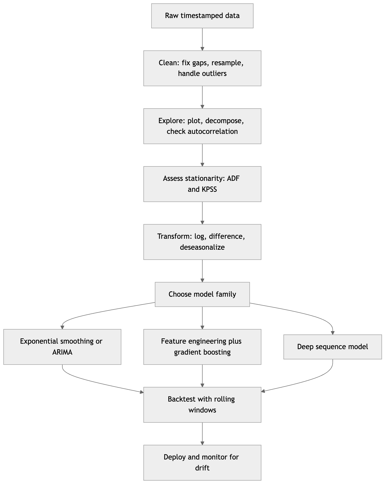
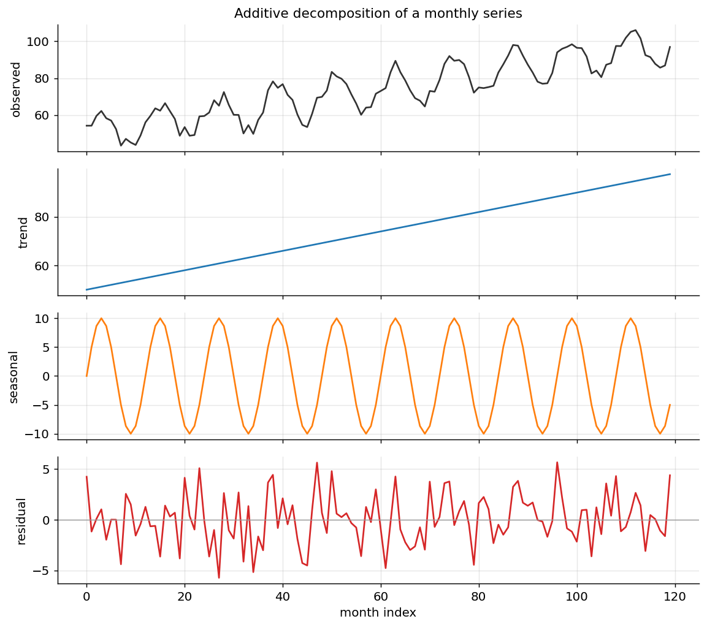
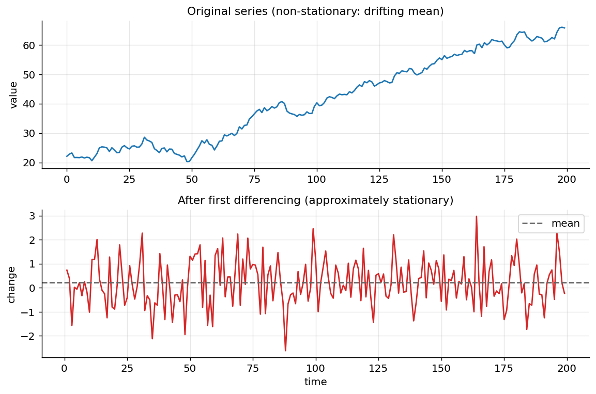
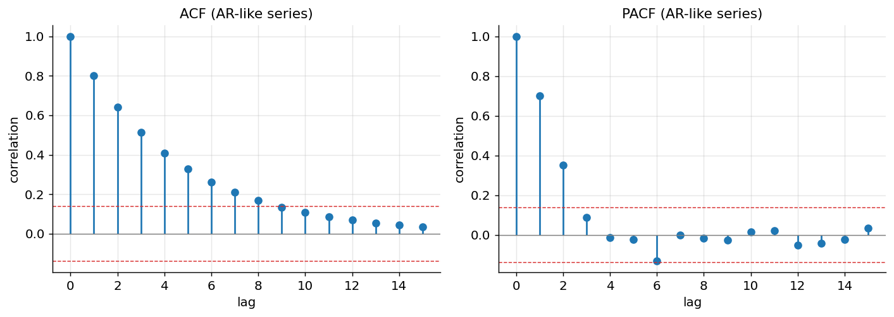
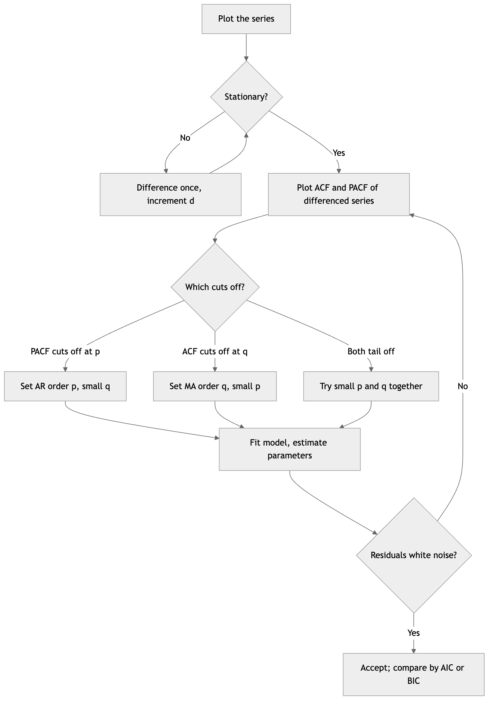
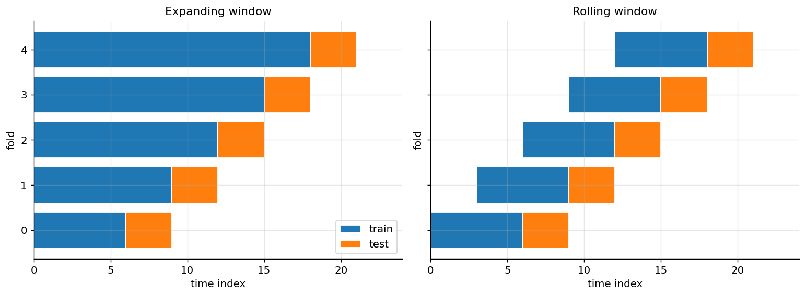
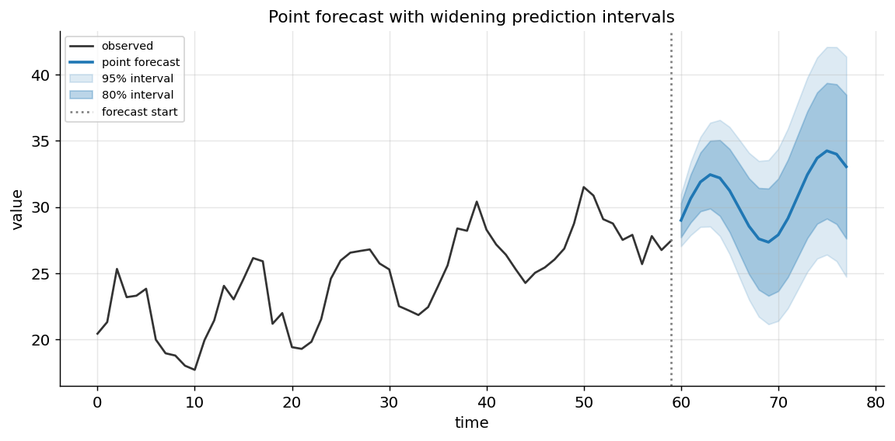

[← 12 Association Rule Learning](ch12-association-rules.md) · [Contents](../README.md#contents) · [14 Recommender Systems →](ch14-recommender-systems.md)

---

# 13 Time Series Analysis and Forecasting

Almost every quantity a business or a scientist cares about is measured repeatedly over time: the number of orders placed each day, the temperature recorded each hour, the megawatts a grid delivers each fifteen minutes, the blood-glucose reading taken every five minutes, the closing price of a security each session. When we line these measurements up in the order they occurred, we get a **time series** — and the moment we do, the ordinary machine-learning playbook of shuffling rows, splitting at random, and treating every observation as independent stops working. The order of the observations is not incidental; it *is* the signal. This chapter is about the tools built to respect that order: how to describe a series in terms of its structural components, how to reason about whether it is stable enough to model, how the classical statistical machinery of exponential smoothing and ARIMA works and when to reach for it, how modern gradient-boosted and deep-learning forecasters reframe the problem as supervised learning, and — running through all of it — how to evaluate a forecast honestly without leaking the future into the past.

Forecasting occupies a strange dual position in the field. It is one of the oldest applied problems in statistics, with methods that predate computers and remain competitive today; and it is simultaneously a frontier of deep learning, with transformer-based and foundation models arriving each year. A practitioner who knows only the classical side will over-engineer problems that a three-line exponential-smoothing model would solve, and a practitioner who knows only the deep-learning side will reach for a giant neural network on a hundred data points and be beaten by a naive baseline. The goal here is fluency across the whole range, and — just as importantly — the judgment to know which end of it a given problem lives at. We build on ideas from the chapter on the Machine Learning Workflow and the chapter on Regression, and we cross-reference the chapters on Sequence Models and on Transformers when we reach the neural forecasters, since the architectures there are exactly the ones repurposed for sequences of numbers.

## 13.1 What Makes Time-Series Data Special

Begin with the property that changes everything: **temporal ordering**. In a standard supervised dataset — the customer table of the chapter on Classification, say — the rows are *exchangeable*. You may shuffle them, split them at random into train and test, and cross-validate across arbitrary folds, because the label of one row tells you nothing about the position of another. A time series violates this at its core. Observation $`y_{t}`$ is not just a value; it is a value *at time* $`t`$, and its neighbors $`y_{t - 1}`$ and $`y_{t + 1}`$ carry information about it. Shuffling destroys precisely the structure we want to learn, and — as we will hammer home repeatedly — splitting at random leaks the future into the training set and produces validation numbers that are pure fantasy.

The statistical name for the dependence between an observation and its own past is **autocorrelation**: the correlation of a series with a lagged copy of itself. Formally, for a series with mean $`\mu`$ and variance $`\sigma^{2}`$, the autocorrelation at **lag** $`k`$ is

``` math
\rho_{k} = \frac{Cov(y_{t},\, y_{t - k})}{\sigma^{2}} = \frac{\mathbb{E}\left\lbrack (y_{t} - \mu)(y_{t - k} - \mu) \right\rbrack}{\sigma^{2}}
```

If today’s sales are high whenever yesterday’s were high, $`\rho_{1}`$ is large and positive. If a value seven days ago predicts today’s (a weekly rhythm), $`\rho_{7}`$ spikes. Autocorrelation is both the obstacle and the opportunity: it is why the independence assumptions of ordinary statistics fail, and it is exactly the structure a forecaster exploits to see into the future. A series with zero autocorrelation at every nonzero lag is **white noise** — unforecastable by definition, because its past tells you nothing about its future.

A time series also carries a **sampling frequency** — hourly, daily, monthly — and often more than one natural rhythm layered on top of another: retail sales rise every December (yearly), swell every weekend (weekly), and peak every evening (daily). These overlapping periodicities, the slow drift of a long-run trend, and the irregular shocks of one-off events all coexist in a single stream of numbers, and the first analytical task is to pull them apart.

### 13.1.1 White Noise and the Random Walk

Two idealized processes anchor the extremes of forecastability, and every real series sits somewhere between them. **White noise** is a sequence of independent draws with constant mean and variance and *zero* autocorrelation at every nonzero lag. It is the very definition of unforecastable: knowing the entire past tells you nothing about the next value beyond its mean. White noise is not a failure but a target — the residuals of a *good* model should look like white noise, because any remaining autocorrelation is structure the model failed to capture and could still exploit.

The **random walk** is white noise’s integral: $`y_{t} = y_{t - 1} + \varepsilon_{t}`$, where each step adds an independent shock. It is the most important non-stationary process in practice — the textbook model for asset prices — and it teaches a humbling lesson. Its *changes* are white noise, so the best possible forecast of tomorrow’s value is simply today’s value (the naive forecast), and no amount of modeling ingenuity can do better on a pure random walk. Recognizing when a series is “essentially a random walk” saves enormous wasted effort: if differencing a series yields white noise, the naive forecast is optimal and you are done. This is precisely why the naive baseline is not a formality but a genuine contender.

### 13.1.2 A First Look at Autocorrelation, Numerically

To make autocorrelation concrete, consider a tiny series measured over eight days: $`\lbrack 10,12,13,11,14,15,13,16\rbrack`$. Its mean is $`13`$. The lag-1 autocorrelation asks how each day relates to the day before: we pair $`(y_{t} - 13)`$ with $`(y_{t - 1} - 13)`$ across all adjacent pairs, sum the products, and divide by the sum of squared deviations. A positive result — which this gently rising, momentum-carrying series produces — says “high days tend to follow high days,” the fingerprint of persistence. A series that zig-zagged, high-low-high-low, would instead show *negative* lag-1 autocorrelation, and a series with a weekly rhythm sampled daily would show its strongest spike not at lag 1 but at lag 7. Reading which lags carry the correlation is the entire diagnostic art we formalize later with the ACF and PACF.



*Figure 198. The end-to-end time-series forecasting workflow, from raw observations through diagnostics and modeling to backtested, monitored deployment.*

### 13.1.3 Regularity, Gaps, and Resampling

Before any modeling, a practical hurdle: real series are rarely delivered on a clean, evenly spaced grid. Sensors drop readings, markets close on weekends, an ETL job fails for an hour. Almost every classical method assumes observations are **equally spaced** in time, so the first job is to put the data on a regular index — resampling to a fixed frequency, then deciding what to do with the gaps. A missing hour can be forward-filled (carry the last value), interpolated (linearly or with a spline), or explicitly modeled as missing; the right choice depends on the mechanism, and — the recurring theme — none of these fills may ever use a *future* value to reconstruct a past one when that reconstructed value will feed a forecast, or you have leaked. Aggregating up (daily to weekly) is safe and often clarifying; disaggregating down (monthly to daily) invents structure that is not in the data and should be treated with suspicion.

Two more cleaning decisions recur. **Outliers** — a data-entry error, a one-off stockout, a sensor glitch — distort trend estimates, inflate variance, and can wreck a least-squares fit, but they must be handled thoughtfully because *not every extreme value is an error*: a genuine holiday spike is signal, not noise. The safe practice is to flag extreme points (via decomposition residuals or a rolling median absolute deviation), investigate whether they are errors or real events, and either correct them, mark them with an indicator feature the model can use, or leave them and choose a robust method — never silently delete, which breaks the equal-spacing assumption. **Calendar effects** deserve early attention too: differing month lengths (28 to 31 days) and the shifting number of weekends per month introduce spurious seasonality that vanishes once you adjust for the number of trading or business days, a subtlety that bites monthly sales and financial series in particular.

## 13.2 The Components of a Time Series

A remarkably useful mental model treats an observed series as the superposition of a few unobserved **components**, each with its own interpretation:

- **Trend** ($`T_{t}`$): the long-run direction — the slow, persistent increase or decrease over many periods. A subscriber count that grows year over year has an upward trend.
- **Seasonality** ($`S_{t}`$): a *fixed-period*, repeating pattern tied to the calendar or clock — the same shape every 7 days, every 12 months, every 24 hours. Seasonality’s defining feature is that its period is known and constant.
- **Cyclic** ($`C_{t}`$): fluctuations that rise and fall but *not* on a fixed period — the multi-year boom-and-bust of a business cycle, whose peaks are years apart but not a fixed number of years apart. The distinction from seasonality is precisely the fixed-versus-variable period, and it matters because seasonality can be modeled with calendar features while cycles generally cannot.
- **Residual** ($`R_{t}`$), also called the irregular or noise component: whatever is left after the structured parts are removed — ideally unpredictable white noise.

**Decomposition** is the act of estimating these components. Two functional forms dominate. In an **additive** model the components sum:

``` math
y_{t} = T_{t} + S_{t} + C_{t} + R_{t}
```

In a **multiplicative** model they multiply:

``` math
y_{t} = T_{t} \times S_{t} \times C_{t} \times R_{t}
```

The choice hinges on how the seasonal swing behaves as the level of the series changes. If December’s sales boost is a roughly *constant number of units* regardless of the year’s overall level, the model is additive. If December adds a roughly *constant percentage* — so the absolute size of the seasonal bump grows as the business grows — the model is multiplicative. A quick diagnostic: plot the series and ask whether the seasonal peaks fan out as the trend rises (multiplicative) or stay a constant height (additive). A multiplicative series can always be made additive by taking logarithms, since $`log(T \times S \times R) = logT + logS + logR`$; this log transform is one of the most common and useful preprocessing steps in all of forecasting, and it doubles as a variance stabilizer when the spread of the series grows with its level.



*Figure 199. An additive decomposition of a synthetic monthly series into trend, seasonal, and residual components that sum back to the observed data.*

### 13.2.1 Classical and STL Decomposition

The oldest decomposition method estimates the trend with a **centered moving average** whose window equals the seasonal period (a 12-month average has no monthly seasonality left in it, since it spans exactly one cycle), subtracts that trend to isolate the seasonal-plus-residual part, averages that across periods to get a stable seasonal shape, and calls the remainder the residual. It works but is rigid: the seasonal pattern is forced to be identical every cycle, the trend estimate is crude at the ends of the series, and outliers contaminate the moving average.

The modern workhorse is **STL** — *Seasonal-Trend decomposition using Loess*. STL uses locally weighted regression (**loess**) smoothers in an iterative loop to estimate the trend and seasonal components, and it brings three decisive advantages: the seasonal component is allowed to *change slowly over time* rather than being frozen, the smoothness of both trend and season is tunable, and a robust variant downweights outliers so a single spike does not distort the whole decomposition. STL handles only additive decomposition directly, so for a multiplicative series you log-transform first, decompose, and exponentiate back. STL is the sensible default for exploratory analysis: run it early, look at the residual, and if the residual still shows obvious structure, your model of the trend and seasonality is incomplete.

## 13.3 Stationarity

Most classical forecasting theory is built on a stability assumption called **stationarity**, and understanding it is the key that unlocks the ARIMA family. A series is (weakly, or covariance) **stationary** if its statistical properties do not change over time — specifically, if its mean is constant, its variance is constant, and its autocovariance $`Cov(y_{t},y_{t - k})`$ depends only on the lag $`k`$ and not on the absolute time $`t`$. Intuitively, a stationary series “looks the same” whichever window you view it through: no trend carrying the level away, no seasonal pattern that makes summer systematically different from winter, no funnel of growing variance.

Why does this matter so much? Because forecasting is fundamentally the act of assuming the future resembles the past, and that assumption is only coherent if the past has stable properties to extrapolate. A model fit to a series whose mean is drifting upward will systematically under-predict the future, because it has averaged over a level that no longer exists. Stationarity is what makes the estimated relationships — the autocorrelations an ARIMA model leans on — meaningful and transferable from the training window to the forecast horizon. The great insight of the ARIMA framework is not that real series *are* stationary (they usually are not) but that many can be *made* stationary by a simple transformation, modeled in that stationary space, and then transformed back.

### 13.3.1 Differencing

The transformation is **differencing**: replacing each value with its change from the previous period.

``` math
\nabla y_{t} = y_{t} - y_{t - 1}
```

A series with a linear trend becomes roughly flat after one difference (the differences of a straight line are constant); a series with a quadratic trend needs a second difference. **Seasonal differencing** subtracts the value from one full season ago, $`\nabla_{s}y_{t} = y_{t} - y_{t - s}`$ (with $`s = 12`$ for monthly data), and removes a stable seasonal pattern. The number of ordinary differences needed to achieve stationarity is the integer $`d`$ that appears in ARIMA($`p,d,q`$), and the number of seasonal differences is the $`D`$ in the seasonal part. The caution is **over-differencing**: differencing more than necessary does not just waste a degree of freedom, it *injects* artificial autocorrelation (a spurious negative spike at lag 1) and inflates the variance, making the model worse. Difference the minimum amount that achieves stationarity and no more.



*Figure 200. A trending, growing-variance series before differencing and after one difference, showing how differencing removes the trend and stabilizes the level.*

### 13.3.2 Testing for Stationarity: ADF and KPSS

Eyeballing a plot is a good start, but two formal hypothesis tests make the judgment rigorous, and — a point that trips up many practitioners — they are set up as *mirror images* of each other, so it pays to use them together.

The **Augmented Dickey-Fuller (ADF) test** has a null hypothesis of **non-stationarity** (technically, that the series has a *unit root*, the signature of a random walk). A small p-value (below 0.05) *rejects* the null and lets you conclude the series is stationary. So for ADF, small p-value = good = stationary.

The **KPSS test** flips it: its null hypothesis is **stationarity** (around a level or a deterministic trend). A small p-value *rejects* stationarity, indicating the series is not stationary. So for KPSS, small p-value = bad = non-stationary.

Because they test opposite nulls, running both gives a more robust reading than either alone, and their four combinations are worth memorizing:

| ADF result | KPSS result | Conclusion |
|----|----|----|
| Stationary (reject null) | Stationary (fail to reject) | Series is stationary; no differencing needed |
| Non-stationary (fail to reject) | Non-stationary (reject) | Series is non-stationary; difference it |
| Non-stationary | Stationary | Trend-stationary; remove a deterministic trend rather than differencing |
| Stationary | Non-stationary | Difference-stationary; apply differencing |

``` python
from statsmodels.tsa.stattools import adfuller, kpss

adf_stat, adf_p, *_ = adfuller(series)
kpss_stat, kpss_p, *_ = kpss(series, regression="c")

print(f"ADF  p-value: {adf_p:.3f}")   # e.g. 0.71  -> fail to reject -> NON-stationary
print(f"KPSS p-value: {kpss_p:.3f}")  # e.g. 0.01  -> reject         -> NON-stationary
# Both point to non-stationary: difference the series and re-test.
```

## 13.4 Autocorrelation: the ACF and PACF

With a stationary series in hand, two diagnostic functions guide model selection and, more deeply, reveal a series’ memory structure.

The **autocorrelation function (ACF)** plots $`\rho_{k}`$ against lag $`k`$: the correlation of the series with itself $`k`$ steps back. It captures the *total* linear relationship between $`y_{t}`$ and $`y_{t - k}`$, including everything that flows through the intermediate lags. If $`y_{t}`$ correlates with $`y_{t - 1}`$ and $`y_{t - 1}`$ correlates with $`y_{t - 2}`$, then $`y_{t}`$ will show correlation with $`y_{t - 2}`$ in the ACF *even if there is no direct link* — the correlation is transmitted through the chain.

The **partial autocorrelation function (PACF)** removes that indirect transmission. The partial autocorrelation at lag $`k`$ is the correlation between $`y_{t}`$ and $`y_{t - k}`$ *after regressing out* the intervening lags $`y_{t - 1},\ldots,y_{t - k + 1}`$ — the *direct* relationship at lag $`k`$ with all shorter paths held constant. This distinction between total (ACF) and direct (PACF) association is the whole game in reading these plots, and it maps cleanly onto the two building blocks of ARIMA:

- An **AR (autoregressive)** process, where $`y_{t}`$ depends directly on its own recent values, produces a PACF that **cuts off sharply** after lag $`p`$ (there is no direct dependence beyond the model order) while its ACF **tails off** gradually (correlation propagates indirectly through the chain).
- An **MA (moving average)** process, where $`y_{t}`$ depends on recent *shocks*, produces the mirror image: an ACF that **cuts off sharply** after lag $`q`$ and a PACF that **tails off**.

This near-symmetry is the classic Box-Jenkins reading, summarized in the table below. Bands drawn at roughly $`\pm 1.96/\sqrt{n}`$ mark the threshold of statistical significance; spikes poking outside them are “real,” spikes inside them are plausibly noise.

| Pattern | ACF behavior | PACF behavior | Suggests |
|----|----|----|----|
| AR($`p`$) | Tails off (decays) | Cuts off after lag $`p`$ | AR order $`p`$ = last significant PACF lag |
| MA($`q`$) | Cuts off after lag $`q`$ | Tails off (decays) | MA order $`q`$ = last significant ACF lag |
| ARMA($`p,q`$) | Tails off | Tails off | Mixed; try small $`p`$ and $`q`$ |
| Seasonal | Spikes at multiples of $`s`$ | Spikes at multiples of $`s`$ | Add seasonal terms at period $`s`$ |



*Figure 201. Stylized ACF and PACF stem plots for an AR process: the ACF tails off geometrically while the PACF cuts off sharply after lag two.*

## 13.5 Classical Forecasting Methods

We now build up the classical toolkit in order of sophistication, because each method generalizes the last, and because the simplest ones are also the baselines every fancier model must beat.

### 13.5.1 Naive Baselines

Never skip these. The **naive forecast** predicts that the next value equals the last observed value, $`{\widehat{y}}_{t + 1} = y_{t}`$ — which, for a random walk, is provably optimal. The **seasonal naive** forecast predicts the value from one season ago, $`{\widehat{y}}_{t + 1} = y_{t + 1 - s}`$, and is startlingly hard to beat for strongly seasonal data. The **drift** method extends the naive forecast along the average historical slope. These cost nothing and set the bar; a sophisticated model that cannot beat seasonal naive is not earning its complexity, and reporting the comparison is a mark of professional honesty.

### 13.5.2 Moving Averages and Smoothing

A **simple moving average** forecast averages the last $`k`$ observations. It smooths out noise but reacts sluggishly to genuine changes in level and, crucially, cannot capture trend — its forecasts flatten out immediately. Its limitation motivates the family that dominates practical short-horizon forecasting: exponential smoothing.

### 13.5.3 Simple Exponential Smoothing

**Simple exponential smoothing (SES)** fixes the moving average’s equal weighting with an intuitive idea: recent observations should matter more than old ones, with influence decaying exponentially into the past. The one-step forecast is a **level** $`\ell_{t}`$ updated recursively:

``` math
\ell_{t} = \alpha\, y_{t} + (1 - \alpha)\,\ell_{t - 1},\quad\quad{\widehat{y}}_{t + 1} = \ell_{t}
```

The **smoothing parameter** $`\alpha \in \lbrack 0,1\rbrack`$ controls responsiveness: near 1, the forecast chases the latest observation and reacts fast but jitters; near 0, it is stable and slow, averaging over a long history. Expanding the recursion reveals the exponentially decaying weights explicitly — $`\ell_{t} = \alpha y_{t} + \alpha(1 - \alpha)y_{t - 1} + \alpha(1 - \alpha)^{2}y_{t - 2} + \cdots`$ — every past observation contributes, with geometrically shrinking weight. SES is appropriate for a series with no trend and no seasonality, just a slowly wandering level, and its forecast for *every* future step is the same flat line at $`\ell_{t}`$, since it has no notion of direction.

To see the recursion breathe, take $`\alpha = 0.3`$ and start with an initial level $`\ell_{0} = 10`$. Feeding the observations $`y_{1} = 12`$, $`y_{2} = 11`$, $`y_{3} = 15`$: the first update gives $`\ell_{1} = 0.3(12) + 0.7(10) = 3.6 + 7.0 = 10.6`$; then $`\ell_{2} = 0.3(11) + 0.7(10.6) = 3.3 + 7.42 = 10.72`$; then $`\ell_{3} = 0.3(15) + 0.7(10.72) = 4.5 + 7.504 = 12.0`$. Notice how the surprise at $`y_{3} = 15`$ pulls the level up only partway, from 10.72 to 12.0, because $`\alpha`$ is modest — the estimate is deliberately sluggish, filtering noise at the cost of lag. Had $`\alpha`$ been 0.8, the same $`y_{3}`$ would have dragged the level almost all the way to 15. This bias-variance dial — smooth and laggy versus responsive and jittery — is the fundamental tension in all smoothing, and in practice $`\alpha`$ (like $`\beta`$ and $`\gamma`$) is not guessed but *estimated* by minimizing one-step forecast error over the training data, which is exactly what a fitted ETS model does for you.

### 13.5.4 Holt’s Linear Trend

**Holt’s linear method** adds a second recursively updated component, a **trend** (slope) $`b_{t}`$, so the forecast can slope up or down instead of flattening:

``` math
\ell_{t} = \alpha\, y_{t} + (1 - \alpha)(\ell_{t - 1} + b_{t - 1})
```

``` math
b_{t} = \beta\,(\ell_{t} - \ell_{t - 1}) + (1 - \beta)\, b_{t - 1}
```

``` math
{\widehat{y}}_{t + h} = \ell_{t} + h\, b_{t}
```

The level update now incorporates the previous trend, and a second smoothing parameter $`\beta`$ controls how quickly the estimated slope adapts. The $`h`$-step forecast extends the current level along the current slope. Because an unchecked linear trend can extrapolate to absurd values over long horizons, a widely used refinement is the **damped trend**, which multiplies the slope’s contribution by a damping factor $`\phi \in (0,1)`$ raised to increasing powers, so the forecast flattens gracefully to a horizontal asymptote rather than shooting off forever — empirically one of the most reliable methods in large forecasting competitions.

### 13.5.5 Holt-Winters: Adding Seasonality

**Holt-Winters** completes the family with a third component, a **seasonal** index $`s_{t}`$, giving level, trend, and season — the reason the whole family is often called **triple exponential smoothing**. It comes in additive and multiplicative seasonal forms, mirroring the decomposition choice. The additive version:

``` math
\ell_{t} = \alpha\,(y_{t} - s_{t - m}) + (1 - \alpha)(\ell_{t - 1} + b_{t - 1})
```

``` math
b_{t} = \beta\,(\ell_{t} - \ell_{t - 1}) + (1 - \beta)\, b_{t - 1}
```

``` math
s_{t} = \gamma\,(y_{t} - \ell_{t}) + (1 - \gamma)\, s_{t - m}
```

``` math
{\widehat{y}}_{t + h} = \ell_{t} + h\, b_{t} + s_{t + h - m}
```

with $`m`$ the seasonal period and $`\gamma`$ the seasonal smoothing parameter. The level is de-seasonalized before updating, the trend evolves as before, and the seasonal index for each position in the cycle is itself smoothed across cycles so the pattern can drift over time. This whole family is formalized statistically as **ETS (Error, Trend, Seasonal)** state-space models, which additionally supply likelihood-based parameter estimation and principled prediction intervals — the version you get from a modern library, which will also *automatically* select the best combination of additive/multiplicative error, damped/undamped trend, and additive/multiplicative season by information criterion.

``` python
from statsmodels.tsa.holtwinters import ExponentialSmoothing

# Monthly series with trend and yearly seasonality (m = 12)
model = ExponentialSmoothing(
    y_train,
    trend="add",            # Holt linear trend
    damped_trend=True,      # flatten long-horizon extrapolation
    seasonal="add",         # additive Holt-Winters seasonal
    seasonal_periods=12,
).fit()
forecast = model.forecast(24)   # next 24 months
# forecast is a length-24 series continuing level + trend + seasonal pattern
```

## 13.6 The ARIMA Family

Where exponential smoothing models the *components* of a series (level, trend, season) directly, the **ARIMA** family models its *autocorrelation structure* — the statistical relationships between an observation and its own past values and past errors. It is the other great pillar of classical forecasting, and it is built from parts we can assemble one at a time.

### 13.6.1 AR, MA, and ARMA

An **autoregressive** model of order $`p`$, **AR(**$`p`$**)**, regresses the current value on its own past values:

``` math
y_{t} = c + \phi_{1}y_{t - 1} + \phi_{2}y_{t - 2} + \cdots + \phi_{p}y_{t - p} + \varepsilon_{t}
```

It is literally a linear regression (the chapter on Regression) whose predictors are lagged copies of the target, and it captures *momentum* and *mean reversion*: an AR(1) with $`0 < \phi_{1} < 1`$ describes a series that drifts back toward its mean, pulled by a fraction $`\phi_{1}`$ of its last deviation.

A worked AR(1) forecast makes the mean-reversion concrete. Suppose we have fitted $`y_{t} = 2 + 0.6\, y_{t - 1} + \varepsilon_{t}`$, so the constant is $`c = 2`$ and $`\phi_{1} = 0.6`$; the implied long-run mean is $`c/(1 - \phi_{1}) = 2/0.4 = 5`$. If the last observed value is $`y_{T} = 10`$ — well above the mean — the one-step forecast is $`{\widehat{y}}_{T + 1} = 2 + 0.6(10) = 8`$. The two-step forecast feeds that back: $`{\widehat{y}}_{T + 2} = 2 + 0.6(8) = 6.8`$. Continuing, we get $`6.08`$, then $`5.65`$, and so on, and the forecasts decay geometrically toward the long-run mean of 5. This is the signature behavior of a stationary AR process: forecasts revert to the mean at a rate governed by $`\phi_{1}`$, and the further out the horizon, the closer the forecast sits to that mean — the model becomes uninformative about the distant future, which is exactly why its prediction intervals widen to a constant band.

A **moving average** model of order $`q`$, **MA(**$`q`$**)** — no relation to the smoothing “moving average” above, an unfortunate name collision — regresses the current value on past *forecast errors* (shocks):

``` math
y_{t} = c + \varepsilon_{t} + \theta_{1}\varepsilon_{t - 1} + \cdots + \theta_{q}\varepsilon_{t - q}
```

An MA process captures the lingering effect of random shocks: a surprise today ripples forward for $`q`$ periods and then vanishes completely. **ARMA(**$`p,q`$**)** simply combines the two, modeling a value as a function of both its recent levels and its recent shocks — appropriate for a stationary series showing both kinds of memory.

### 13.6.2 Integration: the “I” in ARIMA

ARMA requires stationarity, and most real series are not stationary. **ARIMA(**$`p,d,q`$**)** — *AutoRegressive Integrated Moving Average* — bolts differencing into the model itself: the “I” (integrated) part says “difference the series $`d`$ times, fit an ARMA($`p,q`$) to the differences, and integrate (cumulatively sum) the forecasts back to the original scale.” The three orders are therefore:

- $`p`$: the number of autoregressive (lagged-value) terms,
- $`d`$: the number of times the series is differenced to reach stationarity,
- $`q`$: the number of moving-average (lagged-error) terms.

ARIMA($`0,1,0`$) is the random walk; ARIMA($`0,0,0`$) is white noise; ARIMA($`p,0,q`$) is plain ARMA. This single framework subsumes a whole zoo of models by choosing three integers.

### 13.6.3 Seasonal ARIMA and Exogenous Regressors

**SARIMA** extends ARIMA with a seasonal block, written **ARIMA(**$`p,d,q`$**)(**$`P,D,Q`$**)**$`_{s}`$. The uppercase $`(P,D,Q)`$ are autoregressive, differencing, and moving-average orders applied at the seasonal lag, and $`s`$ is the seasonal period. A SARIMA($`1,1,1`$)($`1,1,1`$)$`_{12}`$ model, for instance, has non-seasonal AR, differencing, and MA terms *plus* their counterparts operating on 12-month-apart observations — the standard tool for monthly data with a yearly cycle.

**SARIMAX** adds the “X”: **exogenous** regressors. These are external predictor variables that help explain the target — a promotion flag, a holiday indicator, a weather covariate, a price. The model becomes a hybrid of regression on these external features and ARIMA on the residual autocorrelation: the regression captures the explainable, driver-linked variation, and the ARIMA part mops up the autocorrelation that remains in the residuals. It is the bridge from pure univariate forecasting to models that incorporate outside drivers, and it is often the classical method of choice when you have genuine leading indicators. The essential caution with exogenous variables: to forecast the target for a future date, you need the exogenous values for that same future date, which means they must be either known in advance (holidays, planned promotions) or themselves forecast (introducing their own error that propagates into the target forecast). A subtle failure mode is fitting a SARIMAX with an exogenous variable that is powerful in-sample but unavailable or unreliable at forecast time — the model looks brilliant in backtests that quietly use realized future regressors and then disappoints in production. Always backtest with the exogenous values *you would actually have had*, forecasting them where necessary, so the evaluation reflects the real information available at prediction time.

### 13.6.4 Identifying ARIMA Orders

Choosing $`(p,d,q)`$ is the classic **Box-Jenkins** methodology, and it proceeds as a diagnostic loop rather than a formula.



*Figure 202. The Box-Jenkins ARIMA order-identification loop, from stationarity through ACF and PACF reading to residual diagnostics.*

The workflow: (1) achieve stationarity by differencing, which fixes $`d`$; (2) read the ACF and PACF of the differenced series to propose $`p`$ and $`q`$ using the cut-off/tail-off rules above; (3) fit candidate models and compare them by an **information criterion** — **AIC** (Akaike) or **BIC** (Bayesian), both of which reward goodness of fit while penalizing the number of parameters, so they guard against overfitting with too many terms; (4) run **residual diagnostics** — the residuals of an adequate model should be white noise, which you check by confirming their ACF shows no significant spikes and by the **Ljung-Box test** (whose null is “residuals are independent”; a large p-value is what you want). If the residuals still carry structure, the model is missing something — iterate. In practice, automated routines such as `pmdarima`’s `auto_arima` or R’s `auto.arima` search the order space by information criterion and spare you much of the manual reading, but understanding the manual process is what lets you sanity-check their output and diagnose failures.

``` python
import pmdarima as pm

model = pm.auto_arima(
    y_train,
    seasonal=True, m=12,          # search seasonal orders at period 12
    d=None, D=None,               # let tests choose differencing (ADF/KPSS internally)
    stepwise=True,                # efficient order search, not exhaustive grid
    information_criterion="aic",
    suppress_warnings=True,
)
print(model.summary())            # e.g. best model: SARIMAX(1,1,1)(0,1,1)[12]
forecast, conf_int = model.predict(n_periods=24, return_conf_int=True)
```

### 13.6.5 ETS versus ARIMA

Since exponential smoothing (in its ETS state-space form) and ARIMA are the two great classical families, a natural question is which to reach for, and the honest answer is that they overlap more than they differ. There are deep connections: many ETS models have an exactly equivalent ARIMA representation (simple exponential smoothing is ARIMA(0,1,1), Holt’s linear method is ARIMA(0,2,2)), so they are often fitting the same underlying dynamics from different angles. The practical distinctions: ETS thinks in terms of *components* (level, trend, season) and is unbeatably convenient when a series has clear trend and seasonality that you want modeled directly and automatically; ARIMA thinks in terms of *autocorrelation* and is more flexible for series with complex short-run dependence, and it uniquely admits exogenous regressors through SARIMAX. ETS handles multiplicative seasonality natively; ARIMA needs a prior log transform. Neither dominates across benchmarks — which is one more argument for fitting both and combining them. A reasonable default workflow is to let automated routines (`AutoETS` and `auto_arima`) fit each, compare them by cross-validated error rather than in-sample AIC, and keep whichever wins or average the two.

## 13.7 Decomposition-Based Regression and Prophet

Between the smoothing and ARIMA traditions sits a third classical-flavored approach that has become enormously popular for business forecasting: fit an *explicit additive model of the components* by regression. The idea is to write the series as a sum of interpretable pieces — a flexible trend, one or more seasonal terms, and holiday effects — and estimate them directly rather than through recursive smoothing or autocorrelation.

The best-known incarnation is **Prophet** (from Meta), which models a series as $`y_{t} = g_{t} + s_{t} + h_{t} + \varepsilon_{t}`$, where $`g_{t}`$ is a piecewise-linear (or logistic-saturating) trend with automatically detected **changepoints**, $`s_{t}`$ is seasonality represented by a Fourier series (a sum of sines and cosines, so multiple seasonalities — daily, weekly, yearly — can be layered), and $`h_{t}`$ captures holiday and special-event effects supplied as a calendar. Its appeal is pragmatic rather than theoretical: it is robust to missing data and outliers, it handles multiple seasonalities and irregular holidays gracefully, its parameters are interpretable to non-specialists (“the trend changed here; the weekly effect looks like this”), and it works reasonably well out of the box without stationarity testing or order selection. This makes it a favorite for analysts who need decent forecasts at scale without deep time-series expertise. Its weaknesses are the flip side: it is a *curve-fitting* model that does not explicitly model autocorrelation in the residuals, so it can leave forecastable structure on the table, and it is not designed to exploit exogenous drivers or many related series the way gradient boosting is. The Fourier-seasonality trick, though, is broadly useful and reappears as a feature-engineering device in the ML methods below.

## 13.8 Evaluating Forecasts Honestly

Everything about evaluating a forecaster is shaped by one non-negotiable rule: **you may only ever test on data that is chronologically after your training data.** This flows directly from the whole point of forecasting — predicting the unknown future from the known past — and violating it is the cardinal sin of the field.

### 13.8.1 The Chronological Split

The random train/test split of ordinary machine learning is forbidden. If you shuffle a time series and split at random, your training set contains observations from *after* some of your test observations, and the model gets to “learn from the future.” Validation error collapses to something beautiful and completely meaningless, and the model fails catastrophically in production. Instead, split by time: train on the first (earliest) portion, test on the final (latest) portion, with a hard wall between them. This is the single most important discipline in the entire chapter, and it is worth saying plainly: never shuffle a time series before splitting.

### 13.8.2 Rolling and Expanding Window Backtesting

A single train/test split wastes data and gives a noisy estimate that depends heavily on which slice you happened to hold out. **Backtesting** — also called *time-series cross-validation* — evaluates the model across many splits, always respecting time order, by walking the train/test boundary forward through the series. There are two schemes:

- **Expanding window**: the training set grows at each step, always starting from the beginning and extending to just before the test block, which itself slides forward. The model sees ever more history — appropriate when more data reliably helps and the process is stable.
- **Rolling (sliding) window**: the training set is a *fixed-size* window that slides forward, dropping the oldest observations as it gains new ones. This adapts to a non-stationary process whose recent behavior matters more than its distant past.

At each fold you retrain (or refit), forecast the horizon, score it, and finally average the scores across folds for a robust estimate. Backtesting mimics exactly how the model will be used in production — repeatedly forecasting the near future from all data available up to that moment — which is why it is the gold standard for forecast evaluation.

Two refinements protect against subtle leakage even within a proper time split. First, insert a **gap (or embargo)** between the end of training and the start of the test block whenever your features use trailing windows or your target is itself an aggregate: if a feature at time $`t`$ depends on a 7-day window and the test block begins immediately after training, the first test feature can overlap training-period information, so a gap the width of your longest window cleanly separates them. Second, when a model is expensive to retrain, a common concession is to **refit periodically** rather than at every fold — retrain monthly, but forecast daily in between — which trades a little realism for tractability; just document it, because a model refit every step will look better than one refit rarely, and you must compare like with like. The number of folds is itself a trade-off: more folds give a lower-variance estimate but cost more compute and shrink the earliest training window.



*Figure 203. Expanding-window versus rolling-window backtesting, where each row is one fold with training blocks in blue and the held-out test block in orange, walking forward in time.*

### 13.8.3 Forecast Accuracy Metrics

No single number captures forecast quality, and each metric answers a different question. The core set:

- **MAE (Mean Absolute Error)**, $`\frac{1}{n}\sum|y_{t} - {\widehat{y}}_{t}|`$: the average absolute miss, in the units of the series. Robust to outliers and easy to explain, but scale-dependent, so it cannot compare series measured in different units.
- **RMSE (Root Mean Squared Error)**, $`\sqrt{\frac{1}{n}\sum(y_{t} - {\widehat{y}}_{t})^{2}}`$: also in the series’ units, but squaring penalizes large errors disproportionately, so it is the metric to optimize when big misses are especially costly. Like MAE it is scale-dependent.
- **MAPE (Mean Absolute Percentage Error)**, $`\frac{100}{n}\sum\left| \frac{y_{t} - {\widehat{y}}_{t}}{y_{t}} \right|`$: scale-*free*, expressed as a percentage, which makes it intuitive and comparable across series — but it has two nasty flaws. It is undefined (or explodes) whenever an actual value is zero or near zero, and it is *asymmetric*: it penalizes over-forecasts more heavily than under-forecasts, biasing models toward under-prediction.
- **sMAPE (symmetric MAPE)** rescales the denominator to $`(|y_{t}| + |{\widehat{y}}_{t}|)/2`$ to blunt MAPE’s asymmetry. It is bounded and more balanced, though not perfectly symmetric, and still misbehaves near zero.
- **MASE (Mean Absolute Scaled Error)**: the MAE of your forecast *divided by* the MAE of a naive (or seasonal-naive) forecast on the training set. This is the metric to prefer for cross-series comparison and competitions. Its interpretation is beautifully clean: **MASE below 1 means you beat the naive baseline; above 1 means you did worse.** It is scale-free, defined even when values hit zero, and symmetric — the closest thing to a universal forecasting metric.

| Metric | Scale-free? | Robust to zeros? | Symmetric? | Best for |
|----|----|----|----|----|
| MAE | No | Yes | Yes | Reporting error in native units |
| RMSE | No | Yes | Yes | Penalizing large errors heavily |
| MAPE | Yes | No | No | Business-friendly percentages (nonzero data) |
| sMAPE | Yes | Partly | Nearly | Competition scoring, bounded percentage |
| MASE | Yes | Yes | Yes | Comparing across series; beating the baseline |

A quick worked MASE clarifies why it is so trustworthy. Suppose over a test period your model achieves an MAE of 8 units. On the *training* set, a one-step seasonal-naive forecast (predict the value from one season ago) had an MAE of 10 units — this is the scaling denominator, fixed once from the training data. Then MASE $`= 8/10 = 0.8`$: your model’s typical error is 80% of the naive baseline’s, a genuine 20% improvement. Had the model scored an MAE of 12, MASE would be $`12/10 = 1.2`$, telling you unambiguously that you did *worse* than doing nothing clever — a verdict MAE alone could never deliver, because 12 units means nothing without a reference. This baseline-relative framing is why MASE is the metric of choice when comparing forecasts across many series of different scales, as in large forecasting competitions.

The professional habit: report at least one scale-dependent metric (MAE or RMSE) for concrete interpretability and MASE for a baseline-relative verdict, and always evaluate them under proper backtesting.

## 13.9 Machine Learning for Forecasting

The classical methods are elegant but assume mostly linear, univariate structure and one series at a time. A different and increasingly dominant approach **reframes forecasting as supervised regression**: build a feature matrix in which each row is a time point, the columns are engineered predictors derived only from the *past*, and the target is the future value. Once in this shape, the whole arsenal of the chapter on Trees and Ensembles applies — most powerfully, gradient-boosted trees.

### 13.9.1 Feature Engineering for Time Series

The art here is manufacturing informative features while never letting future information leak into a row. Three families dominate:

- **Lag features**: the value of the series at previous time steps — $`y_{t - 1},y_{t - 7},y_{t - 14},y_{t - 365}`$ — chosen to match the autocorrelation and seasonality you discovered in the ACF. These are the workhorses; they hand the model exactly the “own past” that AR terms use, but in a framework that can then combine them nonlinearly.
- **Rolling-window statistics**: summaries of a trailing window — a 7-day rolling mean, a 30-day rolling standard deviation, a rolling min or max. These encode recent level and volatility. The non-negotiable rule: a rolling feature for time $`t`$ must be computed over a window ending at $`t - 1`$ (strictly the past), never including $`t`$ itself, or you leak the answer into the features.
- **Date and calendar features**: deterministic attributes of the timestamp — day of week, month, quarter, hour, is-weekend, is-holiday, day-of-year — which let the model learn seasonal and calendar effects directly. Cyclical features such as day-of-week are best encoded as a $`(sin,cos)`$ pair so that the model sees Sunday and Monday as adjacent rather than as the numerically distant 6 and 0. **Fourier terms** — sines and cosines at the seasonal frequency and its harmonics — generalize this and capture smooth seasonality with only a few features, the same trick Prophet uses internally.

Two further families round out the toolkit. **Time-since-event** features count the steps since (or until) a known landmark — days since the last promotion, days until the next holiday, hours since the last maintenance — encoding effects that decay or build with proximity to an event. And for a **global model** spanning many series, features that identify and describe each series — the store ID, product category, region, and static attributes — are essential, since they are how one shared model learns per-series behavior; high-cardinality identifiers are handled by native categorical support (as in LightGBM or CatBoost) or by learned embeddings in a neural model.

``` python
import pandas as pd

df = df.sort_values("date")                       # chronological order first!
df["lag_1"]  = df["sales"].shift(1)               # yesterday
df["lag_7"]  = df["sales"].shift(7)               # same weekday last week
# Rolling mean over the PREVIOUS 7 days: shift(1) BEFORE rolling to exclude today
df["roll_mean_7"] = df["sales"].shift(1).rolling(7).mean()
df["dow"]    = df["date"].dt.dayofweek
df["month"]  = df["date"].dt.month
df["is_holiday"] = df["date"].isin(holiday_dates).astype(int)
df = df.dropna()                                  # drop rows with undefined early lags
# X = df[feature_cols]; y = df["sales"] -> now an ordinary supervised regression problem
```

### 13.9.2 Gradient Boosting for Forecasting

With features in place, a gradient-boosting model (XGBoost, LightGBM, CatBoost) is often the strongest and most practical forecaster available, and for good reason. It captures **nonlinear** relationships and feature interactions that linear ARIMA cannot; it ingests many **exogenous** features effortlessly; and — its decisive advantage in industry — a single model can forecast **thousands of related series at once** (global modeling) by adding a series-identifier feature, sharing statistical strength across series in a way that fitting one ARIMA per series never can. This is why gradient boosting has won or placed highly in major forecasting competitions (notably the M5 competition on Walmart sales).

Two limitations demand attention. First, tree models **cannot extrapolate**: a tree predicts by averaging training targets in a leaf, so it can never output a value higher than the maximum it saw in training. For a strongly trending series this is fatal unless you difference or detrend first so the model predicts *changes* rather than raw levels — a step so essential it is worth stating as a rule: with tree-based forecasters, model the *first difference* (or the ratio to a rolling baseline), never the raw trending level.

Second, generating **multi-step** forecasts requires a deliberate strategy, and there are three:

- **Recursive (iterated)**: train a single one-step model, forecast $`t + 1`$, append that prediction to the history, recompute the lag features, and forecast $`t + 2`$, and so on. It uses one model and matches how AR models forecast, but errors compound — each forecast is built on top of previous forecasts, so mistakes cascade over long horizons.
- **Direct**: train a *separate* model for each horizon $`h`$, each predicting $`y_{t + h}`$ directly from features known at time $`t`$. No error compounding, and each horizon can specialize, but you maintain $`H`$ models and they cannot easily enforce coherence across horizons.
- **Multi-output (direct-multi-horizon)**: train one model that emits the whole horizon vector at once, sharing representation across steps. Deep models favor this naturally.

The recursive-versus-direct choice is a genuine trade-off: recursive is cheaper and often better for short horizons and smooth series, direct is safer for long horizons where compounding would dominate, and hybrids (“rectify”) combine them. There is no universal winner, so backtest the strategies against each other on the horizon you actually care about.

### 13.9.3 Intermittent and Sparse Demand

A special case worth naming defeats most standard methods: **intermittent demand**, where the series is mostly zeros punctuated by occasional nonzero values — spare-parts sales, insurance claims, rare-event counts. Exponential smoothing and ARIMA smear a smooth curve through data that is genuinely lumpy, and percentage errors like MAPE are undefined on the zeros. The classical remedy is **Croston’s method**, which cleverly decouples the problem into *two* separate exponentially smoothed series — the size of nonzero demands, and the interval between them — and combines them into a rate. Modern variants (SBA, the Syntetos-Boylan approximation) correct a bias in the original, and tree-based or specialized count models are strong alternatives. The practical point is diagnostic: check the fraction of zeros before modeling, because a demand pattern that is 80% zeros needs intermittent-specific methods, not a SARIMA fit that will confidently predict fractional daily sales of an item that sells three times a year.

### 13.9.4 Hierarchical and Grouped Forecasting

Real forecasting problems are often *nested*: total company sales decompose into regions, regions into stores, stores into products; or a national total splits by category and by channel. These form a **hierarchy**, and a subtle requirement emerges — the forecasts should be **coherent**, meaning the forecasts of the children sum to the forecast of the parent. Forecasting each level independently almost never yields coherence (the store forecasts will not add up to the region forecast), which is both logically embarrassing and operationally broken when different teams plan off different levels. **Forecast reconciliation** methods fix this: bottom-up (forecast the leaves, sum upward), top-down (forecast the total, allocate downward by historical proportions), and the modern **optimal reconciliation** (MinT and relatives) that forecasts every level and then projects the whole set onto the coherent subspace in a way that minimizes error, often *improving* accuracy at every level by borrowing strength across the hierarchy. Whenever your problem has a natural aggregation structure, reconciliation is not optional polish but a correctness requirement.

## 13.10 Deep Learning for Time Series

When you have long histories, many related series, complex nonlinear dynamics, and the compute to train, deep learning offers the most powerful — and most data-hungry — forecasters. These build directly on the architectures of the chapters on Sequence Models and on Transformers, repurposed from tokens to real-valued observations.

A vocabulary distinction organizes all of these models and is worth fixing early, because production libraries build their APIs around it. Inputs split into three kinds of **covariates**: *static* covariates that do not change over time (a store’s location, a product’s category); *past (observed) covariates* known only up to the present (a competitor’s realized price, actual weather); and *future (known) covariates* whose values are known ahead for the forecast horizon (calendar dates, scheduled promotions, planned holidays). A well-designed forecaster routes each kind through the appropriate pathway — future covariates can inform every horizon step, while past covariates must be extrapolated or dropped beyond the present — and mishandling the distinction is a common source of leakage, since accidentally feeding a *realized* future value of a “past” covariate hands the model the answer.

### 13.10.1 Recurrent Models

The **RNN**, and especially the **LSTM** and **GRU** from the chapter on Sequence Models, are the natural first neural forecasters: they consume a series step by step, maintain a hidden state summarizing the past, and output a prediction, with the LSTM’s gated cell state carrying information across long horizons where a vanilla RNN’s gradient would vanish. They handle nonlinearity and long dependencies gracefully and stream in constant memory, but they train slowly (the recurrence is inherently sequential) and, on modest data, are frequently beaten by a well-tuned gradient-boosting model or even ARIMA — a humbling but important empirical fact. In practice, a recurrent forecaster is typically trained on windowed slices of the series (a sliding window of past values as input, the next value or the next $`h`$ values as target) with the target either the raw level after differencing or, better, standardized per series so that many series of different scales can share one global model. The same no-shuffling discipline applies: windows are drawn respecting time order, and the validation windows come strictly after the training windows.

### 13.10.2 Convolutional Sequence Models

An alternative to recurrence borrows the convolution of the chapter on Convolutional Neural Networks and slides it along the *time* axis instead of across an image. A **Temporal Convolutional Network (TCN)** stacks **causal convolutions** — filters that look only at the current and past time steps, never the future, which preserves the no-leakage discipline structurally — combined with **dilated convolutions** that skip an exponentially growing number of steps between filter taps. Dilation is the key trick: by doubling the dilation each layer ($`1,2,4,8,\ldots`$), a modest stack achieves an enormous **receptive field**, seeing thousands of steps back while remaining cheap and fully parallel across time (unlike the inherently sequential RNN). WaveNet, originally built for raw audio generation, is the famous ancestor of this idea. TCNs frequently match or beat LSTMs on forecasting while training far faster, and their parallelism makes them a strong practical middle ground between recurrent and attention models.

### 13.10.3 Specialized Forecasting Architectures

The 2018-2022 period produced a wave of architectures designed *specifically* for forecasting rather than borrowed from language:

- **N-BEATS** is a deep stack of fully connected blocks — no recurrence, no convolution — that learns to decompose the series into interpretable trend and seasonality basis expansions, producing forecasts by summing “backcast” and “forecast” outputs across blocks. It was the first pure deep-learning model to convincingly beat classical statistical methods on broad benchmarks, and its successor **N-HiTS** improved long-horizon accuracy and efficiency with multi-rate sampling.
- **DeepAR** (from Amazon) is an autoregressive LSTM that trains a *single global model* across many related series and, crucially, outputs a **probability distribution** at each step rather than a point — you sample forward to obtain full probabilistic forecasts with uncertainty. Its global, probabilistic design made it a production standard for large-scale demand forecasting.
- The **Temporal Fusion Transformer (TFT)** applies the attention mechanism of the chapter on Transformers to forecasting, with a carefully engineered architecture that handles static metadata, known-future inputs (like holidays), and observed-past covariates in separate pathways, uses variable-selection networks to weigh features, and — a rare virtue in deep models — offers interpretability through its attention weights and variable-importance scores. It natively produces quantile forecasts for prediction intervals.

### 13.10.4 Foundation Models for Time Series

Applying the **Transformer** directly to long time series exposed a wrinkle worth understanding: vanilla attention has cost quadratic in sequence length and, worse, its point-wise attention struggles to see the smooth, locally correlated structure of numeric series. A line of research addressed this with efficiency-oriented variants (Informer, Autoformer, FEDformer) that sparsify or decompose attention, and then a simpler idea proved surprisingly powerful — **patching**, as in PatchTST, which chops the series into subsequence patches and treats each patch as a token, cutting sequence length, giving each token local context, and improving long-horizon accuracy. The saga even produced a useful reality check: a 2022 paper (DLinear) showed that a *single linear layer* over the input window beat many elaborate transformers on standard long-horizon benchmarks, a stark reminder that architectural complexity must earn its keep against embarrassingly simple baselines. The field has since largely reconciled these results, but the lesson endures.

The most recent frontier mirrors the large-language-model story of the chapters on how LLMs work: **foundation models** for time series — such as TimeGPT, Google’s TimesFM, Amazon’s Chronos, and Moirai — are large models *pretrained on enormous, diverse collections of time series* and designed to forecast a new, unseen series with little or no task-specific training (**zero-shot** or few-shot forecasting). Chronos, notably, *tokenizes* real-valued observations into a discrete vocabulary and trains a language-model architecture on them, making the LLM analogy nearly literal. The appeal is obvious: skip the per-series modeling entirely and get a reasonable forecast from a pretrained model out of the box. As of the mid-2020s they are promising and improving fast, competitive with tuned classical methods on many benchmarks, but not a universal replacement — on a specific, well-understood series with clean seasonality, a purpose-built SARIMA or a tuned gradient booster can still win, and often at a fraction of the inference cost. Treat them as a strong, fast baseline and a rising tide rather than a settled conclusion.

The overarching lesson of this section is one of *proportionality*. Deep models have the highest ceiling and the highest cost, in data, compute, and engineering. The graveyard of forecasting projects is full of neural networks that lost to a seasonal-naive baseline because the data simply did not contain enough signal to justify them.

## 13.11 Multivariate Time Series and VAR

So far the target has depended on its own past and perhaps on exogenous inputs. When several series *influence each other* — where past values of series A help predict series B *and* vice versa — we have a genuinely **multivariate** problem, and the classical tool is the **Vector Autoregression (VAR)**. A VAR generalizes AR to a vector of series: each series is regressed on the past values of *all* the series in the system, so a VAR($`p`$) with $`k`$ series predicts each of the $`k`$ variables from the previous $`p`$ vectors of all $`k`$ variables jointly. Concretely, for two series the VAR(1) is a pair of coupled equations, each with its own lagged term *and* a cross term from the other series, and the coefficients are estimated jointly by ordinary least squares equation by equation. VAR shines when the variables are genuinely interdependent — macroeconomic indicators like GDP, inflation, and interest rates are the textbook case — and it supports analyses classical univariate methods cannot, notably **Granger causality** (testing whether one series’ past improves the prediction of another, with the crucial caveat that this is *predictive* not true causal precedence) and **impulse response** analysis (tracing how a shock to one variable propagates through the system over time).

Two cautions attend VAR. Its cost is parametric: the number of coefficients grows with the *square* of the number of series, so VAR is practical for a handful of variables, not hundreds — beyond that, regularized (Bayesian VAR) or deep multivariate models take over. And, like AR, it assumes stationarity, so the series are typically differenced first. But differencing away a genuine *long-run equilibrium* between series throws away information: when two non-stationary series move together in the long run (their difference is stationary), they are **cointegrated**, and the right tool is the **Vector Error Correction Model (VECM)**, which models the short-run dynamics of the differences *plus* an error-correction term that pulls the system back toward its long-run relationship. Cointegration is the reason a naive “difference everything” reflex can be wrong for interrelated series, and it is a staple of econometric forecasting.

## 13.12 Anomaly Detection in Time Series

A close cousin of forecasting is **anomaly detection**: identifying observations that deviate meaningfully from expected behavior — a fraudulent transaction, a failing sensor, a server-metric spike, a sudden demand collapse. The forecasting connection is direct and elegant: **forecast what the series should be, then flag points where the actual value departs from the prediction by more than expected.** Concretely, you build a model of normal behavior, compute the residual (actual minus forecast) at each point, and raise an alarm when the residual exceeds a threshold — often a multiple of the residual standard deviation, or a quantile of the residual distribution.

The nuances that make this hard are worth naming. A **point anomaly** is a single wildly off value; a **contextual anomaly** is a value that is normal in general but abnormal *for its context* (a temperature of 30°C is unremarkable in July, anomalous in January); and a **collective anomaly** is a subsequence that is abnormal as a pattern even if no single point is extreme (a flat line where variation is expected). Contextual and collective anomalies are exactly why naive global thresholds fail and why a *forecasting-based* residual, which already accounts for trend and seasonality, is so effective — it makes the threshold contextual automatically. Beyond forecasting residuals, the toolkit includes seasonal-decomposition residuals (flag outliers in the STL remainder), distance and density methods, matrix-profile techniques for repeated-pattern discovery, and dedicated algorithms like Twitter’s Seasonal Hybrid ESD and Facebook Prophet’s built-in outlier handling.

Two operational realities shape any deployment. Anomaly detection is almost always **unsupervised or weakly supervised**, because labeled anomalies are rare by definition, which means you cannot tune thresholds by ordinary cross-validated accuracy and must instead reason about rates directly. And detection runs in one of two modes: **batch** (scan a completed history to find past anomalies, e.g. for root-cause analysis) or **streaming/online** (score each point as it arrives for real-time alerting), the latter forbidding any use of future context and demanding that the model update its notion of “normal” as the series evolves. The perennial challenge is the trade-off between catching real anomalies and drowning operators in false alarms — a threshold problem, and one where the cost asymmetry of misses versus false positives should be made explicit, echoing the discussion of precision and recall in the chapter on Classification. A detector that fires a hundred false alarms for every true one will be ignored, so precision at the operating threshold matters as much as recall.

## 13.13 Probabilistic Forecasting and Prediction Intervals

A single number — “next month’s demand will be 4,200 units” — is often worse than useless, because it conveys false certainty. Decisions depend on the *range* of plausible outcomes: how much safety stock to hold, whether to provision extra servers, what worst-case cash flow to plan for. **Probabilistic forecasting** produces a distribution or a set of intervals rather than a point, and it is increasingly the expected deliverable rather than a nicety.

A **prediction interval** gives a range within which the future value is expected to fall with a stated probability — a 95% interval should contain the actual value 95% of the time. Note the important distinction from a *confidence* interval: a confidence interval quantifies uncertainty about an estimated *parameter*, while a prediction interval quantifies uncertainty about a future *observation* and is therefore always wider, since it must account for the irreducible noise of the process itself as well as parameter uncertainty. A characteristic and correct feature of forecast intervals is that they **widen as the horizon lengthens** — uncertainty compounds the further ahead you look, fanning out from the last observation.

Several routes produce these intervals. Classical ARIMA and ETS models derive them **analytically** from the model’s assumed error distribution (typically Gaussian), which is clean but only as trustworthy as the normality and homoscedasticity assumptions behind it — and real forecast errors are often fat-tailed and skewed, so analytic intervals can be overconfident. **Quantile regression** trains a model to predict specific quantiles directly by minimizing the asymmetric **pinball loss** (also called quantile loss); fitting the model at the 5th, 50th, and 95th quantiles yields a median forecast bracketed by a 90% interval, and gradient-boosting libraries and TFT support this natively. The pinball loss for target quantile $`\tau`$ penalizes under- and over-prediction asymmetrically — an under-prediction is weighted by $`\tau`$ and an over-prediction by $`(1 - \tau)`$ — so minimizing it for $`\tau = 0.9`$ pushes the prediction up until only 10% of actuals exceed it, which is exactly the definition of the 90th percentile. This asymmetric weighting is the whole mechanism: it is why one loss function, evaluated at different $`\tau`$, sweeps out the entire predictive distribution. **Conformal prediction** offers distribution-free intervals with finite-sample coverage guarantees by calibrating interval width on held-out residuals — an increasingly popular, assumption-light approach. And **ensemble or simulation** methods (bootstrapping residuals, sampling forward from DeepAR, running many stochastic simulations) produce a full empirical predictive distribution. Whichever route you take, the interval must be *validated*: check its **empirical coverage** on backtested data — if your nominal 90% intervals contain the truth only 70% of the time, they are miscalibrated and dangerous, promising a confidence the model does not actually possess.



*Figure 204. A point forecast with 80 and 95 percent prediction intervals that fan out as the horizon extends beyond the last observed value.*

## 13.14 Combining Forecasts

One of the most robust and under-appreciated findings in the entire forecasting literature is that **combining forecasts from different methods usually beats any single method.** Averaging the predictions of, say, an ETS model, a SARIMA model, and a gradient booster tends to reduce error because the models make *different* mistakes — their errors partly cancel — and the combination hedges against any one model’s structural weakness on a particular series. This is the time-series face of the ensemble principle from the chapter on Trees and Ensembles, and it has been confirmed repeatedly in the M-competitions, whose winning entries are almost always combinations. The simplest combination — a plain average of forecasts — is startlingly hard to beat, a phenomenon so reliable it is called the **“forecast combination puzzle”**: elaborate schemes that estimate optimal weights often overfit and underperform the naive equal-weight average, especially with few models or short histories. The practical guidance is to build a small, *diverse* stable of models (one classical, one ML, perhaps one deep), combine them by simple averaging or lightly regularized weights, and only reach for learned weights when you have enough backtesting folds to estimate them reliably. Combination is cheap insurance that pays out remarkably often.

## 13.15 Choosing a Method

The full toolkit, at a glance, so you can match method to problem:

| Method | Handles trend/season | Nonlinear | Multiple series | Exogenous inputs | Native intervals | Data hunger | Best when |
|----|----|----|----|----|----|----|----|
| Seasonal naive | Season only | No | Each alone | No | Via residuals | Minimal | Baseline; strong stable seasonality |
| Exponential smoothing / ETS | Yes | No | Each alone | No | Yes | Low | Short horizons, clear components, few series |
| ARIMA / SARIMA(X) | Yes (via differencing) | No | Each alone | Yes (X) | Yes | Low-medium | Single well-behaved series, linear dynamics |
| Gradient boosting | Via features | Yes | Yes (global) | Yes | Via quantiles | Medium | Many series, rich features, nonlinearity |
| RNN / LSTM | Yes | Yes | Yes | Yes | Via output dist. | High | Long histories, complex dynamics |
| N-BEATS / TFT / DeepAR | Yes | Yes | Yes | Yes (TFT/DeepAR) | Yes | High | Large-scale, high-value forecasting |
| Foundation models | Yes | Yes | Yes | Some | Some | None (pretrained) | Fast zero-shot baseline, cold start |

> **Strengths of classical methods (ETS, ARIMA).** Interpretable, fast to fit, need little data, produce principled prediction intervals from theory, and remain state-of-the-art baselines for single, well-behaved series. Decades of theory back them, and they often beat far more complex models on small or clean data.
>
> **Weaknesses of classical methods.** Assume mostly linear dynamics; fit one series at a time so they cannot share strength across related series; handle exogenous inputs only awkwardly (SARIMAX); and struggle with long, complex, or highly nonlinear patterns.
>
> **When to use ML (gradient boosting).** Reach for it when you have many related series, a wealth of exogenous and calendar features, nonlinear interactions, and enough data to learn them. It is frequently the best price-performance choice in industry — but remember to detrend or difference so trees can cope with growth, and pick a multi-step strategy deliberately.
>
> **When to use deep learning.** Justify it with long histories, thousands of series, genuinely complex dynamics, and the compute and expertise to train and serve it. Prefer purpose-built forecasters (N-BEATS, TFT, DeepAR) over generic architectures, and always benchmark against a cheap baseline before committing.
>
> **Pitfalls across all methods.** Data leakage and look-ahead bias top the list, followed by shuffled splits, un-inverted transforms, unstationary inputs fed to methods that assume stationarity, and — the quiet killer — never comparing against a naive baseline, so you cannot tell whether your model added any value at all.

Two considerations cut across the table and often settle the choice before accuracy does. The first is **data volume relative to the seasonal period**: to estimate a yearly seasonal pattern reliably you want several full years, not several months, because a single cycle tells you nothing about how the pattern repeats — as a rule of thumb, aim for at least two and ideally many complete seasonal cycles before trusting any seasonal model, and with only a handful of observations, prefer a simple method or none at all. The second is the **forecast horizon**: short-horizon problems (nowcasting the next step or few) reward models that exploit recent autocorrelation and are forgiving of simple methods, whereas long-horizon problems expose compounding error and reward models that capture stable trend and seasonality while quantifying rapidly widening uncertainty. State the horizon explicitly at the outset, because a method excellent one step ahead can be mediocre twenty steps out, and vice versa. Finally, know when *not* to forecast: a series driven by unpredictable exogenous shocks, or one with too little history, may have no learnable signal, and a disciplined “this is essentially a random walk; use the naive forecast and widen the intervals” is a more valuable deliverable than a false-precision model.

## 13.16 Practical Pitfalls

The failure modes of forecasting are specific and, once named, largely avoidable.

- **Data leakage and look-ahead bias.** Any feature that incorporates information not available at prediction time inflates validation accuracy and collapses in production. The classic offenders: a rolling statistic that includes the current point, a target-derived feature computed over the full series before splitting, a scaler or imputer fit on the whole dataset (fit it on training data only, then apply to validation), and using a future exogenous value you would not actually know. Audit every feature by asking: “would this value truly be available at the moment I make this forecast?”
- **Shuffling before splitting.** Said thrice for emphasis, because it is the most common and most catastrophic mistake: never randomly shuffle a time series before splitting, and never use standard k-fold cross-validation on it. Split and cross-validate by time.
- **Ignoring non-stationarity.** Feeding a trending, growing-variance series to a method that assumes stationarity produces confidently wrong forecasts. Test for stationarity, transform (log, difference, deseasonalize), and re-test.
- **Forgetting to invert transforms.** If you logged, differenced, or scaled the series, the model’s predictions live in that transformed space; you must invert every transform — exponentiate, cumulatively sum, unscale — before reporting or evaluating, and differencing in particular requires the last observed value to reconstruct the level. Metrics computed in the wrong space are meaningless.
- **No baseline.** Without a naive or seasonal-naive comparison (ideally via MASE), you cannot claim your model works. Many “successful” models silently lose to predicting yesterday’s value.
- **Overfitting to one horizon or one backtest fold.** A model tuned to shine on a single held-out slice may be fitting that slice’s idiosyncrasies. Evaluate across multiple rolling folds and across the horizons you actually care about.
- **Concept drift.** The process that generated your training data can change — a pandemic, a pricing change, a new competitor. A model fit to the old regime degrades silently. Monitor forecast error in production and retrain or recalibrate when it drifts, and prefer rolling windows when recency matters.
- **Confusing correlation with structure.** Two trending series will correlate strongly whether or not they are related (spurious regression); always assess relationships on stationary, differenced data before believing them.

## 13.17 Summary

- A **time series** is defined by **temporal ordering**, and the dependence of an observation on its own past — **autocorrelation** — is both the obstacle to standard ML assumptions and the signal a forecaster exploits. Shuffling and random splitting destroy this structure and leak the future.
- A series decomposes into **trend**, **seasonality** (fixed period), **cyclic** (variable period), and **residual** components, combined **additively** or **multiplicatively**; **STL** is the modern, robust decomposition method, and a log transform converts multiplicative structure to additive.
- **Stationarity** — constant mean, variance, and lag-only autocovariance — underpins classical modeling. Non-stationary series are made stationary by **differencing**; the **ADF** and **KPSS** tests (with opposite null hypotheses) diagnose the need together.
- The **ACF** measures total autocorrelation and the **PACF** measures direct autocorrelation; their cut-off versus tail-off patterns identify AR and MA orders (Box-Jenkins).
- **Exponential smoothing** models components directly — SES (level), **Holt** (add trend), **Holt-Winters** (add seasonality) — while the **ARIMA** family (AR, MA, ARMA, ARIMA, SARIMA, SARIMAX) models autocorrelation structure and folds in differencing and exogenous regressors.
- Forecasts must be evaluated with **chronological splits** and **rolling or expanding-window backtesting**, scored with **MAE/RMSE** (native units), **MAPE/sMAPE** (percentages), and especially **MASE** (baseline-relative, below 1 beats naive).
- **Machine learning** reframes forecasting as supervised regression via **lag features, rolling statistics, and calendar features**, with **gradient boosting** excelling at many series, rich features, and nonlinearity — but unable to extrapolate trends without differencing.
- **Deep learning** (RNN/LSTM, and purpose-built **N-BEATS**, **DeepAR**, **TFT**) and emerging **foundation models** offer the highest ceiling at the highest cost; **VAR** handles genuinely interdependent multivariate systems.
- **Anomaly detection** flags large forecast residuals; **probabilistic forecasting** and **prediction intervals** (analytic, quantile/pinball, conformal, or simulation) convey uncertainty that widens with the horizon and must be validated by empirical coverage.

## 13.18 Key Takeaways

- **Never shuffle a time series before splitting.** Train on the past, test on the future, and backtest with rolling or expanding windows — this single discipline separates honest forecasting from self-deception.
- **Always beat a baseline, or admit you have not.** Seasonal-naive is shockingly strong; report MASE so the reader knows whether your model earned its complexity.
- **Match method to data volume.** Classical ETS/ARIMA win on small, clean, single series; gradient boosting wins on many series with rich features; deep learning needs long histories and lots of series to pay off; foundation models are a fast zero-shot baseline.
- **Stationarity is the gateway to ARIMA.** Test it, difference the minimum amount to achieve it, and never over-difference. The ACF/PACF cut-off/tail-off rules turn diagnostics into model orders.
- **Feature engineering must respect time.** Lags, rolling stats, and calendar features are the ML forecaster’s fuel, but any feature touching the present or future is leakage that will look brilliant in validation and fail in production.
- **A forecast without an interval is a decision without a risk assessment.** Produce prediction intervals, expect them to widen with the horizon, and validate their coverage.

## 13.19 Exercises

1.  **Conceptual.** Explain precisely why random shuffling and standard k-fold cross-validation are invalid for time series, and describe how expanding-window and rolling-window backtesting fix the problem. Give one situation where you would prefer a rolling window over an expanding one, and why.

2.  **Conceptual.** Distinguish seasonality from a cyclic component, and additive from multiplicative decomposition. Given a monthly sales series whose December spike grows larger every year as the business expands, which decomposition applies, and what single transformation would let you use additive methods on it?

3.  **Conceptual.** The ADF and KPSS tests have opposite null hypotheses. Fill in the conclusion for each of the four combinations of (ADF rejects / fails to reject) and (KPSS rejects / fails to reject), and explain why running both is more informative than running either alone.

4.  **Math.** Starting from the simple-exponential-smoothing recursion $`\ell_{t} = \alpha y_{t} + (1 - \alpha)\ell_{t - 1}`$, expand it three steps to show the explicit weights on $`y_{t}`$, $`y_{t - 1}`$, and $`y_{t - 2}`$. What happens to the weight on old observations as $`\alpha \rightarrow 1`$ versus $`\alpha \rightarrow 0`$, and what does each extreme mean for forecast responsiveness?

5.  **Conceptual.** You fit an AR-like model and see an ACF that decays geometrically with a PACF that cuts off sharply after lag 3. What ARIMA orders does this suggest, and why? Sketch what the two plots would look like instead for a pure MA(2) process.

6.  **Coding.** Take a daily sales series and engineer a leakage-free feature matrix: a lag-1 and lag-7 feature, a 7-day rolling mean computed strictly over past days, day-of-week (encoded as sine/cosine), and a holiday flag. Then deliberately introduce leakage by computing the rolling mean *including* the current day, train a gradient booster both ways under a chronological split, and report how much the leaked version overstates validation accuracy.

7.  **Coding.** Fit both a SARIMA model (via `auto_arima`) and a gradient-boosting forecaster to the same monthly series, evaluate both with expanding-window backtesting, and report MAE, RMSE, and MASE against a seasonal-naive baseline. Which model wins on each metric, and does either beat the baseline?

8.  **Conceptual.** A stakeholder asks for “the forecast” as a single number for next quarter’s demand. Explain why a point forecast alone is inadequate for their inventory decision, describe two different ways to produce a 90% prediction interval (one classical, one distribution-free), and explain what “empirical coverage” means and how you would check that your intervals are calibrated.

---

[← 12 Association Rule Learning](ch12-association-rules.md) · [Contents](../README.md#contents) · [14 Recommender Systems →](ch14-recommender-systems.md)
