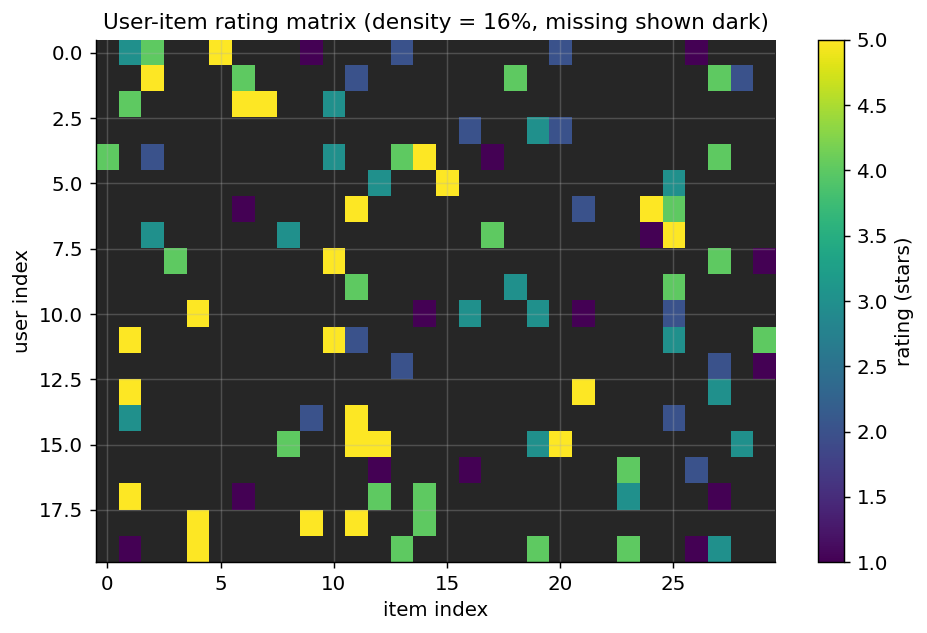
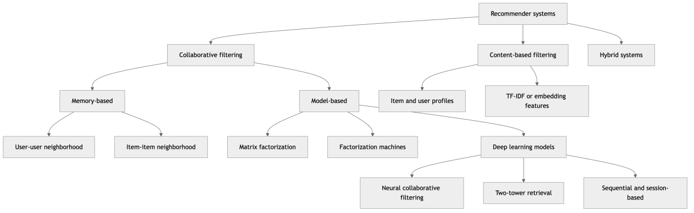
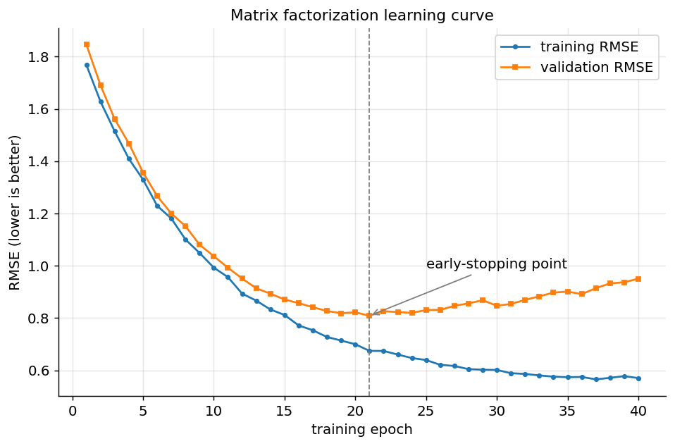
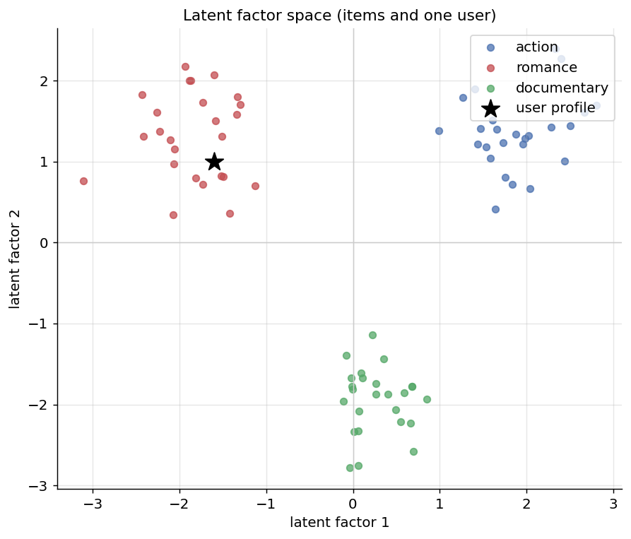
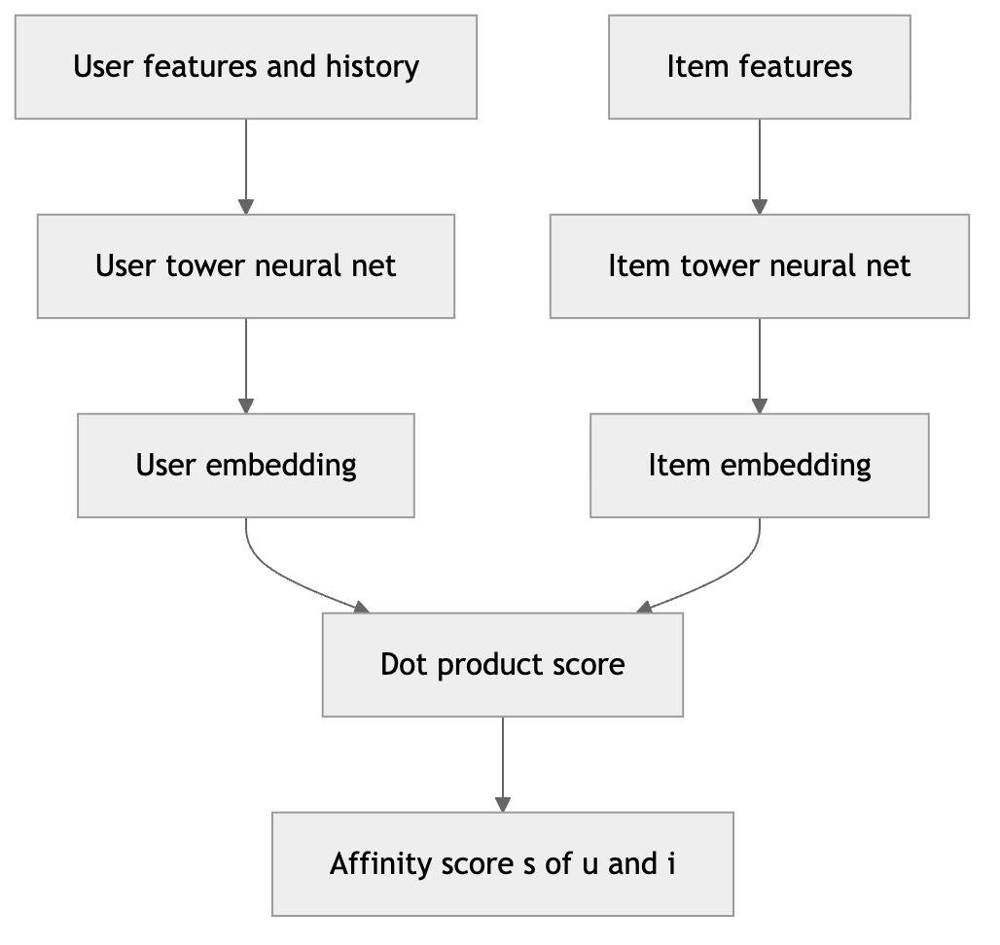
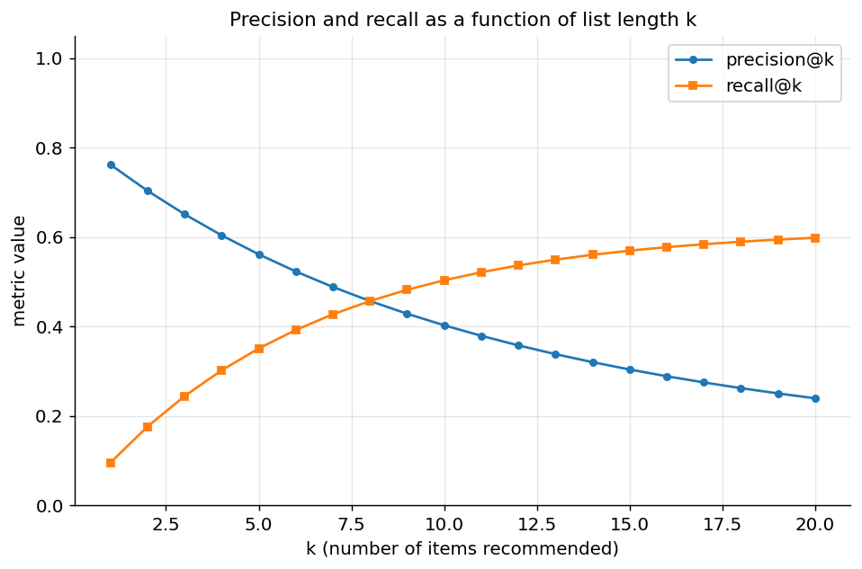

[← 13 Time Series Analysis and Forecasting](ch13-time-series-forecasting.md) · [Contents](../README.md#contents) · [15 Reinforcement Learning Foundations →](ch15-rl-foundations.md)

---

# 14 Recommender Systems

Open almost any consumer product built in the last two decades and you are looking at a recommender system at work. The videos queued up after the one you just watched, the “customers who bought this also bought” shelf, the songs that flow seamlessly into a playlist you never curated, the friends a social network suggests, the news articles ranked in your feed, the job postings surfaced to you and not to the person sitting next to you — all of these are the visible output of models whose job is to predict, from a vast catalog of possibilities, the small handful of items a particular person will find most valuable right now. **Recommender systems** are the branch of machine learning dedicated to this personalized ranking problem, and they are among the most commercially consequential applications the field has produced: a double-digit fraction of revenue at large e-commerce and streaming companies is routinely attributed to recommendations, and the algorithms that drive them shape what billions of people read, watch, buy, and believe.

What makes recommendation distinctive as a machine-learning problem is that it is fundamentally about *relationships between two populations* — users and items — observed only through a sparse, biased, and constantly shifting record of their past interactions. There is no clean feature vector handed to you and no unambiguous label to predict; instead you are given a mostly empty matrix of clicks, ratings, purchases, and dwell times, and asked to fill in the blanks and rank what remains. This chapter builds the subject from that matrix upward. We begin with the structure of interaction data and the crucial distinction between explicit and implicit feedback. We then develop the two classical families — **content-based filtering**, which recommends items similar to what a user already liked, and **collaborative filtering**, which recommends items that *similar users* liked — before diving deep into **matrix factorization**, the latent-factor idea that dominated the field for a decade and still underpins much of what runs in production. From there we move to **factorization machines** and the modern **deep learning** recommenders, the industrial **retrieval-then-ranking** architecture that lets these models serve billions of requests against catalogs of millions, the perennial **cold-start** problem, and a substantial treatment of **evaluation** that goes well beyond accuracy. We close with the bias, fairness, and feedback-loop pathologies that make recommenders one of the most ethically fraught systems in applied machine learning.

## 14.1 The Recommendation Problem

At its most abstract, a recommender system estimates a **utility function** $`\widehat{r}:U \times I \rightarrow \mathbb{R}`$ that scores how valuable an item $`i \in I`$ would be to a user $`u \in U`$, and then, for each user, returns the top-scoring items the user has not already consumed. The set of users $`U`$ and the set of items $`I`$ are both potentially enormous — millions of users, millions of items — and the utility is observed for only a vanishingly small fraction of the $`|U| \times |I|`$ possible pairs. Everything difficult about the field flows from that last fact.

It helps to separate two closely related tasks that people often conflate. **Rating prediction** asks: given a user and an item, what score (say, a number of stars) would this user assign? This was the framing of the famous Netflix Prize, and it is naturally evaluated with regression error metrics. **Top-N recommendation** (also called **item ranking**) asks the more practically useful question: of all the items this user has not yet seen, which $`N`$ should we put in front of them, and in what order? These are not the same problem. A model can predict ratings with low error and still produce a terrible ranked list, because low average error says nothing about whether the *few* items you place at the very top are the right ones. Modern practice overwhelmingly favors the ranking framing, and much of the evaluation section of this chapter is devoted to why the metrics differ so sharply.

Recommendation shows up in more places than the consumer-facing examples suggest. It is the engine behind product and content discovery, but the same machinery powers ad targeting, search-result personalization, computational advertising’s click-through-rate models, matchmaking in dating and hiring platforms, drug-target and molecule suggestion in the sciences, next-item completion in code editors, and the “related entities” panels that pervade knowledge products. Whenever you have two populations linked by a sparse record of preference or interaction, the recommender toolkit applies.

Much of the field’s modern shape was forged by a single event: the **Netflix Prize**, a public competition running from 2006 to 2009 that offered one million dollars to any team that could improve Netflix’s rating-prediction accuracy by 10% on a large release of anonymized user ratings. The contest was consequential out of all proportion to its prize. It popularized latent-factor **matrix factorization** as the dominant technique — the winning entries were elaborate ensembles built around it — established RMSE as the benchmark metric for a generation, and demonstrated the power of blending many models. It also, in retrospect, taught two cautionary lessons the field is still absorbing: that optimizing a rating-prediction metric like RMSE is a poor proxy for the ranking quality users actually experience, and that releasing “anonymized” interaction data can leak real identities, a privacy failure that ended plans for a sequel competition. The arc from the Netflix Prize to today’s implicit-feedback, ranking-focused, privacy-conscious systems traces most of this chapter’s intellectual history.

## 14.2 The User-Item Interaction Matrix

The central data structure of the field is the **user-item interaction matrix** $`R`$, an $`m \times n`$ matrix where $`m = |U|`$ and $`n = |I|`$, and where the entry $`R_{ui}`$ records the interaction (if any) between user $`u`$ and item $`i`$. If user $`u`$ gave item $`i`$ four stars, then $`R_{ui} = 4`$; if there is no recorded interaction, the entry is *missing* — not zero, but genuinely unknown, a distinction we will belabor because getting it wrong is one of the most common and costly mistakes in the field.

The defining property of this matrix is its extreme **sparsity**. A large streaming catalog might contain half a million titles, but the median user has watched a few hundred; a retailer with ten million products sees each customer touch a few dozen. Densities below 1% are typical, and below 0.1% are common. This sparsity is not an inconvenience to be engineered around — it is the structural fact that every algorithm in this chapter must confront. It means most user-item pairs have no signal at all, that similarity computations rest on tiny overlaps, and that any method which materializes the full dense matrix is doomed at scale.



*Figure 205. A synthetic user-item rating matrix; most entries are missing (dark), and observed ratings are scattered sparsely across the grid.*

### 14.2.1 Explicit versus Implicit Feedback

How the entries of $`R`$ come to be filled shapes everything downstream. There are two fundamentally different regimes.

**Explicit feedback** is data the user deliberately provides as a statement of preference: a five-star rating, a thumbs up or down, a numeric score, a written review with an inferred sentiment. Its great virtue is clarity — a one-star rating is an unambiguous signal of dislike, and the sign of the preference is known. Its weaknesses are that it is scarce (most users never rate anything), effortful to collect, and systematically biased: people rate items they feel strongly about, so the ratings you *do* see are not a random sample. This is a form of **missing-not-at-random** data, and it quietly violates the assumptions of many models.

**Implicit feedback** is the exhaust of ordinary behavior: clicks, views, purchases, watch time, dwell time, add-to-cart events, skips, replays. It is abundant — every interaction generates it — and it needs no extra effort from the user. But it is treacherous to interpret. The absence of an interaction is deeply ambiguous: a user did not watch a film either because they disliked it *or* because they never saw it existed. There is, in the strict sense, **no negative feedback** in implicit data — only positive signals of varying strength and a vast sea of unobserved pairs that mix genuine disinterest with mere unawareness. A purchase is a strong positive; a click that led to an immediate bounce is a weak or even negative one; watch time is a graded signal but confounded by content length and autoplay. The table below summarizes the contrast.

| Property | Explicit feedback | Implicit feedback |
|----|----|----|
| Example | Star ratings, thumbs up/down | Clicks, purchases, watch time |
| Volume | Scarce | Abundant |
| Cost to user | High (deliberate action) | Zero (passive) |
| Preference sign | Known (positive and negative) | Positive-only; no true negatives |
| Meaning of “missing” | Not yet rated | Disinterest *or* unawareness (ambiguous) |
| Noise level | Lower, but selection-biased | Higher, confounded by exposure |
| Dominant modeling target | Rating value | Interaction probability / preference with confidence |

The practical upshot is that implicit-feedback models must treat the unobserved entries as weak negatives rather than as missing, and must weight observations by a **confidence** that reflects how strong the positive signal is — an idea we develop precisely when we reach implicit-feedback matrix factorization. Because real systems today run overwhelmingly on implicit signals, this distinction is not academic; it dictates the loss function, the sampling strategy, and the evaluation protocol.

## 14.3 A Taxonomy of Approaches

Before diving into individual methods, it helps to hold the whole landscape in view. Recommendation approaches divide first by *what information they use*, and within each branch by *how they model it*.



*Figure 206. A taxonomy of the main families of recommender systems and their principal subtypes.*

**Content-based filtering** uses attributes of the items themselves — genre, text, tags, embeddings — together with a profile of what the user has liked, and recommends items whose attributes match that profile. It needs no other users. **Collaborative filtering** ignores item attributes entirely and instead exploits the interaction matrix: it recommends items based on patterns across the whole user-item history, on the premise that users who agreed in the past will agree in the future. Collaborative filtering splits into **memory-based** methods, which compute similarities directly over the raw matrix at query time, and **model-based** methods, which learn a compact parametric model (a factorization, a factorization machine, a neural network) offline and use it to score. **Hybrid systems** combine several of these to paper over each one’s weaknesses, most importantly to handle cold start. We take each family in turn.

## 14.4 Content-Based Filtering

Content-based filtering rests on a simple intuition: if you liked *this*, you will like things *like this*. It represents every item as a feature vector describing its content, builds a **user profile** that summarizes the features of items the user has engaged with, and then recommends items whose feature vectors are most similar to that profile.

### 14.4.1 Item and User Profiles

The first task is to turn each item into a vector. For text-heavy items — articles, product descriptions, movie synopses — the classic representation is **TF-IDF**, which we meet in the chapter on Dimensionality Reduction and Feature Extraction. Each item becomes a sparse vector over a vocabulary, where the weight of term $`t`$ in item $`i`$ is

``` math
\text{tfidf}(t,i) = \text{tf}(t,i) \cdot log\frac{n}{\text{df}(t)},
```

so that terms which are frequent in this item but rare across the catalog receive high weight. For items with structured attributes — a film’s genres, a song’s tempo and key, a product’s category and brand — the vector is a concatenation of one-hot categorical encodings and normalized numeric features. Increasingly, both are superseded by learned **embeddings**: a movie is represented by a dense vector from a model trained on its poster, plot, and cast; a product by an embedding of its image and title. These dense representations, discussed in the chapters on Transformers and on Dimensionality Reduction, capture semantic similarity that bag-of-words cannot — they place “sci-fi thriller” near “space adventure” even when the two share no keywords.

Given item vectors $`\mathbf{x}_{i}`$, the **user profile** $`\mathbf{p}_{u}`$ is typically the (optionally rating-weighted) average of the vectors of items the user liked:

``` math
\mathbf{p}_{u} = \frac{\sum_{i \in I_{u}}^{}r_{ui}\,\mathbf{x}_{i}}{\sum_{i \in I_{u}}^{}r_{ui}},
```

where $`I_{u}`$ is the set of items user $`u`$ has rated and $`r_{ui}`$ their rating (or an implicit weight). The profile lives in the same space as the items, so we can score any candidate item by its similarity to the profile.

### 14.4.2 Similarity and Scoring

The workhorse similarity for high-dimensional sparse vectors is **cosine similarity**, which measures the angle between two vectors and ignores their magnitude:

``` math
\text{sim}(\mathbf{p}_{u},\mathbf{x}_{i}) = cos(\mathbf{p}_{u},\mathbf{x}_{i}) = \frac{\mathbf{p}_{u} \cdot \mathbf{x}_{i}}{\left\| \mathbf{p}_{u} \right\|\,\left\| \mathbf{x}_{i} \right\|}.
```

Magnitude invariance matters here because a long document or a product with many tags should not automatically look more relevant simply because its vector is longer. The recommendation for user $`u`$ is then the list of unseen items ranked by $`\text{sim}(\mathbf{p}_{u},\mathbf{x}_{i})`$, highest first. A minimal implementation reads almost like pseudocode:

``` python
import numpy as np

# item_vectors: (n_items, d) TF-IDF or embedding matrix, L2-normalized rows
# liked: indices of items the user rated positively
def recommend_content(item_vectors, liked, top_n=5):
    profile = item_vectors[liked].mean(axis=0)        # user profile vector
    profile /= (np.linalg.norm(profile) + 1e-9)
    scores = item_vectors @ profile                    # cosine sim (rows normalized)
    scores[liked] = -np.inf                             # never re-recommend
    return np.argsort(-scores)[:top_n]
# recommend_content(X, liked=[3, 17, 42]) -> array([ 8, 25, 11, 2, 19])
```

Content-based filtering can also be framed as ordinary supervised learning: treat each user as a separate classification or regression problem, with the item vectors as inputs and the user’s ratings as targets, and fit a per-user model (logistic regression, a small tree). This “one model per user” view connects the method directly to the supervised techniques in the chapter on Supervised Learning and Model Evaluation, and it makes the method’s chief limitation obvious — each user’s model is trained only on that user’s handful of ratings.

> **Content-based filtering at a glance**
>
> **Strengths**: needs no other users, so it works from a single user’s history and sidesteps the *user* cold-start of collaborative methods; recommends brand-new items the moment their features are known (no *item* cold start); recommendations are explainable (“because you liked X, which is also a courtroom drama”); immune to popularity bias since it never looks at what the crowd does.
>
> **Weaknesses**: confined to the feature space, so it produces **over-specialization** — it keeps recommending more of the same and rarely surprises the user; quality is capped by the quality of the item features, which are expensive to engineer well; it cannot learn that fans of one genre secretly love an unrelated one, because it never consults other users; a new user with no history still gets nothing.
>
> **When to use**: rich item metadata and sparse cross-user overlap; strict need for explainability; catalogs that churn rapidly so that most items are always new; regulated settings where recommending by *content* is more defensible than by crowd behavior.
>
> **Pitfalls**: leaking the target into the item features; forgetting to L2-normalize before cosine similarity; letting a user’s profile drift stale as their tastes change; conflating “similar content” with “will be enjoyed,” which ignores quality and freshness.

## 14.5 Collaborative Filtering: Memory-Based Methods

Collaborative filtering abandons item attributes and works purely from the interaction matrix. Its founding premise — the **collaborative** in the name — is that the crowd’s collective behavior encodes preference structure that no individual’s history reveals: if hundreds of people who rated the films you loved also loved a film you have never heard of, that film is a good bet, regardless of its genre or your stated preferences. **Memory-based** collaborative filtering, also called **neighborhood-based** CF, realizes this idea in the most direct possible way: it computes similarities between rows or columns of $`R`$ and predicts a missing entry as a similarity-weighted average of known entries.

### 14.5.1 User-User Collaborative Filtering

In **user-user CF**, to predict how user $`u`$ would rate item $`i`$, we find the users most similar to $`u`$ who *have* rated $`i`$, and take a weighted average of their ratings. The first ingredient is a **similarity metric** between two users, computed over the items they have both rated. The most principled choice is the **Pearson correlation coefficient**, which centers each user’s ratings by their own mean before comparing — crucial because users have different baselines (one person’s “3” is another’s “5”):

``` math
\text{sim}(u,v) = \frac{\sum_{i \in I_{uv}}^{}(r_{ui} - {\bar{r}}_{u})(r_{vi} - {\bar{r}}_{v})}{\sqrt{\sum_{i \in I_{uv}}^{}(r_{ui} - {\bar{r}}_{u})^{2}}\,\sqrt{\sum_{i \in I_{uv}}^{}(r_{vi} - {\bar{r}}_{v})^{2}}},
```

where $`I_{uv}`$ is the set of items both users rated and $`{\bar{r}}_{u}`$ is user $`u`$’s mean rating. Cosine similarity is the alternative when ratings are implicit or already centered. Given similarities, the prediction is a mean-centered, similarity-weighted average over the neighborhood $`N(u;i)`$ of the $`k`$ most similar users who rated $`i`$:

``` math
{\widehat{r}}_{ui} = {\bar{r}}_{u} + \frac{\sum_{v \in N(u;i)}^{}\text{sim}(u,v)\,(r_{vi} - {\bar{r}}_{v})}{\sum_{v \in N(u;i)}^{}|\text{sim}(u,v)|}.
```

The mean-centering (adding back $`{\bar{r}}_{u}`$, subtracting each neighbor’s $`{\bar{r}}_{v}`$) is what makes the method robust to differing rating scales; dropping it is a frequent bug that silently degrades quality.

### 14.5.2 Item-Item Collaborative Filtering

**Item-item CF** flips the axis: to predict $`r_{ui}`$, it finds the items most similar to $`i`$ that user $`u`$ has already rated, and averages those ratings weighted by item similarity. Similarity is now computed between *columns* of $`R`$ — two items are similar if the users who rated both gave them correlated scores. The prediction is

``` math
{\widehat{r}}_{ui} = \frac{\sum_{j \in N(i;u)}^{}\text{sim}(i,j)\, r_{uj}}{\sum_{j \in N(i;u)}^{}|\text{sim}(i,j)|},
```

where $`N(i;u)`$ is the set of items similar to $`i`$ that $`u`$ has rated. Item-item CF, popularized by Amazon, became the industrial default for a decisive practical reason: in most systems there are far fewer items than users, item-item similarities are far more **stable over time** than user-user ones (an item’s rating pattern barely moves as one more person rates it, whereas a user’s neighborhood shifts with every rating they add), and the item-item similarity matrix can therefore be **precomputed offline** and cached, turning serving into a fast lookup. It also produces intuitive explanations (“because you watched X”).

A subtlety worth flagging is which similarity to use for item-item CF. Plain cosine over the raw rating columns is biased by users’ differing baselines: a generous rater who gives everything a 4 or 5 inflates the apparent similarity of every pair of items they touched. The **adjusted cosine similarity** corrects this by subtracting each *user’s* mean rating before computing the cosine over the columns:

``` math
\text{sim}(i,j) = \frac{\sum_{u \in U_{ij}}^{}(r_{ui} - {\bar{r}}_{u})(r_{uj} - {\bar{r}}_{u})}{\sqrt{\sum_{u \in U_{ij}}^{}(r_{ui} - {\bar{r}}_{u})^{2}}\,\sqrt{\sum_{u \in U_{ij}}^{}(r_{uj} - {\bar{r}}_{u})^{2}}},
```

where $`U_{ij}`$ is the set of users who rated both items. Because the centering is done per user, adjusted cosine removes the user-baseline effect that plagues raw cosine and is the standard choice for item-item CF on explicit ratings.

### 14.5.3 Similarity Refinements: Shrinkage and Significance Weighting

Two refinements matter enough in practice to state explicitly, because ignoring them is what makes naive neighborhood methods fragile on sparse data. First, a similarity computed from a tiny overlap is untrustworthy — two items rated in common by only two users can post a perfect correlation of $`1.0`$ by sheer coincidence. **Significance weighting** (or shrinkage) discounts such flukes by shrinking the similarity toward zero in proportion to how little support it has:

``` math
\text{sim}'(i,j) = \frac{|U_{ij}|}{|U_{ij}| + \beta}\,\text{sim}(i,j),
```

where $`\beta`$ (often set between 25 and 100) is the number of co-ratings at which the similarity is trusted at roughly half strength. A pair with hundreds of co-ratings is barely touched; a pair with two is nearly zeroed out. Second, a minimum-overlap threshold simply discards any similarity computed from fewer than, say, five common users. These guards are cheap and consistently improve accuracy, and their absence is a leading reason a hand-rolled neighborhood model underperforms a library implementation.

### 14.5.4 A Worked Numeric Example

Nothing cements these formulas like arithmetic. Consider four users rating five films on a 1–5 scale, with dashes for missing ratings:

|           | Matrix | Inception | Titanic | Notebook | Alien |
|-----------|--------|-----------|---------|----------|-------|
| **Alice** | 5      | 4         | 1       | 1        | 5     |
| **Bob**   | 4      | 5         | 2       | 1        | 4     |
| **Carol** | 1      | 2         | 5       | 4        | 1     |
| **Dave**  | 2      | 1         | 4       | 5        | ?     |

We want to predict Dave’s rating of *Alien* using user-user CF. First, similarities between Dave and each other user, using cosine similarity on their commonly rated items (the first four films, which all four users rated). Dave’s vector on those four is $`(2,1,4,5)`$.

Against Alice $`(5,4,1,1)`$: the dot product is $`2 \cdot 5 + 1 \cdot 4 + 4 \cdot 1 + 5 \cdot 1 = 10 + 4 + 4 + 5 = 23`$; the norms are $`\left\| \text{Dave} \right\| = \sqrt{4 + 1 + 16 + 25} = \sqrt{46} \approx 6.78`$ and $`\left\| \text{Alice} \right\| = \sqrt{25 + 16 + 1 + 1} = \sqrt{43} \approx 6.56`$, giving $`\text{sim} = 23/(6.78 \cdot 6.56) \approx 0.517`$.

Against Bob $`(4,5,2,1)`$: dot product $`2 \cdot 4 + 1 \cdot 5 + 4 \cdot 2 + 5 \cdot 1 = 8 + 5 + 8 + 5 = 26`$; $`\left\| \text{Bob} \right\| = \sqrt{16 + 25 + 4 + 1} = \sqrt{46} \approx 6.78`$, so $`\text{sim} = 26/(6.78 \cdot 6.78) \approx 0.565`$.

Against Carol $`(1,2,5,4)`$: dot product $`2 \cdot 1 + 1 \cdot 2 + 4 \cdot 5 + 5 \cdot 4 = 2 + 2 + 20 + 20 = 44`$; $`\left\| \text{Carol} \right\| = \sqrt{1 + 4 + 25 + 16} = \sqrt{46} \approx 6.78`$, so $`\text{sim} = 44/(6.78 \cdot 6.78) \approx 0.957`$.

Dave is overwhelmingly most similar to Carol — sensibly, since both love the romances and dislike the sci-fi and action films — and mildly similar to Alice and Bob. Now predict Dave’s rating of *Alien*. Alice rated it 5, Bob rated it 4, Carol rated it 1. Using a plain similarity-weighted average over these three neighbors:

``` math
{\widehat{r}}_{\text{Dave, Alien}} = \frac{0.517 \cdot 5 + 0.565 \cdot 4 + 0.957 \cdot 1}{0.517 + 0.565 + 0.957} = \frac{2.585 + 2.260 + 0.957}{2.039} = \frac{5.802}{2.039} \approx 2.85.
```

The model predicts Dave would give *Alien* about a 2.85 — a lukewarm-to-negative score, driven by Carol’s dominant similarity and her low rating, even though Alice and Bob liked the film. This is collaborative filtering in miniature: Dave’s prediction is inferred entirely from the *pattern of agreement* with other users, never from anything about the film itself. (Mean-centering each user’s ratings first, as the Pearson formula prescribes, would refine the estimate further; the plain average here keeps the arithmetic transparent.)

> **Memory-based collaborative filtering at a glance**
>
> **Strengths**: conceptually simple and needs no training phase; item-item similarities are stable and precomputable, giving fast serving; recommendations are directly explainable; captures crowd wisdom that content features miss; item-item variant scales to large user bases.
>
> **Weaknesses**: suffers acutely from **sparsity** — with tiny overlaps, similarities are computed from a handful of co-ratings and are statistically fragile; does not scale to computing all pairwise user similarities on large user bases; **cold start** for both new users (no history to match) and new items (no ratings to be matched on); tends to reinforce **popularity bias**, over-recommending blockbusters that co-occur with everything.
>
> **When to use**: modest-to-medium catalogs, a desire for transparent explanations, and when a strong baseline is needed quickly; item-item CF as a robust production default before investing in learned models.
>
> **Pitfalls**: skipping mean-centering so that generous and stingy raters are compared naively; letting a handful of co-ratings drive a high similarity (require a minimum overlap and shrink similarities toward zero for small overlaps); recomputing similarities online instead of caching them.

## 14.6 Model-Based Collaborative Filtering and Matrix Factorization

Memory-based methods never build a model — they defer all computation to query time and reason directly over stored ratings. **Model-based** collaborative filtering instead learns a compact, parametric model offline that *compresses* the interaction matrix into a form that generalizes. The dominant such model, and arguably the single most important idea in the field, is **matrix factorization**.

### 14.6.1 The Latent-Factor Model

Matrix factorization posits that the sprawling, sparse rating matrix $`R`$ is really the shadow of a low-dimensional structure. It assumes there exist $`f`$ hidden **latent factors** — abstract dimensions of taste like “amount of comedy,” “visual spectacle,” “highbrow versus popcorn,” discovered automatically rather than hand-labeled — and that every user and every item can be described by where they sit along these factors. Formally, each user $`u`$ gets a factor vector $`\mathbf{p}_{u} \in \mathbb{R}^{f}`$ and each item $`i`$ a factor vector $`\mathbf{q}_{i} \in \mathbb{R}^{f}`$, and the predicted rating is their inner product:

``` math
{\widehat{r}}_{ui} = \mathbf{p}_{u}^{\top}\mathbf{q}_{i} = \sum_{k = 1}^{f}p_{uk}\, q_{ik}.
```

The interpretation is beautifully direct: $`q_{ik}`$ measures how much item $`i`$ exhibits factor $`k`$, $`p_{uk}`$ measures how much user $`u`$ cares about factor $`k`$, and the dot product is high when a user’s tastes align with an item’s characteristics. Stacking these vectors into matrices $`P \in \mathbb{R}^{m \times f}`$ and $`Q \in \mathbb{R}^{n \times f}`$, the whole rating matrix is approximated by the low-rank product $`R \approx PQ^{\top}`$. Because $`f`$ is small (typically 20–200) compared to $`m`$ and $`n`$, the model has vastly fewer parameters than the matrix has entries — that compression is exactly what forces it to *generalize* rather than memorize, and it is why factorization fills in missing entries sensibly.

This connects directly to the chapter on Dimensionality Reduction and Feature Extraction: matrix factorization is a form of dimensionality reduction applied to the interaction matrix, and the latent factors are analogous to the components PCA extracts. The difference is that we must learn the factorization from a matrix with mostly *missing* entries, which rules out the classical dense linear algebra.

### 14.6.2 From SVD to Funk-SVD

Textbook linear algebra offers the **Singular Value Decomposition (SVD)**, which factorizes any *fully observed* matrix as $`R = U\Sigma V^{\top}`$ and gives the optimal low-rank approximation when truncated to the top $`f`$ singular values. The trouble is that SVD is defined only for complete matrices, and $`R`$ is almost entirely missing. The historical workarounds — imputing the missing entries with zeros or row means and then running SVD — are badly biased: filling blanks with zeros tells the model those items were actively disliked, and mean-imputation drowns the real signal.

The breakthrough, popularized by Simon Funk during the Netflix Prize and now universally (if imprecisely) called **Funk-SVD** or simply “SVD” in the recommender literature, was to *stop imputing* and instead learn $`P`$ and $`Q`$ directly by fitting only the observed entries. Rather than decomposing the whole matrix, we pose an optimization problem: find the factor vectors that best reconstruct the ratings we actually saw, and let the model interpolate the rest. This reframing — from linear-algebra decomposition to regularized regression over observed entries — is what made latent-factor models practical on real, sparse data.

### 14.6.3 The Optimization Objective and Regularization

The learning problem minimizes the squared error on the observed ratings $`\kappa = \{(u,i):R_{ui}\text{observed}\}`$, plus an L2 **regularization** term that penalizes large factor values to prevent overfitting the many free parameters:

``` math
\min_{P,Q}\sum_{(u,i) \in \kappa}^{}\left( r_{ui} - \mathbf{p}_{u}^{\top}\mathbf{q}_{i} \right)^{2} + \lambda\left( \left\| \mathbf{p}_{u} \right\|^{2} + \left\| \mathbf{q}_{i} \right\|^{2} \right).
```

The regularization strength $`\lambda`$ trades off fit against smoothness exactly as it does in ridge regression (see the chapter on Regression Algorithms); without it, a model with hundreds of factors would overfit the sparse observations catastrophically. This objective is **non-convex** in $`P`$ and $`Q`$ jointly — the product $`\mathbf{p}_{u}^{\top}\mathbf{q}_{i}`$ couples the two — so we cannot solve it in closed form. Two optimization strategies dominate.

### 14.6.4 Adding Biases

Before solving, we improve the model with a crucial refinement. Much of the variation in ratings has nothing to do with user-item interaction: some items are simply better-liked than others, and some users rate systematically higher than others. Folding these into the dot product wastes factor capacity. The fix is explicit **bias terms**:

``` math
{\widehat{r}}_{ui} = \mu + b_{u} + b_{i} + \mathbf{p}_{u}^{\top}\mathbf{q}_{i},
```

where $`\mu`$ is the global mean rating, $`b_{u}`$ is user $`u`$’s deviation from it (a generous or harsh rater), and $`b_{i}`$ is item $`i`$’s deviation (a beloved or panned item). The interaction term $`\mathbf{p}_{u}^{\top}\mathbf{q}_{i}`$ is then left to capture only the *personalized* signal — the part of the rating that depends on the specific pairing. In practice the biases explain a large share of the variance and are among the most valuable features in the whole model; omitting them is a common way to leave accuracy on the table. The biases are regularized alongside the factors.

### 14.6.5 SGD versus ALS

**Stochastic gradient descent (SGD)** optimizes the objective one observed rating at a time. For each observation $`(u,i)`$, compute the prediction error $`e_{ui} = r_{ui} - {\widehat{r}}_{ui}`$, then step every relevant parameter in the direction that reduces it:

``` math
\mathbf{p}_{u} \leftarrow \mathbf{p}_{u} + \gamma\left( e_{ui}\,\mathbf{q}_{i} - \lambda\,\mathbf{p}_{u} \right),\quad\quad\mathbf{q}_{i} \leftarrow \mathbf{q}_{i} + \gamma\left( e_{ui}\,\mathbf{p}_{u} - \lambda\,\mathbf{q}_{i} \right),
```

with analogous updates for the biases and a learning rate $`\gamma`$. SGD is simple, memory-light, and fast on sparse explicit data; it is the method Funk used. Its downsides are the usual ones — sensitivity to the learning rate and slower, noisier convergence.

**Alternating Least Squares (ALS)** exploits a structural insight: although the joint problem is non-convex, it becomes an ordinary **least-squares** problem in $`P`$ if you hold $`Q`$ fixed, and vice versa. ALS therefore alternates: fix $`Q`$ and solve for every user’s factors in closed form (a small ridge regression per user), then fix $`P`$ and solve for every item’s factors, and repeat until convergence. Each half-step has an exact solution and each is **embarrassingly parallel** across users (or items), because each user’s factor vector can be solved independently of the others. This parallelism is why ALS is the method of choice in distributed settings such as Spark’s MLlib, and why it dominates for implicit feedback, as we see next. The trade-off is that each ALS iteration is more expensive than an SGD step, and ALS needs the whole system in memory in a way SGD does not.



*Figure 207. Training and validation RMSE over epochs for a matrix-factorization model; validation error bottoms out and then rises as the model begins to overfit.*

### 14.6.6 A Worked Factorization Example

To see the latent-factor model concretely, take a rank-2 factorization ($`f = 2`$) with hand-chosen factors. Imagine the two factors are “action intensity” and “romance intensity.” Two users:

- Dave, who loves romance and dislikes action: $`\mathbf{p}_{\text{Dave}} = ( - 1.0,\ 1.5)`$.
- Alice, who loves action and dislikes romance: $`\mathbf{p}_{\text{Alice}} = (1.5,\  - 1.0)`$.

And two items:

- *Alien* (high action, low romance): $`\mathbf{q}_{\text{Alien}} = (1.4,\  - 0.6)`$.
- *Notebook* (low action, high romance): $`\mathbf{q}_{\text{Notebook}} = ( - 0.5,\ 1.6)`$.

The model’s predicted (interaction-only, biases aside) affinities are dot products:

``` math
{\widehat{r}}_{\text{Dave, Alien}} = ( - 1.0)(1.4) + (1.5)( - 0.6) = - 1.4 - 0.9 = - 2.3,
```

``` math
{\widehat{r}}_{\text{Dave, Notebook}} = ( - 1.0)( - 0.5) + (1.5)(1.6) = 0.5 + 2.4 = + 2.9,
```

``` math
{\widehat{r}}_{\text{Alice, Alien}} = (1.5)(1.4) + ( - 1.0)( - 0.6) = 2.1 + 0.6 = + 2.7.
```

The signs come out exactly as intuition demands: Dave is predicted to dislike *Alien* and love *Notebook*, Alice the reverse. What the training procedure does is *discover* factor vectors like these automatically, from ratings alone, without ever being told that “action” and “romance” are the axes — the meaning of the factors emerges from the data, and often does not correspond to any human-nameable concept at all. Adding the global mean and bias terms would shift these interaction scores onto the actual rating scale.



*Figure 208. A learned 2-D latent space where items cluster by hidden factors; nearby points represent items the model considers similar.*

### 14.6.7 Implicit-Feedback Matrix Factorization with Confidence

Everything so far assumed explicit ratings. For implicit feedback — the abundant, positive-only signal that dominates real systems — the objective must change, because there are no ratings to regress and no true negatives. The standard solution, from Hu, Koren, and Volinsky, reframes the problem in two steps. First, define a binary **preference** $`p_{ui}`$ that is 1 if the user interacted with the item at all and 0 otherwise. Second, attach a **confidence** $`c_{ui}`$ to each preference that grows with the strength of the observed signal:

``` math
c_{ui} = 1 + \alpha\, r_{ui},
```

where $`r_{ui}`$ is the raw count (number of plays, clicks, minutes watched) and $`\alpha`$ controls how fast confidence rises with evidence. The intuition is precise: we are *confident* that a user who watched a show forty times prefers it, so that pair gets high weight; we are *unsure* about a pair with no interaction (preference 0, confidence just 1), because absence is ambiguous. Crucially, *every* user-item pair now enters the loss — including the vast unobserved majority as low-confidence zeros — which is what supplies the negative signal that implicit data lacks. The objective becomes a confidence-weighted squared error over all pairs:

``` math
\min_{P,Q}\sum_{u,i}^{}c_{ui}\left( p_{ui} - \mathbf{p}_{u}^{\top}\mathbf{q}_{i} \right)^{2} + \lambda\left( \sum_{u}^{}\left\| \mathbf{p}_{u} \right\|^{2} + \sum_{i}^{}\left\| \mathbf{q}_{i} \right\|^{2} \right).
```

Summing over all $`m \times n`$ pairs looks hopeless, but a clever algebraic factoring lets ALS solve each user’s ridge problem in time that depends only on the number of items that user actually touched, not on the full catalog. This **implicit ALS** algorithm, implemented in libraries like `implicit`, is one of the most widely deployed recommender algorithms in industry. An alternative loss for implicit data is **Bayesian Personalized Ranking (BPR)**, which optimizes a *pairwise* ranking objective — for each observed positive, it samples an unobserved item and pushes the model to score the positive higher — directly targeting ranking quality rather than reconstruction.

``` python
import implicit
from scipy.sparse import csr_matrix

# user_items: sparse (n_users, n_items) matrix of interaction counts
alpha = 40.0
confidence = (user_items * alpha).astype("float32")   # C = 1 + alpha*r, the +1 is implicit
model = implicit.als.AlternatingLeastSquares(factors=64, regularization=0.05, iterations=20)
model.fit(confidence.T)                                 # library expects item-user
recs = model.recommend(userid=7, user_items=user_items[7], N=10)
# recs -> [(item_id, score), ...] top-10 for user 7, most-plausible first
```

### 14.6.8 Choosing the Number of Factors and Extensions

The number of latent factors $`f`$ is the model’s central capacity knob. Too few, and the model **underfits** — it cannot represent the richness of taste in the data, and both training and validation error stay high. Too many, and with insufficient regularization the model **overfits**, memorizing the observed ratings and generalizing poorly. In practice $`f`$ is chosen by cross-validation over a held-out set, and it interacts with $`\lambda`$: larger $`f`$ generally wants stronger regularization. Typical values run from a few dozen for small datasets to a few hundred for large ones, with diminishing returns and rising cost beyond that. The learning-curve figure earlier in this section illustrates the symptom to watch for — a validation error that stops improving and begins to climb marks the point where capacity or training time should be reined in via early stopping.

Two influential extensions are worth knowing because they routinely appear in strong systems. **SVD++** augments the user’s factor vector with an implicit-feedback component: even when only explicit ratings are used as the target, the mere *fact* that a user rated an item (regardless of the score) carries information, so SVD++ adds a term summing learned factor vectors over all items the user has interacted with. This lets the model exploit the implicit signal hiding inside explicit data and measurably improved Netflix Prize scores. **Time-aware** or **temporal** factorization (timeSVD++) goes further and lets the biases and factors *drift* over time, capturing that item popularity, user rating scales, and tastes all change across months and years. Both extensions embody the same lesson: the more sources of signal — implicit alongside explicit, temporal alongside static — a factorization model can absorb, the better it predicts, which is exactly the motivation for the factorization machines we turn to next.

## 14.7 Factorization Machines

Matrix factorization models the interaction of exactly two entities — a user and an item — and cannot natively incorporate side information like the time of day, the device, the user’s age, or the item’s category. **Factorization machines (FMs)**, introduced by Steffen Rendle, generalize the idea to arbitrary feature vectors while retaining the ability to model interactions under sparsity. An FM takes any real-valued feature vector $`\mathbf{x} \in \mathbb{R}^{d}`$ — which can concatenate one-hot user IDs, one-hot item IDs, and any contextual features — and models the target as

``` math
\widehat{y}(\mathbf{x}) = w_{0} + \sum_{i = 1}^{d}w_{i}x_{i} + \sum_{i = 1}^{d}{\sum_{j = i + 1}^{d}\langle}\mathbf{v}_{i},\mathbf{v}_{j}\rangle\, x_{i}x_{j}.
```

The first two terms are an ordinary linear model (a global bias and per-feature weights). The third term captures every pairwise **feature interaction**, but instead of learning an independent weight for each pair — which would be impossible under sparsity, since most feature pairs are never observed together — it *factorizes* each interaction weight as the dot product of two learned $`k`$-dimensional embeddings $`\mathbf{v}_{i}`$ and $`\mathbf{v}_{j}`$. This factorization is the key trick: it lets the model estimate an interaction between two features even if that exact pair never co-occurred in training, by borrowing strength from other pairs each feature *did* appear in. When the feature vector contains only a one-hot user and a one-hot item, an FM reduces exactly to biased matrix factorization — so FMs strictly generalize it. A further algebraic simplification computes the pairwise term in linear $`O(kd)`$ time rather than quadratic, making FMs fast to train and serve. FMs and their deep descendants (DeepFM, xDeepFM, and Google’s Wide-and-Deep) are the backbone of click-through-rate prediction in advertising and feed ranking, precisely because context and side features matter enormously there.

## 14.8 Deep Learning Recommenders

Neural networks entered recommendation to relax two assumptions of matrix factorization: that user-item affinity is a simple *inner product* (linear in the factors), and that only the two-way user-item interaction matters. Deep models can learn arbitrary nonlinear interaction functions and fuse heterogeneous inputs — IDs, text, images, sequences, context — into a single scorer. We survey the principal architectures.

### 14.8.1 Neural Collaborative Filtering

**Neural Collaborative Filtering (NCF)** replaces the fixed dot product of matrix factorization with a learned function. It embeds the user and item IDs into dense vectors (just as MF does), but then feeds their combination through a multilayer perceptron that learns a flexible, nonlinear scoring function, typically trained with a binary cross-entropy loss over observed positives and sampled negatives. The influential NeuMF variant fuses two branches — a generalized matrix-factorization branch (an element-wise product of embeddings) and an MLP branch — and concatenates them before a final prediction layer, hoping to get both the linear structure MF captures well and the nonlinear structure the MLP adds. The relationship between such models and the perceptron architectures of the chapter on Neural Networks: Fundamentals is direct: an NCF model *is* a feed-forward network whose inputs happen to be learned ID embeddings, trained by the same backpropagation and gradient-based optimization described there.

It is worth pausing on a controversy here, because it is instructive about the whole field. When NCF was published it reported clear gains over matrix factorization, but subsequent reproducibility studies found that a carefully tuned dot-product MF, with proper regularization and negative sampling, often matched or beat the learned MLP scorer — the MLP struggled to *learn* the simple dot product it was supposedly generalizing. The episode became a rallying point for methodological rigor: it did not show that neural recommenders are useless (they are indispensable at scale and with rich features), but that flexibility is not free, that a nonlinear model must earn its keep against a strong linear baseline, and that many reported advances rest on weak baselines. Keep this skepticism handy whenever a new architecture claims to dominate.

### 14.8.2 Two-Tower Retrieval Models

The **two-tower** (or **dual-encoder**) architecture is the workhorse of large-scale *retrieval*, and it is worth understanding precisely because it dictates the entire industrial serving architecture we describe next. The idea is to build two separate networks — a **user tower** that maps a user (and their context and history) to an embedding, and an **item tower** that maps an item (and its features) to an embedding in the *same* space — and to define affinity as the dot product or cosine similarity of the two embeddings:

``` math
\widehat{s}(u,i) = f_{\text{user}}(u)^{\top}f_{\text{item}}(i).
```



*Figure 209. The two-tower model encodes users and items independently into a shared embedding space where affinity is a dot product.*

The architectural payoff is enormous. Because the two towers are independent and interact only at the final dot product, all item embeddings can be **precomputed offline** and stored, and a user’s embedding is computed once per request. Finding the best items then reduces to a **nearest-neighbor search** for the user vector among the item vectors — a problem with mature, sub-linear solutions. This is what makes retrieval over catalogs of millions feasible in milliseconds. Two-tower models are trained with a contrastive or **in-batch negative sampling** loss: within a training batch, each user’s true item is the positive and the other users’ items serve as negatives, and a softmax-style loss pushes each user embedding toward its positive item and away from the rest. The same dual-encoder structure underpins the dense retrievers in the chapter on Retrieval-Augmented Generation — recommendation retrieval and document retrieval are, architecturally, the same problem.

### 14.8.3 Wide-and-Deep and Hybrid Neural Models

Google’s **Wide-and-Deep** architecture trains, jointly, a *wide* linear model over cross-product feature transformations and a *deep* network over embedded features, then sums their outputs. The rationale is a division of labor: the wide part **memorizes** frequent, specific feature co-occurrences (this exact user bought this exact item before), while the deep part **generalizes** to unseen combinations via dense embeddings. This memorization-generalization split proved so useful for app and feed ranking that it spawned a family — DeepFM (which replaces the hand-crafted wide crosses with an FM component), Deep & Cross Network, and others — all sharing the theme of combining an explicit low-order interaction model with a deep high-order one.

### 14.8.4 Sequential and Session-Based Recommenders

The models so far treat a user’s history as an unordered *set*. But preference is often sequential: what you want next depends on what you just did. **Sequential** (and the special case of anonymous **session-based**) recommenders model the *order* of interactions to predict the next item. Early neural approaches such as GRU4Rec used recurrent networks — the RNNs, LSTMs, and GRUs of the chapter on Sequence Models — to consume a session’s click stream and predict the next click. The field then moved, as most of sequence modeling did, to **self-attention**: models like SASRec and BERT4Rec apply the Transformer architecture from the chapter on Transformers and the Attention Mechanism to interaction sequences, letting the model attend directly to any past item regardless of distance and capturing long-range dependencies in a user’s behavior. The parallel to language modeling is exact and worth internalizing: predicting the next item a user will click, given the sequence of items they clicked before, is structurally identical to predicting the next word given the previous words — SASRec is essentially a left-to-right autoregressive Transformer over item IDs, and BERT4Rec is a masked-item model trained like BERT. This correspondence means the entire toolkit of sequence modeling — positional encodings, attention masks, masked pre-training — transfers directly to recommendation. Sequential models are especially valuable when intent shifts rapidly (shopping for a specific occasion), for anonymous users where only the current session is known, and anywhere recency and order carry strong signal; they are less compelling when a user’s tastes are stable and order-independent, where a plain factorization is cheaper and just as good.

### 14.8.5 Autoencoder-Based Recommenders

A final neural family treats recommendation as *reconstruction*. An **autoencoder** takes a user’s (sparse, partially observed) row of the interaction matrix as input, compresses it through a bottleneck, and reconstructs the full row — the reconstructed values at the previously-missing positions are the predictions. This is a satisfying reframing, because it makes explicit what matrix factorization does implicitly: force the interaction data through a low-capacity bottleneck so the model must learn the compact structure that generalizes rather than memorizing individual entries. Models like AutoRec and the variational Mult-VAE learn to denoise and complete a user’s interaction vector, and Mult-VAE in particular, with a multinomial likelihood suited to implicit data, remains a strong and frequently underrated baseline that competes with far more complex architectures — a recurring theme, as the NCF controversy above illustrated, is that conceptually simple models tuned with care are astonishingly hard to beat. Autoencoders connect recommendation to the generative and representation-learning ideas developed elsewhere in the book, and the bottleneck’s learned codes are, once again, latent factors by another name.

> **Deep learning recommenders at a glance**
>
> **Strengths**: learn nonlinear interaction functions beyond the inner product; fuse heterogeneous inputs (IDs, text, images, context, sequences); two-tower models enable web-scale retrieval; sequential models capture order and evolving intent; a single flexible framework spans retrieval and ranking.
>
> **Weaknesses**: data-hungry and often fail to beat a well-tuned matrix factorization on small or medium data; expensive to train and serve; many published gains have proven hard to reproduce against strong classical baselines; opaque and hard to explain; many hyperparameters and failure modes.
>
> **When to use**: large-scale systems with abundant interactions, rich side features, strong sequential signal, or a need to unify multiple modalities; anywhere a two-tower retriever is required to scale to millions of items.
>
> **Pitfalls**: comparing against weak baselines and declaring victory; training-serving skew in feature pipelines; ignoring the retrieval bottleneck and assuming you can score the whole catalog; overfitting popularity; neglecting to sample negatives properly for implicit data.

## 14.9 The Retrieval-then-Ranking Industrial Architecture

No production system scores a user against every item in a catalog of millions on every request — the latency budget forbids it. Real systems are built as a **multi-stage funnel** that trades a little accuracy at the top of the funnel for enormous efficiency, then spends its modeling budget where it matters.


*Figure 210. The industrial recommendation funnel narrows millions of items to a handful through retrieval, ranking, and re-ranking stages.*

The first stage, **candidate generation** or **retrieval**, cheaply narrows the full catalog to a few hundred or few thousand plausible candidates. This is where two-tower models shine: the user embedding is computed once, and the top candidates are found by nearest-neighbor search over precomputed item embeddings. Multiple retrieval sources are usually blended — a two-tower model, an item-item co-occurrence source, a recently-trending source, a source based on the user’s recent items.

The second stage, **ranking**, applies a far heavier and more accurate model to just those candidates. Because it scores only hundreds of items rather than millions, the ranker can afford deep networks with rich features that examine the full user-item-context triple — the wide-and-deep and FM-family models excel here. The ranker’s job is to produce a precise ordering of the shortlist. A crucial architectural distinction separates the two stages: the retrieval model must be a *decomposable* scorer like a two-tower dot product, so that item embeddings can be precomputed and searched, whereas the ranker can be a *joint* scorer that mixes user and item features arbitrarily, because it only ever runs on a short candidate list. This is why you cannot simply use your best ranking model for retrieval — its features cannot be precomputed per item, so scoring the whole catalog with it is exactly the intractable computation the funnel exists to avoid.

A final **re-ranking** stage adjusts the ordering for objectives that per-item scores ignore: **diversity** (avoid five near-identical items in a row), business rules (promoted content, freshness, inventory), fairness constraints, and de-duplication. This is where beyond-accuracy goals, discussed below, are operationalized.

### 14.9.1 Approximate Nearest Neighbor Search

The retrieval stage rests on solving, quickly, the problem: given a query vector (the user embedding), find the item vectors most similar to it under dot product or cosine. Exact search is linear in the catalog size, which is too slow at scale. **Approximate Nearest Neighbor (ANN)** search trades a small, tunable amount of recall for orders-of-magnitude speedup. The dominant algorithm families are **graph-based** methods like HNSW (Hierarchical Navigable Small World graphs), which build a navigable graph over the item vectors and greedily traverse it toward the query; **quantization** methods like Product Quantization, which compress vectors into compact codes so that millions fit in memory and distances are computed on the codes; and **partitioning** methods like inverted-file indexes that probe only a few relevant buckets. Libraries such as FAISS, ScaNN, and HNSWlib, and vector databases built atop them, make ANN a commodity — and, notably, the very same infrastructure serves the dense-retrieval needs of the chapter on Retrieval-Augmented Generation, underscoring how deeply the embedding-plus-ANN pattern now runs through applied machine learning.

## 14.10 The Cold-Start Problem and Hybrid Systems

Collaborative filtering’s power comes entirely from interaction history, which creates its defining weakness: it is helpless when there is no history. The **cold-start** problem has three faces. **New-user cold start**: a user who has just signed up has no interactions, so collaborative methods have nothing to match on. **New-item cold start**: a freshly added item has no ratings, so it can never appear in a collaborative recommendation — a serious problem for catalogs with constant churn (news, marketplaces, video platforms). **New-system cold start**: a brand-new product has no interaction data at all.

The remedies all involve bringing in information beyond the interaction matrix. For new users, systems fall back to **popularity-based** or demographic recommendations, ask a few onboarding questions to seed a profile, or exploit any available context (location, device, referral). For new items, **content-based** signals bridge the gap: because content methods depend only on item features, a new item can be recommended the moment its metadata is known, and its collaborative factors can be *predicted* from its content features until real interactions accrue. This complementarity — content-based methods handle item cold start, collaborative methods handle everything else — is the single strongest argument for combining them.

**Hybrid systems** do exactly that, and nearly all production recommenders are hybrids. The combination strategies form a small taxonomy: **weighted** hybrids linearly blend the scores of several recommenders; **switching** hybrids pick a recommender per situation (content-based for cold items, collaborative otherwise); **feature-combination** hybrids feed content features into a collaborative model (factorization machines are a natural vehicle); **cascade** hybrids use one recommender to refine another’s output; and the modern two-tower and wide-and-deep architectures are hybrids by construction, since they ingest both IDs (collaborative signal) and content/context features in one model. The lesson the field learned repeatedly is that no single approach wins alone: robustness comes from fusing signals so that each method covers the others’ blind spots.

## 14.11 Evaluation

Evaluating recommenders is subtle enough that a large fraction of published progress has evaporated under careful re-evaluation. The core difficulty is that the metric must match the *task*, and the task is almost always ranking, not rating.

### 14.11.1 Rating-Prediction Metrics

When the goal is to predict rating *values*, we use the regression metrics from the chapter on Supervised Learning and Model Evaluation. **Root Mean Squared Error (RMSE)** and **Mean Absolute Error (MAE)** measure the average deviation between predicted and actual ratings on a held-out set:

``` math
\text{RMSE} = \sqrt{\frac{1}{|\mathcal{T}|}\sum_{(u,i) \in \mathcal{T}}^{}({\widehat{r}}_{ui} - r_{ui})^{2}},\quad\quad\text{MAE} = \frac{1}{|\mathcal{T}|}\sum_{(u,i) \in \mathcal{T}}^{}|{\widehat{r}}_{ui} - r_{ui}|.
```

RMSE penalizes large errors more heavily than MAE because of the squaring. The Netflix Prize was scored on RMSE, which shaped a decade of research — but RMSE has a fatal flaw as a proxy for recommendation quality: it weights all predictions equally, whereas a top-N system cares only about getting the *few items at the very top* right. A model can win on RMSE while producing worse rankings than a rival, which is why the field pivoted to ranking metrics.

### 14.11.2 Ranking Metrics

Ranking metrics evaluate the ordered top-$`k`$ list a system actually presents. They rest on a notion of which items are **relevant** to the user in the held-out data (e.g., items the user later interacted with or rated highly).

**Precision@k** is the fraction of the top-$`k`$ recommended items that are relevant; **Recall@k** is the fraction of all the user’s relevant items that appear in the top-$`k`$:

``` math
\text{Precision@}k = \frac{|\text{relevant} \cap \text{top-}k|}{k},\quad\quad\text{Recall@}k = \frac{|\text{relevant} \cap \text{top-}k|}{|\text{relevant}|}.
```

**Hit Rate@k** is the fraction of users for whom *at least one* relevant item made the top-$`k`$ — a lenient but intuitive metric. **Mean Reciprocal Rank (MRR)** rewards putting the first relevant item high: it averages $`1/\text{rank}`$ of the first relevant hit across users, so a first hit at position 1 scores 1.0, at position 4 scores 0.25. **Mean Average Precision (MAP)** averages the precision computed at each relevant position, rewarding systems that pack relevant items toward the top across the whole list.

The most important ranking metric in modern practice is **Normalized Discounted Cumulative Gain (NDCG)**, because it handles *graded* relevance and applies a smooth positional discount. Discounted Cumulative Gain sums each item’s relevance discounted by a logarithm of its position, and NDCG divides by the ideal (best-possible) ordering’s DCG to land in $`\lbrack 0,1\rbrack`$:

``` math
\text{DCG@}k = \sum_{j = 1}^{k}\frac{2^{\text{rel}_{j}} - 1}{\log_{2}(j + 1)},\quad\quad\text{NDCG@}k = \frac{\text{DCG@}k}{\text{IDCG@}k}.
```

The logarithmic discount encodes the empirical fact that users attend far more to the top of a list than the bottom, and the normalization makes scores comparable across users with different numbers of relevant items.

A short worked example makes NDCG concrete. Suppose a system returns five items with binary relevance labels $`\lbrack 1,0,0,1,1\rbrack`$ — the first, fourth, and fifth are relevant. With binary relevance, $`2^{\text{rel}_{j}} - 1`$ is just the label, so

``` math
\text{DCG@}5 = \frac{1}{\log_{2}2} + \frac{0}{\log_{2}3} + \frac{0}{\log_{2}4} + \frac{1}{\log_{2}5} + \frac{1}{\log_{2}6} = 1 + 0 + 0 + 0.431 + 0.387 = 1.818.
```

The *ideal* ordering would place all three relevant items first, giving

``` math
\text{IDCG@}5 = \frac{1}{\log_{2}2} + \frac{1}{\log_{2}3} + \frac{1}{\log_{2}4} = 1 + 0.631 + 0.5 = 2.131,
```

so $`\text{NDCG@}5 = 1.818/2.131 \approx 0.85`$. The score of $`0.85`$ says the ranking is good but not ideal: it earned full credit for the top item but was penalized for burying two relevant items at positions 4 and 5. Notice how the same three relevant items would score a perfect $`1.0`$ if ranked first and progressively worse the deeper they are pushed — this positional sensitivity is exactly what precision@k and recall@k lack, and why NDCG is the metric practitioners reach for when the *order* of the top items, not just their membership, matters. The figure below shows the characteristic tension between precision and recall as $`k`$ grows.



*Figure 211. Precision@k falls while recall@k rises as the recommendation list grows, illustrating the fundamental trade-off at different cutoffs.*

### 14.11.3 Offline versus Online Evaluation

Every metric above is computed **offline**, on logged historical data with a train/test split — usually a **leave-one-out** or temporal split, where the most recent interaction of each user is held out for testing. Offline evaluation is cheap, fast, and reproducible, and it is indispensable for iterating on models. But it is fundamentally limited by two problems. First, the logged data reflects what the *old* system chose to show; you cannot observe how users would have reacted to items they were never exposed to, so offline metrics are computed on a biased sample — a manifestation of the missing-not-at-random problem. Second, offline metrics measure prediction of *past* behavior, not the *causal* effect of a recommendation on future behavior, which is what the business actually cares about.

The gold standard is therefore **online evaluation** via **A/B testing** (controlled experiments): route a random slice of live traffic to the new model, the rest to the incumbent, and compare business metrics — click-through rate, conversion, watch time, retention, revenue — with proper statistical hypothesis testing. Only an A/B test measures the true causal impact on real users. The recurring, humbling lesson of applied recommendation is that **offline and online metrics frequently disagree**: a model that wins on NDCG offline can lose on engagement online, because offline evaluation cannot see the exposure bias, novelty effects, or feedback dynamics that the live system introduces. The operational discipline for running such experiments and monitoring deployed models is developed in the chapter on MLOps: Deploying and Operating ML Systems.

### 14.11.4 Beyond Accuracy

A recommender optimized purely for accuracy can be a bad product. If you perfectly predict what a user already knows they like, you tell them nothing new. Several **beyond-accuracy** dimensions capture the qualities that make recommendations genuinely useful:

- **Diversity** measures how *dissimilar* the items within a single recommendation list are to one another. A list of five nearly identical items is redundant even if each is individually well-predicted; intra-list diversity (average pairwise dissimilarity) rewards variety.
- **Novelty** measures how *unfamiliar* recommended items are to the user — surfacing things they would not have found on their own, rather than obvious items they already know.
- **Serendipity** is novelty *plus* relevance *plus* surprise: a recommendation that is unexpected yet delightful. It is the hardest quality to measure and the most valuable to deliver, and it is precisely what pure accuracy optimization destroys.
- **Coverage** (catalog coverage) measures what fraction of the catalog the system ever recommends. A system that only ever recommends the top 1% of popular items has terrible coverage and starves the **long tail** of the catalog — bad for content creators and for the platform’s breadth.

These goals often *trade off against* accuracy, which is why they are typically enforced in the re-ranking stage rather than the scoring model, and why the honest evaluation of a recommender reports a *portfolio* of metrics, not a single number. A common way to operationalize the trade-off is **maximal marginal relevance**, which builds the list greedily, at each step selecting the item that maximizes a weighted blend of its predicted relevance and its dissimilarity to the items already chosen. A single tunable parameter slides the list from pure relevance (which may be repetitive) toward pure diversity (which may be irrelevant), letting product teams dial in the balance and A/B-test where users actually prefer it. The deeper point is that “best” is not a property of individual items but of the *list as a whole*: a set of five items can be collectively excellent while each is individually only good, and collectively poor while each is individually optimal. Evaluation and re-ranking that reason about the list, not just per-item scores, are what separate a mature recommender from a naive one.

## 14.12 Bias, Fairness, and Feedback Loops

Recommender systems do not passively observe preferences — they *shape* them, and this makes them one of the most ethically consequential systems in machine learning. The dynamics deserve explicit attention, complementing the broader treatment in the chapter on Responsible AI: Ethics, Bias, Safety, and Governance.

**Popularity bias** is the tendency of collaborative methods to over-recommend already-popular items. Popular items have the most interactions, so they dominate co-occurrence statistics and get recommended more, which generates still more interactions — a self-reinforcing cycle that crowds out the long tail. Left unchecked it produces a “rich get richer” catalog where a tiny head of items absorbs most of the attention.

This is one instance of the deeper problem of **feedback loops**. A recommender is trained on data generated by the previous version of itself: users can only interact with what they were shown, so tomorrow’s training data is a consequence of today’s recommendations. The model’s biases become self-fulfilling — if it under-recommends a genre, users interact with that genre less, which the next model reads as evidence the genre is unpopular, and so on. This **exposure bias** or **presentation bias** contaminates all logged data and is why offline evaluation is so treacherous. Breaking the loop requires deliberate intervention: injecting exploration (occasionally showing items the model is uncertain about, a bandit-style strategy connected to the exploration-exploitation ideas in reinforcement learning), debiasing the training objective with inverse-propensity weighting, and monitoring coverage over time.

**Filter bubbles** and **echo chambers** are the human-facing consequence: by continually narrowing recommendations to a user’s established preferences, the system can trap them in an ever-shrinking slice of the catalog or the information space, reducing their exposure to diverse content and, in news and social contexts, potentially amplifying polarization. Whether recommenders cause filter bubbles is genuinely contested empirically, but the mechanism is real and the design responsibility is clear. The subtlety is that the narrowing is often *invisible* to both the user and the operator: each individual recommendation looks reasonable — it is, after all, relevant — and the drift toward homogeneity is only apparent when you aggregate over time and compare the diversity of what a cohort is shown against the diversity of the catalog. This is why coverage and diversity must be monitored as first-class production metrics rather than assumed, and why a system optimized on short-horizon engagement can quietly degrade the very experience that keeps users around over months.

**Fairness** in recommendation is multi-sided, which distinguishes it from fairness in ordinary classification. There is fairness to *users* (does the system serve some demographic groups worse?), fairness to *items or providers* (are some creators, sellers, or groups systematically under-exposed?), and the interaction between them. A hiring or housing recommender that under-surfaces opportunities to a protected group can cause concrete harm and run afoul of the law. Because the system’s outputs feed back into its inputs, unfairness can compound over time in ways that a one-shot fairness audit will miss. These considerations are not add-ons; in high-stakes domains they are design constraints from the outset.

## 14.13 Building a Recommender in Practice

It helps to see how the pieces of this chapter assemble into a project, because the order in which you tackle them matters as much as the algorithms themselves. A disciplined build proceeds in roughly the following stages.

**Frame the objective first.** Decide what the recommendations are *for* — clicks, purchases, watch time, long-term retention — and choose a proxy target and evaluation metric that align with it. This decision, made before any modeling, determines whether you are predicting ratings or ranking items, whether your feedback is explicit or implicit, and which of the metrics in the previous section you will actually optimize. Getting the objective wrong makes every downstream choice wrong.

**Establish strong baselines.** Start with the cheapest sensible models: a non-personalized popularity ranker, an item-item CF, and a well-tuned matrix factorization. These are fast to build, hard to beat, and — as the pitfalls section stresses — they are the yardstick against which every fancier model must prove itself. Many teams have discovered, too late, that their expensive deep model never actually beat the item-item baseline they skipped.

**Split data temporally and log honestly.** Hold out the most recent slice of interactions for evaluation, mirroring how the model will be used, and record enough context (what was shown, in what position, at what time) that you can later debias the logs. The realistic split usually lowers your offline numbers relative to a random split — that lowering is the point, because it is closer to the truth.

**Iterate offline, then confirm online.** Use offline ranking metrics to prune the field of candidate models quickly and cheaply, but treat the offline winner as a *hypothesis* rather than a conclusion. Promote the leading candidates to an **A/B test** and let live business metrics render the verdict, remembering that offline and online results routinely diverge.

**Design for the funnel from the start.** If the catalog is large, decide early which model does retrieval (typically two-tower plus ANN) and which does ranking, because that split shapes feature pipelines, training data, and serving infrastructure. Retrofitting a monolithic scorer into a two-stage funnel late in a project is painful.

**Plan for cold start and monitoring.** Have an explicit fallback for new users and new items before launch, and instrument the live system to track not just accuracy but coverage, popularity concentration, and per-group exposure over time, so that feedback-loop pathologies are caught while they are still small. The operational scaffolding for this — feature stores, model registries, drift monitoring, staged rollout — is the subject of the chapter on MLOps: Deploying and Operating ML Systems, and a recommender without it will quietly rot as tastes and catalog drift.

The connecting thread is that a recommender is a *system*, not a single model: its quality is determined at least as much by data hygiene, evaluation discipline, and serving architecture as by the choice between factorization and a neural network.

## 14.14 Practical Pitfalls

Beyond the algorithm-specific traps flagged in the boxes above, several system-level pitfalls recur across every recommender project:

- **Treating missing as negative in explicit data.** Imputing unrated items as zero (or as dislikes) poisons a rating model. Missing means unknown; only observed entries should enter an explicit-feedback loss.
- **Data leakage through time.** Splitting the interaction data randomly rather than temporally lets the model “see the future” — it trains on interactions that occurred after the test interactions. Always use a temporal split that mirrors how the model will actually be used.
- **Evaluating against weak baselines.** A recurring embarrassment: complex neural models that were shown to beat trivial baselines but lose to a well-tuned matrix factorization or even item-item CF. Always include strong, carefully tuned classical baselines.
- **The wrong metric for the task.** Optimizing RMSE when the product is a top-N list; reporting a single accuracy number and ignoring diversity, coverage, and the long tail.
- **Ignoring the exposure/position bias.** Logged clicks reflect what was shown and where it was placed; treating them as unbiased preference labels bakes the old system’s mistakes into the new one.
- **Training-serving skew.** Feature pipelines that differ between offline training and online serving silently degrade live performance in ways offline metrics cannot detect.
- **Over-recommending popularity.** Failing to monitor and control popularity bias yields a system that feels generic and starves the catalog.
- **Neglecting cold start until launch.** A system with no plan for new users and new items fails exactly when it needs to make a first impression.

## 14.15 Comparing the Approaches

The table below consolidates the trade-offs across the main families, as a reference for method selection.

| Approach | Uses item features | Cold-start (item) | Cold-start (user) | Scalability | Explainability | Typical strength |
|----|----|----|----|----|----|----|
| Content-based | Yes | Handles well | Poor | Good | High | New items, single-user history, transparency |
| Memory-based CF (item-item) | No | Poor | Poor | Medium | High | Strong simple baseline, stable, cacheable |
| Matrix factorization | No | Poor | Poor | Good | Low | Sparse explicit/implicit data, accuracy per cost |
| Factorization machines | Yes (as features) | Fair | Fair | Good | Low | Context/side features, CTR prediction |
| Two-tower deep model | Yes | Fair | Fair | Excellent | Low | Web-scale retrieval over huge catalogs |
| Sequential/Transformer | Yes | Fair | Handles session | Medium | Low | Order-dependent intent, session recommendation |
| Hybrid | Yes | Handles well | Handles well | Varies | Varies | Production robustness, covering all blind spots |

## 14.16 Summary

Recommender systems predict, from a sparse and biased record of past interactions, the small set of items a given user will most value — a personalized ranking problem distinct from ordinary supervised learning because it concerns *relationships between two populations* observed through a mostly empty **user-item interaction matrix**. The single most consequential distinction in the data is **explicit** feedback (deliberate ratings; scarce, signed, selection-biased) versus **implicit** feedback (behavioral exhaust; abundant, positive-only, exposure-confounded), and it dictates the loss, the treatment of missing entries, and the evaluation.

The classical families are **content-based filtering**, which recommends items similar to a user’s profile using item features (TF-IDF or embeddings) and cosine similarity — strong for item cold start and explainability but prone to over-specialization — and **collaborative filtering**, which exploits crowd behavior. **Memory-based** CF computes user-user or item-item neighborhoods directly; item-item is the robust, cacheable production default. **Model-based** CF is dominated by **matrix factorization**, which represents users and items as **latent-factor** vectors whose dot product predicts affinity, learned by minimizing regularized squared error over *observed* entries (Funk-SVD), augmented with global, user, and item **biases**, and optimized by **SGD** or the parallelizable **ALS**. For implicit feedback, confidence-weighted ALS treats all pairs as weak-negative-or-positive with a **confidence** that grows with signal strength. **Factorization machines** generalize this to arbitrary feature vectors, factorizing pairwise interaction weights so they can be estimated under sparsity.

**Deep learning** relaxes the inner-product assumption: neural collaborative filtering learns nonlinear scoring, **two-tower** models enable web-scale retrieval via independent user and item encoders scored by dot product, **wide-and-deep** and FM-descendants balance memorization and generalization for ranking, and **sequential** models (GRU4Rec, SASRec, BERT4Rec) capture order and evolving intent. Production systems assemble these into a **retrieval-then-ranking** funnel — cheap candidate generation (two-tower plus **approximate nearest neighbor** search) narrows millions of items to hundreds, a heavy ranker orders them, and re-ranking enforces diversity and business rules. The **cold-start** problem drives nearly every real system to be a **hybrid** that fuses content and collaborative signals. **Evaluation** must match the task: rating metrics (RMSE, MAE) for value prediction but ranking metrics (precision@k, recall@k, MAP, MRR, NDCG, hit rate) for top-N lists, with offline metrics treated as fallible proxies for **online A/B tests**, and a portfolio of **beyond-accuracy** goals — diversity, novelty, serendipity, coverage. Finally, recommenders *shape* the preferences they observe, producing **popularity bias**, self-reinforcing **feedback loops**, **filter bubbles**, and multi-sided **fairness** concerns that make careful, ongoing governance essential.

## 14.17 Key Takeaways

- The interaction matrix is **sparse by nature**, and its emptiness is the structural fact every algorithm must confront; densities below 1% are normal.
- **Missing is not negative** in explicit data, but in implicit data the unobserved entries *are* the (weak) negatives — get this backwards and the model is wrong from the start.
- Prefer the **ranking framing** (top-N) over the rating framing; a low RMSE does not imply a good ordering of the few items at the top.
- **Content-based** methods handle item cold start and explain themselves but over-specialize; **collaborative** methods capture crowd wisdom but cannot start cold. Real systems **hybridize** to cover both.
- **Matrix factorization** — latent factors, biases, regularized squared error on observed entries, SGD or ALS — remains a strong, cost-effective baseline that many deep models fail to beat.
- For **implicit feedback**, weight every pair by a **confidence** that rises with signal strength, or optimize a pairwise ranking loss like BPR.
- **Two-tower plus ANN** is the pattern that makes retrieval over millions of items feasible; the ranker then spends its budget on the surviving few hundred.
- **Offline metrics are biased proxies**; only **A/B testing** measures causal impact, and the two frequently disagree.
- Report **beyond-accuracy** metrics — diversity, novelty, serendipity, coverage — because a perfectly accurate recommender that only echoes known preferences is a poor product.
- Recommenders create **feedback loops**: they shape the very data they learn from, so popularity bias, filter bubbles, and fairness must be monitored continuously, not audited once.

## 14.18 Exercises

1.  **Explicit vs. implicit (conceptual).** For each signal, classify it as explicit or implicit and state what “missing” means for it: (a) a five-star book rating; (b) the number of seconds a video was watched; (c) a thumbs-down on a song; (d) adding a product to a cart but not buying. For the implicit ones, propose a reasonable confidence weight.

2.  **User-user CF by hand (computation).** Using the four-user rating table from the chapter, compute the cosine similarity between Alice and Bob over the first four films, then predict Bob’s rating of *Alien* is unnecessary (he rated it) — instead predict *Carol’s* rating of *Alien* using her two nearest neighbors. Show every step.

3.  **Item-item vs. user-user (conceptual).** Explain why item-item CF is usually preferred in production even though it often yields similar accuracy to user-user CF. Give two concrete reasons rooted in stability and serving cost.

4.  **Matrix factorization objective (conceptual).** Write the regularized objective for biased matrix factorization on explicit feedback, then write the SGD update rules for $`\mathbf{p}_{u}`$, $`\mathbf{q}_{i}`$, $`b_{u}`$, and $`b_{i}`$ given a single observed rating. Explain what each regularization term prevents.

5.  **Latent factors by hand (computation).** Given user factors $`\mathbf{p} = (1.2, - 0.8)`$ and two items $`\mathbf{q}_{A} = (0.9,0.4)`$, $`\mathbf{q}_{B} = ( - 0.3,1.1)`$, with global mean $`\mu = 3.5`$, user bias $`b_{u} = 0.2`$, and item biases $`b_{A} = - 0.1`$, $`b_{B} = 0.3`$, compute the two predicted ratings. Which item does the model recommend, and how much of the difference comes from biases versus the interaction term?

6.  **Implicit ALS confidence (conceptual).** Explain why implicit-feedback factorization sums over *all* user-item pairs rather than only observed ones, and what role the confidence $`c_{ui} = 1 + \alpha r_{ui}`$ plays. What happens to the recommendations as $`\alpha \rightarrow 0`$?

7.  **Factorization machines (conceptual).** Show that a factorization machine on a feature vector containing only a one-hot user ID and a one-hot item ID reduces to biased matrix factorization. Then explain why the factorized interaction term can estimate an interaction for a feature pair that never co-occurred in training.

8.  **Retrieval and ranking (applied).** You must serve recommendations from a catalog of 5 million items within a 50-millisecond budget. Describe the multi-stage architecture you would build, which model type belongs at each stage, and why scoring the full catalog with your best ranker is infeasible. Where does approximate nearest neighbor search fit?

9.  **Evaluation metrics (computation).** A system returns a ranked list where positions 1–5 have relevance labels $`\lbrack 1,0,1,0,1\rbrack`$ and the user has 4 relevant items total. Compute precision@5, recall@5, the reciprocal rank of the first hit, and DCG@5 with binary relevance. Explain which metric you would report to a product manager and why.

10. **Offline vs. online (conceptual).** Your new model improves offline NDCG@10 by 6% but, in an A/B test, reduces user engagement. Give two distinct mechanisms that could explain this disagreement, and describe how you would investigate each.

11. **Beyond accuracy (applied).** A music recommender scores highly on precision but users complain it is “boring” and only plays songs they already know. Diagnose the problem in terms of novelty, serendipity, and coverage, and propose one change to the scoring or re-ranking stage for each.

12. **Feedback loops and fairness (conceptual).** Explain how popularity bias becomes self-reinforcing through the training-serving feedback loop. Then propose one intervention at the data level, one at the objective level, and one at the re-ranking level to counteract it, and describe how you would measure whether each is working.

---

[← 13 Time Series Analysis and Forecasting](ch13-time-series-forecasting.md) · [Contents](../README.md#contents) · [15 Reinforcement Learning Foundations →](ch15-rl-foundations.md)
