[← 14 Recommender Systems](ch14-recommender-systems.md) · [Contents](../README.md#contents) · [16 Reinforcement Learning Algorithms and Deep RL →](ch16-rl-algorithms.md)

---

# 15 Reinforcement Learning Foundations

Reinforcement learning (RL) studies how an agent should act in an environment to maximize a long-run numerical reward. Unlike the supervised setting, where every training example arrives with the correct answer attached, an RL agent is told only *how good* its choices were — often long after it made them — and must discover good behavior through trial, error, and feedback. This chapter builds the conceptual and mathematical scaffolding for everything that follows: the agent-environment loop, Markov Decision Processes, policies and value functions, the Bellman equations, the exploration-exploitation dilemma, and the classical dynamic-programming algorithms that solve small problems exactly. By the end you will have the vocabulary and intuition needed for the chapter on Reinforcement Learning Algorithms and Deep RL, where we scale these ideas up with sampling and function approximation.

RL is worth the effort because it addresses a class of problems that neither supervised nor unsupervised learning touches: **sequential decision making under uncertainty**. Whenever the “right answer” is not a label but a *course of action*, and the consequences of that action ripple forward in time, you are in RL territory. Playing Go and chess at superhuman level, controlling the plasma in a tokamak fusion reactor, managing a data-center cooling system, recommending the next video, steering a stratospheric balloon, tuning the ranking in a search engine, and aligning large language models with human preferences are all reinforcement learning problems in disguise. The unifying thread is a feedback loop between decisions and outcomes, and a single scalar that says “more of this” or “less of this.”

## 15.1 The Reinforcement Learning Problem

Imagine teaching a dog a trick. You cannot hand the dog a labeled dataset of “correct paw positions.” Instead the dog tries things, and you reward the good attempts with a treat. Over many repetitions the dog learns a *behavior* that tends to earn treats. Reinforcement learning formalizes exactly this loop: a decision maker (the **agent**) repeatedly observes a situation, takes an action, and receives a scalar **reward** signal plus a new situation. The agent’s goal is to choose actions that maximize the total reward accumulated over time.

This framing differs from the other two branches of machine learning in important ways. Supervised learning learns a mapping from inputs to known outputs. Unsupervised learning finds structure in unlabeled data. Reinforcement learning instead learns *what to do* — a mapping from situations to actions — under three complications that make it uniquely hard:

- **Evaluative, not instructive feedback.** The reward tells you how good your action was, not which action would have been best. Supervised learning receives *instructive* feedback: for input $`x`$ the label $`y`$ tells you the correct output regardless of what you predicted. RL receives *evaluative* feedback: the reward scores the action you actually took and says nothing directly about the actions you did not take. There is no gradient handed to you.
- **Delayed consequences.** An action taken now may only pay off (or cost you) many steps later. Sacrificing a queen in chess can be brilliant if it leads to checkmate ten moves on. Credit must be assigned across time, a problem known as **temporal credit assignment**.
- **The data depends on your behavior.** The states you encounter are a function of the actions you took, so the agent influences its own training distribution. This violates the independent-and-identically-distributed assumption that underpins most of supervised learning, and it makes **exploration** a first-class concern: if you never try an action you can never learn its value.

### 15.1.1 How RL differs from supervised and unsupervised learning

It is worth laying the three paradigms side by side, because newcomers frequently try to force RL problems into a supervised mold and are then surprised when it fails.

| Dimension | Supervised learning | Unsupervised learning | Reinforcement learning |
|----|----|----|----|
| Training signal | Correct label $`y`$ for each input | None — structure only | Scalar reward, possibly delayed |
| Feedback type | Instructive (what was right) | None | Evaluative (how good) |
| Data assumption | i.i.d. samples, fixed distribution | i.i.d. samples | Sequential, agent-influenced distribution |
| Goal | Minimize prediction error | Model density / find clusters | Maximize expected cumulative reward |
| Time | Usually one-shot per example | One-shot | Sequential, actions affect the future |
| Typical objects | Classifier, regressor | Clusters, embeddings, densities | Policy, value function |
| Ground truth | The label | (No target) | Only the reward; optimal action unknown |

The deepest distinction is the last row. In supervised learning you know, at least for the training set, what the ideal output was. In RL you almost never know the optimal action — you only observe the reward that followed the action you happened to try. Working out which action *would have been* best, and doing so through the fog of randomness and delay, is the entire challenge.

There are borderline cases worth noting. **Contextual bandits** are RL problems with a horizon of one: you observe a context, take an action, get a reward, and the episode ends — there is no next state to worry about, so temporal credit assignment disappears but exploration remains. **Imitation learning** turns an RL-shaped problem back into supervised learning by training on expert demonstrations of the correct action. And **RL from human feedback (RLHF)**, used to fine-tune language models, learns a reward model from preference comparisons and then optimizes it with policy-gradient RL. These hybrids all sit on a spectrum between pure supervision and pure trial-and-error.

### 15.1.2 The agent-environment loop

The interaction is a discrete-time loop. At each time step $`t`$, the agent observes a **state** $`S_{t}`$, selects an **action** $`A_{t}`$, and the **environment** responds with a **reward** $`R_{t + 1}`$ and the next state $`S_{t + 1}`$. This cycle repeats, producing a **trajectory** (also called a **rollout** or **episode**):

``` math
S_{0},A_{0},R_{1},S_{1},A_{1},R_{2},S_{2},A_{2},R_{3},\ldots
```

The timing convention deserves a moment of care because it trips people up. The reward $`R_{t + 1}`$ is the reward *for* the action $`A_{t}`$ taken in state $`S_{t}`$; it is indexed $`t + 1`$ because, together with $`S_{t + 1}`$, it is what the environment emits on the next tick of the clock. Some texts write $`R_{t}`$ for the same quantity. Sutton and Barto — whose convention we follow — use $`R_{t + 1}`$, and being consistent about it saves you from off-by-one errors when you derive the Bellman equations.

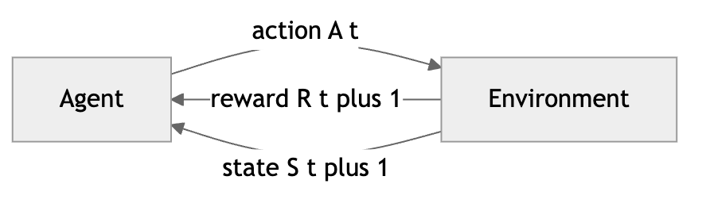

*Figure 212. The agent-environment interaction loop in reinforcement learning*

Let us pin down the core vocabulary, because the rest of the chapter leans on it constantly.

- **Agent.** The learner and decision maker. Everything inside the agent — its policy, its value estimates, its learning rule — is what we get to design. The boundary between agent and environment is drawn at the point of *absolute control*: anything the agent cannot change arbitrarily at will is part of the environment, even a robot’s own motors and battery.
- **Environment.** Everything outside the agent’s control. It defines the dynamics: given the current state and action, what reward and next state appear.
- **State** $`S_{t}`$**.** A description of the situation at time $`t`$, drawn from a state space $`\mathcal{S}`$. In a chess game it is the board position; in a robot it might be joint angles and velocities. A state is meant to summarize everything relevant about the past. We distinguish the true **environment state** from the agent’s **observation** $`O_{t}`$; when they coincide the problem is *fully observable*, otherwise it is a **partially observable MDP (POMDP)**.
- **Action** $`A_{t}`$**.** A choice the agent makes from a set of available actions $`\mathcal{A}`$. Actions can be discrete (move left or right) or continuous (apply 3.2 newtons of torque). The action space’s structure heavily shapes which algorithms apply.
- **Reward** $`R_{t}`$**.** A scalar feedback signal. By the **reward hypothesis**, all goals can be expressed as the maximization of expected cumulative reward. Designing the reward is one of the most consequential and error-prone parts of applied RL.
- **Policy** $`\pi`$**.** The agent’s behavior — a mapping from states to actions (or to a probability distribution over actions). A deterministic policy is written $`a = \pi(s)`$; a stochastic one is $`\pi(a \mid s) = Pr\lbrack A_{t} = a \mid S_{t} = s\rbrack`$.
- **Value function.** A prediction of expected future reward, used to evaluate how good states or actions are and thereby to select between actions.
- **Model.** The agent’s optional internal representation of the environment’s dynamics, predicting the next state and reward.
- **Episode.** A self-contained run from a start state to a **terminal state** — one full game of chess, one attempt at a maze. Tasks that break into episodes are **episodic**; tasks that go on forever (like balancing a pole indefinitely or managing a power grid) are **continuing**.

### 15.1.3 Rewards and the reward hypothesis

The reward signal is the single thread connecting the agent to its purpose, so it deserves special scrutiny. The **reward hypothesis**, stated crisply by Sutton, holds:

> That all of what we mean by goals and purposes can be well thought of as the maximization of the expected value of the cumulative sum of a received scalar signal (the reward).

This is a strong claim, and it is best treated as a *modeling stance* rather than a metaphysical truth. Its practical force is that if you can compress your objective into one number per time step, the entire machinery of RL becomes available. Its practical danger is that a poorly chosen number produces confidently wrong behavior.

A few principles keep reward design honest:

- **Reward the *what*, not the *how*.** Tell the agent the goal (win the game, reward $`+ 1`$), not the intermediate steps you think lead there. If you reward a chess agent for capturing pieces, it may learn to grab material while losing. Value functions are the right place for “how”; the reward is for “what.”
- **Beware reward hacking.** Agents optimize the reward you *wrote*, not the one you *meant*. A classic anecdote: a boat-racing agent rewarded for hitting score-giving targets learned to spin in a circle re-hitting the same targets forever instead of finishing the race. A cleaning robot rewarded for the amount of mess it picks up may learn to dump out a bin so it can pick the mess up again.
- **Sparse versus dense rewards.** A **sparse** reward (only $`+ 1`$ at the goal, $`0`$ everywhere else) is honest and hard to hack but slow to learn from, because the agent rarely stumbles onto any signal. A **dense** reward provides feedback at many steps and speeds learning, but every extra term is a chance to accidentally reward the wrong thing. **Reward shaping** adds guidance terms; done via *potential-based shaping* it provably preserves the optimal policy, whereas ad-hoc shaping often changes it.
- **The reward is scalar and comes from the environment.** If your problem seems to need two objectives (speed *and* safety), you must either combine them into one number with weights, or move to multi-objective RL. The scalarization you choose *is* a value judgment.

We return to these misalignment hazards in the chapter on Responsible AI, because they are not merely engineering nuisances — at scale they are the crux of the AI safety problem.

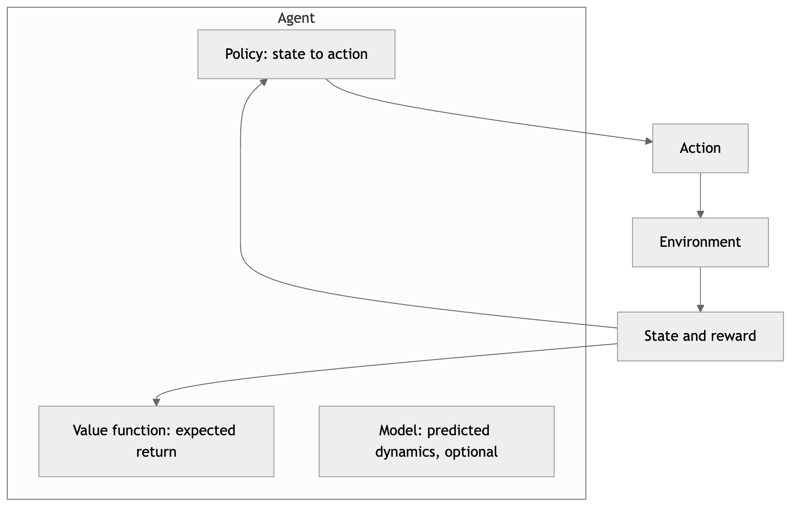

*Figure 213. The five components inside and outside the agent*

## 15.2 Markov Decision Processes

The standard mathematical formalization of the RL problem is the **Markov Decision Process (MDP)**. An MDP makes precise what we mean by states, actions, dynamics, and rewards, and it rests on one simplifying assumption that makes the theory tractable.

### 15.2.1 The Markov property

A state has the **Markov property** if the future depends on the past only through the present:

``` math
Pr\lbrack S_{t + 1},R_{t + 1} \mid S_{t},A_{t}\rbrack = Pr\lbrack S_{t + 1},R_{t + 1} \mid S_{0},A_{0},\ldots,S_{t},A_{t}\rbrack.
```

In plain language: the current state captures all information from the history that is relevant for predicting the future. If you know the present state, remembering how you got there gives you no extra predictive power. Chess satisfies this — the current board (plus castling and en-passant flags) is all you need; the move order that produced it is irrelevant. Many real problems do *not* satisfy it exactly, and a large part of practical RL is engineering a state representation that is “Markov enough.”

The Markov property is a property of the *state representation*, not of the world. A single camera frame of a moving ball is not Markov — you cannot tell which way it is going. Stack four consecutive frames (as the famous Atari DQN work did) and velocity becomes inferable, restoring the property. So when a problem seems non-Markov, the fix is usually to enrich the state: add the missing variables, stack a window of recent observations, or maintain a recurrent hidden state that summarizes history. When you genuinely cannot observe enough, you are in a **POMDP**, and the principled response is to track a **belief state** — a probability distribution over the true states — which is itself Markov.

### 15.2.2 Formal definition

A (finite) MDP is a tuple $`\langle\mathcal{S},\mathcal{A},P,R,\gamma\rangle`$:

- $`\mathcal{S}`$ — a set of states.
- $`\mathcal{A}`$ — a set of actions (possibly state-dependent, $`\mathcal{A}(s)`$).
- $`P`$ — the **transition probability function**, $`P(s' \mid s,a) = Pr\lbrack S_{t + 1} = s' \mid S_{t} = s,A_{t} = a\rbrack`$, giving the probability of landing in $`s'`$ after taking $`a`$ in $`s`$. For each $`(s,a)`$ these probabilities sum to one over $`s'`$.
- $`R`$ — the **reward function**, the expected immediate reward, $`R(s,a) = \mathbb{E}\lbrack R_{t + 1} \mid S_{t} = s,A_{t} = a\rbrack`$ (some texts use $`R(s,a,s')`$ to make the next-state dependence explicit).
- $`\gamma \in \lbrack 0,1\rbrack`$ — the **discount factor**.

Some authors fold $`P`$ and $`R`$ into a single four-argument dynamics function $`p(s',r \mid s,a) = Pr\lbrack S_{t + 1} = s',R_{t + 1} = r \mid S_{t} = s,A_{t} = a\rbrack`$, from which the transition and reward functions are marginals. Together $`P`$ and $`R`$ are the **model** of the environment, sometimes called the **dynamics**. When the agent has access to them, it can plan; when it does not, it must learn from experience.

It is illuminating to see the family of related formalisms and how the MDP sits among them:

| Formalism | States | Actions | Observability | Example |
|----|----|----|----|----|
| Markov chain | Yes | No | Full | Board-game position drift, weather |
| Markov reward process | Yes | No | Full | A chain with rewards, no choices |
| Multi-armed bandit | One (or context) | Yes | Full | A/B testing, ad selection |
| Markov Decision Process | Yes | Yes | Full | Gridworld, robot control |
| POMDP | Yes (hidden) | Yes | Partial | Poker, robot with noisy sensors |

An MDP is exactly a Markov reward process in which the transition and reward distributions are *conditioned on a chosen action* — the agent’s choices steer the chain.

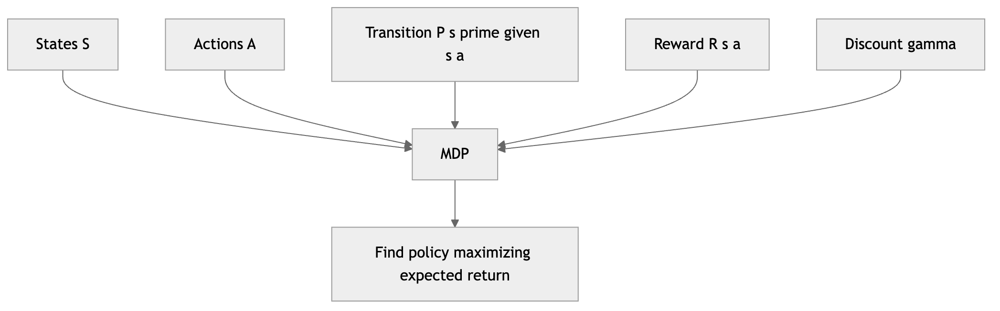

*Figure 214. Components of a Markov Decision Process*

### 15.2.3 Episodic versus continuing tasks

Tasks come in two flavors, and the distinction affects how we define the return.

An **episodic task** has natural end points — **terminal states** — after which the interaction resets to a start state. Each episode is a finite trajectory $`S_{0},A_{0},R_{1},\ldots,S_{T}`$ with a final time step $`T`$. A game of chess, a robot’s attempt to grasp an object, and a single maze run are episodic. We conventionally treat the terminal state as an **absorbing state** that transitions only to itself with reward $`0`$, which lets us write episodic and continuing returns with a single formula.

A **continuing task** never terminates: the agent-environment interaction goes on without limit. Regulating a chemical plant, balancing a pole “forever,” or serving a recommendation feed are continuing. Here the raw sum of rewards could be infinite, which is one reason we discount.

The two are unified by the absorbing-state trick: if $`T = \infty`$ for continuing tasks and the terminal state loops with zero reward for episodic ones, the discounted-return formula below covers both. For continuing tasks there is also an alternative to discounting — the **average reward** formulation, which maximizes $`\lim_{h \rightarrow \infty}\frac{1}{h}\sum_{t = 1}^{h}R_{t}`$ — but discounting is by far the more common choice and the one we develop here.

### 15.2.4 Return and the discount factor

The agent does not maximize the immediate reward; it maximizes the **return** $`G_{t}`$, the cumulative reward from time $`t`$ onward. The **discounted return** is

``` math
G_{t} = R_{t + 1} + \gamma R_{t + 2} + \gamma^{2}R_{t + 3} + \cdots = \sum_{k = 0}^{\infty}\gamma^{k}R_{t + k + 1}.
```

The discount factor $`\gamma`$ weights how much future rewards count relative to immediate ones, and it plays three roles at once:

1.  **Mathematical convergence.** For continuing tasks the sum could be infinite. As long as $`\gamma < 1`$ and rewards are bounded by $`R_{\max}`$, the geometric weighting guarantees a finite return: $`|G_{t}| \leq R_{\max}\sum_{k = 0}^{\infty}\gamma^{k} = R_{\max}/(1 - \gamma)`$.
2.  **Modeling preference for sooner rewards.** A reward now is usually worth more than the same reward later — think of interest rates or the uncertainty of survival. A discount of $`\gamma`$ per step is exactly the economist’s discounting of future utility.
3.  **A planning horizon knob.** With $`\gamma`$ near 0 the agent is myopic, caring almost only about the next reward. With $`\gamma`$ near 1 it is far-sighted, weighing distant consequences heavily. The effective horizon is roughly $`1/(1 - \gamma)`$ steps, so $`\gamma = 0.99`$ corresponds to caring about roughly the next 100 steps.

A useful recursive identity falls right out of the definition and drives all the math to come:

``` math
G_{t} = R_{t + 1} + \gamma\left( R_{t + 2} + \gamma R_{t + 3} + \cdots \right) = R_{t + 1} + \gamma G_{t + 1}.
```

This one line — the return today is the reward now plus the discounted return tomorrow — is the seed of every Bellman equation in the chapter. Keep it in view.

The figure below sketches how the discounted weight of a future reward shrinks with distance for several values of $`\gamma`$ — the visual intuition behind the “effective horizon.”

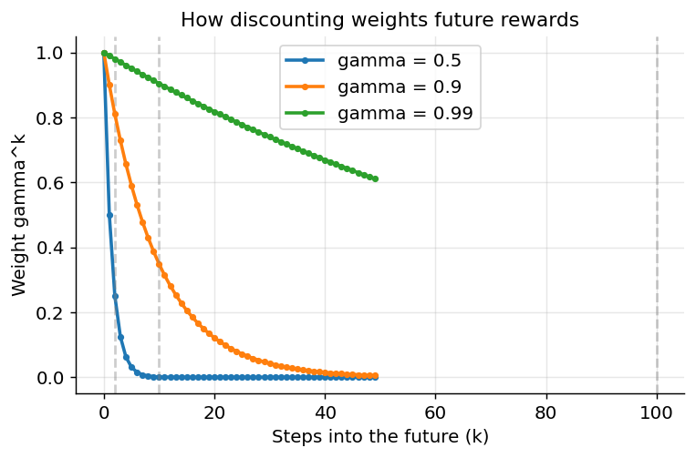

*Figure 215. Discounted weight of a future reward versus steps ahead, for several gamma*

### 15.2.5 A tiny numeric example of a return

Concreteness helps. Suppose an agent receives the reward sequence $`R_{1} = 0`$, $`R_{2} = 0`$, $`R_{3} = 1`$, and then the episode ends (all later rewards $`0`$), with $`\gamma = 0.9`$. The return from time $`0`$ is

``` math
G_{0} = 0 + 0.9 \cdot 0 + {0.9}^{2} \cdot 1 = 0.81.
```

The same terminal reward, if it had arrived one step sooner ($`R_{2} = 1`$), would be worth $`0.9`$ instead of $`0.81`$ — a concrete illustration of “sooner is better.” And a constant reward of $`+ 1`$ forever under $`\gamma = 0.9`$ yields $`G = 1/(1 - 0.9) = 10`$, the bound from role 1 above.

## 15.3 Policies

A **policy** is the agent’s decision-making rule: how it selects actions given states. Everything the agent learns ultimately serves to produce a good policy.

A **deterministic policy** maps each state to exactly one action, written $`a = \pi(s)`$. A **stochastic policy** maps each state to a probability distribution over actions,

``` math
\pi(a \mid s) = Pr\lbrack A_{t} = a \mid S_{t} = s\rbrack,\quad\quad\sum_{a}^{}\pi(a \mid s) = 1.
```

Deterministic policies are simpler and, for a fully observed MDP, there always exists an optimal policy that is deterministic — so why ever use a stochastic one? Three reasons. First, during learning, stochasticity *is* exploration: a policy that always picks the same action can never discover a better one. Second, in **partially observable** or **adversarial** settings the optimal policy is often genuinely stochastic — think rock-paper-scissors, where any deterministic play is exploitable. Third, stochastic policies are differentiable in their parameters, which is what makes policy-gradient methods work; you can nudge the *probabilities* smoothly even when the action space is discrete.

Policies can also be **stationary** (the same rule at every time step, $`\pi(a \mid s)`$ independent of $`t`$) or **non-stationary** (time-dependent, $`\pi_{t}`$). For infinite-horizon discounted MDPs an optimal stationary policy always exists, which is a deep and convenient fact — it means we can search for a single fixed rule rather than a different rule for every moment in time. For finite-horizon problems the optimal policy is generally non-stationary, because with only three steps left you behave differently than with three hundred.

A policy induces a distribution over trajectories, and hence over returns. That distribution is exactly what value functions summarize.

## 15.4 Value Functions

Returns depend on the random trajectory the agent happens to experience. To reason about *how good* a state or action is, we average over that randomness under a fixed policy. This gives us **value functions**, the central objects of RL.

The **state-value function** of a policy $`\pi`$ is the expected return starting from state $`s`$ and following $`\pi`$ thereafter:

``` math
V^{\pi}(s) = \mathbb{E}_{\pi}\left\lbrack G_{t} \mid S_{t} = s \right\rbrack = \mathbb{E}_{\pi}\left\lbrack \sum_{k = 0}^{\infty}\gamma^{k}R_{t + k + 1}\, \middle| \, S_{t} = s \right\rbrack.
```

The **action-value function** (or **Q-function**) is the expected return starting from $`s`$, taking action $`a`$, and following $`\pi`$ afterward:

``` math
Q^{\pi}(s,a) = \mathbb{E}_{\pi}\left\lbrack G_{t} \mid S_{t} = s,A_{t} = a \right\rbrack.
```

The Q-function is especially convenient: if you know $`Q^{\pi}(s,a)`$ for all actions, you can choose the best action by simply taking the $`argmax`$ — no model of the environment required. This is exactly why model-free control methods (Q-learning, SARSA) in the next chapter center on learning Q. In contrast, choosing greedily from $`V`$ alone requires a model, because you must look ahead one step through $`P`$ to know where each action leads.

The two functions are tightly related. Averaging the action values under the policy gives the state value:

``` math
V^{\pi}(s) = \sum_{a}^{}\pi(a \mid s)\, Q^{\pi}(s,a),
```

and expanding one step of dynamics expresses $`Q`$ in terms of $`V`$:

``` math
Q^{\pi}(s,a) = R(s,a) + \gamma\sum_{s'}^{}P(s' \mid s,a)\, V^{\pi}(s').
```

A closely related quantity is the **advantage function** $`A^{\pi}(s,a) = Q^{\pi}(s,a) - V^{\pi}(s)`$, which measures how much better action $`a`$ is than the policy’s average behavior in state $`s`$. Advantages are the workhorse of modern policy-gradient methods because they have lower variance than raw returns; we meet them again in the next chapter.

### 15.4.1 A numeric feel for values

Return to the reward-sequence example. If a policy always produces the trajectory with rewards $`0,0,1`$ from a state $`s`$ with $`\gamma = 0.9`$, and the environment is deterministic, then $`V^{\pi}(s) = G_{0} = 0.81`$ — no averaging needed because there is no randomness. Introduce a coin flip: with probability $`0.5`$ the agent reaches the goal in two steps ($`G = 0.9`$) and with probability $`0.5`$ it takes three ($`G = 0.81`$). Then $`V^{\pi}(s) = 0.5(0.9) + 0.5(0.81) = 0.855`$. Value functions are just these expectations, computed over all the branching the policy and environment can produce.

### 15.4.2 The optimal value functions

Among all policies there exists at least one **optimal policy** $`\pi_{\ast}`$ that achieves the maximum value in every state simultaneously. This is not obvious — a priori, one policy might be best in state $`A`$ and another best in state $`B`$ — but a foundational theorem guarantees a single policy dominates everywhere for a finite MDP. Its value functions are the **optimal value functions**:

``` math
V_{\ast}(s) = \max_{\pi}V^{\pi}(s),\quad\quad Q_{\ast}(s,a) = \max_{\pi}Q^{\pi}(s,a).
```

We can define a **partial ordering** on policies: $`\pi \geq \pi'`$ if $`V^{\pi}(s) \geq V^{\pi'}(s)`$ for all $`s`$. The theorem says there is a policy that is $`\geq`$ all others; any such policy is optimal, they all share $`V_{\ast}`$ and $`Q_{\ast}`$, and at least one of them is deterministic.

Once you have $`Q_{\ast}`$, behaving optimally is trivial: act greedily, $`\pi_{\ast}(s) = arg\max_{a}Q_{\ast}(s,a)`$. The whole enterprise of RL can be viewed as estimating $`Q_{\ast}`$ (or $`V_{\ast}`$) well enough to act near-optimally. The relationship between the optimal functions mirrors the policy-specific case but with a max in place of the policy average:

``` math
V_{\ast}(s) = \max_{a}Q_{\ast}(s,a).
```

## 15.5 The Bellman Equations

Richard Bellman’s insight in the 1950s was that value functions satisfy a recursive consistency condition: the value of where you are equals the immediate reward plus the discounted value of where you go next. This self-referential relationship — the **Bellman equation** — is the engine behind nearly every RL algorithm. It is the mathematical expression of Bellman’s **principle of optimality**: an optimal policy has the property that, whatever the initial state and first action, the remaining actions must constitute an optimal policy for the resulting state.

### 15.5.1 Deriving the Bellman expectation equation

Let us derive the equation for $`V^{\pi}`$ carefully, because the derivation pattern recurs throughout RL. Start from the definition and use the recursive form of the return $`G_{t} = R_{t + 1} + \gamma G_{t + 1}`$:

``` math
V^{\pi}(s) = \mathbb{E}_{\pi}\lbrack G_{t} \mid S_{t} = s\rbrack = \mathbb{E}_{\pi}\lbrack R_{t + 1} + \gamma G_{t + 1} \mid S_{t} = s\rbrack.
```

By linearity of expectation, split into two terms:

``` math
V^{\pi}(s) = \mathbb{E}_{\pi}\lbrack R_{t + 1} \mid S_{t} = s\rbrack + \gamma\,\mathbb{E}_{\pi}\lbrack G_{t + 1} \mid S_{t} = s\rbrack.
```

Now condition on the action $`A_{t} = a`$ (drawn from $`\pi( \cdot \mid s)`$) and the successor $`S_{t + 1} = s'`$ (drawn from $`P( \cdot \mid s,a)`$). The first term becomes $`\sum_{a}^{}\pi(a \mid s)R(s,a)`$. For the second term, once we are in $`s'`$ the expected remaining return is by definition $`V^{\pi}(s')`$ — this is the crucial step where the recursion closes on itself, using the Markov property so that history before $`s'`$ does not matter:

``` math
\mathbb{E}_{\pi}\lbrack G_{t + 1} \mid S_{t} = s\rbrack = \sum_{a}^{}\pi(a \mid s)\sum_{s'}^{}P(s' \mid s,a)\, V^{\pi}(s').
```

Combining gives the **Bellman expectation equation** for $`V^{\pi}`$:

``` math
V^{\pi}(s) = \sum_{a}^{}\pi(a \mid s)\sum_{s'}^{}P(s' \mid s,a)\left\lbrack R(s,a) + \gamma V^{\pi}(s') \right\rbrack.
```

Read it as: the value of $`s`$ is the average, over the actions the policy might take and the next states the environment might produce, of the immediate reward plus the discounted value of the successor. The analogous equation for the Q-function is

``` math
Q^{\pi}(s,a) = \sum_{s'}^{}P(s' \mid s,a)\left\lbrack R(s,a) + \gamma\sum_{a'}^{}\pi(a' \mid s')\, Q^{\pi}(s',a') \right\rbrack.
```

For a *fixed* policy these are linear equations — one per state — so in principle they can be solved exactly. Collecting the values into a vector $`\mathbf{v}`$, the reward into $`\mathbf{r}_{\pi}`$, and the policy-averaged transitions into a matrix $`\mathbf{P}_{\pi}`$, the equation reads $`\mathbf{v} = \mathbf{r}_{\pi} + \gamma\mathbf{P}_{\pi}\mathbf{v}`$, whose closed-form solution is

``` math
\mathbf{v} = (\mathbf{I} - \gamma\mathbf{P}_{\pi})^{- 1}\mathbf{r}_{\pi}.
```

The matrix inverse exists because $`\gamma\mathbf{P}_{\pi}`$ has spectral radius less than one. This is elegant but costs $`O(|\mathcal{S}|^{3})`$, so for anything but tiny problems we prefer the iterative method below.

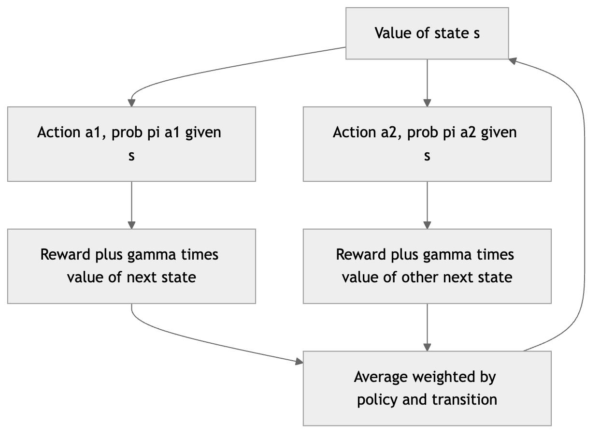

*Figure 216. How the Bellman equation relates a state value to its successors via a backup*

### 15.5.2 Bellman optimality equations

The optimal value functions satisfy a similar relation, but with a $`\max`$ replacing the policy average, because an optimal agent always picks the best action rather than averaging over a fixed policy:

``` math
V_{\ast}(s) = \max_{a}\sum_{s'}^{}P(s' \mid s,a)\left\lbrack R(s,a) + \gamma V_{\ast}(s') \right\rbrack,
```

``` math
Q_{\ast}(s,a) = \sum_{s'}^{}P(s' \mid s,a)\left\lbrack R(s,a) + \gamma\max_{a'}Q_{\ast}(s',a') \right\rbrack.
```

The $`\max`$ makes these equations **nonlinear**, so they cannot be solved by simple linear algebra. Instead we solve them iteratively — turning each Bellman equation into an *update rule* that we apply repeatedly until the values stop changing. That is precisely what dynamic programming does, and we will use it in value iteration shortly.

Why does the iteration work? Define the **Bellman optimality operator** $`T_{\ast}`$ acting on a value vector by $`(T_{\ast}V)(s) = \max_{a}\sum_{s'}^{}P(s' \mid s,a)\lbrack R(s,a) + \gamma V(s')\rbrack`$. One can show $`T_{\ast}`$ is a $`\gamma`$**-contraction** in the max-norm: for any two value vectors $`U,V`$,

``` math
\parallel T_{\ast}U - T_{\ast}V \parallel_{\infty} \leq \gamma\, \parallel U - V \parallel_{\infty}.
```

By the Banach fixed-point theorem, repeatedly applying a contraction converges to a unique fixed point — and that fixed point is $`V_{\ast}`$ by construction. This single fact underwrites the convergence of both value iteration and (as an approximation) Q-learning. The same argument applied to the Bellman *expectation* operator $`T_{\pi}`$ proves that iterative policy evaluation converges to $`V^{\pi}`$.

## 15.6 Exploration versus Exploitation

An agent that only ever does what currently looks best may never discover something better. An agent that always tries new things never cashes in on what it has learned. This tension — the **exploration-exploitation dilemma** — is unique to RL among the learning paradigms, and it has no fully clean resolution.

- **Exploitation** uses current knowledge to maximize immediate expected reward: pick the action with the highest estimated value.
- **Exploration** sacrifices some immediate reward to gather information that may lead to higher reward later.

The classic illustration is the **multi-armed bandit**: several slot machines (“one-armed bandits”) with unknown payout rates. Pull only the arm that has paid best so far and you may be stuck with a mediocre machine because you got unlucky early on a better one. The performance loss relative to always playing the best arm is called **regret**, and the goal of a good exploration strategy is to make cumulative regret grow as slowly as possible — ideally only logarithmically in the number of pulls.

We will survey four strategies of increasing sophistication. Assume we maintain running value estimates $`Q(a)`$ (for a bandit) or $`Q(s,a)`$ (for the full MDP), typically as sample averages that can be updated incrementally:

``` math
Q_{n + 1}(a) = Q_{n}(a) + \frac{1}{n}\left( R_{n} - Q_{n}(a) \right).
```

### 15.6.1 Epsilon-greedy

The simplest practical strategy is $`\varepsilon`$**-greedy**:

``` math
A_{t} = \left\{ \begin{matrix}
\arg\max_{a}Q(s,a) & \text{with probability}1 - \varepsilon \\
\text{a uniformly random action} & \text{with probability}\varepsilon.
\end{matrix} \right.\ 
```

With small $`\varepsilon`$ (say 0.1) the agent mostly exploits but occasionally explores. A common refinement is to **decay** $`\varepsilon`$ over time — explore aggressively early, then settle into exploitation as estimates mature. Its virtue is simplicity and its vice is bluntness: it explores *uniformly at random*, wasting pulls on actions already known to be terrible, and it never fully stops exploring unless you decay it to zero.

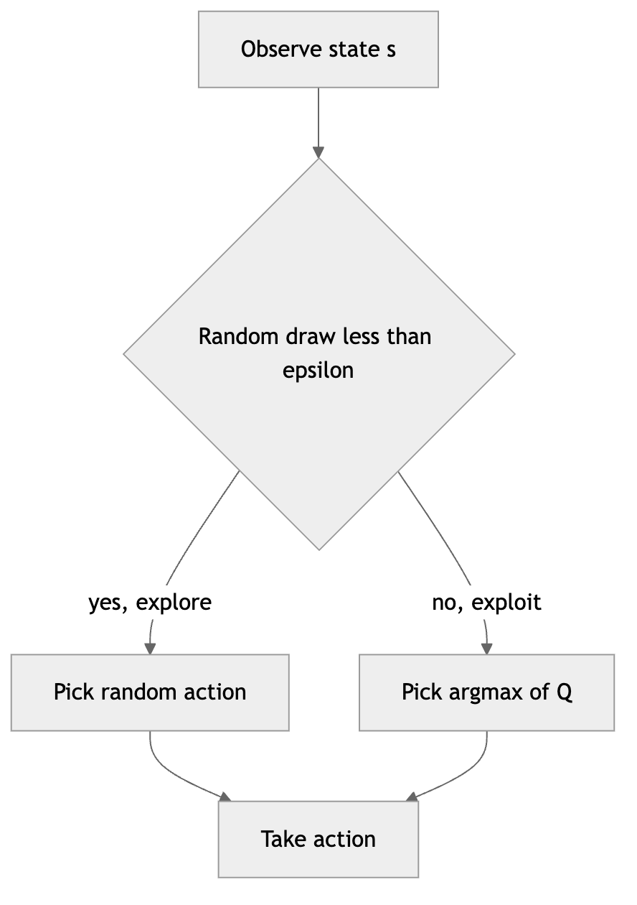

*Figure 217. Epsilon-greedy action selection*

### 15.6.2 Optimistic initialization

**Optimistic initial values** encourage systematic early exploration for free. Initialize every $`Q(a)`$ to a value higher than any plausible true value (say $`+ 5`$ when rewards are around $`+ 1`$). Because every untried action looks better than reality, the greedy agent is *drawn* to try each action; as it does, the inflated estimate is corrected downward, and attention shifts to genuinely good actions. It requires no randomness at all and works remarkably well in stationary problems. Its weakness is that the exploratory drive is temporary — a burst at the start — so it copes poorly with **non-stationary** environments whose payoffs drift over time.

### 15.6.3 Upper-confidence-bound (UCB)

**UCB** explores according to *uncertainty* rather than blindly. It selects the action with the highest optimistic upper bound on its value:

``` math
A_{t} = arg\max_{a}\left\lbrack Q_{t}(a) + c\,\sqrt{\frac{\ln t}{N_{t}(a)}} \right\rbrack,
```

where $`N_{t}(a)`$ is the number of times $`a`$ has been chosen so far and $`c > 0`$ controls the exploration strength. The square-root **exploration bonus** is large for actions tried few times (small $`N_{t}(a)`$) and shrinks as an action is sampled more, while the $`\ln t`$ in the numerator keeps a slow pressure to revisit long-neglected actions. The principle is **optimism in the face of uncertainty**: prefer actions that are *either* known to be good *or* not yet well understood. UCB enjoys strong theoretical guarantees — logarithmic regret in the stochastic bandit — and generalizes the intuition behind Monte Carlo Tree Search used in AlphaGo.

### 15.6.4 Softmax / Boltzmann exploration

Rather than a hard greedy-or-random switch, **softmax** (Boltzmann) exploration makes the *probability* of each action increase smoothly with its estimated value:

``` math
\pi(a \mid s) = \frac{\exp\left( Q(s,a)/\tau \right)}{\sum_{b}^{}\exp\left( Q(s,b)/\tau \right)}.
```

The **temperature** $`\tau > 0`$ interpolates between behaviors: as $`\tau \rightarrow 0`$ the distribution concentrates on the greedy action (pure exploitation); as $`\tau \rightarrow \infty`$ it becomes uniform (pure exploration). Unlike $`\varepsilon`$-greedy, softmax explores the *second-best* action more than a clearly terrible one, spending exploration where it is more likely to pay off. Its downside is sensitivity to the scaling of $`Q`$: if action values differ by many orders of magnitude, choosing a good $`\tau`$ becomes finicky. A close relative, **Thompson sampling**, maintains a posterior over each action’s value and samples from it, acting greedily on the sample — often the strongest simple method of all, and the natural Bayesian answer to the dilemma.

The figure below compares the average reward achieved over time by these strategies on a simulated 10-armed bandit, illustrating the classic result that smarter exploration climbs faster and plateaus higher.

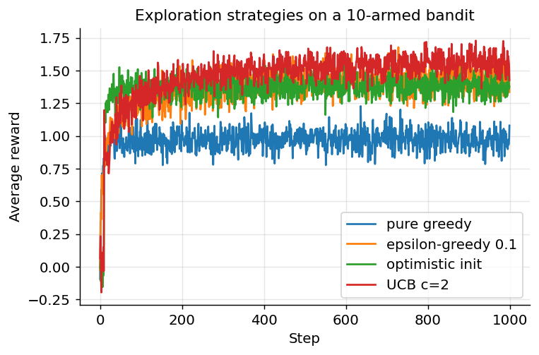

*Figure 218. Average reward over time for four exploration strategies on a 10-armed bandit*

The table below summarizes when to reach for each.

| Strategy | Explores by | Key parameter | Strengths | Weaknesses |
|----|----|----|----|----|
| $`\varepsilon`$-greedy | Uniform random slice | $`\varepsilon`$ | Trivial to implement, robust | Wastes pulls on bad actions; never stops unless decayed |
| Optimistic init | Inflated initial estimates | Initial value | No randomness, self-limiting | Only early exploration; poor if non-stationary |
| UCB | Uncertainty bonus | $`c`$ | Logarithmic regret, principled | Assumes stationarity; harder with function approximation |
| Softmax / Boltzmann | Value-proportional probabilities | $`\tau`$ | Graded, avoids clearly bad actions | Sensitive to value scaling |
| Thompson sampling | Posterior sampling | Prior | Often best empirically, Bayesian | Needs a tractable posterior |

## 15.7 Model-Based versus Model-Free

A central design axis in RL is whether the agent has — or learns — a model of the environment’s dynamics $`P`$ and $`R`$.

- **Model-based** methods use a model (given or learned) to *plan*: they compute or simulate the consequences of actions before committing. Dynamic programming, covered in this chapter, is the purest model-based approach — it assumes $`P`$ and $`R`$ are fully known. Modern model-based RL (e.g., Dyna, MuZero, world models) learns an approximate model from experience and plans within it.
- **Model-free** methods skip the model entirely and learn value functions or policies directly from sampled experience. Q-learning, SARSA, and policy-gradient methods (next chapter) are model-free.

| Aspect | Model-based | Model-free |
|----|----|----|
| Needs $`P`$, $`R`$? | Yes (known or learned) | No |
| Sample efficiency | Usually higher — can replay the model | Usually lower — needs real experience |
| Computation per step | Higher (planning) | Lower |
| Robustness to model error | Sensitive — bad model misleads planning | No model to be wrong |
| Transfers to new goals | Easily — replan with new reward | Poorly — value tied to old reward |
| Examples | Value/policy iteration, Dyna, MuZero | Q-learning, SARSA, REINFORCE, PPO |

Dynamic programming, which we turn to now, sits at the model-based extreme: it requires the full MDP and computes optimal behavior by exhaustively applying the Bellman equations.

## 15.8 Dynamic Programming

**Dynamic programming (DP)** refers to a family of algorithms that compute optimal policies given a *perfect model* of the MDP. DP is rarely practical at scale — it requires the full dynamics and sweeps over the entire state space — but it is the theoretical foundation for the sampling-based methods that follow, all of which can be seen as approximating DP without a model. Two ideas drive every DP algorithm:

1.  **Policy evaluation** — given a policy, compute its value function (the *prediction* problem).
2.  **Policy improvement** — given a value function, derive a better policy by acting greedily with respect to it (part of the *control* problem).

Alternating these two steps is **generalized policy iteration**, the pattern underlying almost all of RL.

### 15.8.1 Policy evaluation

Given a fixed policy $`\pi`$, **iterative policy evaluation** computes $`V^{\pi}`$ by turning the Bellman expectation equation into an update applied repeatedly:

``` math
V_{k + 1}(s) \leftarrow \sum_{a}^{}\pi(a \mid s)\sum_{s'}^{}P(s' \mid s,a)\left\lbrack R(s,a) + \gamma V_{k}(s') \right\rbrack.
```

Starting from arbitrary $`V_{0}`$ (e.g., all zeros), we sweep over all states updating each one. As noted above, this operation is a contraction with factor $`\gamma`$, so $`V_{k}`$ converges to the true $`V^{\pi}`$ as $`k \rightarrow \infty`$. In practice we stop when the largest change across a sweep drops below a small threshold $`\theta`$.

There are two ways to implement a sweep. A **synchronous** (or “two-array”) update computes all new values from the old array before overwriting — closest to the math. An **in-place** update overwrites $`V(s)`$ immediately and lets later states in the same sweep use the fresh values; this often converges faster and uses half the memory, and it is what most implementations do.

``` text
Iterative Policy Evaluation (in-place), for estimating V ≈ V^π
  Input: policy π, MDP (S, A, P, R, γ), threshold θ > 0
  Initialize V(s) = 0 for all s ∈ S
  repeat
    Δ ← 0
    for each s in S:
      v ← V(s)
      V(s) ← Σ_a π(a|s) Σ_s' P(s'|s,a) [ R(s,a) + γ V(s') ]
      Δ ← max(Δ, |v − V(s)|)
  until Δ < θ
  return V
```

### 15.8.2 Policy improvement and policy iteration

Once we have $`V^{\pi}`$, we can ask: in each state, is there an action better than what $`\pi`$ currently does? Define the greedy policy with respect to $`V^{\pi}`$:

``` math
\pi'(s) = arg\max_{a}\sum_{s'}^{}P(s' \mid s,a)\left\lbrack R(s,a) + \gamma V^{\pi}(s') \right\rbrack = arg\max_{a}Q^{\pi}(s,a).
```

The **policy improvement theorem** guarantees $`\pi'`$ is at least as good as $`\pi`$: $`V^{\pi'}(s) \geq V^{\pi}(s)`$ for every state, with strict improvement in at least one state unless $`\pi`$ was already optimal. The proof is a lovely telescoping argument: if in every state the greedy action’s value $`Q^{\pi}(s,\pi'(s)) \geq V^{\pi}(s)`$, then rolling that inequality forward step by step shows the whole trajectory under $`\pi'`$ dominates. When no improvement is possible — $`\pi' = \pi`$ — the greedy policy satisfies the Bellman *optimality* equation, so $`\pi`$ is optimal.

**Policy iteration** alternates evaluation and improvement until the policy stops changing:

``` python
Policy Iteration, for computing π*
  Initialize V(s) and π(s) arbitrarily for all s
  loop:
    1. Policy Evaluation: run iterative evaluation to get V^π
    2. Policy Improvement:
         stable ← true
         for each s in S:
           old ← π(s)
           π(s) ← argmax_a Σ_s' P(s'|s,a) [ R(s,a) + γ V(s') ]
           if old ≠ π(s): stable ← false
    if stable: return π (= π*) and V (= V*)
    else: repeat
```

Because there are finitely many deterministic policies and each iteration strictly improves until optimal, policy iteration converges to $`\pi_{\ast}`$ in a finite number of steps — often surprisingly few, typically a handful even for large state spaces.

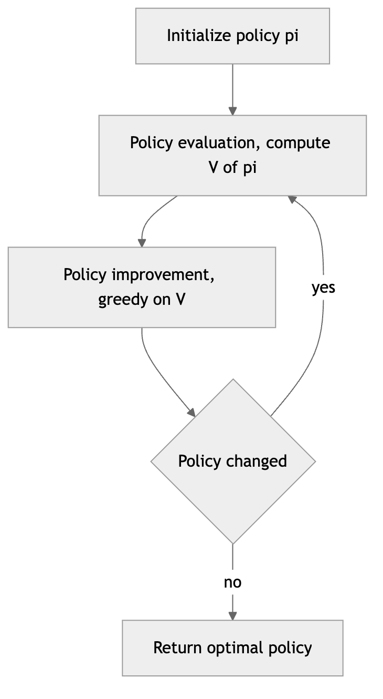

*Figure 219. Policy iteration alternates evaluation and greedy improvement*

### 15.8.3 Value iteration

Policy iteration’s inner loop fully evaluates each policy before improving — which can be wasteful, since we throw away the converged values the moment we improve the policy. **Value iteration** collapses evaluation and improvement into a single update by applying the Bellman *optimality* equation directly, effectively doing just one sweep of evaluation between improvements:

``` math
V_{k + 1}(s) \leftarrow \max_{a}\sum_{s'}^{}P(s' \mid s,a)\left\lbrack R(s,a) + \gamma V_{k}(s') \right\rbrack.
```

We sweep until the values converge, then read off the optimal policy by acting greedily one final time. Value iteration is typically the simpler algorithm to implement and is what we code below.

``` text
Value Iteration, for computing V* and π*
  Input: MDP, threshold θ > 0
  Initialize V(s) = 0 for all s
  repeat
    Δ ← 0
    for each s in S:
      v ← V(s)
      V(s) ← max_a Σ_s' P(s'|s,a) [ R(s,a) + γ V(s') ]
      Δ ← max(Δ, |v − V(s)|)
  until Δ < θ
  π(s) ← argmax_a Σ_s' P(s'|s,a) [ R(s,a) + γ V(s') ]   for all s
  return π, V
```

Value iteration and policy iteration are the two poles of a spectrum. **Modified policy iteration** sits in between: it runs a *fixed number* $`m`$ of evaluation sweeps (not to convergence) before each improvement. Value iteration is the $`m = 1`$ case; classical policy iteration is $`m = \infty`$. In practice a modest $`m`$ often converges fastest of all.

| Property | Policy iteration | Value iteration |
|----|----|----|
| Inner loop | Full policy evaluation | Single Bellman optimality update |
| Outer iterations to converge | Few (but each is expensive) | More (but each is cheap) |
| Update used | Bellman expectation | Bellman optimality |
| Output | Optimal policy and value together | Optimal value, then extract policy |
| Cost per outer iteration | High (evaluation to convergence) | Low (one sweep) |
| Best when | Evaluation is cheap or policies few | Large state spaces, simple sweeps |

### 15.8.4 Generalized policy iteration

Step back and notice the shared skeleton. **Generalized policy iteration (GPI)** is the name for *any* scheme that lets policy evaluation and policy improvement interact, regardless of how completely or how often each is carried out. The value function is repeatedly nudged toward the value of the current policy; the policy is repeatedly nudged toward greediness with respect to the current value. These two processes both cooperate and compete — improving the policy makes the value estimate stale, and re-evaluating changes what greedy means — but they share a single joint fixed point. At that fixed point the policy is greedy with respect to its own value function, which is exactly the condition for optimality (the Bellman optimality equation holds).

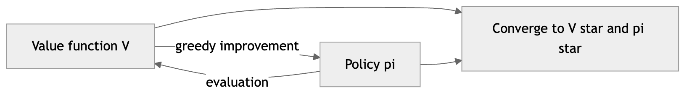

*Figure 220. Generalized policy iteration, evaluation and improvement pulling toward a shared optimum*

This is the single most important organizing idea in the chapter, because nearly every method in the next chapter is an instance of GPI. Monte Carlo methods evaluate by averaging complete returns; temporal-difference methods (Q-learning, SARSA) evaluate by bootstrapping off their own estimates; deep RL replaces the value table with a neural network. All of them alternate some form of evaluation with some form of greedy improvement, exactly as DP does — they differ only in how they estimate values and how greedily they act.

## 15.9 A Worked Example: Gridworld

Let us make all of this concrete with a tiny **gridworld**, the “hello world” of RL. Consider a $`3 \times 4`$ grid of cells. The agent starts somewhere and moves up, down, left, or right. Each step costs a small negative reward (encouraging short paths). One cell is a **goal** with a large positive reward and is terminal; one cell is a **pit** with a large negative reward and is also terminal. One interior cell is a **wall** the agent cannot enter. Bumping into a wall or boundary leaves the agent in place.

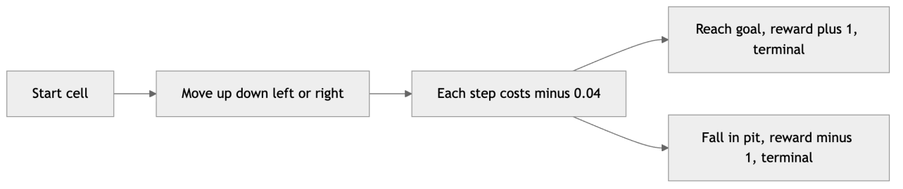

*Figure 221. A small gridworld with a goal and a pit, agent moves in four directions*

The agent does not know in advance which path is best. Value iteration will propagate the goal’s value backward across the grid: cells adjacent to the goal acquire high value first, then their neighbors, and so on, until every cell “knows” roughly how far it is from the goal in reward terms. Acting greedily on the resulting values traces the optimal path.

### 15.9.1 Working two sweeps by hand

Before we run code, let us do the arithmetic for the first couple of sweeps so the propagation is unmistakable. Label cells by $`(\text{row},\text{col})`$ with row 0 at the top. The goal is at $`(0,3)`$ with reward $`+ 1`$ (terminal), the pit at $`(1,3)`$ with reward $`- 1`$ (terminal), the wall at $`(1,1)`$, step reward $`- 0.04`$, and $`\gamma = 0.9`$. Initialize all non-terminal values to $`0`$, and fix terminal values at their rewards.

**Sweep 1.** Consider cell $`(0,2)`$, immediately left of the goal. Its four actions lead to: Right $`\rightarrow (0,3)`$ \[the goal, value $`1.0`$\], Left $`\rightarrow (0,1)`$ \[value $`0`$\], Up $`\rightarrow`$ wall/boundary, stays at $`(0,2)`$ \[value $`0`$\], Down $`\rightarrow (1,2)`$ \[value $`0`$\]. The Bellman optimality update takes the best:

``` math
V(0,2) \leftarrow max\left\lbrack \, - 0.04 + 0.9(1.0),\  - 0.04 + 0.9(0),\ \ldots \right\rbrack = - 0.04 + 0.9(1.0) = 0.86.
```

So after one sweep the cell just left of the goal is worth $`0.86`$; every cell not adjacent to a terminal is still $`- 0.04`$ (its best move leads to a still-zero neighbor). Value has spread exactly one cell out from the goal.

**Sweep 2.** Now $`(0,1)`$, two cells from the goal, sees its Right neighbor $`(0,2)`$ holding the fresh $`0.86`$:

``` math
V(0,1) \leftarrow - 0.04 + 0.9(0.86) = 0.734.
```

The high value has now propagated two cells out. Each sweep pushes the goal’s influence one ring further, and the small $`- 0.04`$ per step is what discounts distant cells below near ones. This backward propagation is the whole mechanism of value iteration; the code below simply automates it until nothing changes.

### 15.9.2 Value iteration in NumPy

The code builds the deterministic gridworld and runs value iteration. We represent each cell by its $`(row,col)`$ index, define the four actions, and apply the Bellman optimality update until the values converge. The transition is deterministic here for clarity, but the same loop handles stochastic dynamics by summing over next states.

``` python
import numpy as np

# --- Gridworld setup -------------------------------------------------
ROWS, COLS = 3, 4
GOAL = (0, 3)        # terminal, reward +1
PIT  = (1, 3)        # terminal, reward -1
WALLS = {(1, 1)}     # impassable cell
STEP_REWARD = -0.04  # small cost per move
GAMMA = 0.9

# Actions: up, down, left, right (row delta, col delta)
ACTIONS = {"U": (-1, 0), "D": (1, 0), "L": (0, -1), "R": (0, 1)}

def is_terminal(s):
    return s == GOAL or s == PIT

def step(s, a):
    """Deterministic transition. Returns next state given state and action."""
    if is_terminal(s) or s in WALLS:
        return s
    dr, dc = ACTIONS[a]
    nr, nc = s[0] + dr, s[1] + dc
    nxt = (nr, nc)
    # Out of bounds or into a wall -> stay put
    if nr < 0 or nr >= ROWS or nc < 0 or nc >= COLS or nxt in WALLS:
        return s
    return nxt

def reward(s):
    if s == GOAL:
        return 1.0
    if s == PIT:
        return -1.0
    return STEP_REWARD

# --- Value iteration -------------------------------------------------
V = np.zeros((ROWS, COLS))
states = [(r, c) for r in range(ROWS) for c in range(COLS) if (r, c) not in WALLS]

for sweep in range(100):
    delta = 0.0
    newV = V.copy()
    for s in states:
        if is_terminal(s):
            newV[s] = reward(s)        # terminal value = its reward
            continue
        # Bellman optimality update: best action's expected return
        q_values = []
        for a in ACTIONS:
            s_next = step(s, a)
            q_values.append(reward(s) + GAMMA * V[s_next])
        newV[s] = max(q_values)
        delta = max(delta, abs(newV[s] - V[s]))
    V = newV
    if delta < 1e-6:
        print(f"Converged after {sweep + 1} sweeps")
        break

# --- Extract the greedy (optimal) policy -----------------------------
policy = {}
for s in states:
    if is_terminal(s):
        policy[s] = "*"
        continue
    best_a, best_q = None, -np.inf
    for a in ACTIONS:
        q = reward(s) + GAMMA * V[step(s, a)]
        if q > best_q:
            best_q, best_a = q, a
    policy[s] = best_a

print("Optimal state values:")
print(np.round(V, 2))
print("Optimal policy (* = terminal, # = wall):")
for r in range(ROWS):
    print(" ".join(policy.get((r, c), "#") for c in range(COLS)))

# Expected output (approximately):
# Converged after ~7 sweeps
# Optimal state values:
# [[ 0.66  0.74  0.86  1.  ]
#  [ 0.59  0.    0.68 -1.  ]
#  [ 0.53  0.48  0.6   0.38]]
# Optimal policy (* = terminal, # = wall):
# R R R *
# U # U *
# U L L L
```

A few things to notice. First, the values **propagate outward from the goal**, exactly as our hand computation showed: after one sweep only cells next to the goal have meaningful value; after a few sweeps the whole grid is informed. Second, the policy that emerges **avoids the pit** — the cell at $`(0,2)`$ points Right into the goal, but the cell at $`(1,2)`$ just below the pit prefers to go Up rather than risk moving toward $`(1,3)`$, because the pit’s $`- 1`$ reward poisons the value of its neighbors. Third, the small per-step cost is what makes the agent prefer *shorter* paths; remove it and every path that eventually reaches the goal looks equally good, so the agent has no reason to hurry.

### 15.9.3 Visualizing the value function

A heatmap of the converged values makes the “value gradient” climbing toward the goal vivid. The figure below renders the gridworld with `imshow`, brightest near the goal and darkest at the pit, with the wall masked out.

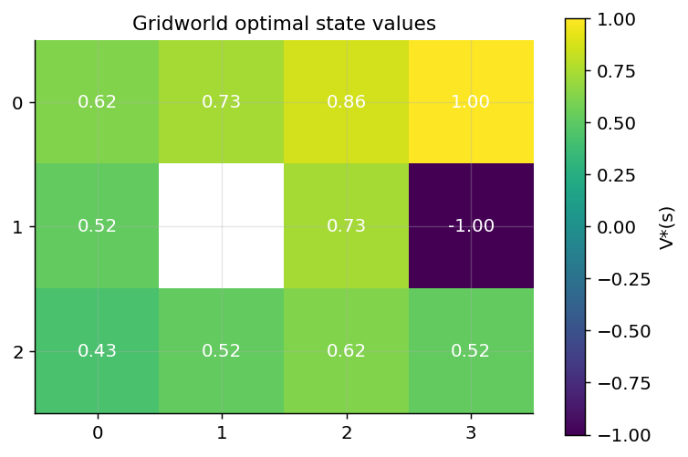

*Figure 222. Converged gridworld state-value function as a heatmap, goal at top-right*

### 15.9.4 Visualizing convergence

The next figure plots the maximum value change per sweep (the quantity $`\Delta`$ we threshold on) for both value iteration and policy iteration on the same gridworld. The characteristic pattern is a rapid, roughly geometric decrease — the contraction property in action — with policy iteration reaching machine-zero change in very few outer iterations.

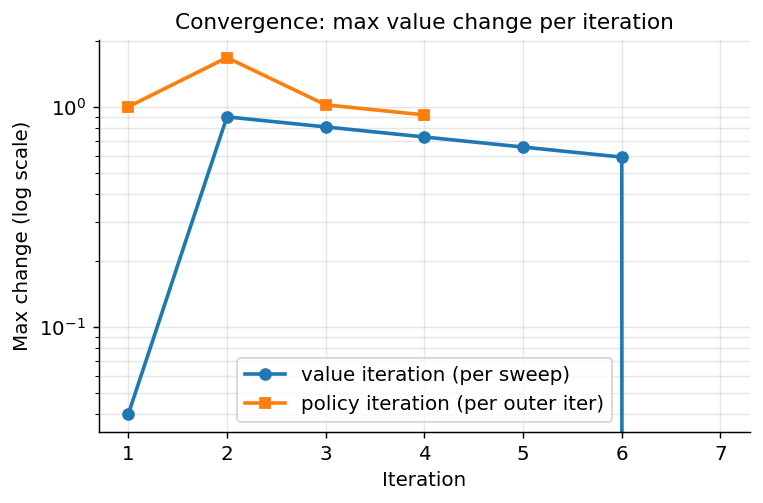

*Figure 223. Convergence of value iteration versus policy iteration on the gridworld*

The plot shows policy iteration converging in a handful of outer iterations (each doing a full, expensive evaluation) while value iteration needs more sweeps but does far less work in each — precisely the trade-off summarized in the comparison table.

### 15.9.5 Strengths, weaknesses, and pitfalls of DP

**Strengths.** Dynamic programming is *exact* and comes with iron-clad convergence guarantees. It finds the true optimal policy, it is polynomial in the number of states and actions (far better than the exponential brute-force search over all policies), and it is the conceptual template every other method imitates.

**Weaknesses.** DP requires a *perfect model* of $`P`$ and $`R`$, which you rarely have. It performs *full-width backups* — every update considers every possible successor — and it *sweeps the entire state space* every iteration.

**When to use.** Small, fully known MDPs: inventory control, small gridworlds, board games with tractable state, and as an inner planner inside larger systems. Use it whenever the model is available and the state space fits in memory.

**Pitfalls.** The dominant one is the **curse of dimensionality**: the number of states grows exponentially with the number of state variables. A robot with ten joints each discretized into a hundred positions has $`100^{10}`$ states — no array on Earth holds that. A second pitfall is assuming your model is correct; a biased model yields a confidently optimal policy for the *wrong* MDP. A third is forgetting that DP gives you the policy for the reward you specified, reward-design errors and all.

### 15.9.6 The limits of DP and the road ahead

These limits are exactly what motivate the sample-based methods of the next chapter. Two ideas break the DP bottlenecks:

- **Sampling instead of full-width backups.** Rather than summing over *every* successor weighted by $`P`$, we can follow *one* sampled transition at a time. This removes the need for a model — we just act and observe — and turns the Bellman equation into a stochastic update. Monte Carlo methods sample entire returns; temporal-difference methods sample a single step and bootstrap off the current estimate, mirroring the value-iteration update but with a sampled next state in place of the full expectation.
- **Function approximation instead of tables.** Rather than storing one number per state, we fit a parameterized function $`V_{\theta}(s)`$ or $`Q_{\theta}(s,a)`$ — a linear model or a neural network — that generalizes across states. This tames the curse of dimensionality by sharing structure, and it is what lets deep RL operate on raw pixels and continuous controls.

Both ideas trade the exactness of DP for scalability, and both introduce new difficulties — variance, bias from bootstrapping, and instability when approximation, bootstrapping, and off-policy learning combine (the “deadly triad”). But the target they chase is unchanged: the Bellman fixed point we defined here.

## 15.10 Putting the Vocabulary Together

We now have the full conceptual toolkit. An RL problem is an MDP $`\langle\mathcal{S},\mathcal{A},P,R,\gamma\rangle`$. The agent seeks a policy $`\pi`$ that maximizes the expected discounted return. We measure quality with value functions $`V^{\pi}`$ and $`Q^{\pi}`$, which satisfy the Bellman expectation equations; the optimal values $`V_{\ast}`$ and $`Q_{\ast}`$ satisfy the Bellman optimality equations, and acting greedily on $`Q_{\ast}`$ is optimal. When the model is known, dynamic programming (policy iteration, value iteration, and everything in between under generalized policy iteration) solves the MDP exactly by repeatedly applying those equations as updates. When the model is unknown — the usual case — we will instead *sample* experience and estimate values, trading the exhaustive sweeps of DP for stochastic updates while still chasing the same Bellman fixed point.

The key mental model to carry forward: **almost every RL method is generalized policy iteration in disguise** — some way of estimating a value function (evaluation) interleaved with some way of acting greedily on it (improvement), with exploration sprinkled in so the estimates stay honest. Monte Carlo methods evaluate by averaging complete returns; temporal-difference methods (Q-learning, SARSA) evaluate by bootstrapping off their own estimates, exactly mirroring the Bellman update we used in value iteration but with single sampled transitions instead of full expectations. Deep RL replaces the lookup table $`V(s)`$ with a neural network, enabling the same ideas to scale to images and high-dimensional states. Hold onto the loop, the MDP, the Bellman equation, and GPI, and the rest of reinforcement learning becomes variations on a theme.

## 15.11 Summary

- **Reinforcement learning** trains an agent to maximize cumulative reward through trial-and-error interaction, distinguished from supervised and unsupervised learning by *evaluative* feedback, *delayed* consequences, and a *data distribution the agent itself shapes*.
- The interaction is the **agent-environment loop**: at each step the agent sees a state, takes an action, and receives a reward and next state, producing a trajectory.
- The **reward hypothesis** claims all goals can be framed as maximizing expected cumulative scalar reward; reward *design* is subtle, and poorly chosen rewards invite **reward hacking**.
- A **Markov Decision Process** $`\langle\mathcal{S},\mathcal{A},P,R,\gamma\rangle`$ formalizes the problem; the **Markov property** says the current state summarizes everything relevant about the past. Tasks are **episodic** (with terminal states) or **continuing**.
- The **return** is the discounted sum of future rewards; the **discount factor** $`\gamma`$ ensures convergence, encodes a preference for sooner rewards, and sets the effective planning horizon ($`\approx 1/(1 - \gamma)`$).
- A **policy** maps states to actions, deterministically or stochastically. An optimal *stationary, deterministic* policy always exists for a discounted MDP.
- **Value functions** $`V^{\pi}(s)`$ and $`Q^{\pi}(s,a)`$ give the expected return from a state (or state-action pair) under a policy; the **optimal** versions $`V_{\ast}`$ and $`Q_{\ast}`$ define optimal behavior, and acting greedily on $`Q_{\ast}`$ is optimal.
- The **Bellman equations** express value functions recursively. The expectation form is linear (used for evaluation); the optimality form is nonlinear (solved iteratively), and its operator is a $`\gamma`$-contraction, guaranteeing convergence to a unique fixed point.
- The **exploration-exploitation dilemma** forces a trade-off between using known good actions and discovering better ones; $`\varepsilon`$**-greedy**, **optimistic initialization**, **UCB**, **softmax/Boltzmann**, and **Thompson sampling** balance it with increasing sophistication.
- **Model-based** methods plan with a model of the dynamics; **model-free** methods learn directly from experience. **Dynamic programming** is the model-based ideal, requiring full knowledge of $`P`$ and $`R`$.
- **Policy iteration** alternates full policy evaluation and greedy improvement; **value iteration** fuses them via the Bellman optimality update; both are instances of **generalized policy iteration** and converge to $`\pi_{\ast}`$. Our gridworld example showed values propagating backward from the goal.
- DP’s **curse of dimensionality** and its need for a perfect model motivate the sampling and function-approximation methods of the next chapter.

## 15.12 Key Takeaways

- RL is sequential decision making under uncertainty; the reward is evaluative and often delayed, and the agent shapes its own data.
- The MDP tuple and the Markov property are the formal bedrock; get the state representation “Markov enough” or the theory does not apply.
- Discounting is a modeling choice with three jobs: convergence, time preference, and horizon control.
- Value functions summarize expected return; the Q-function lets you act without a model, which is why model-free control learns Q.
- The Bellman equation — value now equals reward plus discounted value next — is the recurring engine; expectation form for evaluation, optimality form for control.
- Exploration is not optional: pick a strategy suited to your problem’s stationarity and scale.
- Policy iteration, value iteration, and their in-between relatives are all generalized policy iteration; every later algorithm is GPI with a different evaluator.
- DP is exact but does not scale; sampling and function approximation are how we escape the curse of dimensionality without abandoning the Bellman target.

## 15.13 Exercises

1.  **Conceptual.** Explain why reinforcement learning cannot be reduced to supervised learning even though both involve learning from data. Identify the two features of the RL feedback signal that create the difference, and give an example of a problem that becomes a *contextual bandit* when the horizon collapses to one step.

2.  **Conceptual.** A continuing task has rewards bounded by $`\pm 1`$ at every step. Show that with discount factor $`\gamma`$ the magnitude of the return is bounded by $`1/(1 - \gamma)`$. What does this imply about the effective horizon when $`\gamma = 0.95`$? What goes wrong if you set $`\gamma = 1`$ in a genuinely continuing task?

3.  **Math.** Starting from the definition $`G_{t} = \sum_{k = 0}^{\infty}\gamma^{k}R_{t + k + 1}`$, derive the recursive form $`G_{t} = R_{t + 1} + \gamma G_{t + 1}`$, then take expectations under a policy $`\pi`$ to obtain the Bellman expectation equation for $`V^{\pi}(s)`$. Identify precisely the step where the Markov property is used.

4.  **Math.** The Bellman expectation equation for a fixed policy can be written in matrix form $`\mathbf{v} = \mathbf{r}_{\pi} + \gamma\mathbf{P}_{\pi}\mathbf{v}`$. Solve for $`\mathbf{v}`$ in closed form and explain why the matrix $`(\mathbf{I} - \gamma\mathbf{P}_{\pi})`$ is guaranteed to be invertible for $`\gamma < 1`$.

5.  **By hand.** For the gridworld in this chapter ($`\gamma = 0.9`$, step reward $`- 0.04`$), compute by hand the value of the cell two steps left of the goal after three value-iteration sweeps, assuming all values start at zero. Verify your answer against the code’s converged table.

6.  **Coding.** Modify the gridworld value-iteration code so transitions are **stochastic**: the intended move succeeds with probability 0.8, and with probability 0.1 each the agent slips to one of the two perpendicular directions. Update the Bellman update to sum over the resulting next states. How does the optimal policy near the pit change, and why?

7.  **Coding.** Implement **policy iteration** for the same gridworld and verify it produces the same optimal policy as value iteration. Count and compare the number of outer iterations and total backups each algorithm needs. Then implement **modified policy iteration** with $`m = 3`$ evaluation sweeps and see where it lands between the two.

8.  **Coding.** Reproduce the 10-armed bandit figure and add **softmax** (with two temperatures) and a simple **Thompson sampling** strategy. Rank all methods by average reward at step 1000 and by cumulative regret. Do the rankings agree?

9.  **Conceptual.** Suppose you decay $`\varepsilon`$ from 1.0 to 0.01 over training. Describe what could go wrong if you decay it too quickly, and separately what goes wrong if you never decay it at all. Relate your answer to the exploration-exploitation trade-off and to the notion of regret.

10. **Design.** You are asked to build an RL agent that controls a home thermostat to keep occupants comfortable while minimizing energy cost. Specify the state, action, and reward. Identify one way your reward could be *hacked* and one variable whose omission would break the Markov property.

---

[← 14 Recommender Systems](ch14-recommender-systems.md) · [Contents](../README.md#contents) · [16 Reinforcement Learning Algorithms and Deep RL →](ch16-rl-algorithms.md)
