[← 15 Reinforcement Learning Foundations](ch15-rl-foundations.md) · [Contents](../README.md#contents) · [17 Neural Networks: Fundamentals →](ch17-nn-fundamentals.md)

---

# 16 Reinforcement Learning Algorithms and Deep RL

The previous chapter, on Reinforcement Learning Foundations, gave us the language of agents, environments, Markov Decision Processes (MDPs), value functions, and the Bellman equations. But it also relied on a quiet assumption: that we *know* the environment — its transition probabilities and reward function — so we can solve it with dynamic programming. Real agents rarely enjoy that luxury. A robot does not come with a manual describing the physics of every surface it might roll over; a game-playing agent is not handed the rulebook as a probability table. This chapter is about *learning to act from experience alone*. We will build up from tabular methods that learn by trial and error — Monte Carlo and temporal-difference learning, Q-learning and SARSA — and then confront the moment those methods break down at scale. That breaking point motivates *deep reinforcement learning*: Deep Q-Networks, policy-gradient methods, actor-critic architectures, and the modern algorithms (TRPO, PPO, DDPG, SAC) that power game-playing systems, robots, recommender engines, and the alignment of large language models.

The through-line is a single question asked at ever-larger scale: *given only a stream of states, actions, and rewards, how should an agent revise its behavior?* Every algorithm in this chapter is an answer to that question. They differ in what they estimate (values or policies), how they form their learning targets (full returns or bootstrapped estimates), whose experience they can learn from (their own or anyone’s), and how they represent knowledge (a table or a neural network). Once you see the handful of axes along which these methods vary, the zoo of acronyms collapses into a small, comprehensible design space. Building that map is the goal of the chapter.

## 16.1 From Planning to Learning: Model-Free Control

In the foundations chapter we distinguished *prediction* (estimating the value of a fixed policy) from *control* (finding the best policy). Dynamic-programming methods like value iteration and policy iteration solve control exactly, but they require a *model* of the MDP: the transition function $`p(s' \mid s,a)`$ and the reward function $`r(s,a)`$. They are *model-based planning* algorithms — they compute the answer by sweeping over a known model, never taking a real action.

*Model-free* methods throw that assumption away. The agent does not know how the world works; it only gets to *interact* with it — take an action, observe the next state and a reward, repeat. From this stream of experience it must estimate values and improve its policy. This is the realistic setting for almost all interesting problems, and the distinction is worth making crisp:

- **Model-free prediction** (the *policy-evaluation* problem): given a fixed policy $`\pi`$, estimate its value function $`V^{\pi}(s)`$ or $`Q^{\pi}(s,a)`$ from sampled experience. Monte Carlo and TD(0) are the two canonical prediction algorithms, and we will study both.
- **Model-free control** (the *optimization* problem): find a policy that maximizes return, again from experience alone. SARSA, Q-learning, and expected SARSA are the canonical control algorithms.

Control is prediction plus improvement, wired into a loop. A central idea unifies model-free control: **generalized policy iteration (GPI)**. We alternate between two steps:

1.  **Policy evaluation** — estimate the action-value function $`Q(s,a)`$ for the current policy from experience.
2.  **Policy improvement** — make the policy greedier with respect to the new $`Q`$.

Neither step needs to run to completion before the other begins. Value iteration, for instance, does a single sweep of evaluation before improving; the TD-control methods below improve after *every step*. GPI is best thought of as two processes pulling on the same pair of objects — a value function and a policy — each dragging the other toward mutual consistency. When neither can change the other, the value function satisfies the Bellman optimality equation and the policy is greedy with respect to it: we have reached the fixed point $`\pi^{\ast}`$, $`Q^{\ast}`$.

We work with the *action-value* function $`Q`$ rather than the state-value function $`V`$ for a crucial reason: without a model, we cannot improve a policy from $`V`$ alone. Greedy improvement requires $`\arg\max_{a}Q(s,a)`$, which $`Q`$ gives us directly; deriving the same thing from $`V`$ would need the one-step lookahead $`\arg\max_{a}\sum_{s'}^{}p(s' \mid s,a)\lbrack r + \gamma V(s')\rbrack`$, and that transition model $`p`$ is exactly what we do not have. Storing $`Q`$ costs a factor of $`|\mathcal{A}|`$ more memory than storing $`V`$, and that is a price model-free control is always willing to pay.

Improvement is also tempered by *exploration*: a purely greedy agent will lock onto whatever looks best early and never discover better options — the **exploration-exploitation dilemma** in its sharpest form. The standard fix, introduced last chapter, is the $`\varepsilon`$**-greedy** policy: act greedily with probability $`1 - \varepsilon`$, and pick a uniformly random action with probability $`\varepsilon`$. This guarantees every action in every state keeps a nonzero probability of being tried, which is exactly the condition the convergence proofs require. A related idea, used when we want a stronger theoretical guarantee, is **exploring starts** — begin each episode from a state-action pair chosen so that every pair has nonzero probability of being the start — which we will meet in the Monte Carlo section.

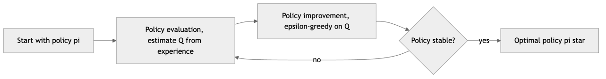

*Figure 224. Generalized policy iteration alternates evaluation and improvement until convergence.*

A useful way to organize everything that follows is by the *depth* and *breadth* of the update each method performs. Dynamic programming does *shallow, full-breadth* updates: one step deep, but summing over all successor states using the model. Monte Carlo does *full-depth, single-sample* updates: all the way to the end of the episode, but along one sampled trajectory. Temporal-difference learning does *shallow, single-sample* updates: one step deep, along one sampled trajectory, bootstrapping on an estimate for the rest. The following diagram places the three families on those two axes; almost every algorithm in this chapter lives somewhere inside the rectangle they define.

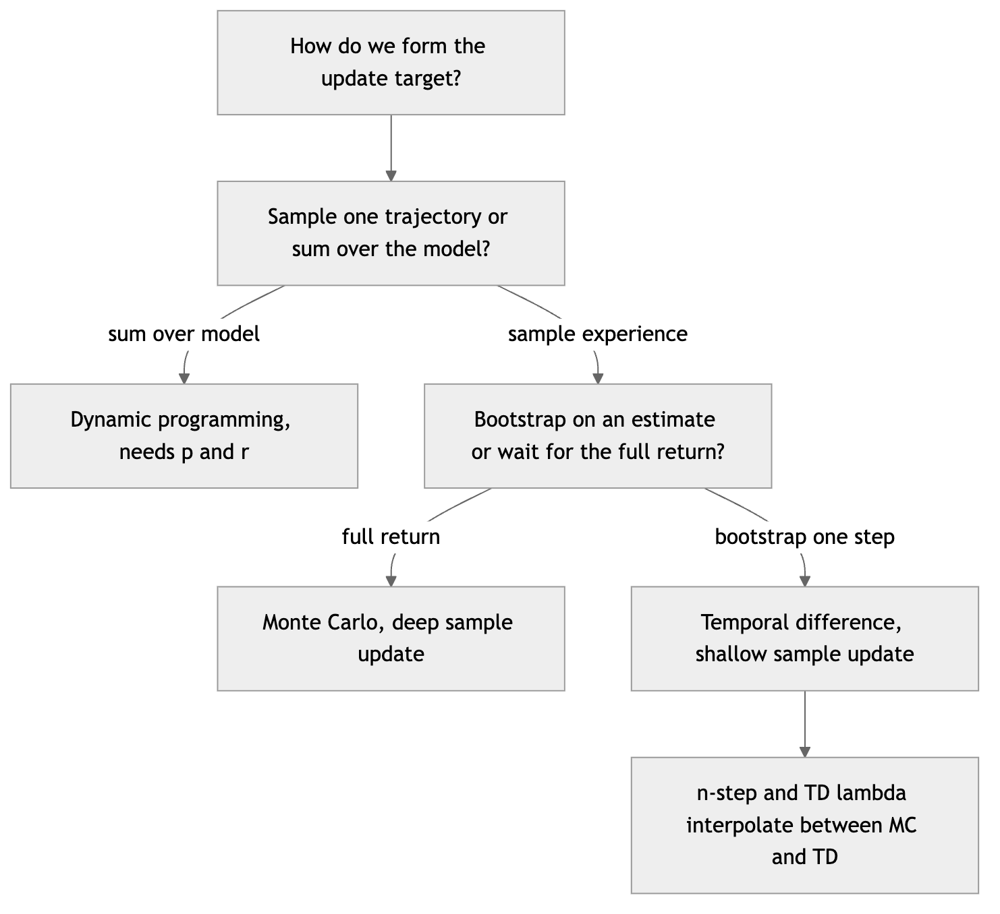

*Figure 225. The space of value-update methods organized by sample breadth and bootstrapping depth.*

## 16.2 Monte Carlo Methods

The simplest way to estimate a value from experience is to *average the returns you actually receive*. That is the Monte Carlo (MC) idea. Recall the return from time $`t`$ is the discounted sum of future rewards:

``` math
G_{t} = R_{t + 1} + \gamma R_{t + 2} + \gamma^{2}R_{t + 3} + \cdots = \sum_{k = 0}^{\infty}\gamma^{k}R_{t + k + 1}
```

Monte Carlo methods wait until an *episode* ends, compute the realized return for each state-action pair visited, and update the value estimate toward the average of those returns. By the law of large numbers, the sample average of returns converges to the true expected value $`Q^{\pi}(s,a) = \mathbb{E}_{\pi}\lbrack G_{t} \mid S_{t} = s,A_{t} = a\rbrack`$. There is no model, no bootstrapping, and no assumption that the Markov property holds inside an episode — MC simply treats each episode as one sample of the random variable “return,” and averages.

### 16.2.1 First-visit versus every-visit

Within an episode a state might be visited more than once. That raises a bookkeeping question that turns out to matter theoretically. **First-visit MC** averages the returns following only the *first* time each state (or state-action pair) is visited in an episode; second and later visits in that same episode are ignored. **Every-visit MC** averages the returns following *every* visit. Both converge to $`V^{\pi}`$ (or $`Q^{\pi}`$), but they are not identical: first-visit estimates are an average of independent samples and are *unbiased* from the start, while every-visit estimates are biased for finite data because the multiple returns within an episode are correlated. The bias of every-visit MC decays to zero as more episodes accumulate, and in practice the two perform similarly; first-visit is the version whose analysis is cleanest, so it is the default we reason about.

Two ways to maintain the average are worth distinguishing. The **sample-average** form keeps a count $`N(s,a)`$ and stores the running mean directly, $`Q(s,a) \leftarrow Q(s,a) + \frac{1}{N(s,a)}\lbrack G - Q(s,a)\rbrack`$, which weights every return equally and is the true mean of observed returns. The **constant-**$`\alpha`$ form uses a fixed step size, $`Q(s,a) \leftarrow Q(s,a) + \alpha\lbrack G - Q(s,a)\rbrack`$, which is an *exponentially weighted* recency-biased average. Constant $`\alpha`$ never fully converges — it keeps tracking — but that is exactly what you want in a *nonstationary* problem, such as control, where the policy (and hence the returns) is changing underneath you.

### 16.2.2 How Monte Carlo control works, step by step

For control we plug MC evaluation into GPI. For each episode, generated by following an $`\varepsilon`$-greedy policy:

1.  Roll out a full episode: $`S_{0},A_{0},R_{1},S_{1},A_{1},R_{2},\ldots,S_{T - 1},A_{T - 1},R_{T}`$.
2.  Walking backward from the end, accumulate the return $`G \leftarrow \gamma G + R_{t + 1}`$.
3.  For each first occurrence of $`(S_{t},A_{t})`$ in the episode (first-visit MC), update the estimate toward the observed return:

``` math
Q(S_{t},A_{t}) \leftarrow Q(S_{t},A_{t}) + \alpha\left\lbrack G_{t} - Q(S_{t},A_{t}) \right\rbrack
```

4.  Improve the policy to be $`\varepsilon`$-greedy with respect to the updated $`Q`$.

The bracketed term $`G_{t} - Q(S_{t},A_{t})`$ is an *error*: how surprised we are by the return relative to our current estimate. We nudge our estimate a fraction $`\alpha`$ of the way toward closing that gap. Walking backward is a small but important efficiency: it lets us compute every $`G_{t}`$ in a single pass because $`G_{t} = R_{t + 1} + \gamma G_{t + 1}`$.

**Monte Carlo control with exploring starts (MCES).** A subtle problem lurks in step 4. If we improve toward a *deterministic* greedy policy, some state-action pairs may never be selected again, so we can never estimate their value, so we can never discover they were better. There are two standard remedies. The first is **exploring starts**: assume we can begin an episode at any state-action pair with nonzero probability, guaranteeing infinite visits to all pairs in the limit; this yields the classic MCES algorithm, which converges to $`Q^{\ast}`$. Exploring starts is often unrealistic (you rarely get to choose a robot’s starting configuration), so the second, more practical remedy is to keep the policy *soft* — always $`\varepsilon`$-greedy rather than fully greedy — which keeps every action alive without needing special starts. On-policy MC control with $`\varepsilon`$-greedy policies converges to the best $`\varepsilon`$-soft policy, which approaches $`\pi^{\ast}`$ as $`\varepsilon \rightarrow 0`$.

### 16.2.3 A worked Monte Carlo example by hand

Let a tiny episode with $`\gamma = 0.9`$ produce the reward sequence $`R_{1} = 0`$, $`R_{2} = 0`$, $`R_{3} = 1`$ across states $`S_{0} = A`$, $`S_{1} = B`$, $`S_{2} = C`$ (terminal after the reward of 1). Walking backward:

- $`G_{2} = R_{3} = 1`$ (return following the visit to $`C`$).
- $`G_{1} = R_{2} + \gamma G_{2} = 0 + 0.9 \times 1 = 0.9`$ (following $`B`$).
- $`G_{0} = R_{1} + \gamma G_{1} = 0 + 0.9 \times 0.9 = 0.81`$ (following $`A`$).

Starting from $`V(A) = V(B) = V(C) = 0`$ with $`\alpha = 0.1`$, the first-visit updates are $`V(A) \leftarrow 0 + 0.1(0.81 - 0) = 0.081`$, $`V(B) \leftarrow 0.09`$, $`V(C) \leftarrow 0.1`$. Notice how the update propagates *the full realized return* into each state in a single episode — MC does not bootstrap, so information from the terminal reward reaches $`A`$ immediately, but the estimate for $`A`$ carries the full variance of that entire three-step trajectory.

### 16.2.4 Strengths, weaknesses, and when to use Monte Carlo

| Aspect | Monte Carlo methods |
|----|----|
| Strengths | Conceptually simple; unbiased (first-visit); no bootstrapping so no need for the Markov property to hold mid-episode; robust to violations of the Markov assumption; can focus computation on states of interest |
| Weaknesses | Requires episodes to *terminate*; updates only at episode end (high latency); high variance because a return depends on a long chain of random actions and transitions; no online learning in continuing tasks |
| When to use | Episodic tasks with manageable episode length; when the Markov property is doubtful; blackjack-style problems; as a low-bias baseline |
| Pitfalls | Slow with long episodes; a single unlucky trajectory can swing an estimate wildly; deterministic greedy improvement without exploring starts or $`\varepsilon`$-softness can starve state-action pairs |

These weaknesses — episode-bound updates and high variance — are exactly what the next idea attacks.

## 16.3 Temporal-Difference Learning

Temporal-difference (TD) learning is, arguably, the central idea of reinforcement learning. It combines the *sampling* of Monte Carlo with the *bootstrapping* of dynamic programming — that is, updating an estimate based partly on other estimates rather than waiting for the final outcome. Sutton, who introduced it, described TD learning as learning a guess from a guess, and the phrase captures both its power and its danger.

Consider the simplest TD method, **TD(0)**, for the prediction problem of estimating $`V^{\pi}`$. Instead of waiting for the full return $`G_{t}`$, we take a single step, observe $`R_{t + 1}`$ and $`S_{t + 1}`$, and update using our *current estimate* of the next state’s value as a stand-in for the rest of the return:

``` math
V(S_{t}) \leftarrow V(S_{t}) + \alpha\left\lbrack \underset{\text{TD target}}{\underbrace{R_{t + 1} + \gamma V(S_{t + 1})}} - V(S_{t}) \right\rbrack
```

The quantity

``` math
\delta_{t} = R_{t + 1} + \gamma V(S_{t + 1}) - V(S_{t})
```

is the **TD error**. It measures the discrepancy between our prediction $`V(S_{t})`$ and a slightly better, one-step-grounded estimate. Notice that we update *every step*, online, without waiting for the episode to end — and we can learn in continuing (never-ending) tasks. The TD error is a quantity of independent importance: it turns out to correspond to the phasic firing of dopamine neurons in biological reward learning, one of the most celebrated bridges between machine learning and neuroscience.

### 16.3.1 Bootstrapping versus sampling, precisely

It helps to line up the three update targets side by side, because their differences generate every method in this chapter:

- **Dynamic programming** target: $`\mathbb{E}_{\pi}\lbrack R_{t + 1} + \gamma V(S_{t + 1})\rbrack`$ — bootstraps ($`V`$ appears on the right) and does *not* sample (it takes an expectation over the known model).
- **Monte Carlo** target: $`G_{t}`$ — samples (one trajectory) and does *not* bootstrap (no $`V`$ on the right).
- **TD(0)** target: $`R_{t + 1} + \gamma V(S_{t + 1})`$ — both samples *and* bootstraps.

TD is the only one of the three that needs neither a model nor the end of an episode. That combination is why it became the backbone of practical RL.

The trade-off is the classic *bias-variance* tension:

|  | Monte Carlo | TD(0) |
|----|----|----|
| Update target | actual return $`G_{t}`$ | $`R_{t + 1} + \gamma V(S_{t + 1})`$ |
| Bootstraps? | no | yes |
| Bias | unbiased | biased (uses estimates) |
| Variance | high (whole trajectory) | low (one reward + one estimate) |
| When can it update? | end of episode | every step |
| Needs episodes to end? | yes | no |
| Exploits Markov property? | no | yes |

TD methods usually learn faster in practice. The bias washes out as estimates improve, while the variance reduction pays off immediately. There is even a precise sense in which they differ: on a batch of data, Monte Carlo converges to the estimate that minimizes mean-squared error on the observed returns, while TD(0) converges to the value function of the *maximum-likelihood MDP* implied by the data — the certainty-equivalence estimate. When the environment really is Markov, TD’s answer is the one you want.

### 16.3.2 A worked TD(0) example by hand

Reuse the trajectory $`A \rightarrow B \rightarrow C \rightarrow \text{terminal}`$ with rewards $`0,0,1`$, $`\gamma = 0.9`$, $`\alpha = 0.1`$, and suppose our current estimates happen to be $`V(A) = 0.5`$, $`V(B) = 0.7`$, $`V(C) = 0.4`$. Processing the steps online:

- Step $`A \rightarrow B`$: $`\delta = R + \gamma V(B) - V(A) = 0 + 0.9(0.7) - 0.5 = 0.13`$, so $`V(A) \leftarrow 0.5 + 0.1(0.13) = 0.513`$.
- Step $`B \rightarrow C`$: $`\delta = 0 + 0.9(0.4) - 0.7 = - 0.34`$, so $`V(B) \leftarrow 0.7 + 0.1( - 0.34) = 0.666`$.
- Step $`C \rightarrow \text{terminal}`$: the terminal value is $`0`$, so $`\delta = 1 + 0.9(0) - 0.4 = 0.6`$, and $`V(C) \leftarrow 0.4 + 0.1(0.6) = 0.46`$.

Contrast this with the MC pass earlier: MC pushed the *entire* return into each state at once, while TD nudged each state toward its immediate successor. The reward of 1 has reached $`C`$ but not yet $`A`$ or $`B`$; it will propagate backward one state per episode. That slow, layered propagation is the price of TD’s low variance, and it is exactly what eligibility traces (below) accelerate. The figure below shows the bias-variance contrast in action.

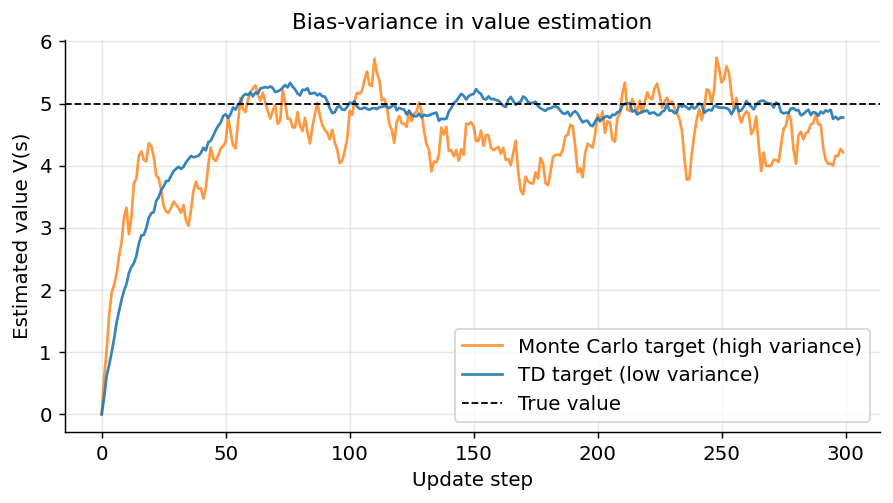

*Figure 226. High-variance Monte Carlo vs low-variance TD value estimates converging to the truth.*

## 16.4 SARSA: On-Policy TD Control

TD(0) does *prediction*. To do *control* we apply the same one-step bootstrapped update to action-values and wrap it in GPI. SARSA is the on-policy result. Its name comes from the quintuple it uses for each update: **S**tate, **A**ction, **R**eward, next **S**tate, next **A**ction $`(S_{t},A_{t},R_{t + 1},S_{t + 1},A_{t + 1})`$. The update rule mirrors TD(0):

``` math
Q(S_{t},A_{t}) \leftarrow Q(S_{t},A_{t}) + \alpha\left\lbrack R_{t + 1} + \gamma\, Q(S_{t + 1},A_{t + 1}) - Q(S_{t},A_{t}) \right\rbrack
```

The target uses $`Q(S_{t + 1},A_{t + 1})`$ — the value of the action the agent *actually takes next*, chosen by the same $`\varepsilon`$-greedy behavior policy. The policy that generates behavior and the policy being evaluated are one and the same; hence **on-policy**. Because the update needs $`A_{t + 1}`$, a SARSA agent commits to its next action before it updates the current one — the algorithm literally learns the value of the policy it is following, exploration and all.

### 16.4.1 A worked SARSA update

Suppose $`\gamma = 0.9`$, $`\alpha = 0.5`$, current $`Q(S_{t},A_{t}) = 2.0`$, the agent receives $`R_{t + 1} = 1`$, lands in $`S_{t + 1}`$, and its $`\varepsilon`$-greedy policy happens to pick an *exploratory* action $`A_{t + 1}`$ whose value is $`Q(S_{t + 1},A_{t + 1}) = 3.0`$ (not the best action there, which is worth 5.0). The SARSA target is $`1 + 0.9(3.0) = 3.7`$, the error is $`3.7 - 2.0 = 1.7`$, and $`Q(S_{t},A_{t}) \leftarrow 2.0 + 0.5(1.7) = 2.85`$. SARSA folded the *cost of exploring* into the estimate: had the agent been forced to bootstrap on the greedy 5.0 it would have targeted $`1 + 0.9(5.0) = 5.5`$ instead. That difference is the entire on-policy/off-policy story, and Q-learning below makes exactly the opposite choice.

### 16.4.2 The contrast: cliff-walking intuition

Why does this matter? Consider an agent walking along a cliff edge, where the shortest path to the goal runs right beside a row of catastrophic “fall off the cliff” states that give a large negative reward and reset the agent. Q-learning (next section) learns the *optimal* path hugging the cliff, because its target assumes greedy future behavior. But during training the $`\varepsilon`$-greedy exploration occasionally takes a random step — and along the cliff edge that random step is disastrous. SARSA *accounts for its own exploration*: because its target uses the actual (sometimes exploratory) next action, it learns a *safer* path further from the edge, sacrificing a little optimality for robustness while it is still exploring. If you plot the *reward collected during training*, SARSA accumulates more, because it falls off the cliff less; if you plot the *final greedy policy*, Q-learning’s is shorter. This is one of the most instructive experiments in all of RL, and it is Exercise 4.

### 16.4.3 Strengths, weaknesses, and when to use SARSA

| Aspect | SARSA (on-policy TD control) |
|----|----|
| Strengths | Learns the value of the policy actually being followed; accounts for exploration risk; safer online behavior; simple one-step online updates; converges to $`Q^{\ast}`$ as $`\varepsilon \rightarrow 0`$ under standard conditions |
| Weaknesses | Cannot straightforwardly reuse off-policy data; learns a slightly conservative policy while exploring; convergence to the true optimum requires annealing $`\varepsilon`$ to zero |
| When to use | Safety-sensitive online learning where exploratory mistakes are costly; on-policy settings; when you want the learned values to reflect real behavior |
| Pitfalls | If $`\varepsilon`$ never decays, SARSA converges to the best $`\varepsilon`$-soft policy, not $`\pi^{\ast}`$; sensitive to the exploration schedule |

## 16.5 Q-Learning: Off-Policy TD Control

Q-learning, introduced by Watkins in 1989, is the most famous reinforcement learning algorithm. It applies the TD idea directly to action-values and learns the *optimal* action-value function $`Q^{\ast}`$ regardless of how the agent behaves while gathering data. The update rule is:

``` math
Q(S_{t},A_{t}) \leftarrow Q(S_{t},A_{t}) + \alpha\left\lbrack R_{t + 1} + \gamma\max_{a'}Q(S_{t + 1},a') - Q(S_{t},A_{t}) \right\rbrack
```

The key is the $`\max_{a'}`$ term. The TD target uses the value of the *best* next action — not the action the agent will actually take. This makes Q-learning **off-policy**: the *behavior policy* that generates experience (typically $`\varepsilon`$-greedy, to keep exploring) differs from the *target policy* being learned (the greedy, optimal one). The agent can behave randomly, even badly, and still converge to the optimal policy, because the $`\max`$ always evaluates the greedy choice. This separation is powerful — it lets us reuse old data, learn from a human demonstrator, or explore aggressively while still converging to the optimal target.

Q-learning is a direct stochastic-approximation analogue of the Bellman optimality equation $`Q^{\ast}(s,a) = \mathbb{E}\lbrack R + \gamma\max_{a'}Q^{\ast}(s',a')\rbrack`$: each update replaces the expectation with a single sample and the true $`Q^{\ast}`$ on the right with our current estimate. Under the Robbins-Monro step-size conditions ($`\sum_{t}^{}\alpha_{t} = \infty`$, $`\sum_{t}^{}\alpha_{t}^{2} < \infty`$) and continued exploration of all state-action pairs, tabular Q-learning is guaranteed to converge to $`Q^{\ast}`$ with probability one.

### 16.5.1 A worked Q-learning update

Reuse the SARSA numbers: $`\gamma = 0.9`$, $`\alpha = 0.5`$, $`Q(S_{t},A_{t}) = 2.0`$, reward $`R_{t + 1} = 1`$, and in $`S_{t + 1}`$ the action values are $`\{ 3.0,5.0,1.0\}`$. Where SARSA bootstrapped on the *taken* action (3.0), Q-learning bootstraps on the *best* action: target $`= 1 + 0.9max(3.0,5.0,1.0) = 1 + 0.9(5.0) = 5.5`$, error $`= 5.5 - 2.0 = 3.5`$, so $`Q(S_{t},A_{t}) \leftarrow 2.0 + 0.5(3.5) = 3.75`$. Same transition, same exploratory next action, but a larger, more optimistic update — Q-learning ignores the fact that the agent explored and credits the state with the value of behaving optimally thereafter.

### 16.5.2 A runnable gridworld example: FrozenLake

Let us implement tabular Q-learning on Gymnasium’s `FrozenLake-v1`, a small gridworld. The agent starts at the top-left, must reach a goal at the bottom-right, and the lake has holes that end the episode with zero reward. Reaching the goal gives reward 1. We use the non-slippery variant so the dynamics are deterministic and learning is clean.

``` python
# Tabular Q-learning on FrozenLake (Gymnasium)
import numpy as np
import gymnasium as gym

env = gym.make("FrozenLake-v1", is_slippery=False)  # 4x4 grid, deterministic
n_states, n_actions = env.observation_space.n, env.action_space.n

Q = np.zeros((n_states, n_actions))
alpha, gamma = 0.8, 0.95          # learning rate, discount
epsilon, eps_min, eps_decay = 1.0, 0.05, 0.999
episodes = 2000
rng = np.random.default_rng(0)

for ep in range(episodes):
    state, _ = env.reset(seed=ep)
    done = False
    while not done:
        # epsilon-greedy action selection
        if rng.random() < epsilon:
            action = env.action_space.sample()
        else:
            action = int(np.argmax(Q[state]))
        next_state, reward, terminated, truncated, _ = env.step(action)
        done = terminated or truncated
        # Q-learning update (off-policy: uses max over next actions)
        best_next = np.max(Q[next_state])
        td_target = reward + gamma * best_next * (not terminated)
        Q[state, action] += alpha * (td_target - Q[state, action])
        state = next_state
    epsilon = max(eps_min, epsilon * eps_decay)

# Evaluate the greedy policy learned
def greedy_rollout():
    s, _ = env.reset(seed=123); done = False; total = 0
    while not done:
        s, r, term, trunc, _ = env.step(int(np.argmax(Q[s])))
        total += r; done = term or trunc
    return total

print("Learned Q-table (rows=states, cols=actions):")
print(np.round(Q, 2))
print("Greedy policy reward:", greedy_rollout())   # expected: 1.0
```

After training, the greedy policy reliably navigates to the goal (reward `1.0`), and the $`Q`$-table encodes a value gradient increasing toward the goal state. Try setting `is_slippery=True`: the stochastic dynamics make the problem genuinely hard, and you will need more episodes and a slower $`\varepsilon`$ decay.

The figure below shows the epsilon-decay schedule this code uses — exploration starts at 1.0 and anneals toward a small floor, so the agent explores broadly early and exploits its learned values late.

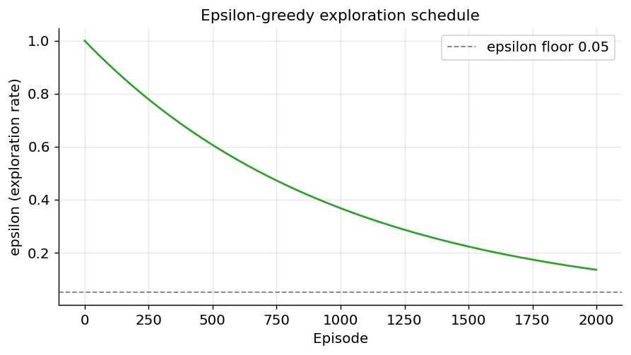

*Figure 227. Exponential epsilon decay with a floor, the exploration schedule used in the Q-learning example.*

Watching individual Q-values evolve is even more revealing than the final table. The next figure sketches how the estimated value of a few state-action pairs climbs and settles as training proceeds — early estimates are noisy and biased low (the table starts at zero), then rise as the terminal reward propagates backward through the grid and finally plateau near their true values.

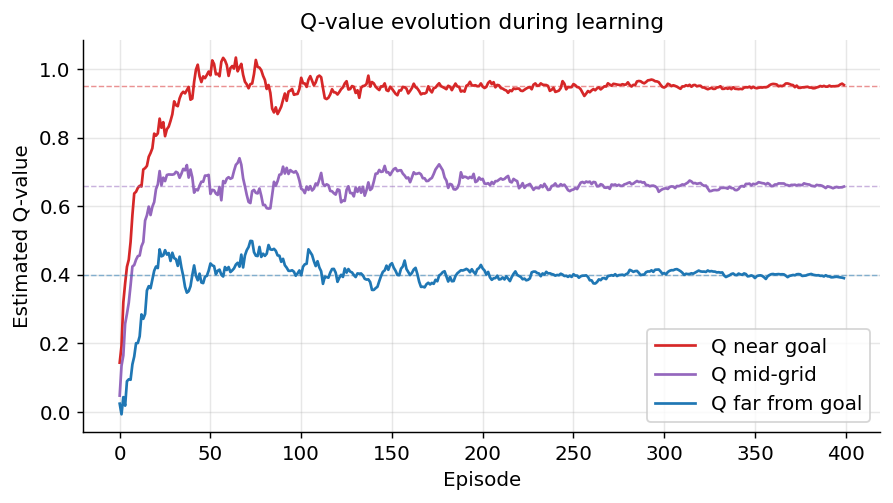

*Figure 228. Simulated evolution of three Q-value estimates converging toward their true values during training.*

### 16.5.3 Strengths, weaknesses, and when to use Q-learning

| Aspect | Q-learning (off-policy TD control) |
|----|----|
| Strengths | Learns the optimal policy from *any* sufficiently exploratory behavior; can reuse old or demonstrator data; strong tabular convergence guarantees; simple to implement |
| Weaknesses | The $`\max`$ operator introduces *maximization bias* (systematic overestimation); ignores the risk of its own exploration; off-policy plus function approximation plus bootstrapping is the deadly triad and can diverge |
| When to use | Small-to-medium discrete state-action spaces; when you want the optimal policy regardless of behavior; as the value-based foundation for DQN |
| Pitfalls | Overestimation from $`\max`$ (fixed by double Q-learning); divergence under function approximation without stabilizers; unsafe intermediate policies near catastrophic states |

## 16.6 Expected SARSA

Expected SARSA sits neatly between SARSA and Q-learning. Instead of bootstrapping on the *sampled* next action (SARSA) or the *maximizing* next action (Q-learning), it bootstraps on the *expected* value of the next state under the current policy:

``` math
Q(S_{t},A_{t}) \leftarrow Q(S_{t},A_{t}) + \alpha\left\lbrack R_{t + 1} + \gamma\sum_{a'}^{}\pi(a' \mid S_{t + 1})\, Q(S_{t + 1},a') - Q(S_{t},A_{t}) \right\rbrack
```

By taking the expectation over next actions explicitly, expected SARSA removes the variance that SARSA incurs from randomly sampling $`A_{t + 1}`$. It is therefore usually *more stable and often outperforms SARSA* at the same step size, at the modest cost of computing a sum over actions each step. It also unifies the two control algorithms: if the target policy $`\pi`$ is the greedy policy, the expectation collapses to $`\max_{a'}Q(S_{t + 1},a')`$ and expected SARSA *becomes* Q-learning. And it can be run either on-policy (expectation under the behavior policy) or off-policy (expectation under a different target policy), making it a flexible bridge.

### 16.6.1 A worked expected SARSA update

Take $`S_{t + 1}`$ with three actions worth $`\{ 3.0,5.0,1.0\}`$ under an $`\varepsilon`$-greedy policy with $`\varepsilon = 0.3`$, so the greedy action (value 5.0) has probability $`1 - \varepsilon + \varepsilon/3 = 0.8`$ and each other action probability $`\varepsilon/3 = 0.1`$. The expected next value is $`0.1(3.0) + 0.8(5.0) + 0.1(1.0) = 0.3 + 4.0 + 0.1 = 4.4`$. With $`\gamma = 0.9`$, $`\alpha = 0.5`$, $`R_{t + 1} = 1`$, $`Q(S_{t},A_{t}) = 2.0`$: target $`= 1 + 0.9(4.4) = 4.96`$, update $`\rightarrow 2.0 + 0.5(4.96 - 2.0) = 3.48`$. This lands between SARSA’s 2.85 and Q-learning’s 3.75 — as expected, since expected SARSA averages over exactly the actions SARSA samples among, and Q-learning is the $`\varepsilon \rightarrow 0`$ limit of it.

## 16.7 On-Policy versus Off-Policy Learning

The on-policy/off-policy distinction is one of the two or three deepest ideas in the whole chapter, so it deserves a dedicated treatment. Every learning method involves two policies, even if they coincide:

- The **behavior policy** $`b(a \mid s)`$ generates the experience the agent actually sees.
- The **target policy** $`\pi(a \mid s)`$ is the policy whose value we are learning, and which we intend to deploy.

**On-policy** learning requires $`b = \pi`$: you learn about the policy you are following (SARSA, expected SARSA run on-policy, REINFORCE, A2C, PPO). **Off-policy** learning allows $`b \neq \pi`$: you learn about one policy while following another (Q-learning, DQN, DDPG, SAC). Off-policy is strictly more general and enables three things on-policy cannot: learning the optimal policy while exploring, learning from logged or demonstrator data, and reusing old experience many times (as replay buffers do).

The price of off-policy learning is a *distribution mismatch*: the data comes from $`b`$ but we want expectations under $`\pi`$. For Monte Carlo and multi-step methods, the standard correction is **importance sampling**, which reweights returns by the ratio of probabilities the two policies assign to the trajectory:

``` math
\rho_{t:T - 1} = \prod_{k = t}^{T - 1}\frac{\pi(A_{k} \mid S_{k})}{b(A_{k} \mid S_{k})}
```

Multiplying a return by $`\rho`$ produces an unbiased estimate of $`\pi`$’s value from $`b`$’s data, but the products of ratios can explode, giving importance sampling notoriously high variance. Weighted importance sampling reduces that variance at the cost of a little bias and is preferred in practice. One-step methods like Q-learning sidestep importance sampling entirely: because the $`\max`$ (or expectation) is computed *analytically* over next actions rather than *sampled*, no correction is needed for the one-step bootstrap — one of the quiet reasons Q-learning is so convenient.

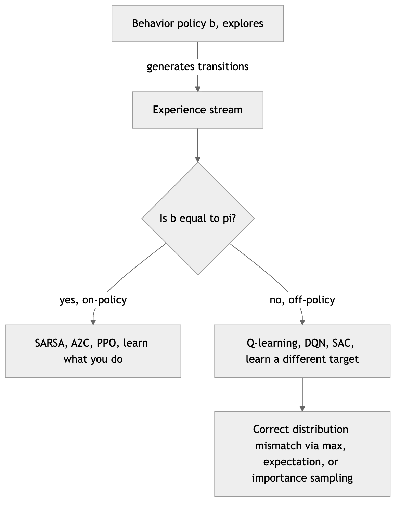

*Figure 229. Behavior policy gathers data while the target policy is what we learn and deploy.*

## 16.8 n-Step Methods and TD(λ)

Monte Carlo and TD(0) are the two ends of a spectrum, and there is no reason to live only at the extremes. $`n`$**-step methods** look $`n`$ steps into the future before bootstrapping. The $`n`$-step return is

``` math
G_{t:t + n} = R_{t + 1} + \gamma R_{t + 2} + \cdots + \gamma^{n - 1}R_{t + n} + \gamma^{n}V(S_{t + n})
```

and the update is $`V(S_{t}) \leftarrow V(S_{t}) + \alpha\lbrack G_{t:t + n} - V(S_{t})\rbrack`$. With $`n = 1`$ this is exactly TD(0); as $`n \rightarrow \infty`$ (or to the end of the episode) it becomes Monte Carlo. Intermediate $`n`$ — often somewhere between 4 and 16 — usually learns faster than either extreme, because it propagates reward information backward several steps per update (unlike TD(0)’s one) while incurring far less variance than a full MC return. The cost is a delay: you must wait $`n`$ steps before you can update $`S_{t}`$.

**TD(**$`\lambda`$**)** offers a more elegant way to blend all the $`n`$-step returns at once. Define the $`\lambda`$**-return** as a geometrically weighted average of every $`n`$-step return:

``` math
G_{t}^{\lambda} = (1 - \lambda)\sum_{n = 1}^{\infty}\lambda^{n - 1}G_{t:t + n}
```

with $`\lambda \in \lbrack 0,1\rbrack`$. At $`\lambda = 0`$ only the one-step return survives and we recover TD(0); at $`\lambda = 1`$ we recover Monte Carlo. Intermediate $`\lambda`$ smoothly interpolates. This is the *forward view*: conceptually elegant but acausal, since $`G_{t}^{\lambda}`$ depends on the entire future.

The practical magic is that TD($`\lambda`$) has an equivalent *backward view* implemented with **eligibility traces**. Each state (or feature) carries a trace $`e_{t}(s)`$ that spikes when the state is visited and decays by $`\gamma\lambda`$ each step:

``` math
e_{t}(s) = \gamma\lambda\, e_{t - 1}(s) + \mathbf{1}\lbrack S_{t} = s\rbrack
```

At each step we compute the ordinary one-step TD error $`\delta_{t}`$ and apply it to *every* state in proportion to its current trace: $`V(s) \leftarrow V(s) + \alpha\,\delta_{t}\, e_{t}(s)`$. The trace acts as a short-term memory of recently visited states, so a surprise now is credited backward to the states that led here, decaying with recency. The eligibility trace turns the acausal forward view into a fully online, incremental algorithm updated every step — you get the multi-step credit assignment of MC-flavored returns with the online convenience of TD. SARSA($`\lambda`$) and $`Q(\lambda)`$ extend the idea to control by tracing state-action pairs, and eligibility-trace ideas resurface in modern policy-gradient methods as **generalized advantage estimation (GAE)**, which we meet with actor-critic.

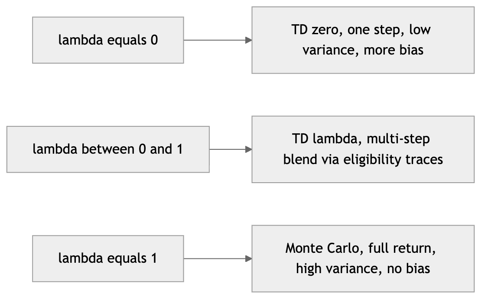

*Figure 230. The lambda parameter interpolates between one-step TD and Monte Carlo.*

## 16.9 Function Approximation: Why Tabular Methods Break Down

Everything so far has stored $`Q(s,a)`$ as a table with one entry per state-action pair. This works beautifully for FrozenLake’s 16 states. It is hopeless for the real world.

Consider Atari games: the state is a raw screen of $`210 \times 160`$ pixels. Even reduced to $`84 \times 84`$ grayscale frames with 256 intensity levels, the number of possible states is $`256^{84 \times 84}`$ — astronomically larger than the number of atoms in the universe. A backgammon board has roughly $`10^{20}`$ states; Go has more than $`10^{170}`$. A table cannot store, let alone visit, even a vanishing fraction of these. This is the **curse of dimensionality**. And even where a table would fit in memory, it would learn hopelessly slowly, because a tabular update to $`Q(s,a)`$ teaches the agent *nothing* about any other state — every state must be visited many times on its own.

The solution is **function approximation**: instead of a lookup table, represent $`Q(s,a;\theta)`$ (or $`V(s;\theta)`$, or a policy $`\pi_{\theta}`$) as a parameterized function — a linear model over hand-crafted features, a tile coding, or, in deep RL, a neural network — with parameters $`\theta`$ far fewer than the number of states. We fit $`\theta`$ so the function generalizes across states. Now two states that *look* similar (similar pixel patterns, similar feature vectors) get similar value estimates *without ever both being visited*. **Generalization is the entire point** — it is what makes learning in enormous spaces possible at all, and it is also what makes it dangerous, because an update for one state now perturbs the estimates for others.

We turn value estimation into a supervised-learning-like regression problem, minimizing the mean-squared TD error:

``` math
L(\theta) = \mathbb{E}\left\lbrack (\underset{\text{target}}{\underbrace{R + \gamma\max_{a'}Q(S',a';\theta)}} - Q(S,A;\theta))^{2} \right\rbrack
```

and updating $`\theta`$ by (semi-)gradient descent. It is called a *semi-gradient* method because we deliberately treat the bootstrapped target as a fixed constant and do not differentiate through it — a choice that matters enormously, as we are about to see. This unification of RL with deep learning — using the neural-network machinery from the chapters on neural networks and training deep networks — is what we mean by **deep reinforcement learning**.

But there is a catch. Combining three ingredients — **function approximation**, **bootstrapping**, and **off-policy learning** — forms what Sutton and Barto call the **deadly triad**. Any one or two are safe; all three together can make the value estimates diverge to infinity, even on simple problems with a fixed policy. Function approximation means an update for one state changes others; bootstrapping means targets depend on those same shifting estimates; off-policy means the update distribution does not match the policy being evaluated, so the usual self-correcting pressure is absent. The classic counterexample (Baird’s) diverges with all three present and converges the moment you remove any one. The next algorithm, DQN, is largely a set of engineering tricks to keep the deadly triad from detonating.

## 16.10 Deep Q-Networks (DQN)

In 2015, DeepMind’s DQN learned to play 49 Atari games from raw pixels, reaching human-level or superhuman performance on many using a *single* architecture and hyperparameter set. It was a landmark: the same network that learned Pong learned Breakout and Space Invaders, with no game-specific engineering. DQN is Q-learning with a convolutional neural network as the $`Q`$-function, plus two stabilizing innovations that directly target the deadly triad.

### 16.10.1 Experience replay

Naively, an online RL agent learns from consecutive transitions. But consecutive transitions are *highly correlated* — successive frames of a game look almost identical — which violates the i.i.d. assumption gradient descent relies on and leads to unstable, oscillating updates. It also means the training distribution lurches as the agent moves through the state space, so the network forgets earlier regions (catastrophic forgetting). **Experience replay** fixes both. Every transition $`(s,a,r,s',\text{done})`$ is stored in a large *replay buffer* (often a million transitions). During training, we sample *random minibatches* from the buffer. Random sampling breaks temporal correlations, smooths and stabilizes the data distribution, and lets each experience be reused many times, greatly improving data efficiency. Replay is also inherently *off-policy* — the stored transitions came from older versions of the policy — which is exactly why DQN inherits the deadly triad and needs the second trick.

### 16.10.2 Target networks

The TD target $`R + \gamma\max_{a'}Q(s',a';\theta)`$ depends on the very parameters $`\theta`$ we are updating. Chasing a moving target this way is unstable — every gradient step shifts the target we are trying to reach, creating feedback loops that can blow up. DQN introduces a separate **target network** with parameters $`\theta^{-}`$, used only to compute targets:

``` math
y = R + \gamma\max_{a'}Q(s',a';\theta^{-})
```

The target network is held fixed and only periodically synced to the online network ($`\theta^{-} \leftarrow \theta`$) every few thousand steps (or, in a “soft update,” blended slowly as $`\theta^{-} \leftarrow \tau\theta + (1 - \tau)\theta^{-}`$). Freezing the target gives the regression problem a stationary objective between syncs, dramatically reducing oscillation and divergence. Together, replay and target networks are what let Q-learning survive contact with a neural network.

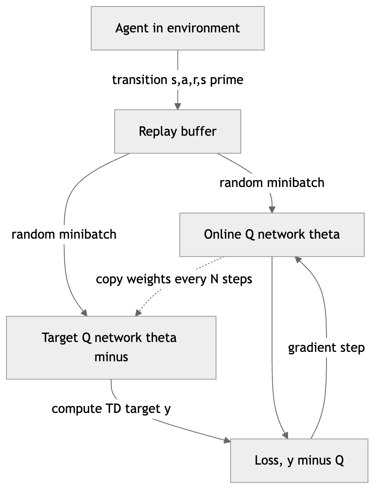

*Figure 231. DQN architecture with experience replay and a periodically synced target network.*

### 16.10.3 A PyTorch DQN sketch

Here is a compact but complete DQN for Gymnasium’s `CartPole-v1`, where the agent balances a pole on a moving cart. The state is a 4-vector (cart position, velocity, pole angle, angular velocity), so we use a small fully-connected network rather than a CNN. The structure — replay buffer, target network, $`\varepsilon`$-greedy, Huber TD loss — is identical to the Atari version.

``` python
# Minimal DQN in PyTorch for CartPole-v1
import random, collections
import numpy as np, torch, torch.nn as nn
import gymnasium as gym

torch.manual_seed(0); np.random.seed(0); random.seed(0)
env = gym.make("CartPole-v1")
n_obs = env.observation_space.shape[0]      # 4
n_act = env.action_space.n                  # 2

def make_net():
    return nn.Sequential(
        nn.Linear(n_obs, 128), nn.ReLU(),
        nn.Linear(128, 128), nn.ReLU(),
        nn.Linear(128, n_act))

online, target = make_net(), make_net()
target.load_state_dict(online.state_dict())
opt = torch.optim.Adam(online.parameters(), lr=1e-3)
buffer = collections.deque(maxlen=10000)

gamma, batch = 0.99, 64
eps, eps_min, eps_decay = 1.0, 0.02, 0.995

def act(state, eps):
    if random.random() < eps:
        return env.action_space.sample()
    with torch.no_grad():
        q = online(torch.tensor(state, dtype=torch.float32))
    return int(q.argmax())

def learn():
    if len(buffer) < batch: return
    s, a, r, s2, d = zip(*random.sample(buffer, batch))
    s  = torch.tensor(np.array(s),  dtype=torch.float32)
    s2 = torch.tensor(np.array(s2), dtype=torch.float32)
    a  = torch.tensor(a).unsqueeze(1)
    r  = torch.tensor(r,  dtype=torch.float32).unsqueeze(1)
    d  = torch.tensor(d,  dtype=torch.float32).unsqueeze(1)
    q  = online(s).gather(1, a)                       # Q(s,a)
    with torch.no_grad():
        q_next = target(s2).max(1, keepdim=True).values
        y = r + gamma * q_next * (1 - d)              # TD target via target net
    loss = nn.functional.smooth_l1_loss(q, y)         # Huber loss
    opt.zero_grad(); loss.backward(); opt.step()

step = 0
for ep in range(300):
    state, _ = env.reset(seed=ep); done = False; ret = 0
    while not done:
        action = act(state, eps)
        s2, reward, term, trunc, _ = env.step(action)
        done = term or trunc
        buffer.append((state, action, reward, s2, float(done)))
        state = s2; ret += reward; step += 1
        learn()
        if step % 500 == 0:                            # sync target network
            target.load_state_dict(online.state_dict())
    eps = max(eps_min, eps * eps_decay)
    if ep % 50 == 0:
        print(f"episode {ep}  return {ret:.0f}  eps {eps:.2f}")
# Returns climb toward 500 (the CartPole-v1 max) as training proceeds.
```

The learning curve for a run like this is jagged but rising — a signature every deep-RL practitioner learns to read. The figure below shows a stylized example: per-episode return is noisy, but a moving average reveals steady improvement toward the environment’s cap of 500.

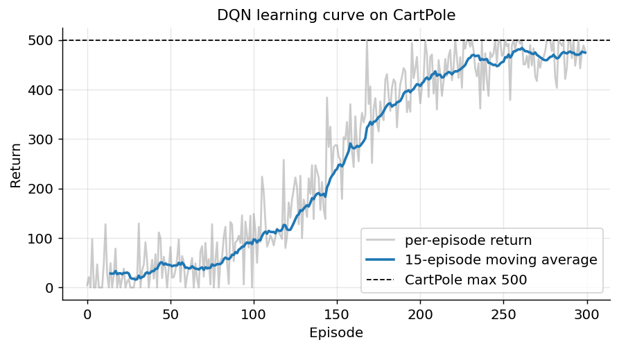

*Figure 232. A stylized DQN learning curve, noisy per-episode returns with a rising moving average.*

### 16.10.4 DQN variants

DQN spawned a family of improvements, each addressing a specific flaw:

- **Double DQN.** The $`\max`$ operator in Q-learning both *selects* and *evaluates* the next action with the same noisy estimates, which systematically *overestimates* values (maximization bias). Double DQN decouples the two: the online network selects the best next action, and the target network evaluates it, $`y = R + \gamma\, Q(s',arg\max_{a'}Q(s',a';\theta);\theta^{-})`$. This simple change removes most of the overestimation and improves both stability and final performance.
- **Dueling DQN.** Splits the network into two streams — a scalar state-value $`V(s)`$ and a per-action *advantage* $`A(s,a)`$ — recombined as $`Q(s,a) = V(s) + (A(s,a) - \text{mean}_{a}A(s,a))`$. This lets the network learn which *states* are valuable without having to learn the effect of every action in them, which helps enormously where many actions have similar value.
- **Prioritized Experience Replay (PER).** Uniform sampling from the buffer wastes effort on transitions the agent already predicts well. PER samples transitions with probability proportional to their (recent) TD error, so *surprising* transitions are replayed more often, with importance-sampling weights to correct the resulting bias.
- **Noisy Nets and distributional RL (C51/QR-DQN).** Noisy Nets add learnable noise to the weights for state-dependent exploration, replacing $`\varepsilon`$-greedy; distributional methods learn the full *distribution* of returns rather than just its mean, which turns out to stabilize learning.

The **Rainbow** agent combined six of these improvements (double, dueling, PER, multi-step returns, distributional, and noisy nets) and substantially outperformed any single one, illustrating that they attack complementary weaknesses.

## 16.11 Policy-Gradient Methods: REINFORCE

DQN learns a value function and *derives* a policy from it (act greedily). Policy-gradient methods take the opposite, more direct route: they parameterize the policy $`\pi_{\theta}(a \mid s)`$ — typically a neural network outputting action probabilities (a softmax for discrete actions, or the mean and variance of a Gaussian for continuous ones) — and adjust $`\theta`$ to directly *increase expected return*. This is attractive for several reasons: continuous action spaces are handled natively (a robot’s joint torques cannot be enumerated for a $`\max`$); the policy can be stochastic, which is provably necessary in some partially observed or adversarial settings; and the policy can change smoothly, avoiding the abrupt policy flips that a small change in a value estimate can cause in value-based methods.

We define the objective as the expected return under the policy:

``` math
J(\theta) = \mathbb{E}_{\tau \sim \pi_{\theta}}\left\lbrack G(\tau) \right\rbrack
```

where $`\tau`$ is a trajectory. The obstacle is that the distribution over trajectories depends on $`\theta`$, and it also depends on the unknown environment dynamics — so we cannot naively differentiate through it. The **policy gradient theorem** resolves this with the “log-derivative trick.” Because $`\nabla_{\theta}p_{\theta}(\tau) = p_{\theta}(\tau)\,\nabla_{\theta}\log p_{\theta}(\tau)`$, and because the environment dynamics do not depend on $`\theta`$ and so drop out of $`\nabla_{\theta}\log p_{\theta}(\tau)`$, we obtain a gradient that requires *no model*:

``` math
\nabla_{\theta}J(\theta) = \mathbb{E}_{\pi_{\theta}}\left\lbrack \sum_{t}^{}\nabla_{\theta}\log\pi_{\theta}(A_{t} \mid S_{t})\, G_{t} \right\rbrack
```

The intuition is beautifully simple: *increase the log-probability of actions that led to high returns, decrease it for actions that led to low returns*, weighted by how good the return was. The $`\nabla_{\theta}\log\pi_{\theta}`$ term is the direction in parameter space that makes an action more likely; multiply it by the return and you push toward profitable behavior. This is the same score-function estimator that appears throughout statistics.

**REINFORCE** is the Monte Carlo realization: run an episode, compute returns, and apply the gradient. Because raw returns have high variance, we subtract a **baseline** $`b(S_{t})`$ that does not depend on the action, which *provably does not change the expected gradient* (since $`\mathbb{E}\lbrack\nabla_{\theta}\log\pi_{\theta}(a \mid s)\, b(s)\rbrack = 0`$) but can dramatically reduce its variance. The natural choice of baseline is an estimate of the state value $`V(S_{t})`$, so we replace $`G_{t}`$ with the **advantage** $`A_{t} = G_{t} - V(S_{t})`$ — “how much better than average was this action?” A positive advantage pushes the action’s probability up, a negative one pushes it down, and actions of exactly average value are left alone. Subtracting the baseline is why learning-from-scratch policy gradients do not thrash: without it, *every* action in a rewarding trajectory gets reinforced, even the bad ones.

``` python
# REINFORCE with a value baseline (PyTorch, CartPole)
import torch, torch.nn as nn, numpy as np, gymnasium as gym
torch.manual_seed(0); np.random.seed(0)
env = gym.make("CartPole-v1")
obs_n, act_n = env.observation_space.shape[0], env.action_space.n

policy = nn.Sequential(nn.Linear(obs_n,128), nn.ReLU(), nn.Linear(128,act_n))
value  = nn.Sequential(nn.Linear(obs_n,128), nn.ReLU(), nn.Linear(128,1))
opt = torch.optim.Adam(list(policy.parameters())+list(value.parameters()), lr=2e-3)
gamma = 0.99

for ep in range(400):
    state,_ = env.reset(seed=ep); done=False
    logps, vals, rewards = [], [], []
    while not done:
        s = torch.tensor(state, dtype=torch.float32)
        logits = policy(s); dist = torch.distributions.Categorical(logits=logits)
        a = dist.sample()
        logps.append(dist.log_prob(a)); vals.append(value(s))
        state, r, term, trunc, _ = env.step(int(a)); done = term or trunc
        rewards.append(r)
    # discounted returns (reward-to-go)
    G, returns = 0.0, []
    for r in reversed(rewards):
        G = r + gamma*G; returns.insert(0, G)
    returns = torch.tensor(returns)
    returns = (returns - returns.mean())/(returns.std()+1e-8)
    logps = torch.stack(logps); vals = torch.cat(vals).squeeze(-1)
    advantage = returns - vals.detach()
    policy_loss = -(logps * advantage).mean()        # maximize return
    value_loss  = nn.functional.mse_loss(vals, returns)
    opt.zero_grad(); (policy_loss + value_loss).backward(); opt.step()
```

### 16.11.1 Strengths, weaknesses, and when to use policy gradients

| Aspect | Policy-gradient methods (REINFORCE) |
|----|----|
| Strengths | Handle continuous and high-dimensional action spaces natively; learn stochastic policies; smooth policy changes; direct optimization of the objective; strong convergence to a local optimum |
| Weaknesses | High variance (especially without a baseline); sample-inefficient (on-policy MC); sensitive to step size; converge only to local optima |
| When to use | Continuous control; when a stochastic policy is required; as the foundation for actor-critic and PPO |
| Pitfalls | Too-large steps collapse the policy; forgetting to subtract a baseline; reusing data off-policy without correction; premature entropy collapse |

## 16.12 Actor-Critic, A2C, and A3C

REINFORCE still waits for full episodes and, even with a baseline, suffers high variance because $`G_{t}`$ is a full Monte Carlo return. **Actor-critic** methods marry policy gradients with TD learning to fix this. There are two components (two networks, or two heads of one network):

- The **actor** is the policy $`\pi_{\theta}(a \mid s)`$ — it decides what to do.
- The **critic** is a value function $`V_{\phi}(s)`$ — it estimates how good states are and *critiques* the actor’s choices.

Instead of the Monte Carlo return, the actor is updated using the TD-based **advantage** $`A(s,a) \approx r + \gamma V_{\phi}(s') - V_{\phi}(s)`$, which is exactly the one-step TD error from the critic. This lets the actor learn *every step* (bootstrapping) with much lower variance, while the critic learns by ordinary TD. The two learn together: the critic gives the actor a low-variance training signal, and the actor gives the critic a stream of on-policy data.

The choice of how many steps to bootstrap for the advantage is itself a bias-variance knob, and the modern answer is **generalized advantage estimation (GAE)** — an eligibility-trace-style exponentially-weighted average of $`n`$-step advantage estimates, controlled by a parameter $`\lambda`$ exactly analogous to TD($`\lambda`$). GAE has become the default advantage estimator inside A2C and PPO precisely because it lets you dial in the bias-variance trade-off with a single number.

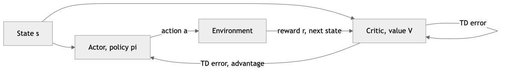

*Figure 233. The actor-critic loop. The critic evaluates states, the actor improves the policy.*

**A2C (Advantage Actor-Critic)** is the synchronous, batched form: many parallel environment copies collect experience simultaneously, gradients are averaged, and updates are applied in lockstep. Parallel actors decorrelate the data (a different solution to the same problem replay buffers solve for DQN, but keeping the method on-policy). **A3C (Asynchronous Advantage Actor-Critic)**, the original 2016 version, had workers update a shared parameter server asynchronously; A2C later showed the synchronous variant is simpler, uses hardware more efficiently, and usually performs as well or better. Both are on-policy and discard data after each update, which is the main reason PPO — which squeezes several updates out of each batch — largely superseded them.

## 16.13 Modern Algorithms: TRPO, PPO, DDPG, SAC

### 16.13.1 Trust-Region Policy Optimization (TRPO)

Vanilla policy gradients are fragile: a single large update can collapse the policy, and because the data was collected under the old policy, it becomes stale after one gradient step. TRPO (2015) was the first widely successful fix. It maximizes the policy-gradient objective *subject to a constraint* that the new policy stay within a **trust region** of the old one, measured by the KL divergence: $`\max_{\theta}\mathbb{E}\lbrack\rho_{t}{\widehat{A}}_{t}\rbrack`$ subject to $`\mathbb{E}\lbrack\text{KL}(\pi_{\theta_{\text{old}}}\, \parallel \,\pi_{\theta})\rbrack \leq \delta`$. Keeping each step inside a small KL ball guarantees monotonic improvement in theory and prevents the catastrophic policy collapse that plagues naive methods. The drawback is complexity: TRPO requires second-order information (a conjugate-gradient solve against the Fisher matrix), which is awkward to implement and expensive.

### 16.13.2 Proximal Policy Optimization (PPO)

PPO, from OpenAI in 2017, keeps TRPO’s trust-region *spirit* with a fraction of the machinery, and it has become the workhorse of modern RL — robust, simple, and the algorithm behind much of RLHF. It defines the probability ratio

``` math
\rho_{t}(\theta) = \frac{\pi_{\theta}(A_{t} \mid S_{t})}{\pi_{\theta_{\text{old}}}(A_{t} \mid S_{t})}
```

and optimizes a **clipped surrogate objective**:

``` math
L^{\text{CLIP}}(\theta) = \mathbb{E}_{t}\left\lbrack \min\left( \rho_{t}(\theta)\,{\widehat{A}}_{t},\mspace{6mu}\text{clip}(\rho_{t}(\theta),\, 1 - \epsilon,\, 1 + \epsilon)\,{\widehat{A}}_{t} \right) \right\rbrack
```

The clip prevents the ratio from straying outside $`\lbrack 1 - \epsilon,1 + \epsilon\rbrack`$ (typically $`\epsilon = 0.2`$): once an update would change the policy too much in a profitable direction, the objective flattens and the gradient vanishes, capping the effective step size. The $`\min`$ makes the bound one-sided in the right way — it removes the incentive to move too far when the advantage is positive, and it still penalizes moving the wrong way when the advantage is negative. This keeps updates *proximal* to the old policy, giving the stability of trust-region methods with only first-order gradients. PPO reuses each batch of data for several epochs of minibatch updates, making it far more sample-efficient than vanilla policy gradients, and it typically adds an entropy bonus (to sustain exploration) and a value-function loss (for the critic) to the objective.

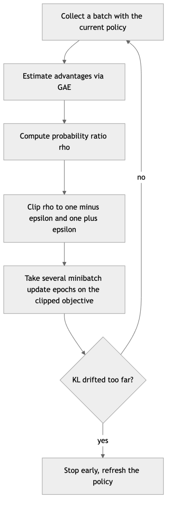

*Figure 234. PPO clips the policy-update ratio to stay within a trust region of the old policy.*

### 16.13.3 DDPG, TD3, and SAC for continuous control

DQN’s $`\max_{a'}`$ is impossible over continuous actions. Three algorithms address continuous control off-policy:

- **DDPG (Deep Deterministic Policy Gradient)** learns a *deterministic* actor $`\mu_{\theta}(s)`$ that outputs the maximizing action directly, plus a critic $`Q_{\phi}(s,a)`$ in the DQN style (with replay and target networks). Exploration is added as noise on the actor’s output. It is off-policy and sample-efficient but notoriously sensitive to hyperparameters and prone to the same overestimation bias as vanilla DQN.
- **TD3 (Twin Delayed DDPG)** patches DDPG’s failure modes with three tricks: two critics with a $`\min`$ over them (clipped double-Q, to curb overestimation), delayed and slower actor updates, and target-policy smoothing (noise on the target action). These make it substantially more stable than DDPG.
- **SAC (Soft Actor-Critic)** is the modern default for continuous control. It is off-policy, uses twin critics like TD3, and — crucially — optimizes a **maximum-entropy** objective that rewards the policy for staying random:

``` math
J(\pi) = \sum_{t}^{}\mathbb{E}\left\lbrack r_{t} + \alpha\,\mathcal{H}(\pi( \cdot \mid s_{t})) \right\rbrack
```

The entropy term $`\mathcal{H}`$ encourages the agent to keep exploring and to hedge across near-optimal actions, which yields more robust policies and far less hyperparameter fiddling than DDPG. The temperature $`\alpha`$ can even be tuned automatically. SAC’s combination of off-policy sample efficiency and entropy-driven stability is why it dominates continuous-control benchmarks and real-robot learning.

## 16.14 A Comparison of Reinforcement Learning Algorithms

| Algorithm | Family | On/Off-policy | Action space | Model-free? | Key idea / when to use |
|----|----|----|----|----|----|
| Monte Carlo | value | on-policy | discrete | yes | Average full returns; episodic tasks, no bootstrapping |
| SARSA | value (TD) | on-policy | discrete | yes | Safe online control accounting for exploration |
| Expected SARSA | value (TD) | either | discrete | yes | Lower-variance SARSA; generalizes to Q-learning |
| Q-learning | value (TD) | off-policy | discrete | yes | Learn optimal policy from any behavior; small/tabular |
| DQN | value + NN | off-policy | discrete | yes | Pixels and large discrete spaces; Atari-style games |
| REINFORCE | policy gradient | on-policy | both | yes | Simplest direct policy optimization; high variance |
| A2C / A3C | actor-critic | on-policy | both | yes | Lower-variance parallel policy gradients |
| TRPO | actor-critic | on-policy | both | yes | Trust-region monotonic improvement; predecessor of PPO |
| PPO | actor-critic | on-policy | both | yes | Robust default; RLHF, robotics, general-purpose |
| DDPG | actor-critic | off-policy | continuous | yes | Continuous control, sample-efficient but finicky |
| TD3 | actor-critic | off-policy | continuous | yes | Stabilized DDPG with twin critics and delayed updates |
| SAC | actor-critic | off-policy | continuous | yes | Modern default for continuous control; stable, explorative |

Three axes organize this whole table, and internalizing them is more valuable than memorizing any row. First, **what is learned**: a value function (Monte Carlo, SARSA, Q-learning, DQN), a policy (REINFORCE), or both (all actor-critic methods). Second, **whose data**: on-policy methods learn only from their own current behavior; off-policy methods learn from anyone’s, enabling replay and demonstration. Third, **action space**: value-based $`\max`$ methods need discrete actions, while policy and actor-critic methods handle continuous ones. Almost every practical algorithm choice follows from locating your problem on these three axes.

## 16.15 Where Deep RL Is Used

Reinforcement learning has moved from a research curiosity to a production technology across several domains.

**Games.** Games are RL’s proving ground because they offer cheap, fast, well-defined feedback. DQN mastered Atari from pixels. AlphaGo and its successor AlphaZero combined deep RL with Monte Carlo Tree Search to defeat world champions at Go, chess, and shogi — AlphaZero learning entirely from self-play with no human game data at all. AlphaStar (StarCraft II) and OpenAI Five (Dota 2) extended this to complex, partially-observed, real-time games with enormous action spaces, and MuZero went further by *learning a model* of the game so it could plan without being told the rules.

**Robotics and control.** PPO, SAC, DDPG, and TD3 train locomotion, manipulation, and dexterity policies, often in massively parallel physics simulators (thousands of simulated robots at once) and then transferred to physical hardware — the *sim-to-real* problem, tackled with domain randomization so the policy is robust to the reality gap. Continuous-control benchmarks like MuJoCo are standard here, and RL has trained everything from quadruped locomotion to in-hand cube manipulation.

**Recommendations and operations.** Recommender systems can be framed as RL problems where the agent chooses what to show to maximize *long-term* engagement or user value rather than a single immediate click — an important reframing, since myopic click-optimization can degrade the experience over time. RL also tunes data-center cooling, optimizes chip floorplans, manages inventory, schedules compute, and routes traffic — any sequential decision problem with a measurable objective and a simulator (or enough logged data) to learn from.

**RLHF for large language models.** Perhaps the most consequential recent application is *Reinforcement Learning from Human Feedback* (RLHF), the technique that aligns large language models with human preferences. A reward model is trained on human comparisons of model outputs, and then PPO fine-tunes the language model to maximize that learned reward while a KL penalty keeps it close to the original model. This is how raw pretrained models become helpful, harmless assistants. Newer preference-optimization methods (such as direct preference optimization, which reframes the problem to avoid an explicit RL loop) are active alternatives, but PPO-style RLHF remains the reference technique. We treat RLHF and its successors in depth in the chapter on LLMs in Practice; here it is enough to recognize that the PPO algorithm of this chapter is the engine underneath.

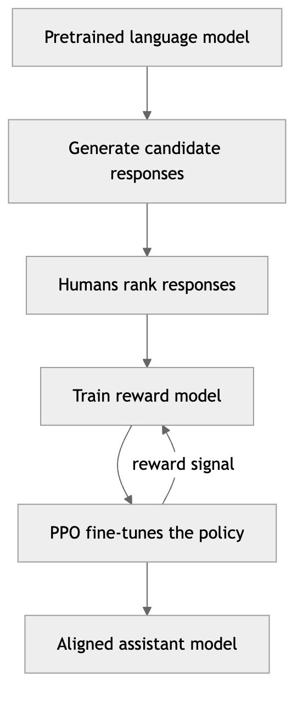

*Figure 235. RLHF pipeline. A learned reward model guides policy optimization of the language model.*

## 16.16 Common Pitfalls in Deep RL

Deep RL is famously finicky — often described as “the field where reproducing a result is the hard part.” A few recurring traps:

- **Reward design and reward hacking.** Agents optimize exactly what you reward, not what you intend. A boat-racing agent once learned to spin in circles collecting power-ups instead of finishing the race, because the power-ups were rewarded. Sparse rewards (signal only at the goal) make learning slow; reward shaping helps but can introduce unintended optima. Getting the reward right is usually harder than choosing the algorithm.
- **Instability and the deadly triad.** Without replay buffers, target networks, gradient clipping, and careful learning rates, value-based deep RL can diverge. Watch for exploding Q-values — a classic symptom of the triad detonating.
- **Sample inefficiency.** Deep RL can need millions or billions of environment steps. This is fine in fast simulation, painful on real hardware. Off-policy methods (DQN, SAC) reuse data and help; model-based methods help more.
- **Hyperparameter and seed sensitivity.** Results can swing wildly across random seeds; a method can look better than another purely by luck of the seed. Always report performance over several seeds with confidence intervals.
- **Exploration collapse.** If $`\varepsilon`$ or policy entropy decays too fast, the agent commits prematurely to a mediocre policy and never discovers better options. Maximum-entropy methods like SAC and entropy bonuses in PPO mitigate this.
- **Overestimation bias.** The $`\max`$ in value-based methods systematically inflates value estimates; double DQN, TD3’s twin critics, and SAC’s clipped double-Q all exist to counter it.

## 16.17 Summary

This chapter traced a single arc: from agents that plan with a known model, to agents that learn purely from experience, to agents that scale that learning to pixels, robots, and language. The organizing ideas are few. Model-free control alternates policy evaluation and improvement (generalized policy iteration) over the action-value function $`Q`$, because without a model you cannot improve a policy from $`V`$ alone. Monte Carlo methods estimate values by averaging complete returns — unbiased but high-variance and episode-bound — while temporal-difference learning bootstraps from current estimates, updating every step with lower variance at the cost of some bias; $`n`$-step methods and TD($`\lambda`$) with eligibility traces interpolate smoothly between the two.

For control, Q-learning is off-policy TD using a $`\max`$ over next actions, learning the optimal policy regardless of behavior; SARSA is its on-policy counterpart, using the actually-taken next action so it accounts for its own exploration and learns safer paths during training; expected SARSA sits between them and generalizes both. The on-policy/off-policy distinction — whether the behavior policy equals the target policy — governs whether you can reuse data and demonstrations, at the price of a distribution mismatch that importance sampling or analytic bootstrapping must correct.

Tabular methods break down when state spaces are astronomical, motivating function approximation with neural networks — deep RL — whose power is generalization and whose danger is the deadly triad of function approximation, bootstrapping, and off-policy learning. DQN tamed the triad with experience replay and target networks and reached human-level Atari play; its descendants (double, dueling, prioritized, Rainbow) each patched a specific flaw. Policy-gradient methods optimize a parameterized policy directly via the policy gradient theorem, with baselines and advantages to reduce variance; actor-critic methods add a value critic for step-wise, low-variance updates. TRPO and PPO constrain policy updates to a trust region for stability, with PPO’s clipped objective the robust modern default; DDPG, TD3, and SAC bring off-policy learning to continuous control, SAC adding a maximum-entropy bonus for exploration and robustness. These algorithms now power game-playing systems, robotics, recommendation, and the RLHF that aligns large language models — where PPO is the engine underneath.

## 16.18 Key Takeaways

- **Model-free RL learns from experience alone**, alternating evaluation and improvement over $`Q`$ because policy improvement without a model requires action-values, not state-values.
- **Monte Carlo = sampling without bootstrapping** (unbiased, high variance, episode-bound); **TD = sampling with bootstrapping** (biased, low variance, online). The TD error $`\delta_{t} = R_{t + 1} + \gamma V(S_{t + 1}) - V(S_{t})`$ is the central learning signal.
- $`n`$**-step returns and TD(**$`\lambda`$**)** interpolate between MC and TD; eligibility traces implement TD($`\lambda`$) online by decaying a memory of recently visited states and applying the current TD error to all of them.
- **Q-learning is off-policy** (target uses $`\max`$), **SARSA is on-policy** (target uses the taken action), and **expected SARSA** takes the expectation over next actions, unifying the two. Off-policy learning enables data reuse and demonstrations but needs a distribution correction.
- **Tabular methods cannot scale**; function approximation generalizes across states but, combined with bootstrapping and off-policy learning, risks the **deadly triad** and divergence.
- **DQN** stabilizes deep Q-learning with **experience replay** (decorrelates data) and a **target network** (freezes the TD target); double, dueling, and prioritized variants each fix a distinct weakness.
- **Policy gradients** optimize $`\pi_{\theta}`$ directly using $`\nabla_{\theta}\log\pi_{\theta} \cdot A_{t}`$; **baselines and advantages** cut variance without adding bias. **Actor-critic** methods use a critic to supply a low-variance advantage every step.
- **PPO** (clipped trust region) is the robust general-purpose default; **SAC** (off-policy, maximum-entropy) is the default for continuous control. **RLHF** for LLMs runs on PPO.

## 16.19 Exercises

1.  **Conceptual — on vs off-policy.** Explain precisely why Q-learning is called off-policy while SARSA is on-policy, referring to their update targets. In the cliff-walking scenario, which would you expect to take the safer route *during training*, and why?

2.  **Conceptual — MC by hand.** For the episode with rewards $`R_{1} = 1`$, $`R_{2} = 0`$, $`R_{3} = 2`$ over states $`X,Y,Z`$ and $`\gamma = 0.5`$, compute the first-visit Monte Carlo returns $`G_{0},G_{1},G_{2}`$ by walking backward. Then compute the constant-$`\alpha`$ updates with $`\alpha = 0.2`$ starting from all-zero estimates.

3.  **Conceptual — the deadly triad.** Name the three ingredients of the deadly triad. For each of tabular Q-learning, DQN, and linear on-policy TD, state which triad elements are present and whether divergence is a concern.

4.  **Conceptual — expected SARSA.** Show algebraically that expected SARSA reduces to Q-learning when the target policy is greedy, and to (expected) SARSA when the target policy equals the $`\varepsilon`$-greedy behavior policy. Why does expected SARSA typically have lower variance than SARSA?

5.  **Coding — slippery FrozenLake.** Modify the tabular Q-learning example to use `is_slippery=True`. Tune $`\alpha`$, $`\gamma`$, the $`\varepsilon`$ schedule, and the number of episodes until the greedy policy succeeds reliably. Plot the moving-average reward per episode and discuss why the stochastic environment is harder.

6.  **Coding — SARSA vs Q-learning.** Implement tabular SARSA and compare it to Q-learning on a cliff-walking gridworld. Track and plot the *return collected during training* (not just final greedy performance) for both. Do you observe SARSA accumulating higher reward during learning while Q-learning finds the shorter final path? Explain.

7.  **Coding — eligibility traces.** Implement SARSA($`\lambda`$) with eligibility traces on a gridworld and compare its learning speed to one-step SARSA for several values of $`\lambda \in \{ 0,0.5,0.9,1.0\}`$. Plot episodes-to-solve versus $`\lambda`$ and explain the shape of the curve.

8.  **Coding — DQN ablation.** Take the PyTorch DQN sketch and remove (a) the target network (use the online network for targets) and (b) experience replay (train on the most recent transition only). Train each ablation and the full DQN on CartPole and plot the learning curves. Which component matters more for stability here?

9.  **Coding — REINFORCE variance.** Run REINFORCE on CartPole with and without the value baseline. Plot the learning curves and the variance of the gradient estimates over training. Quantify how much the baseline reduces variance and how it affects convergence speed.

10. **Conceptual — RLHF.** RLHF uses PPO to fine-tune a language model against a learned reward model. Why is it important to constrain the fine-tuned policy to stay close to the original model (e.g., via a KL penalty)? What failure mode does this prevent? Connect your answer to the reward-hacking pitfall discussed in this chapter.

---

[← 15 Reinforcement Learning Foundations](ch15-rl-foundations.md) · [Contents](../README.md#contents) · [17 Neural Networks: Fundamentals →](ch17-nn-fundamentals.md)
