[← 16 Reinforcement Learning Algorithms and Deep RL](ch16-rl-algorithms.md) · [Contents](../README.md#contents) · [18 Training and Optimizing Deep Networks →](ch18-training-deep-nets.md)

---

# 17 Neural Networks: Fundamentals

Almost every headline-grabbing AI system of the past decade — image recognizers that rival radiologists, language models that write code, systems that beat champions at Go — rests on a single, surprisingly simple computational idea: stack many small differentiable units, each computing a weighted sum followed by a nonlinearity, and adjust their parameters by following the gradient of an error signal. This chapter builds that idea from the ground up. We start with the biological metaphor, derive the artificial neuron and the perceptron, see why nonlinearity and depth are essential (the famous XOR problem), and then assemble neurons into multilayer networks. We work through activation functions in depth, forward propagation as matrix algebra, loss functions, and — the conceptual heart of deep learning — backpropagation via the chain rule, complete with a fully worked numeric example. Finally we build a working network three ways: from scratch in NumPy, then in Keras and PyTorch. Everything in Part V of this book is an elaboration of what you learn here.

A word on how to read this chapter. Neural networks are one of those topics where the mathematics looks intimidating until you realize it is the same three operations — a matrix multiply, an element-wise nonlinearity, and the chain rule — repeated over and over. If you internalize those three operations and how they compose, the rest is engineering. We will therefore return to the same small networks again and again, viewing them first as biology-inspired diagrams, then as equations, then as running code, so that each perspective reinforces the others.

## 17.1 From Biological Neurons to Artificial Ones

The brain contains roughly 86 billion neurons. A biological neuron receives electrochemical signals through branching structures called dendrites, integrates them in its cell body (the soma), and — if the combined signal crosses a threshold — “fires,” sending a spike down its axon to the dendrites of other neurons across junctions called synapses. Crucially, each synapse has a *strength* that can change with experience; learning, in the brain, is largely a matter of adjusting synaptic strengths. The Canadian psychologist Donald Hebb captured the intuition in 1949 with a phrase now shortened to “neurons that fire together wire together”: synapses that repeatedly participate in firing their target grow stronger.

Artificial neural networks borrow this metaphor loosely, not literally. We are not simulating biochemistry. We are taking one idea — *weighted integration of inputs followed by a thresholding/activation step, with weights that adapt* — and turning it into mathematics we can optimize with calculus. The biological story is inspiration, not specification. Modern networks deviate from biology in countless ways: real neurons communicate with discrete spikes whose *timing* carries information, they operate asynchronously, and there is no global error signal broadcast backward through the cortex the way backpropagation sends gradients backward through a network. Artificial neurons, by contrast, output continuous values, update in lockstep, and are trained by an algorithm with no clear biological analogue. And that is fine. The engineering question is not “is this brain-like?” but “does this compute useful functions and can we train it?”

The first mathematical model of a neuron predates modern computers. In 1943 Warren McCulloch and Walter Pitts proposed a binary threshold unit — inputs summed and compared to a threshold — and showed that networks of such units could compute any logical (Boolean) function. Their model had no learning; the weights were hand-set. Fifteen years later Frank Rosenblatt made the idea *learnable* with the perceptron and even built it in hardware, the Mark I Perceptron, which learned to classify images from a $`20 \times 20`$ array of photocells. The 1969 Minsky–Papert critique then froze the field for over a decade. Backpropagation, though discovered in various forms earlier, was popularized for neural networks in 1986 and reignited interest, but networks remained shallow and hard to train through the 1990s and 2000s, partly because sigmoid/tanh saturation made depth impractical and partly because data and compute were scarce.

The modern era began around 2012, when a deep convolutional network (AlexNet) won the ImageNet competition by a wide margin, powered by three ingredients this chapter has been building toward: ReLU activations that let gradients flow through deep stacks, GPUs that made the matrix multiplies fast, and large labeled datasets. Every turning point in this history was driven by precisely the conceptual issues we study here — linear separability, vanishing gradients, the cost of computing gradients, and the availability of the hardware to run them at scale.

### 17.1.1 The Artificial Neuron

The simplest artificial neuron takes a vector of inputs $`\mathbf{x} = (x_{1},x_{2},\ldots,x_{n})`$, multiplies each by a learnable **weight** $`w_{i}`$, sums them, adds a learnable **bias** $`b`$, and passes the result through an **activation function** $`\sigma`$:

``` math
z = \sum_{i = 1}^{n}w_{i}x_{i} + b = \mathbf{w}^{\top}\mathbf{x} + b,\quad\quad a = \sigma(z)
```

Here $`z`$ is the **weighted sum** (also called the *pre-activation* or *logit*), and $`a`$ is the neuron’s **output** (the *activation*). The weights determine how much each input matters; a large positive weight means that input strongly pushes the neuron toward firing, a negative weight pushes against it. The bias shifts the threshold — it lets the neuron fire even when all inputs are zero, or require a strong input before responding. Geometrically, $`\mathbf{w}^{\top}\mathbf{x} + b = 0`$ defines a hyperplane, and the neuron responds to which side of that hyperplane an input falls on. The weight vector $`\mathbf{w}`$ is the *normal* to that hyperplane — it points in the direction of steepest increase of $`z`$ — and the bias sets the hyperplane’s offset from the origin.

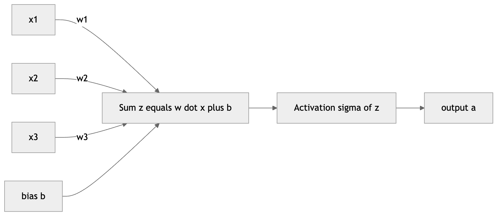

*Figure 236. A single artificial neuron computing a weighted sum plus bias, then an activation*

The correspondence between the biological metaphor and its mathematical abstraction is worth tabulating, if only to remember how loose it is.

| Biological neuron | Artificial neuron |
|----|----|
| Dendrites receiving signals | Input values $`x_{i}`$ |
| Synaptic strengths | Weights $`w_{i}`$ |
| Cell body integrating inputs | Weighted sum $`z = \mathbf{w}^{\top}\mathbf{x} + b`$ |
| Firing threshold | Bias $`b`$ and activation $`\sigma`$ |
| Axon output spike (discrete, timed) | Activation $`a = \sigma(z)`$ (continuous) |
| Learning by adjusting synapses | Learning by gradient descent on weights |

A useful bookkeeping trick, which you will see in mathematical treatments, is to fold the bias into the weight vector by appending a constant input $`x_{0} = 1`$ with weight $`w_{0} = b`$. Then $`z = \mathbf{w}^{\top}\mathbf{x}`$ with the augmented vectors, and the bias needs no special handling. In code we usually keep the bias separate because broadcasting makes it convenient, but conceptually the bias is just one more weight attached to an always-on input.

### 17.1.2 The Perceptron and Its Learning Rule

The original **perceptron**, introduced by Frank Rosenblatt in 1958, is a single neuron with a **step** (or *sign*) activation: it outputs $`1`$ if $`z \geq 0`$ and $`0`$ (or $`- 1`$) otherwise. What made it historic was not the architecture but the *learning rule* — a simple, local, iterative procedure that provably finds a separating hyperplane whenever one exists.

The rule works as follows. Present training examples one at a time. For each example $`(\mathbf{x},y)`$ with true label $`y \in \{ 0,1\}`$, compute the prediction $`\widehat{y} = \text{step}(\mathbf{w}^{\top}\mathbf{x} + b)`$ and update every weight in proportion to the error:

``` math
w_{i} \leftarrow w_{i} + \eta\,(y - \widehat{y})\, x_{i},\quad\quad b \leftarrow b + \eta\,(y - \widehat{y})
```

Here $`\eta > 0`$ is the learning rate. Read the update intuitively. If the prediction is correct, $`y - \widehat{y} = 0`$ and nothing changes. If the neuron should have fired but did not ($`y = 1,\widehat{y} = 0`$), then $`y - \widehat{y} = + 1`$ and we *add* a multiple of $`\mathbf{x}`$ to $`\mathbf{w}`$, nudging the weighted sum upward for this input so it is more likely to fire next time. If the neuron fired when it should not have, we subtract $`\mathbf{x}`$, pushing the sum down. Each update rotates and shifts the decision hyperplane toward correctly classifying the offending point.

Consider a concrete pass. Suppose we are learning the logical AND of two binary inputs, starting from $`\mathbf{w} = (0,0)`$, $`b = 0`$, with $`\eta = 1`$. The example $`(1,1)`$ has target $`1`$; the initial sum is $`0`$, so $`\widehat{y} = \text{step}(0) = 1`$ — correct by luck, no change. The example $`(1,0)`$ has target $`0`$; the sum is still $`0`$, so $`\widehat{y} = 1`$, wrong, and we update $`\mathbf{w} \leftarrow (0,0) + 1 \cdot (0 - 1) \cdot (1,0) = ( - 1,0)`$ and $`b \leftarrow - 1`$. Successive passes continue nudging the weights until every training point sits on the correct side of the line. This is learning reduced to its barest essentials: measure the error on one example, move the parameters a little in the direction that fixes it, repeat.

The **perceptron convergence theorem** guarantees that if the training data is *linearly separable*, this rule terminates with zero errors in a finite number of updates. That guarantee is the perceptron’s triumph — and the source of its downfall, because it says nothing about data that is *not* linearly separable, where the rule never settles.

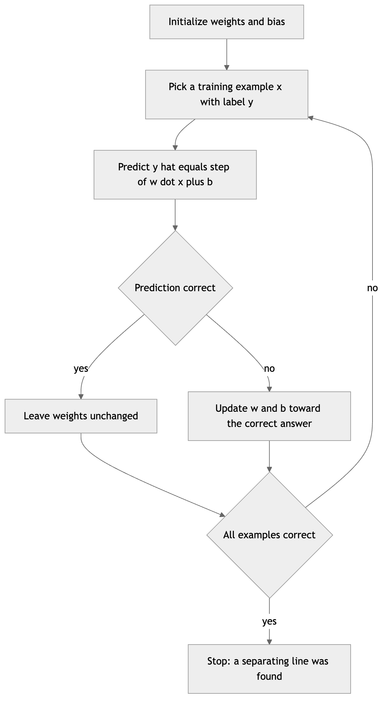

*Figure 237. The perceptron learning loop repeats until no example is misclassified*

### 17.1.3 The Limits of a Single Neuron

A single perceptron draws a single straight boundary, so it can represent only **linearly separable** functions. It handles AND and OR — for each of those, a line cleanly separates the “true” corner(s) of the input square from the rest — but it cannot represent XOR, the exclusive-or that is true when the inputs *differ*. Plot XOR’s four points: the two “true” points $`(0,1)`$ and $`(1,0)`$ sit at opposite corners, and no single line can separate them from the two “false” points $`(0,0)`$ and $`(1,1)`$. When Marvin Minsky and Seymour Papert made this limitation rigorous in their 1969 book *Perceptrons*, funding and enthusiasm evaporated, ushering in the first AI winter. The resolution — obvious in hindsight but which took over a decade to become practical — is to stack neurons in layers and use smooth activations so we can train them with gradients rather than the perceptron rule. That is the multilayer perceptron, and getting there requires us to first understand activation functions.

## 17.2 Activation Functions

If every neuron computed only a linear function, stacking them would be pointless: a composition of linear maps is itself a linear map, so a hundred-layer linear network has exactly the expressive power of a single linear layer. To see this concretely, chain two linear layers: $`\mathbf{a}^{\lbrack 2\rbrack} = W^{\lbrack 2\rbrack}(W^{\lbrack 1\rbrack}\mathbf{x}) = (W^{\lbrack 2\rbrack}W^{\lbrack 1\rbrack})\mathbf{x} = W'\mathbf{x}`$, which is just a single linear layer with weights $`W' = W^{\lbrack 2\rbrack}W^{\lbrack 1\rbrack}`$. The **activation function** injects the nonlinearity that breaks this collapse, and that nonlinearity is what lets networks approximate arbitrarily complex functions. Choosing the right activation matters for both *expressiveness* (what the network can represent) and *trainability* (whether gradient descent can actually find good parameters). We will look at each major activation, its formula, its derivative (which backpropagation needs), and its practical trade-offs.

### 17.2.1 Sigmoid

The logistic **sigmoid** squashes any real number into the open interval $`(0,1)`$:

``` math
\sigma(z) = \frac{1}{1 + e^{- z}},\quad\quad\sigma'(z) = \sigma(z)\,(1 - \sigma(z))
```

It was historically dominant because it is smooth, bounded, and has a probabilistic interpretation — it is the same function used in logistic regression, covered in the chapter on Classification, where its output reads naturally as a probability. Its derivative is elegantly expressed in terms of its own output, which makes it cheap to compute during backpropagation once you have already computed the forward activation.

The derivation of that derivative is worth seeing once, because the same trick recurs. Writing $`\sigma = (1 + e^{- z})^{- 1}`$ and applying the chain rule, $`\sigma'(z) = - (1 + e^{- z})^{- 2} \cdot ( - e^{- z}) = \frac{e^{- z}}{(1 + e^{- z})^{2}}`$. Now split that fraction: $`\frac{e^{- z}}{(1 + e^{- z})^{2}} = \frac{1}{1 + e^{- z}} \cdot \frac{e^{- z}}{1 + e^{- z}} = \sigma(z)\,(1 - \sigma(z))`$, since $`\frac{e^{- z}}{1 + e^{- z}} = 1 - \sigma(z)`$.

Sigmoid’s weaknesses are serious for deep networks. First, its output is not zero-centered — it is always positive — which means the gradients flowing into a downstream neuron’s weights all share a sign, forcing inefficient zig-zag updates. Second, and more damaging, the gradient is tiny whenever $`|z|`$ is large: the function **saturates**, with $`\sigma'`$ peaking at just $`0.25`$ at $`z = 0`$ and decaying toward zero in both tails. When gradients are repeatedly multiplied through many saturating layers, they shrink geometrically toward zero — the infamous **vanishing-gradient problem**, which stalled deep networks for years. Today sigmoid survives mainly in the *output* layer for binary classification and inside the gates of recurrent networks (see the chapter on Sequence Models).

### 17.2.2 Tanh

The hyperbolic tangent is a rescaled sigmoid that maps to $`( - 1,1)`$:

``` math
tanh(z) = \frac{e^{z} - e^{- z}}{e^{z} + e^{- z}} = 2\sigma(2z) - 1,\quad\quad\tanh'(z) = 1 - \tanh^{2}(z)
```

Because it is **zero-centered**, it tends to train faster than sigmoid in hidden layers — gradients flowing back are not all biased toward one sign, so weight updates can move in productive diagonal directions. Its derivative is also steeper, peaking at $`1.0`$ at the origin versus sigmoid’s $`0.25`$, so signals shrink less per layer. But it still saturates at both extremes, so it suffers from vanishing gradients in very deep stacks. For a long time tanh was the default hidden-layer activation, and it remains common inside recurrent architectures, but for feed-forward networks it has largely been displaced by ReLU.

### 17.2.3 ReLU

The **Rectified Linear Unit** is deceptively simple and now the default hidden-layer activation for most architectures:

``` math
\text{ReLU}(z) = max(0,z),\quad\quad\text{ReLU}'(z) = \left\{ \begin{matrix}
1 & z > 0 \\
0 & z < 0
\end{matrix} \right.\ 
```

(The derivative at exactly $`z = 0`$ is undefined; in practice frameworks arbitrarily set it to $`0`$ or $`1`$, and it makes no measurable difference because the pre-activation is essentially never exactly zero.) ReLU has three big advantages. It does not saturate for positive inputs, so gradients flow undiminished (gradient exactly $`1`$) through active units, dramatically easing the vanishing-gradient problem and enabling the training of genuinely deep networks. It is extremely cheap — just a comparison and a select, with no exponentials. And it induces **sparsity**: because negative pre-activations produce exactly zero, a typical layer has many inactive units at any given input, which can improve efficiency and act as a mild regularizer.

Its drawback is the **dying ReLU** problem. A neuron whose pre-activation is always negative across the whole dataset — often the result of a large gradient update that pushes its weights into a bad region, or a too-high learning rate — outputs zero for every input and receives zero gradient, so it can never recover and is effectively dead. In a healthy network a modest fraction of dead units is harmless, but a large fraction wastes capacity. This failure mode motivates the variants below.

### 17.2.4 Leaky ReLU, PReLU, ELU, GELU, and Swish

**Leaky ReLU** fixes dying units by giving negative inputs a small nonzero slope $`\alpha`$ (typically $`0.01`$), so that dead-region gradients are small but never exactly zero:

``` math
\text{LeakyReLU}(z) = \left\{ \begin{matrix}
z & z \geq 0 \\
\alpha z & z < 0
\end{matrix} \right.\ ,\quad\quad\text{LeakyReLU}'(z) = \left\{ \begin{matrix}
1 & z \geq 0 \\
\alpha & z < 0
\end{matrix} \right.\ 
```

**Parametric ReLU (PReLU)** takes the idea one step further by making $`\alpha`$ a *learnable* parameter, adjusted by backpropagation along with the weights. This adds negligible cost and can help on large vision datasets, though it risks a little overfitting on small ones.

**ELU** (Exponential Linear Unit) replaces the linear negative arm with a smooth exponential curve that saturates at $`- \alpha`$ for very negative inputs:

``` math
\text{ELU}(z) = \left\{ \begin{matrix}
z & z \geq 0 \\
\alpha(e^{z} - 1) & z < 0
\end{matrix} \right.\ 
```

By pushing mean activations closer to zero, ELU can speed convergence, and its bounded negative saturation makes it more robust to noise than Leaky ReLU; the cost is the exponential computation.

**GELU** (Gaussian Error Linear Unit) is the activation of choice inside modern Transformers (see the chapter on Transformers). Instead of a hard gate, it weights each input by the probability that a standard normal variable is below it, giving a smooth curve that can dip slightly negative near the origin:

``` math
\text{GELU}(z) = z\,\Phi(z) \approx 0.5\, z\left( 1 + tanh\lbrack\sqrt{2/\pi}\,(z + 0.044715\, z^{3})\rbrack \right)
```

where $`\Phi`$ is the standard normal cumulative distribution function. The intuition is a “soft” version of ReLU: rather than a sharp on/off decision, GELU probabilistically scales the input, which empirically improves training of very large models.

**Swish** (also called SiLU), discovered by automated search, has a similar smooth, non-monotonic shape:

``` math
\text{Swish}(z) = z\,\sigma(\beta z)
```

with $`\beta`$ often fixed at $`1`$. Like GELU it is smooth everywhere and allows a small negative response, and it frequently edges out ReLU on deep architectures at a modest extra cost.

The practical guidance is simple. For a standard feed-forward or convolutional network, plain **ReLU** is an excellent default; if you observe many dead units, switch to **Leaky ReLU** or **ELU**. For Transformer-style models, **GELU** (or Swish) is standard. The exotic options rarely change results dramatically, so do not agonize over them early. A reasonable rule of thumb: pick ReLU, get the rest of the pipeline working, and only revisit the activation if you have evidence (many dead units, or a Transformer-style architecture) that a different choice would help. Activation choice is a knob worth a few percent, not the difference between a working and a broken model — the loss/activation pairing, learning rate, and data quality matter far more.

### 17.2.5 Softmax

The activations above act *element-wise*: each output depends only on its own input. **Softmax** is different — it acts on a whole vector of $`K`$ logits and turns them into a probability distribution over $`K`$ classes, so it lives in the *output* layer of multiclass classifiers:

``` math
\text{softmax}(\mathbf{z})_{k} = \frac{e^{z_{k}}}{\sum_{j = 1}^{K}e^{z_{j}}}
```

The outputs are strictly positive and sum to $`1`$, so they are interpretable as class probabilities. Exponentiation exaggerates differences — the largest logit dominates, which is why “softmax” is a smooth, differentiable stand-in for the non-differentiable “argmax” — while keeping everything differentiable so gradients can flow. In practice we subtract $`\max_{j}z_{j}`$ from every logit before exponentiating; this shifts all exponents to be $`\leq 0`$, changes nothing mathematically (the constant cancels between numerator and denominator), but prevents numerical overflow when logits are large. Softmax’s Jacobian is a full matrix because each output depends on every input, but as we will see, when it is paired with cross-entropy loss the messy Jacobian collapses into a beautifully simple gradient.

A refinement you will meet later is the **temperature** parameter $`T`$: dividing the logits by $`T`$ before the softmax, $`\text{softmax}(\mathbf{z}/T)`$, controls how “peaked” the distribution is. A high temperature ($`T > 1`$) flattens the probabilities toward uniform, expressing more uncertainty; a low temperature ($`T < 1`$) sharpens them toward a one-hot vector, expressing more confidence; and $`T \rightarrow 0`$ recovers a hard argmax. Temperature does not appear in ordinary classification training (where $`T = 1`$), but it is central to sampling from language models and to knowledge distillation, both discussed in later chapters. It is a useful reminder that the raw pre-softmax values — the **logits** — carry the model’s confidence, and that softmax is merely one way of reading them out.

The figure below compares the element-wise activations and their derivatives, making the saturation behavior visible.

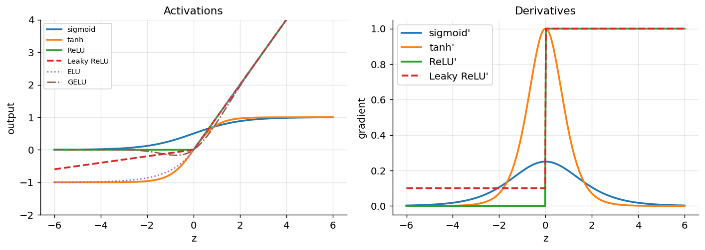

*Figure 238. Common activation functions (left) and their derivatives (right)*

Study the right panel: the sigmoid and tanh derivatives are nonzero only in a narrow band around the origin and vanish in the tails, which is the vanishing-gradient problem drawn as a picture, whereas ReLU’s derivative is a flat $`1`$ for all positive inputs, so it never attenuates the signal on the active side.

| Activation | Range | Saturates? | Zero-centered? | Cost | Typical use |
|----|----|----|----|----|----|
| Sigmoid | $`(0,1)`$ | Yes (both ends) | No | exp | Binary output layer, gates |
| Tanh | $`( - 1,1)`$ | Yes (both ends) | Yes | exp | Hidden layers (older nets), RNNs |
| ReLU | $`\lbrack 0,\infty)`$ | No (positive side) | No | cheap | Default hidden layers |
| Leaky ReLU | $`( - \infty,\infty)`$ | No | Nearly | cheap | Hidden layers, avoids dead units |
| PReLU | $`( - \infty,\infty)`$ | No | Nearly | cheap | Vision, learns negative slope |
| ELU | $`( - \alpha,\infty)`$ | Negative side only | Nearly | exp | Hidden layers, faster convergence |
| GELU | $`\approx ( - 0.17,\infty)`$ | No | Nearly | exp/tanh | Transformers |
| Swish | $`\approx ( - 0.28,\infty)`$ | No | Nearly | exp | Deep nets, search-discovered |
| Softmax | $`(0,1)`$, sums to 1 | — | — | exp | Multiclass output layer |

## 17.3 Multilayer Perceptrons and the Power of Depth

A single neuron draws a single hyperplane — it can only separate data that is linearly separable. The **multilayer perceptron (MLP)** overcomes this by organizing neurons into layers: an **input layer** (the raw features), one or more **hidden layers**, and an **output layer**. Every neuron in a layer connects to every neuron in the next — hence “fully connected” or “dense” — and each hidden layer applies a nonlinear activation. The output of one layer becomes the input to the next. The term “hidden” simply means these layers have no direct contact with the outside world: we observe the inputs and the outputs, but the intermediate representations are internal machinery.

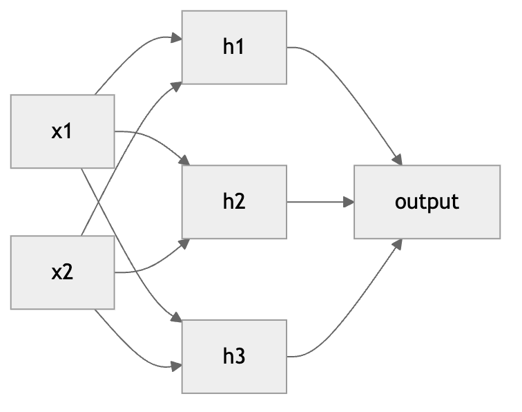

*Figure 239. A multilayer perceptron with two inputs, a hidden layer of three units, and one output*

In vectorized form, a network with layers indexed by $`\ell = 1,\ldots,L`$ computes, for each layer, a weight matrix $`W^{\lbrack\ell\rbrack}`$ and bias vector $`\mathbf{b}^{\lbrack\ell\rbrack}`$:

``` math
\mathbf{z}^{\lbrack\ell\rbrack} = W^{\lbrack\ell\rbrack}\mathbf{a}^{\lbrack\ell - 1\rbrack} + \mathbf{b}^{\lbrack\ell\rbrack},\quad\quad\mathbf{a}^{\lbrack\ell\rbrack} = \sigma^{\lbrack\ell\rbrack}\left( \mathbf{z}^{\lbrack\ell\rbrack} \right)
```

with $`\mathbf{a}^{\lbrack 0\rbrack} = \mathbf{x}`$ and the network output $`\widehat{\mathbf{y}} = \mathbf{a}^{\lbrack L\rbrack}`$. If layer $`\ell`$ has $`n_{\ell}`$ units, then $`W^{\lbrack\ell\rbrack}`$ has shape $`n_{\ell} \times n_{\ell - 1}`$ and $`\mathbf{b}^{\lbrack\ell\rbrack}`$ has length $`n_{\ell}`$. The total number of learnable parameters is the sum over layers of $`n_{\ell}\, n_{\ell - 1} + n_{\ell}`$ — worth computing for any architecture you design, since it tells you how much data and memory you will need. A modest network with layers $`784 \rightarrow 128 \rightarrow 64 \rightarrow 10`$, for instance, has $`784 \cdot 128 + 128 + 128 \cdot 64 + 64 + 64 \cdot 10 + 10 \approx 109,000`$ parameters, dominated by the first weight matrix.

### 17.3.1 Choosing an Architecture

How many hidden layers, and how many units each? There is no formula, but there are useful heuristics. **Width** (units per layer) controls how much a layer can represent at its level; **depth** (number of layers) controls how many levels of composition the network can build. More of either increases capacity — the range of functions the network can fit — but also increases the risk of overfitting and the compute needed to train. A common starting point for a tabular MLP is one or two hidden layers with a width comparable to (or a few times) the input dimension, then adjust based on the training and validation loss: if the network cannot even fit the training data (underfitting), add capacity; if it fits training data far better than validation data (overfitting), reduce capacity or add regularization. The output layer is not a free choice — it is dictated by the task: a single linear unit for scalar regression, a single sigmoid for binary classification, and $`K`$ softmax units for $`K`$-way classification. Everything between the input and output is where the design freedom, and the art, lives. For structured data like images, text, and audio, the fully connected MLP is usually replaced by specialized architectures (convolutional and attention-based networks) covered later in this part of the book, but those architectures are still built from the same neurons, activations, and backpropagation developed here.

### 17.3.2 Why Depth and Nonlinearity Matter: The XOR Problem

The XOR (“exclusive or”) function is the canonical demonstration of why we need hidden layers. XOR outputs $`1`$ when its two binary inputs differ and $`0`$ when they match. As we saw, the two “1” points sit at opposite corners of the unit square, and so do the two “0” points — there is *no single straight line* that separates them. A perceptron, which can only draw one line, cannot learn XOR. This is exactly the limitation Minsky and Papert seized upon.

Add one hidden layer and the problem dissolves. The hidden layer transforms the input space into a new representation where the classes *are* linearly separable. Intuitively, one hidden neuron can learn “at least one input is on” (OR) and another can learn “both inputs are on” (AND); the output neuron then computes “OR but not AND,” which is precisely XOR. We can even write down exact weights. Let the two hidden units use a step activation with

``` math
h_{1} = \text{step}(x_{1} + x_{2} - 0.5)\mspace{6mu}\mspace{6mu}(\text{OR}),\quad\quad h_{2} = \text{step}(x_{1} + x_{2} - 1.5)\mspace{6mu}\mspace{6mu}(\text{AND}),
```

and let the output be $`\widehat{y} = \text{step}(h_{1} - h_{2} - 0.5)`$. Check the four cases: for $`(0,0)`$ both hidden units are $`0`$, so output $`0`$; for $`(1,0)`$ and $`(0,1)`$ we get $`h_{1} = 1,h_{2} = 0`$, so output $`1`$; for $`(1,1)`$ both are $`1`$, so $`h_{1} - h_{2} = 0`$ and output $`0`$. The network computes XOR exactly. The key move is that after the hidden layer the four points have been *folded* — $`(1,0)`$ and $`(0,1)`$ both map to $`(h_{1},h_{2}) = (1,0)`$ — into a configuration a single line can split. Each layer reshapes the geometry of the data until the final layer’s job becomes a simple linear separation.

The figure below makes the folding visible. On the left is the original input space, where no line separates the two classes; on the right is the same four points after the hidden layer’s transformation, where the two “1” points have collapsed onto each other and a single line now suffices.

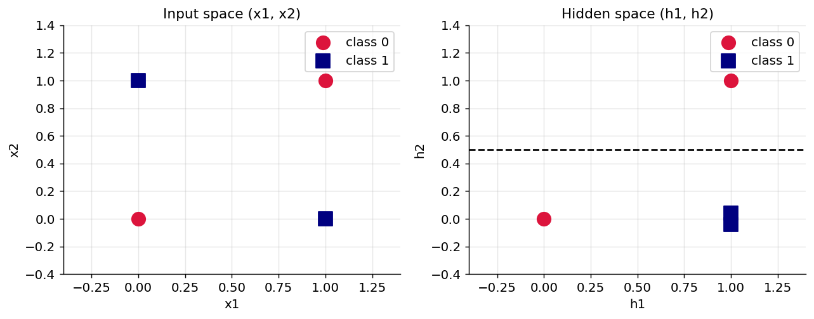

*Figure 240. The hidden layer folds XOR’s input space (left) into a linearly separable one (right)*

This is the essence of what neural networks do and why “deep learning” is often called **representation learning**: the hidden layers are not merely a computational detour to the answer, they *learn a new coordinate system* in which the problem becomes easy. Everything downstream — image classifiers, language models — is this same idea, learning representations in which a final linear layer can do the last, simple step.

### 17.3.3 The Universal Approximation Theorem

The XOR construction hints at a much more general and celebrated result. The **universal approximation theorem** (Cybenko 1989 for sigmoids, Hornik 1991 more generally) states that a feed-forward network with a *single* hidden layer containing a finite number of neurons and a suitable nonlinear activation can approximate *any continuous function* on a closed and bounded (compact) domain to any desired accuracy, given enough hidden units. In other words, MLPs are *universal function approximators*: there is essentially no continuous input-output relationship they cannot represent in principle.

It is just as important to understand what the theorem does **not** say, because it is routinely over-interpreted.

- It is an *existence* result, not a *construction*. It guarantees that suitable weights exist; it says nothing about how to find them. Gradient descent may never reach them.
- It says nothing about the *number* of hidden units required. “Enough” can be astronomically large — often exponential in the input dimension — so a shallow network that approximates a complicated function may need to be impractically wide.
- It promises only approximation on a *bounded* domain, and only for *continuous* functions. It offers no guarantee about how the network behaves on inputs outside the training region (extrapolation), which is why networks can fail bizarrely on out-of-distribution data.
- It says nothing about *generalization*. Being able to fit a function on a domain is not the same as learning it from finite, noisy samples in a way that transfers to new data.

This is where *depth* earns its keep. A series of theoretical and empirical results show that deep networks can represent certain functions with exponentially fewer parameters than any shallow network achieving the same accuracy. The reason is compositional: deep networks build hierarchical representations — edges from pixels, shapes from edges, objects from shapes — and reuse lower-level features across many higher-level ones. Real-world data (images, language, audio) has exactly this compositional structure, which is why deep networks, not merely wide ones, dominate. The universal approximation theorem tells us shallow networks *could* in principle do the job; depth tells us how to do it *efficiently* and *learnably*.

A concrete way to feel the difference: a function like “is the number of active inputs odd?” (the parity function, a generalization of XOR to many inputs) can be computed by a deep network with a number of units that grows gently with the input size, but a single hidden layer needs a number of units that grows *exponentially*. Depth buys the network the ability to reuse partial computations — the way a well-organized program factors repeated logic into functions rather than copying it inline. This is why, in practice, adding a few well-designed layers usually helps far more than making one layer enormously wide, and why the history of deep learning is a history of finding ways to train ever-deeper networks stably.

## 17.4 Forward Propagation

**Forward propagation** is simply evaluating the network: push an input through layer by layer to produce a prediction. For a two-layer network (one hidden layer with ReLU, a sigmoid output) on a single input $`\mathbf{x}`$:

``` math
\mathbf{z}^{\lbrack 1\rbrack} = W^{\lbrack 1\rbrack}\mathbf{x} + \mathbf{b}^{\lbrack 1\rbrack},\quad\mathbf{a}^{\lbrack 1\rbrack} = \text{ReLU}(\mathbf{z}^{\lbrack 1\rbrack})
```

``` math
z^{\lbrack 2\rbrack} = W^{\lbrack 2\rbrack}\mathbf{a}^{\lbrack 1\rbrack} + b^{\lbrack 2\rbrack},\quad\widehat{y} = \sigma(z^{\lbrack 2\rbrack})
```

In practice we process a whole **batch** of $`m`$ examples at once by stacking them as rows of a matrix $`X \in \mathbb{R}^{m \times n}`$, replacing matrix-vector products with matrix-matrix products. With this convention (rows = examples) the layer computation becomes $`Z^{\lbrack\ell\rbrack} = A^{\lbrack\ell - 1\rbrack}{W^{\lbrack\ell\rbrack}}^{\top} + \mathbf{b}^{\lbrack\ell\rbrack}`$, where $`A^{\lbrack\ell - 1\rbrack}`$ is $`m \times n_{\ell - 1}`$ and the bias is *broadcast* across all $`m`$ rows. Keeping the shapes straight is the single most common source of bugs when implementing networks by hand; a good habit is to annotate every intermediate array with its expected shape as a comment.

Tracing the shapes through a concrete case cements the mechanics. Take a batch of $`m = 32`$ examples with $`n = 784`$ features fed to a $`784 \rightarrow 128 \rightarrow 10`$ classifier. The input $`A^{\lbrack 0\rbrack}`$ is $`32 \times 784`$. The first weight matrix $`W^{\lbrack 1\rbrack}`$ is $`128 \times 784`$, so $`A^{\lbrack 0\rbrack}{W^{\lbrack 1\rbrack}}^{\top}`$ is $`32 \times 128`$; adding the length-128 bias (broadcast down the 32 rows) and applying ReLU leaves $`A^{\lbrack 1\rbrack}`$ at $`32 \times 128`$. The second weight matrix $`W^{\lbrack 2\rbrack}`$ is $`10 \times 128`$, so $`A^{\lbrack 1\rbrack}{W^{\lbrack 2\rbrack}}^{\top}`$ is $`32 \times 10`$; softmax over each row yields the prediction matrix $`\widehat{Y}`$, $`32 \times 10`$, one probability distribution per example. Every shape is determined by the rule “inner dimensions must match, and the batch dimension rides along untouched.” When an implementation throws a shape-mismatch error — the most common bug in from-scratch code — tracing dimensions this way almost always pinpoints the culprit, usually a missing transpose.

Batching is not just a convenience. It is the reason GPUs, which excel at dense linear algebra, accelerate neural networks so dramatically: one large matrix multiply over 256 examples is far more efficient than 256 separate small ones, because it saturates the hardware’s parallel arithmetic units and amortizes memory-transfer overhead. We cache the intermediate $`\mathbf{z}^{\lbrack\ell\rbrack}`$ and $`\mathbf{a}^{\lbrack\ell\rbrack}`$ values during the forward pass because, as we are about to see, backpropagation needs them to compute gradients.

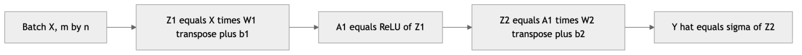

*Figure 241. A batch flows forward through two layers as matrix operations*

## 17.5 Loss Functions

Training requires a scalar **loss** $`J`$ that measures how wrong the predictions are; learning means minimizing it. The choice of loss depends on the task and pairs naturally with the output activation. Most standard losses can be derived from the principle of *maximum likelihood*: choose parameters that make the observed data most probable under the model. Different assumptions about the noise (Gaussian for regression, Bernoulli/categorical for classification) yield different losses.

For **regression**, the standard choice is **mean squared error (MSE)**, which arises from assuming Gaussian noise around the prediction:

``` math
J_{\text{MSE}} = \frac{1}{m}\sum_{i = 1}^{m}\left( {\widehat{y}}^{(i)} - y^{(i)} \right)^{2}
```

MSE penalizes large errors quadratically, so it is sensitive to outliers; when robustness matters, the mean absolute error or the Huber loss (quadratic near zero, linear in the tails) is preferred. The regression output neuron uses a *linear* (identity) activation so it can produce any real value.

For **binary classification** with a sigmoid output, we use **binary cross-entropy** (log loss), which is the negative log-likelihood of a Bernoulli model:

``` math
J_{\text{BCE}} = - \frac{1}{m}\sum_{i = 1}^{m}\left\lbrack y^{(i)}\log{\widehat{y}}^{(i)} + (1 - y^{(i)})log(1 - {\widehat{y}}^{(i)}) \right\rbrack
```

For **multiclass classification** with a softmax output and one-hot targets, we use **categorical cross-entropy**:

``` math
J_{\text{CE}} = - \frac{1}{m}\sum_{i = 1}^{m}{\sum_{k = 1}^{K}y_{k}^{(i)}}\log{\widehat{y}}_{k}^{(i)}
```

Because only the true class has $`y_{k} = 1`$, this reduces to $`- \frac{1}{m}\sum_{i}^{}\log{\widehat{y}}_{\text{true class}}^{(i)}`$ — the average negative log-probability the model assigns to the correct answer. This form also explains why cross-entropy is unbounded: if the model assigns probability near zero to the true class, $`- log`$ of that is enormous, so a single confidently-wrong prediction incurs a large penalty and a correspondingly large corrective gradient.

Two practical variations on these losses recur often enough to mention now. When classes are **imbalanced** — say 99% negatives — a plain loss lets the model win by always predicting the majority class, so we attach per-class weights that up-weight the rare class’s contribution (a *weighted* cross-entropy), forcing the network to take the minority seriously. And to discourage overconfidence, **label smoothing** replaces the hard one-hot target (1 for the true class, 0 elsewhere) with a slightly softened target (for example $`0.9`$ and $`0.1/(K - 1)`$), which improves calibration and generalization in large classifiers. Both are small modifications to the same cross-entropy machinery, not new losses, and both are one-argument options in the frameworks. Cross-entropy is preferred over MSE for classification because it produces stronger gradients when the model is confidently wrong. If a sigmoid output is saturated near $`0`$ but the true label is $`1`$, MSE’s gradient is throttled by the tiny $`\sigma'`$ factor and learning stalls, whereas cross-entropy’s gradient stays large, driving a fast correction.

A beautiful piece of mathematics underlies the standard pairings. When softmax is combined with categorical cross-entropy, the gradient of the loss with respect to the logits simplifies to the clean form $`\widehat{\mathbf{y}} - \mathbf{y}`$ — the prediction minus the truth. The same simplification holds for sigmoid with binary cross-entropy. The softmax Jacobian and the cross-entropy derivative each look complicated in isolation, but their product telescopes into a single subtraction. This is not a coincidence; it is precisely why those pairings are standard, and it is also why frameworks fuse them into a single numerically stable operation (`softmax_cross_entropy_with_logits`, `BCEWithLogitsLoss`) that you should always prefer over applying the activation and the loss separately.

Let us prove the simplification for the softmax-cross-entropy case, because doing so once removes all mystery. For a single example with one-hot target $`\mathbf{y}`$, the loss is $`J = - \sum_{k}^{}y_{k}\log{\widehat{y}}_{k}`$ where $`{\widehat{y}}_{k} = e^{z_{k}}/\sum_{j}^{}e^{z_{j}}`$. We want $`\partial J/\partial z_{i}`$. First, the softmax derivative is $`\partial{\widehat{y}}_{k}/\partial z_{i} = {\widehat{y}}_{k}(\mathbb{1}\lbrack k = i\rbrack - {\widehat{y}}_{i})`$, where $`\mathbb{1}`$ is the indicator. Substituting into the chain rule,

``` math
\frac{\partial J}{\partial z_{i}} = - \sum_{k}^{}\frac{y_{k}}{{\widehat{y}}_{k}}\,\frac{\partial{\widehat{y}}_{k}}{\partial z_{i}} = - \sum_{k}^{}\frac{y_{k}}{{\widehat{y}}_{k}}\,{\widehat{y}}_{k}(\mathbb{1}\lbrack k = i\rbrack - {\widehat{y}}_{i}) = - \sum_{k}^{}y_{k}(\mathbb{1}\lbrack k = i\rbrack - {\widehat{y}}_{i}).
```

Distribute the sum: the first term picks out $`- y_{i}`$, and the second is $`{\widehat{y}}_{i}\sum_{k}^{}y_{k} = {\widehat{y}}_{i}`$ (since the one-hot target sums to $`1`$). So $`\partial J/\partial z_{i} = {\widehat{y}}_{i} - y_{i}`$, or in vector form $`\delta^{\lbrack L\rbrack} = \widehat{\mathbf{y}} - \mathbf{y}`$. The whole apparatus of softmax and logarithms collapses into “prediction minus truth,” and the derivation is worth re-deriving yourself until it feels obvious.

The figure below makes the practical consequence vivid. It plots the gradient magnitude that reaches the output logit as a function of the prediction, when the true label is $`1`$, for cross-entropy versus MSE with a sigmoid output. Where the model is confidently *wrong* (prediction near $`0`$), cross-entropy delivers a large corrective gradient while MSE’s gradient has been strangled to near zero by the sigmoid’s saturation — a stalled network.

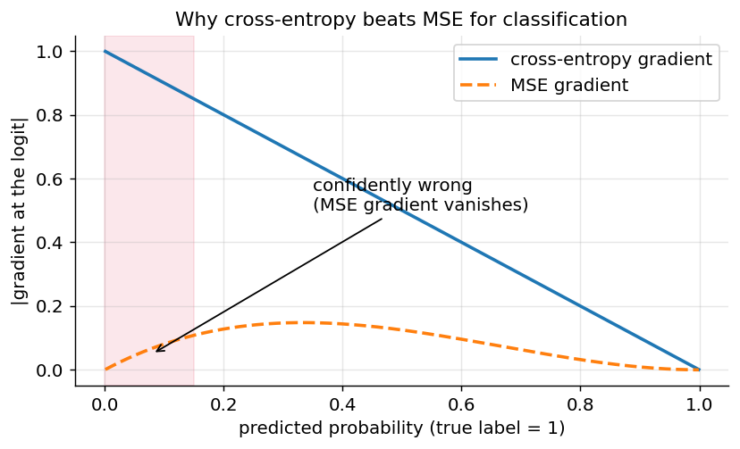

*Figure 242. With a sigmoid output and true label 1, cross-entropy keeps a strong gradient when confidently wrong; MSE does not*

## 17.6 Backpropagation

Forward propagation tells us the loss. **Backpropagation** tells us how to change every weight to reduce it. It is nothing more than the **chain rule** of calculus applied systematically and efficiently to the computational graph of the network, computing $`\partial J/\partial W^{\lbrack\ell\rbrack}`$ and $`\partial J/\partial b^{\lbrack\ell\rbrack}`$ for every layer in a single backward sweep. The algorithm was popularized for neural networks by Rumelhart, Hinton, and Williams in 1986, and it is the reason deep learning works at all.

### 17.6.1 The Chain Rule and the Computational Graph

Recall the chain rule: if $`J`$ depends on $`u`$ and $`u`$ depends on $`v`$, then $`\frac{\partial J}{\partial v} = \frac{\partial J}{\partial u} \cdot \frac{\partial u}{\partial v}`$. A neural network is a long chain (in fact a directed graph) of such dependencies: the loss depends on the output, which depends on the last pre-activation, which depends on the last layer’s weights and on the previous activation, and so on back to the input. Think of the network as a graph of elementary operations — multiply, add, apply $`\sigma`$. The forward pass flows left to right computing *values*; the backward pass flows right to left computing *gradients*. At each node the chain rule says: the gradient of the loss with respect to a node’s input equals the gradient with respect to its output, multiplied by the local derivative of the node. Every node needs to know only how to compute its own output (forward) and how to convert an incoming gradient into an outgoing one (backward) — a purely local rule that composes into a global gradient.

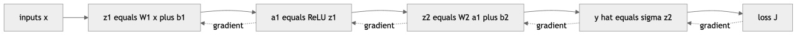

*Figure 243. Forward pass computes values left to right, backprop sends gradients right to left*

A tiny non-network example makes the mechanism concrete. Consider the scalar expression $`f = (a \cdot b) + c`$ evaluated at $`a = 3,b = 2,c = 4`$. The forward pass computes an intermediate $`u = a \cdot b = 6`$ and then $`f = u + c = 10`$. Now the backward pass. Seed the output with $`\partial f/\partial f = 1`$. The addition node passes its incoming gradient unchanged to both inputs, so $`\partial f/\partial u = 1`$ and $`\partial f/\partial c = 1`$. The multiplication node routes gradient to each input scaled by the *other* input (the local derivative of $`a \cdot b`$ with respect to $`a`$ is $`b`$), so $`\partial f/\partial a = \partial f/\partial u \cdot b = 1 \cdot 2 = 2`$ and $`\partial f/\partial b = \partial f/\partial u \cdot a = 1 \cdot 3 = 3`$. In one backward sweep we obtained the gradient with respect to *all three* inputs, each computed from a purely local rule (add copies, multiply swaps). A neural network is just a very large version of this graph, with matrix-multiply and activation nodes instead of scalar multiply and add — but the discipline is identical.

This local, graph-based view is exactly what modern frameworks implement as **automatic differentiation (autograd)**. You write only the forward computation; the framework records the graph of operations as they execute (a “tape”), then walks it backward, invoking each operation’s known local-derivative rule. This is called *reverse-mode* automatic differentiation, and it is efficient precisely when there are many inputs (parameters) and one output (the scalar loss) — the neural-network case. It is not numerical differentiation (no finite differences) and not symbolic differentiation (no giant algebraic formula); it computes exact numerical gradients by composing local derivatives.

### 17.6.2 The Math, Layer by Layer

Define the **error** at layer $`\ell`$ as the gradient of the loss with respect to that layer’s pre-activation:

``` math
\delta^{\lbrack\ell\rbrack} = \frac{\partial J}{\partial\mathbf{z}^{\lbrack\ell\rbrack}}
```

For the output layer with the standard loss-activation pairing (softmax with cross-entropy, or sigmoid with binary cross-entropy), the error is simply

``` math
\delta^{\lbrack L\rbrack} = \widehat{\mathbf{y}} - \mathbf{y}
```

For any hidden layer, we propagate the error backward through the next layer’s weights and the local activation derivative, where $`\odot`$ is element-wise multiplication:

``` math
\delta^{\lbrack\ell\rbrack} = \left( {W^{\lbrack\ell + 1\rbrack}}^{\top}\delta^{\lbrack\ell + 1\rbrack} \right) \odot \sigma'\left( \mathbf{z}^{\lbrack\ell\rbrack} \right)
```

Once we have $`\delta^{\lbrack\ell\rbrack}`$, the parameter gradients fall out directly (here for a single example; for a batch we average over examples):

``` math
\frac{\partial J}{\partial W^{\lbrack\ell\rbrack}} = \delta^{\lbrack\ell\rbrack}\,{\mathbf{a}^{\lbrack\ell - 1\rbrack}}^{\top},\quad\quad\frac{\partial J}{\partial\mathbf{b}^{\lbrack\ell\rbrack}} = \delta^{\lbrack\ell\rbrack}
```

At heart, backpropagation solves the **credit-assignment problem**: given that the final output was wrong by some amount, how much is each of the millions of interior weights to blame? A weight deep in the network influences the loss only indirectly, through a long chain of downstream computations, and the chain rule is exactly the tool that multiplies those indirect influences together correctly. The $`\delta`$ vectors are the mechanism: $`\delta^{\lbrack\ell\rbrack}`$ summarizes “how much the loss would change if this layer’s pre-activation changed,” and it is assembled by transporting the next layer’s blame backward and gating it by the local sensitivity. A weight gets a large gradient precisely when it carried a strong signal *into* an error-sensitive part of the network.

Read the recurrence intuitively: the error at a layer is the error coming *down from above* (transported through the transposed weights $`{W^{\lbrack\ell + 1\rbrack}}^{\top}`$), *gated* by how much this layer’s activation was responding (its derivative $`\sigma'`$). The weight gradient is an outer product of “how wrong this layer’s pre-activation was” ($`\delta^{\lbrack\ell\rbrack}`$) with “what came into it” ($`\mathbf{a}^{\lbrack\ell - 1\rbrack}`$) — it credits or blames each weight in proportion to both the error it feeds and the signal it carried. The vanishing-gradient problem is now transparent: if $`\sigma'`$ is small (as sigmoid’s is when saturated, capped at $`0.25`$), each backward step shrinks $`\delta`$, and after many layers it nearly vanishes. This is the single most important set of equations in deep learning; almost everything else in training is bookkeeping around it.

### 17.6.3 A Fully Worked Numeric Example

Equations become concrete when you push actual numbers through them. Consider a tiny network with two inputs, one hidden layer of two sigmoid units, and one sigmoid output, trained on a single example with mean squared error (using the $`\frac{1}{2}`$ convention $`J = \frac{1}{2}(\widehat{y} - y)^{2}`$ so the derivative is clean). Here are the numbers; every value below is exact to the digits shown and can be reproduced with a calculator.

**Setup.** Input $`\mathbf{x} = (0.5,\, 0.1)`$ with target $`y = 1`$. Parameters:

``` math
W^{\lbrack 1\rbrack} = \begin{bmatrix}
0.1 & 0.3 \\
0.2 & 0.4
\end{bmatrix},\quad\mathbf{b}^{\lbrack 1\rbrack} = \begin{bmatrix}
0.25 \\
0.25
\end{bmatrix},\quad W^{\lbrack 2\rbrack} = \begin{bmatrix}
0.5 & 0.6
\end{bmatrix},\quad b^{\lbrack 2\rbrack} = 0.35
```

**Forward pass.** The hidden pre-activations are $`z_{1}^{\lbrack 1\rbrack} = 0.1(0.5) + 0.3(0.1) + 0.25 = 0.33`$ and $`z_{2}^{\lbrack 1\rbrack} = 0.2(0.5) + 0.4(0.1) + 0.25 = 0.39`$. Applying the sigmoid gives the hidden activations $`a_{1}^{\lbrack 1\rbrack} = \sigma(0.33) = 0.58176`$ and $`a_{2}^{\lbrack 1\rbrack} = \sigma(0.39) = 0.59628`$. The output pre-activation is $`z^{\lbrack 2\rbrack} = 0.5(0.58176) + 0.6(0.59628) + 0.35 = 0.99865`$, so the prediction is $`\widehat{y} = \sigma(0.99865) = 0.73079`$. The loss is $`J = \frac{1}{2}(0.73079 - 1)^{2} = 0.03624`$.

**Backward pass.** Start at the output. The loss derivative is $`\partial J/\partial\widehat{y} = \widehat{y} - y = - 0.26921`$, and the sigmoid derivative there is $`\widehat{y}(1 - \widehat{y}) = 0.19673`$. Their product is the output error:

``` math
\delta^{\lbrack 2\rbrack} = (\widehat{y} - y)\,\widehat{y}(1 - \widehat{y}) = - 0.26921 \times 0.19673 = - 0.05296
```

The output-layer parameter gradients follow immediately from $`\delta^{\lbrack 2\rbrack}`$ times the incoming activations:

``` math
\frac{\partial J}{\partial W^{\lbrack 2\rbrack}} = \delta^{\lbrack 2\rbrack}\,{\mathbf{a}^{\lbrack 1\rbrack}}^{\top} = \begin{bmatrix}
 - 0.03081 & - 0.03158
\end{bmatrix},\quad\quad\frac{\partial J}{\partial b^{\lbrack 2\rbrack}} = \delta^{\lbrack 2\rbrack} = - 0.05296
```

Now propagate into the hidden layer. Transport the error through $`W^{\lbrack 2\rbrack}`$: the gradient arriving at the hidden activations is $`\partial J/\partial\mathbf{a}^{\lbrack 1\rbrack} = {W^{\lbrack 2\rbrack}}^{\top}\delta^{\lbrack 2\rbrack} = ( - 0.02648,\, - 0.03178)`$. Gate this by the hidden sigmoid derivatives, $`a_{i}^{\lbrack 1\rbrack}(1 - a_{i}^{\lbrack 1\rbrack}) = (0.24332,\, 0.24072)`$, to get the hidden error:

``` math
\delta^{\lbrack 1\rbrack} = \left( {W^{\lbrack 2\rbrack}}^{\top}\delta^{\lbrack 2\rbrack} \right) \odot \sigma'(\mathbf{z}^{\lbrack 1\rbrack}) = ( - 0.00644,\, - 0.00765)
```

Finally the hidden-layer weight gradients are the outer product of $`\delta^{\lbrack 1\rbrack}`$ with the input $`\mathbf{x}`$:

``` math
\frac{\partial J}{\partial W^{\lbrack 1\rbrack}} = \delta^{\lbrack 1\rbrack}\,\mathbf{x}^{\top} = \begin{bmatrix}
 - 0.00322 & - 0.00064 \\
 - 0.00382 & - 0.00076
\end{bmatrix},\quad\quad\frac{\partial J}{\partial\mathbf{b}^{\lbrack 1\rbrack}} = \delta^{\lbrack 1\rbrack} = \begin{bmatrix}
 - 0.00644 \\
 - 0.00765
\end{bmatrix}
```

**One gradient-descent step.** With learning rate $`\eta = 0.5`$, we subtract $`\eta`$ times each gradient. For example $`W^{\lbrack 2\rbrack}`$ becomes $`\begin{bmatrix}
0.51541 & 0.61579
\end{bmatrix}`$ and $`b^{\lbrack 2\rbrack}`$ becomes $`0.37648`$. If we now redo the forward pass with the updated parameters, the prediction rises to $`\widehat{y} = 0.73976`$ and the loss falls to $`0.03386`$ — down from $`0.03624`$. One step in the right direction, exactly as intended. Notice how the gradients shrink as we move backward: $`\delta^{\lbrack 2\rbrack} \approx - 0.053`$ but $`\delta^{\lbrack 1\rbrack} \approx - 0.007`$, roughly an eightfold attenuation across just one sigmoid layer. Multiply that shrinkage over dozens of layers and you have the vanishing-gradient problem in miniature — a concrete illustration of why sigmoid hidden layers gave way to ReLU.

### 17.6.4 Gradient Checking

Because a single sign error in a backward formula can silently cripple training, practitioners verify hand-written gradients with **numerical gradient checking**. The idea uses the definition of a derivative: perturb one parameter by a tiny $`\epsilon`$ in each direction, measure how the loss changes, and compare the resulting finite-difference estimate to the analytic gradient:

``` math
\frac{\partial J}{\partial\theta} \approx \frac{J(\theta + \epsilon) - J(\theta - \epsilon)}{2\epsilon}
```

The centered form above is accurate to order $`\epsilon^{2}`$. With $`\epsilon \approx 10^{- 5}`$, the analytic and numerical gradients should agree to five or six decimal places; a relative difference above $`\sim 10^{- 4}`$ signals a bug. Gradient checking is far too slow for training (it costs two forward passes per parameter) but invaluable for validating a from-scratch implementation once, then disabling.

### 17.6.5 Why It Is Efficient

A naive approach would recompute shared sub-expressions for every parameter, costing time proportional to (number of parameters) times (network size). Backpropagation, by caching the forward-pass values and reusing the $`\delta`$ vectors, computes *all* gradients in time proportional to a single forward pass — a constant factor of roughly two to three, regardless of how many millions of parameters there are. This efficiency — gradients essentially for free — is what makes training networks with billions of parameters feasible. Without it, deep learning would be computationally hopeless.

### 17.6.6 The Batched, Vectorized Form

The single-example equations above are the right way to *understand* backprop, but real training processes a batch of $`m`$ examples at once, and the equations vectorize cleanly. Stack the batch’s activations as rows of $`A^{\lbrack\ell - 1\rbrack} \in \mathbb{R}^{m \times n_{\ell - 1}}`$ and the layer errors as rows of $`\Delta^{\lbrack\ell\rbrack} \in \mathbb{R}^{m \times n_{\ell}}`$. Then the forward step is $`Z^{\lbrack\ell\rbrack} = A^{\lbrack\ell - 1\rbrack}{W^{\lbrack\ell\rbrack}}^{\top} + \mathbf{b}^{\lbrack\ell\rbrack}`$, and the backward step becomes

``` math
\Delta^{\lbrack\ell\rbrack} = \left( \Delta^{\lbrack\ell + 1\rbrack}W^{\lbrack\ell + 1\rbrack} \right) \odot \sigma'\left( Z^{\lbrack\ell\rbrack} \right),\quad\quad\frac{\partial J}{\partial W^{\lbrack\ell\rbrack}} = \frac{1}{m}\,{\Delta^{\lbrack\ell\rbrack}}^{\top}A^{\lbrack\ell - 1\rbrack},\quad\quad\frac{\partial J}{\partial\mathbf{b}^{\lbrack\ell\rbrack}} = \frac{1}{m}\sum_{\text{rows}}^{}\Delta^{\lbrack\ell\rbrack}.
```

Two things change relative to the single-example version. First, transposes move around because examples are now rows rather than columns — this is purely a layout convention, and getting it consistent is the main implementation hurdle. Second, the weight gradient is *summed over the batch* (then averaged by $`1/m`$), because each example contributes its own outer product and we want the mean gradient over the batch. The bias gradient is likewise the mean of the per-example errors, which in code is a `sum` over the batch axis followed by division. This is exactly the pattern in the from-scratch NumPy code later in the chapter — recognizing the correspondence between these equations and `dW2 = A1.T @ dZ2` is the payoff of working through the algebra.

## 17.7 Gradient Descent and Its Variants

With gradients in hand, we update each parameter by stepping in the direction that decreases the loss — the negative gradient — scaled by a **learning rate** $`\eta`$:

``` math
\theta \leftarrow \theta - \eta\,\frac{\partial J}{\partial\theta}
```

The learning rate is the single most important hyperparameter. Too large and training diverges or oscillates across the valley walls; too small and it crawls, or gets stuck. The core variants of gradient descent differ in *how much data* they use to estimate the gradient at each step.

| Variant | Data per update | Update frequency | Gradient quality | Notes |
|----|----|----|----|----|
| Batch GD | Entire dataset | Once per epoch | Exact, smooth | Slow, memory-heavy, can stick in minima |
| Stochastic (SGD) | One example | Every example | Very noisy | Fast updates, noise can escape minima |
| Mini-batch | A small batch (e.g. 32–256) | Every batch | Good balance | The practical default |

**Batch gradient descent** averages the gradient over the whole training set before each update. It gives the truest descent direction and a smooth loss curve, but each step requires a full pass over the data, it needs the whole dataset in memory, and its very smoothness can trap it in poor minima or saddle points. **Stochastic gradient descent (SGD)** goes to the other extreme, updating after every single example. Its updates are cheap and frequent, and the noise in its gradient estimate can actually help by jostling the parameters out of shallow local minima — but that same noise makes convergence jittery and the final loss less stable.

**Mini-batch gradient descent** is what nearly everyone uses: it estimates the gradient from a small batch (commonly 32 to 256 examples), which gives a reasonable gradient estimate, exploits vectorized GPU hardware, and retains just enough noise to help escape poor minima and saddle points. A full pass over the dataset is one **epoch**; a typical training run lasts tens to hundreds of epochs. Batch size interacts with the learning rate — larger batches give lower-variance gradients that tolerate (and often need) a larger learning rate. Building on plain mini-batch SGD, optimizers like **Momentum** (which accumulates a velocity to smooth and accelerate descent), **RMSProp**, and **Adam** (which adapt a per-parameter step size) converge faster and more reliably; these are covered in depth in the chapter on Training and Optimizing Deep Networks. The figure below shows noisy mini-batch descent navigating an elongated loss surface toward the minimum.

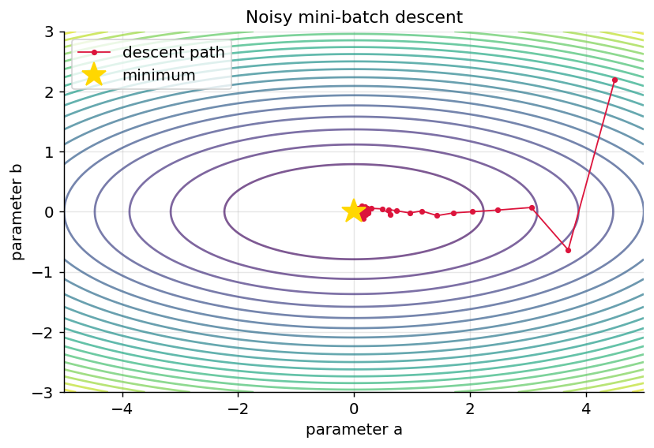

*Figure 244. Mini-batch gradient descent path on an elongated quadratic loss surface*

Notice how the path zig-zags across the steep, narrow axis (the $`b`$ direction, where the surface curves eight times more sharply) while making steady progress along the shallow axis. This ill-conditioning — different curvature in different directions — is endemic to neural loss surfaces and is exactly what momentum and adaptive optimizers are designed to fix.

Seen in three dimensions, the same surface is a bowl whose walls are far steeper along one axis than the other; gradient descent slides down the steep walls quickly but crawls along the gently sloping floor toward the true minimum. Real neural-network loss surfaces are vastly higher-dimensional and non-convex — riddled with saddle points, flat plateaus, and many equivalent minima — but this simple bowl captures the intuition that the *shape* of the surface, not just the algorithm, determines how hard optimization is.

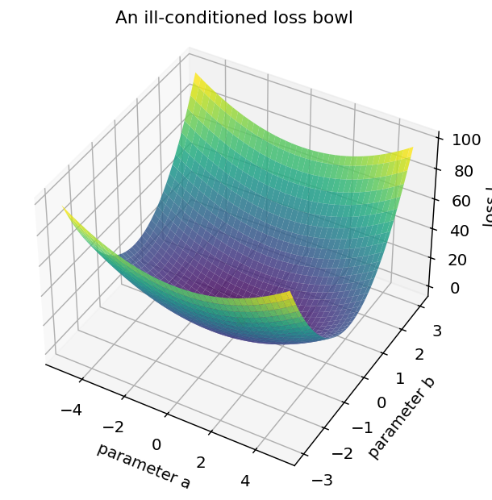

*Figure 245. The same loss surface in 3D: a bowl far steeper along one axis than the other*

### 17.7.1 The Learning Rate in Practice

Because the learning rate governs everything, it is worth seeing its three regimes side by side. On a simple convex loss, a well-chosen rate descends smoothly to the minimum; a rate that is too small barely moves; and a rate that is too large overshoots and, past a critical value, diverges outright with the loss exploding to infinity (often surfacing as `NaN`). The figure below runs gradient descent on the same one-dimensional bowl $`J(w) = w^{2}`$ from the same start with three different rates.

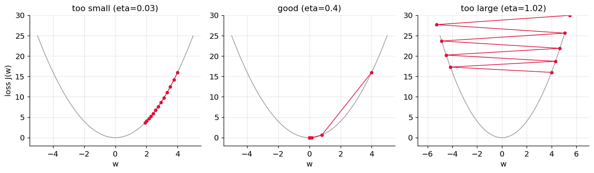

*Figure 246. The same descent under a too-small, a good, and a too-large learning rate*

In practice you rarely set a single fixed rate for a whole run. **Learning-rate schedules** decay the rate over time (step decay, cosine decay, or a brief linear *warm-up* followed by decay) so that training takes large early steps and small, careful late steps; and adaptive optimizers like Adam adjust an effective per-parameter rate automatically. The next chapter treats these in depth, but the mental model to carry forward is the one drawn above: watch the loss curve, and if it spikes, lower the rate.

## 17.8 Weight Initialization

We update the weights during training, but we have to start them *somewhere*, and that starting point matters more than beginners expect. Two failure modes bracket the problem. If we initialize every weight to the same constant (say zero), every neuron in a layer computes the same output and therefore receives the *same* gradient, so they update identically and remain forever indistinguishable — the **symmetry problem**. The cure is randomness: small random weights break the symmetry so neurons can specialize. But the *scale* of that randomness is delicate. Too large, and pre-activations land in the saturated tails of sigmoid/tanh (killing gradients) or blow up through the layers (exploding activations); too small, and the signal shrinks toward zero as it propagates, so deep layers receive almost no input variance and almost no gradient.

The principled schemes keep the *variance* of activations roughly constant from layer to layer. **Xavier/Glorot initialization**, designed for tanh and sigmoid, draws weights with variance $`\text{Var}(w) = \frac{2}{n_{\text{in}} + n_{\text{out}}}`$, balancing the forward signal and the backward gradient. **He initialization**, designed for ReLU, uses $`\text{Var}(w) = \frac{2}{n_{\text{in}}}`$; the factor of two compensates for the fact that ReLU zeroes out (on average) half its inputs, halving the variance, so the extra factor restores it. Biases are almost always initialized to zero (there is no symmetry problem for biases, since the weights already differ). Frameworks apply a sensible default automatically — Keras `Dense` and PyTorch `Linear` both use a Glorot- or He-style scheme — which is why our framework examples “just work” without our specifying anything. When you write a network from scratch, though, you must choose the scale yourself, and getting it wrong is a common reason a hand-built deep network refuses to learn.

## 17.9 Putting It All Together: The Training Loop

We have now met every component of training in isolation — forward propagation, the loss, backpropagation, the gradient-descent update, initialization. It is worth assembling them into the single cyclic procedure that *is* training a neural network, because everything from a two-neuron toy to a trillion-parameter language model runs this exact loop.

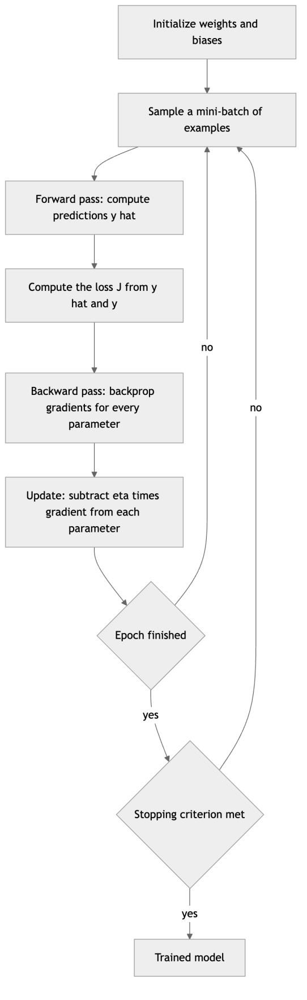

*Figure 247. The training loop repeats forward, loss, backward, and update until convergence*

A little vocabulary makes discussions of training precise. An **iteration** (or *step*) is one execution of the loop body: one forward pass, one backward pass, one parameter update, on one mini-batch. An **epoch** is one full sweep through the entire training set, which consists of (dataset size ÷ batch size) iterations. **Convergence** is when further training stops meaningfully reducing the loss; in practice we rarely train to true convergence but stop when a *validation* metric stops improving — **early stopping**, a regularization technique discussed in the chapter on Supervised Evaluation. So a run described as “50 epochs, batch size 64, on 60,000 examples” performs $`50 \times (60000/64) \approx 46,875`$ iterations, and thus 46,875 gradient updates. Understanding these units keeps you from confusing “the loss barely moved this epoch” (possibly fine) with “the loss barely moved this iteration” (expected — one mini-batch is a tiny, noisy nudge).

During training we monitor the loss on both the training set and a held-out validation set. A training loss that keeps falling while the validation loss turns upward is the signature of **overfitting**: the network is memorizing training idiosyncrasies rather than learning generalizable structure. The remedies — regularization, dropout, weight decay, more data, early stopping — are the subject of the next chapter; here the point is simply that the training loop is where you *watch* for these dynamics, and that a plot of training and validation loss over epochs is the single most informative diagnostic you can produce.

## 17.10 A Network From Scratch in NumPy

To cement the mechanics, let us train a two-layer MLP on XOR using nothing but NumPy — implementing forward propagation, backpropagation, and gradient descent by hand. If you can follow this, you understand what every framework does under the hood.

``` python
import numpy as np
np.random.seed(42)

# XOR dataset: 4 examples, 2 features
X = np.array([[0, 0], [0, 1], [1, 0], [1, 1]], dtype=float)
y = np.array([[0], [1], [1], [0]], dtype=float)

def sigmoid(z):       return 1 / (1 + np.exp(-z))
def sigmoid_prime(a): return a * (1 - a)          # a is sigmoid(z)
def relu(z):          return np.maximum(0, z)
def relu_prime(z):    return (z > 0).astype(float)

# Initialize weights (small random) and biases (zeros)
W1 = np.random.randn(2, 4) * 0.5;  b1 = np.zeros((1, 4))   # hidden layer: 4 units
W2 = np.random.randn(4, 1) * 0.5;  b2 = np.zeros((1, 1))   # output layer: 1 unit

eta = 0.5
for epoch in range(5000):
    # ---- Forward propagation ----
    Z1 = X @ W1 + b1;   A1 = relu(Z1)             # (4,4)
    Z2 = A1 @ W2 + b2;  A2 = sigmoid(Z2)          # (4,1) predictions

    # ---- Binary cross-entropy loss ----
    eps = 1e-8
    loss = -np.mean(y*np.log(A2+eps) + (1-y)*np.log(1-A2+eps))

    # ---- Backpropagation ----
    m = X.shape[0]
    dZ2 = (A2 - y) / m                            # sigmoid + BCE simplification
    dW2 = A1.T @ dZ2;           db2 = dZ2.sum(axis=0, keepdims=True)
    dA1 = dZ2 @ W2.T
    dZ1 = dA1 * relu_prime(Z1)
    dW1 = X.T @ dZ1;            db1 = dZ1.sum(axis=0, keepdims=True)

    # ---- Gradient descent update ----
    W2 -= eta*dW2; b2 -= eta*db2
    W1 -= eta*dW1; b1 -= eta*db1

    if epoch % 1000 == 0:
        print(f"epoch {epoch:4d}  loss {loss:.4f}")

print("Predictions:", np.round(A2.ravel(), 3))
# Expected: loss falls toward ~0, predictions ~ [0, 1, 1, 0]
```

Notice the exact correspondence between the code and the equations: `dZ2 = A2 - y` is $`\delta^{\lbrack L\rbrack} = \widehat{y} - y`$; `dZ1 = dA1 * relu_prime(Z1)` is the hidden-layer recurrence with the element-wise activation gate; and `dW = A_prev.T @ dZ` is the batched form of the outer product $`\delta\,\mathbf{a}^{\top}`$ (transposed because our examples are stacked as rows). The whole of deep learning is this pattern, scaled up.

A few implementation choices deserve comment. We use four hidden units where XOR strictly needs only two, because the extra capacity and random initialization make it far more likely that gradient descent finds a good solution rather than stalling in a poor local configuration — with exactly two units, some random seeds fail to converge. We scale the initial weights by $`0.5`$ (a hand-tuned stand-in for He initialization) and set biases to zero. The learning rate $`0.5`$ is aggressive but works on this tiny, clean problem; on real data you would use something far smaller with an adaptive optimizer. And we divide the output error by $`m`$ so the gradient is a mean rather than a sum, keeping the effective step size independent of batch size. Change any of these — halve the units, zero the weight scale, crank the learning rate to 50 — and you can watch the network fail in exactly the ways the pitfalls section warns about, which makes this code an excellent sandbox for building intuition.

To see that the network learns a genuinely nonlinear decision boundary — not just the four XOR corners — we can train it on a harder two-dimensional problem and visualize the region it carves out. The figure below fits the same architecture (widened) to the classic “two moons” dataset and shades the learned decision surface.

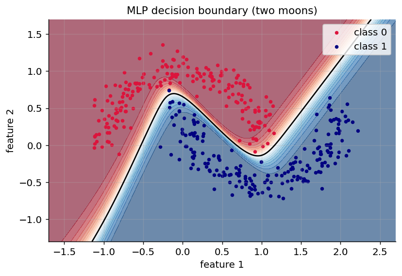

*Figure 248. Nonlinear decision boundary learned by a from-scratch MLP on the two-moons problem*

The curved black contour is the $`\widehat{y} = 0.5`$ decision boundary. A linear model could only draw a straight line here and would misclassify a large fraction of points; the hidden layer’s nonlinearity lets the MLP bend the boundary to follow the interleaving crescents.

## 17.11 The Same Network in Keras

Frameworks let us declare the architecture and delegate forward propagation, backpropagation (via autograd), and optimization. Here is the XOR network in Keras (TensorFlow).

``` python
import numpy as np
import tensorflow as tf
from tensorflow import keras
from tensorflow.keras import layers

tf.random.set_seed(42)
X = np.array([[0,0],[0,1],[1,0],[1,1]], dtype="float32")
y = np.array([[0],[1],[1],[0]], dtype="float32")

model = keras.Sequential([
    layers.Input(shape=(2,)),
    layers.Dense(4, activation="relu"),     # hidden layer
    layers.Dense(1, activation="sigmoid"),  # output layer
])
model.compile(optimizer=keras.optimizers.SGD(learning_rate=0.5),
              loss="binary_crossentropy", metrics=["accuracy"])
model.fit(X, y, epochs=500, verbose=0)

print(model.predict(X, verbose=0).round(3))
# Expected: predictions ~ [[0.],[1.],[1.],[0.]]
```

A few lines replace all our manual bookkeeping. `Dense` creates a weight matrix and bias with sensible default initialization (Glorot for the weights, zeros for the bias); `compile` attaches the loss and optimizer; `fit` runs the mini-batch training loop, computing gradients with autograd and applying updates. You never write a gradient formula. `model.summary()` will print the layer shapes and the parameter count (here $`2 \cdot 4 + 4 + 4 \cdot 1 + 1 = 17`$ parameters), a habit worth keeping as models grow.

## 17.12 The Same Network in PyTorch

PyTorch exposes the training loop explicitly, which mirrors our from-scratch version closely: zero the gradients, forward pass, compute loss, `backward()` to run autograd-backprop, and `step()` to update. This explicitness — you can print, inspect, and modify anything mid-loop — is a big part of why PyTorch is popular for research.

``` python
import torch
import torch.nn as nn

torch.manual_seed(42)
X = torch.tensor([[0,0],[0,1],[1,0],[1,1]], dtype=torch.float32)
y = torch.tensor([[0],[1],[1],[0]], dtype=torch.float32)

model = nn.Sequential(
    nn.Linear(2, 4), nn.ReLU(),     # hidden layer
    nn.Linear(4, 1), nn.Sigmoid(),  # output layer
)
loss_fn = nn.BCELoss()
optimizer = torch.optim.SGD(model.parameters(), lr=0.5)

for epoch in range(500):
    optimizer.zero_grad()        # clear old gradients (they accumulate by default)
    y_hat = model(X)             # forward propagation
    loss = loss_fn(y_hat, y)
    loss.backward()              # backpropagation (autograd)
    optimizer.step()             # gradient descent update

print(model(X).detach().round())
# Expected: predictions ~ [[0.],[1.],[1.],[0.]]
```

The one subtlety that trips up newcomers is `zero_grad()`: PyTorch *accumulates* gradients into `.grad` by default (a feature useful for some advanced techniques), so you must clear them each iteration or gradients from successive batches will pile up. Note also that for real work you would use `nn.BCEWithLogitsLoss` and drop the final `nn.Sigmoid`, letting the framework fuse the sigmoid and the loss for numerical stability — the same fused-operation principle mentioned in the loss-functions section.

All three implementations train the identical mathematical model. The NumPy version shows the gears; the frameworks hide them so you can build networks with hundreds of layers without writing a single gradient by hand. The value of having built it once by hand is that when a framework model fails to learn, you know exactly which gear — initialization, activation saturation, loss/activation mismatch, learning rate — to inspect.

## 17.13 Practical Pitfalls

Several issues bite newcomers repeatedly, and being aware of them saves hours of debugging.

- **Bad weight initialization.** Initializing all weights to the same value makes every neuron in a layer compute the same thing forever (the *symmetry* problem) — they receive identical gradients and never differentiate, so break symmetry with random values. Initializing too large saturates activations and explodes gradients; too small collapses signal to zero. Use principled schemes — *Xavier/Glorot* for tanh/sigmoid, *He* initialization for ReLU — which scale the random values by the layer’s fan-in and which frameworks apply by default.
- **Forgetting to scale inputs.** Networks train far better when features are standardized (mean 0, variance 1), as discussed in the chapter on Data Preparation. Unscaled features with wildly different ranges make the loss surface badly conditioned — the elongated bowl of the descent figure — and force a painfully small learning rate.
- **Wrong loss/activation pairing.** Sigmoid output with MSE, or softmax with the wrong target encoding, leads to weak gradients or silent bugs. Pair sigmoid with binary cross-entropy and softmax with categorical cross-entropy, and prefer the fused “with-logits” losses.
- **Learning rate mis-set.** The most common cause of “my network won’t learn” (rate too small) or “my loss is NaN” (rate too large, updates diverge). Start around $`10^{- 3}`$ with Adam and tune by watching the loss curve: a good rate shows steady decrease, too high shows spikes or divergence, too low shows a nearly flat line.
- **Vanishing/exploding gradients.** Deep stacks of saturating activations vanish; very large weights or recurrent loops explode. ReLU-family activations, normalization layers, residual connections, careful initialization, and gradient clipping mitigate these — the subject of the next chapter.
- **Numerical instability in softmax/log.** Always subtract the max before exponentiating in softmax, and add a small $`\epsilon`$ inside logarithms (as in the from-scratch code) or use the framework’s fused, stabilized operations.
- **Not overfitting a tiny sample first.** Before a long training run, confirm the model can drive the loss to near zero on a handful of examples. If it cannot memorize five points, there is a bug — a wrong shape, a detached gradient, a frozen layer — and no amount of data will fix it.

A pragmatic debugging workflow ties these together. When a network will not learn, check them in order of likelihood: confirm the data is loaded and labeled correctly and inputs are scaled; overfit a tiny batch to rule out plumbing bugs; verify the loss/activation pairing; sweep the learning rate across a few orders of magnitude while watching the loss curve; and only then suspect the architecture. Most “the network won’t train” problems are one of the first three, not an exotic modeling failure.

## 17.14 Where This Leads Next

Everything in this chapter is the irreducible core, but a network you would actually deploy needs more. The next chapter, on training and optimizing deep networks, tackles what happens when you stack many layers: the vanishing- and exploding-gradient problems in full, better optimizers (Momentum, RMSProp, Adam), normalization layers (batch and layer normalization) that stabilize the distributions flowing through the network, residual connections that give gradients a shortcut backward, and regularization (dropout, weight decay, early stopping) that keeps large models from memorizing their training data. From there, Part V specializes the fully connected neuron into architectures matched to structure in data — convolutional networks for images, recurrent and attention-based networks for sequences, and Transformers for language — followed by generative models and the large language models that dominate today’s landscape. Each of those is more elaborate, but none of them abandons the four ideas you now hold: a neuron computes a weighted sum and a nonlinearity, layers compose into representations, a loss scores the output, and backpropagation plus gradient descent tune the parameters. Master these and the rest of deep learning is a series of well-motivated refinements.

## 17.15 Summary

- An **artificial neuron** computes a weighted sum of its inputs plus a bias, then applies a nonlinear **activation function**: $`a = \sigma(\mathbf{w}^{\top}\mathbf{x} + b)`$. Weights set input importance; the bias shifts the threshold; the weight vector is the normal to the neuron’s decision hyperplane.
- The **perceptron** is a single neuron with a step activation and a simple, provably convergent learning rule — but only for **linearly separable** data. It cannot represent **XOR**, the limitation that triggered the first AI winter.
- **Activation functions** provide the nonlinearity that gives networks their power; without them, any deep network collapses to a single linear layer. Sigmoid and tanh saturate (causing vanishing gradients); **ReLU** is the modern default; **Leaky ReLU, PReLU, ELU** rescue dead units; **GELU and Swish** are smooth activations favored in Transformers; **softmax** turns logits into a class probability distribution.
- **Multilayer perceptrons** with hidden layers can approximate any continuous function (the **universal approximation theorem**), but that theorem is only an existence result — it promises nothing about how many units are needed, how to find the weights, or generalization. **Depth** provides efficiency through hierarchical, compositional feature reuse.
- **Forward propagation** evaluates the network layer by layer as batched matrix operations; the **loss** (MSE for regression, cross-entropy for classification) scores the predictions, and standard loss/activation pairings arise from maximum likelihood.
- **Backpropagation** is the chain rule applied to the computational graph, computing all gradients in roughly one forward pass. The key recurrence is $`\delta^{\lbrack\ell\rbrack} = ({W^{\lbrack\ell + 1\rbrack}}^{\top}\delta^{\lbrack\ell + 1\rbrack}) \odot \sigma'(\mathbf{z}^{\lbrack\ell\rbrack})`$, with the output error simplifying to $`\widehat{\mathbf{y}} - \mathbf{y}`$. Frameworks generalize this into **automatic differentiation**.
- **Gradient descent** updates parameters along the negative gradient scaled by the **learning rate**; **mini-batch** descent is the practical standard, balancing gradient quality, speed, and hardware efficiency.
- Frameworks (**Keras**, **PyTorch**) implement forward, backward, and optimization via autograd, but the math is exactly what we built by hand in NumPy.

## 17.16 Key Takeaways

- Everything reduces to three operations composed repeatedly: a **matrix multiply**, an **element-wise nonlinearity**, and the **chain rule**. Master these and the largest models are just more of the same.
- Nonlinearity is not optional — it is what separates a deep network from a glorified linear regression. The choice among nonlinearities is a secondary tuning decision; the presence of one is fundamental.
- Backpropagation is *not magic*: it is the chain rule with cached intermediate values, which is why gradients cost about as much as a forward pass. The worked numeric example shows there is nothing to fear in the equations.
- The gradient shrinks as it flows backward through saturating activations. This one observation explains the rise of ReLU, the difficulty of training deep networks before modern techniques, and much of the next chapter.
- Build a network from scratch once. The intuition you gain about shapes, initialization, and gradient flow will make every framework model you ever debug faster to fix.
- Universal approximation guarantees *representability*, not *learnability* or *generalization*. Depth, good initialization, sensible activations, and enough data are what turn a theoretical possibility into a working model.

## 17.17 Exercises

1.  **Conceptual.** Explain why composing two linear layers without any activation function in between is equivalent to a single linear layer. Write out the algebra with explicit weight matrices, and state what this implies about the necessity of nonlinear activations.

2.  **Conceptual.** The output-layer error for softmax-with-cross-entropy and for sigmoid-with-binary-cross-entropy both simplify to $`\widehat{\mathbf{y}} - \mathbf{y}`$. Why is this simplification numerically and practically desirable compared to pairing these activations with MSE? Relate your answer to what happens to the gradient when the model is confidently wrong.

3.  **Conceptual.** State the universal approximation theorem precisely, then list three things it does *not* guarantee. Give a practical example where each limitation matters.

4.  **Math.** Derive the derivative of the sigmoid function and show that it can be written as $`\sigma'(z) = \sigma(z)(1 - \sigma(z))`$. Using this result, explain quantitatively (the derivative’s maximum value is $`0.25`$) why deep sigmoid networks suffer from vanishing gradients.

5.  **Math (worked example).** Reproduce the fully worked backpropagation example in this chapter by hand or with a calculator: verify the forward-pass values $`\widehat{y} = 0.73079`$ and $`J = 0.03624`$, then recompute $`\delta^{\lbrack 2\rbrack}`$, $`\delta^{\lbrack 1\rbrack}`$, and all four parameter gradients. Confirm the loss decreases after one step with $`\eta = 0.5`$.

6.  **Coding (from scratch).** Modify the NumPy XOR network to use `tanh` in the hidden layer instead of ReLU. You will need the correct derivative ($`1 - \tanh^{2}`$). Compare convergence speed and final loss against the ReLU version over the same number of epochs, and explain any difference.

7.  **Coding (from scratch).** Add numerical gradient checking to the from-scratch network: for a few randomly chosen weights, compute the centered finite-difference gradient and compare it to the backprop gradient. Report the relative error and confirm it is below $`10^{- 5}`$.

8.  **Coding (framework).** Using either Keras or PyTorch, build an MLP to classify the `sklearn.datasets.load_digits` (8×8 handwritten digits) dataset. Use a softmax output with 10 units, categorical cross-entropy loss, and one or two ReLU hidden layers. Report test accuracy and experiment with the number of hidden units.

9.  **Experiment.** Take the from-scratch XOR network and sweep the learning rate over $`\{ 0.01,0.1,0.5,2.0,10.0\}`$. Plot the loss curve for each. Describe what happens at very small and very large learning rates, and relate your observations to the gradient-descent discussion and the loss-surface figure.

10. **Experiment.** Train the two-moons network from this chapter with a *single* hidden unit, then with 2, 4, 8, and 16 units. Plot the decision boundary in each case and describe how capacity affects the network’s ability to separate the crescents.

---

[← 16 Reinforcement Learning Algorithms and Deep RL](ch16-rl-algorithms.md) · [Contents](../README.md#contents) · [18 Training and Optimizing Deep Networks →](ch18-training-deep-nets.md)
