[← 17 Neural Networks: Fundamentals](ch17-nn-fundamentals.md) · [Contents](../README.md#contents) · [19 Convolutional Neural Networks and Computer Vision →](ch19-cnn-cv.md)

---

# 18 Training and Optimizing Deep Networks

Knowing the architecture of a neural network is only half the battle. A network with millions of parameters is a wilderness of non-convex loss surfaces, and naive training will leave you stranded: gradients that vanish to nothing or explode to infinity, weights that never escape their random initialization, optimizers that crawl or diverge, and models that memorize the training set while failing on everything else. This chapter is the practitioner’s field guide to making deep networks actually learn. We build on the forward and backward passes from the chapter on Neural Network Fundamentals and turn the dials that separate a model that trains in minutes from one that never converges at all.

The material here is deliberately practical. Every technique we introduce — a way to initialize weights, a normalization layer, an optimizer, a schedule, a regularizer — exists to solve a specific, observable failure of training. So rather than presenting the toolkit as a list of tricks, we organize it around the failures each tool defeats: gradients that do not propagate, activations that drift out of range, loss surfaces that are hard to descend, and models that overfit. By the end you should be able to look at a broken training run, read its symptoms off the loss curves and gradient statistics, and know which dial to turn.

## 18.1 Why Deep Networks Are Hard to Train

A neural network learns by gradient descent: compute the loss, backpropagate to get the gradient of the loss with respect to every weight, and nudge each weight in the direction that reduces the loss. In a shallow network this is straightforward. In a deep network the gradient must travel backward through dozens of layers, and at each layer it is multiplied by that layer’s local Jacobian. Long products of numbers behave badly. If the factors are consistently less than one, the product shrinks toward zero; if consistently greater than one, it grows without bound. These are the **vanishing** and **exploding gradient** problems, and they are the central obstacle that the rest of this chapter is organized to defeat.

### 18.1.1 The Shape of the Loss Landscape

Before we chase gradients through layers, it helps to picture where they live. The loss of a deep network is a scalar function of millions of parameters, so its graph is a surface in a space we cannot draw. But three features of that surface recur and shape everything we do.

First, the surface is **non-convex**. Unlike the bowl-shaped loss of linear or logistic regression (see the chapter on Regression), a deep network’s loss has many local minima, ridges, and flat regions. There is no closed-form solution and no guarantee of reaching the global minimum; we settle for a “good enough” minimum, and empirically most local minima of large networks generalize about equally well.

Second, high-dimensional loss surfaces are dominated not by local minima but by **saddle points** — places where the gradient is zero but the surface curves up in some directions and down in others. In a space of millions of dimensions, a point where *every* direction curves upward (a true local minimum) is astronomically rare; far more common is a point where some directions still descend. Saddle points have near-zero gradients, so a poorly chosen optimizer can stall on them for a long time.

Third, the surface has **ravines**: long narrow valleys that are steep across their width and nearly flat along their length. Ravines arise whenever different parameters have very different curvature — a routine situation in deep nets. They are the single geometric feature that motivates momentum and adaptive optimizers, because plain gradient descent bounces across a ravine’s steep walls while barely advancing along its floor.

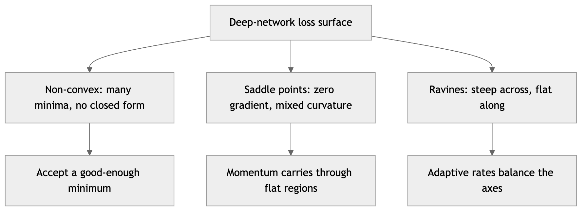

*Figure 249. Three features of deep loss surfaces that shape optimizer design*

### 18.1.2 The Vanishing and Exploding Gradient Problem

Consider a simple deep network where each layer applies a linear map followed by a nonlinearity $`\sigma`$. By the chain rule, the gradient of the loss $`L`$ with respect to a weight in an early layer involves a product of terms across all later layers:

``` math
\frac{\partial L}{\partial W^{(1)}} \propto \prod_{\ell = 2}^{L}(W^{(\ell)})^{\top}\, diag\left( \sigma'(z^{(\ell)}) \right)
```

Two things determine whether this product blows up or dies out: the magnitude of the weight matrices and the magnitude of the activation derivatives $`\sigma'`$. The classic culprit is the sigmoid. Its derivative is $`\sigma'(z) = \sigma(z)(1 - \sigma(z))`$, which peaks at just $`0.25`$ and is near zero whenever the unit is saturated. Stack ten sigmoid layers and the gradient is multiplied by at most $`{0.25}^{10} \approx 10^{- 6}`$ — the early layers receive essentially no learning signal. Conversely, if the weights are large, the product of weight matrices can grow exponentially and produce NaN losses within a few steps.

To make this precise, think of the product of Jacobians as behaving like a scalar raised to the depth $`L`$. If every factor multiplies the gradient’s magnitude by an average factor $`r`$, then after $`L`$ layers the magnitude scales like $`r^{L}`$. There is no middle ground for large $`L`$: if $`r < 1`$ the gradient vanishes exponentially, if $`r > 1`$ it explodes exponentially, and only the razor’s edge $`r \approx 1`$ keeps signals alive. The entire toolkit of initialization and normalization is an effort to engineer that razor’s edge — to hold the effective per-layer gain near one so that gradients neither die nor detonate as depth grows.

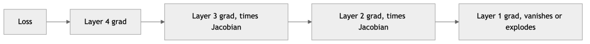

*Figure 250. How a gradient signal degrades or amplifies as it propagates backward through layers*

The symptoms are distinctive and worth memorizing. **Vanishing gradients** show up as early layers whose weights barely change from their initial values while later layers train normally; the training loss falls at first (the last layers adapt) and then stalls well above zero. **Exploding gradients** show up as a loss that suddenly jumps to a huge number or `NaN`, often after a period of apparently healthy training, accompanied by a gradient norm that spikes by orders of magnitude in a single step. Recurrent networks (see the chapter on Sequence Models) are especially prone to both, because “depth” there is the sequence length, which can be hundreds of steps.

### 18.1.3 Seeing It: Gradient Magnitude by Layer

The cleanest way to internalize the problem is to build a deep network, run one backward pass, and plot the average gradient magnitude at each layer. With sigmoid activations the gradients decay sharply toward the input; with ReLU and sensible initialization they stay flat across depth. That contrast is the whole story of why the modern toolkit exists.

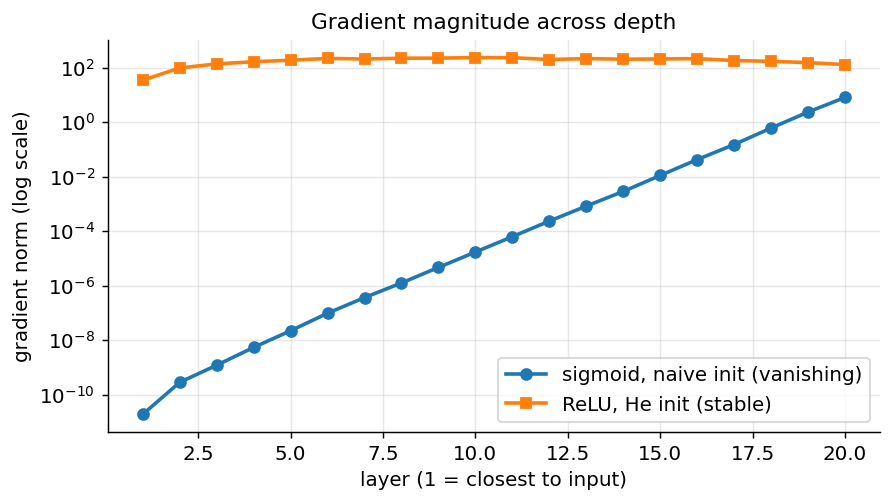

*Figure 251. Gradient magnitude by layer for a deep sigmoid net (vanishing) vs a ReLU net with He init (stable)*

The modern toolkit attacks this problem from several directions at once: better activation functions (ReLU and its variants, covered in the Fundamentals chapter, whose derivative is exactly $`1`$ for positive inputs), careful **weight initialization**, **normalization layers** that keep activations well-scaled, **gradient clipping** to cap explosions, and residual/skip connections that give gradients a shortcut path. We treat each in turn.

### 18.1.4 The Role of the Activation Function

The single change that did the most to defeat vanishing gradients was replacing saturating activations with ReLU. Recall from the analysis above that each layer multiplies the backward signal by its activation derivative $`\sigma'`$. For the sigmoid this factor is at most $`0.25`$ and usually much less, so the signal decays fast. ReLU’s derivative is exactly $`1`$ for every positive input and $`0`$ for negative ones — so along the “on” paths the gradient passes through completely undamped, and depth stops being a multiplicative penalty. This is why ReLU, though it looks almost trivially simple, was a turning point in training deep networks.

ReLU brings its own failure mode, the **dying ReLU problem**: a unit whose input is negative for every training example outputs zero, has zero gradient, and therefore never updates — it is dead for the rest of training. A large learning rate that pushes many biases strongly negative can kill a large fraction of a layer’s units at once. The remedies are the leaky variants that keep a small nonzero slope for negative inputs: **Leaky ReLU** uses a fixed slope such as $`0.01`$, **PReLU** learns the slope, and the smooth **ELU** and **GELU** (the latter now standard in transformers) avoid the hard zero entirely. When you see a layer whose activations are almost all zero in a histogram, the dying ReLU is the first suspect, and switching to a leaky variant or lowering the learning rate is the fix.

## 18.2 Weight Initialization

Before training begins, every weight must be assigned a value. This choice is not a formality — it determines whether the signals described above start out at the razor’s edge or already doomed. A network can be perfectly designed and still fail to train from a bad initialization.

### 18.2.1 The Zero and Constant Trap

It is tempting to set all weights to zero, but this is catastrophic. If all weights in a layer are identical, every neuron receives the same inputs, computes the same output, and — crucially — receives the same gradient during backpropagation. They therefore update identically and remain identical forever. The layer has the representational capacity of a single neuron no matter how wide it is. This is the **symmetry problem**, and it is why the very first requirement of any initializer is to **break symmetry** with distinct random values.

Note that the problem is not zero specifically; any constant fails for the same reason. Setting every weight to $`0.5`$ is just as broken as setting it to $`0`$, because symmetry, not magnitude, is what pins the neurons together. Biases, by contrast, are conventionally initialized to zero and this is perfectly fine: the weights have already broken symmetry, so identical biases do not lock the neurons together.

### 18.2.2 The Scale Problem and Variance Preservation

Once we agree on random weights, the question becomes: random with what *scale*? Draw them too small and the signal shrinks layer by layer until activations (and gradients) vanish; draw them too large and the signal amplifies until it saturates or explodes. The guiding principle is **variance preservation**: we want the variance of the activations to stay roughly constant as we go forward through layers, and the variance of the gradients to stay constant going backward.

Here is the variance calculation that pins down the right scale. Consider a single linear unit $`y = \sum_{i = 1}^{n_{\text{in}}}w_{i}x_{i}`$ where the inputs $`x_{i}`$ and weights $`w_{i}`$ are independent, zero-mean, and identically distributed. The variance of the output is

``` math
Var(y) = \sum_{i = 1}^{n_{\text{in}}}{Var}(w_{i}x_{i}) = n_{\text{in}}\, Var(w)\, Var(x).
```

For the output variance to equal the input variance — so the signal neither grows nor shrinks as it crosses this layer — we need $`n_{\text{in}}\, Var(w) = 1`$, that is $`Var(w) = 1/n_{\text{in}}`$. That single equation is the seed from which every principled initializer grows. The different schemes below simply adjust it for what happens on the backward pass and for the effect of the nonlinearity.

### 18.2.3 Xavier/Glorot Initialization

Glorot and Bengio (2010) noted that the argument above only balances the forward pass. Repeating it for the backward pass — where the gradient flows through $`W^{\top}`$ and sees $`n_{\text{out}}`$ fan-out connections — gives the competing requirement $`Var(w) = 1/n_{\text{out}}`$. The two cannot both hold unless $`n_{\text{in}} = n_{\text{out}}`$, so **Xavier (Glorot) initialization** splits the difference with the harmonic-style average:

``` math
Var(W) = \frac{2}{n_{\text{in}} + n_{\text{out}}}
```

In practice you draw weights either from a uniform distribution $`W \sim \mathcal{U}\left\lbrack - \sqrt{6/(n_{\text{in}} + n_{\text{out}})},\mspace{6mu}\sqrt{6/(n_{\text{in}} + n_{\text{out}})} \right\rbrack`$ or a Gaussian with the variance above. Xavier is the right choice for activations that are symmetric around zero and roughly linear near the origin, such as $`\tanh`$ and the logistic sigmoid.

### 18.2.4 He (Kaiming) Initialization

ReLU changes the analysis. Because ReLU zeroes out negative inputs, on average it halves the variance of the signal passing through it: a symmetric input distribution loses half its mass to the flat region. He et al. (2015) corrected for this by doubling the variance to compensate:

``` math
Var(W) = \frac{2}{n_{\text{in}}}
```

This is **He (Kaiming) initialization**, and it is the default you should reach for whenever you use ReLU or its relatives (Leaky ReLU, ELU, GELU). The factor of $`2`$ exactly compensates for the activations ReLU kills. Using Xavier with ReLU tends to let the signal decay slowly across depth; using He with $`\tanh`$ tends to let it grow. Match the initializer to the activation, and — as the gradient-by-layer plot above showed — a 20-layer ReLU network with He init keeps its gradients flat where a naively initialized one collapses.

### 18.2.5 LeCun Initialization and Self-Normalizing Networks

A third scheme, **LeCun initialization**, uses $`Var(W) = 1/n_{\text{in}}`$ — exactly the forward-only result. It is the natural partner of the SELU (scaled exponential linear unit) activation, which was designed so that, combined with LeCun init, activations automatically converge to zero mean and unit variance across layers. Such **self-normalizing networks** can train deep fully connected stacks without any explicit normalization layer, though in practice they have been largely superseded by BatchNorm and LayerNorm.

| Initializer | Variance | Best activation | Intuition |
|----|----|----|----|
| Xavier / Glorot | $`2/(n_{\text{in}} + n_{\text{out}})`$ | tanh, sigmoid | Balances forward and backward variance |
| He / Kaiming | $`2/n_{\text{in}}`$ | ReLU family | Compensates for ReLU killing half the signal |
| LeCun | $`1/n_{\text{in}}`$ | SELU | Enables self-normalizing networks |

``` python
# Initialization in Keras and PyTorch
import tensorflow as tf
from tensorflow import keras

# Keras: choose initializers per layer
keras.layers.Dense(128, activation="relu",
                   kernel_initializer="he_normal")
keras.layers.Dense(128, activation="tanh",
                   kernel_initializer="glorot_uniform")

import torch.nn as nn
linear = nn.Linear(256, 128)
nn.init.kaiming_normal_(linear.weight, nonlinearity="relu")  # He
nn.init.zeros_(linear.bias)                                  # biases start at 0
```

A few refinements matter in modern practice. **Embedding layers** (see the chapters on Sequence Models and Transformers) are usually initialized from a small normal distribution such as $`\mathcal{N}(0,0.02)`$ rather than by fan-in, since they act as lookup tables rather than linear maps. **Residual networks** benefit from scaling the last layer of each residual block down (or initializing it to zero), so that at the start of training each block is close to the identity and the signal passes through the skip connections unperturbed — this lets very deep networks train stably from step one. And it is standard to initialize the $`\gamma`$ scale of the final BatchNorm in each residual block to zero for the same reason.

## 18.3 Normalization Layers

Normalization layers were one of the most important advances in making deep networks trainable. They keep the distribution of activations stable as they flow through the network, which directly combats the vanishing/exploding gradient problem, lets you use higher learning rates, and reduces the sensitivity to initialization. Where a good initializer sets the signal scale correctly at step zero, a normalization layer *maintains* a good scale at every step throughout training, even as the weights change.

### 18.3.1 Batch Normalization, Derived

**Batch normalization (BatchNorm)**, introduced by Ioffe and Szegedy (2015), normalizes each feature across the examples in a mini-batch. For a given feature (activation channel), let $`x_{1},\ldots,x_{m}`$ be its values across the $`m`$ examples in the batch. BatchNorm computes the batch mean and variance, standardizes, then applies a learned scale and shift:

``` math
\mu_{\mathcal{B}} = \frac{1}{m}\sum_{i = 1}^{m}x_{i},\quad\quad\sigma_{\mathcal{B}}^{2} = \frac{1}{m}\sum_{i = 1}^{m}(x_{i} - \mu_{\mathcal{B}})^{2}
```

``` math
{\widehat{x}}_{i} = \frac{x_{i} - \mu_{\mathcal{B}}}{\sqrt{\sigma_{\mathcal{B}}^{2} + \epsilon}},\quad\quad y_{i} = \gamma{\widehat{x}}_{i} + \beta
```

The standardization forces zero mean and unit variance, and the learned parameters $`\gamma`$ (scale) and $`\beta`$ (shift) let the network *undo* the normalization if that is what minimizes the loss — so BatchNorm never reduces the network’s representational power. The small constant $`\epsilon`$ (typically $`10^{- 5}`$) guards against division by zero.

The reason $`\gamma`$ and $`\beta`$ matter is subtle but important. If we only ever forced unit variance and zero mean, a sigmoid or tanh would be confined to its near-linear central region and could never use its saturating tails. By making the post-normalization scale and shift learnable, BatchNorm can recover any mean and variance the optimizer wants — the network gets the stability of normalized inputs *and* the freedom of arbitrary output statistics.

BatchNorm was originally motivated as reducing “internal covariate shift” (the changing distribution of layer inputs as earlier layers update); later research (Santurkar et al., 2018) argued its real benefit is **smoothing the loss landscape**, making gradients more predictable and Lipschitz-bounded, which is why it permits larger learning rates. Either way, the empirical effect is dramatic: faster and more stable convergence, and a mild regularizing effect because each example’s normalization depends on the random composition of its batch, injecting a small amount of noise.

The catch is the dependence on batch statistics. At test time we often predict one example at a time, so there is no batch to compute statistics over. BatchNorm therefore accumulates a **running average** of the mean and variance during training (an exponential moving average) and uses those fixed values at inference. This creates a genuine difference between training and evaluation behavior — one you must respect in code by switching the model to eval mode — and it makes BatchNorm unreliable with very small batches, where the per-batch statistics are noisy estimates of the true ones.

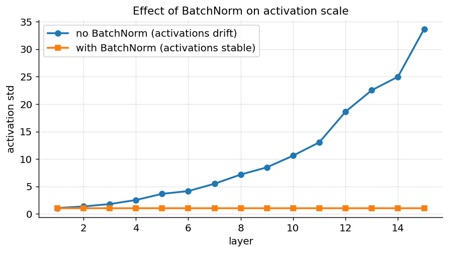

*Figure 252. BatchNorm keeps hidden activations well-scaled across depth; without it they drift*

### 18.3.2 Layer Normalization

**Layer normalization (LayerNorm)**, introduced by Ba et al. (2016), sidesteps the batch dependence entirely by normalizing across the *features* of a single example rather than across the batch. For one example with $`H`$ features $`x_{1},\ldots,x_{H}`$:

``` math
\mu = \frac{1}{H}\sum_{j = 1}^{H}x_{j},\quad\quad\sigma^{2} = \frac{1}{H}\sum_{j = 1}^{H}(x_{j} - \mu)^{2},\quad\quad y_{j} = \gamma\,\frac{x_{j} - \mu}{\sqrt{\sigma^{2} + \epsilon}} + \beta
```

Because each example is normalized independently, LayerNorm behaves identically at train and test time and works for any batch size, including a single example. It is also indifferent to sequence length, which is why it is the natural choice for recurrent networks and transformers, where it is ubiquitous (see the chapter on Transformers). Modern large language models frequently use **RMSNorm**, a simplification that drops the mean-centering and the $`\beta`$ shift, normalizing only by the root-mean-square of the features; it is slightly cheaper and works just as well in practice.

### 18.3.3 Group and Instance Normalization

Between the two extremes — BatchNorm normalizes over the batch, LayerNorm over all features of one example — sit two intermediate schemes designed for images, where activations have a channel dimension and spatial dimensions.

**Instance normalization** normalizes each channel of each example independently over its spatial extent (height and width). By removing per-image contrast and brightness, it became the workhorse of **style transfer** and image generation, where the statistics of a feature map often encode style information you want to standardize away.

**Group normalization** (Wu and He, 2018) splits the channels into groups and normalizes within each group, over both the group’s channels and the spatial dimensions. It interpolates between LayerNorm (one group containing all channels) and InstanceNorm (one channel per group). Its key virtue is that, like LayerNorm, it is **independent of batch size**, so it matches BatchNorm’s accuracy on vision tasks even when memory forces a batch size of one or two per device — a common situation in detection and segmentation (see the chapter on Convolutional Networks).

| Normalization | Normalizes over | Batch-size dependent | Typical use |
|----|----|----|----|
| BatchNorm | batch, per feature/channel | yes | CNNs with large batches |
| LayerNorm | all features of one example | no | Transformers, RNNs |
| InstanceNorm | spatial extent, per channel per example | no | Style transfer, generation |
| GroupNorm | channel groups + spatial, per example | no | Detection/segmentation, small batches |

A final design decision is *where* to put the normalization. In transformers, **post-norm** (normalize after the residual addition) was the original design but is hard to train very deep; **pre-norm** (normalize the input to each sublayer, before the residual) is far more stable and is now standard, at a small cost in final quality. The general lesson is that normalization and residual connections must be arranged together so that the skip path stays clean and gradients flow through it unimpeded — which brings us to residual connections themselves.

## 18.4 Residual Connections as Gradient Highways

Initialization and normalization keep the per-layer gain near one, but as networks pushed past a few dozen layers even careful scaling was not enough — accuracy *degraded* with depth, and not from overfitting but from an optimization failure: the deeper network could not even fit the training data as well as a shallower one. The fix, introduced with ResNet (He et al., 2015) and now pervasive across architectures, is the **residual (skip) connection**, which adds a layer’s input back to its output:

``` math
y = x + F(x)
```

where $`F`$ is the block’s transformation (some layers, a nonlinearity, perhaps normalization). Instead of asking each block to learn the full mapping, we ask it to learn only the *residual* — the difference from the identity — which is easier when the ideal mapping is close to the identity, as it often is deep in a network.

The reason this rescues gradient flow is visible in one line of the chain rule. Differentiating $`y = x + F(x)`$ gives

``` math
\frac{\partial y}{\partial x} = I + \frac{\partial F}{\partial x}.
```

The gradient of the output with respect to the input contains an additive identity term. When the backward signal flows through the block, it is multiplied by $`I + \partial F/\partial x`$ rather than by $`\partial F/\partial x`$ alone — so even if the block’s own Jacobian shrinks the signal, the identity term carries the gradient through undiminished. Stacking many such blocks, the gradient reaches the earliest layers along a “highway” of identity connections that no product of small factors can close off. This is why residual networks train stably at hundreds or even a thousand layers where a plain stack of the same depth simply will not learn.

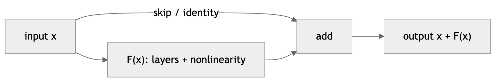

*Figure 253. A residual block routes the input around the transformation so gradients have a direct path*

Residual connections combine naturally with the initialization trick mentioned earlier — initializing the last layer of each block near zero so that $`F(x) \approx 0`$ at the start, making every block begin as an identity map. Training then gently “turns on” the blocks that help. Skip connections are treated in architectural detail in the chapters on Convolutional Networks and Transformers; here the point is that, alongside initialization and normalization, they are the third pillar holding the per-layer gain near one and are what makes truly deep training possible.

## 18.5 Optimizers in Depth

The optimizer is the rule that turns gradients into weight updates. All of the algorithms below descend from plain gradient descent, but each adds machinery to navigate the difficult geometry of deep loss surfaces — the ravines, plateaus, and saddle points we met at the start of the chapter.

### 18.5.1 Stochastic Gradient Descent

The starting point is **stochastic gradient descent (SGD)**. Rather than computing the gradient over the entire dataset (batch gradient descent, which is expensive and memory-hungry), we estimate it from a small **mini-batch** of examples and step:

``` math
\theta_{t + 1} = \theta_{t} - \eta\,\nabla_{\theta}L(\theta_{t};\,\text{mini-batch})
```

Here $`\eta`$ is the **learning rate**. Mini-batching makes each step cheap, and the noise in the gradient estimate is not merely tolerated but genuinely helpful: it lets the optimizer escape sharp, brittle minima and tends to steer toward flatter minima that generalize better. But pure SGD struggles in ravines — long narrow valleys where the surface is much steeper across the valley than along it. The optimizer oscillates across the steep walls while creeping slowly toward the minimum, because the same learning rate must serve both the steep and the shallow directions.

### 18.5.2 Momentum and Nesterov

**Momentum** fixes the oscillation by accumulating a velocity vector that averages out the back-and-forth and accelerates along consistent directions, like a heavy ball rolling downhill:

``` math
v_{t + 1} = \beta v_{t} + \nabla_{\theta}L(\theta_{t}),\quad\quad\theta_{t + 1} = \theta_{t} - \eta\, v_{t + 1}
```

The momentum coefficient $`\beta`$ (typically $`0.9`$) controls how much past velocity carries forward; $`\beta = 0.9`$ means the velocity is roughly an average over the last ten gradients. Components of the gradient that keep pointing the same way add up and accelerate; components that flip sign from step to step cancel out and are damped. This is exactly what a ravine needs: it damps the cross-valley oscillation while building speed along the valley floor. Momentum also helps coast through the flat regions around saddle points, where the raw gradient is near zero but accumulated velocity keeps the parameters moving.

**Nesterov accelerated gradient** is a clever refinement that evaluates the gradient *after* taking the momentum step — a “look-ahead” that lets the optimizer sense that it is about to overshoot and correct sooner. It gives provably faster convergence on convex problems and is usually a small, free improvement:

``` math
v_{t + 1} = \beta v_{t} + \nabla_{\theta}L(\theta_{t} - \eta\beta v_{t}),\quad\quad\theta_{t + 1} = \theta_{t} - \eta\, v_{t + 1}
```

### 18.5.3 Adaptive Methods: AdaGrad, RMSProp, Adam

The methods above use a single global learning rate for every parameter. **Adaptive** methods instead give each parameter its own effective learning rate based on the history of its gradients — useful when some features are sparse (and their gradients are rare but important) or when different directions need very different step sizes.

**AdaGrad** accumulates the sum of squared gradients per parameter and divides the step by its square root:

``` math
G_{t} = G_{t - 1} + g_{t}^{2},\quad\quad\theta_{t + 1} = \theta_{t} - \frac{\eta}{\sqrt{G_{t}} + \epsilon}\, g_{t}
```

Parameters that have received large or frequent gradients get progressively smaller steps; rarely updated parameters keep large steps. This is excellent for sparse problems, but AdaGrad has a fatal flaw for deep learning: $`G_{t}`$ grows monotonically without bound, so the effective learning rate decays toward zero and learning grinds to a halt long before convergence.

**RMSProp** fixes this by replacing the cumulative sum with an exponentially decaying average, so the denominator forgets old gradients and stops growing:

``` math
E\lbrack g^{2}\rbrack_{t} = \rho\, E\lbrack g^{2}\rbrack_{t - 1} + (1 - \rho)\, g_{t}^{2},\quad\quad\theta_{t + 1} = \theta_{t} - \frac{\eta}{\sqrt{E\lbrack g^{2}\rbrack_{t}} + \epsilon}\, g_{t}
```

With the memory of old gradients bounded, the per-parameter rate adapts to the *recent* curvature rather than the entire history, and learning no longer stalls. RMSProp was for years the default for recurrent networks.

**Adam** (Adaptive Moment Estimation, Kingma and Ba, 2014) combines momentum with RMSProp. It tracks an exponential average of the gradients (first moment $`m`$, playing momentum’s role) and of their squares (second moment $`v`$, playing RMSProp’s role):

``` math
m_{t} = \beta_{1}m_{t - 1} + (1 - \beta_{1})g_{t},\quad\quad v_{t} = \beta_{2}v_{t - 1} + (1 - \beta_{2})g_{t}^{2}
```

Because $`m`$ and $`v`$ are initialized to zero, they are biased toward zero during the first several steps, when the exponential average has not yet “warmed up.” Adam corrects for this with an explicit **bias correction** that divides out the expected shrinkage:

``` math
{\widehat{m}}_{t} = \frac{m_{t}}{1 - \beta_{1}^{t}},\quad\quad{\widehat{v}}_{t} = \frac{v_{t}}{1 - \beta_{2}^{t}},\quad\quad\theta_{t + 1} = \theta_{t} - \frac{\eta}{\sqrt{{\widehat{v}}_{t}} + \epsilon}\,{\widehat{m}}_{t}
```

To see why the correction is needed, take expectations of $`m_{t}`$ assuming a roughly constant true gradient mean $`g`$. Unrolling the recursion gives $`\mathbb{E}\lbrack m_{t}\rbrack = (1 - \beta_{1}^{t})\, g`$, so early on (small $`t`$) $`m_{t}`$ systematically underestimates $`g`$ by the factor $`(1 - \beta_{1}^{t})`$; dividing by exactly that factor restores an unbiased estimate. The defaults $`\beta_{1} = 0.9`$, $`\beta_{2} = 0.999`$, $`\epsilon = 10^{- 8}`$ work remarkably well across a huge range of problems, which is why Adam became the default optimizer for most of deep learning.

### 18.5.4 AdamW: Decoupled Weight Decay

There is a subtle bug in how Adam interacts with L2 regularization. Classic L2 regularization adds $`\frac{\lambda}{2} \parallel \theta \parallel^{2}`$ to the loss, which adds $`\lambda\theta`$ to the gradient. But in Adam that extra gradient term gets divided by $`\sqrt{{\widehat{v}}_{t}}`$ along with everything else, so parameters with large accumulated gradients get *less* effective regularization — the opposite of what a weight-decay penalty is supposed to do. **AdamW** (Loshchilov and Hutter, 2017) decouples weight decay from the adaptive gradient update, applying it directly to the weights as a separate shrinkage step:

``` math
\theta_{t + 1} = \theta_{t} - \eta\left( \frac{{\widehat{m}}_{t}}{\sqrt{{\widehat{v}}_{t}} + \epsilon} + \lambda\,\theta_{t} \right)
```

AdamW consistently generalizes better than Adam-with-L2 and is now the standard optimizer for training transformers and large models. When people say “use Adam” for a modern model, they almost always mean AdamW.

### 18.5.5 Beyond Adam

The optimizer story does not end with Adam. **Adadelta** is a close cousin of RMSProp that eliminates the learning rate entirely by tracking a running average of past *updates* as well as gradients. For training very large models where optimizer state (the $`m`$ and $`v`$ buffers, which double or triple the memory of the parameters themselves) is a bottleneck, **Adafactor** factorizes the second-moment estimate to save memory, and **LAMB** adds layer-wise normalization so that Adam-style training remains stable at enormous batch sizes. **Lion**, a more recent optimizer discovered by program search, uses only the sign of a momentum term and can match AdamW with less memory. For most work, though, SGD-with-momentum and AdamW remain the two you reach for first.

| Optimizer | Per-param rate | Momentum | Notes |
|----|----|----|----|
| SGD | no | no | Simple, strong final generalization, needs tuning |
| SGD + Momentum | no | yes | Smooths ravines, common for CNNs |
| Nesterov | no | yes (look-ahead) | Faster, slightly better convergence |
| AdaGrad | yes | no | Good for sparse features, learning rate dies |
| RMSProp | yes | no | Fixes AdaGrad decay, good for RNNs |
| Adam | yes | yes | Robust default, fast convergence |
| AdamW | yes | yes | Adam with correct weight decay, best for transformers |

A practical note on the SGD-versus-Adam choice: Adam converges faster and is far more forgiving of the learning rate, which makes it the right default and nearly mandatory for transformers. But on many vision tasks, a well-tuned SGD with momentum reaches a slightly *better* final accuracy, because its noisier, less adaptive updates seem to find flatter minima. If you have the time and compute to tune SGD, it can be worth it; if you want something that just works, use AdamW.

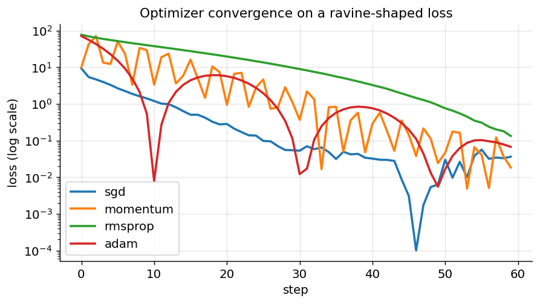

*Figure 254. Convergence of SGD, Momentum, RMSProp, and Adam on a noisy ravine-shaped loss*

To see *why* the curves differ, it helps to watch the optimizers actually move across the loss surface. Plotting their trajectories on the contour lines of the same ravine shows plain SGD zig-zagging across the steep walls, momentum overshooting and curving back, and the adaptive methods driving almost straight down the valley because they rescale the steep axis automatically.

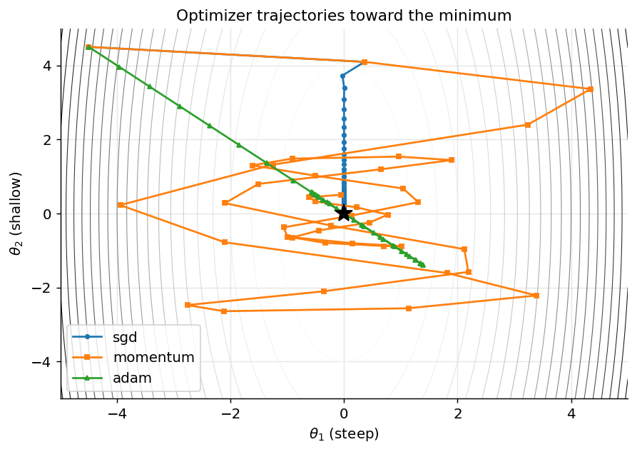

*Figure 255. Optimizer trajectories on the contours of a ravine-shaped loss surface*

### 18.5.6 Batch Size, Gradient Noise, and the Learning Rate

Batch size deserves a place in the optimizer discussion because it interacts tightly with the learning rate. A mini-batch gradient is a noisy estimate of the true gradient, and the noise shrinks as the batch grows — its standard deviation falls like $`1/\sqrt{B}`$ for batch size $`B`$. A large batch therefore gives a smoother, more accurate gradient and better hardware utilization, but the smoothness is not free: some of that noise was doing useful regularization work, nudging the optimizer toward flatter, better-generalizing minima. This is why very large batches sometimes generalize slightly worse unless compensated for.

The practical rule that ties the two together is the **linear scaling rule**: when you multiply the batch size by $`k`$, multiply the learning rate by $`k`$ as well. The intuition is that a $`k`$-times-larger batch takes one step where $`k`$ small-batch steps would have been taken, so to cover the same ground the single step must be $`k`$ times larger. The rule holds over a wide range but breaks down at extreme batch sizes, where the required learning rate becomes too large to be stable — which is exactly where **warmup** (ramping the rate up gradually) and large-batch optimizers such as LAMB become necessary. A useful mental model is the **gradient noise scale**: below it, increasing the batch mostly buys accuracy in the gradient estimate and you should scale the learning rate up; above it, extra examples in the batch are largely redundant and you get diminishing returns.

## 18.6 Learning-Rate Schedules and Warmup

The learning rate is the single most important hyperparameter. Too high and training diverges or bounces around the minimum without settling; too low and it crawls, wasting compute and possibly getting stuck. And the best value is rarely constant across training — the ideal rate is large early, when you want to cover ground, and small late, when you want to settle precisely. This is why practitioners almost always use a **schedule** that changes $`\eta`$ over time rather than a single fixed number.

### 18.6.1 Common Decay Schedules

**Step decay** multiplies the learning rate by a constant factor (commonly $`0.1`$) at fixed milestones — say, every 30 epochs. It is simple and was the standard recipe for training the classic vision architectures. **Exponential decay** smooths this into a continuous $`\eta_{t} = \eta_{0}\, e^{- kt}`$, decreasing by a small factor every step.

The now-dominant choice is **cosine annealing** (Loshchilov and Hutter, 2016), which decreases the rate smoothly along a half-cosine curve from the maximum to a minimum over the course of training:

``` math
\eta_{t} = \eta_{\min} + \frac{1}{2}(\eta_{\max} - \eta_{\min})\left( 1 + cos\frac{t\pi}{T} \right)
```

Cosine annealing spends a long time near the maximum rate (good for exploration), then decays gently and finishes with a long tail of tiny steps (good for fine settling), with no abrupt jumps to destabilize training. A popular variant, **cosine annealing with warm restarts** (SGDR), periodically resets the rate back to the maximum, letting the optimizer jump out of one minimum and explore toward another; the collection of models saved just before each restart can be ensembled for free.

### 18.6.2 Warmup

**Warmup** addresses a different problem, one specific to the start of training. At step zero the weights are random and, for adaptive optimizers, the moment estimates $`m`$ and $`v`$ are unreliable (their bias correction is largest and their variance highest). A large learning rate applied to these unreliable early gradients can knock the model into a bad region it never recovers from. **Warmup** ramps the learning rate up linearly from near zero over the first few hundred to few thousand steps, then hands off to the decay schedule. It is essential for training transformers, where “linear warmup then cosine (or inverse-square-root) decay” is the standard recipe, and it also stabilizes training at large batch sizes.

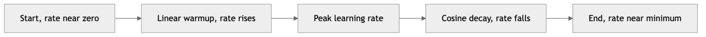

*Figure 256. A typical warmup then cosine decay learning rate schedule over training*

### 18.6.3 The One-Cycle Policy

The **one-cycle policy** (Smith, 2018) is a schedule that has become popular for training networks quickly. Over a single cycle it ramps the learning rate *up* from a low value to a high peak and then back *down* to a value even lower than where it started, while simultaneously moving the momentum in the opposite direction (high when the rate is low, low when the rate is high). The high-rate middle phase acts as a strong regularizer that discourages the model from settling into sharp minima, and the very low final rate lets it converge precisely. Combined with a high peak rate found by a learning-rate finder, one-cycle enables what its author called “super-convergence” — training in far fewer epochs than a constant rate would need.

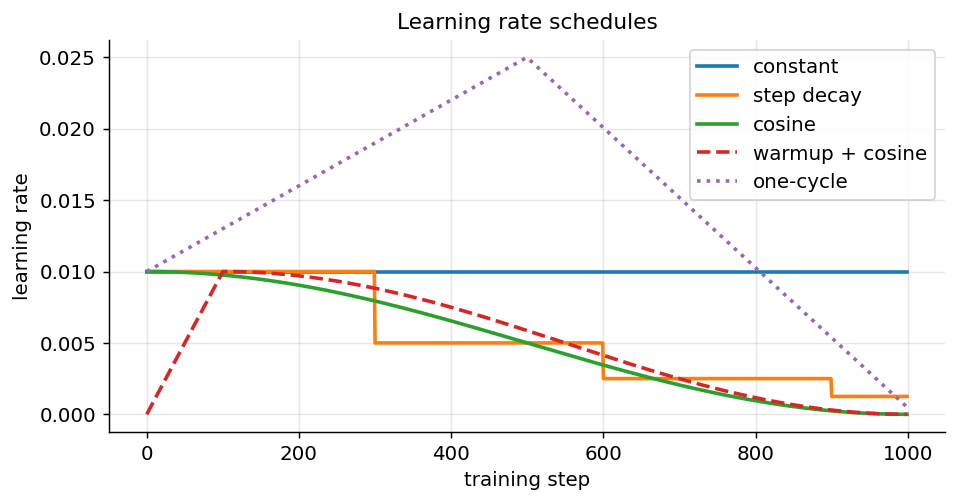

*Figure 257. Constant, step decay, cosine, warmup+cosine, and one-cycle learning-rate schedules*

### 18.6.4 The Learning-Rate Finder

How do you choose the peak learning rate in the first place? The **learning-rate finder** (also called the LR range test) is a cheap, reliable answer. Starting from a tiny rate such as $`10^{- 7}`$, you train for a few hundred mini-batches while multiplying the learning rate by a constant factor at every step, so it sweeps exponentially up to a large value like $`1`$. Plotting the loss against the (log-scaled) learning rate produces a characteristic curve: flat at first (the rate is too small to make progress), then a steep downward slope where learning is efficient, then a sharp upturn where the rate is too large and the loss diverges. The best learning rate is roughly one order of magnitude below the point of minimum loss — right in the middle of the steepest descent, comfortably before the divergence. This single-pass test replaces a great deal of trial and error and is built into libraries such as fastai and PyTorch Lightning.

## 18.7 Regularization for Deep Networks

Deep networks have enough capacity to memorize their training data outright — a large model can drive training loss to zero even on randomly labeled data. Regularization is the collection of techniques that constrain this capacity, or add noise and priors, so the model learns generalizable structure instead of memorizing. We covered the bias-variance tradeoff in the chapter on Supervised Learning and Model Evaluation; here we focus on the techniques specific to deep nets.

### 18.7.1 L2 Regularization and Weight Decay

The oldest tool is to penalize large weights by adding $`\frac{\lambda}{2} \parallel \theta \parallel^{2}`$ to the loss. This pulls weights toward zero, producing smoother functions with smaller Lipschitz constants that are less prone to fitting noise. As discussed under AdamW, with adaptive optimizers you should prefer **decoupled weight decay** (shrink the weights directly) rather than adding the penalty to the loss, because the two are *not* equivalent once the update is rescaled per parameter. Typical values of $`\lambda`$ range from $`10^{- 5}`$ to $`10^{- 2}`$. One refinement worth knowing: it is standard *not* to apply weight decay to bias terms or to the $`\gamma`$/$`\beta`$ parameters of normalization layers, since shrinking those toward zero serves no regularizing purpose and can hurt.

**L1 regularization**, which penalizes $`\parallel \theta \parallel_{1}`$ instead, drives some weights exactly to zero and so induces sparsity; it is less common in deep nets than L2 but useful when you want a compact, prunable model.

### 18.7.2 Dropout

**Dropout** (Srivastava et al., 2014) is one of the most effective and conceptually surprising regularizers. During each training step, every neuron in a dropout layer is independently “dropped” (its output set to zero) with probability $`p`$. Because the network can never rely on the presence of any particular neuron, it is forced to spread its representation across many redundant units rather than concentrating on a few fragile feature detectors. The standard interpretation is that dropout trains an enormous **ensemble** of subnetworks that share weights, and averages over them implicitly at test time — an ensemble being one of the most reliable ways to reduce variance.

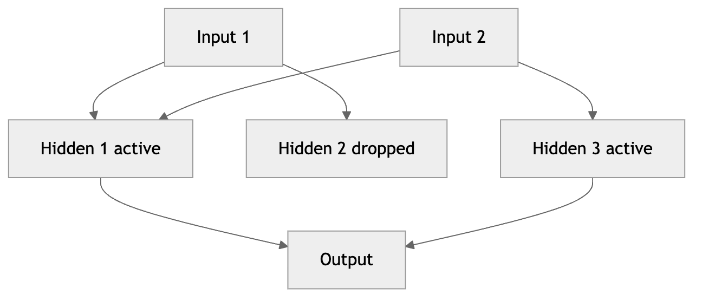

*Figure 258. Dropout randomly disables a subset of neurons each training step*

At test time we want to use the whole network, so we must reconcile the fact that training saw only a fraction $`(1 - p)`$ of the neurons active on average. Naively, we would multiply every activation by $`(1 - p)`$ at test time to match the expected magnitude. Frameworks instead implement **inverted dropout**: during training, the surviving activations are *divided* by $`(1 - p)`$, which keeps the expected activation constant and means test time needs no rescaling at all — you simply turn dropout off. A subtle but critical consequence is that you must put the model in *evaluation mode* at inference (Keras does this automatically inside `model.predict`; in PyTorch you must call `model.eval()`), or dropout will keep randomly corrupting your predictions. Typical dropout rates are $`0.2`$–$`0.5`$ for fully connected layers; convolutional layers usually need much less (or a spatial variant).

One interaction to be aware of: **dropout and BatchNorm can conflict**. Dropout changes the variance of the activations at training time but not at test time, which shifts the statistics BatchNorm sees between the two regimes and can hurt accuracy. A common practical rule is to prefer one or the other in a given block, to place dropout *after* the normalization rather than before it, or to rely on BatchNorm’s own mild regularization and use dropout sparingly — which is part of why many modern convolutional architectures use little or no dropout in their convolutional trunk.

Several variants adapt the idea to different architectures. **Spatial dropout** drops entire feature-map channels rather than individual pixels, which is more effective in CNNs where neighboring pixels are highly correlated. **DropConnect** drops individual weights instead of activations. **Stochastic depth** drops whole residual blocks during training, which both regularizes and speeds up training of very deep residual networks. The plot below shows the essential effect: dropout closes the gap between training and validation loss, trading a little training-set fit for better generalization.

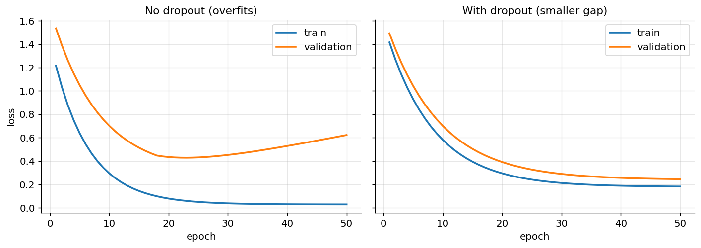

*Figure 259. Dropout reduces the train/validation gap (schematic learning curves)*

### 18.7.3 Early Stopping

The simplest regularizer of all: watch the validation loss, and stop training when it stops improving. As training proceeds, training loss falls monotonically but validation loss eventually bottoms out and turns upward as the model begins to overfit. **Early stopping** halts near the bottom of that validation curve and restores the best weights seen so far. A `patience` parameter lets the validation loss wiggle for a few epochs before triggering, so you do not stop on a single noisy uptick. Early stopping is nearly free, composes with every other technique, and is the reason it is safe to set a generous maximum number of epochs.

### 18.7.4 Label Smoothing

**Label smoothing** regularizes the *targets* rather than the weights. Instead of training a classifier toward hard one-hot labels (probability $`1`$ for the true class, $`0`$ for the rest), we soften them: the true class gets probability $`1 - \alpha`$ and the remaining mass $`\alpha`$ is spread over the other classes, with $`\alpha`$ typically around $`0.1`$. This discourages the network from becoming over-confident — driving a single logit to $`+ \infty`$ — which improves calibration and generalization, and prevents the largest logit from growing so much larger than the rest that gradients vanish for the correct examples. Label smoothing is standard in modern image classification and machine translation.

### 18.7.5 Data Augmentation

If you cannot get more data, you can manufacture plausible variations of what you have. **Data augmentation** applies label-preserving transformations so the model sees a slightly different version of every example each epoch: for images, random crops, flips, rotations, color jitter, and cutout; for audio, time-shifts, pitch changes, and added noise; for text, synonym replacement and back-translation. Two powerful modern techniques mix examples together: **mixup** trains on convex combinations of two images *and* their labels, while **cutmix** pastes a patch of one image onto another and mixes the labels in proportion to the patch area. Augmentation is one of the highest-leverage regularizers in computer vision and is discussed further in the chapter on Convolutional Networks.

## 18.8 Overfitting versus Underfitting in Deep Nets

With the regularizers in hand, we can state the central diagnostic clearly. Every training run sits somewhere on a spectrum between two failure modes, and the correct response is opposite at the two ends — so misdiagnosing which one you have will make things worse.

**Underfitting (high bias)** means the model is too weak to capture the signal even in the training data: both training and validation loss are high and plateau together, with a small gap between them. The model lacks capacity, has not trained long enough, is over-regularized, or has a learning rate too low to make progress. **Overfitting (high variance)** means the model fits the training data far better than new data: training loss is low and still falling while validation loss has flattened or turned upward, and the gap between them is large and widening.

The deep-learning twist is that the classical picture — where more capacity always eventually hurts — is incomplete. Very large modern networks often sit in an over-parameterized regime where they fit the training set perfectly yet still generalize well, and where adding more capacity *helps*. In practice this means the modern recipe is often to build a model large enough to overfit, then add regularization (augmentation, dropout, weight decay, early stopping) until the validation gap closes — rather than starting small. The table summarizes the diagnosis and response.

| Symptom | Diagnosis | Remedies |
|----|----|----|
| Train and val loss both high, small gap | Underfitting / high bias | Bigger model, train longer, higher LR, less regularization, better features |
| Train loss low, val loss much higher and rising | Overfitting / high variance | More data, augmentation, dropout, weight decay, early stopping, smaller model |
| Train and val loss both low, small gap | Good fit | Ship it; consider a larger model only for headroom |
| Train loss will not fall at all | Optimization failure, not capacity | Check LR, initialization, data pipeline, loss function |

That last row is the one beginners most often misread as underfitting. If the training loss refuses to move, the problem is almost never model capacity — it is a broken learning rate, a dead initialization, a disconnected computation graph, or a bug in the data pipeline. The fix is debugging, which we return to below.

## 18.9 Gradient Clipping

We met exploding gradients at the start of the chapter as the twin of vanishing gradients. **Gradient clipping** is the direct, blunt defense: before applying the optimizer step, cap the size of the gradient so a single pathological batch cannot blow up the weights. There are two common forms.

**Clipping by norm** rescales the entire gradient vector whenever its L2 norm exceeds a threshold $`c`$, preserving its direction:

``` math
g \leftarrow g \cdot \frac{c}{max( \parallel g \parallel ,\, c)}
```

**Clipping by value** independently clamps each component of the gradient into $`\lbrack - c,c\rbrack`$, which can change the direction but is simple and occasionally useful. Norm clipping is the more principled and common choice because it leaves the update direction intact and only tames the magnitude.

Clipping is close to mandatory for recurrent networks and transformers, where the effective depth (sequence length) makes explosions routine; a typical threshold is a max norm of $`1.0`$ or $`5.0`$. It is cheap insurance: if your training occasionally spikes to `NaN`, adding gradient clipping is often the single-line fix. Watching the gradient norm over time (before clipping) is also one of the most informative training diagnostics — steady norms mean healthy training, and frequent clipping events tell you the learning rate may be too high.

## 18.10 Mixed-Precision Training and Practical Tips

Training large models is as much an engineering problem as a mathematical one. A handful of techniques squeeze more model, more batch, and more speed out of the same hardware.

**Mixed-precision training** performs most operations in 16-bit floating point (fp16 or bfloat16) instead of 32-bit, which roughly halves memory use and, on modern accelerators with dedicated matrix units, can double or triple throughput. The subtlety is numerical range: fp16 has so few exponent bits that small gradients underflow to zero. The standard fix is **loss scaling** — multiply the loss by a large constant before backpropagation so the gradients land in fp16’s representable range, then divide them back out before the optimizer step. Frameworks automate this: PyTorch’s `torch.cuda.amp` with a `GradScaler`, or Keras’s mixed-precision policy, handle the casting and scaling for you. The bfloat16 format, which trades mantissa precision for the same exponent range as fp32, avoids the underflow problem entirely and is preferred on hardware that supports it, often needing no loss scaling at all.

Two more memory techniques are worth knowing. **Gradient accumulation** lets you simulate a large batch on limited memory by summing gradients over several small mini-batches before taking one optimizer step — indispensable when a model barely fits and you still want the smoother gradients of a large effective batch. **Gradient (activation) checkpointing** trades compute for memory by discarding intermediate activations during the forward pass and recomputing them during the backward pass, which can let you train models two or three times larger than would otherwise fit.

When one accelerator is not enough, training scales across many. **Data parallelism** replicates the model on each device, gives each a different slice of the batch, and averages the gradients across devices before the optimizer step — the simplest and most common approach, and the reason large effective batch sizes (and the linear scaling rule above) matter in practice. **Model** and **pipeline parallelism** instead split the model itself across devices when a single copy is too large to fit, and sharded-optimizer schemes such as ZeRO partition the parameters, gradients, and optimizer state across devices to fit models that no single accelerator could hold. These distributed strategies are what make training billion-parameter models possible; the algorithms in this chapter are unchanged, but the batch is now assembled and the gradients reduced across a whole cluster.

Beyond memory, a few habits separate reproducible, debuggable training from chaos:

- **Seed everything** — Python, NumPy, and the framework’s RNG — and record the seed, so a run can be reproduced. Be aware that some GPU operations are nondeterministic unless you explicitly request deterministic mode.
- **Normalize your inputs.** Scale features to zero mean and unit variance (or images to $`\lbrack 0,1\rbrack`$ or $`\lbrack - 1,1\rbrack`$). This is the cheapest possible aid to optimization and is easy to forget.
- **Log aggressively.** Track training and validation loss, the learning rate, and the gradient norm every few steps. Tools like TensorBoard or Weights & Biases make the curves you need for diagnosis effortless.
- **Checkpoint regularly** so a crash or a diverging run does not cost you the whole job, and save the best model by validation metric, not just the last one.
- **Start small.** Get the full pipeline working end to end on a tiny model and a tiny dataset before scaling up. Most bugs are cheaper to find at small scale.

## 18.11 Transfer Learning and Fine-Tuning

Training a large network from scratch requires enormous data and compute. **Transfer learning** sidesteps this by starting from a model already trained on a large dataset and adapting it to your task. The pretrained network has already learned general-purpose features — edges and textures in a vision model, syntax and semantics in a language model — and those features transfer to related tasks with far less data than learning them from nothing. This is the dominant paradigm in modern applied deep learning: almost no one trains an image or language model from random weights anymore.

There are two main strategies, and the right choice depends mostly on how much data you have and how similar your task is to the original.

**Feature extraction** freezes the pretrained “backbone” entirely and trains only a new task-specific “head” (typically a fresh classifier) on top of the frozen features. Because the backbone is fixed, this is fast, needs little data, and cannot overfit the backbone. It is the right choice when your dataset is small or very similar to the pretraining data.

**Fine-tuning** unfreezes some or all of the backbone and continues training it — usually at a much smaller learning rate than the new head — so the pretrained features adapt to your task. It reaches higher accuracy when you have enough data, but risks “catastrophic forgetting” of the useful pretrained features if the learning rate is too high. A common recipe is to first train the head with the backbone frozen (so the randomly initialized head does not send large, destructive gradients back into the pretrained weights), then unfreeze and fine-tune the whole model at a low rate.

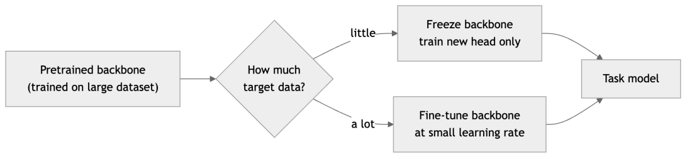

*Figure 260. Transfer learning reuses a pretrained backbone and adapts it to a new task*

A key factor in choosing between them is the **domain gap** — how far your data is from the pretraining data. A model pretrained on natural photographs transfers almost effortlessly to another natural-image task (small gap, feature extraction often suffices) but needs more fine-tuning to handle medical scans or satellite imagery (large gap, where the low-level features themselves must adapt). The larger the gap and the more data you have, the more of the backbone you should unfreeze.

A refinement that gets the best of both is **discriminative** or **layer-wise** learning rates: use a very small rate for the early layers (which capture the most general features and should barely change), a larger rate for later layers (which are more task-specific), and the largest rate for the new head. The intuition matches how features specialize with depth — the first layers of a vision model detect edges useful for any task, while the last layers detect task-specific objects. Gradual unfreezing, where you unfreeze layers from the top down over successive epochs, is a related and effective schedule. For very large language models, **parameter-efficient fine-tuning** methods such as LoRA (discussed in the chapter on LLMs in Practice) fine-tune only a small number of injected parameters, making adaptation feasible on modest hardware.

## 18.12 Hyperparameter Tuning at Scale

Training a deep network involves many knobs, and their settings interact. Here is a prioritized list of what to tune and sensible starting points, roughly in order of impact.

- **Learning rate** — by far the most important. Start with $`10^{- 3}`$ for Adam/AdamW, $`10^{- 1}`$ to $`10^{- 2}`$ for SGD with momentum, and tune on a log scale. Use a learning-rate finder to bracket the range.
- **Batch size** — larger batches give smoother gradients and faster hardware throughput but may generalize slightly worse and cost more memory. Common values: $`32`$–$`512`$. When you increase batch size, scale the learning rate up roughly proportionally (the “linear scaling rule”) and add warmup.
- **Optimizer and schedule** — AdamW with warmup-then-cosine is a safe default; SGD with momentum can give the best final vision accuracy if you invest in tuning.
- **Regularization strength** — weight decay $`\lambda`$, dropout rate $`p`$, augmentation intensity. More capacity needs more regularization.
- **Architecture** — depth, width, activation. Usually explored more coarsely than the above.

### 18.12.1 Search Strategies

For the search itself, **grid search** (try every combination on a fixed grid) is simple but scales exponentially with the number of hyperparameters and wastes trials on dimensions that do not matter. **Random search** samples each hyperparameter randomly and, counterintuitively, is more efficient than grid search when only a few of the hyperparameters actually matter — it covers the important dimensions with more distinct values for the same budget. For expensive models, **Bayesian optimization** builds a probabilistic model of the objective and proposes the most promising configurations to try next, converging in far fewer trials; tools such as Optuna, Ray Tune, and Weights & Biases Sweeps implement it.

At larger scale, the key idea is **early stopping of unpromising trials** so you do not waste compute finishing runs that are clearly losing. **Successive halving** and its refinement **Hyperband** (and the asynchronous variant ASHA) start many configurations with a small budget, keep only the best fraction, give them more budget, and repeat — concentrating compute on the survivors. **Population-based training** goes further, evolving a population of models during a single training run: periodically the worst performers copy the weights and hyperparameters of the best and then perturb them, so the schedule of hyperparameters is discovered *along with* the weights.

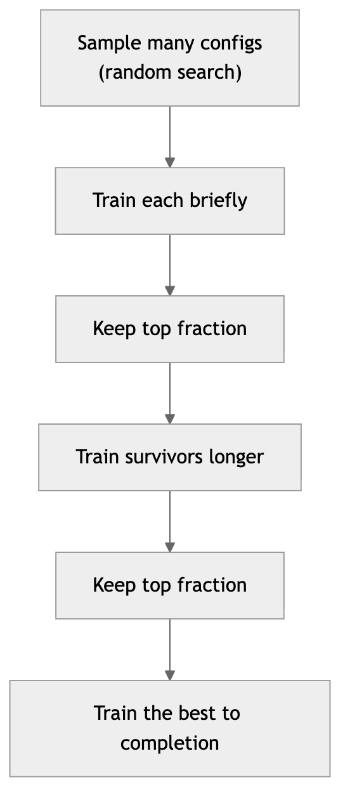

*Figure 261. Progressively concentrating compute on promising configurations (Hyperband-style)*

### 18.12.2 A Default Recipe to Start From

Because the search space is large, it helps to begin from a recipe that works across a wide range of problems and to tune outward from there rather than exploring blindly. For a modern feed-forward, convolutional, or transformer model, a strong starting point is: **AdamW** at learning rate $`3 \times 10^{- 4}`$ (or $`10^{- 3}`$) with weight decay $`10^{- 2}`$ excluded from biases and normalization parameters; **linear warmup** over the first few percent of steps followed by **cosine decay** to near zero; **He initialization** with ReLU/GELU activations; a **normalization layer** in every block (BatchNorm for CNNs with large batches, LayerNorm for transformers); modest **dropout** ($`0.1`$) and **label smoothing** ($`0.1`$); **gradient clipping** at max norm $`1.0`$; and the largest **batch size** that fits in memory, with the learning rate scaled accordingly. This recipe rarely wins a competition on its own, but it almost never fails outright, which makes it the right baseline: get it training cleanly first, confirm the diagnostics look healthy, and only then tune the learning rate and regularization for the last increments of performance.

The chapter on the Machine Learning Workflow discusses validation strategy in general; the cardinal rule bears repeating here. Tune on a **validation set**, and report final numbers only on a held-out **test set** you touch exactly once. Every decision you make by looking at a dataset leaks a little information into your model; a test set you have peeked at repeatedly is no longer an honest estimate of generalization.

## 18.13 Diagnosing Training with Learning Curves

The most informative diagnostic is the pair of **learning curves**: training and validation loss (or accuracy) plotted against epochs. We used their shapes above to define overfitting and underfitting; here we turn them into a practical debugging tool.

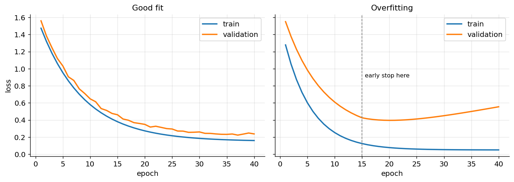

*Figure 262. Learning curves for a good fit versus an overfitting model*

Beyond the loss curves themselves, several other signals sharpen the diagnosis. The **gradient norm** over time should be reasonably steady; sudden spikes signal instability (clip them) and a norm decaying to zero signals vanishing gradients. **Activation and weight histograms** (TensorBoard makes these easy) reveal saturation — if a layer’s activations are all pinned at zero or at the tails of a sigmoid, that layer has stopped learning. The **learning-rate value** plotted alongside the loss confirms your schedule is doing what you think. And the ratio of the update size to the weight size, per layer, should be small but nonzero (a rule of thumb is around $`10^{- 3}`$); much larger means the learning rate is too high, much smaller means it is too low or the layer is stuck.

Certain loss-curve shapes have telltale causes. The table collects the ones you will see most often.

| Loss-curve symptom | Likely cause | First things to try |
|----|----|----|
| Flat from step one, never moves | Dead learning rate, disconnected graph, or all-zero init | Raise LR; check gradients are nonzero; verify the graph is connected |
| Shoots to `NaN` or `inf` | Exploding gradients, LR too high, bad input (NaN in data), log of zero | Lower LR; add gradient clipping; check for NaNs and unstable losses |
| Falls then plateaus high | Underfitting, or LR now too small | Bigger model, train longer, LR warm restart, less regularization |
| Train falls, val rises | Overfitting | Add regularization, augmentation, early stopping; get more data |
| Very noisy, bouncing loss | LR too high, or batch size too small | Lower LR; increase batch size; add LR decay |
| Loss decreases in sudden steps | LR schedule milestones, or data not shuffled | Confirm shuffling; smooth the schedule (cosine) |

Two final sanity checks catch a large fraction of real-world bugs. Before a long run, **overfit a tiny subset** — say ten examples — to near-zero loss. If a model with adequate capacity cannot memorize ten examples, you have a bug (wrong loss function, frozen weights, mislabeled data, a broken pipeline), and no amount of hyperparameter tuning will save you. Second, check that your **initial loss is sensible**: for a balanced $`k`$-class classifier with softmax cross-entropy, the untrained loss should be about $`\ln k`$ (for example $`\ln 10 \approx 2.30`$ for ten classes). A wildly different starting loss means something is wrong before training even begins.

### 18.13.1 A Worked Diagnostic Walkthrough

To see how these signals combine, consider a common scenario. You train a deep classifier and the loss falls for a few epochs, then flattens near $`2.3`$ and refuses to move; validation accuracy hovers at chance. The flat-near-$`\ln k`$ value is the first clue: the model is predicting the uniform distribution, so effectively nothing is being learned. You check the gradient norms and find they are tiny at the input layers and only modest at the output — a vanishing-gradient signature. Before assuming a fundamental problem, you run the ten-example overfit test; it also fails, confirming the issue is optimization, not generalization. Now you have a short, ordered checklist: verify the inputs are normalized (an unnormalized input can saturate the first layer immediately); confirm the activations are ReLU-family with He initialization rather than sigmoid with a tiny init; add BatchNorm or residual connections to restore gradient flow; and only if all of that is healthy, raise the learning rate or lengthen warmup. In most real cases one of the first two fixes — normalizing inputs and matching the initializer to the activation — resolves it, and the loss breaks through the plateau. The discipline that makes this fast is having the diagnostics (loss, gradient norm, the ten-example test) already wired up *before* you need them, rather than instrumenting a failing run under pressure.

## 18.14 Putting It Together: Training Loops

We now assemble these ideas into complete, runnable training code. We show both Keras and PyTorch so you can use either framework. Both train a small classifier on the digits dataset with He initialization, BatchNorm, dropout, AdamW, a learning-rate schedule, gradient clipping, and early stopping — the full toolkit of this chapter in one place.

### 18.14.1 Keras with Callbacks

Keras hides the training loop behind `model.fit`, and the moving parts — early stopping, learning-rate scheduling, checkpointing — are supplied as **callbacks**.

``` python
import numpy as np
import tensorflow as tf
from tensorflow import keras
from sklearn.datasets import load_digits
from sklearn.model_selection import train_test_split
from sklearn.preprocessing import StandardScaler

X, y = load_digits(return_X_y=True)
X = StandardScaler().fit_transform(X).astype("float32")   # normalize inputs
X_tr, X_val, y_tr, y_val = train_test_split(X, y, test_size=0.2, random_state=0)

model = keras.Sequential([
    keras.layers.Input(shape=(64,)),
    keras.layers.Dense(128, kernel_initializer="he_normal", use_bias=False),
    keras.layers.BatchNormalization(),
    keras.layers.Activation("relu"),
    keras.layers.Dropout(0.3),
    keras.layers.Dense(64, kernel_initializer="he_normal", activation="relu"),
    keras.layers.Dropout(0.3),
    keras.layers.Dense(10, activation="softmax"),
])

model.compile(
    optimizer=keras.optimizers.AdamW(learning_rate=1e-3, weight_decay=1e-4,
                                     global_clipnorm=5.0),   # gradient clipping
    loss="sparse_categorical_crossentropy",
    metrics=["accuracy"],
)

callbacks = [
    keras.callbacks.EarlyStopping(monitor="val_loss", patience=10,
                                  restore_best_weights=True),
    keras.callbacks.ReduceLROnPlateau(monitor="val_loss", factor=0.5, patience=4),
    keras.callbacks.ModelCheckpoint("best.keras", monitor="val_loss",
                                    save_best_only=True),
]

history = model.fit(X_tr, y_tr, validation_data=(X_val, y_val),
                    epochs=200, batch_size=64, callbacks=callbacks, verbose=0)
print("best val accuracy:", max(history.history["val_accuracy"]))
# best val accuracy: ~0.98
```

The `history` object holds the per-epoch losses and metrics you would feed straight into the learning-curve plot above.

### 18.14.2 PyTorch: An Explicit Loop

PyTorch makes the loop explicit, which is more code but far more transparent — you can see exactly where the forward pass, loss, backward pass, gradient clipping, and optimizer step happen.

``` python
import torch
import torch.nn as nn
from torch.utils.data import TensorDataset, DataLoader
from sklearn.datasets import load_digits
from sklearn.model_selection import train_test_split
from sklearn.preprocessing import StandardScaler

torch.manual_seed(0)
X, y = load_digits(return_X_y=True)
X = StandardScaler().fit_transform(X).astype("float32")
X_tr, X_val, y_tr, y_val = train_test_split(X, y, test_size=0.2, random_state=0)

tr_loader = DataLoader(TensorDataset(torch.tensor(X_tr), torch.tensor(y_tr)),
                       batch_size=64, shuffle=True)
X_val_t = torch.tensor(X_val); y_val_t = torch.tensor(y_val)

model = nn.Sequential(
    nn.Linear(64, 128, bias=False), nn.BatchNorm1d(128), nn.ReLU(), nn.Dropout(0.3),
    nn.Linear(128, 64), nn.ReLU(), nn.Dropout(0.3),
    nn.Linear(64, 10),
)
# He initialization for the ReLU layers
for m in model:
    if isinstance(m, nn.Linear):
        nn.init.kaiming_normal_(m.weight, nonlinearity="relu")

opt = torch.optim.AdamW(model.parameters(), lr=1e-3, weight_decay=1e-4)
sched = torch.optim.lr_scheduler.CosineAnnealingLR(opt, T_max=200)
loss_fn = nn.CrossEntropyLoss(label_smoothing=0.05)   # label smoothing

best_val, patience, wait = float("inf"), 10, 0
best_state = None
for epoch in range(200):
    model.train()                                  # enable dropout/BN training mode
    for xb, yb in tr_loader:
        opt.zero_grad()                            # PyTorch accumulates grads by default
        loss = loss_fn(model(xb), yb)
        loss.backward()
        nn.utils.clip_grad_norm_(model.parameters(), max_norm=5.0)  # clip explosions
        opt.step()
    sched.step()

    model.eval()                                   # disable dropout; use BN running stats
    with torch.no_grad():
        val_logits = model(X_val_t)
        val_loss = loss_fn(val_logits, y_val_t).item()
        val_acc = (val_logits.argmax(1) == y_val_t).float().mean().item()

    if val_loss < best_val:                        # early stopping bookkeeping
        best_val, wait = val_loss, 0
        best_state = {k: v.clone() for k, v in model.state_dict().items()}
    else:
        wait += 1
        if wait >= patience:
            break

model.load_state_dict(best_state)                  # restore best weights
print(f"stopped at epoch {epoch}, val acc {val_acc:.3f}")
# stopped at epoch ~40, val acc ~0.98
```

Note the three pieces of discipline that beginners most often forget: calling `optimizer.zero_grad()` before each backward pass (PyTorch *accumulates* gradients by default), toggling `model.train()` / `model.eval()` so dropout and BatchNorm behave correctly, and wrapping evaluation in `torch.no_grad()` to save memory. Gradient clipping (`clip_grad_norm_`) caps the gradient’s L2 norm and is your insurance against exploding gradients, especially in recurrent models.

### 18.14.3 Adding Mixed Precision

Turning the PyTorch loop above into a mixed-precision one takes only a few lines: create a `GradScaler`, wrap the forward pass in an `autocast` context, and scale the loss before `backward`. This is the pattern you will use for any large model on a modern GPU.

``` python
scaler = torch.cuda.amp.GradScaler()
for xb, yb in tr_loader:
    opt.zero_grad()
    with torch.cuda.amp.autocast():            # run forward pass in fp16/bf16
        loss = loss_fn(model(xb), yb)
    scaler.scale(loss).backward()              # scale loss so small grads survive
    scaler.unscale_(opt)                       # unscale before clipping
    nn.utils.clip_grad_norm_(model.parameters(), max_norm=5.0)
    scaler.step(opt)                           # optimizer step (skipped if grads overflow)
    scaler.update()                            # adjust the scale factor for next step
```

## 18.15 Summary

- Deep networks are hard to train mainly because gradients are products of many factors that tend to **vanish or explode** as they propagate through layers; the effective per-layer gain must be held near one, and the whole toolkit of this chapter exists to keep signals and gradients well-scaled.
- The **loss landscape** is non-convex and dominated by saddle points and ravines; momentum coasts through saddles and adaptive rates balance ravines.
- **Weight initialization** breaks symmetry (never use zero or constant weights) and preserves variance. Use **Xavier/Glorot** for tanh/sigmoid and **He/Kaiming** for ReLU-family activations; the scale follows from a one-line variance calculation.
- **Normalization layers** maintain a good activation scale throughout training. **BatchNorm** (over the batch) speeds up CNNs but depends on batch size; **LayerNorm** (over features) is batch-independent and dominates transformers; **Group/Instance norm** cover the middle ground for vision at small batch sizes.
- **Optimizers** build on SGD: momentum and Nesterov smooth ravines; AdaGrad, RMSProp, and Adam adapt the rate per parameter; **AdamW** fixes Adam’s weight-decay bug and is the modern default. SGD with momentum can still win on final vision accuracy.
- **Learning-rate schedules** (step, cosine) plus **warmup**, the **one-cycle** policy, and the **LR finder** are often as important as the optimizer itself, especially for transformers.
- Regularize with **L2/weight decay, dropout (inverted), early stopping, label smoothing, and data augmentation**; combine them to close the train/validation gap.
- **Gradient clipping** caps explosions; **mixed precision** with loss scaling, **gradient accumulation**, and **checkpointing** are the engineering levers for training large models on limited hardware.
- **Transfer learning** — feature extraction when data is scarce, fine-tuning (with discriminative learning rates) when it is plentiful — is the default modern workflow.
- Tune the **learning rate first**, prefer random search or Bayesian optimization with early stopping of bad trials, and always sanity-check by overfitting a tiny subset and confirming the initial loss is near $`\ln k`$.
- Read **learning curves** and gradient statistics to diagnose underfitting, good fit, overfitting, and outright optimization bugs, and respond accordingly.
- In code, Keras uses **callbacks** for early stopping and scheduling; PyTorch uses an **explicit loop** where you must remember `zero_grad`, `train`/`eval` modes, `no_grad`, and gradient clipping.

## 18.16 Key Takeaways

- Training failures have *symptoms*: read them off the loss curve and gradient norm, then match the symptom to a specific fix rather than changing things at random.
- Initialization and normalization solve the same problem — keeping signals well-scaled — at different times: initialization at step zero, normalization at every step thereafter.
- AdamW with warmup-then-cosine decay is the reliable default recipe; reach for it first and only tune SGD if you need the last fraction of a percent.
- The learning rate is the hyperparameter that matters most by a wide margin; spend your tuning budget there first, and use an LR finder to bracket it cheaply.
- Build a model large enough to overfit, then regularize until the validation gap closes — this is the modern order of operations, not “start small.”
- Two cheap habits catch most bugs before they cost you a long run: overfit ten examples to zero loss, and confirm the initial loss equals $`ln(\text{number of classes})`$.
- Almost never train a large model from scratch: start from pretrained weights and fine-tune.

## 18.17 Exercises

1.  **Conceptual.** Explain why initializing all weights of a layer to the same nonzero constant fails to train, even though the symmetry-breaking argument is usually stated for zero initialization. What property of backpropagation causes the neurons to stay identical?

2.  **Math.** Starting from the variance identity $`Var(y) = n_{\text{in}}\, Var(w)\, Var(x)`$, derive the He initialization variance $`2/n_{\text{in}}`$ for a layer followed by ReLU. Explain precisely where the factor of $`2`$ comes from and why it would be wrong for a tanh layer.

3.  **Math.** Starting from Adam’s update equations, derive why the bias-correction terms $`{\widehat{m}}_{t} = m_{t}/(1 - \beta_{1}^{t})`$ and $`{\widehat{v}}_{t} = v_{t}/(1 - \beta_{2}^{t})`$ are needed. Show that $`\mathbb{E}\lbrack m_{t}\rbrack = (1 - \beta_{1}^{t})\, g`$ for a constant gradient mean $`g`$, and explain how the correction fixes the early-training bias.

4.  **Coding.** Modify the PyTorch training loop to log the training and validation loss each epoch, then plot both curves. Deliberately remove dropout, weight decay, and label smoothing and increase the network width tenfold. Describe how the curves change and identify the regime (underfit/good/overfit).

5.  **Coding.** Implement a learning-rate finder: starting from a tiny rate (e.g. $`10^{- 7}`$), train for a few hundred steps while exponentially increasing the rate each step, and plot loss versus learning rate on a log axis. Identify the rate just before the loss starts to diverge, and explain why you would pick a rate about one order of magnitude below the minimum-loss point.

6.  **Conceptual.** A colleague reports that their model trains fine with batch size 256 but produces garbage predictions at inference with batch size 1. They use BatchNorm. Diagnose the likely cause, explain the role of the running statistics, and propose two fixes (one that changes the code path, one that changes the normalization layer).

7.  **Experiment.** Take the Keras model and compare SGD, SGD+momentum, RMSProp, Adam, and AdamW on identical data and epochs. Plot the validation-loss curves on one axis. Which converges fastest? Which generalizes best? Relate your findings to the optimizer comparison table.

8.  **Experiment.** Add batch normalization layers to a deep tanh network that is failing to train, and compare the training curves and the per-layer gradient norms with and without it. Explain the change in terms of the vanishing-gradient analysis and the loss-landscape-smoothing view of BatchNorm.

9.  **Conceptual.** You are fine-tuning a pretrained image model on a small dataset of 500 labeled images. Would you use feature extraction or full fine-tuning, and what learning-rate strategy would you choose for the backbone versus the head? Justify your answer in terms of overfitting risk and catastrophic forgetting.

10. **Coding.** Convert the PyTorch loop to mixed precision using `autocast` and `GradScaler`, and confirm that gradient clipping still works by unscaling before the clip. Measure the change in peak GPU memory and step time, and explain the role of loss scaling.

---

[← 17 Neural Networks: Fundamentals](ch17-nn-fundamentals.md) · [Contents](../README.md#contents) · [19 Convolutional Neural Networks and Computer Vision →](ch19-cnn-cv.md)
