[← 18 Training and Optimizing Deep Networks](ch18-training-deep-nets.md) · [Contents](../README.md#contents) · [20 Natural Language Processing: Fundamentals →](ch20-nlp-fundamentals.md)

---

# 19 Convolutional Neural Networks and Computer Vision

Images are arguably the richest data type machine learning routinely handles: a single modest photograph contains hundreds of thousands of pixels, each carrying color and spatial context. Teaching a machine to *see* — to recognize a cat, locate a pedestrian, or read a license plate — was once considered nearly impossible. Convolutional neural networks (CNNs) changed that, and they remain the workhorse of computer vision even in an era increasingly shared with transformers. This chapter explains why ordinary neural networks struggle with images, builds up the convolution operation from first principles with a fully worked numeric example, walks through the landmark architectures that defined the field, and surveys the core vision tasks — classification, detection, and segmentation — along with the practical techniques (transfer learning, data augmentation) that make modern vision systems work. It closes with vision transformers and a tour of real-world applications from radiology to self-driving cars.

## 19.1 Why Dense Networks Fail on Images

The fully connected (dense) networks introduced in the chapter on Neural Network Fundamentals treat their input as a flat vector. To feed an image into such a network, you would flatten it: a modest $`224 \times 224`$ RGB image becomes a vector of $`224 \times 224 \times 3 = 150,528`$ numbers. If the first hidden layer has just 1,000 neurons, that single layer needs $`150,528 \times 1,000 \approx 150`$ million weights. The parameter count is not merely a memory problem — it is a *statistical* problem. With that many free parameters, the network has enormous capacity to memorize and almost no inductive bias toward what makes images meaningful. Given the finite training sets we actually have, such a model will overfit ferociously.

There are three deeper issues:

- **No notion of locality.** In a dense layer, every input pixel connects to every neuron with an independent weight. But the meaning of a pixel depends overwhelmingly on its *neighbors* — edges, corners, and textures are local patterns. A dense layer has to learn this locality from scratch, wasting capacity.
- **No translation invariance.** A cat in the top-left corner and the same cat in the bottom-right are, to a flattened dense network, two completely different input vectors that share no weights. The network must relearn “cat” at every position, effectively multiplying the amount of data it needs.
- **Destroyed spatial structure.** Flattening throws away the 2D grid. The fact that pixel $`(10,10)`$ sits directly above pixel $`(11,10)`$ is information the dense network never receives; it would behave identically if you shuffled all the pixels with a fixed permutation.

The parameter blow-up is worth quantifying, because it dramatizes the whole motivation for convolution. The table contrasts a single dense layer with a single convolutional layer processing the same image.

| Layer processing a 224×224×3 image         | Parameters   |
|--------------------------------------------|--------------|
| Dense layer to 1,000 units (flatten first) | ~150,000,000 |
| Conv layer, 64 filters of 3×3×3            | 1,792        |
| Conv layer, 1,000 filters of 3×3×3         | 28,000       |

The dense layer needs roughly five thousand times more parameters than a convolutional layer with the *same* number of output channels — and the convolutional layer is the more capable image processor, because it preserves spatial structure the dense layer throws away. This is the entire argument in one table: convolution is both smaller and better suited to images.

Convolutional networks fix all three problems with two ideas borrowed from signal processing and neuroscience: **local connectivity** (each neuron looks at a small spatial neighborhood) and **weight sharing** (the same small set of weights is slid across the entire image). The result is a model that is dramatically smaller, naturally translation-equivariant, and respects the grid structure of its input. These are not just efficiency tricks; they are *inductive biases* — built-in assumptions about the world that happen to be true for natural images, and that let the network generalize from far less data.

The biological inspiration is worth noting. In the 1960s, Hubel and Wiesel probed the cat visual cortex and found neurons that responded only to edges at particular orientations within a small region of the visual field — “simple cells” — and others that pooled these responses over a slightly larger region while tolerating small shifts — “complex cells.” This hierarchy of local feature detectors followed by spatial pooling is almost exactly the conv-then-pool structure a CNN uses, discovered decades before the networks that would formalize it.

## 19.2 The Convolution Operation

### 19.2.1 Intuition: Sliding a Filter

At the heart of a CNN is the **convolution** of an input with a small **kernel** (also called a **filter**). Imagine a small $`3 \times 3`$ window of weights. You place it over the top-left corner of the image, multiply each weight by the pixel beneath it, sum the products into a single number, and write that number to an output grid. Then you slide the window one step to the right and repeat. When you reach the end of a row, you drop down and start again. The grid of numbers you produce is a **feature map** — it records how strongly the kernel’s pattern appears at each location.

Different kernels detect different patterns. A kernel that looks like

``` math
\begin{bmatrix}
 - 1 & 0 & 1 \\
 - 1 & 0 & 1 \\
 - 1 & 0 & 1
\end{bmatrix}
```

responds strongly to vertical edges (a bright-to-dark transition left to right). The crucial insight of CNNs is that we *do not hand-design these kernels* — we initialize them randomly and let gradient descent learn whatever filters minimize the loss. Early layers reliably converge to edge and color-blob detectors; deeper layers compose those into textures, then object parts, then whole objects. In effect, the network learns its own feature extractors, replacing the hand-engineered features (SIFT, HOG, Gabor filters) that dominated computer vision before deep learning.

### 19.2.2 The Math

For a 2D input $`I`$ and a kernel $`K`$ of size $`k \times k`$, the (cross-correlation, which deep-learning libraries call “convolution”) output at position $`(i,j)`$ is:

``` math
S(i,j) = (I \ast K)(i,j) = \sum_{m = 0}^{k - 1}{\sum_{n = 0}^{k - 1}I}(i + m,\, j + n)\, K(m,n) + b
```

where $`b`$ is a learned bias. A footnote on terminology: mathematically, true convolution flips the kernel before sliding it, whereas the operation above (no flip) is *cross-correlation*. Because the kernel weights are learned, the distinction is irrelevant in practice — the network simply learns the flipped version if it needs to — and every major library calls this operation “convolution.” We follow that convention throughout.

For multi-channel input (e.g., 3 color channels), each filter has a matching depth, so a $`3 \times 3`$ filter over RGB input actually has $`3 \times 3 \times 3 = 27`$ weights plus a bias; it sums across all channels to produce a *single* output feature map. A convolutional layer learns many such filters in parallel — if a layer has 64 filters, it produces 64 feature maps, and that count becomes the channel depth of the next layer’s input. The general rule: a filter always spans the *full depth* of its input but only a small *spatial* window, and each filter collapses that depth into one output channel.

It helps to trace the shapes explicitly through a small stack. Suppose we feed a $`32 \times 32 \times 3`$ image into a layer of 16 filters of size $`3 \times 3`$ with “same” padding. Each filter carries $`3 \times 3 \times 3 = 27`$ weights plus a bias, the layer holds $`16 \times 28 = 448`$ parameters, and it emits a $`32 \times 32 \times 16`$ tensor — the spatial size is preserved by the padding, while the depth is now the *number of filters*, not the number of colors. Follow that with 32 filters of size $`3 \times 3`$: each filter now spans the full input depth of 16, so it carries $`3 \times 3 \times 16 = 144`$ weights plus a bias, the layer holds $`32 \times 145 = 4,640`$ parameters, and it emits a $`32 \times 32 \times 32`$ tensor. The pattern to internalize: a filter’s spatial footprint is a hyperparameter you choose (usually $`3 \times 3`$), but its depth is *dictated* by the incoming channel count, and the layer’s own filter count becomes the outgoing channel count. This is why the third dimension of a CNN’s tensors typically grows layer by layer even as the first two shrink.

### 19.2.3 A Fully Worked Numeric Example

Abstractions become concrete when you push actual numbers through. Take this $`5 \times 5`$ single-channel input $`I`$ and the $`3 \times 3`$ vertical-edge kernel $`K`$:

``` math
I = \begin{bmatrix}
3 & 0 & 1 & 2 & 7 \\
1 & 5 & 8 & 9 & 3 \\
2 & 7 & 2 & 5 & 1 \\
0 & 1 & 3 & 1 & 7 \\
4 & 2 & 1 & 6 & 2
\end{bmatrix},\quad\quad K = \begin{bmatrix}
1 & 0 & - 1 \\
1 & 0 & - 1 \\
1 & 0 & - 1
\end{bmatrix}
```

With **valid** convolution (no padding) and **stride 1**, a $`3 \times 3`$ kernel over a $`5 \times 5`$ input produces a $`3 \times 3`$ output. Consider the top-left output cell $`S(0,0)`$. Overlay the kernel on the top-left $`3 \times 3`$ block of $`I`$:

``` math
\begin{bmatrix}
3 & 0 & 1 \\
1 & 5 & 8 \\
2 & 7 & 2
\end{bmatrix} \odot \begin{bmatrix}
1 & 0 & - 1 \\
1 & 0 & - 1 \\
1 & 0 & - 1
\end{bmatrix}
```

Multiply element-wise and sum: $`(3 \cdot 1) + (0 \cdot 0) + (1 \cdot - 1) + (1 \cdot 1) + (5 \cdot 0) + (8 \cdot - 1) + (2 \cdot 1) + (7 \cdot 0) + (2 \cdot - 1) = 3 - 1 + 1 - 8 + 2 - 2 = - 5`$. Slide the window one column right for $`S(0,1)`$, and so on. Working through all nine positions yields:

``` math
S = I \ast K = \begin{bmatrix}
 - 5 & - 4 & 0 \\
 - 10 & - 2 & 2 \\
0 & - 2 & - 4
\end{bmatrix}
```

The magnitudes are largest where the input changes sharply from left to right — exactly what a vertical-edge detector should report. This tiny example is the entire operation; a real convolutional layer does the same arithmetic millions of times across many channels and filters, but nothing about the core computation is more complicated than what you just did by hand.

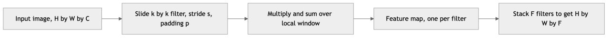

*Figure 263. A 3 by 3 kernel slides over the input to produce one feature map*

### 19.2.4 Stride and Padding

Two hyperparameters control how the filter sweeps the input:

- **Stride** $`s`$: how many pixels the window moves each step. A stride of 1 produces a dense output; a stride of 2 skips every other position, roughly halving the output’s height and width (a form of downsampling that can replace pooling).
- **Padding** $`p`$: how many rows/columns of zeros are added around the border. Without padding (“valid” convolution), the output shrinks and border pixels are under-sampled — a corner pixel participates in only one output, while a central pixel participates in $`k^{2}`$. With “same” padding, enough zeros are added so the output keeps the input’s spatial size (for stride 1), and border information is preserved.

The output dimension along one axis is:

``` math
O = \left\lfloor \frac{W - k + 2p}{s} \right\rfloor + 1
```

where $`W`$ is the input size, $`k`$ the kernel size, $`p`$ the padding, and $`s`$ the stride. A few worked cases build intuition for this formula:

- **Size-preserving (“same”) convolution.** A $`32 \times 32`$ input with a $`3 \times 3`$ kernel, padding 1, stride 1 gives $`\lfloor(32 - 3 + 2)/1\rfloor + 1 = 32`$ — size preserved. In general, a stride-1 convolution stays the same size when $`p = (k - 1)/2`$, which is why odd kernel sizes (3, 5, 7) are preferred: they admit an integer symmetric padding.
- **Valid convolution.** The same $`32 \times 32`$ input with $`p = 0`$ gives $`\lfloor(32 - 3)/1\rfloor + 1 = 30`$ — it shrinks by $`k - 1 = 2`$.
- **Strided downsampling.** A $`224 \times 224`$ input with a $`7 \times 7`$ kernel, stride 2, padding 3 gives $`\lfloor(224 - 7 + 6)/2\rfloor + 1 = \lfloor 223/2\rfloor + 1 = 111 + 1 = 112`$ — this is exactly the first layer of ResNet, which halves resolution immediately.

The number of parameters in a convolutional layer depends only on the filter size and channel counts, *not* on the image size. A layer with $`F`$ filters of size $`k \times k`$ over $`C`$ input channels has $`F \times (k \times k \times C + 1)`$ weights (the $`+ 1`$ is the per-filter bias). Compare $`64`$ filters of size $`3 \times 3`$ over 3 channels — just $`64 \times (27 + 1) = 1,792`$ parameters — against the 150-million-parameter dense layer from the opening section. This is the payoff of weight sharing: the same 1,792 numbers describe how to detect features anywhere in an image of *any* size.

### 19.2.5 Receptive Fields and Parameter Sharing

The **receptive field** of a neuron is the region of the *original input image* that can influence its activation. A neuron in the first convolutional layer with a $`3 \times 3`$ kernel has a $`3 \times 3`$ receptive field. A neuron in the second layer, looking at a $`3 \times 3`$ window of first-layer outputs, indirectly sees a $`5 \times 5`$ patch of the input. Stack more layers (and interleave pooling or strides) and the receptive field grows quickly, so deep neurons integrate information from large image regions while shallow ones stay local. This is the mechanism behind the feature hierarchy: small receptive fields catch edges, large ones catch whole objects.

Two stacked $`3 \times 3`$ convolutions have the same $`5 \times 5`$ receptive field as a single $`5 \times 5`$ convolution, but with fewer parameters ($`2 \times 9 = 18`$ versus $`25`$ per channel pair) and an extra nonlinearity in between — the insight VGG pushed to its limit, discussed below.

**Parameter sharing** — reusing one kernel across all spatial positions — is what makes convolution *translation-equivariant*: shift the input and the feature map shifts by the same amount. Equivariance plus pooling yields approximate *invariance*, the property we ultimately want for classification (a cat is a cat wherever it appears). It is worth being precise: convolution alone is equivariant, not invariant; invariance emerges from the pooling and, ultimately, the global aggregation at the network’s end.

The figure below tracks how the receptive field expands with depth when you stack $`3 \times 3`$ convolutions and periodically downsample — the mechanism that lets deep neurons “see” the whole image.

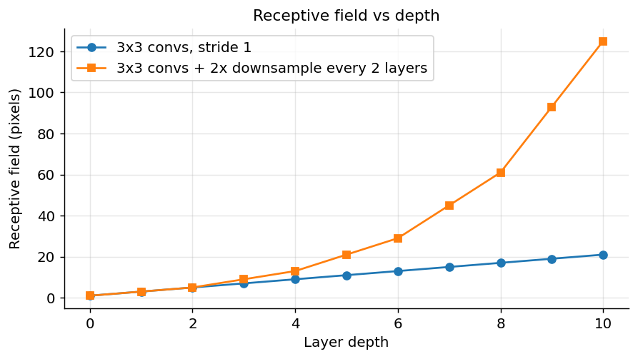

*Figure 264. Receptive field grows with depth; downsampling accelerates the growth*

Without downsampling the receptive field grows only linearly with depth, which is why plain deep stacks struggle to integrate global context; strided convolutions and pooling make it grow far faster, letting a neuron near the top of the network respond to structure spanning most of the input.

### 19.2.6 How a CNN Learns Its Filters

We keep saying kernels are “learned,” so it is worth being concrete about how. A convolutional layer is just a differentiable function of its weights, so it slots into backpropagation like any other layer (see the chapter on Neural Network Fundamentals). Two facts make the convolutional case special.

First, because the *same* kernel weight touches many output positions, its gradient is the *sum* of the contributions from every position where it was applied:

``` math
\frac{\partial L}{\partial K(m,n)} = \sum_{i,j}^{}\frac{\partial L}{\partial S(i,j)} \cdot I(i + m,\, j + n)
```

Weight sharing thus turns into gradient *accumulation* — a single update reflects evidence gathered from the entire image, which is part of why CNNs are so sample-efficient. Second, the gradient that flows *backward* to the input, $`\partial L/\partial I`$, is itself a convolution of the upstream gradient with the flipped kernel; libraries implement this as a transposed convolution. You never write this by hand — autograd handles it — but knowing that both the weight update and the backward signal are convolutions demystifies why the whole layer is cheap and why the same fast primitives serve training and inference.

The practical consequence: initialize the kernels with a variance-preserving scheme (He initialization for ReLU, discussed in the chapter on Training and Optimizing Deep Networks), and gradient descent reliably discovers edge and blob detectors in the first layer, textures and simple parts in the middle, and object-specific detectors near the top — a hierarchy you can literally visualize, as the interpretability section shows.

### 19.2.7 Normalization and Regularization Inside CNNs

Modern convolutional stacks rarely place a bare `Conv` before a nonlinearity; they insert **batch normalization** (BN) in between, giving the now-standard *Conv → BN → ReLU* triple. BN normalizes each channel’s activations across the batch (and spatial positions) to zero mean and unit variance, then rescales with two learned parameters. In a CNN this stabilizes and accelerates training, permits higher learning rates, and adds mild regularization; it is a big part of why very deep ResNets train at all. The mechanics are covered fully in the chapter on Training and Optimizing Deep Networks — here it is enough to know that BN is nearly universal in convolutional backbones, and that alternatives such as group normalization are preferred when batches are tiny (common in detection and segmentation, where images are large and few fit in memory). Dropout, by contrast, is used sparingly in convolutional layers (weight sharing already regularizes) but remains common in the final dense head.

### 19.2.8 Visualizing What a Filter Does

The figure below applies a hand-built vertical-edge kernel to a synthetic image so you can see a feature map emerge.

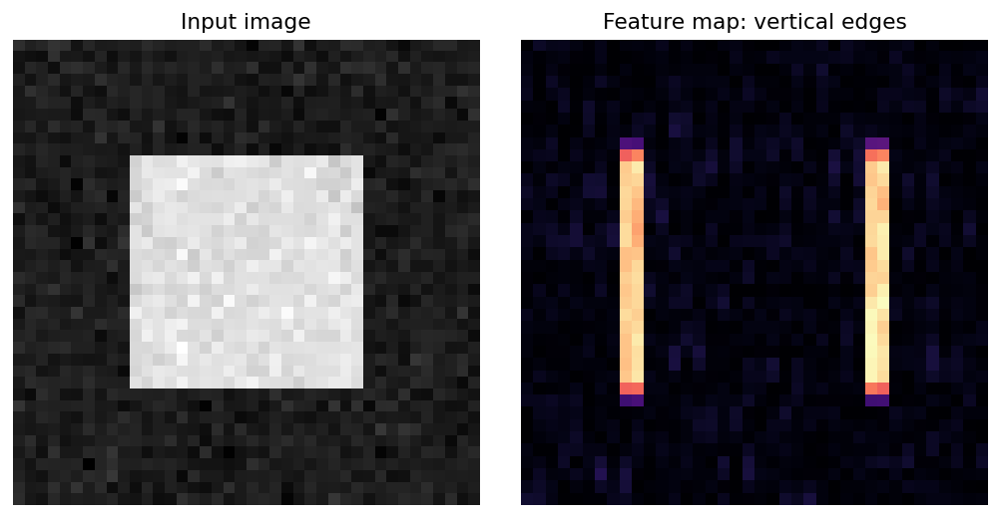

*Figure 265. A vertical-edge filter convolved with an image, producing a feature map*

Notice that the feature map lights up precisely at the left and right edges of the square — the vertical boundaries — and stays dark over flat regions. A horizontal-edge kernel would do the opposite. To see how a whole *bank* of filters carves the same image into complementary feature maps, the next figure applies four classic kernels at once.

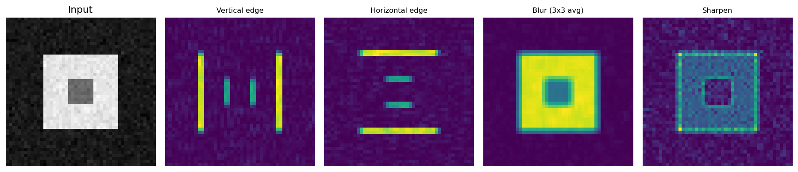

*Figure 266. A bank of four filters produces four complementary feature maps*

Edge kernels highlight boundaries, the averaging kernel smooths, and the sharpening kernel accentuates local contrast. A real convolutional layer holds dozens or hundreds of such filters, each learned rather than hand-chosen, and their stacked outputs form the multi-channel input to the next layer.

## 19.3 Pooling and the Conv-Pool-FC Architecture

### 19.3.1 Pooling

After a convolution (and a nonlinearity like ReLU), CNNs typically apply **pooling** to reduce spatial resolution. The most common variant, **max pooling**, slides a small window (usually $`2 \times 2`$, stride 2) and keeps only the maximum value in each window, discarding three-quarters of the activations. Pooling serves two purposes: it shrinks the feature maps (reducing computation and parameters downstream) and it grants a measure of **local translation invariance** — a feature that shifts by one pixel still falls in the same pooling window and produces the same output.

Three pooling variants recur:

- **Max pooling** keeps the strongest response in each window. Because a feature map records “how much” a pattern is present, taking the max asks “is this feature anywhere in this region?” — a natural question for detection.
- **Average pooling** takes the mean instead, retaining a smoother summary. It is gentler and preserves more background context, but tends to dilute sharp activations.
- **Global average pooling (GAP)** collapses an *entire* feature map to a single number, turning an $`H \times W \times C`$ tensor into a length-$`C`$ vector. GAP has largely replaced the giant flatten-then-dense layers of early CNNs: it has zero parameters, resists overfitting, and lets a network accept inputs of varying spatial size. Most modern classifiers end with GAP followed by a single dense layer.

Pooling has no learnable parameters; the gradient of max pooling simply routes back to whichever input held the maximum. A modern trend, popularized by architectures like ResNet, is to drop explicit pooling in favor of **strided convolutions** that downsample and learn at the same time — but pooling remains ubiquitous and conceptually clean.

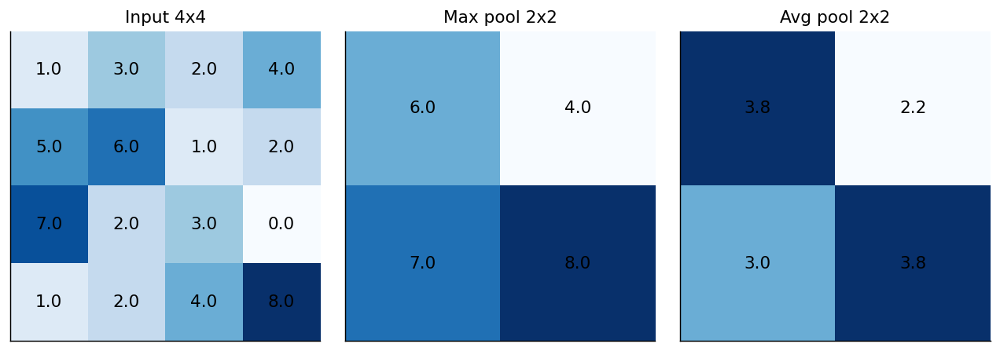

*Figure 267. 2x2 max pooling versus average pooling on a 4x4 feature map*

### 19.3.2 The 1x1 Convolution

A special case worth its own mention is the $`1 \times 1`$ **convolution**. With a $`1 \times 1`$ spatial window it looks pointless — until you remember filters span the full channel depth. A $`1 \times 1`$ conv is therefore a learned linear combination *across channels* at every pixel, which lets you cheaply increase or decrease the number of channels. Reducing channels before an expensive $`3 \times 3`$ or $`5 \times 5`$ convolution — a **bottleneck** — saves enormous compute, a trick central to Inception and ResNet. A $`1 \times 1`$ conv followed by ReLU also adds a per-pixel nonlinearity, effectively a tiny fully connected network applied identically at each location.

### 19.3.3 Putting It Together

A classic CNN stacks several **convolution + ReLU + pooling** blocks to extract a hierarchy of features, then flattens (or globally pools) the final feature maps and feeds them to one or more **fully connected (FC)** layers that perform the actual classification. Early blocks have small receptive fields and detect simple patterns; deep blocks have large receptive fields and detect object parts and whole objects.


*Figure 268. The classic conv-pool-FC pipeline for image classification*

This conv-pool-FC template, refined over a decade, underlies almost every architecture in the next section. A useful mental model of the shape flow: spatial dimensions ($`H,W`$) shrink as you go deeper (through pooling or striding) while channel depth ($`C`$) grows, trading “where” for “what” until the final layers hold a compact, highly abstract description of the whole image.

## 19.4 Landmark Architectures

The history of CNNs is a story of going deeper, smarter, and more efficient — and much of it was written on a single benchmark. The **ImageNet Large Scale Visual Recognition Challenge (ILSVRC)**, an annual competition to classify 1.2 million images into 1,000 categories, served as the field’s proving ground from 2010 to 2017. Its top-5 error rate (the fraction of images whose correct label is not among the model’s five best guesses) fell from around 28% with pre-deep-learning methods, to AlexNet’s 16% in 2012, to roughly 6.7% with GoogLeNet in 2014, to 3.6% with ResNet in 2015 — surpassing the estimated human error rate of about 5%. Each drop corresponded to one of the architectural ideas below. Understanding that trajectory is understanding modern vision: the innovations were not incremental tuning but distinct, reusable ideas — ReLU and dropout, small stacked kernels, multi-scale modules, and residual connections — that then propagated into every downstream task. The table below summarizes the milestones before we discuss them; treat it as a map of the section.

| Architecture | Year | Key idea | Depth | Params (approx) | Notable detail |
|----|----|----|----|----|----|
| LeNet-5 | 1998 | First practical CNN | 7 layers | 60K | Digit recognition on checks |
| AlexNet | 2012 | Deep CNN + GPUs + ReLU + dropout | 8 layers | 60M | Won ImageNet by a wide margin |
| VGG-16/19 | 2014 | Uniform stacks of 3×3 convs | 16–19 layers | 138M | Simple but very heavy |
| GoogLeNet / Inception | 2014 | Parallel multi-scale filters | 22 layers | 7M | 1×1 bottlenecks, efficient |
| ResNet | 2015 | Residual / skip connections | 50–152+ layers | 25M (R-50) | Trains extremely deep nets |
| DenseNet | 2016 | Connect every layer to every later layer | 121–264 | 8M (D-121) | Feature reuse, few params |
| MobileNet | 2017 | Depthwise separable convolutions | varies | 4M | Built for phones |
| EfficientNet | 2019 | Compound scaling of depth/width/resolution | varies | 5M (B0) | Best accuracy per FLOP |
| Vision Transformer | 2020 | Attention over image patches | varies | 86M (ViT-B) | No convolutions at all |

### 19.4.1 LeNet-5

Yann LeCun’s **LeNet-5** was the proof of concept: a small network of two convolutional layers interleaved with subsampling (pooling), followed by fully connected layers, trained to read handwritten digits on bank checks. It established the conv-pool-FC pattern that everything else builds on and was deployed commercially to process millions of checks. But limited compute, small datasets, and the use of saturating activations kept CNNs a niche technique for over a decade.

### 19.4.2 AlexNet

In 2012, **AlexNet** stunned the field by winning the ImageNet Large Scale Visual Recognition Challenge with a top-5 error of about 16%, far ahead of the runner-up’s 26%. Its ingredients were not radically new individually, but their combination was decisive: a deeper network trained on two GPUs (a necessity given the memory of the era), the **ReLU** activation (which trains far faster than the saturating sigmoid/tanh and does not saturate for positive inputs), **dropout** for regularization in the dense layers, local response normalization, and aggressive data augmentation. AlexNet’s victory is widely regarded as the spark of the modern deep learning revolution — after it, error rates on ImageNet fell every year as the field poured effort into deeper convolutional models.

### 19.4.3 VGG

**VGG** (from Oxford’s Visual Geometry Group) pushed a single idea to its limit: build the whole network out of stacked $`3 \times 3`$ convolutions with $`2 \times 2`$ max pooling, doubling the channel count after each pooling stage. As noted earlier, two stacked $`3 \times 3`$ convolutions match the receptive field of one $`5 \times 5`$ but use fewer parameters and add a nonlinearity; three stacked match a $`7 \times 7`$. VGG-16 is conceptually simple, produces excellent transferable features, and remains a popular backbone — but its 138 million parameters (most in the first fully connected layer) make it slow and memory-hungry, a cautionary tale that depth is cheaper than width in dense layers.

### 19.4.4 Inception (GoogLeNet)

**Inception** asked a different question: rather than commit to a single filter size per layer, why not apply several in parallel and let the network choose? An *inception module* runs $`1 \times 1`$, $`3 \times 3`$, and $`5 \times 5`$ convolutions plus a pooling branch side by side and concatenates the results along the channel axis, capturing features at multiple scales simultaneously. The catch is cost — until you insert $`1 \times 1`$ **bottleneck** convolutions to shrink channel depth *before* the expensive $`3 \times 3`$ and $`5 \times 5`$ branches. This trick let GoogLeNet reach 22 layers with only about 7 million parameters, an order of magnitude fewer than VGG, while being more accurate. To combat vanishing gradients in such a deep network — this predated ResNet — GoogLeNet also attached *auxiliary classifiers* partway up the network during training, injecting extra gradient signal into the middle layers (they were discarded at inference). Later versions (Inception-v3, v4) refined the modules with factorized convolutions — replacing a $`5 \times 5`$ by two $`3 \times 3`$s, and a $`3 \times 3`$ by a $`1 \times 3`$ followed by a $`3 \times 1`$ — and added batch normalization, squeezing out still more efficiency.

### 19.4.5 ResNet and Skip Connections

As networks grew deeper, researchers hit a paradox: adding layers made *training* error worse, even though a deeper network can in principle represent anything a shallower one can (the extra layers could just learn the identity). This **degradation problem** is not overfitting — it is an optimization failure, the difficulty of pushing a useful signal and gradient through many nonlinear layers. **ResNet** solved it with the **residual connection** (or skip connection): instead of asking a block of layers to learn a target mapping $`H(x)`$ directly, ask it to learn the *residual* $`F(x) = H(x) - x`$, then add the input back:

``` math
y = F(x,\{ W_{i}\}) + x
```

If the optimal mapping is close to the identity, the network can simply drive $`F`$ toward zero — far easier than learning the identity through stacked nonlinear layers. Just as important, the skip connection creates a “gradient highway”: during backpropagation the addition passes the gradient through unchanged, so even the earliest layers of a 152-layer network receive a strong learning signal. ResNet won ImageNet 2015 and made networks of 50, 101, and 152 layers routine. The residual block is one of the most influential ideas in all of deep learning and reappears, essentially unchanged, inside every transformer.

Deep ResNets use a **bottleneck block**: a $`1 \times 1`$ conv to reduce channels, a $`3 \times 3`$ conv at the reduced width, and a $`1 \times 1`$ conv to expand channels back — three cheap layers doing the work of one expensive one, with the skip connection wrapped around all three.

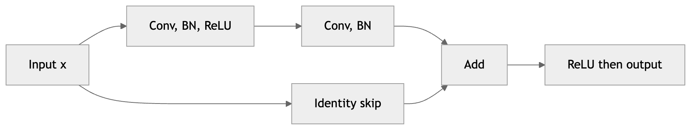

*Figure 269. A residual block adds the input back to the transformed output*

### 19.4.6 DenseNet

**DenseNet** took skip connections to their logical extreme: within a *dense block*, every layer receives the concatenated feature maps of *all* preceding layers as input, and passes its own output forward to all subsequent layers. Where ResNet *adds* the skip, DenseNet *concatenates* it. This maximizes feature reuse — later layers can directly access early, low-level features — strengthens gradient flow, and, surprisingly, uses *fewer* parameters than ResNet for comparable accuracy, because each layer needs to produce only a small number of new feature maps (the “growth rate”) rather than relearn features already available upstream. The cost is memory: concatenation makes activation maps grow, which can strain GPU memory during training.

### 19.4.7 MobileNet and Depthwise Separable Convolutions

The architectures so far chased accuracy on server GPUs. **MobileNet** chased *efficiency* for phones and embedded devices, and its key device is the **depthwise separable convolution**, which factorizes a standard convolution into two cheaper steps:

1.  **Depthwise convolution:** apply a single $`k \times k`$ filter to *each input channel independently* — no mixing across channels. This captures spatial patterns.
2.  **Pointwise convolution:** a $`1 \times 1`$ convolution that mixes the channels back together. This captures cross-channel patterns.

A standard convolution does both at once, at a cost of $`k^{2} \cdot C_{\text{in}} \cdot C_{\text{out}}`$ multiply-adds per output pixel. The separable version costs $`k^{2} \cdot C_{\text{in}} + C_{\text{in}} \cdot C_{\text{out}}`$ — a reduction by roughly a factor of $`\frac{1}{C_{\text{out}}} + \frac{1}{k^{2}}`$, which for a $`3 \times 3`$ kernel is about $`8`$–$`9 \times`$ cheaper with only a small accuracy loss. MobileNetV2 added inverted residual blocks with linear bottlenecks; this family (and cousins like ShuffleNet) powers on-device vision where every milliwatt counts.

### 19.4.8 EfficientNet

**EfficientNet** observed that practitioners scaled networks ad hoc — sometimes deeper, sometimes wider, sometimes at higher input resolution — and asked whether there is a principled way. Its answer is **compound scaling**: increase depth, width, and input resolution *together* according to a fixed ratio governed by a single coefficient. Starting from a small, well-designed baseline (EfficientNet-B0, found by neural architecture search and built on MobileNet-style blocks), scaling up produces the B1–B7 family, which achieved state-of-the-art ImageNet accuracy at a fraction of the parameters and FLOPs of previous models. The lesson generalizes: balanced scaling beats maxing out any single dimension.

## 19.5 The Spectrum of Vision Tasks

Before diving into detection and segmentation, it helps to see the whole landscape at once. Computer vision tasks form a ladder of increasing spatial granularity, and the same backbone can usually serve all of them — only the *head* and the *loss* change.

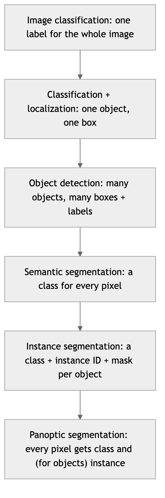

*Figure 270. Vision tasks form a ladder from whole-image labels to per-pixel, per-instance masks*

**Image classification** is the foundation and the simplest rung: assign one label, or a probability distribution over labels, to an entire image. The full conv-pool-FC pipeline ending in a softmax targets exactly this, and it is where pretrained backbones are trained. Each higher rung reuses that backbone’s features but demands a richer output — a box, then a box per object, then a label per pixel, then a mask per object instance. Understanding a task as “which of these outputs do I need?” is the fastest way to pick an architecture, because the community has a canonical model for each rung. The rest of this section climbs the ladder from detection upward; classification we have already built end to end in the practice code below.

## 19.6 Interpreting and Visualizing CNNs

A common complaint about deep networks is that they are “black boxes.” Vision is the domain where that complaint is least true, because a CNN’s internal computations are spatial and can be projected back onto the image. Several complementary techniques turn a trained network’s decisions into pictures a human can inspect — valuable for debugging, for building trust, and for catching a model that is “right for the wrong reasons.”

- **Filter and feature-map visualization.** The simplest approach is to display the learned first-layer kernels directly (they look like oriented edge and color detectors, strikingly similar to Hubel and Wiesel’s simple cells) and to render the feature maps a given image produces at each layer. Early maps highlight edges and textures; deep maps light up sparsely on object parts.
- **Activation maximization.** Instead of feeding a real image, optimize an input *from noise* to maximally activate a chosen neuron or class. The resulting synthetic images reveal what a unit “wants to see” — deep units produce dreamlike textures and object fragments, confirming the edges-to-parts-to-objects hierarchy.
- **Saliency maps.** Compute the gradient of a class score with respect to the input pixels; large magnitudes mark pixels that, if changed, would most affect the prediction. This produces a rough heatmap of “where the network is looking,” though raw gradients can be noisy.
- **Grad-CAM (Gradient-weighted Class Activation Mapping).** The most widely used technique: weight the final convolutional feature maps by how much each contributes to the target class (via the gradients flowing into them), then sum and upsample to get a coarse, class-specific heatmap overlaid on the image. Grad-CAM reliably shows, say, that a “cat” prediction is driven by the cat’s face rather than the couch behind it.

Interpretability is not a luxury. These tools routinely expose **shortcut learning** — a classic case is a model that “detects horses” by keying on a photographer’s watermark present in all the horse training images, or a pneumonia classifier that keys on the type of scanner rather than the lung pathology. A model can score high on a test set and still be relying on a spurious cue that will not generalize; visualization is often the fastest way to catch it. These themes connect directly to the chapter on Responsible AI.

## 19.7 Object Detection

Classification answers “what is in this image?” with a single label. Real applications usually need more: *what* objects are present *and where*. **Object detection** returns a list of **bounding boxes**, each with a class label and a confidence score. A self-driving car does not want to know merely that a pedestrian exists somewhere in the frame — it needs the box.

Detection is genuinely harder than classification for a structural reason: the number of outputs is *variable and unknown*. One image contains a single face; the next contains a crowd of forty. A classifier always emits a fixed-length probability vector, but a detector must emit a list whose length it decides on the fly, place each box precisely, and avoid both missing objects and hallucinating duplicates. The two families below — two-stage and single-stage — represent two different answers to “how do we get a neural network to produce a variable-length, spatially-grounded list of predictions?” Both, as we will see, lean on the same trick of predicting against a fixed grid of reference locations and then pruning.

### 19.7.1 Measuring Overlap: Intersection over Union

To score a predicted box against a ground-truth box we need a measure of overlap. The standard is **Intersection over Union (IoU)**, the area of their intersection divided by the area of their union:

``` math
\text{IoU} = \frac{\text{area}(B_{\text{pred}} \cap B_{\text{gt}})}{\text{area}(B_{\text{pred}} \cup B_{\text{gt}})}
```

IoU ranges from 0 (no overlap) to 1 (perfect overlap). A prediction is usually counted as correct if its IoU with a ground-truth box of the right class exceeds a threshold, commonly $`0.5`$. The figure below draws a predicted and a ground-truth box and computes their IoU directly.

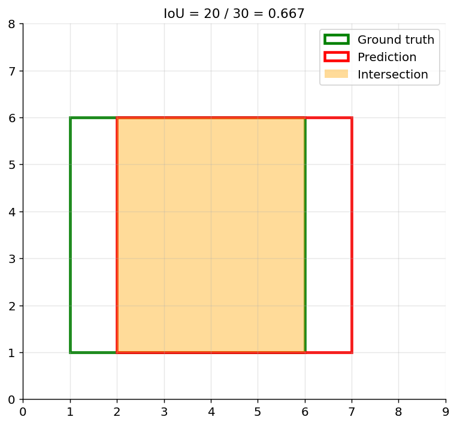

*Figure 271. Intersection over Union between a ground-truth and a predicted box*

Here the intersection area is 20, the union is 30, and IoU is $`0.667`$ — comfortably above the usual $`0.5`$ threshold, so this prediction would count as a true positive.

### 19.7.2 From IoU to mean Average Precision

A detector emits many boxes at varying confidence. Sweeping a confidence threshold traces a **precision-recall curve**: high thresholds yield few, high-precision detections; low thresholds recover more objects (higher recall) at the cost of false positives. The **Average Precision (AP)** for a class is the area under this precision-recall curve. **mean Average Precision (mAP)** averages AP across all classes, and is the headline metric for detection benchmarks. Variants specify the IoU threshold: “mAP@0.5” uses a single 0.5 threshold (the PASCAL VOC convention), while “mAP@\[.5:.95\]” (the COCO convention) averages over ten IoU thresholds from 0.5 to 0.95, rewarding tight localization.

One more essential piece: a detector typically fires several overlapping boxes for the same object. **Non-Maximum Suppression (NMS)** cleans this up — keep the highest-confidence box, discard any other box whose IoU with it exceeds a threshold, and repeat. Without NMS, mAP collapses under a flood of duplicate detections.

The figure below shows a representative precision-recall curve and the average precision (area under it) that summarizes a single class.

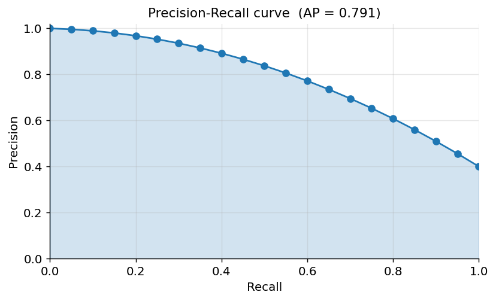

*Figure 272. A precision-recall curve; Average Precision is the area beneath it*

### 19.7.3 Anchor Boxes and the Detection Loss

How does a network “predict a box”? Most detectors do not regress box coordinates from scratch. Instead they tile the image with **anchor boxes** — reference rectangles of several predefined scales and aspect ratios at every feature-map location — and predict, for each anchor, (1) an *objectness* or class score and (2) small *offsets* that nudge the anchor to fit the true object. Predicting offsets from sensible priors is far easier than predicting absolute coordinates, and using multiple aspect ratios lets one location handle both a pedestrian (tall) and a car (wide). Training assigns each anchor to a ground-truth box if their IoU is high enough (a positive), to background if it is low (a negative), and ignores the ambiguous middle.

The training objective is a **multi-task loss** that adds two terms: a *classification* loss (cross-entropy over classes, or focal loss to counter the overwhelming background) and a *localization* loss (a smooth-L1 or IoU-based regression on the box offsets), applied only to positive anchors. This two-headed loss — “what is it?” plus “where exactly?” — is the shared skeleton beneath both detector families. Newer **anchor-free** detectors (such as recent YOLO and FCOS variants) drop the hand-designed anchors and predict boxes directly from points or centers, simplifying the pipeline while keeping the same classification-plus-localization structure.

### 19.7.4 Two-Stage Detectors: the R-CNN Family

The first successful deep detectors split the problem into two stages — propose regions that might contain objects, then classify each.

- **R-CNN** (2014) used a classical algorithm (selective search) to propose ~2,000 candidate regions, warped each to a fixed size, and ran a CNN on every one. Accurate for its time but painfully slow — thousands of forward passes per image.
- **Fast R-CNN** ran the CNN *once* over the whole image and introduced **RoI pooling** to extract a fixed-size feature vector for each proposed region from the shared feature map, sharing almost all computation.
- **Faster R-CNN** replaced selective search with a learned **Region Proposal Network (RPN)** that predicts object proposals directly from the feature map using **anchor boxes** (reference boxes of several scales and aspect ratios tiled across the image). This made the whole pipeline end-to-end trainable and fast enough for many applications, and it remains a strong accuracy baseline.

### 19.7.5 Single-Stage Detectors: YOLO and SSD

Two-stage detectors are accurate but their proposal step limits speed. **Single-stage** detectors predict boxes and classes directly in one forward pass.

- **YOLO** (“You Only Look Once”) divides the image into a grid and, for each cell, predicts a fixed set of bounding boxes with confidence scores and class probabilities — all in a single network evaluation. This reframing as one regression problem makes YOLO extremely fast, capable of real-time video, and its many successive versions (v2 through the latest) have steadily closed the accuracy gap with two-stage methods while adding anchor-free designs and better training tricks.
- **SSD** (Single Shot Detector) similarly predicts in one pass but does so from feature maps at *multiple scales* — shallow, high-resolution maps catch small objects; deep, coarse maps catch large ones — using anchor boxes at each scale.

Single-stage detectors trade a little accuracy (historically on small or crowded objects) for dramatic speed, which is why they dominate real-time and embedded deployments.

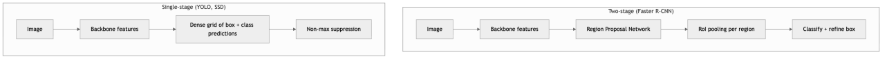

*Figure 273. Two-stage versus single-stage detection pipelines*

| Detector     | Type         | Speed     | Accuracy  | Best for                |
|--------------|--------------|-----------|-----------|-------------------------|
| Faster R-CNN | Two-stage    | Moderate  | High      | Accuracy-critical tasks |
| YOLO         | Single-stage | Very fast | Good–high | Real-time video         |
| SSD          | Single-stage | Fast      | Good      | Mobile, embedded        |

## 19.8 Semantic and Instance Segmentation

Segmentation goes finer-grained than detection, classifying *every pixel* rather than drawing boxes.

- **Semantic segmentation** labels each pixel with a class (road, sky, car) but does not distinguish individual objects — all cars share the “car” label, merging into one region.
- **Instance segmentation** distinguishes individual objects *and* outlines them at pixel level — car \#1 versus car \#2 — combining detection’s “which object” with segmentation’s pixel precision.
- **Panoptic segmentation** unifies the two, assigning every pixel both a class and, for countable “things,” an instance ID, while amorphous “stuff” (sky, grass) gets only a class.

### 19.8.1 Fully Convolutional Networks and Upsampling

Segmentation poses a tension a plain classifier never faces: it needs both *deep* features (to know a region is “cat”) and *high resolution* (to place the boundary at the exact pixel). But the very downsampling that builds deep features destroys the resolution. Every good segmentation architecture is, at heart, a strategy for recovering resolution without discarding semantics.

The breakthrough for semantic segmentation was the **Fully Convolutional Network (FCN)**, which replaced a classifier’s final dense layers with convolutions so the network outputs a spatial map rather than a single label, then *upsamples* that coarse map back to full input resolution. Upsampling is done with **transposed convolution** (sometimes loosely called “deconvolution”), a learnable operation that spreads each input value into a larger output patch — effectively convolution run in reverse to increase, rather than decrease, spatial size. FCNs also fuse predictions from multiple depths so that coarse semantic information is sharpened by finer, higher-resolution features.

### 19.8.2 U-Net

**U-Net**, originally built for biomedical image segmentation, is the canonical encoder-decoder architecture. An *encoder* (the contracting path) downsamples the image into rich, low-resolution features; a *decoder* (the expanding path) upsamples back to full resolution; and **skip connections** copy high-resolution feature maps from each encoder stage directly to the matching decoder stage, so fine boundary detail lost during downsampling is restored. Its symmetric contracting-then-expanding shape gives it its name and its “U” diagram. U-Net trains well from very few annotated images — a decisive advantage in medical domains where labels are scarce — and it (and its many descendants) remains the default for dense prediction across microscopy, satellite imagery, and beyond.

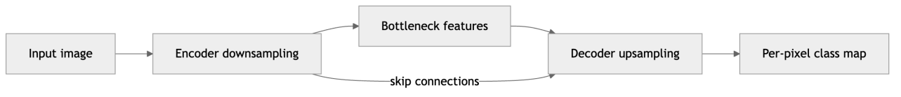

*Figure 274. U-Net encoder-decoder with skip connections for segmentation*

### 19.8.3 Mask R-CNN

For instance segmentation, **Mask R-CNN** extends Faster R-CNN with a third output branch that predicts a binary mask for each detected box, in parallel with the existing class and box-refinement branches. A key refinement, **RoIAlign**, replaces the coarse quantization of RoI pooling with bilinear sampling so that mask predictions line up precisely with the input pixels — small misalignments that were tolerable for classification are ruinous for masks. Mask R-CNN elegantly unifies detection and segmentation in a single, trainable model and has become a foundational baseline for instance-level tasks.

### 19.8.4 Losses and Metrics for Segmentation

Because segmentation is per-pixel classification, the default loss is **pixel-wise cross-entropy**, summed over every pixel. But segmentation is usually severely imbalanced — the object of interest may occupy a tiny fraction of the image (a tumor in a scan, a lane marking in a road). Plain cross-entropy then rewards a model that labels everything “background.” Two remedies are standard: *weighting* the loss by inverse class frequency, and the **Dice loss**, derived from the Dice coefficient, which measures overlap directly and is insensitive to the vast background. The Dice coefficient between a predicted mask $`P`$ and ground truth $`G`$ is

``` math
\text{Dice} = \frac{2\,|P \cap G|}{|P| + |G|}
```

which is closely related to IoU (both range 0 to 1 and reward overlap). Correspondingly, the evaluation metrics are **mean IoU** (average IoU across classes, the standard for semantic segmentation benchmarks) and the **Dice score** (dominant in medical imaging). Reporting overall pixel accuracy is discouraged precisely because imbalance makes it look deceptively high while small structures are missed entirely.

## 19.9 Vision Transformers

For most of the 2010s, “computer vision” and “convolutional network” were nearly synonymous. The **Vision Transformer (ViT)**, introduced in 2020 and covered in depth in the chapter on Transformers and the Attention Mechanism, broke that identity by applying the transformer architecture — built for language — directly to images, with *no convolutions at all*.

The recipe is disarmingly simple. Split the image into a grid of fixed-size patches (say $`16 \times 16`$ pixels), flatten each patch and project it to an embedding vector, add a positional embedding so the model knows where each patch came from, prepend a special classification token, and feed the resulting sequence of “visual words” into a standard transformer encoder. Self-attention then lets every patch attend to every other patch, giving the model a *global* receptive field from the very first layer — a stark contrast to a CNN, where a global view emerges only after many layers.

This difference is instructive. A CNN has strong built-in **inductive biases**: locality (nearby pixels relate) and translation equivariance (weight sharing). These biases are why CNNs learn efficiently from modest data. A ViT has far weaker biases — it must *learn* locality and spatial relationships from the data itself. The consequence, borne out empirically, is that ViTs *underperform* CNNs when trained on ImageNet-sized data but *match or exceed* them when pretrained on very large datasets (hundreds of millions of images), where the flexibility of learned attention pays off and the lack of restrictive priors becomes an advantage.


*Figure 275. How a Vision Transformer processes an image as a sequence of patches*

The table below summarizes the trade-offs that guide the choice between the two paradigms.

| Property | CNN | Vision Transformer |
|----|----|----|
| Core operation | Local convolution (shared kernels) | Global self-attention over patches |
| Receptive field | Grows with depth | Global from the first layer |
| Inductive bias | Strong (locality, translation equivariance) | Weak (must be learned from data) |
| Data efficiency | High — trains well on modest data | Low — needs large-scale pretraining |
| Scaling behavior | Good, saturates sooner | Excellent at very large scale |
| Compute pattern | Cheap, hardware-friendly | Attention is quadratic in patch count |
| Typical strength | Real-time, edge, small datasets | Huge datasets, foundation models |

The modern landscape is a blend rather than a winner-take-all. Convolutional backbones remain dominant for data-efficient and real-time work; transformer backbones excel at large scale; and **hybrids** — CNN stems feeding transformer bodies (e.g., the ConvNeXt family, which modernizes CNNs with transformer-inspired design, or Swin Transformers, which reintroduce locality via windowed attention) — often give the best of both. The practical takeaway is not “transformers replaced CNNs” but “attention and convolution are complementary tools, chosen by data scale and latency budget.”

## 19.10 Transfer Learning and Fine-Tuning

Here is the single most important practical lesson of this chapter: **you almost never train a vision model from scratch.** Training a strong network requires millions of labeled images and large GPU budgets. Instead, you take a model already trained on a huge dataset (typically ImageNet, with 1.2 million images across 1,000 classes) and adapt it to your task. This is **transfer learning**, and it works because the early-to-middle layers of a vision network learn generic features — edges, textures, shapes — that transfer across almost any image domain. Only the later, task-specific layers need to change.

There are two main strategies:

- **Feature extraction.** Freeze the pretrained convolutional **backbone** and use it as a fixed feature extractor. Replace only the final classification head with a fresh layer sized to your number of classes, and train just that head. This is fast, needs little data, and is the right default when your dataset is small or similar to the pretraining domain.
- **Fine-tuning.** Unfreeze some or all of the backbone and continue training on your data with a *small* learning rate. This adapts the higher-level features to your domain. Fine-tune when you have more data or when your images differ substantially from ImageNet — for example, grayscale medical scans, satellite imagery, or microscopy, where the pretrained high-level features are a poorer match.

A common recipe combines both in two phases: first train the new head with the backbone frozen (so the randomly initialized head does not send large, destructive gradients into the pretrained weights), then unfreeze the top layers and fine-tune the whole thing at a low learning rate. The general principle is that lower layers hold the most transferable features and should change least; higher layers are the most task-specific and benefit most from adaptation.

Why does this work so reliably? Empirical studies of layer transferability show that the first-layer filters a network learns — oriented edges and color blobs — are almost identical no matter what the network was trained on, because those primitives are universal to natural images. The universality decays with depth: mid-level texture and shape detectors are broadly reusable, while the final layers specialize to the exact 1,000 ImageNet categories and transfer poorly to a distant domain. This gradient of specificity is precisely why the “freeze low, adapt high” recipe is a good default, and why a bigger domain gap (natural photos → chest X-rays) calls for unfreezing more layers. It also explains a subtler benefit: a pretrained backbone gives you not just good features but a good *initialization*, one that sits in a favorable region of the loss landscape, so even full fine-tuning converges faster and to a better optimum than random initialization would. In an era of “foundation models,” this is the norm across all of machine learning — you inherit knowledge from large-scale pretraining rather than paying for it yourself.

How much data do you need before fine-tuning beats feature extraction? There is no universal threshold, but a useful heuristic ladder: with a few hundred images, freeze everything and train only the head; with a few thousand, unfreeze the last block or two; with tens of thousands or a very different domain, fine-tune the whole network at a low learning rate. When labels are scarce, self-supervised pretraining (learning from unlabeled images via pretext tasks like masked-patch prediction or contrastive learning) increasingly provides backbones that transfer even better than supervised ImageNet weights.

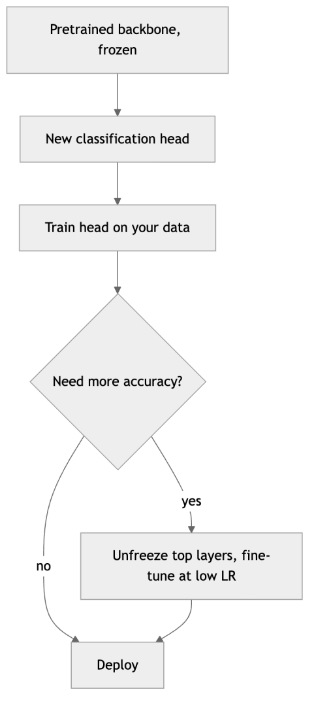

*Figure 276. Transfer learning reuses a pretrained backbone and swaps the head*

We show a runnable transfer-learning snippet in the practice section below.

## 19.11 Data Augmentation for Vision

Because labeled images are expensive and overfitting is a constant threat, **data augmentation** — synthetically expanding the training set with label-preserving transformations — is standard practice. The idea is to teach the model the *invariances* you care about: a flipped, rotated, or slightly recolored cat is still a cat, so showing the network these variants makes it robust to them and effectively multiplies the size of your dataset for free.

Common geometric and photometric augmentations include:

- **Geometric:** horizontal flips, small rotations and translations, random crops and resizes, scaling, and (for some domains) shears and perspective warps.
- **Photometric:** brightness, contrast, saturation, and hue jitter; adding Gaussian noise; blurring; simulating lighting changes.

More advanced techniques manipulate images in groups: **Cutout** masks random rectangular patches (forcing the model to rely on multiple cues rather than one region); **Mixup** blends two images and their labels linearly; and **CutMix** pastes a patch of one image onto another and mixes the labels in proportion to the patch area. These regularizers noticeably improve robustness and calibration on large-scale benchmarks. **RandAugment** and **AutoAugment** go further by searching over augmentation policies automatically.

In code, augmentation is a short pipeline that runs inside the data loader. The `torchvision` idiom composes transforms that are re-sampled for every image on every epoch:

``` python
# PyTorch: a typical training-time augmentation pipeline
from torchvision import transforms

train_tfm = transforms.Compose([
    transforms.RandomResizedCrop(224),          # random crop + resize (scale/aspect jitter)
    transforms.RandomHorizontalFlip(),          # 50% chance to flip left-right
    transforms.ColorJitter(0.2, 0.2, 0.2, 0.1), # brightness, contrast, saturation, hue
    transforms.ToTensor(),
    transforms.Normalize(mean=[0.485, 0.456, 0.406],   # ImageNet statistics
                         std=[0.229, 0.224, 0.225]),
])

# The validation transform is deterministic: resize, center crop, normalize. No randomness.
val_tfm = transforms.Compose([
    transforms.Resize(256),
    transforms.CenterCrop(224),
    transforms.ToTensor(),
    transforms.Normalize(mean=[0.485, 0.456, 0.406],
                         std=[0.229, 0.224, 0.225]),
])
```

Note that the same normalization statistics appear in both pipelines — they must match what the pretrained backbone expects — but only the training pipeline contains randomness.

Two cautions. First, augmentation is applied *on the fly* during training so each epoch sees slightly different inputs — and it must be applied to the *training set only*; the validation and test sets stay clean. Second, transforms must be **label-preserving for your task**. A horizontal flip is fine for natural photos and satellite imagery but wrong for digit recognition (a flipped “6” is not a “6”) or for reading text; a vertical flip is meaningless for street scenes but perfectly valid for overhead satellite tiles. Always ask whether the transformed image would carry the same label a human would assign.

## 19.12 Building CNNs in Practice

We now turn to runnable code. As is convention in the deep learning chapters, we show both **Keras/TensorFlow** and **PyTorch** versions of the same model so you can use whichever framework you prefer.

### 19.12.1 A CNN in Keras (TensorFlow)

This example trains a small CNN on MNIST handwritten digits. It runs in a couple of minutes on CPU.

``` python
# Keras / TensorFlow: small CNN on MNIST
import tensorflow as tf
from tensorflow.keras import layers, models

# Load and preprocess: scale to [0,1] and add a channel dimension
(x_train, y_train), (x_test, y_test) = tf.keras.datasets.mnist.load_data()
x_train = x_train.astype("float32")[..., None] / 255.0  # shape (60000, 28, 28, 1)
x_test  = x_test.astype("float32")[..., None] / 255.0

model = models.Sequential([
    layers.Input((28, 28, 1)),
    layers.Conv2D(32, 3, activation="relu", padding="same"),
    layers.MaxPooling2D(),                 # 28x28 -> 14x14
    layers.Conv2D(64, 3, activation="relu", padding="same"),
    layers.MaxPooling2D(),                 # 14x14 -> 7x7
    layers.GlobalAveragePooling2D(),       # 7x7x64 -> 64
    layers.Dropout(0.3),
    layers.Dense(10, activation="softmax"),
])

model.compile(optimizer="adam",
              loss="sparse_categorical_crossentropy",
              metrics=["accuracy"])
model.fit(x_train, y_train, epochs=3, batch_size=128, validation_split=0.1)

test_loss, test_acc = model.evaluate(x_test, y_test, verbose=0)
print(f"Test accuracy: {test_acc:.4f}")   # expect ~0.98 after 3 epochs
```

### 19.12.2 The Same CNN in PyTorch

``` python
# PyTorch: equivalent small CNN on MNIST
import torch
import torch.nn as nn
import torch.nn.functional as F
from torch.utils.data import DataLoader
from torchvision import datasets, transforms

device = "cuda" if torch.cuda.is_available() else "cpu"
tfm = transforms.Compose([transforms.ToTensor()])  # scales to [0,1], shape (1,28,28)
train_ds = datasets.MNIST(".", train=True,  download=True, transform=tfm)
test_ds  = datasets.MNIST(".", train=False, download=True, transform=tfm)
train_dl = DataLoader(train_ds, batch_size=128, shuffle=True)
test_dl  = DataLoader(test_ds,  batch_size=256)

class SmallCNN(nn.Module):
    def __init__(self):
        super().__init__()
        self.conv1 = nn.Conv2d(1, 32, 3, padding=1)
        self.conv2 = nn.Conv2d(32, 64, 3, padding=1)
        self.pool  = nn.MaxPool2d(2)
        self.drop  = nn.Dropout(0.3)
        self.fc    = nn.Linear(64, 10)

    def forward(self, x):
        x = self.pool(F.relu(self.conv1(x)))   # -> (32, 14, 14)
        x = self.pool(F.relu(self.conv2(x)))   # -> (64, 7, 7)
        x = F.adaptive_avg_pool2d(x, 1).flatten(1)  # global avg pool -> (64,)
        x = self.drop(x)
        return self.fc(x)

model = SmallCNN().to(device)
opt = torch.optim.Adam(model.parameters(), lr=1e-3)

for epoch in range(3):
    model.train()
    for xb, yb in train_dl:
        xb, yb = xb.to(device), yb.to(device)
        opt.zero_grad()
        loss = F.cross_entropy(model(xb), yb)  # softmax is folded into the loss
        loss.backward()
        opt.step()

# Evaluation
model.eval()
correct = total = 0
with torch.no_grad():
    for xb, yb in test_dl:
        xb, yb = xb.to(device), yb.to(device)
        preds = model(xb).argmax(1)
        correct += (preds == yb).sum().item()
        total += yb.size(0)
print(f"Test accuracy: {correct/total:.4f}")  # expect ~0.98
```

Notice the framework differences: Keras hides the training loop behind `fit`, while PyTorch makes the loop explicit (zero gradients, forward, compute loss, backward, step). PyTorch’s `cross_entropy` expects raw logits and applies softmax internally, so the model’s final layer has no activation; Keras applies `softmax` in the layer and uses `sparse_categorical_crossentropy`.

### 19.12.3 Transfer Learning in PyTorch

Finally, the dominant practical pattern: adapting a pretrained ResNet. This snippet shows feature extraction — freezing the backbone and training a new head for a custom number of classes.

``` python
# PyTorch: transfer learning with a pretrained ResNet-18
import torch
import torch.nn as nn
from torchvision import models

NUM_CLASSES = 5  # your dataset's class count

# Load ResNet-18 pretrained on ImageNet
net = models.resnet18(weights=models.ResNet18_Weights.IMAGENET1K_V1)

# 1) Freeze the backbone so only the new head learns
for p in net.parameters():
    p.requires_grad = False

# 2) Replace the final fully connected layer with a fresh one
in_features = net.fc.in_features          # 512 for ResNet-18
net.fc = nn.Linear(in_features, NUM_CLASSES)   # new params default to requires_grad=True

# 3) Optimize ONLY the new head's parameters
optimizer = torch.optim.Adam(net.fc.parameters(), lr=1e-3)
criterion = nn.CrossEntropyLoss()

# --- training loop over your DataLoader would go here ---
# To later FINE-TUNE: unfreeze some layers and use a small LR, e.g.:
# for p in net.layer4.parameters():
#     p.requires_grad = True
# optimizer = torch.optim.Adam(
#     [p for p in net.parameters() if p.requires_grad], lr=1e-5)
print(net.fc)  # Linear(in_features=512, out_features=5, bias=True)
```

The Keras equivalent uses `tf.keras.applications` (e.g., `ResNet50(include_top=False, weights="imagenet")`), sets `base_model.trainable = False`, and stacks a `GlobalAveragePooling2D` plus a new `Dense` head on top — the same three steps in a different idiom. Remember to normalize inputs with the *same* preprocessing the backbone was trained with (each `torchvision`/`applications` model documents its expected mean and standard deviation).

### 19.12.4 The Bias-Variance View of Augmentation

The plot below illustrates conceptually why augmentation helps: without it, a model with limited data overfits (training accuracy climbs while validation accuracy stalls or drops); augmentation narrows that gap.

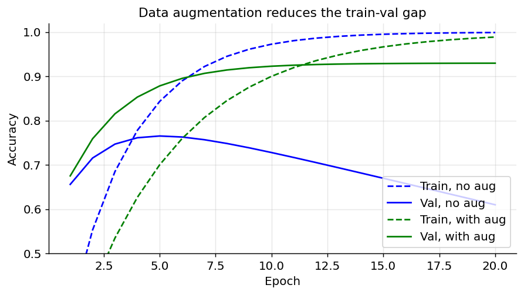

*Figure 277. Conceptual training vs validation accuracy, with and without augmentation*

## 19.13 Applications

The techniques above are not academic exercises; they run in production across many industries. Three domains illustrate both the power and the responsibilities of computer vision.

### 19.13.1 Medical Imaging

CNNs and U-Net variants now assist radiologists and pathologists in detecting tumors in mammograms and CT scans, segmenting organs and lesions for surgical planning, grading diabetic retinopathy from retinal photographs, and screening pathology slides for cancerous cells. The stakes make several themes from this chapter concrete: transfer learning and heavy augmentation are essential because labeled medical data is scarce and expensive; U-Net’s ability to learn from few annotated images is a decisive advantage; and *calibration and uncertainty* matter far more than raw accuracy, because a confident wrong prediction can cause real harm. These systems are deployed as decision *support* — flagging regions for a clinician’s review — not as autonomous diagnosticians, and they are subject to rigorous regulatory validation. Distribution shift is a persistent danger: a model trained on scans from one hospital’s machine can degrade sharply on another vendor’s scanner or a different patient population, so validation across sites is essential before any clinical use. Medical imaging also showcases the value of the interpretability tools from earlier — a Grad-CAM heatmap that highlights the actual lesion, rather than an unrelated artifact or a text annotation burned into the image, is a basic sanity check clinicians rightly demand before trusting a prediction.

### 19.13.2 Autonomous Driving

Self-driving cars and advanced driver-assistance systems fuse nearly every task in this chapter, in real time and under a strict latency budget. Object *detection* (YOLO/SSD-style, for speed) locates vehicles, pedestrians, cyclists, and signs; semantic *segmentation* labels drivable road, lane markings, and sidewalks; instance segmentation separates individual agents; and depth estimation and multi-camera fusion build a 3D scene. The overriding constraints are latency (decisions in milliseconds), robustness to weather, lighting, and rare “long-tail” events, and the need to fail safely — which is why these perception stacks are validated far beyond aggregate mAP, with attention to worst-case behavior. The long tail is the crux: a detector that is 99.9% accurate on common scenes can still fail on the once-in-a-million configuration — an overturned truck, a person in an unusual costume, glare from a low sun — and in safety-critical settings those rare failures dominate the risk. This is why real deployments layer redundant sensors (camera, lidar, radar), extensive simulation, and conservative fallback behaviors on top of the neural perception, rather than trusting any single model.

### 19.13.3 Remote Sensing, Retail, and Video

The reach of convolutional vision extends well beyond these flagship domains. In **remote sensing**, segmentation networks map deforestation, flooding, crop health, and urban growth from satellite and aerial imagery — a domain where vertical flips *are* valid augmentations and where transfer learning must bridge a large gap from natural photos. In **agriculture**, detectors count fruit, spot diseased plants, and steer autonomous harvesters. In **retail and manufacturing**, vision systems read shelves, catch defects on production lines faster and more consistently than human inspectors, and power cashierless checkout. **Video understanding** adds a temporal axis: action recognition and tracking either extend 2D CNNs with 3D convolutions (convolving across time as well as space) or pair a per-frame CNN with a sequence model, connecting this chapter to the chapter on Sequence Models. Across all of these, the same three-part recipe recurs — a pretrained backbone, task-appropriate heads (classification, detection, or segmentation), and domain-specific augmentation.

### 19.13.4 Face Recognition and OCR

Two widely deployed specializations round out the picture. **Face recognition** typically uses a CNN trained with a *metric-learning* objective (such as triplet loss or ArcFace) to map each face to an **embedding** vector, so that faces of the same person land near each other in the embedding space; recognition then reduces to a nearest-neighbor lookup, and verification to a distance threshold. This powers phone unlocking and photo organization — but also surveillance, and it raises significant privacy, consent, and fairness concerns (accuracy disparities across demographic groups are well documented) discussed in the chapter on Responsible AI. **Optical Character Recognition (OCR)** converts images of text into machine-readable strings; modern systems pair a CNN for visual feature extraction with a sequence model (RNN or transformer) and a CTC or attention decoder to handle variable-length text, and underpin document digitization, license-plate reading, and translation apps.

## 19.14 Choosing and Deploying a Model

With so many architectures available, the practical question is rarely “which is best?” but “which fits my constraints?” A few rules of thumb:

- **Start with a strong, well-supported baseline.** A pretrained ResNet-50 (classification), Faster R-CNN or a modern YOLO (detection), and U-Net or Mask R-CNN (segmentation) are sensible defaults that get you 90% of the way with minimal fuss. Reach for exotic architectures only once a baseline has revealed a specific bottleneck.
- **Let your latency and hardware budget narrow the field.** On a server GPU with no tight latency limit, favor accuracy (larger ResNets, EfficientNet-B4+, transformer backbones). On a phone, drone, or microcontroller, favor efficiency (MobileNet, EfficientNet-B0, small YOLO variants) and measure real on-device latency, not just FLOPs — memory bandwidth and operator support often matter more than raw arithmetic.
- **Let data scale decide CNN versus transformer.** With a few thousand to a few hundred thousand images, a convolutional backbone (or a pretrained ViT) is the safe choice. Only very large datasets or very large pretrained checkpoints justify a from-scratch transformer.
- **Match model capacity to dataset size.** A 138M-parameter VGG on 500 images is a recipe for overfitting; prefer a smaller model, feature extraction, and heavy augmentation.

Once trained, getting a model to run economically in production is its own discipline (developed further in the chapter on MLOps and Productionization). Three techniques are especially common for vision: **quantization**, which stores and computes weights in 8-bit integers instead of 32-bit floats for roughly a $`4 \times`$ size and speed win at negligible accuracy cost; **pruning**, which removes redundant weights or whole channels; and **knowledge distillation**, in which a small “student” network is trained to mimic a large “teacher,” inheriting much of its accuracy at a fraction of the cost. Exporting to a portable runtime (ONNX, TensorRT, Core ML, TensorFlow Lite) then lets the same model run across servers, phones, and edge accelerators. The overarching point: training accuracy is only half the job; a vision model earns its keep only when it runs within the latency, memory, and power budget of its deployment target.

## 19.15 Common Pitfalls

A few mistakes recur often enough to warrant a checklist:

- **Forgetting normalization.** Pretrained models expect inputs normalized with the *same* mean and standard deviation used during their original training. Skipping this, or using the wrong statistics, silently wrecks accuracy.
- **Augmenting the validation/test set.** Augmentation belongs to training only; evaluate on clean data, or your metrics will not reflect deployment.
- **Too-high a learning rate when fine-tuning.** Large gradients can destroy carefully pretrained weights in the first few steps. Fine-tune at a small fraction of the original learning rate, and warm up by training the new head first.
- **Data leakage through preprocessing.** Ensure the same resize/crop/normalize pipeline is applied at train and inference time, and that no test information (e.g., dataset-wide statistics) leaks into training.
- **Label-changing augmentations.** As noted, a vertical flip turns a “6” into something else; choose transforms that preserve the label for *your* task.
- **Tiny datasets, huge models.** With only a few hundred images, prefer feature extraction over full fine-tuning, and lean heavily on augmentation and regularization to avoid memorizing the training set.
- **Ignoring class imbalance in detection/segmentation.** Backgrounds vastly outnumber objects; without measures like focal loss or hard-negative mining, the model learns to predict “background” everywhere.
- **Reporting the wrong metric.** Accuracy is meaningless for detection (use mAP) and misleading for imbalanced segmentation (use IoU / Dice per class).

## 19.16 Summary

- Dense networks fail on images because they ignore locality, lack translation invariance, destroy spatial structure, and explode in parameter count. CNNs fix this with **local connectivity** and **weight sharing**, encoding the right inductive biases for natural images.
- A **convolution** slides learned **kernels** over the input to produce **feature maps**; **stride** controls downsampling and **padding** controls output size, per $`O = \lfloor(W - k + 2p)/s\rfloor + 1`$. Parameter count depends on kernel and channel sizes, not image size. Stacking layers grows the **receptive field**, building a hierarchy from edges to objects.
- **Pooling** (max, average, and especially **global average pooling**) reduces resolution and adds local translation invariance; $`1 \times 1`$ **convolutions** mix channels cheaply. The **conv-pool-FC** template stacks these into a classifier.
- Landmark architectures trace a path of increasing depth and ingenuity: **LeNet** (proof of concept), **AlexNet** (the deep-learning breakthrough), **VGG** (uniform 3×3 stacks), **Inception** (parallel multi-scale modules with bottlenecks), **ResNet** (skip connections enabling very deep nets), **DenseNet** (dense feature reuse), **MobileNet** (depthwise separable convolutions for efficiency), and **EfficientNet** (principled compound scaling).
- Vision tasks scale in granularity: **classification** (one label), **object detection** (boxes via R-CNN, YOLO, SSD, scored by **IoU** and **mAP**, cleaned up with **NMS**), and **segmentation** (per-pixel labels via FCN, U-Net, and Mask R-CNN), plus specialized OCR and face recognition.
- **Vision Transformers** replace convolution with self-attention over image patches; they have weaker inductive biases than CNNs, so they need more data but scale better, and hybrids often win in practice.
- **Transfer learning** — feature extraction or fine-tuning a pretrained backbone — is the dominant practical approach and the default for almost any real vision project.
- **Data augmentation** synthetically expands training data with label-preserving transforms, reducing overfitting by teaching desired invariances.

## 19.17 Key Takeaways

- Convolution is not magic: it is the same multiply-and-sum you can do by hand, applied with shared weights over local windows. Internalize the output-size formula and the worked numeric example, and everything else follows.
- Depth and skip connections, not width, are the levers that made modern accuracy possible; ResNet’s residual block is the most reused idea in deep learning and shows up again in transformers.
- You will rarely train from scratch. Reach first for a pretrained backbone, then decide between feature extraction and fine-tuning based on how much data you have and how far your domain is from ImageNet.
- Match the task to the output you need — a label (classification), boxes (detection), or per-pixel masks (segmentation) — and match the metric to the task (accuracy, mAP, IoU/Dice). Choosing the wrong metric hides real failures.
- CNNs and transformers are complementary. Let data scale and latency budget, not fashion, decide between them.

## 19.18 Exercises

1.  **Conceptual.** A convolutional layer has 128 filters of size $`5 \times 5`$ operating on an input with 32 channels. How many learnable parameters does it have (including biases)? Compare this to a dense layer mapping a flattened $`64 \times 64 \times 32`$ input to 128 outputs, and explain what the ratio tells you about weight sharing.

2.  **By hand.** Using the $`5 \times 5`$ input and $`3 \times 3`$ vertical-edge kernel from the worked example, recompute the feature map with **stride 2** and no padding. What are the output dimensions, and which four cells of the original $`3 \times 3`$ output survive?

3.  **Conceptual.** Explain in your own words why ResNet’s skip connections allow training of much deeper networks than plain stacked convolutions. What problem do they address (and why is it *not* overfitting), and how does the residual formulation $`y = F(x) + x`$ help both the forward pass and the backward pass?

4.  **Output-shape math.** An input feature map is $`128 \times 128 \times 16`$. You apply a convolution with 64 filters, kernel size $`3 \times 3`$, stride 2, and padding 1, followed by a $`2 \times 2`$ max pool with stride 2. What is the final output shape? How many parameters does the convolution use?

5.  **Detection metrics.** Given a ground-truth box $`\lbrack 2,2,8,6\rbrack`$ and a predicted box $`\lbrack 3,1,9,5\rbrack`$ (as $`\lbrack x_{1},y_{1},x_{2},y_{2}\rbrack`$), compute the IoU by hand. At an IoU threshold of 0.5, is this a true positive? Then explain in one paragraph why mAP is preferred over plain accuracy for detection.

6.  **Coding.** Adapt one of the MNIST CNN examples to **CIFAR-10** (32×32 RGB images, 10 classes). Add at least two augmentations (random horizontal flip and random crop) and report the change in validation accuracy versus no augmentation.

7.  **Coding.** Using the transfer-learning snippet as a starting point, implement the two-phase recipe: first train only the new head with the backbone frozen, then unfreeze `layer4` and fine-tune at a learning rate 100× smaller. Plot the validation accuracy across both phases and comment on the jump (or lack of one).

8.  **Efficiency.** For a $`3 \times 3`$ convolution mapping 64 input channels to 64 output channels, compute the multiply-adds per output pixel for a standard convolution versus a depthwise separable convolution. By what factor is the separable version cheaper, and what accuracy trade-off does MobileNet accept in return?

9.  **Design.** You must build a system that counts and locates every car in traffic-camera video in real time. Which task (classification, detection, or segmentation) and which architecture family would you choose, and why? What evaluation metric would you report, and what would change about your choice if the cameras ran on battery-powered edge devices?

10. **Design.** You have 400 labeled chest X-rays and need to segment the lungs. Which architecture would you start from, would you use transfer learning, which augmentations are safe (and which are not), and what metric would you report to a clinical collaborator?

---

[← 18 Training and Optimizing Deep Networks](ch18-training-deep-nets.md) · [Contents](../README.md#contents) · [20 Natural Language Processing: Fundamentals →](ch20-nlp-fundamentals.md)
