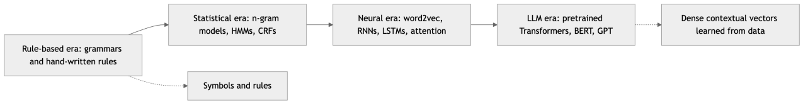
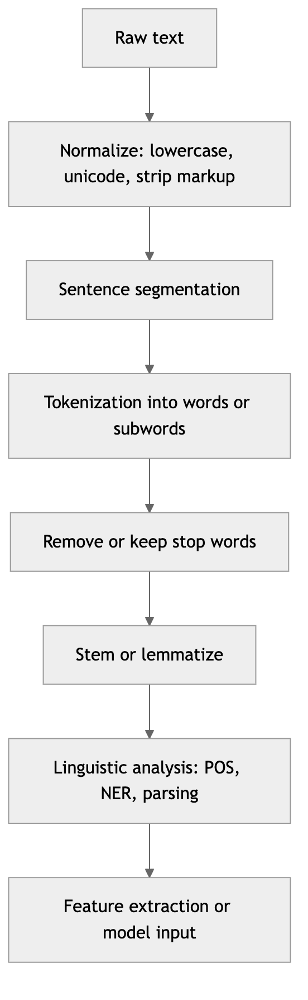
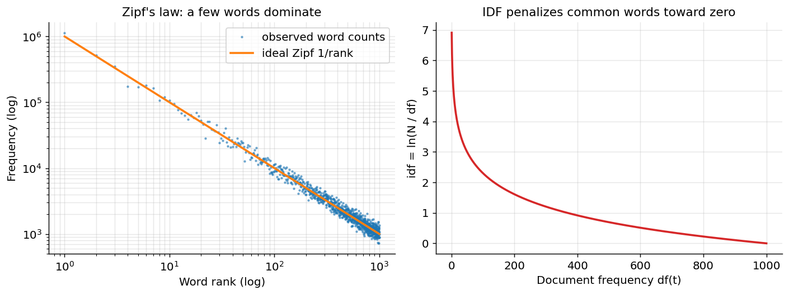
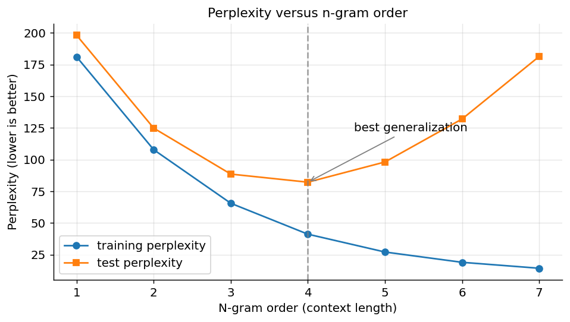
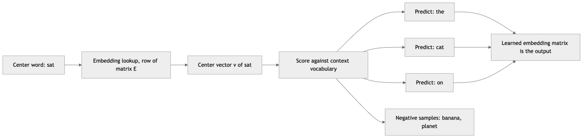
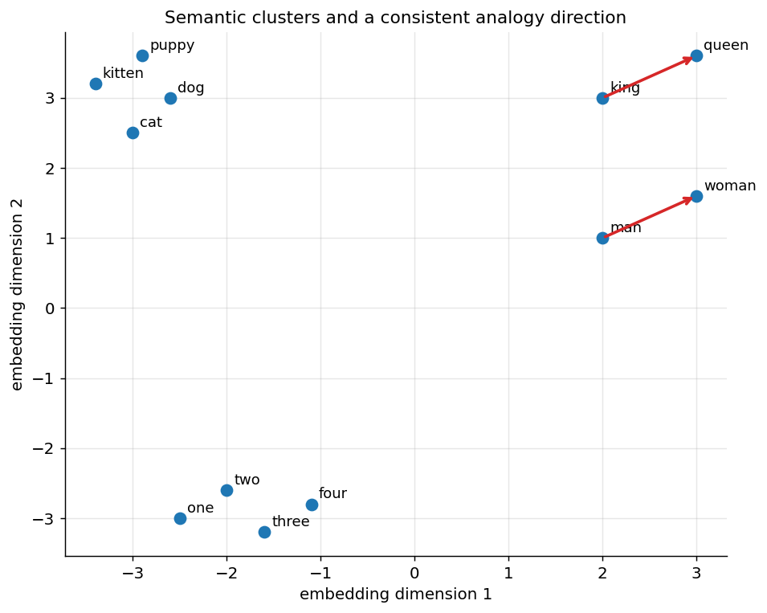

[← 19 Convolutional Neural Networks and Computer Vision](ch19-cnn-cv.md) · [Contents](../README.md#contents) · [21 Sequence Models: RNNs, LSTMs, and GRUs →](ch21-sequence-models.md)

---

# 20 Natural Language Processing: Fundamentals

Language is the oldest and richest interface humanity has ever built, and for most of the history of computing it was the one thing machines could not touch. A spreadsheet of numbers, an image of pixels, a stream of sensor readings — these submit readily to the mathematics of the preceding chapters. But a sentence resists. It is discrete where our models prefer the continuous, ambiguous where they prefer the definite, and structured in ways that a flat feature vector cannot capture. **Natural language processing** (NLP) is the field that teaches computers to read, understand, and generate human language, and it is the discipline that produced the single most visible triumph of modern machine learning: large language models that converse, translate, summarize, and reason in text.

This chapter builds the foundations on which that triumph rests. It is deliberately a *bridge* chapter. Behind it lie the classical techniques that dominated NLP for half a century — the pipelines of tokenizers, taggers, and parsers; the sparse bag-of-words vectors; the n-gram language models; the first dense word embeddings. Ahead of it lie the neural architectures that swept the field: the recurrent networks of the chapter on Sequence Models, the attention mechanism of the chapter on Transformers, and the systems examined in the chapter on Large Language Models. We will reference those later chapters by name and not duplicate their deep dives. The goal here is to give you the vocabulary, the representations, the tasks, and the metrics that every NLP practitioner must know — the concepts that neural methods did not so much replace as *absorb and generalize*. You cannot understand why a Transformer tokenizes text into subwords, or why perplexity measures a language model’s quality, or what “named-entity recognition” even means, without the material in this chapter.

## 20.1 Why Language Is Hard

It is worth dwelling on *why* language defeated computers for so long, because the difficulties are not incidental — they are structural, and every technique in this chapter is a response to one of them.

**Ambiguity** is pervasive and operates at every level. A single word carries many senses: “bank” is a financial institution, the side of a river, a maneuver an airplane makes, and a verb meaning to rely on. This is **lexical ambiguity**, and resolving it — **word-sense disambiguation** — requires context. At the sentence level there is **syntactic ambiguity**: “I saw the man with the telescope” has two grammatical parses (who has the telescope?), and “the old man the boats” reads as nonsense until you realize “man” is a verb and “old” a noun. There is **referential ambiguity**: in “the trophy did not fit in the suitcase because it was too big,” what does “it” refer to? Humans resolve this instantly through world knowledge (trophies, not suitcases, are the kind of thing that is “too big” to fit); a naive parser cannot. Ambiguity means that language has no context-free ground truth — the same string can mean different things, and meaning is not recoverable from surface form alone.

**Compositionality** is the property that the meaning of a whole is built from the meanings of its parts and the way they are combined. “Dog bites man” and “man bites dog” share every word yet mean opposite things, because syntax — word order and grammatical role — carries meaning independent of the words themselves. This is why a **bag-of-words** representation, which we study below, is fundamentally limited: it discards order and therefore discards a large part of meaning. Worse, compositionality is not always clean. **Idioms** (“kick the bucket,” “spill the beans”) mean something unrelated to their parts; **negation** and **scope** flip meaning (“this movie was good, not bad” versus “this movie was bad, not good”); and **long-range dependencies** link words far apart (“The keys to the cabinet *are* on the table” — the plural verb agrees with “keys,” five words back).

**Context** — linguistic, situational, and cultural — determines meaning in ways no closed model can fully enumerate. The sentence “can you pass the salt?” is grammatically a question about ability but pragmatically a request. “It’s cold in here” may be a statement of fact or a plea to close the window. Understanding requires not just the words but the speaker, the setting, and a vast reservoir of shared world knowledge. This is the domain of **pragmatics**, and it is the frontier that large language models, trained on enough text to have absorbed much of that shared knowledge implicitly, have pushed furthest.

Language is also **variable in length and productive**: sentences range from one word to hundreds, and speakers routinely coin words and constructions never before uttered, so no fixed feature vector and no closed vocabulary can ever fully suffice. It is **morphologically rich** in ways that differ wildly across languages — English inflects lightly, but Finnish or Turkish pack what English says in a whole phrase into a single agglutinated word, and Chinese writes no spaces between words at all — so techniques tuned to English often break elsewhere, a fact worth remembering whenever a method is described as “standard.”

Two further practical difficulties deserve mention. Language is **discrete and symbolic**: a vocabulary is a set of tens or hundreds of thousands of distinct tokens with no inherent numeric structure, so the very first problem in NLP is turning symbols into numbers a model can compute with — the representation problem that occupies much of this chapter. And language is **sparse and Zipfian**: a handful of words (“the,” “of,” “and”) account for a large fraction of all tokens, while the vast majority of words are rare, and any real corpus contains words you have never seen. This long-tailed distribution, which we visualize below, shapes everything from smoothing in language models to the subword tokenization used by modern systems.

## 20.2 A Short History: Rules, Statistics, Neural, and LLMs

NLP has passed through four overlapping eras, and knowing the arc clarifies why the field looks the way it does today.

The **symbolic / rule-based era** (roughly the 1950s to the late 1980s) treated language as a formal system to be handled with hand-written rules and grammars. Researchers built parsers from context-free grammars, dictionaries of word senses, and elaborate systems of morphological and syntactic rules. The 1954 Georgetown-IBM experiment translated a few dozen Russian sentences into English and fueled a decade of over-optimism about machine translation; the 1966 ALPAC report, finding the results disappointing, cut funding sharply. Rule systems were interpretable and precise where they worked, but they were brittle, expensive to build, and could not scale to the ambiguity and variety of real text.

The **statistical era** (late 1980s through the 2000s) reframed language as a problem of *probability* rather than formal rule. Driven by growing corpora and cheap computation, researchers estimated models from data: n-gram language models for speech recognition and translation, hidden Markov models for part-of-speech tagging, and, later, discriminative models like conditional random fields and maximum-entropy classifiers. IBM’s Candide statistical machine-translation system and the noisy-channel model exemplify the period. The bet — that patterns learned from data beat rules written by hand — largely paid off, and NLP became an empirical, evaluation-driven science.

The **neural era** (roughly 2013 through 2018) replaced sparse, hand-engineered features with dense, learned representations. word2vec (2013) showed that useful word meaning could be learned from raw text as dense vectors; recurrent networks and LSTMs (the chapter on Sequence Models) learned to process sequences end to end; and encoder-decoder models with attention transformed machine translation. The pipeline of separate tokenizer-tagger-parser stages began to collapse into single models trained directly on the end task.

The **LLM era** (2018 to the present) began with the Transformer (the chapter on Transformers) and the discovery that pretraining a large Transformer on enormous unlabeled text, then adapting it, beat everything before it. ELMo and BERT brought deep *contextual* representations; the GPT family showed that a single generative model could be prompted to perform almost any task. The chapters on Large Language Models cover this in depth. The through-line of all four eras is a steady move from *knowledge we write down* to *knowledge we learn from data*, and from *sparse symbols* to *dense, contextual vectors*.



*Figure 278. The four overlapping eras of natural language processing, from hand-written rules to learned representations.*

## 20.3 The Classical NLP Pipeline

Before the neural era folded everything into end-to-end models, an NLP system was a *pipeline*: a chain of stages, each transforming the text a little further from raw characters toward structured meaning. Even today, when much of this is handled implicitly inside a neural model, the pipeline remains the mental model every practitioner uses, and its stages are still run explicitly in countless production systems, search engines, and preprocessing scripts. The stages, in rough order, are text normalization, tokenization, morphological reduction (stemming or lemmatization), stop-word handling, sentence segmentation, and then the linguistic analyses (tagging, parsing, entity recognition) covered in the next section.



*Figure 279. The classical NLP preprocessing pipeline transforms raw text into structured, analyzable units.*

### 20.3.1 Text Normalization

**Text normalization** is the unglamorous but consequential first step of putting text into a canonical form. It typically includes **case folding** (converting to lowercase, so “Apple” and “apple” are treated alike — though this conflates the company with the fruit, a small loss usually worth the reduction in sparsity), **Unicode normalization** (the same visible character can have multiple byte encodings; NFC or NFKC normalization collapses them), stripping or converting markup and HTML entities, handling accents and diacritics, normalizing whitespace, and deciding what to do with numbers, dates, URLs, emojis, and punctuation. Each decision trades information against sparsity. Lowercasing loses the signal that a capitalized mid-sentence word may be a proper noun; removing punctuation loses the difference between “let’s eat, grandma” and “let’s eat grandma.” There is no universally correct normalization — only choices appropriate to a task. A sentiment classifier may happily discard case and punctuation; a named-entity recognizer needs both.

### 20.3.2 Tokenization

**Tokenization** is the act of splitting text into the atomic units — **tokens** — that the rest of the system will treat as indivisible. It sounds trivial and is not. The naive approach, **whitespace tokenization**, splits on spaces. It fails immediately on punctuation (“dog.” becomes a token distinct from “dog”), on contractions (“don’t” — one token, or “do” + “n’t”?), on hyphenation (“state-of-the-art”), and entirely on languages like Chinese and Japanese that do not put spaces between words. **Rule-based tokenizers** (such as those in the Penn Treebank standard, or spaCy’s) apply carefully engineered regular expressions and language-specific rules to separate punctuation, split contractions consistently, and keep abbreviations and numbers intact. These are still the default for classical pipelines.

The deeper question is the *granularity* of a token, and there are three broad choices, each with sharp trade-offs.

| Granularity | Unit | Vocabulary size | Handles unknown words? | Sequence length |
|----|----|----|----|----|
| Word | whole words | very large (100K+) | no — out-of-vocabulary problem | short |
| Character | single characters | tiny (dozens to hundreds) | yes, trivially | very long |
| Subword | word pieces | moderate (tens of thousands) | yes, by composition | moderate |

**Word tokenization** yields short sequences and intuitive units but suffers the **out-of-vocabulary (OOV)** problem: any word not seen in training — a typo, a rare name, a new coinage, an inflected form — becomes an “unknown” token, and the vocabulary must be enormous to cover a real language. **Character tokenization** eliminates OOV entirely (every word is a sequence of known characters) and needs a tiny vocabulary, but it produces very long sequences and forces the model to learn word structure from scratch. **Subword tokenization** is the modern compromise and the approach used by essentially every large language model. It splits rare words into meaningful pieces while keeping common words whole: “tokenization” might become “token” + “ization,” and an unseen word like “unhappiness” becomes “un” + “happiness” or “un” + “happy” + “ness.” Frequent words stay intact; rare words decompose into known pieces; nothing is ever truly out-of-vocabulary because, in the worst case, a word falls back to individual characters.

The dominant subword algorithms — **Byte-Pair Encoding (BPE)**, **WordPiece**, and **SentencePiece** — are covered in detail in the chapter on Large Language Models, since they are integral to how those models represent text. In brief, BPE starts from characters and greedily merges the most frequent adjacent pair repeatedly until it reaches a target vocabulary size; WordPiece merges based on likelihood gain rather than raw frequency; and SentencePiece operates directly on raw text (including the whitespace) so it is language-agnostic and reversible. The key idea to carry forward is that these methods *learn* their vocabulary from a corpus, balancing vocabulary size against sequence length, and that this is why a modern model’s “tokens” are neither words nor characters but statistically-chosen fragments.

The mechanism is easiest to grasp for BPE. Begin by splitting every word into individual characters, then repeatedly scan the corpus for the most frequent adjacent symbol pair and merge it into a new symbol, recording the merge. If “e” and “s” are the most common adjacent pair, they merge into “es”; if “es” then frequently precedes “t,” a later merge produces “est.” After a few thousand such merges the vocabulary contains whole common words (which got merged all the way up), frequent morphemes (“ing,” “ed,” “est,” “un”), and, as a floor, the individual characters. At encoding time a new word is greedily broken into the longest pieces in this learned vocabulary. This is why a common word like “the” stays one token while a rare word like “antidisestablishmentarianism” fragments into many pieces, and why no word is ever truly unknown: in the worst case it decomposes to characters. The trade-off is a knob — a larger vocabulary means shorter sequences but more parameters in the model’s embedding table, and typical modern vocabularies land between 30,000 and 100,000 tokens.

``` python
# A conceptual look at subword tokenization (BPE-style), not executed
text = "unhappiness tokenization"
tokens = tokenizer.encode(text)
print(tokens)
# ['un', 'happiness', 'token', 'ization']
# rare/complex words split into reusable pieces; nothing is truly OOV
```

### 20.3.3 Stemming versus Lemmatization

Natural languages inflect: “run,” “runs,” “running,” “ran” are surface forms of one underlying word. Treating them as unrelated tokens fragments the signal and inflates the vocabulary. **Morphological reduction** collapses inflected forms to a common base, and there are two philosophies.

**Stemming** chops off affixes using crude, fast heuristics with no understanding of the word. The classic **Porter stemmer** applies a cascade of suffix-stripping rules: “running” becomes “run,” “happily” becomes “happili,” “argument” becomes “argument” but “arguing” becomes “argu.” The output is often not a real word (“happili,” “argu”), and stemming makes errors of both kinds — **over-stemming** conflates words that differ (“universe” and “university” both stem to “univers”) and **under-stemming** fails to conflate words that match. But it is fast and requires no dictionary.

**Lemmatization** maps a word to its **lemma** — its actual dictionary base form — using a vocabulary and morphological analysis, usually informed by the word’s part of speech. “better” lemmatizes to “good,” “ran” to “run,” “mice” to “mouse.” It is slower and needs linguistic resources, but its output is always a real word and it handles irregular forms that stemming mangles.

| Aspect | Stemming | Lemmatization |
|----|----|----|
| Method | rule-based suffix stripping | dictionary + morphology + POS |
| Output | may not be a real word (“studi”) | always a valid lemma (“study”) |
| Speed | very fast | slower |
| Accuracy | crude, error-prone | linguistically correct |
| Needs POS? | no | often yes |
| Example: “studies” | “studi” | “study” |
| Example: “was” | “wa” | “be” |

In practice, lemmatization is preferred when quality matters and resources permit; stemming survives in high-throughput retrieval systems where speed dominates and approximate matching suffices. Notably, modern neural systems that tokenize into subwords often skip both — the subword vocabulary already captures much of the shared structure (“run” and “running” share the “run” piece), so explicit stemming becomes unnecessary.

### 20.3.4 Stop Words

**Stop words** are extremely common, low-information words — “the,” “is,” “at,” “of,” “and” — that appear in almost every document and therefore, in many tasks, carry little discriminative signal. Removing them shrinks the representation and can improve classical information-retrieval and topic-modeling systems, where the goal is to identify what a document is *about*. But stop-word removal is a task-dependent judgment, not an unconditional good. Negation words (“not,” “no,” “never”) are technically stop words yet flip sentiment entirely; function words carry grammatical meaning essential to parsing; and the phrase “to be or not to be” is *entirely* stop words. Modern neural models almost never remove stop words — they learn which tokens matter — so stop-word lists are mainly a tool of classical bag-of-words pipelines. When you do use them, use a list appropriate to the task and never remove negations from a sentiment model.

### 20.3.5 Sentence Segmentation

**Sentence segmentation** (or **sentence boundary detection**) splits text into sentences. The naive rule — split on periods, question marks, and exclamation points — founders on the humble period, which also ends abbreviations (“Dr.,” “Inc.,” “U.S.A.”), appears in decimals (“3.14”) and URLs, and inside quotations. Robust segmenters combine rules with statistical models trained to classify each period as sentence-ending or not, using features like the preceding token, capitalization of the following token, and whether the preceding token is a known abbreviation. Sentence segmentation matters because many downstream tasks — parsing, translation, summarization — operate per sentence, and a mis-split sentence corrupts everything after it.

## 20.4 Linguistic Structure

Beyond breaking text into tokens, classical NLP extracts *grammatical structure* — the scaffolding of meaning. These analyses were the crown jewels of the statistical era and remain useful both as end products (search, information extraction) and as features for downstream models.

### 20.4.1 Part-of-Speech Tagging

**Part-of-speech (POS) tagging** assigns each token its grammatical category — noun, verb, adjective, adverb, preposition, determiner, and so on — usually from a standardized tagset such as the 36-tag Penn Treebank set (NN for singular noun, VBD for past-tense verb, JJ for adjective, and so on). POS tagging is a **sequence-labeling** problem: each token gets a label, and the labels are correlated (a determiner is usually followed by a noun or adjective, rarely a verb). It disambiguates by context — in “I *book* a flight” versus “I read a *book*,” the word “book” is a verb then a noun — and the correct tag depends on the surrounding words. Classical taggers used hidden Markov models and later conditional random fields (below); modern taggers use bidirectional recurrent or Transformer encoders and reach accuracies above 97%. POS tags feed lemmatization, parsing, and information extraction.

### 20.4.2 Named-Entity Recognition

**Named-entity recognition (NER)** finds and classifies the proper-noun spans in text — people, organizations, locations, dates, monetary amounts — and is one of the most commercially important NLP tasks, underpinning search, question answering, and document processing. In “Tim Cook announced that Apple will open a store in Berlin in March,” NER should extract *Tim Cook* (Person), *Apple* (Organization), *Berlin* (Location), and *March* (Date). Because entities span multiple tokens, NER is framed as sequence labeling with a **BIO tagging scheme**: each token is labeled **B**-egin of an entity, **I**-nside an entity, or **O**-utside any entity, with the entity type appended. Thus “Tim Cook” becomes `B-PER I-PER` and “Apple” becomes `B-ORG`. This turns span extraction into per-token classification, the same framing used for chunking and many other tasks.

``` python
# BIO tagging for named-entity recognition, conceptual output
"Tim   Cook   announced  Apple   opens  Berlin"
#  B-PER I-PER O          B-ORG   O      B-LOC
# multi-token entities are stitched from B (begin) and I (inside) tags
```

### 20.4.3 Parsing: Constituency and Dependency

**Parsing** recovers the grammatical structure of a sentence, and there are two complementary formalisms. **Constituency parsing** (phrase-structure parsing) decomposes a sentence into nested *phrases* — noun phrases, verb phrases, prepositional phrases — producing a tree whose leaves are words and whose internal nodes are phrase categories. It answers “what are the grammatical building blocks and how do they nest?” **Dependency parsing** instead links words directly: each word (except the root, usually the main verb) has exactly one *head* it depends on, with a labeled grammatical relation (subject, object, modifier). It answers “which words govern which?” Dependency parses are typically flatter, more directly useful for extracting *who did what to whom*, and are the dominant formalism in modern practice; the Universal Dependencies project provides a consistent cross-lingual annotation standard.

To see the difference concretely, take “the dog chased the cat.” A **constituency** parse groups the words into nested phrases: a sentence (S) splits into a noun phrase (“the dog”) and a verb phrase (“chased the cat”), and the verb phrase splits again into the verb “chased” and a further noun phrase (“the cat”). The tree emphasizes *what the building blocks are*. A **dependency** parse instead makes “chased” the root and draws labeled arcs from it: “dog” is its `nsubj` (nominal subject), “cat” is its `dobj` (direct object), and each “the” is a `det` (determiner) hanging off its noun. The dependency view emphasizes *which words govern which* and hands a relation-extraction system the subject-verb-object triple directly — (dog, chased, cat) — without any tree-walking. This is why dependency parsing became the workhorse for information extraction. It also makes the earlier ambiguity example vivid: “I saw the man with the telescope” has two valid dependency parses, one attaching “with the telescope” to “saw” (I used the telescope) and one attaching it to “man” (the man had the telescope), and the parser must choose.

Parsing was a defining achievement of statistical NLP and remains valuable for relation extraction, grammar checking, and any task needing explicit structure, though end-to-end neural models increasingly learn the structure implicitly.

### 20.4.4 Chunking

**Chunking** (shallow parsing) is a lightweight middle ground: rather than build a full parse tree, it identifies flat, non-overlapping phrases — most commonly base noun phrases (“the quick brown fox”) and verb phrases — without recovering their internal or hierarchical structure. Framed, like NER, as BIO sequence labeling, chunking is cheaper and more robust than full parsing and often sufficient for extracting the key phrases a downstream task needs.

## 20.5 Text Representation

We now reach the central problem of classical NLP: turning text, which is symbolic and variable-length, into the fixed-size numeric vectors that machine-learning algorithms consume. The representations in this section — bag-of-words, n-grams, TF-IDF — dominated for decades, still power fast production systems, and remain the essential baseline against which every neural method is measured.

### 20.5.1 Bag-of-Words

The **bag-of-words (BoW)** model is the simplest useful representation. Fix a vocabulary of $`V`$ words. Represent a document as a vector of length $`V`$ whose $`i`$-th entry is the number of times word $`i`$ appears — its **term frequency**. The order of words is discarded entirely; the document becomes a *multiset* (a “bag”) of its words. “The cat sat on the mat” and “the mat sat on the cat” produce identical vectors. This is BoW’s defining limitation (it throws away the compositional, order-dependent meaning discussed earlier) and simultaneously its great virtue: it is trivial to compute, produces fixed-length vectors regardless of document length, and works remarkably well for tasks where *topic* matters more than *syntax* — spam filtering, topic classification, sentiment analysis. Because most documents contain only a small fraction of the vocabulary, BoW vectors are extremely **sparse**: mostly zeros, which sparse-matrix data structures exploit for efficiency.

### 20.5.2 N-grams

To claw back a little of the word order that BoW discards, we can extend the vocabulary from single words to **n-grams**: contiguous sequences of $`n`$ tokens. A **unigram** is a single word; a **bigram** is a pair (“New York,” “not good”); a **trigram** is a triple. A bag-of-bigrams representation counts bigrams instead of (or alongside) unigrams, so it can distinguish “not good” from “good” and capture short phrases and collocations that unigrams miss. The cost is a combinatorial explosion of the vocabulary — the number of possible bigrams is roughly the square of the number of words — making the representation even sparser and larger. In practice, unigrams plus bigrams, with rare n-grams pruned, is a strong, common configuration. N-grams reappear immediately below as the basis of classical language models.

### 20.5.3 The Vector Space Model

Once documents are vectors, the geometry of the vector space becomes a tool. In the **vector space model** of information retrieval, both documents and queries are vectors in the same $`V`$-dimensional space, and their *similarity* is a geometric quantity. The natural choice is **cosine similarity** — the cosine of the angle between two vectors — because it measures orientation while ignoring magnitude, so a long document and a short one on the same topic still score as similar:

``` math
cos(\mathbf{a},\mathbf{b}) = \frac{\mathbf{a} \cdot \mathbf{b}}{\left\| \mathbf{a} \right\|\,\left\| \mathbf{b} \right\|} = \frac{\sum_{i}^{}a_{i}b_{i}}{\sqrt{\sum_{i}^{}a_{i}^{2}}\,\sqrt{\sum_{i}^{}b_{i}^{2}}}
```

A cosine of 1 means the vectors point in the same direction (maximally similar in content), 0 means they are orthogonal (share no words), and for non-negative count vectors it never goes below 0. This single formula underlies keyword search ranking, document clustering, near-duplicate detection, and — as we will see — the comparison of word embeddings. But raw counts make a poor basis for it, because the most frequent words dominate the dot product while carrying the least information. That is the problem TF-IDF solves.

### 20.5.4 TF-IDF

**TF-IDF** — term frequency times inverse document frequency — is the classic weighting scheme that turns raw counts into informative weights. The insight is that a word is important to a document if it appears *often in that document* but *rarely across the corpus*. “The” appears often in every document, so it distinguishes nothing; a word like “mitochondria” appearing several times in one document strongly signals what that document is about.

The **term frequency** $`\text{tf}(t,d)`$ measures how often term $`t`$ occurs in document $`d`$ — often the raw count, or the count normalized by document length, or a log-scaled count $`1 + log(\text{count})`$ to dampen the effect of very high counts. The **inverse document frequency** measures how rare a term is across the corpus of $`N`$ documents:

``` math
\text{idf}(t) = ln\frac{N}{\text{df}(t)}
```

where $`\text{df}(t)`$, the **document frequency**, is the number of documents containing $`t`$. A term in every document has $`\text{df} = N`$ and thus $`\text{idf} = ln1 = 0`$; a term in only one document has a large idf. (Practical implementations add smoothing — for example $`\ln\frac{1 + N}{1 + \text{df}(t)} + 1`$ — to avoid division by zero and to keep idf positive.) The TF-IDF weight is simply the product:

``` math
\text{tfidf}(t,d) = \text{tf}(t,d) \times \text{idf}(t)
```

**A worked numeric example.** Take a corpus of $`N = 3`$ short documents:

- $`d_{1}`$: “the cat sat on the mat” (6 tokens)
- $`d_{2}`$: “the dog sat on the log” (6 tokens)
- $`d_{3}`$: “the cat chased the dog” (5 tokens)

First, document frequencies. The word “the” appears in all three documents, so $`\text{df}(\text{the}) = 3`$. “cat” appears in $`d_{1}`$ and $`d_{3}`$, so $`\text{df}(\text{cat}) = 2`$; likewise “sat,” “on,” and “dog” each appear in two documents. “mat,” “log,” and “chased” appear in one document each. Now the inverse document frequencies (natural log, no smoothing):

``` math
\text{idf}(\text{the}) = ln\frac{3}{3} = 0,\quad\text{idf}(\text{cat}) = ln\frac{3}{2} \approx 0.405,\quad\text{idf}(\text{mat}) = ln\frac{3}{1} \approx 1.099
```

Compute TF-IDF for document $`d_{1}`$, using term frequency normalized by the 6-token length so, e.g., “the” has $`\text{tf} = 2/6 \approx 0.333`$ and “cat” has $`\text{tf} = 1/6 \approx 0.167`$:

| Term | tf in $`d_{1}`$ | idf   | tf-idf    |
|------|-----------------|-------|-----------|
| the  | 0.333           | 0.000 | **0.000** |
| cat  | 0.167           | 0.405 | 0.068     |
| sat  | 0.167           | 0.405 | 0.068     |
| on   | 0.167           | 0.405 | 0.068     |
| mat  | 0.167           | 1.099 | **0.183** |

The result captures exactly the intuition. Despite appearing *most often* in $`d_{1}`$, the word “the” receives a weight of **zero** — it is in every document, so it says nothing about what $`d_{1}`$ is about. Meanwhile “mat,” which appears only once, receives the **highest** weight, because it is unique to $`d_{1}`$ and therefore maximally distinctive. TF-IDF has automatically discovered, from statistics alone and with no linguistic knowledge, which words characterize the document.

``` python
# TF-IDF with scikit-learn, matching the worked example, not executed
from sklearn.feature_extraction.text import TfidfVectorizer
corpus = ["the cat sat on the mat",
          "the dog sat on the log",
          "the cat chased the dog"]
X = TfidfVectorizer().fit_transform(corpus)
print(X.shape)   # (3, 8)  -> 3 documents, 8-word vocabulary
# "the" columns are near zero; distinctive words dominate each row
```

The relationship between raw frequency and informativeness is governed by **Zipf’s law**, one of the most robust empirical regularities in all of linguistics: in a large corpus, the frequency of a word is roughly inversely proportional to its rank. The most common word is about twice as frequent as the second, three times the third, and so on. A handful of words dominate; a vast tail of words appears only once or twice. The figure below shows this law and, alongside it, why IDF weighting is the natural response — it *penalizes* exactly the high-frequency, low-rank words that Zipf’s law says will otherwise flood any count-based representation.



*Figure 280. Zipf’s law on the left explains the long-tailed word distribution that IDF weighting on the right is designed to tame.*

### 20.5.5 The Limitations of Sparse Representations

TF-IDF and bag-of-words are workhorses, but their limitations are exactly the difficulties of language enumerated at the start of this chapter, and they motivate everything that follows.

- **No word meaning.** Each word is a separate dimension, mutually orthogonal. “car” and “automobile” are as unrelated as “car” and “banana” — their vectors share nothing. The representation cannot generalize across synonyms or capture that “good” and “great” are similar.
- **No word order (mostly).** BoW discards order; n-grams recover only local order at the cost of explosive sparsity, and still cannot capture long-range dependencies.
- **High dimensionality and sparsity.** Vectors have one dimension per vocabulary word (tens of thousands), almost all zero, which is memory-hungry and interacts badly with distance-based methods (see the curse of dimensionality in the chapter on Dimensionality Reduction).
- **No handling of the unseen.** A word absent from the training vocabulary simply vanishes.

The first of these — no notion of word similarity — is the most damaging, and its solution, **dense distributed word embeddings**, is one of the pivotal ideas in the history of NLP.

> **Bag-of-words and TF-IDF — Strengths, Weaknesses, Pitfalls.** *Strengths:* trivial to compute, fast at scale, interpretable (you can read off which words drove a prediction), a strong baseline that neural models must beat, and effective whenever *topic* matters more than *syntax*. *Weaknesses:* no word meaning or similarity, no long-range order, extreme dimensionality and sparsity, and no handling of unseen words. *Pitfalls:* fitting the vocabulary or IDF on the full dataset leaks statistics into the test set; forgetting to prune rare n-grams explodes memory; and removing stop words indiscriminately can delete the very tokens (like negations) a task depends on.

## 20.6 Language Models

A **language model** assigns probabilities to sequences of words: it answers “how likely is this sentence?” and, equivalently, “given the words so far, what word comes next?” This deceptively simple object is foundational. It powers speech recognition (choosing “recognize speech” over “wreck a nice beach”), machine translation, spelling correction, text generation, and — scaled up enormously — the large language models of later chapters. Formally, by the chain rule of probability, the joint probability of a sequence factors into a product of conditional next-word probabilities:

``` math
P(w_{1},w_{2},\ldots,w_{n}) = \prod_{i = 1}^{n}P(w_{i} \mid w_{1},\ldots,w_{i - 1})
```

The difficulty is the conditioning context $`w_{1},\ldots,w_{i - 1}`$, which grows without bound. No corpus can estimate $`P(w_{i} \mid \text{entire preceding text})`$ directly, because almost every long context has been seen zero times.

### 20.6.1 N-gram Models

The classical solution is the **Markov assumption**: approximate the full history by only the previous $`n - 1`$ words. A **bigram** model conditions on one previous word, a **trigram** model on two:

``` math
P(w_{i} \mid w_{1},\ldots,w_{i - 1}) \approx P(w_{i} \mid w_{i - n + 1},\ldots,w_{i - 1})
```

These conditional probabilities are estimated by simple counting — **maximum likelihood estimation** — over a training corpus. For a bigram model:

``` math
P(w_{i} \mid w_{i - 1}) = \frac{\text{count}(w_{i - 1},w_{i})}{\text{count}(w_{i - 1})}
```

That is, the probability of “mat” following “the” is the number of times “the mat” appears divided by the number of times “the” appears. N-gram models are fast, interpretable, and were the backbone of statistical speech recognition and translation for two decades. But they have a fatal weakness that connects directly to Zipf’s law: **data sparsity**. Most possible n-grams never appear in any finite corpus, so their counts — and therefore their estimated probabilities — are zero. A trigram unseen in training gets probability zero, which, multiplied into the chain rule, makes an *entire sentence* impossible even if it is perfectly fluent. This is the **zero-probability problem**, and solving it is what smoothing is for.

### 20.6.2 Smoothing

**Smoothing** redistributes probability mass from seen events to unseen ones, so that no n-gram gets exactly zero probability. The techniques form a ladder of sophistication.

**Laplace (add-one) smoothing** is the crudest: add 1 to every count before normalizing. For a bigram model over a vocabulary of size $`V`$:

``` math
P_{\text{Laplace}}(w_{i} \mid w_{i - 1}) = \frac{\text{count}(w_{i - 1},w_{i}) + 1}{\text{count}(w_{i - 1}) + V}
```

Every conceivable bigram now has nonzero probability. Add-one smoothing is simple but too aggressive — with a large vocabulary it steals far too much mass from observed events and gives it to the vast sea of unseen ones. **Add-**$`k`$ **smoothing** softens this by adding a fraction $`k < 1`$ instead of 1, but the fundamental crudeness remains: it treats all unseen n-grams identically.

A small calculation exposes both the fix and the over-correction. Suppose in our corpus the word “the” occurs $`\text{count}(\text{the}) = 100`$ times, the bigram “the cat” occurs $`\text{count}(\text{the},\text{cat}) = 20`$ times, the bigram “the aardvark” occurs zero times, and the vocabulary has $`V = 5000`$ words. The unsmoothed estimates are $`P(\text{cat} \mid \text{the}) = 20/100 = 0.20`$ and $`P(\text{aardvark} \mid \text{the}) = 0/100 = 0`$ — the second is the zero-probability catastrophe. Under Laplace smoothing the seen bigram becomes $`P(\text{cat} \mid \text{the}) = (20 + 1)/(100 + 5000) = 21/5100 \approx 0.0041`$, while the unseen one becomes $`(0 + 1)/5100 \approx 0.0002`$. The zero is repaired — but notice how violently the seen estimate collapsed, from $`0.20`$ to $`0.0041`$, roughly a fiftyfold drop, because adding 1 to each of 5000 candidate continuations inflated the denominator far more than the numerator. This is exactly the over-smoothing that makes add-one unsuitable for realistic vocabularies and motivates the more careful discounting of backoff, interpolation, and Kneser-Ney, which move only a small, principled amount of mass to the unseen events.

**Backoff** and **interpolation** are smarter: when a higher-order n-gram is unseen or rare, fall back on lower-order statistics. Interpolation always mixes them — the trigram estimate is a weighted blend of trigram, bigram, and unigram probabilities, with weights tuned on held-out data. This uses the fact that even if “the cat purred” was never seen, “cat purred” or at least “purred” probably was.

**Kneser-Ney smoothing** is the most effective classical method and remains the gold standard for n-gram models. Its key insight is subtle and worth stating: the probability mass given to an unseen word should depend not on how *frequent* that word is overall, but on how many *distinct contexts* it appears in — its **continuation probability**. The word “Francisco” is fairly frequent, but it appears almost exclusively after “San,” so it is a poor candidate to follow a novel context. “The,” by contrast, follows a huge variety of words. Kneser-Ney also applies **absolute discounting**, subtracting a fixed amount from every observed count and redistributing the freed mass according to continuation probabilities. The result substantially outperforms add-one and simple backoff and was the state of the art for n-gram language modeling until neural models arrived.

| Method | Idea | Quality | Note |
|----|----|----|----|
| Maximum likelihood | raw counts, no smoothing | poor | zero-probability problem |
| Laplace (add-one) | add 1 to all counts | weak | over-smooths with large $`V`$ |
| Add-$`k`$ | add fraction $`k`$ | modest | needs tuning of $`k`$ |
| Interpolation / backoff | blend n-gram orders | good | uses lower-order evidence |
| Kneser-Ney | absolute discount + continuation | best classical | context diversity, not frequency |

### 20.6.3 Perplexity

How good is a language model? The standard intrinsic metric is **perplexity**, which measures how *surprised* the model is by held-out test text — lower is better. Perplexity is the exponentiated average negative log-probability the model assigns to the test set. For a test sequence of $`N`$ words:

``` math
\text{PP}(W) = exp\left( - \frac{1}{N}\sum_{i = 1}^{N}\ln P(w_{i} \mid w_{i - n + 1},\ldots,w_{i - 1}) \right)
```

Intuitively, perplexity is the **effective branching factor** of the model — the average number of equally-likely choices it believes it faces at each word. A perplexity of 100 means the model is, on average, as uncertain as if it had to pick uniformly among 100 words at every step. A perfect model that always assigned probability 1 to the actual next word would have perplexity 1; a uniform model over a vocabulary of $`V`$ words has perplexity $`V`$. Lower perplexity means the model concentrates its probability on the words that actually occur, so it is a better model of the language. Perplexity lets us compare language models directly, and it is still reported for modern neural and large language models.

> **N-gram language models — Strengths, Weaknesses, Pitfalls.** *Strengths:* fast to train and query, interpretable, requiring only counting; excellent for streaming and low-latency settings; and, with Kneser-Ney, surprisingly competitive for their size. *Weaknesses:* the Markov assumption blinds them to any dependency longer than the context window, and the vocabulary-squared (or -cubed) blow-up makes high orders impractical. *Pitfalls:* forgetting to smooth yields the zero-probability catastrophe; comparing perplexities across models with different vocabularies or tokenizers is meaningless; and mishandling sentence-boundary and unknown-word tokens quietly corrupts the probabilities.

Two cautions. First, perplexity depends on the vocabulary and tokenization, so perplexities are only comparable across models that share them. Second, perplexity is an *intrinsic* metric — it measures modeling of the corpus, not usefulness on a downstream task, and a lower-perplexity model is not guaranteed to translate or summarize better. The figure below illustrates how perplexity behaves as we vary n-gram order, exposing the central tension of n-gram modeling: higher order fits training text better but, without enough data, generalizes worse on unseen text.



*Figure 281. Higher n-gram orders lower training perplexity but eventually raise test perplexity, the classic bias-variance tension of sparse count models.*

## 20.7 Word Embeddings

We return now to the deepest limitation of sparse representations — that they encode no notion of word meaning — and to its transformative solution. A **word embedding** maps each word to a dense, low-dimensional, real-valued vector (typically 50 to 300 dimensions) such that words with similar meanings have similar vectors. Where a one-hot or bag-of-words representation makes every word orthogonal to every other, an embedding places words in a continuous geometric space where distance encodes similarity. This idea reshaped NLP and is the entry point to all neural language processing; the chapter on Sequence Models develops how embeddings are consumed by neural networks, and this section establishes what they are and how they are learned.

### 20.7.1 The Distributional Hypothesis

The theoretical foundation is the **distributional hypothesis**, articulated by linguists in the 1950s and captured in J. R. Firth’s aphorism, “you shall know a word by the company it keeps.” Words that occur in similar *contexts* tend to have similar *meanings*. “cat” and “dog” both follow “the” and “my,” both precede “barked,” “ran,” “slept,” both appear near “pet,” “vet,” and “food”; their contexts overlap heavily, so they mean similar things. This is a profound and useful claim, because *context is observable in raw text with no human labeling*. If we build vectors so that words with similar contexts get similar vectors, meaning emerges from unlabeled corpora for free.

The oldest embodiment of this idea is the **co-occurrence matrix**: a large matrix whose rows are words and whose columns are context words, with each cell counting how often the two co-occur within a window. Consider a tiny corpus and a window of one word on each side. The row for “cat” records its neighbors; the row for “dog” records its neighbors; if those rows are similar, so are the words. These raw co-occurrence rows are themselves crude embeddings — but they are sparse and high-dimensional. Applying dimensionality reduction (the truncated SVD of the chapter on Dimensionality Reduction, known in this context as **Latent Semantic Analysis**) compresses them into dense vectors, the first practical word embeddings. word2vec and GloVe can be understood as more efficient, more effective ways of achieving the same end.

**A tiny co-occurrence worked example.** Make the idea concrete with a four-sentence corpus and a symmetric context window of one word on each side:

- “the cat sat”
- “the dog sat”
- “the cat ran”
- “the dog ran”

Counting, for each target word, how often each other word appears immediately beside it yields this co-occurrence matrix (rows are target words, columns are context words):

|         | the | cat | dog | sat | ran |
|---------|-----|-----|-----|-----|-----|
| **cat** | 2   | 0   | 0   | 1   | 1   |
| **dog** | 2   | 0   | 0   | 1   | 1   |
| **sat** | 0   | 1   | 1   | 0   | 0   |
| **ran** | 0   | 1   | 1   | 0   | 0   |

Read off the distributional hypothesis directly from the rows. “cat” and “dog” have *identical* context rows $`(2,0,0,1,1)`$ — both follow “the” and both precede “sat” and “ran” — so their cosine similarity is exactly 1: the corpus treats them as interchangeable, which is precisely their semantic relationship (both are animals that appear in the same slots). Likewise “sat” and “ran” share the row $`(0,1,1,0,0)`$ and come out identical, correctly grouping the two verbs. Meanwhile the cosine similarity between “cat” and “sat” is 0, because their context rows share no nonzero dimension — a noun and a verb keep different company. Nothing here required labels or linguistic rules; the geometry of raw co-occurrence counts recovered both a semantic and a syntactic grouping. Scaling this up to a real vocabulary, then compressing the enormous sparse matrix with truncated SVD, is exactly Latent Semantic Analysis, and the vectors word2vec and GloVe learn are dense, better-optimized versions of these same context rows.

### 20.7.2 word2vec

**word2vec**, introduced by Mikolov and colleagues at Google in 2013, learns embeddings by training a shallow neural network on a *fake prediction task* whose only purpose is to force useful vectors into existence — the vectors, not the predictions, are the product. It comes in two mirror-image variants.

**Continuous Bag-of-Words (CBOW)** predicts a center word from its surrounding context: given {“the,” “cat,” “on,” “the”}, predict “sat.” It averages the context word vectors and is fast, working well on frequent words. **Skip-gram** does the reverse: given the center word “sat,” predict each surrounding context word (“the,” “cat,” “on,” “the”). Skip-gram is slower but performs better on rare words and small corpora, and it is the more widely used variant. In skip-gram, each word has two learned vectors — a center vector $`\mathbf{v}_{w}`$ used when it is the input and a context vector $`\mathbf{u}_{w}`$ used when it is a predicted neighbor — and the probability of a context word given a center word is a softmax over their dot product:

``` math
P(c \mid w) = \frac{exp(\mathbf{u}_{c}^{\top}\mathbf{v}_{w})}{\sum_{c' \in V}^{}\exp(\mathbf{u}_{c'}^{\top}\mathbf{v}_{w})}
```

Maximizing this pushes the vectors of words that co-occur toward alignment. The obvious problem is the denominator, a sum over the entire vocabulary, which is far too expensive to compute for every training pair. word2vec’s decisive practical trick is **negative sampling**: instead of the full softmax, treat each true (center, context) pair as a positive example and pair it with a handful of randomly sampled “negative” words that did *not* appear in the context, then train a binary logistic classifier to distinguish real neighbors from fake ones:

``` math
\log\sigma(\mathbf{u}_{c}^{\top}\mathbf{v}_{w}) + \sum_{i = 1}^{K}\mathbb{E}_{c_{i} \sim P_{n}}\left\lbrack \log\sigma( - \mathbf{u}_{c_{i}}^{\top}\mathbf{v}_{w}) \right\rbrack
```

Here $`\sigma`$ is the logistic sigmoid, $`K`$ is a small number of negatives (typically 5 to 20), and $`P_{n}`$ is a noise distribution — usually the unigram frequency raised to the power $`3/4`$, which upweights rarer words relative to their raw frequency. This converts an intractable $`V`$-way softmax into $`K + 1`$ cheap binary updates per training pair and is what made word2vec fast enough to train on billions of words. The chapter on Large Language Models revisits the softmax-versus-sampling trade-off in a modern setting.



*Figure 282. The skip-gram architecture learns an embedding for the center word that predicts its surrounding context words.*

### 20.7.3 GloVe

**GloVe** (Global Vectors, Pennington et al., Stanford, 2014) takes a complementary route. Where word2vec learns from local prediction windows one at a time, GloVe works from the *global* co-occurrence statistics of the whole corpus directly. It builds the co-occurrence matrix once, then learns vectors whose dot products approximate the *logarithm* of co-occurrence counts. Its guiding insight is that *ratios* of co-occurrence probabilities encode meaning: the ratio $`P(\text{ice} \mid k)/P(\text{steam} \mid k)`$ is large for \$k = \$ “solid,” small for \$k = \$ “gas,” and near 1 for a word related to both or neither. GloVe’s objective is a weighted least-squares fit that captures these ratios, with a weighting function that down-weights very frequent co-occurrences so they do not dominate. In practice word2vec and GloVe produce embeddings of similar quality; word2vec streams over text, GloVe factorizes an aggregated matrix.

### 20.7.4 fastText

**fastText** (Bojanowski et al., Facebook, 2016) extends word2vec with one crucial change: it represents each word as a bag of **character n-grams** plus the whole word, and a word’s embedding is the sum of its subword vectors. “where” contributes n-grams like “wh,” “whe,” “her,” “ere,” “re.” This subword approach delivers two large benefits. First, it can construct an embedding for a word *never seen in training* by summing its character n-grams — solving the out-of-vocabulary problem that afflicts word2vec and GloVe. Second, it captures **morphology**: “run,” “runs,” “running” share n-grams and therefore get related vectors automatically, and it works especially well for morphologically rich languages (Finnish, Turkish, German) where words take many inflected forms. fastText is the pragmatic default when OOV robustness and morphology matter.

| Method | Learns from | OOV words | Morphology | Training |
|----|----|----|----|----|
| word2vec | local prediction windows | no | no | fast, streaming |
| GloVe | global co-occurrence matrix | no | no | matrix factorization |
| fastText | windows + character n-grams | yes, by composition | yes | fast, streaming |

### 20.7.5 Cosine Similarity and Analogies

The payoff of embeddings is that meaning becomes *geometry*, and the tool for reading that geometry is again **cosine similarity**. To find words similar to “king,” compute the cosine similarity of its vector against every other word vector and take the largest — you get “queen,” “prince,” “monarch,” “throne.” Cosine, not Euclidean distance, is used because embedding magnitude tends to reflect word frequency rather than meaning, and cosine ignores magnitude.

The most celebrated property of word2vec-style embeddings is that they encode relationships as *consistent vector offsets*, so that meaning supports **analogical arithmetic**. The canonical example:

``` math
\mathbf{v}_{\text{king}} - \mathbf{v}_{\text{man}} + \mathbf{v}_{\text{woman}} \approx \mathbf{v}_{\text{queen}}
```

The vector from “man” to “woman” points in roughly the same direction as the vector from “king” to “queen” — a consistent “gender” direction learned from raw text. Similar offsets encode tense (“walk” to “walked” parallels “run” to “ran”), pluralization, and even geography (“Paris” to “France” parallels “Tokyo” to “Japan,” a “capital-of” direction). These regularities, discovered rather than designed, were a striking demonstration that distributed vectors capture genuine structure. (They also carry the *biases* of their training text — embeddings famously encode gender and racial stereotypes, a fairness concern examined in the chapter on Responsible AI.) The figure below shows a stylized 2D embedding space, synthesized to exhibit both semantic clustering and a consistent analogy offset.



*Figure 283. A stylized 2D word-embedding space showing semantic clusters and the parallel offset that underlies word analogies.*

### 20.7.6 Evaluating Embeddings

Embeddings are evaluated in two ways. **Intrinsic evaluation** tests the vectors directly against human judgments: **word-similarity** benchmarks (WordSim-353, SimLex-999) correlate the cosine similarities of word pairs with human-rated similarity scores, and **analogy** benchmarks (the Google analogy set) measure accuracy on “a is to b as c is to ?” questions. **Extrinsic evaluation** plugs the embeddings into a downstream task — classification, tagging, translation — and measures whether they improve end performance, which is ultimately what matters. The two do not always agree: embeddings that score well on analogies are not guaranteed to help a given task, so extrinsic evaluation is the final arbiter.

### 20.7.7 Contextual versus Static Embeddings

word2vec, GloVe, and fastText all produce **static embeddings**: each word has exactly *one* vector, regardless of context. This is their fundamental limitation. The word “bank” gets a single vector that must simultaneously average its financial and riverside senses — the model cannot represent that “bank” means different things in “river bank” and “savings bank.” Static embeddings cannot do word-sense disambiguation, because they collapse all senses of a word into one point.

The resolution is **contextual embeddings**, in which a word’s vector is *computed from its sentence* and therefore differs from context to context. “bank” in “river bank” gets a vector near “shore” and “water”; the same word in “bank account” gets a vector near “money” and “loan.” The first widely used contextual embeddings came from **ELMo** (2018), which ran a deep bidirectional LSTM (the chapter on Sequence Models) over the sentence and used its internal states as embeddings. **BERT** (2018) took this further with a bidirectional Transformer trained by masked-language modeling, producing the deep contextual representations that define modern NLP. These models are the subject of the chapters on Transformers and Large Language Models; the point to carry forward is the conceptual leap — from *one vector per word* to *one vector per word occurrence in context* — which finally let representations honor the ambiguity and context-dependence that make language hard.

> **Word embeddings — Strengths, Weaknesses, Pitfalls.** *Strengths:* dense and low-dimensional, they encode similarity and analogy, transfer knowledge learned from huge unlabeled corpora into small labeled tasks, and dramatically cut the parameter count of downstream models. *Weaknesses (static variants):* one vector per word cannot represent polysemy, and out-of-vocabulary words have no vector (fastText’s subwords partially fix this). *Pitfalls:* embeddings inherit and amplify the social biases of their training text, so auditing is essential (see the chapter on Responsible AI); cosine, not Euclidean distance, is the right similarity because vector magnitude tracks frequency; and pretrained vectors must match the domain — general-web embeddings can mislead on specialized text like clinical or legal language.

| Property | Static (word2vec, GloVe, fastText) | Contextual (ELMo, BERT) |
|----|----|----|
| Vectors per word | one, fixed | one per context |
| Word-sense disambiguation | no | yes |
| Model | shallow, cheap | deep, expensive |
| Captures polysemy | no | yes |
| Typical use | features, similarity, fast baselines | state-of-the-art task performance |

## 20.8 Core NLP Tasks and How They Are Framed

Much of practical NLP is a matter of recognizing which of a few canonical *problem shapes* a task fits, because the shape determines the model, the loss, and the metric. There are really only a handful of shapes, summarized here before we take the tasks one by one:

| Problem shape | Input to output | Example tasks | Typical metric |
|----|----|----|----|
| Sequence to label | whole text to one label | topic classification, sentiment, intent | accuracy, F1 |
| Sequence to per-token labels | one label per token | POS tagging, NER, chunking | entity/token F1 |
| Sequence to sequence | variable-length in to variable-length out | translation, abstractive summarization | BLEU, ROUGE |
| Span extraction | text plus query to a span | extractive QA | exact match, F1 |
| Sequence to probability | text to a likelihood | language modeling | perplexity |
| Unsupervised structure | corpus to latent groups | topic modeling, clustering | coherence, perplexity |

Recognizing the shape is most of the battle: once you know a task is “one label per token,” you reach for a sequence labeler with a transition-aware output; once you know it is “variable-length in to variable-length out,” you reach for an encoder-decoder. Below are the core tasks and their framings in detail.

**Text classification** assigns a whole document to one of a fixed set of categories — spam versus not-spam, topic labels, language identification, intent detection. Framed as ordinary supervised classification (the chapter on Supervised Learning and Model Evaluation) over a text representation: classically TF-IDF vectors into a Naive Bayes or logistic-regression classifier; in the neural era, a document embedding into a softmax. **Sentiment analysis** is the most prominent special case — classifying text by the opinion it expresses (positive/negative/neutral, or a 1-to-5 rating). It looks easy and hides real difficulty: negation (“not good”), sarcasm (“oh, great, another delay”), domain dependence (“unpredictable” is praise for a movie plot, a complaint about a car), and aspect-level opinions (“great food, terrible service” is positive and negative at once). Fine-grained **aspect-based sentiment analysis** ties each sentiment to the entity it targets. Sentiment is a useful lens on the whole history of NLP in miniature: a bag-of-words model with a sentiment lexicon handles the easy majority of cases (the presence of “excellent” or “terrible” is highly predictive), n-grams recover local negation (“not good”), and only contextual neural models begin to handle sarcasm, contrast, and implication, which depend on meaning the surface words do not carry. This is why sentiment remains a favorite benchmark: it is easy enough to get a decent baseline in an afternoon and hard enough that the last few points of accuracy still demand the most sophisticated models.

**Sequence labeling** assigns a label to *each token* in a sequence rather than one label to the whole text; POS tagging, NER, and chunking are all instances, unified by the BIO scheme. Structurally distinct from classification because the labels are interdependent — the tag of one token constrains its neighbors — which is why models with an explicit label-transition component (CRFs; recurrent and Transformer sequence models) excel here.

**Machine translation (MT)** maps a sequence in one language to a sequence in another — the archetypal **sequence-to-sequence** task, where both input and output are variable-length sequences and their lengths and word orders differ. It drove much of NLP’s history: rule-based systems, then statistical phrase-based MT (the noisy-channel model, phrase tables, and alignment), then neural encoder-decoder models with attention, which is the direct ancestor of the Transformer (the chapter on Transformers). **Question answering (QA)** comes in flavors: **extractive** QA finds the answer span within a provided passage (framed as predicting start and end token positions), while **generative** and **open-domain** QA produce a free-form answer, often retrieving relevant documents first — the pattern generalized in the chapter on Retrieval-Augmented Generation. **Summarization** condenses a long text into a short one, either **extractive** (select and stitch the most important sentences) or **abstractive** (generate new sentences, a sequence-to-sequence task) — the latter far harder and prone to producing fluent but unfaithful summaries.

A recurring theme across these generative tasks — translation, abstractive summarization, generative QA — is the tension between **fluency** and **faithfulness**. Modern models produce text that reads beautifully yet may quietly invent facts (a “hallucination”), mistranslate a negation, or summarize a document by asserting something it never said. Because the surface text is fluent, such errors are easy to miss and hard for automatic overlap metrics to catch, which is why faithfulness has become a central evaluation concern for generation and a major motivation for grounding systems in retrieved evidence (the chapter on Retrieval-Augmented Generation) and for human evaluation.

**Topic modeling** is the main *unsupervised* text task: discover the latent themes running through a document collection without any labels. The classic model is **Latent Dirichlet Allocation (LDA)**, a generative probabilistic model that treats each document as a *mixture* of topics and each topic as a *distribution over words*. LDA posits that a document was produced by repeatedly choosing a topic (from the document’s topic mixture) and then a word (from that topic’s word distribution); inference runs this generative story backward to recover, from the observed words, both the per-document topic mixtures and the per-topic word distributions. A topic emerges as a cluster of words that co-occur — {“gene,” “dna,” “sequence,” “genome”} signals a genetics topic — and each document is summarized as proportions over topics. LDA is valuable for exploring and organizing large unlabeled corpora, though it rests on a bag-of-words assumption and, like other classical methods, is increasingly complemented by embedding-based clustering.

## 20.9 Classical Models Still in Use

The neural era did not retire the classical models; it repositioned them as fast, interpretable, data-efficient baselines that remain in production wherever those properties matter. Two families stand out.

For **text classification**, **Naive Bayes** and **logistic regression** (both developed in the chapter on Classification: Logistic Regression, k-NN, and Naive Bayes) are the enduring baselines. **Multinomial Naive Bayes** models a document as a bag of words and, despite its “naive” assumption that words are conditionally independent given the class, works remarkably well for topic and spam classification — it is fast, needs little data, and is trivial to update. Its independence assumption is obviously false (words are correlated), yet the resulting classifier is robust because it needs only the *decision boundary* to be roughly right, not the probabilities. **Logistic regression** over TF-IDF features usually edges out Naive Bayes when there is enough data, because it does not assume independence and learns calibrated feature weights; it remains one of the strongest and most interpretable text classifiers and is the baseline any neural model must beat to justify its cost.

For **sequence labeling**, the classical tools are **hidden Markov models (HMMs)** and **conditional random fields (CRFs)**, introduced in the chapter on Sequence Models. An HMM is a *generative* model that treats the observed words as emissions from a hidden sequence of states (e.g., POS tags), with transition probabilities between states and emission probabilities of words given states; the Viterbi algorithm recovers the most likely tag sequence. A CRF is the *discriminative* counterpart: it models the conditional probability of the whole label sequence given the whole observation sequence directly, so it can use rich, overlapping features (word shape, prefixes, neighboring words, gazetteers) without worrying about their dependence. CRFs generally outperform HMMs on tasks like NER and were the state of the art before neural sequence models — and, tellingly, a CRF layer is still often stacked on top of a neural encoder to enforce valid label transitions. Knowing these models is not merely historical: they clarify *why* sequence labeling needs to model label interactions, an idea neural architectures inherited rather than discarded.

The generative-versus-discriminative distinction here mirrors the one drawn for classification in the chapter on Classification: Logistic Regression, k-NN, and Naive Bayes, and it is worth carrying across. A generative model (Naive Bayes, HMM) learns how the data was *produced* — the joint distribution of features and labels — which lets it generate samples, cope with missing data, and train from less data, at the price of modeling more than the task strictly requires. A discriminative model (logistic regression, CRF) learns only the *decision* — the conditional distribution of labels given features — which usually gives better accuracy when data is plentiful and lets it exploit rich, correlated features without pretending they are independent. In text, the practical upshot is a reliable ladder: start with Naive Bayes for a fast generative baseline, move to logistic regression or a CRF when accuracy matters and data allows, and only then reach for a neural model, having established the bar it must clear.

## 20.10 Evaluation Metrics for NLP

NLP tasks span classification, sequence labeling, and generation, and each shape calls for different metrics. Choosing and reporting the right one is a core skill.

For **classification and sequence labeling**, the metrics are those of the chapter on Supervised Learning and Model Evaluation: **accuracy** (fraction correct — misleading when classes are imbalanced, as they usually are in NER where most tokens are “O”), **precision** and **recall**, and their harmonic mean, the **F1 score**. NER and other span tasks report F1 computed over *entities* (a prediction counts only if the full span and type match), and multi-class tasks report **macro-F1** (average over classes, treating each equally) or **micro-F1** (pooled over all decisions, dominated by frequent classes).

For **language modeling**, the intrinsic metric is **perplexity**, defined above — lower means the model better predicts held-out text.

For **machine translation**, the dominant automatic metric is **BLEU** (Bilingual Evaluation Understudy). BLEU measures **n-gram precision** — what fraction of the candidate translation’s n-grams (for $`n`$ from 1 to 4) also appear in one or more reference translations — combined across n-gram orders by a geometric mean and multiplied by a **brevity penalty** that punishes translations shorter than the reference (so a system cannot game precision by emitting only a few high-confidence words). BLEU correlates reasonably with human judgment in aggregate but is imperfect: it rewards n-gram overlap, not meaning, so a correct paraphrase using different words scores poorly, and a fluent but subtly wrong translation can score well.

For **summarization**, the standard metric is **ROUGE** (Recall-Oriented Understudy for Gisting Evaluation), the recall-oriented mirror of BLEU. ROUGE measures how much of the *reference* summary’s content the candidate captures: **ROUGE-N** counts n-gram overlap, and **ROUGE-L** uses the longest common subsequence to reward in-order overlap without requiring contiguity. Recall orientation suits summarization, where the worry is *omitting* important content. **METEOR** was designed to fix BLEU’s brittleness: it aligns candidate and reference allowing **stemming and synonym matches** (so “run” matches “running” and “quick” matches “fast”), computes an F-measure that weights recall more than precision, and adds a penalty for badly ordered matches. METEOR correlates better with human judgment at the sentence level than BLEU, at higher computational cost.

A worked micro-example makes the precision-versus-recall contrast concrete. Suppose the reference is “the cat sat on the mat” and a system outputs “the cat sat on the rug.” Of the candidate’s six unigrams, five (“the,” “cat,” “sat,” “on,” “the”) appear in the reference, so unigram *precision* is $`5/6 \approx 0.83`$ — the BLEU-style view, asking how much of the output is correct. From the reference’s side, five of its six unigrams were recovered, so unigram *recall* is also $`5/6`$ here — the ROUGE-style view, asking how much of the reference was captured. Now shorten the output to just “the cat”: precision stays high ($`2/2 = 1.0`$) but recall collapses ($`2/6`$), and BLEU’s brevity penalty would additionally punish the length — illustrating precisely why a precision-only metric needs the brevity penalty and why summarization, where omission is the danger, leans on recall.

For **extractive question answering**, the standard pair is **exact match (EM)** — the fraction of questions where the predicted answer string exactly equals the reference — and token-level **F1**, which gives partial credit for overlapping words when the predicted span is close but not identical. For example, if the gold answer is “in 1969” and a system predicts “1969,” exact match scores 0 (the strings differ) but token F1 is high (one of two predicted tokens overlaps, and the one reference token is recovered), which is why both are reported together: EM is unforgiving of harmless boundary differences, and F1 restores partial credit.

| Metric | Task | Measures | Orientation |
|----|----|----|----|
| Accuracy / F1 | classification, labeling | correct decisions | balanced |
| Perplexity | language modeling | prediction uncertainty | lower is better |
| BLEU | machine translation | n-gram precision + brevity penalty | precision |
| ROUGE | summarization | n-gram / subsequence overlap | recall |
| METEOR | translation, generation | matches with stems and synonyms | recall-weighted F |
| Exact match | question answering | exact string equality | strict |

A unifying caution applies to all automatic generation metrics: they compare against a *fixed set of references* and reward surface overlap, so they systematically under-credit valid outputs that phrase things differently and can over-credit fluent-but-wrong ones. They are useful for tracking progress and comparing systems at scale, but human evaluation remains the gold standard for generation quality, and the chapter on LLMs in Practice discusses newer model-based evaluation approaches.

## 20.11 Preprocessing Pitfalls and Practical Tips

The gap between a textbook NLP method and a working one is usually a pile of preprocessing details. A few recurring pitfalls and habits are worth internalizing.

- **Fit preprocessing on training data only.** The vocabulary, the IDF values, the tokenizer merges — all must be learned from the training set and then *applied* to validation and test data. Fitting a `TfidfVectorizer` on the full dataset before splitting leaks corpus-wide document frequencies into your test set and inflates results. This is the text-domain instance of the data-leakage warnings throughout this book; wrap preprocessing in a pipeline so it is refit per fold.
- **Do not over-clean.** Aggressive normalization destroys signal. Removing all punctuation kills the difference between a statement and a question; lowercasing everything erases the proper-noun cue that helps NER; stripping emojis and repeated characters (“soooo good”) discards sentiment. Clean only as much as the task requires, and measure the effect.
- **Never strip negations for sentiment.** Standard stop-word lists include “not,” “no,” and “never.” Removing them turns “not good” into “good.” Curate the stop-word list for the task, or skip removal entirely.
- **Mind tokenization consistency.** The tokenizer used at inference must match the one used in training exactly. A mismatch — different handling of contractions, casing, or subword merges — silently degrades every prediction. With subword models, always use the model’s own tokenizer.
- **Handle the long tail deliberately.** Zipf’s law guarantees many rare words. Decide explicitly how to treat them: cap the vocabulary, map rare words to an unknown token, or use subword tokenization that dissolves the problem. Ignoring the tail leads to bloated, sparse features and OOV surprises in production.
- **Beware label leakage through metadata.** Document length, boilerplate headers, source formatting, and URLs can correlate spuriously with labels and let a model “cheat.” Inspect what your features actually key on.
- **Watch language and encoding.** Assuming English and ASCII breaks on Unicode, right-to-left scripts, and languages without whitespace word boundaries. Normalize Unicode early and pick language-appropriate tokenizers and segmenters.
- **Match the metric to the task and the class balance.** Report F1, not accuracy, on imbalanced problems; report the entity-level, not token-level, F1 for NER; and remember that BLEU and ROUGE are diagnostic aggregates, not measures of correctness on any single output.

These are not minor hygiene issues. In practice, more NLP projects are undone by a preprocessing or evaluation flaw — a leaked test set, a stop-word list that ate the negations, a tokenizer mismatch — than by the choice of model.

## 20.12 Summary

Natural language processing teaches machines to read, understand, and generate human language, a problem made genuinely hard by **ambiguity** (one form, many meanings), **compositionality** (meaning built from parts and their order), and dependence on **context** and world knowledge — compounded by language being discrete, symbolic, sparse, and Zipfian. The field advanced through four eras — rule-based, statistical, neural, and the current LLM era — steadily trading hand-written knowledge for knowledge learned from data and sparse symbols for dense contextual vectors.

The **classical NLP pipeline** turns raw text into analyzable units: normalization, then tokenization (word, character, or the modern **subword** schemes — BPE, WordPiece, SentencePiece — detailed in the chapter on Large Language Models), then morphological reduction by **stemming** (fast, crude) or **lemmatization** (slower, linguistically correct), plus stop-word handling and sentence segmentation. On top of this sit the linguistic analyses — **POS tagging**, **named-entity recognition** (framed with BIO tags), **constituency and dependency parsing**, and **chunking** — most of them instances of sequence labeling.

To feed text to models we need numeric **representations**. **Bag-of-words** and **n-grams** give sparse count vectors; the **vector space model** compares them by **cosine similarity**; and **TF-IDF** weights terms by frequency-in-document against rarity-across-corpus, automatically zeroing out ubiquitous words and elevating distinctive ones, as the worked example showed. Sparse representations founder on their inability to encode word meaning, their high dimensionality, and their blindness to unseen words. **Language models** assign probabilities to sequences; classical **n-gram models** with the Markov assumption require **smoothing** (Laplace, interpolation, and the gold-standard **Kneser-Ney**) to escape the zero-probability problem, and are evaluated by **perplexity**, the effective branching factor.

**Word embeddings** solved the meaning problem via the **distributional hypothesis**: **word2vec** (CBOW and skip-gram with negative sampling), **GloVe** (global co-occurrence factorization), and **fastText** (subword-aware, OOV-robust) produce dense vectors where cosine similarity captures relatedness and vector offsets encode analogies. Their limitation — one static vector per word — is overcome by **contextual embeddings** (ELMo, BERT), the bridge to the chapters on Transformers and Large Language Models. The core **tasks** — classification, sentiment, sequence labeling, translation, question answering, summarization, and topic modeling with LDA — each fit a canonical problem shape that dictates model and metric, and classical models (**Naive Bayes**, **logistic regression**, **HMMs**, **CRFs**) remain strong, interpretable baselines. NLP is evaluated with accuracy and **F1**, **perplexity**, **BLEU**, **ROUGE**, **METEOR**, and **exact match**, each matched to its task — and many projects fail not on modeling but on preprocessing and evaluation discipline.

## 20.13 Key Takeaways

- Language is hard for principled reasons — ambiguity, compositionality, context, and its discrete, sparse, Zipfian nature — and every NLP technique is a response to one of these.
- The classical pipeline (normalize, tokenize, reduce, tag, parse) is still the practitioner’s mental model; **subword tokenization** is the modern default because it eliminates out-of-vocabulary words while keeping sequences short.
- **TF-IDF** remains the essential sparse baseline: it rewards words frequent in a document but rare across the corpus, automatically discounting the high-frequency words that Zipf’s law says would otherwise dominate.
- Sparse representations encode no word meaning, no real word order, and cannot handle unseen words — the limitations that motivate embeddings.
- **N-gram language models** need **smoothing** to avoid zero probabilities; **Kneser-Ney** is the best classical method, and **perplexity** (lower is better) is the standard intrinsic evaluation.
- **Word embeddings** turn meaning into geometry via the distributional hypothesis; word2vec, GloVe, and fastText produce **static** vectors, while ELMo and BERT produce **contextual** vectors that finally handle polysemy — the bridge to modern neural NLP.
- Recognize the **task shape** — whole-document classification, per-token sequence labeling, or sequence-to-sequence generation — because it dictates the model, the loss, and the metric.
- Match the **metric** to the task: F1 for imbalanced classification and NER, perplexity for language models, BLEU for translation, ROUGE for summarization, METEOR for meaning-aware generation, exact match for extractive QA — and treat all automatic generation metrics as aggregates, not verdicts on individual outputs.
- Classical models (Naive Bayes, logistic regression, HMMs, CRFs) are fast, interpretable, data-efficient baselines that the neural era repositioned rather than retired; a neural model must beat them to justify its cost.
- Guard against preprocessing pitfalls: fit vocabulary and IDF on training data only, do not over-clean, never strip negations for sentiment, and keep tokenization consistent between training and inference.

## 20.14 Exercises

1.  **Conceptual.** Give three sentences that are each ambiguous in a *different* way (lexical, syntactic, referential) and explain, for each, what external information a system would need to resolve the ambiguity. Which of the three do you think is hardest for a purely statistical model, and why?

2.  **Conceptual.** Explain why a bag-of-words representation cannot distinguish “the movie was good, not boring” from “the movie was boring, not good.” What is the smallest change to the representation that would let it tell them apart, and what does that change cost?

3.  **Conceptual.** A trigram appears zero times in a training corpus. Trace what happens to the probability of a sentence containing it under (a) an unsmoothed maximum-likelihood model and (b) a Kneser-Ney model, and explain in words why Kneser-Ney’s use of *continuation probability* rather than raw frequency is the better choice for the unseen context.

4.  **Conceptual.** A model achieves a perplexity of 40 on a test set. State precisely what this means in terms of an “effective branching factor,” and explain why perplexities are only comparable across models that share a vocabulary and tokenization.

5.  **Worked — TF-IDF.** Using the three-document corpus from this chapter, compute the full TF-IDF vector for $`d_{2}`$ (“the dog sat on the log”). Which term receives the highest weight, and why? Then compute the cosine similarity between the TF-IDF vectors of $`d_{1}`$ and $`d_{2}`$, and comment on whether the value matches your intuition about how similar the two documents are.

6.  **Coding — sparse baselines.** Load the 20 Newsgroups dataset via `sklearn.datasets.fetch_20newsgroups`. Build a `TfidfVectorizer` (try unigrams, then unigrams plus bigrams) feeding a `MultinomialNB` and a `LogisticRegression`, all inside a `Pipeline`, and compare cross-validated macro-F1. Which representation and which classifier win, and by how much?

7.  **Coding — the leakage trap.** Deliberately fit a `TfidfVectorizer` on the *entire* dataset before splitting into train and test, then evaluate a classifier; compare its reported accuracy to the correct pipeline that fits the vectorizer on the training fold only. Quantify the optimism introduced by the leak.

8.  **Coding — embeddings.** Load a set of pretrained embeddings (e.g., GloVe vectors). For “king,” “computer,” and a word of your choice, print the ten nearest neighbors by cosine similarity. Then test the analogies “king − man + woman” and “Paris − France + Italy,” reporting the top result and the rank of the expected answer. Find one analogy that *fails* and hypothesize why.

9.  **Coding — static versus contextual.** Take a polysemous word such as “bank” or “bat” in two sentences with different senses. Show that a static embedding gives it one identical vector in both, then obtain contextual embeddings (e.g., from a BERT-style model) and show that the two occurrences now differ. Measure the cosine similarity in each case and interpret the difference.

10. **Coding — topic modeling.** Fit `LatentDirichletAllocation` with 10 topics on a bag-of-words matrix of a document collection. Print the top ten words of each topic and try to name the themes. Then, for three documents, print their topic mixtures and judge whether the dominant topic matches the document’s actual subject.

11. **Conceptual.** BLEU is precision-oriented and ROUGE is recall-oriented. Explain why this makes BLEU the natural default for machine translation and ROUGE the natural default for summarization, and construct a short example output that scores well on one metric while being a poor result by the standard the other metric cares about.

---

[← 19 Convolutional Neural Networks and Computer Vision](ch19-cnn-cv.md) · [Contents](../README.md#contents) · [21 Sequence Models: RNNs, LSTMs, and GRUs →](ch21-sequence-models.md)
