[← 20 Natural Language Processing: Fundamentals](ch20-nlp-fundamentals.md) · [Contents](../README.md#contents) · [22 Transformers and the Attention Mechanism →](ch22-transformers.md)

---

# 21 Sequence Models: RNNs, LSTMs, and GRUs

Much of the world’s most interesting data arrives as a *sequence*: the words of a sentence, the daily closing prices of a stock, the audio samples of a spoken word, the frames of a video, the clicks of a user browsing a store. In all of these the *order* of the elements carries meaning, and each element is best understood in the context of those around it. This chapter develops the family of neural architectures designed to model exactly this kind of data — recurrent neural networks (RNNs) and their gated descendants, the LSTM and the GRU. Along the way we will see how words become vectors through *embeddings*, how a network can carry a memory across time, why that memory is so hard to train, and how gating mechanisms rescue it. We finish by building the encoder-decoder model whose limitations gave rise to the *attention* mechanism and, ultimately, to the Transformer that dominates the field today.

The recurrent models in this chapter occupy a peculiar place in the history of deep learning. For roughly a decade they were the undisputed tool for anything sequential, and they powered the first commercially successful neural machine translation, speech recognition, and text generation systems. They have since been largely displaced by Transformers for large-scale language work. Yet they remain the right tool for many problems — streaming inference, on-device models, modest data, and low-latency time-series forecasting — and, just as importantly, they are the conceptual ancestors of everything that came after. Understanding them is the surest path to understanding why the Transformer looks the way it does.

## 21.1 Why Sequences Are Different

Consider the sentence “the bank raised interest rates.” The meaning of “bank” depends on the words that follow it; “raised interest rates” tells you it is a financial institution, not a riverside. A model that processes each word in isolation, with no memory of what came before, cannot resolve this. The same is true of a time series: tomorrow’s temperature depends on today’s, and on the trend over the past week. And it is true of audio, where a single phoneme is meaningless until placed in the stream of sound around it.

Sequential data has three properties that ordinary tabular data lacks:

- **Variable length.** A sentence may be 3 words or 300. A patient’s medical history may span one visit or fifty. A sensor stream is, in principle, infinite. We cannot assume a fixed number of input features, as we could with, say, the fixed column set of a spreadsheet.
- **Order matters.** “Dog bites man” and “man bites dog” contain identical words but mean opposite things. Permuting the inputs changes the answer — sometimes completely.
- **Long-range dependencies.** The grammatical subject at the start of a sentence may govern a verb thirty words later (“The *keys* to the cabinet … *are* on the table”). A spike in a sensor reading may only matter relative to a baseline established minutes earlier. The relevant context can be arbitrarily far back.

The chapter on Neural Networks: Fundamentals introduced the *feedforward* network, which maps a fixed-size input vector $`\mathbf{x} \in \mathbb{R}^{d}`$ to an output through a stack of layers. Why can it not simply handle sequences?

### 21.1.1 Why Feedforward Networks Fail on Sequences

A feedforward network has a fixed-size input layer. To feed it a sentence you must first force the sentence into a vector of fixed dimension — for example by concatenating word embeddings into one long vector, or by averaging them. Both are unsatisfying:

- **Concatenation** requires you to fix the maximum length in advance and pad everything else, wasting capacity and breaking on longer inputs. Worse, it ties each *position* to its own weights: the network learns one set of parameters for “the word in slot 3” and a completely separate set for “the word in slot 4.” It has no way to recognize that the same pattern (“not good”) means the same thing wherever it appears. There is no *parameter sharing across time*.
- **Averaging** (a “bag of words”) throws away order entirely, collapsing “dog bites man” and “man bites dog” to the same point, and “this movie was good, not bad” to the same point as “this movie was bad, not good.”

To make the failure of concatenation concrete, imagine a sentiment classifier trained on movie reviews. Suppose the bigram “not good” appears in position 3 of every training review. The concatenation model dutifully learns, in the block of weights assigned to positions 3–4, that “not good” is negative. Now at test time a review says “not good” in position 12. Those weights have never seen the pattern; the position-12 weights learned something unrelated. The model has failed to generalize across position — even though the linguistic fact is position-independent. This is the crux: language patterns are *translation-invariant in time*, and a model that assigns independent weights to each position cannot exploit that invariance.

What we want is a model that (1) accepts inputs one element at a time so length is unbounded, (2) applies the *same* transformation at every time step so a pattern learned in one position transfers to all positions, and (3) maintains an internal *memory* that summarizes everything seen so far. That is precisely the recurrent neural network.

A useful contrast with the chapter on Convolutional Neural Networks: a CNN also shares parameters and detects patterns regardless of position, but it does so over a *fixed local window* in space. An RNN shares parameters over *time* and, in principle, carries information across the entire sequence through a recurrent state. The two ideas are cousins — weight sharing to exploit a structural invariance — applied to different axes.

## 21.2 From Tokens to Vectors: Word Embeddings

Before a sequence model can process language, we face a preliminary question that time-series and audio models do not: *how do we turn a word into numbers?* A neural network consumes real-valued vectors, but a word is a discrete symbol drawn from a vocabulary of tens or hundreds of thousands of items. The way we answer this question turns out to matter enormously, and the answer — dense **word embeddings** — is one of the most influential ideas in modern natural language processing.

### 21.2.1 The Problem with One-Hot Vectors

The naive encoding is the **one-hot vector**. With a vocabulary of $`V`$ words, we assign each word an index and represent it as a vector of length $`V`$ that is 1 in the word’s slot and 0 everywhere else. “cat” might be $`(0,0,1,0,\ldots)`$ and “dog” $`(0,1,0,0,\ldots)`$.

This works but is deeply wasteful, and worse, it is *semantically blind*. Two problems stand out:

- **Dimensionality.** With a 50,000-word vocabulary, every word is a 50,000-dimensional vector, almost all zeros. The first weight matrix of any model that consumes these vectors is enormous.
- **No notion of similarity.** Every pair of distinct one-hot vectors is exactly equidistant. The dot product of “cat” and “dog” is 0, exactly as it is for “cat” and “thermodynamics.” The representation encodes that words are *different* but says nothing about *how* they differ. A model must learn everything about word meaning from scratch, from the labeled task data alone.

We would prefer a representation in which “cat” and “dog” sit close together (both are pets, both are animals, both take similar verbs), while “cat” and “thermodynamics” sit far apart. We want a *dense*, low-dimensional vector — a few hundred numbers — whose geometry reflects meaning.

### 21.2.2 The Distributional Hypothesis

The key insight, due originally to linguists in the 1950s, is the **distributional hypothesis**: *a word is characterized by the company it keeps.* Words that appear in similar contexts tend to have similar meanings. “cat” and “dog” both follow “the” and “my,” both precede “barked” or “purred” or “ran,” both appear near “pet,” “vet,” and “food.” If we build vectors so that words with similar contexts get similar vectors, meaning falls out of raw text for free — no human labeling required.

An **embedding** is a mapping from each word to a dense vector $`\mathbf{e} \in \mathbb{R}^{k}`$ (typical $`k`$ is 50 to 300) learned so that this property holds. Concretely, an embedding is just a lookup table: a matrix $`E \in \mathbb{R}^{V \times k}`$ with one row per vocabulary word. Encoding a word is indexing into the row. This is exactly what Keras’s `Embedding` layer and PyTorch’s `nn.Embedding` do, and mathematically it is equivalent to multiplying the one-hot vector by $`E`$ — but implemented as a cheap row lookup rather than a dense matrix product.

Embeddings can be learned *end to end* as the first layer of any model (the lookup table is just more parameters trained by backpropagation), or they can be **pretrained** on huge unlabeled corpora and reused. The two most influential pretraining recipes are word2vec and GloVe.

### 21.2.3 word2vec

word2vec, introduced by Mikolov et al. at Google in 2013, learns embeddings by training a shallow network on a fake “prediction” task whose only purpose is to force useful vectors into existence. It comes in two flavors:

- **Skip-gram.** Given a center word, predict the surrounding context words within a small window. For “the cat sat on the mat,” with center word “sat” and window 2, the model tries to predict “the,” “cat,” “on,” “the” from “sat.”
- **Continuous bag of words (CBOW).** The mirror image: given the surrounding context words, predict the center word. Predict “sat” from {“the,” “cat,” “on,” “the”}.

Skip-gram tends to work better on rare words and smaller corpora; CBOW is faster and does well on frequent words. Both share the same architecture idea. In skip-gram, each word has two vectors — a “center” vector $`\mathbf{v}_{w}`$ and a “context” vector $`\mathbf{u}_{w}`$ — and the probability that context word $`c`$ appears near center word $`w`$ is modeled with a softmax over the dot product:

``` math
P(c \mid w) = \frac{exp(\mathbf{u}_{c}^{\top}\mathbf{v}_{w})}{\sum_{c' \in V}^{}\exp(\mathbf{u}_{c'}^{\top}\mathbf{v}_{w})}
```

Maximizing this over all center-context pairs in the corpus pushes the vectors of words that co-occur toward alignment. There is one glaring problem: the denominator sums over the *entire* vocabulary, which is far too expensive to compute for every training pair. word2vec’s practical trick is **negative sampling**: instead of the full softmax, treat each real (center, context) pair as a positive example and pair it with a handful of randomly sampled “negative” words that did *not* appear in context, then train a binary logistic classifier to tell real neighbors from fake ones:

``` math
\log\sigma(\mathbf{u}_{c}^{\top}\mathbf{v}_{w}) + \sum_{i = 1}^{K}\mathbb{E}_{c_{i} \sim P_{n}}\left\lbrack \log\sigma( - \mathbf{u}_{c_{i}}^{\top}\mathbf{v}_{w}) \right\rbrack
```

Here $`K`$ is a small number (5–20), and $`P_{n}`$ is a noise distribution (typically the unigram frequency raised to the power $`3/4`$, which usefully upweights rarer words). This turns an intractable $`V`$-way softmax into $`K + 1`$ cheap logistic updates per training pair, and it is what made word2vec fast enough to train on billions of words.

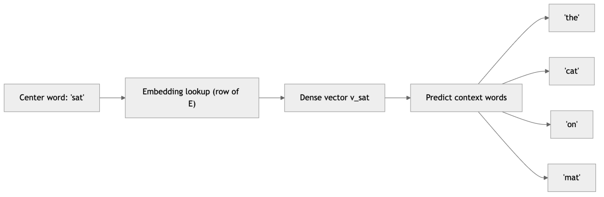

*Figure 284. The skip-gram task. A center word’s embedding is trained to predict the words in its surrounding context window; the learned embedding matrix is the real output.*

### 21.2.4 GloVe

GloVe (“Global Vectors”), from Stanford in 2014, arrives at similar embeddings from a different angle. Rather than sliding a window and predicting neighbors one pair at a time, GloVe first builds a global **co-occurrence matrix** $`X`$, where $`X_{ij}`$ counts how often word $`j`$ appears in the context of word $`i`$ across the whole corpus. It then learns vectors whose dot products approximate the logarithm of these counts:

``` math
J = \sum_{i,j}^{}f(X_{ij})\,(\mathbf{w}_{i}^{\top}{\widetilde{\mathbf{w}}}_{j} + b_{i} + {\widetilde{b}}_{j} - logX_{ij})^{2}
```

The weighting function $`f`$ damps the influence of extremely frequent pairs (like “the of”) so they do not dominate, and is zero when $`X_{ij} = 0`$ so empty entries are skipped. The appeal of GloVe is that it works directly on global corpus statistics rather than local windows, and empirically it produces embeddings competitive with word2vec. In practice the two are near-interchangeable; teams pick whichever pretrained set fits their vocabulary and domain.

### 21.2.5 What Embeddings Capture

The striking result — and the reason embeddings caused such excitement — is that the learned geometry encodes not just similarity but *analogical structure*. Directions in the space correspond to semantic relationships. The canonical example is

``` math
\mathbf{e}_{\text{king}} - \mathbf{e}_{\text{man}} + \mathbf{e}_{\text{woman}} \approx \mathbf{e}_{\text{queen}}
```

The vector from “man” to “king” points in roughly the same direction as the vector from “woman” to “queen” — a “royalty” direction. Similar regularities appear for verb tense (“walk” → “walked” parallels “swim” → “swam”), country-capital pairs, and comparatives. None of this was programmed in; it emerges from the distributional statistics of text. We can visualize this by projecting a handful of embeddings down to two dimensions.

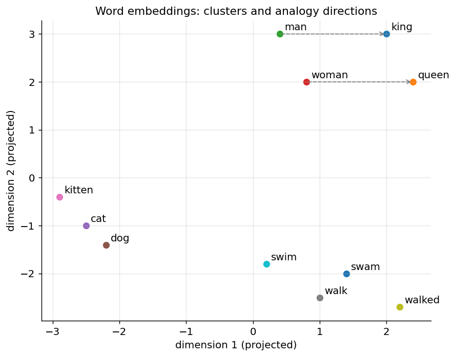

*Figure 285. A schematic 2D projection of word embeddings. Semantically related words cluster, and consistent relationships (gender, tense) appear as parallel offset vectors.*

Two caveats set up the rest of the chapter and the ones that follow. First, word2vec and GloVe are **static** embeddings: each word gets exactly one vector regardless of context, so the “bank” of “river bank” and “savings bank” share a single, blurred representation. Contextual embeddings — where a word’s vector depends on the sentence it sits in — require the sequence models we are about to build (and later, Transformers). Second, embeddings inherit and can amplify the *biases* present in their training text; the same analogy machinery that yields “king − man + woman ≈ queen” has been shown to yield stereotyped associations too, a point we return to in the chapter on Responsible AI.

### 21.2.6 The Out-of-Vocabulary Problem and Subword Units

A static embedding table has a fixed vocabulary, which raises an awkward question: what happens when a word appears at test time that was never in the training vocabulary — a rare surname, a new product name, a typo, a hashtag? With word2vec or GloVe the honest answer is that there is no vector for it. The usual fallback is a single shared `<UNK>` (“unknown”) vector, but collapsing every unseen word to one point throws away exactly the information we wanted. This **out-of-vocabulary (OOV)** problem is acute for morphologically rich languages, where a single lemma can have dozens of inflected forms, most of which are individually rare.

The influential fix is to embed **subword units** rather than whole words. fastText (from the word2vec authors) represents each word as a bag of character n-grams — “where” becomes `<wh`, `whe`, `her`, `ere`, `re>`, plus the whole word — and sums their vectors. A never-before-seen word still shares n-grams with known words, so it lands somewhere sensible in the space, and related forms (“run,” “running,” “runner”) share structure automatically. Modern tokenizers push this further with data-driven schemes such as **byte-pair encoding (BPE)** and WordPiece, which greedily merge frequent character pairs into a vocabulary of subword tokens; a rare word is simply split into several known pieces. These are the tokenizers that feed today’s large language models, and we return to them in the chapter on how LLMs work. The practical upshot for this chapter: character-level models (like the one we code below) sidestep OOV entirely at the cost of longer sequences, while word- and subword-level models trade sequence length for a richer per-token representation.

### 21.2.7 Using and Evaluating Pretrained Embeddings

In a real project you rarely train embeddings from scratch when data is scarce; you download a pretrained set (300-dimensional GloVe vectors trained on Common Crawl, say) and load them into the embedding layer’s weight matrix, then either freeze them or fine-tune them on your task. In Keras this is a matter of passing a `weights=[embedding_matrix]` array and setting `trainable=False`; in PyTorch, `nn.Embedding.from_pretrained(tensor, freeze=True)`. Freezing is sensible with little data (the pretrained geometry is better than anything a small dataset could learn); fine-tuning helps when you have enough labeled examples to adapt the vectors to your domain.

Embeddings are evaluated two ways. **Intrinsic** evaluation tests the vectors directly — analogy accuracy (“Athens is to Greece as Paris is to \_\_\_“) and correlation with human word-similarity judgments. **Extrinsic** evaluation, which is what ultimately matters, measures whether swapping in the embeddings improves a downstream task such as classification or tagging. The two do not always agree, so trust the extrinsic number for production decisions.

## 21.3 Recurrent Neural Networks

With inputs now representable as vectors — embedded tokens for text, raw or normalized measurements for a time series — we can build the recurrent model itself. The core idea of an RNN is a loop. At each time step $`t`$ the network reads the current input $`\mathbf{x}_{t}`$ and combines it with a **hidden state** $`\mathbf{h}_{t - 1}`$ — a vector that summarizes everything seen up to that point — to produce a new hidden state $`\mathbf{h}_{t}`$. That new state is fed back into the network at the next step. The hidden state is the network’s memory, and it is the single thread through which the past reaches the present.

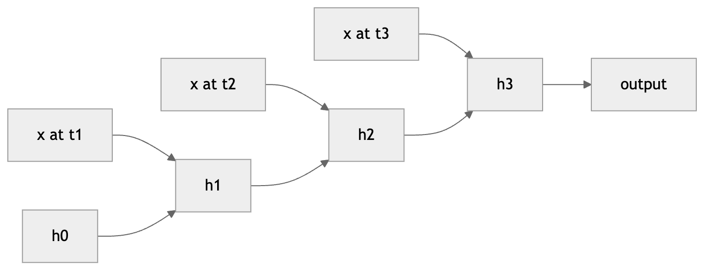

*Figure 286. An RNN cell loops its hidden state back into itself; unrolling the loop reveals one copy of the same cell per time step, all sharing weights.*

### 21.3.1 The Recurrence Equations

A “vanilla” or *Elman* RNN computes the hidden state and an optional output at each step as:

``` math
\mathbf{h}_{t} = tanh\left( W_{xh}\,\mathbf{x}_{t} + W_{hh}\,\mathbf{h}_{t - 1} + \mathbf{b}_{h} \right)
```

``` math
\mathbf{y}_{t} = W_{hy}\,\mathbf{h}_{t} + \mathbf{b}_{y}
```

Here $`\mathbf{x}_{t} \in \mathbb{R}^{d}`$ is the input at step $`t`$, $`\mathbf{h}_{t} \in \mathbb{R}^{k}`$ is the hidden state, and the three weight matrices $`W_{xh}`$ ($`k \times d`$), $`W_{hh}`$ ($`k \times k`$), and $`W_{hy}`$ ($`m \times k`$) together with the bias vectors are the *only* parameters. Crucially, **these same matrices are reused at every time step.** The number of parameters does not depend on the sequence length — this is the parameter sharing that feedforward nets lack. A ten-word sentence and a thousand-word document are processed by the very same $`W_{hh}`$.

The $`\tanh`$ squashes the state into $`( - 1,1)`$, keeping it bounded as it cycles through the loop; without a squashing nonlinearity, repeated multiplication by $`W_{hh}`$ would let the state grow without limit. This is also why the recurrence uses $`\tanh`$ rather than the ReLU that dominates feedforward and convolutional networks: an unbounded activation inside a loop that is applied hundreds of times is a recipe for the state — and the gradient — to blow up, so recurrent cells favor bounded, saturating nonlinearities (a specially initialized “IRNN” using ReLU is possible but delicate). The initial state $`\mathbf{h}_{0}`$ is usually the zero vector (or, occasionally, a learned vector treated as an extra parameter).

### 21.3.2 A Worked Forward Pass

It helps to see the arithmetic once with tiny numbers. Take a hidden size of $`k = 2`$ and a scalar input ($`d = 1`$). Suppose

``` math
W_{xh} = \begin{bmatrix}
0.5 \\
 - 0.3
\end{bmatrix},\quad W_{hh} = \begin{bmatrix}
0.1 & 0.4 \\
 - 0.2 & 0.3
\end{bmatrix},\quad\mathbf{b}_{h} = \mathbf{0},\quad\mathbf{h}_{0} = \begin{bmatrix}
0 \\
0
\end{bmatrix}
```

Feed the input sequence $`x_{1} = 1.0`$, $`x_{2} = 0.5`$. At step 1, the pre-activation is $`W_{xh}x_{1} + W_{hh}\mathbf{h}_{0} = (0.5, - 0.3)^{\top}`$, and

``` math
\mathbf{h}_{1} = tanh\left( (0.5,\, - 0.3)^{\top} \right) = (0.462,\, - 0.291)^{\top}
```

At step 2, $`W_{xh}x_{2} = (0.25, - 0.15)^{\top}`$ and $`W_{hh}\mathbf{h}_{1} = (0.1 \cdot 0.462 + 0.4 \cdot ( - 0.291),\  - 0.2 \cdot 0.462 + 0.3 \cdot ( - 0.291))^{\top} = ( - 0.070,\, - 0.180)^{\top}`$. Their sum is $`(0.180, - 0.330)^{\top}`$, so

``` math
\mathbf{h}_{2} = tanh\left( (0.180,\, - 0.330)^{\top} \right) = (0.178,\, - 0.319)^{\top}
```

Notice that $`\mathbf{h}_{2}`$ depends on $`x_{1}`$ *only through* $`\mathbf{h}_{1}`$ — the state is the sole channel through which the first input influences the second step. Everything the RNN “remembers” about the past must fit inside that vector. This observation, innocuous here, becomes the source of both the model’s power and its difficulties.

### 21.3.3 Unrolling Through Time

The loop is hard to reason about directly, so we **unroll** it: we lay out one copy of the cell for each time step, drawing the hidden-state arrow from each copy to the next. The unrolled RNN is just a very deep feedforward network — as deep as the sequence is long — but with the special constraint that every layer shares the same weights. This view is what makes training tractable: once unrolled, it is an ordinary computational graph, and we can apply backpropagation exactly as in any other network. The only wrinkle is that a single weight matrix now appears in many places, so its gradient will be a sum over all of them.

### 21.3.4 Input-Output Patterns

RNNs are flexible about how inputs and outputs line up, which is why they fit so many tasks:

| Pattern | Inputs → Outputs | Example task |
|----|----|----|
| Many-to-one | sequence → single label | Sentiment classification of a review |
| One-to-many | single vector → sequence | Image captioning |
| Many-to-many (aligned) | sequence → sequence, same length | Part-of-speech tagging |
| Many-to-many (seq2seq) | sequence → sequence, different length | Machine translation |

For a **many-to-one** task we ignore all outputs except the final one, $`\mathbf{y}_{T}`$, and attach the loss there — the network has by then folded the whole sequence into $`\mathbf{h}_{T}`$, so the classification head reads that single summary vector. This is the shape of sentiment analysis, document classification, and sequence-level regression.

The **one-to-many** pattern inverts this: a single input vector (say, the feature vector a CNN extracts from an image) seeds the initial hidden state, and the RNN then generates a sequence, feeding each output back as the next input. Image captioning is the classic case — a CNN encodes the picture, an RNN narrates it word by word. Notice that this already contains the germ of the encoder-decoder idea.

For an **aligned many-to-many** task we take an output at *every* step and sum the per-step losses; each input position has a corresponding label, as in part-of-speech tagging or frame-level audio labeling. Here the input and output lengths are equal and locked in step, which is what makes the alignment “aligned.”

The **seq2seq** pattern, where input and output lengths differ and are not aligned, needs the encoder-decoder construction we build later in the chapter — machine translation being the canonical example, where a source sentence of one length becomes a target sentence of another, in a possibly different word order. The flexibility to occupy all four of these shapes with the *same* underlying cell is a large part of why RNNs became the default sequential model.

## 21.4 Backpropagation Through Time

Training an RNN means computing the gradient of a loss with respect to the shared weights. Because the same matrices appear at every unrolled step, the gradient at a given weight is a **sum of contributions from every time step**. This algorithm is called *backpropagation through time* (BPTT): unroll the network, run the forward pass to compute all hidden states and the loss, then propagate gradients backward from the last step to the first, accumulating the weight gradients along the way. It is ordinary backpropagation applied to the unrolled graph — the name simply emphasizes that “depth” here is “time.”

For a loss $`L = \sum_{t}^{}L_{t}`$, consider the gradient with respect to the recurrent matrix $`W_{hh}`$. Because $`W_{hh}`$ influences the loss through *every* hidden state, the chain rule gives a sum:

``` math
\frac{\partial L}{\partial W_{hh}} = \sum_{t}^{}{\sum_{j \leq t}^{}\frac{\partial L_{t}}{\partial\mathbf{h}_{t}}}\,\frac{\partial\mathbf{h}_{t}}{\partial\mathbf{h}_{j}}\,\frac{\partial\mathbf{h}_{j}}{\partial W_{hh}}
```

The dangerous factor is the middle one: the dependence of a late hidden state $`\mathbf{h}_{t}`$ on an earlier one $`\mathbf{h}_{j}`$ ($`j < t`$), which itself unrolls into a *product* of per-step Jacobians:

``` math
\frac{\partial\mathbf{h}_{t}}{\partial\mathbf{h}_{j}} = \prod_{i = j + 1}^{t}\frac{\partial\mathbf{h}_{i}}{\partial\mathbf{h}_{i - 1}} = \prod_{i = j + 1}^{t}{diag}\left( \tanh'(\mathbf{a}_{i}) \right)\, W_{hh}^{\top}
```

where $`\mathbf{a}_{i}`$ is the pre-activation at step $`i`$. This product of $`(t - j)`$ matrices is the heart of the matter, and the next section shows why it is so treacherous.

In practice we cannot afford to unroll an arbitrarily long sequence, because storing every hidden state for the backward pass means memory grows linearly with length. The remedy is **truncated BPTT**: process the sequence in chunks of, say, 50–200 steps, backpropagating only within each chunk while carrying the hidden state *forward* across chunk boundaries (detached from the graph, so gradients do not flow back into the previous chunk). This bounds memory and compute at the cost of not learning dependencies longer than the truncation window — a trade-off that is usually acceptable and, in any case, unavoidable for very long streams.

## 21.5 The Vanishing and Exploding Gradient Problem

That product of Jacobians is the Achilles’ heel of the vanilla RNN. Each factor is the recurrent matrix $`W_{hh}`$ scaled by the derivative of $`\tanh`$ (which is at most 1, and near 0 when the unit is saturated). Multiplying many such factors together behaves like raising a number to a high power, and the behavior is governed by the largest singular value (roughly, the spectral radius) of the per-step Jacobian:

- If the relevant factors have magnitude **less than 1**, the product shrinks toward zero exponentially in $`(t - j)`$. Gradients from distant time steps **vanish**, so the network cannot learn long-range dependencies — the early words simply have no measurable influence on a loss computed many steps later. The model still trains; it just quietly caps the range over which it can connect events.
- If they have magnitude **greater than 1**, the product blows up. Gradients **explode**, producing huge, unstable updates, oscillating loss curves, and `NaN` values.

A back-of-the-envelope estimate makes the scale vivid. If the effective per-step factor is about 0.9, then across 50 steps the gradient is scaled by $`{0.9}^{50} \approx 0.005`$ — a two-hundred-fold attenuation. At a factor of 0.8 it is $`{0.8}^{50} \approx 1.4 \times 10^{- 5}`$. The signal from fifty steps ago is, for all practical purposes, gone. Conversely a factor of 1.1 gives $`{1.1}^{50} \approx 117`$, and by a few hundred steps the numbers overflow.

We can make “effective per-step factor” precise. Ignoring the $`\tanh`$ derivative for a moment (it only makes things worse, since $`\tanh' \leq 1`$), the repeated factor is powers of $`W_{hh}^{\top}`$. If $`\lambda_{\max}`$ is the largest eigenvalue magnitude — the **spectral radius** — of $`W_{hh}`$, then a gradient component aligned with the dominant eigenvector is multiplied by roughly $`\lambda_{\max}`$ each step, so across $`(t - j)`$ steps it scales like $`\lambda_{\max}^{\, t - j}`$. The trichotomy is stark: $`\lambda_{\max} < 1`$ guarantees exponential decay (vanishing), $`\lambda_{\max} > 1`$ permits exponential growth (exploding), and only the razor’s edge $`\lambda_{\max} = 1`$ preserves magnitude — but a matrix cannot stay exactly on that edge in every direction while still doing useful computation. Because the $`\tanh`$ derivative shrinks the factor further (and is essentially zero for saturated units), *vanishing is the generic outcome* for a randomly initialized vanilla RNN. This is not a tuning failure to be fixed with a better learning rate; it is a structural property of iterating a linear map, and it is precisely what the gated architectures are engineered around.

Exploding gradients have a simple, effective fix: **gradient clipping**, which rescales the whole gradient vector whenever its norm exceeds a threshold $`\theta`$:

``` math
\mathbf{g} \leftarrow \mathbf{g} \cdot \frac{\theta}{max( \parallel \mathbf{g} \parallel ,\ \theta)}
```

This preserves the *direction* of the update while capping its *magnitude*, and it is cheap insurance that recurrent training almost always uses. Vanishing gradients are far more insidious — there is no loud failure, no `NaN`, the model just silently fails to connect distant events and plateaus at a mediocre loss. There is no clipping-style patch; the fix required a new architecture, which is exactly what the LSTM provides. The figure below shows how the influence of an early input decays as we move forward in time, and how a gated cell escapes the decay.

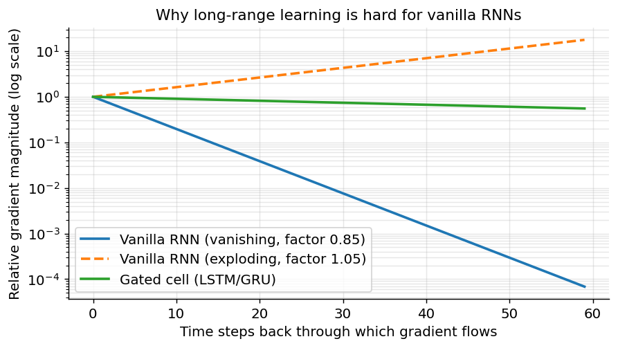

*Figure 287. Gradient magnitude flowing back through a vanilla RNN versus a gated (LSTM-like) path. The vanilla signal decays or explodes geometrically; the gated path preserves it.*

## 21.6 Long Short-Term Memory (LSTM)

The LSTM, introduced by Hochreiter and Schmidhuber in 1997, was designed specifically to defeat the vanishing-gradient problem, though it took another decade and far more compute for the field to appreciate how well it worked. Its central innovation is a separate **cell state** $`\mathbf{c}_{t}`$ that runs straight through the sequence with only minor, *additive* interactions — a kind of conveyor belt for information. Because information can be carried forward by addition rather than by repeated multiplication with a weight matrix, the gradient along this path neither vanishes nor explodes. This straight-through path is sometimes called the **constant error carousel**, and it is the whole point of the design.

Around that cell state, the LSTM places three **gates**: small neural layers with sigmoid outputs in $`(0,1)`$ that act as soft, learnable valves. A gate output near 0 closes the valve (let nothing through); near 1 opens it fully. Because the sigmoid is smooth, the gates are differentiable and the network can *learn* when to open and close them. The gates are the LSTM’s control system; the cell state is its memory.

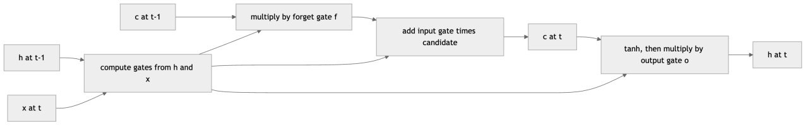

*Figure 288. Inside an LSTM cell, the forget gate scrubs the old cell state, the input gate writes new candidate information, and the output gate exposes a filtered view as the hidden state.*

### 21.6.1 The LSTM Equations

At each step the LSTM receives the previous hidden state $`\mathbf{h}_{t - 1}`$, the previous cell state $`\mathbf{c}_{t - 1}`$, and the current input $`\mathbf{x}_{t}`$. Let $`\sigma`$ be the logistic sigmoid and $`\odot`$ denote element-wise multiplication. The computation is:

``` math
\mathbf{f}_{t} = \sigma\left( W_{f}\,\lbrack\mathbf{h}_{t - 1},\mathbf{x}_{t}\rbrack + \mathbf{b}_{f} \right)\quad\quad\text{(forget gate)}
```

``` math
\mathbf{i}_{t} = \sigma\left( W_{i}\,\lbrack\mathbf{h}_{t - 1},\mathbf{x}_{t}\rbrack + \mathbf{b}_{i} \right)\quad\quad\text{(input gate)}
```

``` math
{\widetilde{\mathbf{c}}}_{t} = tanh\left( W_{c}\,\lbrack\mathbf{h}_{t - 1},\mathbf{x}_{t}\rbrack + \mathbf{b}_{c} \right)\quad\quad\text{(candidate)}
```

``` math
\mathbf{c}_{t} = \mathbf{f}_{t} \odot \mathbf{c}_{t - 1} + \mathbf{i}_{t} \odot {\widetilde{\mathbf{c}}}_{t}\quad\quad\text{(cell update)}
```

``` math
\mathbf{o}_{t} = \sigma\left( W_{o}\,\lbrack\mathbf{h}_{t - 1},\mathbf{x}_{t}\rbrack + \mathbf{b}_{o} \right)\quad\quad\text{(output gate)}
```

``` math
\mathbf{h}_{t} = \mathbf{o}_{t} \odot tanh(\mathbf{c}_{t})\quad\quad\text{(hidden state)}
```

Here $`\lbrack\mathbf{h}_{t - 1},\mathbf{x}_{t}\rbrack`$ is the concatenation of the two vectors, so each $`W`$ is a single matrix acting on the stacked input; many implementations fuse the four into one large matrix for speed. Reading the equations as a story:

1.  The **forget gate** $`\mathbf{f}_{t}`$ looks at the current context and decides, component by component, how much of the old cell state to keep. When modeling text, it might learn to clear a “current subject is singular” memory once a clause ends and a new subject appears.
2.  The **input gate** $`\mathbf{i}_{t}`$ decides how much of the freshly computed **candidate** $`{\widetilde{\mathbf{c}}}_{t}`$ to write into the cell state. The candidate proposes *what* to add; the input gate decides *whether* to add it.
3.  The cell state is updated by *scaling the old value and adding the new* — $`\mathbf{c}_{t} = \mathbf{f}_{t} \odot \mathbf{c}_{t - 1} + \mathbf{i}_{t} \odot {\widetilde{\mathbf{c}}}_{t}`$. This additive structure is what protects the gradient.
4.  The **output gate** $`\mathbf{o}_{t}`$ decides which parts of the (now-updated) cell state to expose as the hidden state $`\mathbf{h}_{t}`$, which is what the next layer and the next time step actually see. The cell state is the private long-term memory; the hidden state is the filtered view of it made public.

### 21.6.2 Why the Gradient Survives

The key mathematical point is what happens to the gradient along the cell-state path. Differentiating the cell update, the local derivative of $`\mathbf{c}_{t}`$ with respect to $`\mathbf{c}_{t - 1}`$ is simply the forget gate:

``` math
\frac{\partial\mathbf{c}_{t}}{\partial\mathbf{c}_{t - 1}} = diag(\mathbf{f}_{t})
```

Contrast this with the vanilla RNN, whose per-step factor was $`diag(\tanh')\, W_{hh}^{\top}`$ — a full matrix multiply that shrinks or grows the signal. The LSTM’s per-step factor is just an element-wise multiply by a number in $`(0,1)`$, with *no weight matrix in the loop*. If the network learns $`\mathbf{f}_{t} \approx 1`$ for some component, that memory — and the gradient flowing through it — is preserved across arbitrarily many steps, essentially undamped. The gradient can still be modulated by the gates, but it is no longer forced through repeated multiplication by $`W_{hh}`$, which is exactly the mechanism that made it vanish. A common and effective practical trick is to initialize the forget-gate bias $`\mathbf{b}_{f}`$ to a positive value (often 1.0) so that early in training the cell *defaults to remembering*, giving the optimizer a chance to discover long-range structure before it learns to forget.

The following figure shows how the three gates might behave across a short sequence, illustrating the “valve” intuition: values slide smoothly between fully closed and fully open as the input changes.

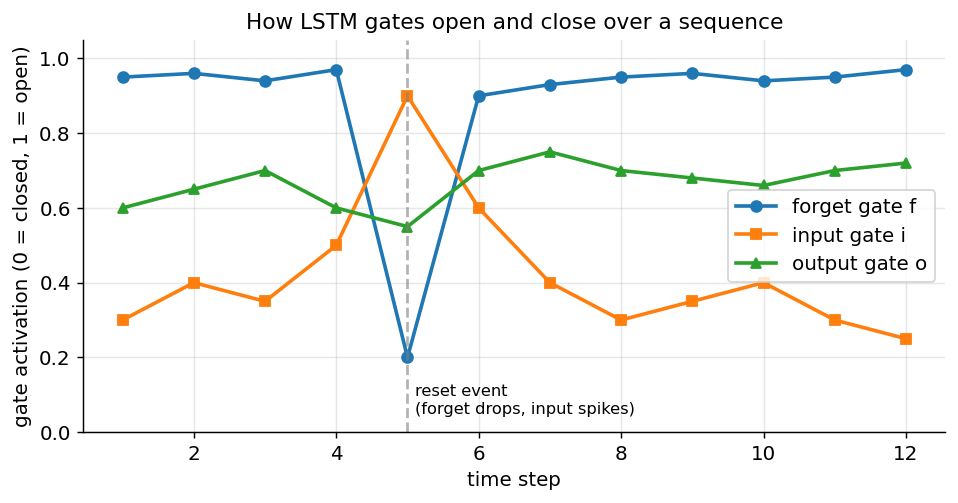

*Figure 289. Illustrative LSTM gate activations across a sequence. Sigmoid gates slide between 0 (closed) and 1 (open); the forget gate here stays high (remember) until a “reset” event mid-sequence.*

### 21.6.3 A Single LSTM Step, Numerically

To ground the equations, take a one-dimensional cell ($`k = 1`$) and watch it *remember*. Suppose at step $`t`$ the previous cell state is $`c_{t - 1} = 0.8`$, and the gates evaluate to $`f_{t} = 0.95`$, $`i_{t} = 0.10`$, $`o_{t} = 0.60`$, with candidate $`{\widetilde{c}}_{t} = - 0.5`$. Then

``` math
c_{t} = f_{t}\, c_{t - 1} + i_{t}\,{\widetilde{c}}_{t} = 0.95 \cdot 0.8 + 0.10 \cdot ( - 0.5) = 0.76 - 0.05 = 0.71
```

``` math
h_{t} = o_{t}\, tanh(c_{t}) = 0.60 \cdot tanh(0.71) = 0.60 \cdot 0.611 = 0.367
```

The memory barely moved (0.80 to 0.71) because the forget gate was near 1 and the input gate near 0 — the cell chose to *hold* its value and largely ignore the new candidate. Now imagine a “reset” step where the context signals that the old memory is irrelevant: $`f_{t} = 0.05`$, $`i_{t} = 0.90`$, $`{\widetilde{c}}_{t} = 0.9`$. Then $`c_{t} = 0.05 \cdot 0.8 + 0.90 \cdot 0.9 = 0.04 + 0.81 = 0.85`$ — the old value is almost entirely erased and overwritten with the new one. Crucially, in the *hold* case the local gradient $`\partial c_{t}/\partial c_{t - 1} = f_{t} = 0.95`$, so a gradient flowing back through this step is multiplied by 0.95, not by a saturating $`\tanh'`$ times a weight matrix. Chain a hundred such near-1 steps and the gradient survives — the very thing a vanilla RNN could not do.

A note on variants: the **peephole** LSTM lets the gates also see the cell state directly, which can help with precise timing tasks; and coupling the input and forget gates ($`\mathbf{i}_{t} = 1 - \mathbf{f}_{t}`$) reduces parameters. These tweaks matter at the margins, but the vanilla three-gate LSTM above is what you will meet by default in every framework.

## 21.7 Gated Recurrent Units (GRU)

The GRU, proposed by Cho et al. in 2014, asks whether all three gates and the separate cell state are truly necessary. It simplifies the LSTM in two ways: it merges the cell state and hidden state into a single vector $`\mathbf{h}_{t}`$, and it uses only two gates — a **reset gate** $`\mathbf{r}_{t}`$ and an **update gate** $`\mathbf{z}_{t}`$.

``` math
\mathbf{z}_{t} = \sigma\left( W_{z}\,\lbrack\mathbf{h}_{t - 1},\mathbf{x}_{t}\rbrack \right)\quad\quad\text{(update gate)}
```

``` math
\mathbf{r}_{t} = \sigma\left( W_{r}\,\lbrack\mathbf{h}_{t - 1},\mathbf{x}_{t}\rbrack \right)\quad\quad\text{(reset gate)}
```

``` math
{\widetilde{\mathbf{h}}}_{t} = tanh\left( W_{h}\,\lbrack\mathbf{r}_{t} \odot \mathbf{h}_{t - 1},\mathbf{x}_{t}\rbrack \right)\quad\quad\text{(candidate)}
```

``` math
\mathbf{h}_{t} = (1 - \mathbf{z}_{t}) \odot \mathbf{h}_{t - 1} + \mathbf{z}_{t} \odot {\widetilde{\mathbf{h}}}_{t}\quad\quad\text{(blend)}
```

The **reset gate** controls how much of the previous state is used when computing the candidate — setting it near 0 lets the unit “forget” the past and behave as if it were reading the start of a fresh sequence, which is useful at clause or segment boundaries. The **update gate** acts like a combined forget-and-input gate: it interpolates between keeping the old state ($`\mathbf{z}_{t} \rightarrow 0`$) and adopting the new candidate ($`\mathbf{z}_{t} \rightarrow 1`$). The single convex interpolation $`(1 - \mathbf{z}_{t})\,\mathbf{h}_{t - 1} + \mathbf{z}_{t}\,{\widetilde{\mathbf{h}}}_{t}`$ again gives the additive, gradient-friendly path: when $`\mathbf{z}_{t} \approx 0`$ the state is copied forward essentially unchanged, and its gradient with it.

Notice how the GRU folds LSTM roles together. The LSTM’s forget and input gates, which independently decided how much to erase and how much to write, are fused into the GRU’s single update gate that trades the two off directly (“keep this fraction of the old, take the complementary fraction of the new”). There is no output gate at all — the entire state is exposed at every step, so the GRU has no private/public distinction between cell and hidden state. This is the sense in which the GRU “drops” functionality: it cannot hold information in the cell while hiding it from the output, and it cannot erase and overwrite independently. In practice these losses rarely hurt.

### 21.7.1 LSTM vs. GRU vs. Vanilla RNN: Which to Use?

|  | Vanilla RNN | LSTM | GRU |
|----|----|----|----|
| Gates | none | 3 (forget, input, output) | 2 (reset, update) |
| Memory vectors | hidden state only | cell state + hidden state | single hidden state |
| Parameters (per unit) | fewest | most (≈ 33% more than GRU) | middle |
| Handles long dependencies | poorly (vanishing gradient) | very well | very well |
| Training speed | fastest per step, but often fails to converge on long deps | slowest | faster than LSTM |
| Gradient path | $`\tanh' \cdot W_{hh}^{\top}`$ (multiplicative, decays) | additive cell state (constant error carousel) | additive convex blend |
| When to prefer | teaching, very short sequences | large data, very long dependencies | smaller data, faster iteration, edge deployment |

Empirically the LSTM and GRU perform similarly on most problems; GRUs train a little faster because they have fewer parameters, while LSTMs occasionally edge ahead on tasks with very long or very precise dependencies. The vanilla RNN is essentially never the right production choice — it is included here because it is the clearest illustration of the recurrence and the problem the gated cells solve. A reasonable default is to start with a GRU for prototyping and try an LSTM if you need a bit more capacity.

## 21.8 Building Richer Recurrent Architectures

A single recurrent layer is rarely the whole story. Two structural enhancements are nearly ubiquitous, and they compose freely.

### 21.8.1 Bidirectional RNNs

A plain RNN reads left to right, so its state at step $`t`$ knows only the past. For many tasks — labeling each word with its part of speech, named-entity recognition, transcribing speech — the *future* context is just as informative. Consider tagging “book” in “I want to book a flight” versus “I read a book”: the word after “book” is decisive, and a left-to-right model has not seen it yet when it must decide.

A **bidirectional RNN** runs two independent recurrent layers, one forward and one backward over the sequence, and concatenates their hidden states at each position:

``` math
\mathbf{h}_{t} = \lbrack\,\overrightarrow{\mathbf{h}_{t}}\,;\,\overleftarrow{\mathbf{h}_{t}}\,\rbrack
```

This doubles the representation at each step and gives every position full access to context from both directions. The catch is fundamental: it requires the *entire* sequence up front, so it cannot be used for streaming or for autoregressive generation, where the future has not yet been produced. Bidirectionality is for *analysis* tasks (tag, classify, extract), not for *generation* tasks.

### 21.8.2 Stacked (Deep) RNNs

Just as we stack layers in a feedforward network, we can stack recurrent layers: the sequence of hidden states output by the first RNN becomes the input sequence to a second, and so on. Lower layers tend to capture short, local patterns while higher layers capture longer, more abstract structure — a temporal analogue of the feature hierarchy in a CNN. Two to four stacked layers is typical; beyond that, returns diminish and training grows harder, so residual connections (from the chapter on Training and Optimizing Deep Networks) are often added to keep gradients flowing, and dropout is applied *between* layers (never recurrently along time in the naive way, which would inject fresh noise at every step).

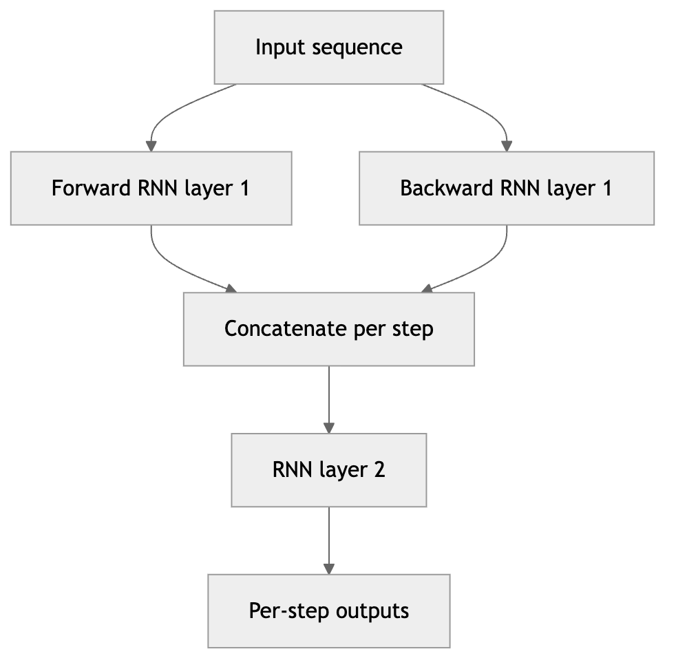

*Figure 290. A two-layer bidirectional RNN. Each position gets a forward and backward state from layer one, which feed a second recurrent layer before the output.*

### 21.8.3 Training Recurrent Networks in Practice

Recurrent networks are notoriously finicky to train, and a handful of techniques separate a model that converges from one that thrashes. They are worth collecting in one place.

- **Recurrent weight initialization.** Because the recurrent matrix is iterated many times, its spectral radius at initialization strongly influences early dynamics. **Orthogonal initialization** of $`W_{hh}`$ (all singular values equal to 1) keeps the initial per-step factor near the magnitude-preserving edge, giving gradients a fighting chance before learning reshapes the matrix. Frameworks default to it for recurrent layers.
- **Forget-gate bias.** As noted, initializing the LSTM forget-gate bias to $`+ 1`$ (or larger) makes the cell default to remembering, which measurably speeds up learning of long dependencies.
- **The right dropout.** Applying ordinary dropout along the *time* axis injects fresh noise at every step and corrupts the memory. The correct approach is **variational (recurrent) dropout**, which samples one dropout mask and reuses it across all time steps, and applying standard dropout only *between* stacked layers, not within the recurrence.
- **Normalization.** Batch normalization interacts badly with recurrence (statistics differ per time step and per sequence length); **layer normalization**, which normalizes across the features of a single example, is the recurrent-friendly choice and stabilizes training of deep or long models.
- **Batching by length.** Padding every sequence to the length of the longest wastes computation on pad tokens. Grouping sequences of similar length into the same batch (bucketing) and masking the pad positions keeps batches efficient and correct.
- **Optimizer and schedule.** Adam with a modest learning rate ($`10^{- 3}`$ down to $`10^{- 4}`$) is the reliable default, always paired with gradient clipping. Learning-rate warmup and decay help the largest models.

None of these change the architecture; they are the operational knowledge that makes the architecture trainable, and skipping them is a common reason a “correct” recurrent model refuses to learn.

## 21.9 Sequence-to-Sequence and the Encoder-Decoder

So far our outputs have either been one label per sequence or one label per step. But machine translation, summarization, and speech-to-text need to map an input sequence of one length to an output sequence of a *different* length, with no fixed alignment between them. A five-word English sentence may become a seven-word French one, in a different word order. The **sequence-to-sequence** (seq2seq) architecture, introduced by Sutskever et al. in 2014, solves this with two RNNs:

- The **encoder** reads the entire input sequence and compresses it into a fixed-size vector — typically its final hidden state — called the **context vector** or “thought vector.”
- The **decoder** is itself an RNN that is initialized with that context vector and then generates the output sequence one element at a time, feeding each generated token back in as the next input (autoregression), until it emits a special end-of-sequence token.

The encoder and decoder are *separate* networks with their own weights — the encoder need not even be the same type or depth as the decoder, and in translation they operate over different vocabularies (source and target). Both are typically LSTMs or GRUs, and often bidirectional on the encoder side (where the whole input is available) but strictly unidirectional on the decoder side (where the output is being generated left to right and the future does not yet exist). Special tokens do the bookkeeping: a start-of-sequence token primes the decoder’s first step, and the end-of-sequence token it eventually emits signals when to stop generating. This clean division of labor — one network to *understand*, another to *produce*, joined by a learned intermediate representation — is a template that outlived RNNs entirely; the Transformer’s encoder-decoder keeps exactly this shape and swaps only the internals.

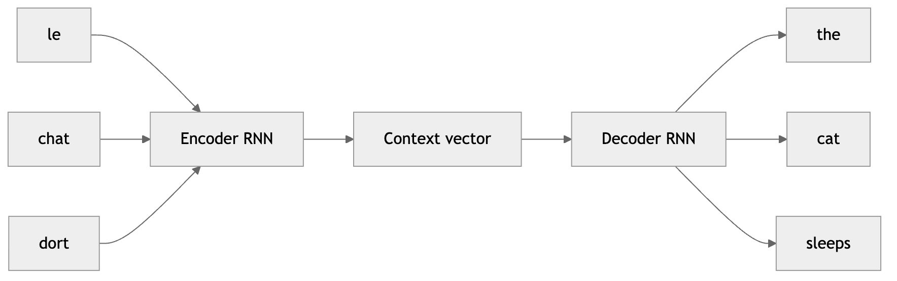

*Figure 291. An encoder-decoder for translation. The encoder squeezes the whole source sentence into one context vector that seeds the decoder, which generates the target word by word.*

### 21.9.1 Teacher Forcing and Inference

Training and inference in a seq2seq decoder differ in an important way. During training we use **teacher forcing**: at each decoder step we feed the *ground-truth* previous target token, not the token the model actually predicted. This stabilizes and speeds up learning, because early in training the model’s own predictions are nonsense and feeding them back would compound errors. The risk is **exposure bias**: at inference time there is no ground truth, so the model must consume its own predictions, and a distribution it never saw during training. Scheduled sampling (occasionally feeding the model’s own prediction during training) is one mitigation.

At inference we also face a search problem: the decoder defines a probability over the entire output sequence, and we want a high-probability sequence, not just a greedy one. **Greedy decoding** takes the single most likely token at each step, which is fast but myopic — an early locally optimal choice can doom the rest. **Beam search** keeps the $`B`$ most probable partial sequences at each step (typical $`B`$ is 4–10), expanding all of them and pruning back to $`B`$, trading compute for noticeably better outputs. This decoding machinery carries over almost unchanged to the Transformer decoders of later chapters.

One more design choice shapes every seq2seq system: the **granularity of the tokens**. Early translation systems worked at the *word* level, which keeps sequences short and meaningful but forces an enormous vocabulary and stumbles on rare or unseen words (the OOV problem again). *Character*-level models have a tiny vocabulary and no OOV at all, but their sequences are several times longer, straining the model’s memory over long spans. The winning compromise, universal today, is *subword* tokenization (BPE/WordPiece): a vocabulary of a few tens of thousands of frequent word-pieces that keeps sequences reasonably short, represents any word by composing pieces, and never encounters a truly unknown token. The choice interacts directly with everything in this chapter — longer sequences make the vanishing-gradient and bottleneck problems worse, which is one more reason subword units became standard.

### 21.9.2 The Bottleneck Problem — and the Bridge to Attention

The encoder-decoder works, but notice what it asks of a single fixed-size context vector: it must encode the *entire* meaning of a sentence — which could be fifty words long — into a few hundred numbers, and the decoder must reconstruct the whole target from that one vector. This is the **information bottleneck**. For short sentences it is fine; for long ones, translation quality degrades sharply as length grows, because early source words are squeezed out of the lone context vector. Sutskever et al. even found it helped to feed the source sentence *backwards*, so that the first source words — often aligned with the first target words — sat nearer the end of the encoder and thus survived more strongly in the final state. That such a hack helped at all was a symptom of the disease.

The fix, proposed by Bahdanau et al. in 2015, is **attention**: instead of forcing everything through one vector, let the decoder look back at *all* of the encoder’s hidden states and, at each output step, compute a weighted combination of them — focusing on the source words most relevant to the word it is currently generating. Concretely, at decoder step $`t`$ with decoder state $`\mathbf{s}_{t}`$ and encoder states $`\mathbf{h}_{1},\ldots,\mathbf{h}_{n}`$:

``` math
e_{t,j} = \text{score}(\mathbf{s}_{t - 1},\mathbf{h}_{j}),\quad\quad\alpha_{t,j} = \frac{exp(e_{t,j})}{\sum_{k}^{}\exp(e_{t,k})},\quad\quad\mathbf{c}_{t} = \sum_{j}^{}\alpha_{t,j}\,\mathbf{h}_{j}
```

The scores $`e_{t,j}`$ measure how relevant source position $`j`$ is to the current output step; the softmax turns them into **attention weights** $`\alpha_{t,j}`$ that sum to one; and the **context vector** $`\mathbf{c}_{t}`$ is the resulting weighted average of encoder states, now computed *afresh at every output step* rather than fixed once. The decoder uses $`\mathbf{c}_{t}`$ alongside its own state to predict the next token. Two classic scoring functions differ in detail:

- **Bahdanau (additive) attention** feeds the two states through a small feedforward network: $`\text{score}(\mathbf{s},\mathbf{h}) = \mathbf{v}^{\top}tanh(W_{1}\mathbf{s} + W_{2}\mathbf{h})`$. It was the original formulation and uses the *previous* decoder state.
- **Luong (multiplicative) attention** uses a cheaper bilinear or dot-product score, $`\text{score}(\mathbf{s},\mathbf{h}) = \mathbf{s}^{\top}W\mathbf{h}`$ or simply $`\mathbf{s}^{\top}\mathbf{h}`$, and uses the *current* decoder state. Its dot-product form is the direct ancestor of the scaled dot-product attention at the heart of the Transformer.

To see the mechanism turn scores into a focused read, work a tiny dot-product example with three encoder states. Suppose the raw scores against the current decoder state come out as $`\mathbf{e} = (2.0,\ 0.5,\  - 1.0)`$. The softmax gives weights proportional to $`(e^{2.0},e^{0.5},e^{- 1.0}) = (7.39,\ 1.65,\ 0.37)`$, which normalize to $`\mathbf{\alpha} \approx (0.785,\ 0.176,\ 0.039)`$. The context vector is then $`\mathbf{c} = 0.785\,\mathbf{h}_{1} + 0.176\,\mathbf{h}_{2} + 0.039\,\mathbf{h}_{3}`$ — overwhelmingly the first encoder state, with a whiff of the second and almost none of the third. The decoder has *chosen where to look* for this output step, and because the whole operation is differentiable, the network learns to produce scores that place the mass on the right source words. Note that nothing here is recurrent: the read is a single, parallel, all-to-all comparison, which is exactly the property the Transformer will exploit to discard recurrence altogether.

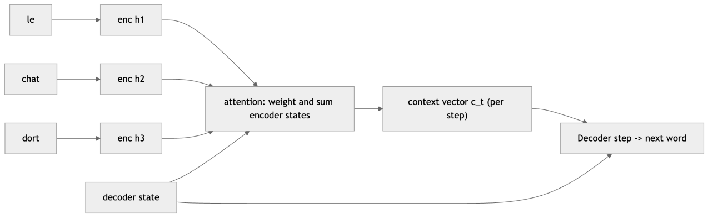

*Figure 292. Seq2seq with attention. At each output step the decoder scores every encoder state, forms attention weights, and builds a fresh context vector, removing the single-vector bottleneck.*

A valuable side effect of attention is *interpretability*: the weight matrix $`\alpha`$ is a soft alignment between source and target, and plotting it shows which source words the model looked at for each target word — usually a near-diagonal band for related languages, with off-diagonal jumps where word order differs. The figure below sketches such an alignment.

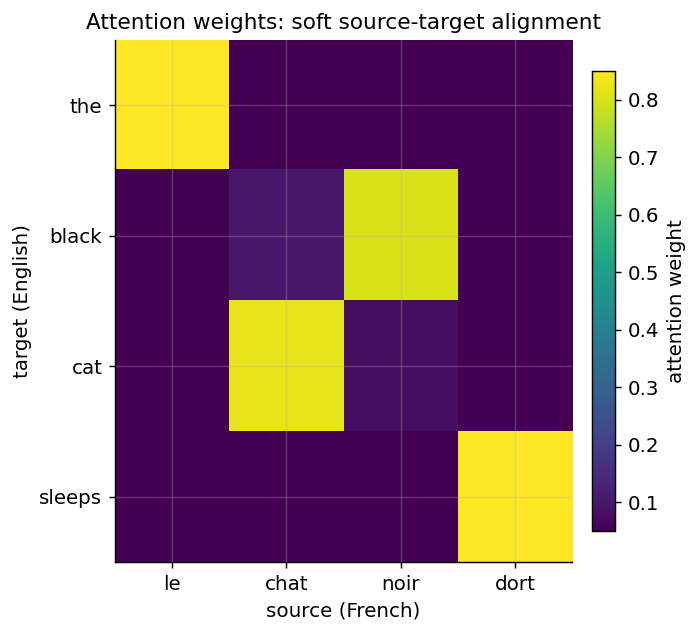

*Figure 293. An attention alignment heatmap between a French source and English target. Bright cells show where the decoder attended; the near-diagonal pattern with a reordering is typical.*

Attention fixed the *bottleneck*, but it left a second limitation of recurrence untouched — one that ultimately mattered even more. An RNN’s computation is **inherently sequential**: step $`t`$ cannot begin until step $`t - 1`$ has produced its hidden state. On a modern GPU with thousands of cores, this serialization is a straitjacket; the hardware sits mostly idle waiting for the recurrence to advance one step at a time, and training time grows linearly with sequence length with no way to parallelize across it. Once attention had shown that a decoder could reach any source position in a single hop, the natural question was whether the recurrence itself could be dropped and the *entire* sequence processed in parallel. It could.

That answer — “attention is all you need” — is the subject of the chapter on Transformers and the Attention Mechanism. The recurrent models in this chapter are thus both important in their own right and the direct ancestors of the architectures that now dominate the field: the query-key-value attention of the Transformer is a generalization of the alignment mechanism we just built on top of an RNN, freed from the sequential recurrence that constrained it.

## 21.10 Code: Implementing Recurrent Models

We will build a small **language model** — a network that predicts the next character given the characters so far — first in Keras/TensorFlow and then in PyTorch. Character-level language modeling is an ideal teaching task: it needs no external data, exercises memory, and produces output you can read.

### 21.10.1 Keras / TensorFlow

``` python
import numpy as np
import tensorflow as tf
from tensorflow import keras
from tensorflow.keras import layers

# --- Toy corpus and vocabulary ---
text = ("recurrent networks remember the past " * 200)
vocab = sorted(set(text))
stoi = {c: i for i, c in enumerate(vocab)}
itos = {i: c for c, i in stoi.items()}
V = len(vocab)

SEQ_LEN = 20
data = np.array([stoi[c] for c in text], dtype=np.int32)

# Build (input window -> next char) training pairs
X, y = [], []
for i in range(len(data) - SEQ_LEN):
    X.append(data[i:i + SEQ_LEN])
    y.append(data[i + SEQ_LEN])
X, y = np.array(X), np.array(y)

# --- Model: embedding -> LSTM -> dense softmax over vocabulary ---
model = keras.Sequential([
    layers.Input(shape=(SEQ_LEN,)),
    layers.Embedding(input_dim=V, output_dim=32),  # the learned lookup table E
    layers.LSTM(64),                               # try layers.GRU(64) to compare
    layers.Dense(V, activation="softmax"),
])
model.compile(optimizer="adam",
              loss="sparse_categorical_crossentropy",
              metrics=["accuracy"])
model.fit(X, y, epochs=5, batch_size=128, verbose=2)

# --- Generate text by sampling one character at a time ---
def generate(seed, n=60):
    idx = [stoi[c] for c in seed][-SEQ_LEN:]
    out = seed
    for _ in range(n):
        x = np.array(idx[-SEQ_LEN:])[None, :]
        probs = model.predict(x, verbose=0)[0]
        nxt = np.random.choice(V, p=probs)
        out += itos[nxt]
        idx.append(nxt)
    return out

print(generate("recurrent net"))
# Expected: after a few epochs the model reproduces the repeating phrase,
# e.g. "recurrent networks remember the past recurrent networks ..."
```

The `Embedding` layer here is exactly the lookup table from earlier in the chapter: it maps each integer character index to a learned 32-dimensional vector. Because we train it end to end, it discovers whatever representation of characters is most useful for next-character prediction — no pretraining needed on a task this small. To switch to a stacked, bidirectional variant, replace the single LSTM line with:

``` python
layers.Bidirectional(layers.LSTM(64, return_sequences=True)),  # layer 1, returns full sequence
layers.LSTM(64),                                               # layer 2, returns last state
```

`return_sequences=True` makes a recurrent layer emit its hidden state at *every* step (needed to feed another recurrent layer); the default `False` emits only the final state (needed before a classification head). Note that a bidirectional layer is inappropriate for genuine next-character *generation*, since it would need to see future characters — it is shown here only to illustrate the API.

### 21.10.2 PyTorch

The same model in PyTorch, written explicitly so the data flow is visible.

``` python
import torch
import torch.nn as nn

# --- Reuse the vocabulary/encoding from above ---
text = ("recurrent networks remember the past " * 200)
vocab = sorted(set(text))
stoi = {c: i for i, c in enumerate(vocab)}
itos = {i: c for c, i in stoi.items()}
V, SEQ_LEN = len(vocab), 20

data = torch.tensor([stoi[c] for c in text], dtype=torch.long)
X = torch.stack([data[i:i + SEQ_LEN] for i in range(len(data) - SEQ_LEN)])
y = torch.stack([data[i + SEQ_LEN] for i in range(len(data) - SEQ_LEN)])

class CharLSTM(nn.Module):
    def __init__(self, vocab_size, embed=32, hidden=64):
        super().__init__()
        self.embed = nn.Embedding(vocab_size, embed)
        self.lstm  = nn.LSTM(embed, hidden, batch_first=True)  # nn.GRU to compare
        self.fc    = nn.Linear(hidden, vocab_size)

    def forward(self, x):
        e = self.embed(x)              # (batch, seq, embed)
        out, (h, c) = self.lstm(e)     # out: (batch, seq, hidden)
        last = out[:, -1, :]           # hidden state at the final step
        return self.fc(last)           # (batch, vocab) logits

model = CharLSTM(V)
opt = torch.optim.Adam(model.parameters(), lr=1e-2)
loss_fn = nn.CrossEntropyLoss()       # expects raw logits, not softmax

for epoch in range(5):
    perm = torch.randperm(len(X))
    total = 0.0
    for i in range(0, len(X), 128):
        b = perm[i:i + 128]
        logits = model(X[b])
        loss = loss_fn(logits, y[b])
        opt.zero_grad()
        loss.backward()
        nn.utils.clip_grad_norm_(model.parameters(), 5.0)  # tame exploding grads
        opt.step()
        total += loss.item()
    print(f"epoch {epoch}  avg loss {total / (len(X) // 128):.3f}")
# Expected: loss falls steadily; sampling from the model reproduces the phrase.
```

Two details worth highlighting. First, `nn.CrossEntropyLoss` in PyTorch applies the softmax internally, so the model returns raw **logits** — do not add a softmax layer yourself, or you will apply it twice and cripple the gradients. Second, `clip_grad_norm_` implements the gradient clipping described earlier; it is cheap insurance against the exploding-gradient blowups that recurrent training is prone to. Swapping `nn.LSTM` for `nn.GRU` is a one-line change, and `nn.LSTM(embed, hidden, num_layers=2, bidirectional=True, batch_first=True)` gives a deep, bidirectional stack in a single constructor.

### 21.10.3 A Time-Series Forecasting Example

The same machinery forecasts numeric series. The changes are that the input features are real numbers rather than token indices (so no embedding layer), and the output is a regression value with a mean-squared-error loss:

``` python
import torch, torch.nn as nn

# Synthetic sine wave with noise; predict the next value from a window of past values.
t = torch.linspace(0, 50, 1000)
series = torch.sin(t) + 0.1 * torch.randn(1000)
W = 25
Xs = torch.stack([series[i:i+W] for i in range(len(series)-W-1)]).unsqueeze(-1)  # (N, W, 1)
ys = series[W+1:].unsqueeze(-1)                                                  # (N, 1)

class Forecaster(nn.Module):
    def __init__(self, hidden=32):
        super().__init__()
        self.gru = nn.GRU(1, hidden, batch_first=True)
        self.fc  = nn.Linear(hidden, 1)
    def forward(self, x):
        out, h = self.gru(x)
        return self.fc(out[:, -1, :])

model = Forecaster()
opt = torch.optim.Adam(model.parameters(), lr=1e-2)
loss_fn = nn.MSELoss()
# Chronological split: train on the first 80%, validate on the last 20% (never shuffle!)
n_train = int(0.8 * len(Xs))
for epoch in range(30):
    model.train()
    pred = model(Xs[:n_train])
    loss = loss_fn(pred, ys[:n_train])
    opt.zero_grad(); loss.backward(); opt.step()
```

Trained on the first 80% of the wave and asked to predict the last 20%, the model tracks the true signal closely, as the figure shows. The dashed vertical line marks where training data ends and forecasting begins.

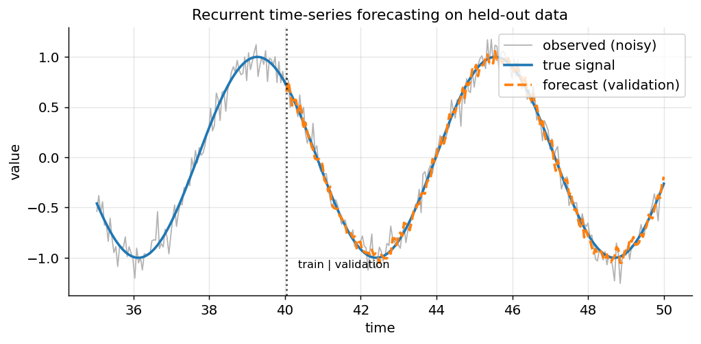

*Figure 294. A recurrent forecaster’s one-step-ahead predictions versus the true noisy sine wave on held-out data. The model tracks the signal well past the train/validation boundary.*

## 21.11 Evaluating Sequence Models

Sequence tasks need metrics that respect order and length, and the right choice depends on the task.

- **Perplexity** is the standard metric for language modeling. It is the exponentiated average per-token cross-entropy loss, $`\text{PPL} = exp\left( \frac{1}{N}\sum_{t}^{} - \log P(x_{t} \mid x_{< t}) \right)`$, and is interpreted as the model’s average “branching factor” — how many equally likely next tokens it is effectively choosing among. A perplexity of 1 is perfect prediction; lower is better. Because it is just a monotonic transform of the loss, it costs nothing to report and makes cross-model comparison intuitive (a drop from 80 to 40 means the model is, loosely, half as confused).
- **BLEU** and its relatives (ROUGE, METEOR) score generated text against one or more references by measuring n-gram overlap, with a brevity penalty so a model cannot game the score by emitting a single high-precision word. BLEU was the workhorse of machine-translation evaluation for two decades. It is imperfect — it rewards surface overlap, not meaning, and correlates only roughly with human judgment — but it is cheap and reproducible, which is why leaderboards ran on it.
- **Word error rate (WER)** governs speech recognition: the edit distance (insertions, deletions, substitutions) between the predicted and reference transcripts, divided by the number of reference words.
- For forecasting, the ordinary regression metrics apply — RMSE, MAE, and MAPE — but always computed on a *chronologically held-out* tail, and ideally compared against a naive baseline (predict tomorrow equals today) so you can tell whether the model earned its complexity.

A subtle but critical point: **teacher-forced loss overstates generative quality.** A decoder can achieve low loss while being fed ground-truth history at every step, then fall apart when it must run free and consume its own outputs. Always evaluate generation the way it will be used — free-running, with beam search or sampling — not only by the training-time loss.

### 21.11.1 A Note on Classical Sequence Models

RNNs did not appear in a vacuum. Before them, the dominant tools were **n-gram language models** — which estimate $`P(x_{t} \mid x_{t - 1},\ldots,x_{t - n + 1})`$ by counting, and are limited to a short fixed context and plagued by data sparsity — and **hidden Markov models (HMMs)**, which posit a discrete latent state evolving by a Markov transition matrix and emitting observations. HMMs powered speech recognition and part-of-speech tagging for years. The RNN generalizes both: its hidden state is a *continuous, high-dimensional* analogue of the HMM’s discrete state, updated by a learned nonlinear function rather than a fixed transition table, and it conditions on the entire history in principle rather than a fixed window. This extra capacity is exactly why RNNs overtook these classical methods once enough data and compute were available.

## 21.12 Applications

Recurrent models powered a generation of production systems and remain valuable wherever streaming, small models, or modest data favor them over Transformers.

- **Language modeling.** Predicting the next token underpins text generation, autocomplete, and spelling correction, and pretrains representations for downstream tasks. LSTMs were the state of the art here until Transformers, and the character-level model above is a miniature of the systems that once generated news snippets and code.
- **Machine translation.** The encoder-decoder seq2seq model, later augmented with attention, was the architecture behind the first wave of neural machine translation systems — most famously Google’s 2016 GNMT, an eight-layer LSTM encoder-decoder with attention that replaced a decade of phrase-based statistical machinery and cut translation errors sharply overnight.
- **Time-series forecasting.** Demand prediction, energy load, anomaly detection in sensor streams, and financial modeling all use recurrent nets to capture temporal structure that classical methods like ARIMA (from the chapter on the Machine Learning Workflow) struggle with when relationships are nonlinear or when many series must be modeled jointly. Their streaming, constant-memory inference is a genuine advantage over attention models on long or unbounded signals.
- **Speech.** Acoustic models for speech recognition and the synthesis side of text-to-speech historically relied on (often bidirectional, often deep) LSTMs to model the temporal structure of audio frames, frequently trained with the connectionist temporal classification (CTC) loss to handle the unknown alignment between audio frames and output characters.
- **Other sequential domains.** Handwriting recognition and generation, music generation, gesture and activity recognition from wearable sensors, and clickstream or session modeling for recommendation all fit the recurrent template, wherever data arrives in order and often in a stream.

It is worth being precise about when a recurrent model is still the *right* choice in a Transformer-dominated era, because the answer is “more often than the headlines suggest.” Transformers pay a cost that scales with the square of the sequence length (every position attends to every other) and, in their standard form, must hold the whole sequence in memory. A recurrent model processes one step at a time in constant memory, which makes it attractive for genuinely streaming or unbounded signals — real-time sensor monitoring, on-device keyword spotting, low-latency control loops — and for deployment on small or embedded hardware where a large attention model will not fit. When data is scarce, the strong sequential inductive bias of an RNN can also generalize better than a data-hungry Transformer. The rule of thumb: reach for a Transformer when you have long-range structure, abundant data, and parallel hardware to train on; reach for a GRU or LSTM when you are streaming, resource-constrained, or working with modest, strongly sequential data.

## 21.13 Practical Pitfalls

- **Forgetting to normalize time-series inputs.** Recurrent nets are as sensitive to feature scale as any neural net; standardize inputs (see the chapter on data preparation) and remember to *invert* the scaling on predictions before reporting them.
- **Data leakage in series splits.** Never shuffle a time series before splitting — train on the past and validate on the future, or you will leak future information into training and wildly overestimate accuracy. This is the single most common time-series mistake.
- **Using a bidirectional layer for generation.** Bidirectional RNNs need the whole sequence, so they cannot be used for autoregressive generation or real-time streaming, no matter how tempting their higher validation accuracy on analysis tasks looks.
- **Sequences too long for BPTT.** Very long sequences exhaust memory; use truncated BPTT and lean on LSTM/GRU rather than vanilla RNNs for long-range dependencies.
- **Padding without masking.** When batching variable-length sequences you pad them to equal length; you must then *mask* the padding (via a masking layer or PyTorch’s `pack_padded_sequence`) so the model does not treat pad tokens as real data or let them corrupt the final hidden state.
- **Skipping gradient clipping.** Recurrent training is unusually prone to exploding gradients; a clip norm of around 1–5 is cheap insurance and should be on by default.
- **Ignoring exposure bias.** A decoder trained only with teacher forcing can be brittle at inference when it must consume its own outputs; evaluate on free-running generation, not just teacher-forced loss.

## 21.14 Summary

- Sequential data has **variable length**, **order-dependence**, and **long-range dependencies** that feedforward networks cannot handle, because they have a fixed input size and no parameter sharing across positions.
- Words become model inputs through **embeddings** — dense, learned vectors whose geometry encodes meaning via the distributional hypothesis. **word2vec** (skip-gram/CBOW with negative sampling) and **GloVe** (global co-occurrence factorization) are the classic pretraining recipes; both are static, one-vector-per-word representations.
- A **recurrent neural network** processes a sequence one step at a time, maintaining a **hidden state** that summarizes the past, and reuses the **same weights** at every step. Unrolling the recurrence turns it into a deep computational graph trained by **backpropagation through time**.
- Vanilla RNNs suffer from **vanishing and exploding gradients** because BPTT multiplies many Jacobians together; this prevents them from learning long-range dependencies. Clipping fixes exploding gradients; vanishing gradients motivated gated cells.
- The **LSTM** adds a cell state with additive updates and three gates (forget, input, output), giving the gradient a near-constant path through time — the constant error carousel — so long-range memory survives.
- The **GRU** simplifies the LSTM to two gates (reset, update) and a single state vector; it trains faster and usually performs comparably.
- **Bidirectional** RNNs read a sequence in both directions for richer per-step context (but cannot stream), and **stacked** RNNs build depth for hierarchical temporal features.
- **Encoder-decoder** (seq2seq) models map input sequences to differently-sized output sequences via a context vector. The fixed-size context creates an **information bottleneck** for long inputs, which **attention** — and ultimately the Transformer — was invented to solve.

## 21.15 Key Takeaways

- The defining trick of an RNN is **parameter sharing across time**: one set of weights applied at every step, so a pattern learned in one position transfers to all positions and the model handles any length.
- The **hidden state is the only channel** through which the past reaches the present; everything the model remembers must fit inside it, which is why plain RNNs forget.
- **Gating is the cure for vanishing gradients.** Because the cell state is updated additively and its gradient passes through the forget gate rather than a weight matrix, an LSTM/GRU can preserve information — and its gradient — across hundreds of steps.
- **LSTM and GRU are near-equals**; prefer a GRU for speed and small data, an LSTM for the very longest or most precise dependencies. The vanilla RNN is a teaching tool, not a production choice.
- **Attention was born here**, as a fix for the seq2seq bottleneck, letting the decoder look at all encoder states rather than one summary. That idea, generalized, became the Transformer.
- Match the architecture to the task: **bidirectional and deep** for analysis, **unidirectional** for generation and streaming; and never shuffle a time series before splitting.

## 21.16 Exercises

1.  **Conceptual.** Explain precisely why a feedforward network that concatenates word embeddings into a fixed-length vector lacks “parameter sharing across time,” and why that hurts generalization. Contrast this with how a CNN shares parameters across space.

2.  **Conceptual.** One-hot vectors make every pair of distinct words equidistant. Explain how word2vec’s skip-gram objective breaks this symmetry using only unlabeled text, and describe what problem negative sampling solves and how.

3.  **Math.** Starting from $`\mathbf{c}_{t} = \mathbf{f}_{t} \odot \mathbf{c}_{t - 1} + \mathbf{i}_{t} \odot {\widetilde{\mathbf{c}}}_{t}`$, derive $`\partial\mathbf{c}_{t}/\partial\mathbf{c}_{t - 1}`$ and explain in one or two sentences why this makes the LSTM gradient resistant to vanishing, compared with the $`diag(\tanh')\, W_{hh}^{\top}`$ factor in a vanilla RNN.

4.  **Math.** Using the worked forward-pass example (hidden size 2), continue one more step with a third input $`x_{3} = - 0.5`$ and compute $`\mathbf{h}_{3}`$. Then argue informally how a single scalar change to $`x_{1}`$ would propagate to $`\mathbf{h}_{3}`$, and why that influence would shrink over many more steps.

5.  **Conceptual.** A GRU has no separate cell state and only two gates, yet it performs comparably to an LSTM on many tasks. Map each LSTM gate onto its closest GRU counterpart, and identify what functionality, if any, the GRU has dropped.

6.  **Coding.** Take the PyTorch character-LSTM example and (a) swap the `nn.LSTM` for an `nn.GRU`, (b) make it two layers with `num_layers=2`, and (c) make it bidirectional. For each change, report the parameter count and final training loss. Which change helps most on this toy task, and why might a deeper or bidirectional model *not* help here?

7.  **Coding.** Implement the time-series forecaster end-to-end: standardize the series, split chronologically into train/validation, train with `nn.MSELoss`, and plot predicted versus actual values on the validation set. Then deliberately shuffle before splitting and observe how the validation error misleads you. Report both numbers.

8.  **Conceptual.** Describe the encoder-decoder bottleneck problem in your own words, predict how translation quality should vary with source-sentence length for a model *without* attention, and sketch (in words or pseudocode) how an attention mechanism changes the decoder’s computation at each output step. Which attention scoring function is the direct ancestor of Transformer attention, and why?

---

[← 20 Natural Language Processing: Fundamentals](ch20-nlp-fundamentals.md) · [Contents](../README.md#contents) · [22 Transformers and the Attention Mechanism →](ch22-transformers.md)
