[← 21 Sequence Models: RNNs, LSTMs, and GRUs](ch21-sequence-models.md) · [Contents](../README.md#contents) · [23 Generative AI: GANs, VAEs, and Diffusion Models →](ch23-generative-models.md)

---

# 22 Transformers and the Attention Mechanism

In 2017 a single paper, provocatively titled *Attention Is All You Need*, reorganized the field of deep learning around one idea. The sequence models of the previous chapter — RNNs, LSTMs, and GRUs — process tokens one after another, carrying a memory forward through time. That sequential dependence is both their charm and their downfall: it makes them hard to parallelize and prone to forgetting. The **Transformer** discards recurrence entirely and replaces it with a mechanism called **attention**, which lets every position in a sequence look directly at every other position in a single, fully parallel step. The result scales gracefully to billions of parameters and trillions of tokens, and it is the architecture underneath every large language model you have heard of — GPT, BERT, T5, Claude, and the rest. This chapter builds the Transformer from its smallest part, the attention operation, up to the full encoder-decoder stack, and ends by bridging directly into the large language model chapters that follow.

The chapter is long because the Transformer is pivotal: almost everything in the remaining chapters — pretraining, fine-tuning, retrieval-augmented generation, agents, and multimodal models — assumes you understand attention in your bones. We will therefore not rush. We will derive scaled dot-product attention from first principles, work a numeric example by hand and then in code, assemble the encoder and decoder block by block, discuss how the model is trained and why it scales, confront the quadratic cost of attention and the tricks that tame it, and finally survey the three great families of Transformer models that the original design gave rise to.

## 22.1 Why Attention Beats Recurrence

Recall from the chapter on sequence models how a recurrent network reads a sentence. It consumes one token, updates a hidden state, consumes the next token, updates again, and so on. To relate the first word of a sentence to the last, information must survive a long chain of hidden-state updates. Two problems follow. First, **long-range dependencies decay**: gradients vanish or explode across many steps, so the model struggles to connect distant tokens even with the gating tricks of LSTMs. Second, the computation is **inherently sequential** — step $`t`$ cannot start until step $`t - 1`$ finishes — which wastes the massively parallel hardware (GPUs and TPUs) that modern training depends on.

A concrete example makes the long-range problem vivid. Consider the sentence “The keys that the man who lived down the road had lost were finally found.” To conjugate “were” correctly, the model must connect it to “keys” (plural), across a long relative clause containing the singular distractors “man” and “road.” An RNN must carry the fact that the subject is plural through every intervening word’s hidden-state update, competing with all the other information those words inject; the signal can wash out. Self-attention, by contrast, lets “were” look *directly* at “keys” in a single step, no matter how many words intervene. This ability to form long-range dependencies cheaply is not a minor efficiency gain — it changes what the model can reliably learn.

Attention attacks both problems at once. Instead of routing information through a bottleneck that travels in time, attention computes, for each position, a direct weighted combination of *all* other positions. The **path length** between any two tokens — the number of computational steps a signal must traverse to travel from one to the other — becomes constant, a single hop, regardless of how far apart they are. And because every position’s computation is independent of the others, the whole layer runs in parallel.

It is worth making the comparison precise, because it explains why the field switched wholesale. For a sequence of length $`n`$ and representation dimension $`d`$, consider three quantities: the total compute per layer, the number of *sequential* operations that cannot be parallelized, and the maximum path length between two positions.

| Layer type | Compute per layer | Sequential operations | Maximum path length |
|----|----|----|----|
| Recurrent (RNN/LSTM) | $`O(n \cdot d^{2})`$ | $`O(n)`$ | $`O(n)`$ |
| Convolutional (kernel $`k`$) | $`O(k \cdot n \cdot d^{2})`$ | $`O(1)`$ | $`O(\log_{k}n)`$ |
| Self-attention | $`O(n^{2} \cdot d)`$ | $`O(1)`$ | $`O(1)`$ |

The recurrent layer needs $`n`$ sequential steps and has a path length of $`n`$ — the worst of both worlds for long sequences. The convolutional layer parallelizes but needs a stack of $`\log_{k}n`$ layers before distant positions can interact. Self-attention parallelizes fully ($`O(1)`$ sequential operations) and connects any two positions in one hop, at the cost of $`O(n^{2})`$ compute in the sequence length. That quadratic term is the Transformer’s one Achilles’ heel, and much of the second half of this chapter is about living with it. But for the sequence lengths that dominate practice, the trade is overwhelmingly favorable, and the perfect parallelism is what unlocked training at scale.

The intuition behind attention is a **soft dictionary lookup**. In an ordinary dictionary you supply a *key* and retrieve the *value* stored under the exact matching key. Attention softens this: you supply a *query*, compare it against *every* key to get a similarity score, turn those scores into weights that sum to one, and return the weighted average of *all* the values. Nothing is retrieved exactly; everything is retrieved a little, in proportion to relevance. This differentiable, all-to-all lookup is the engine of the Transformer, and because it is differentiable, the projections that produce queries, keys, and values can all be learned by gradient descent.

That last point is what separates attention from a hand-built lookup table. A hard dictionary requires exact-match keys and cannot be trained; its gradient is zero almost everywhere. By softening the match into a weighted average, attention becomes smooth and differentiable, so the network can *learn* what to store under each key, what each query should look for, and how strongly to retrieve — all from the training loss. The mechanism is thus less a fixed data structure than a learnable, content-addressable memory that the surrounding network shapes to its needs. Keeping this “differentiable soft retrieval” picture in mind will make every later variant — cross-attention, causal masking, multiple heads — feel like natural adjustments to the same core idea rather than separate tricks to memorize.

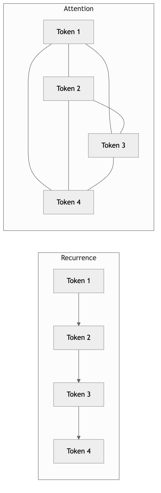

*Figure 295. Recurrence routes information sequentially through time, while attention connects all positions directly*

### 22.1.1 A brief history: how attention arrived

Attention did not appear from nowhere with the Transformer; it began as a patch on recurrent sequence-to-sequence models. Around 2014, neural machine translation used an encoder RNN to compress an entire source sentence into a single fixed-length vector, which a decoder RNN then unspooled into the target sentence. This worked for short sentences and fell apart on long ones: a single vector is a punishing bottleneck for a fifty-word sentence, and translation quality dropped sharply with length.

Bahdanau and colleagues introduced **attention** in 2014-2015 precisely to remove that bottleneck. Instead of forcing the decoder to rely on one summary vector, they let it look back at *all* of the encoder’s hidden states at every output step, computing a weighted combination whose weights (the alignment) were learned. This soft alignment let each output word draw directly from the relevant input words, and it dramatically improved long-sentence translation. Crucially, the attention weights were interpretable: plotting them recovered the word-to-word alignment between languages.

For three years attention lived as an *add-on* to recurrence — the RNN still did the heavy lifting of sequence processing, with attention bolted on to help the decoder. The radical move of *Attention Is All You Need* was to ask whether the recurrence was needed at all. The answer, it turned out, was no: with self-attention doing the within-sequence mixing, multi-head attention providing diversity, positional encodings supplying order, and feed-forward layers doing per-position computation, the RNN could be removed entirely. What had been a helper became the whole engine — hence the title. Keeping this lineage in mind demystifies the architecture: the decoder’s cross-attention is the direct descendant of Bahdanau’s original alignment mechanism.

## 22.2 Scaled Dot-Product Attention

Let us formalize the soft-lookup idea. We start with a sequence of $`n`$ input vectors, each of dimension $`d_{model}`$, stacked into a matrix $`X \in \mathbb{R}^{n \times d_{model}}`$. From $`X`$ we produce three new matrices by linear projection:

``` math
Q = XW^{Q},\quad\quad K = XW^{K},\quad\quad V = XW^{V},
```

where $`W^{Q},W^{K} \in \mathbb{R}^{d_{model} \times d_{k}}`$ and $`W^{V} \in \mathbb{R}^{d_{model} \times d_{v}}`$ are learned weight matrices. The rows of $`Q`$ are **queries**, the rows of $`K`$ are **keys**, and the rows of $`V`$ are **values**. Each token thus emits a query (“what am I looking for?”), advertises a key (“what do I offer?”), and carries a value (“what I will contribute if attended to”).

It is important to see that queries, keys, and values are three different *views* of the same underlying token, produced by three different learned matrices. A token about the word “bank” might advertise, through its key, that it is a noun related to finance or rivers; a nearby query from “money” might match the financial sense; and the value carries the semantic content that will be mixed into whoever attends to it. Because the three projections are independent, the model has the freedom to make “what I match on” different from “what I contribute” — a subtle but powerful degree of freedom.

### 22.2.1 The equation

The core operation, **scaled dot-product attention**, is compact enough to write in a single line:

``` math
\text{Attention}(Q,K,V) = \text{softmax}\left( \frac{QK^{\top}}{\sqrt{d_{k}}} \right)V.
```

Read it piece by piece:

- $`QK^{\top} \in \mathbb{R}^{n \times n}`$ is the matrix of **dot-product similarities** between every query and every key. Entry $`(i,j)`$ measures how much token $`i`$’s query aligns with token $`j`$’s key. The dot product is large and positive when the two vectors point in similar directions, near zero when they are orthogonal, and negative when they oppose — a natural, cheap similarity measure that is also a single matrix multiply.
- Dividing by $`\sqrt{d_{k}}`$ is the **scaling** step, discussed in detail below.
- The **softmax** is applied row-wise, converting each row of scores into a probability distribution — the **attention weights** — that sums to one across all keys. Softmax is a natural choice: it is smooth, differentiable, always positive, and normalized, so the output is a genuine weighted average.
- Multiplying by $`V`$ produces, for each query, a **weighted average of all value vectors**. A token that attends strongly to position $`j`$ pulls in most of $`V_{j}`$.

The output has shape $`n \times d_{v}`$: one new context-aware vector per input token. Each output vector is a blend of information drawn from wherever in the sequence was relevant.

Why the dot product rather than some other similarity? Earlier attention mechanisms used **additive attention**, which scores a query-key pair by feeding their concatenation through a small neural network with a learned weight vector. Additive and dot-product (**multiplicative**) attention have similar accuracy, but the dot product wins decisively on efficiency: it is a single dense matrix multiply, $`QK^{\top}`$, which is exactly the operation modern accelerators are optimized to run at peak throughput. The scaling by $`\sqrt{d_{k}}`$ is the small correction that makes the otherwise-preferable dot product behave well at large dimension. This is a recurring theme in the Transformer’s design — where two options are comparable in quality, the one that reduces to big matrix multiplications is chosen, because that is what scales on GPUs.

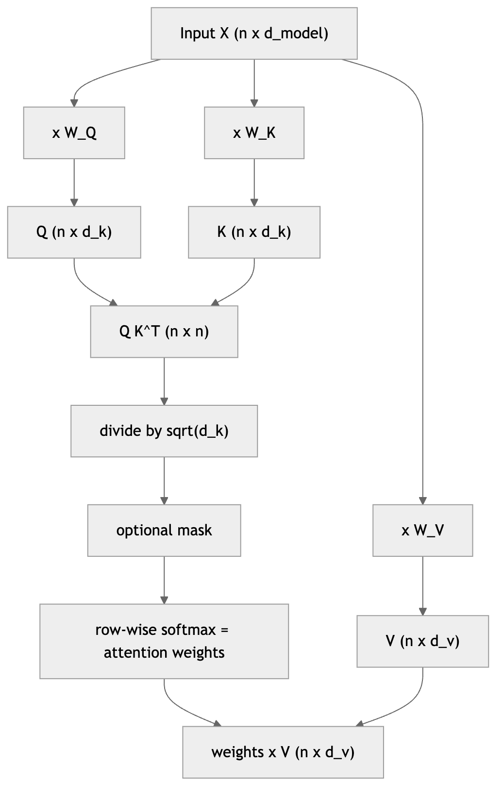

*Figure 296. The data flow inside a single scaled dot-product attention operation*

### 22.2.2 Why the scaling factor

The division by $`\sqrt{d_{k}}`$ looks like a small detail, but omitting it breaks training for large $`d_{k}`$. Suppose the components of a query vector $`q`$ and a key vector $`k`$ are independent random variables with zero mean and unit variance. A single dot-product score is

``` math
q \cdot k = \sum_{i = 1}^{d_{k}}q_{i}k_{i}.
```

Each product $`q_{i}k_{i}`$ has mean $`E\lbrack q_{i}k_{i}\rbrack = E\lbrack q_{i}\rbrack E\lbrack k_{i}\rbrack = 0`$ and variance $`E\lbrack q_{i}^{2}k_{i}^{2}\rbrack = E\lbrack q_{i}^{2}\rbrack E\lbrack k_{i}^{2}\rbrack = 1`$. Summing $`d_{k}`$ independent such terms gives a score with mean $`0`$ and **variance** $`d_{k}`$ — so the typical magnitude of a raw score grows like $`\sqrt{d_{k}}`$. For $`d_{k} = 64`$ the scores swing over a range of roughly $`\pm 8`$; for $`d_{k} = 512`$, roughly $`\pm 22`$.

Why does this matter? The softmax of a vector with one large entry saturates: it pushes almost all the weight onto a single position and drives the others toward zero. In that saturated regime the softmax’s gradient is nearly zero, so learning stalls — the model cannot adjust the attention pattern because no gradient flows. Dividing the scores by $`\sqrt{d_{k}}`$ rescales the variance back to $`1`$ regardless of $`d_{k}`$, keeping the softmax in its responsive, well-conditioned range. A quick simulation confirms the variance arithmetic: the raw dot-product variance tracks $`d_{k}`$ almost exactly, and dividing by $`\sqrt{d_{k}}`$ restores unit variance.

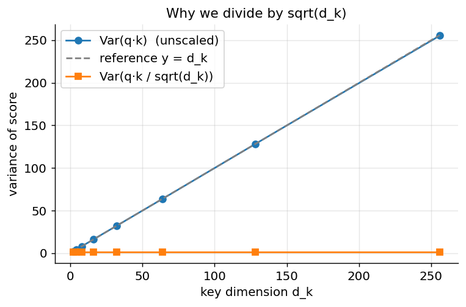

*Figure 297. Dot-product score variance grows linearly with d_k; scaling by sqrt(d_k) restores unit variance.*

### 22.2.3 A worked numeric example

Formulas become concrete when you push actual numbers through them. Take a tiny sequence of three tokens with $`d_{k} = d_{v} = 2`$. Suppose the learned projections have already produced these queries, keys, and values (we choose round numbers so the arithmetic is easy to follow):

``` math
Q = \begin{bmatrix}
1 & 0 \\
0 & 1 \\
1 & 1
\end{bmatrix},\quad K = \begin{bmatrix}
1 & 0 \\
0 & 1 \\
1 & 1
\end{bmatrix},\quad V = \begin{bmatrix}
10 & 0 \\
0 & 10 \\
5 & 5
\end{bmatrix}.
```

Focus on the first token’s query $`q_{1} = \lbrack 1,0\rbrack`$. Its raw scores against the three keys are the dot products $`q_{1} \cdot k_{1} = 1`$, $`q_{1} \cdot k_{2} = 0`$, and $`q_{1} \cdot k_{3} = 1`$. Scaling by $`\sqrt{d_{k}} = \sqrt{2} \approx 1.414`$ gives $`\lbrack 0.707,\ 0,\ 0.707\rbrack`$. Exponentiating: $`e^{0.707} \approx 2.028`$, $`e^{0} = 1`$, $`e^{0.707} \approx 2.028`$, which sum to $`\approx 5.056`$. The softmax weights are therefore

``` math
\lbrack\, 0.401,\ 0.198,\ 0.401\,\rbrack,
```

meaning token 1 attends about $`40\%`$ to itself, $`40\%`$ to token 3, and only $`20\%`$ to token 2 — sensible, since $`q_{1}`$ aligns with $`k_{1}`$ and $`k_{3}`$ but is orthogonal to $`k_{2}`$. The output for token 1 is the weighted average of the value rows:

``` math
0.401 \cdot \lbrack 10,0\rbrack + 0.198 \cdot \lbrack 0,10\rbrack + 0.401 \cdot \lbrack 5,5\rbrack = \lbrack 6.02,\ 3.98\rbrack.
```

The first coordinate is pulled up by the two value rows with large first components; the second coordinate is smaller because only token 2 (with weight $`0.198`$) and token 3 contribute to it. This is the entire mechanism in miniature: score, scale, softmax, blend. The following code reproduces the hand computation exactly and prints the intermediate matrices, which is the fastest way to build trust in the equation.

``` python
import numpy as np

def softmax(x, axis=-1):
    x = x - x.max(axis=axis, keepdims=True)     # numerical stability
    e = np.exp(x)
    return e / e.sum(axis=axis, keepdims=True)

Q = np.array([[1., 0.], [0., 1.], [1., 1.]])
K = Q.copy()
V = np.array([[10., 0.], [0., 10.], [5., 5.]])

scores  = Q @ K.T / np.sqrt(Q.shape[-1])
weights = softmax(scores, axis=-1)
output  = weights @ V

print("scaled scores:\n", np.round(scores, 3))
print("attention weights:\n", np.round(weights, 3))
print("output:\n", np.round(output, 3))
# attention weights (row 0): [0.401 0.198 0.401]
# output (row 0):            [6.017 3.983]
```

### 22.2.4 An attention heatmap

In a real sentence the learned projections produce attention patterns that reflect linguistic structure. Consider “the animal didn’t cross the street because it was tired.” To resolve what “it” refers to, the query emitted by “it” should align strongly with the key of “animal” and weakly with “street.” The softmax then places most weight on the value vector of “animal,” so the output representation of “it” becomes infused with “animal” — exactly the coreference a human reader performs. The figure below synthesizes such a pattern to show what an attention-weight matrix looks like: each row is a query, each column a key, and brighter cells mean stronger attention.

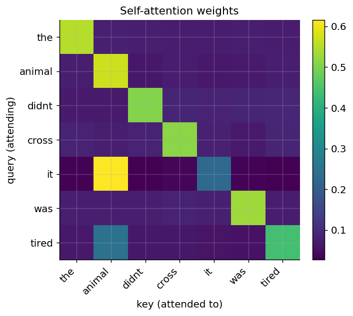

*Figure 298. An attention weight matrix; each row is a query, each column a key, brighter means more attention.*

### 22.2.5 Self-attention versus cross-attention

When $`Q`$, $`K`$, and $`V`$ all derive from the *same* sequence — as above — we call it **self-attention**: every token attends to its own sequence, including itself. Self-attention is how a model builds context-aware representations, letting each word’s meaning be shaped by its neighbors.

When the queries come from one sequence and the keys/values from another, we call it **cross-attention**. Cross-attention is how the Transformer’s decoder consults the encoder’s output: the decoder’s queries ask “what in the source is relevant to the word I am generating now?”, and the keys and values come from the encoder’s representation of the source. In machine translation, this is the mechanism by which each output word aligns to the relevant input words — a learned, soft version of the alignment tables that older statistical translation systems maintained explicitly. The distinction is purely about where $`Q`$, $`K`$, and $`V`$ come from; the arithmetic of scaled dot-product attention is identical in both cases.

Notice a shape consequence that trips up newcomers: in cross-attention the query sequence and the key/value sequence can have *different lengths*. If the source has $`m`$ tokens and the target-so-far has $`t`$ tokens, the decoder produces $`t`$ queries while the encoder supplies $`m`$ keys and values, so the score matrix is $`t \times m`$ rather than square. Everything else — scaling, softmax over the key axis, weighted sum of values — works exactly as before. This is what lets a five-word English sentence attend into a nine-word French one, or vice versa, with no special handling. Cross-attention is also where the encoder’s *fixed* representation is reused at every decoding step: the keys and values are computed once from the source and cached, while only the decoder’s queries change as generation proceeds.

### 22.2.6 Masking

Two forms of masking matter, and both are applied by setting the disallowed score entries to $`- \infty`$ (in practice a large negative number) *before* the softmax, so those weights become exactly zero afterward.

A **padding mask** zeroes out attention to padding tokens that were added to make sequences in a batch the same length. Without it, real tokens would waste attention weight on meaningless padding, and the padding would leak into the representations.

A **causal mask** (also called a look-ahead mask) prevents a position from attending to *future* positions. This is essential for autoregressive generation, where predicting token $`t`$ must not peek at tokens $`t + 1,t + 2,\ldots`$ — otherwise the model would trivially “cheat” during training by copying the answer, and would be useless at inference time when the future genuinely does not exist yet. The causal mask is a lower-triangular pattern: position $`i`$ may attend to all $`j \leq i`$ and nothing beyond. We return to it when we build the decoder.

Why set the masked scores to $`- \infty`$ rather than simply zeroing the weights after the softmax? Because zeroing weights after the fact would break the normalization — the surviving weights would no longer sum to one — and would leak a little probability mass to forbidden positions before renormalization. Injecting $`- \infty`$ (a large negative number in practice) *before* the softmax makes $`e^{- \infty} = 0`$, so the forbidden positions contribute exactly zero and the softmax renormalizes cleanly over only the allowed positions. The mask therefore lives inside the softmax, not after it, and the same trick handles padding and causality uniformly: any score you never want to contribute is driven to negative infinity before normalization.

## 22.3 Multi-Head Attention

A single attention operation forces the model to blend all kinds of relationships — syntactic, semantic, positional — into one weighted average. That is limiting: a token often needs to gather several *different* kinds of information at once. **Multi-head attention** gives the model several independent attention operations, called **heads**, running in parallel. Each head has its own projection matrices and can specialize: one head might track subject-verb agreement, another might follow coreference, another might simply attend to the previous token, and yet another might attend to the sentence’s punctuation. Empirically, trained models do develop heads with recognizable, interpretable roles.

Formally, with $`h`$ heads we project into $`h`$ lower-dimensional subspaces (typically $`d_{k} = d_{v} = d_{model}/h`$), run attention in each, concatenate the results, and project back:

``` math
\text{head}_{i} = \text{Attention}(XW_{i}^{Q},XW_{i}^{K},XW_{i}^{V}),
```

``` math
\text{MultiHead}(X) = \text{Concat}(\text{head}_{1},\ldots,\text{head}_{h})\, W^{O},
```

where $`W^{O} \in \mathbb{R}^{hd_{v} \times d_{model}}`$ recombines the heads. The key economy is that splitting $`d_{model}`$ across $`h`$ heads keeps the total computation and parameter count essentially the same as a single full-dimensional attention: each head operates in dimension $`d_{model}/h`$, and there are $`h`$ of them, so the products cancel. Multi-head attention therefore buys representational diversity almost for free. For the original base model, $`d_{model} = 512`$ and $`h = 8`$, so each head works in a $`64`$-dimensional subspace.

Why does splitting help rather than hurt, given the same total dimension? Because a single softmax can only place its mass one way. If a token needs to attend to both its syntactic head *and* the topic word of the sentence, a single head must compromise between the two; eight heads can pursue eight distinct patterns simultaneously and let $`W^{O}`$ combine them. Diversity of attention patterns, not raw dimension, is what multiple heads provide. (Later work found that many heads can be pruned after training with little loss, suggesting the mechanism is somewhat redundant — but during training the redundancy appears to help optimization.)

It helps to trace the shapes explicitly, because implementations that get them wrong are a classic source of silent bugs. Starting from input $`X`$ of shape $`(n,d_{model})`$, the three projections produce $`Q,K,V`$ each of shape $`(n,d_{model})`$, which are then *reshaped* into $`(h,n,d_{model}/h)`$ — the same numbers, reorganized so that each head owns a contiguous slice of the feature dimension. Attention runs independently within each head, producing $`h`$ outputs of shape $`(n,d_{model}/h)`$; concatenating along the feature axis rebuilds an $`(n,d_{model})`$ tensor, and the final projection $`W^{O}`$ mixes information *across* heads, which is essential — without $`W^{O}`$ the heads would never talk to one another. In batched code this becomes a four-dimensional tensor $`(B,h,n,d_{k})`$, and the entire multi-head computation is still just a couple of batched matrix multiplications, which is why it runs at full hardware efficiency despite conceptually being $`h`$ separate attention operations.

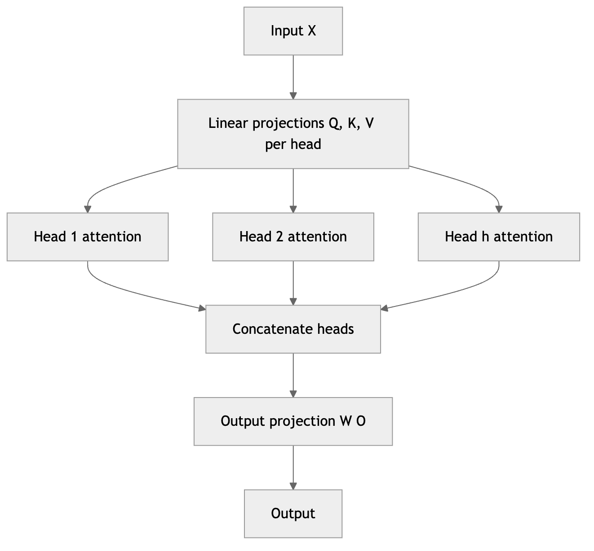

*Figure 299. Multi-head attention runs several scaled dot-product attentions in parallel and merges them*

## 22.4 Positional Encoding

Attention has a curious blind spot: it is **permutation-equivariant**. Because it computes a weighted sum over all positions with weights that depend only on content, shuffling the input tokens merely shuffles the outputs in the same way — the operation itself has no notion of order. “Dog bites man” and “man bites dog” would look identical to bare self-attention, since the set of query-key comparisons is the same either way. Since word order obviously carries meaning, we must inject **positional information** into the inputs before the first attention layer. It may seem surprising that simply *adding* a positional vector to a content embedding suffices — one might expect the two signals to interfere. But the model has ample capacity to separate them: with $`d_{model}`$ dimensions to work with, it can learn to read content from some directions of the vector space and position from others, and the attention projections can attend to either as needed. Addition, rather than concatenation, keeps the dimension fixed and lets every layer see position at no extra parameter cost.

The original Transformer uses fixed **sinusoidal positional encodings**. For position $`pos`$ and embedding dimension index $`i`$:

``` math
PE_{(pos,2i)} = sin\left( \frac{pos}{10000^{2i/d_{model}}} \right),\quad\quad PE_{(pos,2i + 1)} = cos\left( \frac{pos}{10000^{2i/d_{model}}} \right).
```

These vectors are *added* to the token embeddings (they share the dimension $`d_{model}`$). Different dimensions oscillate at different frequencies — low dimensions vary slowly across positions, high dimensions vary quickly — so each position receives a unique, smoothly varying signature, like a binary counter expressed in continuous sinusoids. Two properties make this design elegant. First, because $`sin(a + b)`$ and $`cos(a + b)`$ are linear combinations of $`\sin a,cosa,sinb,cosb`$, the encoding of position $`pos + k`$ is a fixed linear function of the encoding of position $`pos`$; the model can therefore learn to attend to *relative* offsets by learning that linear map. Second, sinusoidal encodings need no training and, in principle, extrapolate to sequence lengths longer than any seen during training.

Many modern models instead use **learned positional embeddings** — a trainable vector per absolute position, as in BERT and GPT-2. These are simple and effective but cannot extrapolate past the maximum length seen in training. Two relative-position schemes now dominate large models. **Rotary position embeddings (RoPE)** rotate the query and key vectors by an angle proportional to their position before the dot product, so the attention score depends only on the *relative* offset between two tokens; RoPE is used in LLaMA, Mistral, and many current LLMs. **ALiBi** (Attention with Linear Biases) skips positional embeddings entirely and instead adds a bias to each attention score that grows linearly with the distance between query and key, penalizing far-away tokens; it extrapolates gracefully to longer contexts. We will meet these again in the LLM chapters, where context-length extension is a central concern.

The reason relative schemes have largely displaced absolute ones is worth stating, because it recurs throughout modern LLM design. Absolute encodings hard-code “you are at position 512”; but for language, what usually matters is “the token three words back,” a *relative* fact. RoPE makes this precise with a clean geometric trick: rotating a query at position $`m`$ and a key at position $`n`$ by angles proportional to $`m`$ and $`n`$ means their dot product depends only on the difference $`m - n`$, because the rotations partially cancel. The score for two tokens thus encodes their gap directly, and — because rotation preserves vector norms — it does so without distorting the content. This relative structure is also what lets RoPE-based models be stretched to longer contexts after training by interpolating the rotation frequencies, a now-standard technique for extending context windows without full retraining.

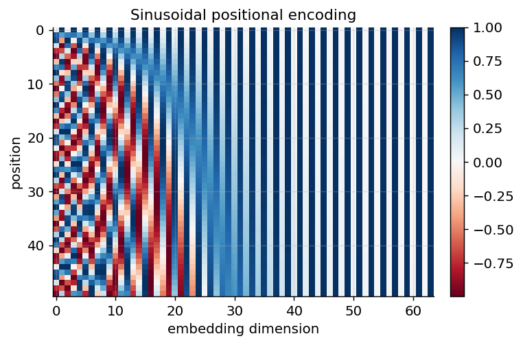

*Figure 300. Sinusoidal positional encodings; each row is a position, each column an embedding dimension.*

The reason the model can read *relative* position out of these encodings is visible if you compute the dot-product similarity between the positional vector at a reference position and the vectors at every other position. The similarity is highest at the reference and falls off smoothly and symmetrically with distance, and — crucially — the shape of that falloff is roughly the same wherever you place the reference. A relative offset of “three tokens away” therefore has a consistent signature that an attention head can learn to detect, independent of absolute location. The next figure shows this by correlating the encoding at position 20 with all others.

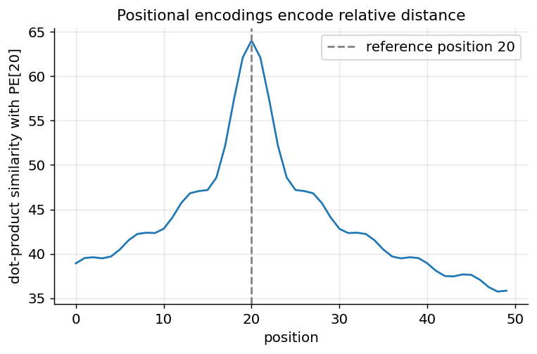

*Figure 301. Similarity between the positional encoding at position 20 and every other position falls off with distance.*

## 22.5 The Input: Embeddings and the Vocabulary

Before the encoder or decoder sees anything, the integer token ids from the tokenizer must become vectors. An **embedding matrix** $`E \in \mathbb{R}^{|V| \times d_{model}}`$ holds one learned vector per vocabulary entry; looking up a token id selects its row. These embedding vectors are parameters, trained jointly with everything else, and after training they arrange themselves so that related tokens sit near one another in the $`d_{model}`$-dimensional space — the distributed representations discussed in the sequence-models chapter, now learned end to end.

Two small but consequential details attach here. First, the original Transformer scales the embeddings by $`\sqrt{d_{model}}`$ before adding the positional encodings, so that the token signal and the positional signal have comparable magnitude. Second, the input embedding matrix is often **tied** to the output projection that produces logits over the vocabulary — the same matrix is used to map tokens *in* and to score tokens *out*. Weight tying saves a large number of parameters (the vocabulary can be tens of thousands of rows wide) and typically improves quality, because the notion of “what this token means” and “when to predict this token” are two sides of one representation. The embedding matrices are frequently among the largest single parameter blocks in a model, which is one reason vocabulary size is a real design decision rather than an afterthought.

## 22.6 The Full Transformer Architecture

With attention, multi-head attention, and positional encoding in hand, we can assemble the complete model. The original Transformer is an **encoder-decoder** designed for sequence-to-sequence tasks such as machine translation. The encoder turns an input sequence into a stack of context-rich representations; the decoder generates the output sequence one token at a time, attending both to its own past outputs and to the encoder’s representations.

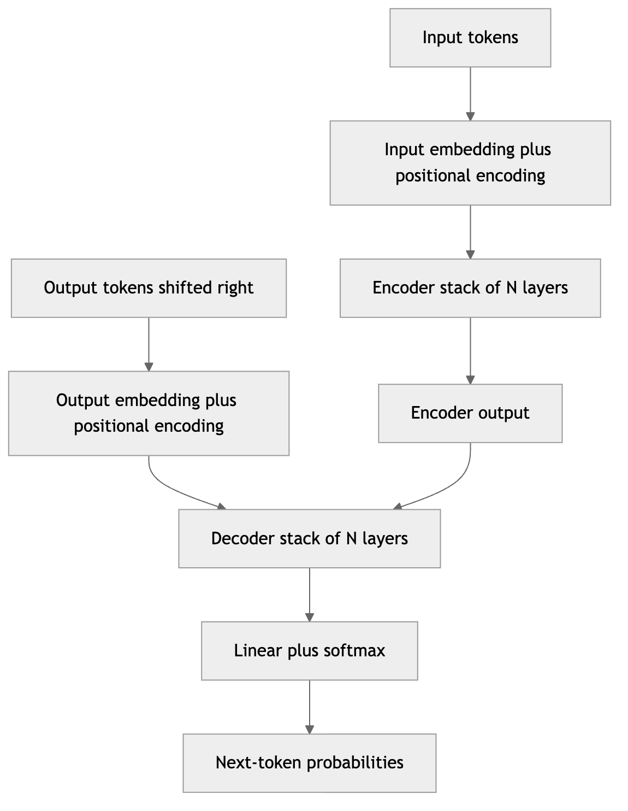

*Figure 302. The full Transformer with a stack of N encoder layers feeding a stack of N decoder layers*

### 22.6.1 Inside an encoder layer

Each encoder layer has two **sublayers**:

1.  A **multi-head self-attention** sublayer, where every input position attends to every other input position. This is where information mixes *across* positions.
2.  A **position-wise feed-forward network (FFN)**, a small two-layer MLP applied independently and identically to each position:

``` math
\text{FFN}(x) = max(0,xW_{1} + b_{1})W_{2} + b_{2}.
```

The FFN typically expands the dimension fourfold in its hidden layer (e.g., $`d_{model} = 512 \rightarrow 2048 \rightarrow 512`$), giving the model nonlinear processing capacity at each position *after* attention has mixed information across positions. A useful mental model is a rhythm: attention gathers context, then the FFN digests it, layer after layer. Although the FFN is called “position-wise” because it treats every position identically and independently, it holds a large share of the model’s parameters — in big models the FFNs dominate the parameter count, and recent research views them as a kind of key-value memory storing factual associations. Modern models often replace the ReLU with a smoother gated activation such as GELU or SwiGLU.

Two design elements wrap each sublayer and are essential to training deep stacks:

- **Residual (skip) connections**: the input of each sublayer is added to its output, $`x + \text{Sublayer}(x)`$. As discussed in the chapter on training deep networks, residuals give gradients a direct path and let very deep stacks train without vanishing gradients. They also mean each sublayer only has to learn a *refinement* of its input rather than a full transformation.
- **Layer normalization**: applied around each sublayer to stabilize activations by normalizing each token’s feature vector to zero mean and unit variance (with learned scale and shift). The original paper uses *post-norm*, $`\text{LayerNorm}(x + \text{Sublayer}(x))`$; most modern implementations use *pre-norm*, $`x + \text{Sublayer}(\text{LayerNorm}(x))`$, which keeps a clean residual highway from input to output and trains far more stably at depth. The switch to pre-norm is one of the quiet reasons very deep Transformers became trainable. Note that layer normalization normalizes across the *feature* dimension of a single token, independent of batch size and sequence length — which is exactly why it suits variable-length sequences better than batch normalization, whose statistics would leak across positions and depend on the batch.

A productive way to see the whole stack, popular in mechanistic-interpretability research, is the **residual stream**. Because every sublayer is wrapped in a residual connection, the running sum $`x`$ that flows from the embedding at the bottom to the output at the top is never overwritten — each attention and feed-forward sublayer only *adds* a correction to it. The residual stream is thus a shared communication channel of width $`d_{model}`$: attention heads *read* from it (via their query, key, and value projections) and *write* to it (via the output projection), and feed-forward layers do the same. Information deposited by an early layer remains available to every later layer unless something explicitly overwrites it. This picture explains why residuals are not a mere optimization trick but a structural feature: they are the bus along which the model’s components pass messages, and depth simply means more rounds of reading and writing to that bus.

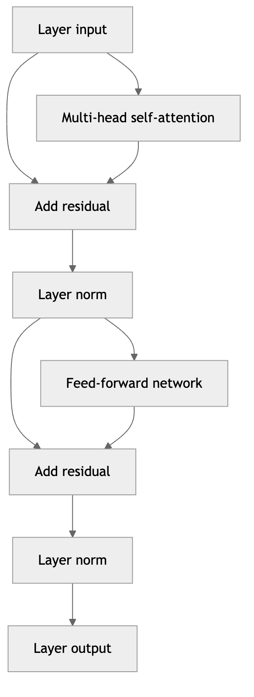

*Figure 303. One encoder layer with two residual sublayers, self-attention and feed-forward*

### 22.6.2 Inside a decoder layer

Each decoder layer has *three* sublayers:

1.  A **masked multi-head self-attention** sublayer over the output tokens generated so far, with a causal mask so position $`t`$ cannot see future positions. This lets the decoder build a representation of what it has produced up to now.
2.  A **multi-head cross-attention** sublayer, where queries come from the decoder and keys/values come from the encoder output — this is how the decoder reads the input. Here the causal mask does not apply, because the entire source is available.
3.  A **position-wise feed-forward network**, as in the encoder.

Each sublayer again has residual connections and layer normalization. After the final decoder layer, a linear projection maps each position’s vector to the size of the vocabulary, and a softmax turns those logits into a probability distribution over the next token. Often the output projection matrix is *tied* to the input embedding matrix (they share weights), which saves parameters and tends to improve quality. The original base model used $`N = 6`$ layers in both stacks, $`d_{model} = 512`$, $`h = 8`$ heads, and an FFN hidden size of $`2048`$ — roughly 65 million parameters, tiny by today’s standards, yet it set a new state of the art in translation.

Why stack many identical layers at all? Because each layer can only mix information one “hop” through attention and refine it once through the feed-forward network. Stacking layers lets the model build progressively more abstract representations: lower layers in a trained Transformer tend to capture surface features such as adjacency and part of speech, middle layers capture syntax and phrase structure, and upper layers capture semantics and task-specific abstractions. The residual stream carries the running representation upward while each layer edits it, so depth translates directly into representational refinement. This is the same hierarchical-features story told for convolutional networks in the vision chapter, now applied to sequences — and it is why simply adding layers (with pre-norm to keep training stable) reliably increases capacity.

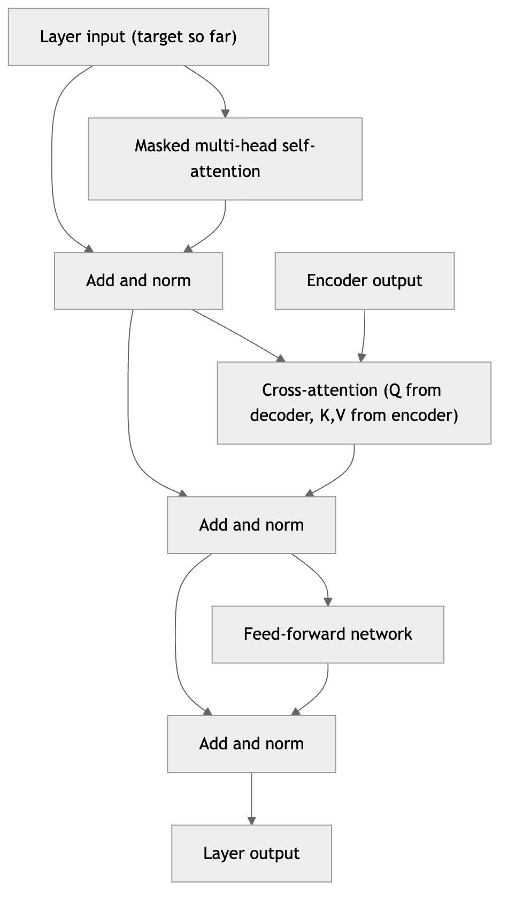

*Figure 304. One decoder layer with three residual sublayers: masked self-attention, cross-attention, feed-forward*

### 22.6.3 The complete forward pass, end to end

It is worth assembling the pieces into a single narrative, because the individual sections can obscure how simple the overall flow is. Suppose we translate a source sentence. (1) The source tokens are looked up in the embedding matrix, scaled by $`\sqrt{d_{model}}`$, and added to positional encodings. (2) This flows through $`N`$ encoder layers, each applying multi-head self-attention (every source token gathering context from every other) and a position-wise feed-forward network, with residual connections and layer normalization around both; the output is a set of $`m`$ context-rich source vectors. (3) On the decoder side, the target tokens generated so far are likewise embedded and positioned, then passed through $`N`$ decoder layers. Each decoder layer first applies *masked* self-attention (so the target attends only to its own past), then *cross-attention* into the frozen encoder vectors (so each target position pulls in relevant source information), then a feed-forward network — again all residual-and-normalized. (4) The final decoder vectors are projected by the output matrix to vocabulary-sized logits, and a softmax yields the next-token distribution. During training this happens for all target positions at once under teacher forcing; during inference it happens one token at a time with a KV cache. Every symbol in the architecture diagram now has a job you can name, and the same skeleton — minus the encoder and cross-attention — is exactly a GPT-style language model.

## 22.7 Training the Transformer

Understanding how a Transformer is trained explains several of its design choices and its extraordinary training efficiency.

**Teacher forcing and parallel training.** During training on a sequence-to-sequence task, we know the entire target sequence in advance. Rather than generating one token at a time and feeding the model’s own (possibly wrong) predictions back in, we feed the model the *ground-truth* target sequence, shifted right by one position, and ask it to predict each next token. This is **teacher forcing**. Combined with the causal mask, it lets the decoder be trained on all positions of the target *simultaneously* in a single forward pass: the mask guarantees that the prediction at position $`t`$ depends only on ground-truth tokens $`1\ldots t`$, never on the future it is trying to predict. This is the crucial reason Transformers train so much faster than RNNs, which must unroll step by step even during training. The one wrinkle is *exposure bias*: at inference the model consumes its own outputs, a distribution it never saw during teacher-forced training, which can let errors compound. In practice, scale and good decoding strategies keep this manageable.

**The loss.** The training objective is the average **cross-entropy** between the predicted next-token distribution and the true next token, summed over every position:

``` math
\mathcal{L} = - \frac{1}{T}\sum_{t = 1}^{T}\log p_{\theta}(y_{t} \mid y_{< t},x).
```

Minimizing this is exactly maximum-likelihood language modeling — teaching the model to assign high probability to the actual continuations in the training data.

**Label smoothing.** Rather than training against a one-hot target that demands probability $`1.0`$ on the correct token and $`0`$ everywhere else, the original Transformer uses **label smoothing**: the target distribution places $`1 - \epsilon`$ (say $`0.9`$) on the correct token and spreads the remaining $`\epsilon`$ uniformly over the vocabulary. Concretely, with $`\epsilon = 0.1`$ and a vocabulary of $`32,000`$ tokens, the correct token’s target becomes $`0.9`$ and every other token receives $`0.1/31,999 \approx 3 \times 10^{- 6}`$ instead of exactly zero. Pushing a one-hot target through cross-entropy rewards the model for driving the correct logit toward $`+ \infty`$ and the rest toward $`- \infty`$ — encouraging brittle over-confidence and poorly calibrated probabilities. The smoothed target caps how sharp the model is asked to be. This discourages over-confidence, improves calibration, and — perhaps counterintuitively — improves downstream accuracy and BLEU even though it slightly worsens the raw loss, since the model is being scored against a target it is deliberately forbidden from perfectly matching.

**Optimization schedule.** Transformers are typically trained with the Adam optimizer and a distinctive **learning-rate warmup**: the learning rate rises linearly for the first several thousand steps and then decays (in the original, proportionally to the inverse square root of the step number). The warmup matters because, early in training, the attention patterns and layer-norm statistics are unstable; a large learning rate at step one can send the model into a bad region it never recovers from. Dropout is applied to the attention weights, the sublayer outputs, and the embeddings for regularization. These ingredients — Adam, warmup then decay, dropout, label smoothing — form the standard recipe that later scaled to enormous models with remarkably few changes.

**How big are these models?** The table below gives a feel for the scale of the original Transformer against a few later landmarks, to show both how modest the 2017 model was and how few of the *structural* choices changed as the parameter count grew by four orders of magnitude. What changed was mostly size, data, and the positional and normalization details — not the core mechanism.

| Model | Layers | $`d_{model}`$ | Heads | Parameters | Family |
|----|----|----|----|----|----|
| Transformer base (2017) | 6 + 6 | 512 | 8 | ~65M | Encoder-decoder |
| BERT-base | 12 | 768 | 12 | ~110M | Encoder-only |
| GPT-2 (large) | 36 | 1280 | 20 | ~774M | Decoder-only |
| T5-base | 12 + 12 | 768 | 12 | ~220M | Encoder-decoder |
| GPT-3 | 96 | 12288 | 96 | ~175B | Decoder-only |

The near-constancy of the recipe across this range is itself a remarkable fact, and it is why the Transformer is often described as a general-purpose *substrate* rather than a task-specific architecture.

## 22.8 Computational Complexity and Efficient Attention

The Transformer’s one structural weakness is the cost of attention in the sequence length. The score matrix $`QK^{\top}`$ has shape $`n \times n`$, so both the compute and the memory of a single attention layer scale as $`O(n^{2})`$. Doubling the context length quadruples the attention cost; a context of tens of thousands of tokens produces a score matrix with hundreds of millions of entries. This quadratic wall is why early Transformers were limited to a few hundred or a couple thousand tokens, and why extending context length is a recurring research theme.

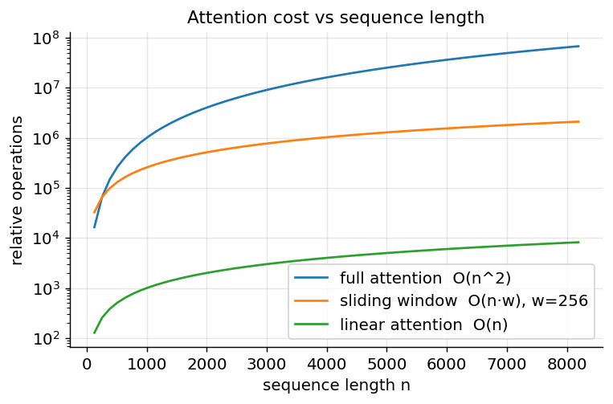

*Figure 305. Attention cost grows quadratically with sequence length, while efficient variants grow far more slowly.*

A family of **efficient-attention** methods attacks this cost, and they fall into a few conceptual groups.

- **Sparse attention** restricts each query to a subset of keys instead of all $`n`$. A **sliding-window** (local) pattern lets each token attend only to a fixed window of $`w`$ neighbors, giving $`O(n \cdot w)`$ cost; adding a few **global** tokens that everyone attends to (as in Longformer and BigBird) restores long-range reach cheaply. Sparse patterns trade some expressiveness for large savings and work well when relevant information is mostly local.
- **Linear attention** rewrites the operation to avoid ever forming the $`n \times n`$ matrix. By replacing the softmax with a kernel feature map $`\phi( \cdot )`$, attention can be reordered from $`(\phi(Q)\phi(K)^{\top})V`$ to $`\phi(Q)(\phi(K)^{\top}V)`$; the second grouping computes a small $`d \times d`$ summary of the keys and values first, giving $`O(n)`$ cost. The catch is that the kernel approximation is not exactly softmax, so quality can suffer.
- **FlashAttention** takes a different tack: it computes *exact* attention but reorganizes the computation to be I/O-aware. The naive implementation writes the full $`n \times n`$ score matrix to slow high-bandwidth GPU memory and reads it back; FlashAttention tiles the computation so that blocks of scores are produced, softmaxed, and consumed entirely inside fast on-chip SRAM, never materializing the full matrix. The asymptotic compute is still $`O(n^{2})`$, but the memory traffic drops dramatically, yielding large real-world speedups and $`O(n)`$ memory. Because it changes *how* attention is computed rather than *what* is computed, it is a drop-in replacement with no loss of accuracy, and it is now standard in production training.

The rule of thumb: sparse and linear attention change the mathematics to reduce asymptotic cost (accepting some approximation), while FlashAttention keeps the mathematics exact and optimizes the hardware execution. Modern long-context models often combine ideas — for example, FlashAttention for the kernel plus a sliding-window pattern for locality.

To make the quadratic wall concrete, consider the memory of the score matrix alone. With a batch of size $`B`$, $`h`$ heads, and sequence length $`n`$, the attention weights occupy $`B \cdot h \cdot n^{2}`$ numbers. For a single sequence with $`16`$ heads at $`n = 2,000`$, that is about $`64`$ million values — a few hundred megabytes in $`32`$-bit precision, per layer, and it must be held for the backward pass during training. Quadruple the length to $`n = 8,000`$ and the same matrix balloons past a billion values per layer. This is why naive long-context training exhausts GPU memory so abruptly, and why FlashAttention’s refusal to ever materialize that matrix — it recomputes small tiles on the fly instead of storing the whole thing — is such a decisive practical win even though the arithmetic it performs is identical.

## 22.9 Tokenization: Turning Text into Tokens

Before any of this math runs, text must become integers. A Transformer operates on a fixed **vocabulary** of tokens, each mapped to an embedding vector. The naive choices are poor: word-level vocabularies explode in size and choke on unseen words, while character-level vocabularies make sequences punishingly long (and long sequences are expensive, as the previous section showed). Modern systems use **subword tokenization**, which strikes a balance by breaking rare words into reusable pieces while keeping common words intact.

- **Byte-Pair Encoding (BPE)**, used by GPT models, starts from individual characters (or raw bytes) and repeatedly merges the most frequent adjacent pair into a new token, building up a vocabulary of subwords. “tokenization” might split into `token` + `ization`; an unknown name splits into known fragments. Byte-level BPE guarantees any string is representable, so there are no out-of-vocabulary failures.
- **WordPiece**, used by BERT, is similar but chooses merges that maximize the likelihood of the training corpus rather than raw frequency, and marks word-continuation pieces with a `##` prefix (e.g., `play`, `##ing`).
- **SentencePiece / Unigram** models treat tokenization as a probabilistic segmentation problem and operate directly on raw text without pre-tokenizing on whitespace, which helps for languages without spaces.

| Scheme | Used by | Granularity | Out-of-vocabulary handling |
|----|----|----|----|
| Word-level | Older NLP | Whole words | Fails on unseen words |
| Character-level | Some models | Single characters | Robust but very long sequences |
| BPE | GPT family | Subword (frequency merges) | Splits into known pieces |
| WordPiece | BERT family | Subword (likelihood merges) | Splits with `##` continuation |
| Unigram / SentencePiece | T5, LLaMA | Subword (probabilistic) | Robust, language-agnostic |

A concrete walk-through makes the mechanics clear. Take BPE and the toy corpus fragment where the pieces `low`, `er`, `est`, and `new` are already frequent merges. The word “lowest” tokenizes as `low` + `est`, “newer” as `new` + `er`, and a never-before-seen word such as “lowestest” as `low` + `est` + `est` — every unknown string decomposes into known fragments, so there is no out-of-vocabulary failure, only longer token sequences. This is the payoff of subword schemes: a vocabulary of, say, 50,000 tokens covers common words as single units for efficiency while still representing any rare or novel string by falling back to smaller pieces.

A practical consequence: token counts are not word counts. English averages roughly 1.3 tokens per word, which matters for context-window limits and API billing, as we will discuss in the LLM chapters. Tokenization also has subtle failure modes — numbers can fragment digit by digit (a reason models historically struggled with arithmetic), code indentation and rare Unicode can explode into many tokens, and the *same* word can tokenize differently depending on whether it has a leading space. A model can only ever reason about text through the lens of its tokenizer, so tokenizer quirks quietly shape what the model finds easy or hard.

## 22.10 Transformer Families: Encoder-Only, Decoder-Only, Encoder-Decoder

The original architecture has three living descendants, each keeping a different part of the design and excelling at different tasks. The split is one of the most useful organizing ideas in modern NLP, because it tells you at a glance what a model is good for.

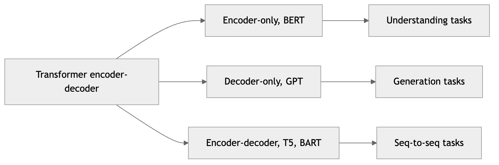

*Figure 306. Three Transformer families derived from the original encoder-decoder design*

### 22.10.1 Encoder-only (BERT)

**BERT** (Bidirectional Encoder Representations from Transformers) keeps only the encoder stack. Because the encoder uses unmasked self-attention, every token sees the entire sentence in both directions, producing deeply contextual representations that fuse left and right context. BERT is pretrained with **masked language modeling (MLM)**: about $`15\%`$ of tokens are replaced with a `[MASK]` placeholder (or, occasionally, a random or unchanged token), and the model must predict the originals from the surrounding context. Because the model may look both ways, MLM forces it to build a genuinely bidirectional understanding — the reason encoder-only models are so strong at *understanding* rather than *generating*. The original BERT added a next-sentence-prediction objective, later shown to be largely unnecessary and dropped by RoBERTa.

This bidirectional context makes encoder-only models excellent at classification, named-entity recognition, extractive question answering, and sentence-embedding similarity. You attach a small task-specific head to the encoder and fine-tune. What they cannot do is generate fluent text token by token — you do not sample stories from BERT, because it was never trained to model $`p(\text{next token} \mid \text{past})`$.

A subtle but important wrinkle of MLM is the **pretrain-finetune mismatch**: the `[MASK]` token appears constantly during pretraining but never during fine-tuning or inference, so the model would over-rely on a symbol it will never see again. BERT’s mitigation is to replace only $`80\%`$ of the chosen tokens with `[MASK]`, swap $`10\%`$ for a random token, and leave $`10\%`$ unchanged, forcing the model to build robust representations of *every* position rather than only the masked ones. Later encoder-only models refined this recipe: RoBERTa trained longer on more data with dynamic masking and dropped next-sentence prediction; DeBERTa added disentangled position-and-content attention; ELECTRA replaced masking with a more sample-efficient “replaced-token detection” objective. The family remains the workhorse for embedding and retrieval systems, where its bidirectional, non-generative representations are exactly what a similarity search needs.

### 22.10.2 Decoder-only (GPT)

**GPT** (Generative Pretrained Transformer) keeps only the decoder stack, minus the cross-attention sublayer (there is no separate encoder to attend to). It uses **causal self-attention** so each token attends only to the past, and is pretrained on the simplest possible objective: **predict the next token**. This single objective, scaled up, turns out to be astonishingly general — next-token prediction over a huge corpus forces the model to learn grammar, facts, translation, arithmetic, code, and chains of reasoning, because all of these are needed to predict text well. The same trained model can then perform a task simply by being *prompted*, with no architectural change — the phenomenon of in-context learning that the LLM chapters explore.

Because the objective is causal, a decoder-only model produces a prediction at *every* position in one forward pass during training — position $`t`$ predicts token $`t + 1`$ using only tokens $`1\ldots t`$, enforced by the causal mask. This means a single sequence of length $`n`$ yields $`n`$ training signals, making the objective extraordinarily data-efficient in the sense that every token teaches the model something. It is also why the same pass that trains the model can, with the KV cache, generate from it: training and inference share the identical causal structure.

Decoder-only models dominate today’s generative landscape; GPT, Claude, LLaMA, Mistral, Gemini, and most frontier LLMs are decoder-only Transformers. Their appeal is uniformity and scale: one stack, one objective, one way to use the model for everything from chat to code completion. Later members of the family differ from GPT-2 mostly in the details this chapter has flagged — RoPE or ALiBi positions instead of learned embeddings, pre-norm with RMSNorm, gated SwiGLU feed-forward layers, and grouped-query attention to shrink the KV cache — but the causal, next-token skeleton is unchanged. The LLM chapters are devoted almost entirely to this family.

### 22.10.3 Encoder-decoder (T5, BART)

**T5** and **BART** keep the full encoder-decoder design. The encoder reads an input with bidirectional attention, and the decoder generates an output while cross-attending to it. This shines on genuine sequence-to-sequence tasks where input and output differ in length and content: translation, summarization, and T5’s “text-to-text” framing in which *every* task — classification, QA, translation, even regression — is cast as generating a target string from a source string. That framing is elegant: T5 prepends a task prefix such as “translate English to German:” or “summarize:” to the input and trains one model to produce the right target string for all of them, so a single set of weights handles a whole benchmark suite. T5’s pretraining objective is **span corruption**: contiguous spans of the input are replaced by sentinel tokens and the decoder learns to emit the missing spans — a middle ground between BERT’s single-token masking and GPT’s next-token prediction. BART instead pretrains as a denoising autoencoder over several corruption types (masking spans, deleting tokens, shuffling sentences) and learns to reconstruct the original, which suits it to summarization and generative repair. Encoder-decoder models offer the best of both worlds for transduction — bidirectional understanding of the source plus fluent generation of the target — at the cost of more parameters and the architectural complexity of maintaining two stacks with cross-attention between them. As decoder-only models grew powerful enough to absorb transduction tasks through prompting, the encoder-decoder family narrowed toward specialized, efficient translation and summarization use, though it remains strong and widely deployed there.

| Family | Attention | Pretraining objective | Best at | Examples |
|----|----|----|----|----|
| Encoder-only | Bidirectional | Masked LM | Understanding, embeddings, classification | BERT, RoBERTa, DeBERTa |
| Decoder-only | Causal | Next-token prediction | Open-ended generation, chat, reasoning | GPT, Claude, LLaMA, Mistral |
| Encoder-decoder | Bi + cross + causal | Span corruption / denoising | Translation, summarization, seq-to-seq | T5, BART, mT5 |

### 22.10.4 Why the decoder-only family won at scale

It is worth pausing on why the field converged on decoder-only models for the largest systems. Next-token prediction requires no labeled data — the label is simply the next token — so it can consume essentially the entire internet. The single objective and single stack make scaling engineering simpler. And in-context learning means one pretrained model handles unboundedly many tasks through prompting, without the per-task fine-tuning that encoder-only models require. Encoder-only and encoder-decoder models remain excellent and efficient for their niches — embeddings, retrieval, focused transduction — but the general-purpose frontier is decoder-only.

### 22.10.5 Pretraining and fine-tuning: the transfer-learning paradigm

All three families share a workflow that is arguably as important as the architecture itself: **pretrain then adapt**. A model is first *pretrained* on a massive, unlabeled or self-labeled corpus with a self-supervised objective (masked or next-token prediction), which is expensive and done once. The resulting model has absorbed broad knowledge of language, facts, and reasoning patterns. It is then cheaply *adapted* to specific tasks. This decoupling is what made Transformers economically transformative: the enormous cost of learning language is amortized across every downstream use.

Adaptation takes several forms, in rough order of cost. **Full fine-tuning** continues gradient descent on all the model’s weights using a modest labeled dataset for the target task — standard for encoder-only models, where you bolt a small classification head onto the `[CLS]` representation and train. **Parameter-efficient fine-tuning** (PEFT), such as LoRA, freezes the pretrained weights and trains only a small number of added parameters, cutting memory and storage dramatically while nearly matching full fine-tuning; it is the norm for adapting large models and is covered in the LLMs in Practice chapter. **Prompting and in-context learning** adapt a decoder-only model with *no* weight changes at all: the task is described, optionally with a few examples, directly in the input. And **instruction tuning** plus **reinforcement learning from human feedback** further shape a pretrained model into a helpful assistant — the pipeline behind chat models, developed in the LLM chapters. The through-line is that the Transformer you have just learned to build is almost never trained from scratch by practitioners; it is downloaded, pretrained, and adapted.

## 22.11 Why Transformers Parallelize and Scale

The headline advantage is parallelism. Within a layer, all $`n`$ positions are processed simultaneously: the attention scores are a single matrix multiply $`QK^{\top}`$, and the FFN applies to all positions at once. During training, even the autoregressive decoder runs in parallel across the sequence thanks to teacher forcing plus causal masking — the model sees the whole target sequence and predicts every next-token in one forward pass, the mask ensuring no cheating. Contrast this with an RNN, which must unroll step by step and can never fill a GPU with a long sequence’s worth of work at once.

This parallelism is what made the **scaling laws** of modern AI possible. Because Transformers map cleanly onto dense matrix multiplication — the operation GPUs and TPUs are built to do fastest — they saturate hardware throughput, and empirically their loss falls smoothly and *predictably* as you scale parameters, data, and compute together. This predictability is not a minor convenience: it means a lab can measure the loss curve on small models and forecast, before spending millions of dollars, roughly how much better a larger model will be. Few architectures in the history of machine learning have offered such a reliable “turn the crank” relationship between resources and quality, and it is the single biggest reason the Transformer, rather than some competitor, became the substrate of the current AI era.

Two consequences of this scaling deserve a preview. First, the loss follows an approximate **power law** in model size, dataset size, and compute — plotted on log-log axes it is nearly a straight line over many orders of magnitude — and later work (the “Chinchilla” analysis) showed that for a fixed compute budget, model size and data should be scaled *together* rather than pouring everything into parameters. Second, as models grow, certain capabilities appear to switch on relatively abruptly — multi-step arithmetic, instruction following, rudimentary reasoning — behaviors sometimes called **emergent abilities** because they are weak or absent in small models and become reliable past some scale. Whether these transitions are genuinely sharp or an artifact of how we measure them is debated, but the practical upshot is not: scale has repeatedly bought qualitatively new behavior, and the Transformer is the vehicle that made buying it feasible. The scaling laws and emergent abilities are a major theme of the LLM chapters.

## 22.12 Inference: Autoregressive Decoding and the KV Cache

Training is fully parallel, but *inference* in a decoder-only or encoder-decoder model is inherently sequential: to produce token $`t + 1`$ the model must first know token $`t`$, because that token becomes part of the input. Generation therefore proceeds one token at a time. At each step the model computes the next-token probability distribution, a decoding strategy chooses a token from it, that token is appended to the sequence, and the loop repeats until an end-of-sequence token appears or a length limit is reached.

**Decoding strategies** determine *how* a token is chosen from the distribution, and they trade off quality, diversity, and determinism.

- **Greedy decoding** always takes the single highest-probability token. It is fast and deterministic but myopic — locally optimal choices can lead to bland or repetitive text and can miss a higher-probability *sequence*.
- **Beam search** keeps the $`b`$ most probable partial sequences at each step rather than committing to one, and returns the best complete sequence. It is standard for translation and other tasks with a single “correct” output, but it tends to produce generic text for open-ended generation and is more expensive.
- **Sampling** draws a token at random in proportion to the probabilities. A **temperature** parameter $`T`$ rescales the logits before the softmax ($`\text{logits}/T`$): $`T < 1`$ sharpens the distribution toward greedy behavior, $`T > 1`$ flattens it toward uniform randomness, and $`T \rightarrow 0`$ recovers greedy decoding. Pure sampling can pick absurd low-probability tokens, so it is almost always combined with truncation.
- **Top-k** sampling restricts the draw to the $`k`$ most probable tokens; **top-p** (nucleus) sampling restricts it to the smallest set of tokens whose cumulative probability exceeds $`p`$. Both prune the unreliable tail while preserving genuine diversity, and top-p adapts its cutoff to how confident the model is at each step.

These knobs are exactly the `temperature`, `top_k`, and `top_p` parameters you will meet in every LLM API, and we return to them in the LLM chapters. The figure illustrates how temperature reshapes a fixed set of logits into very different sampling distributions.

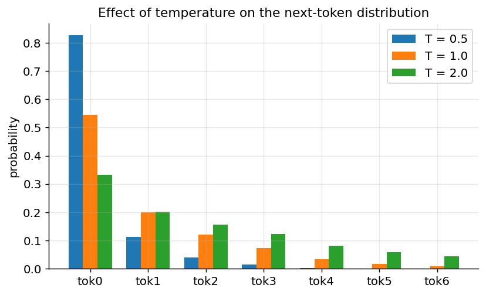

*Figure 307. Temperature reshapes the same logits: low T sharpens toward greedy, high T flattens toward uniform.*

**The KV cache.** A naive implementation would, at every generation step, recompute attention over the entire sequence from scratch — an enormous waste, since the keys and values of the already-generated tokens do not change. The **KV cache** stores the key and value vectors for every past token and every layer, so that generating a new token requires computing only the *one* new query, key, and value and attending against the cached keys and values. This turns the per-step cost from quadratic-in-length recomputation into a single incremental step, and it is what makes real-time generation feasible. The price is memory: the cache grows linearly with sequence length and with the number of layers and heads, and for long contexts it can dominate GPU memory — which is why techniques such as **multi-query attention** and **grouped-query attention** (sharing keys and values across heads to shrink the cache) have become popular in large models. The KV cache is one of the most important practical facts about deploying Transformers, and it explains why the *first* token of a response often takes longer than subsequent tokens: the first step must fill the cache for the entire prompt (the “prefill”), while later steps only extend it.

## 22.13 What Attention Heads Learn

Because attention weights are explicit numbers, we can inspect them, and doing so reveals that trained heads often specialize into interpretable roles. Common patterns include **positional heads** that reliably attend to the previous or next token, **syntactic heads** that connect verbs to their subjects or objects, **coreference heads** that link pronouns to the nouns they refer to, and **delimiter heads** that pool information at punctuation or separator tokens. In BERT-style models, researchers have catalogued heads that track direct objects, determiners, and prepositional attachments with surprising fidelity.

A particularly influential discovery in decoder-only models is the **induction head**, a two-head circuit that implements a simple but powerful copying rule: having seen the pattern “A B … A”, it predicts “B” again. Induction heads appear abruptly during training and coincide with a jump in the model’s ability to learn from context — they are believed to be a mechanistic substrate of in-context learning, the ability of an LLM to pick up a pattern from its prompt and continue it without any weight updates. We will lean on this idea when we discuss why prompting works at all.

Two cautions temper the enthusiasm. First, attention weights are not a complete explanation: a head can place large weight on a token yet contribute little to the output if the corresponding value vector is small, so attention maps are suggestive, not definitive, accounts of what the model “uses.” Second, heads are often redundant — many can be pruned after training with little damage — so a clean one-head-one-function story is an idealization. Still, the interpretability of attention is a genuine advantage over the opaque hidden states of RNNs, and it has grown into the active research program of mechanistic interpretability.

## 22.14 Scaled Dot-Product Attention from Scratch

Reading the equation is one thing; implementing it cements understanding. Here is self-attention in pure NumPy, with no framework magic, extended to support masking.

``` python
import numpy as np

def softmax(x, axis=-1):
    x = x - x.max(axis=axis, keepdims=True)      # numerical stability
    e = np.exp(x)
    return e / e.sum(axis=axis, keepdims=True)

def scaled_dot_product_attention(Q, K, V, mask=None):
    d_k = Q.shape[-1]
    scores = Q @ K.transpose(0, 2, 1) / np.sqrt(d_k)   # (batch, n, n)
    if mask is not None:
        scores = np.where(mask, scores, -1e9)          # block disallowed positions
    weights = softmax(scores, axis=-1)
    return weights @ V, weights

np.random.seed(0)
batch, n, d_k, d_v = 1, 4, 8, 8
Q = np.random.randn(batch, n, d_k)
K = np.random.randn(batch, n, d_k)
V = np.random.randn(batch, n, d_v)

out, attn = scaled_dot_product_attention(Q, K, V)
print("output shape:", out.shape)       # (1, 4, 8)
print("attention rows sum to 1:", np.allclose(attn.sum(axis=-1), 1.0))  # True

# a causal mask: position i may attend only to j <= i (lower triangular)
causal = np.tril(np.ones((n, n), dtype=bool))[None]   # (1, n, n)
out_c, attn_c = scaled_dot_product_attention(Q, K, V, mask=causal)
print("upper triangle is zero:", np.allclose(np.triu(attn_c[0], k=1), 0.0))  # True
```

The same operation in **PyTorch**, wrapped into a reusable multi-head module:

``` python
import torch
import torch.nn as nn
import torch.nn.functional as F

class MultiHeadAttention(nn.Module):
    def __init__(self, d_model=512, num_heads=8):
        super().__init__()
        assert d_model % num_heads == 0
        self.h = num_heads
        self.d_k = d_model // num_heads
        self.W_q = nn.Linear(d_model, d_model)
        self.W_k = nn.Linear(d_model, d_model)
        self.W_v = nn.Linear(d_model, d_model)
        self.W_o = nn.Linear(d_model, d_model)

    def forward(self, x, mask=None):
        B, n, _ = x.shape
        # project and split into heads: (B, h, n, d_k)
        def split(t):
            return t.view(B, n, self.h, self.d_k).transpose(1, 2)
        Q, K, V = split(self.W_q(x)), split(self.W_k(x)), split(self.W_v(x))

        scores = (Q @ K.transpose(-2, -1)) / (self.d_k ** 0.5)   # (B, h, n, n)
        if mask is not None:
            scores = scores.masked_fill(mask == 0, float("-inf"))
        attn = F.softmax(scores, dim=-1)
        context = attn @ V                                       # (B, h, n, d_k)

        context = context.transpose(1, 2).contiguous().view(B, n, -1)
        return self.W_o(context)

x = torch.randn(2, 10, 512)          # batch of 2, seq len 10
mha = MultiHeadAttention()
print(mha(x).shape)                  # torch.Size([2, 10, 512])
```

A complete encoder layer is then just this attention module plus a feed-forward network, each wrapped in a residual connection and layer normalization (shown here in the stabler pre-norm arrangement):

``` python
class EncoderLayer(nn.Module):
    def __init__(self, d_model=512, num_heads=8, d_ff=2048, dropout=0.1):
        super().__init__()
        self.attn = MultiHeadAttention(d_model, num_heads)
        self.ff = nn.Sequential(
            nn.Linear(d_model, d_ff), nn.GELU(), nn.Linear(d_ff, d_model)
        )
        self.norm1 = nn.LayerNorm(d_model)
        self.norm2 = nn.LayerNorm(d_model)
        self.drop = nn.Dropout(dropout)

    def forward(self, x, mask=None):
        x = x + self.drop(self.attn(self.norm1(x), mask))   # residual + pre-norm
        x = x + self.drop(self.ff(self.norm2(x)))           # residual + pre-norm
        return x

layer = EncoderLayer()
print(layer(torch.randn(2, 10, 512)).shape)   # torch.Size([2, 10, 512])
```

For a Keras/TensorFlow audience, multi-head attention is built in as a layer, and the same masking and shapes apply:

``` python
import tensorflow as tf

x = tf.random.normal((2, 10, 512))                 # batch 2, seq len 10
mha = tf.keras.layers.MultiHeadAttention(num_heads=8, key_dim=64)
# self-attention: query and value are the same sequence
out = mha(query=x, value=x, key=x)
print(out.shape)                                   # (2, 10, 512)

# a causal mask for autoregressive use
out_causal = mha(query=x, value=x, use_causal_mask=True)
print(out_causal.shape)                            # (2, 10, 512)
```

Because attention weights are explicit tensors, we can pull them out and inspect them per head — the raw material of the interpretability discussion earlier. The following snippet returns the weights alongside the output and confirms their shape and normalization; visualizing a single head’s matrix as a heatmap is exactly the exercise at the end of the chapter.

``` python
import torch, torch.nn.functional as F

def multihead_with_weights(x, W_q, W_k, W_v, h):
    B, n, d = x.shape
    d_k = d // h
    split = lambda t: t.view(B, n, h, d_k).transpose(1, 2)   # (B, h, n, d_k)
    Q, K, V = split(x @ W_q), split(x @ W_k), split(x @ W_v)
    scores = (Q @ K.transpose(-2, -1)) / d_k ** 0.5          # (B, h, n, n)
    weights = F.softmax(scores, dim=-1)
    out = (weights @ V).transpose(1, 2).reshape(B, n, d)
    return out, weights

torch.manual_seed(0)
d, h, n = 32, 4, 6
x = torch.randn(1, n, d)
Wq, Wk, Wv = (torch.randn(d, d) for _ in range(3))
out, weights = multihead_with_weights(x, Wq, Wk, Wv, h)
print("weights shape (B, h, n, n):", tuple(weights.shape))   # (1, 4, 6, 6)
print("each row sums to 1:", torch.allclose(weights.sum(-1), torch.ones(1, h, n)))
head0 = weights[0, 0]        # (n, n) matrix for head 0, ready to imshow
```

Before training these weights are essentially structureless — the projections are random — which is the point of the exercise: structure such as previous-token or coreference heads *emerges* from optimization, it is not built in.

## 22.15 Using a Pretrained Transformer with Hugging Face

In practice you almost never train a Transformer from scratch — you download a pretrained one and fine-tune or simply use it. The **Hugging Face** `transformers` library is the de facto hub, with a uniform API across hundreds of thousands of models. The highest-level interface is the `pipeline`:

``` python
from transformers import pipeline

# Encoder-only model for sentiment (understanding task)
classifier = pipeline("sentiment-analysis")
print(classifier("Transformers completely changed how I build NLP systems."))
# [{'label': 'POSITIVE', 'score': 0.9998}]

# Decoder-only model for text generation
generator = pipeline("text-generation", model="gpt2")
print(generator("The key idea behind attention is", max_new_tokens=20)[0]["generated_text"])
```

To see tokenization and the model output explicitly, drop one level down to the tokenizer and model objects:

``` python
from transformers import AutoTokenizer, AutoModel
import torch

tokenizer = AutoTokenizer.from_pretrained("bert-base-uncased")
model = AutoModel.from_pretrained("bert-base-uncased")

text = "Attention is all you need."
enc = tokenizer(text, return_tensors="pt")
print(tokenizer.convert_ids_to_tokens(enc["input_ids"][0]))
# ['[CLS]', 'attention', 'is', 'all', 'you', 'need', '.', '[SEP]']

with torch.no_grad():
    out = model(**enc)
# last_hidden_state: one contextual vector per token
print(out.last_hidden_state.shape)   # torch.Size([1, 8, 768])
```

Notice how the WordPiece tokenizer adds BERT’s special `[CLS]` and `[SEP]` tokens, and how the model returns a 768-dimensional contextual embedding per token — the encoder representations described earlier. The `[CLS]` vector is conventionally used as a summary of the whole sentence for classification. From here you would attach a small classification head and fine-tune, a workflow we develop fully in the LLMs in Practice chapter. Switching families is a one-line change: swap `"bert-base-uncased"` for `"gpt2"` and `AutoModel` for `AutoModelForCausalLM` to get a decoder-only generative model, or for `"t5-small"` and `AutoModelForSeq2SeqLM` to get an encoder-decoder.

## 22.16 A Short Case Study: Machine Translation

To ground the whole architecture, trace a single translation of “the cat sat” into French. The three source tokens are embedded, positional encodings are added, and the encoder’s stack of self-attention and feed-forward layers produces three context-rich vectors — the representation of “cat” now carries information that it is the subject and that “sat” is its verb. The decoder begins with a start token, and at each step it does three things: masked self-attention over the French words produced so far, cross-attention into the three encoder vectors to decide which source words matter for the current output word, and a feed-forward digestion, before a final linear-plus-softmax picks the next French token. To emit “chat” it cross-attends heavily to “cat”; to emit “assis” it attends to “sat” while its self-attention tracks the gender and number agreement it has already committed to. Generation continues autoregressively — each emitted token is fed back in — until an end-of-sequence token is produced. Every mechanism in this chapter plays a visible role: self-attention for within-language context, cross-attention for alignment, causal masking for valid autoregression, and positional encoding so word order survives.

The same trace also exposes where things can go subtly right or wrong. Because generation is sequential, an early mistake — say, choosing a masculine article when the noun turns out feminine — propagates: the decoder’s self-attention faithfully conditions on the wrong token it already emitted, and it must either recover awkwardly or commit to an incoherent continuation. This is exposure bias in miniature, and it is why decoding strategy matters: beam search can hold the masculine and feminine hypotheses side by side until the noun disambiguates them, where greedy decoding would have gambled. Meanwhile the KV cache means the encoder’s three vectors and the decoder’s growing history are computed once and reused, so the marginal cost of each new French token is small. A production translation system is exactly this loop, wrapped in batching, length normalization, and a tuned beam width — but the core is precisely the encoder-decoder Transformer assembled in this chapter, running the four mechanisms in concert.

## 22.17 Practical Guidance

When you actually reach for a Transformer, a handful of decisions recur. This section distills them.

**Start from a pretrained model, almost always.** Unless you are doing research on architectures or working in a domain with no public models, download a pretrained checkpoint and adapt it. Training a competitive Transformer from scratch requires data and compute that dwarf most projects’ budgets, and the pretrained representations transfer remarkably well.

**Choose the family from the task, not the hype.** For classification, extractive QA, or embeddings for search, an encoder-only model (BERT, RoBERTa, or a modern embedding model) is smaller, faster, and often more accurate than a giant decoder-only model. For open-ended generation, chat, or any task best expressed as “continue this text,” use a decoder-only model. For translation or summarization with a clearly separate source and target, an encoder-decoder (T5, BART) is a natural fit. Matching the family to the task saves money and improves quality.

**Respect the context window.** Every model has a maximum sequence length fixed by its positional scheme and training. Feeding longer input silently truncates it or errors out. If your documents exceed the window, you need chunking, retrieval (the RAG chapter), or a long-context model built with the efficient-attention techniques described above — and remember that memory grows quadratically, so doubling the context is far more than twice as expensive.

**Tune decoding, not just the model.** For generation, the single biggest lever on output quality is often the decoding configuration. Use low or zero temperature for factual, deterministic tasks; moderate temperature with top-p for creative writing; beam search for translation. A “bad” model is frequently a well-configured model with badly chosen sampling parameters.

**Watch precision and batch shapes.** Mixed-precision (bf16/fp16) training and inference are standard and roughly halve memory, but require care with layer-norm and softmax numerics. Pad and mask consistently, and always confirm your attention mask is doing what you think — masking bugs are silent and produce plausible-looking but wrong results.

**Prefer efficient attention when available.** If your framework offers FlashAttention or a fused scaled-dot-product-attention kernel, enable it. It changes nothing about the result and can multiply throughput while cutting memory, especially at long context.

## 22.18 Common Pitfalls

- **Forgetting positional information.** Without positional encodings the model is order-blind; if you build a Transformer from scratch and skip them, performance collapses to bag-of-words quality and “man bites dog” becomes indistinguishable from “dog bites man.”
- **Wrong masking.** Omitting the causal mask in a decoder lets the model “see the future” during training, producing suspiciously low training loss and useless generation. Forgetting the padding mask lets attention waste weight on padding tokens and leaks them into representations.
- **Unscaled dot products.** Dropping the $`1/\sqrt{d_{k}}`$ factor saturates the softmax for large $`d_{k}`$, kills its gradient, and stalls learning.
- **Quadratic memory surprises.** Doubling sequence length quadruples attention memory; long-document workloads need efficient-attention variants, FlashAttention, or chunking, and they will run out of GPU memory without warning otherwise.
- **Tokenizer mismatch.** Always pair a model with *its own* tokenizer. Feeding GPT-tokenized ids to a BERT model (or vice versa) yields garbage, since vocabularies and special tokens differ entirely.
- **Choosing the wrong family.** Reaching for a decoder-only LLM to produce sentence embeddings, or an encoder-only model to generate text, fights the architecture. Match the family to the task: understanding, generation, or transduction.
- **Post-norm at depth.** Building a very deep stack with post-norm and no warmup often diverges; pre-norm plus learning-rate warmup is the safe default.
- **Ignoring the KV cache at inference.** Regenerating attention over the whole sequence at every step, instead of caching past keys and values, makes generation needlessly slow — and forgetting that the cache itself consumes memory that grows with context leads to out-of-memory failures deep into a long generation.
- **Assuming absolute positions extrapolate.** A model trained with learned positional embeddings up to length 512 will behave poorly, or refuse, past that length. Extending context requires a relative scheme (RoPE, ALiBi) or explicit interpolation, not just a longer input.

## 22.19 Summary

- The Transformer replaces recurrence with **attention**, a differentiable soft-lookup that connects every position to every other in a single, fully parallel step, giving constant path length and eliminating the long-range-dependency and sequential-bottleneck problems of RNNs.
- **Scaled dot-product attention** computes $`\text{softmax}(QK^{\top}/\sqrt{d_{k}})V`$, where queries, keys, and values are learned linear projections of the input; the scaling factor cancels the $`O(d_{k})`$ growth of dot-product variance and keeps softmax gradients healthy.
- **Multi-head attention** runs several attention operations in parallel subspaces so different heads can specialize, then concatenates and projects the results — representational diversity at nearly no extra cost.
- Because attention is permutation-equivariant, **positional encodings** (sinusoidal, learned, or relative schemes like RoPE and ALiBi) inject sequence-order information.
- The **full Transformer** stacks encoder and decoder layers, each built from attention and position-wise feed-forward sublayers wrapped in **residual connections** and **layer normalization**; the decoder adds masked self-attention and cross-attention.
- **Training** uses teacher forcing with causal masking (so the whole target is learned in one parallel pass), cross-entropy loss, label smoothing, dropout, and Adam with learning-rate warmup.
- The core cost is $`O(n^{2})`$ **attention** in sequence length; **sparse**, **linear**, and I/O-aware **FlashAttention** methods reduce it, the first two by approximation and the last by exact hardware-aware computation.
- **Subword tokenization** (BPE, WordPiece, Unigram) converts text into a compact, open-vocabulary token stream.
- Three families dominate: **encoder-only (BERT)** for understanding, **decoder-only (GPT)** for generation, and **encoder-decoder (T5)** for sequence-to-sequence — the decoder-only family, trained on next-token prediction, powers modern LLMs.
- Transformers **scale predictably**: their reliance on dense matrix multiplication saturates modern hardware, and loss falls smoothly with parameters, data, and compute — the foundation of scaling laws.

## 22.20 Key Takeaways

- Attention is a soft, differentiable dictionary lookup: query against all keys, softmax the similarities, average the values. Everything else is scaffolding around this one idea.
- The single equation $`\text{softmax}(QK^{\top}/\sqrt{d_{k}})V`$ is worth memorizing; you can now derive every term in it, including *why* the $`\sqrt{d_{k}}`$ is there.
- Parallelism, not just accuracy, is what made Transformers win — they turn sequence modeling into matrix multiplication, and matrix multiplication is what accelerators do best.
- The encoder/decoder/full split maps directly onto understanding/generation/transduction; choosing a model starts with choosing a family.
- The quadratic cost of attention is the central engineering constraint of the architecture, and knowing the three ways around it (sparse, linear, FlashAttention) tells you how long-context models are built.

## 22.21 Exercises

1.  **Conceptual.** Explain in your own words why self-attention is permutation-equivariant and what would go wrong in a translation model if positional encodings were removed. Give a concrete example sentence pair that the model could no longer distinguish.

2.  **Math.** Suppose $`d_{k} = 64`$ and the entries of $`Q`$ and $`K`$ are independent with zero mean and unit variance. Show that the variance of a single dot-product score $`q \cdot k`$ is $`d_{k}`$, and explain why dividing by $`\sqrt{d_{k}}`$ restores unit variance. Why does unit variance matter for the softmax?

3.  **Coding.** Extend the NumPy `scaled_dot_product_attention` function to support a **causal mask** so that position $`i`$ can only attend to positions $`j \leq i`$. Verify on a length-5 sequence that the attention-weight matrix is lower-triangular (zeros above the diagonal). (The chapter’s implementation gives one solution — reproduce it without looking, then compare.)

4.  **Coding.** Using Hugging Face `transformers`, load `gpt2` and `bert-base-uncased` tokenizers and tokenize the same sentence with both. Compare the number of tokens, the special tokens added, and how each handles a rare word such as “antidisestablishmentarianism.” Summarize the differences.

5.  **Conceptual.** For each of the following tasks, state which Transformer family (encoder-only, decoder-only, or encoder-decoder) you would choose and justify it: (a) classifying support tickets into categories, (b) a customer-service chatbot, (c) translating English to Japanese, (d) producing sentence embeddings for semantic search.

6.  **Coding / analysis.** Implement multi-head attention in PyTorch (you may start from the module in this chapter), run it on a random input of shape `(1, 6, 32)` with 4 heads, and extract the per-head attention-weight matrices. Plot one head’s weights as a heatmap and comment on whether any structure is visible before training.

7.  **Math / worked example.** Redo the three-token worked example from the chapter, but change the value matrix to $`V = \begin{bmatrix}
    1 & 0 \\
    0 & 1 \\
    1 & 1
    \end{bmatrix}`$ and compute the output for the *second* token’s query $`q_{2} = \lbrack 0,1\rbrack`$ by hand. Then confirm your answer in NumPy.

8.  **Conceptual / systems.** A colleague wants to run a Transformer on documents of 32,000 tokens on a single GPU and reports out-of-memory errors. Explain why, estimate how the memory scales relative to a 2,000-token baseline, and recommend two concrete mitigations from the chapter, noting for each whether it changes the attention result exactly or approximately.

9.  **Analysis.** Explain the difference between teacher forcing at training time and autoregressive decoding at inference time. What is exposure bias, and why does the causal mask make parallel training possible without letting the model cheat?

---

[← 21 Sequence Models: RNNs, LSTMs, and GRUs](ch21-sequence-models.md) · [Contents](../README.md#contents) · [23 Generative AI: GANs, VAEs, and Diffusion Models →](ch23-generative-models.md)
