[← 22 Transformers and the Attention Mechanism](ch22-transformers.md) · [Contents](../README.md#contents) · [24 Large Language Models: How They Work →](ch24-llms-how-they-work.md)

---

# 23 Generative AI: GANs, VAEs, and Diffusion Models

Up to this point, most of the models in this book have been *discriminative*: given an input, they predict a label or a number. Generative models flip the problem around. Instead of asking “what is this?”, they ask “what does data like this look like, and how can I make more of it?” This chapter explains the families that power modern generative AI — autoencoders and their variational cousins, Generative Adversarial Networks, diffusion models, normalizing flows, and autoregressive models — building intuition first, then the math, then runnable code, so that by the end you understand why diffusion models now generate most of the images you see online, how systems like Stable Diffusion fit together, and why the same autoregressive idea that draws pixels also writes the text in the large-language-model chapters that follow.

Generative modeling is one of the most consequential shifts in the recent history of machine learning. For decades the field was overwhelmingly discriminative: the marquee results were classifiers and predictors. The generative turn — text that reads as if a person wrote it, photorealistic images from a sentence, protein structures folded from an amino-acid sequence, speech synthesized in a target voice — rests on a small number of ideas that this chapter unpacks in order. The models differ enormously in their mechanics, but they are all answers to the same question: how do you represent, and then sample from, a probability distribution over data too rich and high-dimensional to write down by hand?

## 23.1 What Generative Modeling Is

A discriminative model learns the conditional distribution $`p(y \mid x)`$ — the probability of a label $`y`$ given features $`x`$. A logistic regression classifier, a random forest, and a sentiment classifier are all discriminative: they draw boundaries between classes. A **generative model** instead learns the data distribution itself, either $`p(x)`$ (unconditional) or $`p(x \mid y)`$ (conditional). Once you have a model of $`p(x)`$, you can *sample* from it to synthesize new examples — new faces, new sentences, new molecules — that never existed but look as if they were drawn from the same source as the training data.

Formally, we assume our observed data points $`x^{(1)},\ldots,x^{(n)}`$ are independent draws from some unknown true distribution $`p_{\text{data}}(x)`$. The goal of generative modeling is to learn a model distribution $`p_{\theta}(x)`$, parameterized by $`\theta`$, that is as close as possible to $`p_{\text{data}}(x)`$. “Close” is usually measured by maximizing the likelihood the model assigns to the data, or equivalently minimizing the Kullback-Leibler divergence

``` math
D_{KL}(p_{\text{data}} \parallel p_{\theta}) = \mathbb{E}_{x \sim p_{\text{data}}}\left\lbrack \log\frac{p_{\text{data}}(x)}{p_{\theta}(x)} \right\rbrack.
```

Minimizing this KL divergence over $`\theta`$ is exactly equivalent to maximizing the expected log-likelihood $`\mathbb{E}_{x \sim p_{\text{data}}}\lbrack logp_{\theta}(x)\rbrack`$, because the $`p_{\text{data}}`$ term does not depend on $`\theta`$. This is why so much of generative modeling reduces, one way or another, to **maximum likelihood estimation** — and why the families that *cannot* compute a likelihood (like GANs) need an entirely different training principle.

It is worth separating the three distinct things a generative model might let you do, because different families are good at different ones:

- **Sampling.** Draw a fresh $`x \sim p_{\theta}`$. Every family in this chapter can do this; it is the headline capability.
- **Density evaluation.** Given a specific $`x`$, compute (or bound) $`p_{\theta}(x)`$. This is what you need for anomaly detection, compression, and comparing models by likelihood. Autoregressive models and normalizing flows do this exactly; VAEs and diffusion models bound it; GANs cannot do it at all.
- **Representation learning.** Recover a compact, meaningful latent code $`z`$ for a given $`x`$. VAEs and flows give you this directly; GANs and diffusion models do not, without extra machinery.

The hard part underneath all of this is that real data lives in extremely high-dimensional spaces. A modest $`256 \times 256`$ RGB image is a point in roughly 200,000 dimensions, yet realistic images occupy a vanishingly thin sliver of that space — the *manifold* of natural images. A good generative model must capture the shape of that manifold without explicitly enumerating it. The families in this chapter take very different routes to that goal.

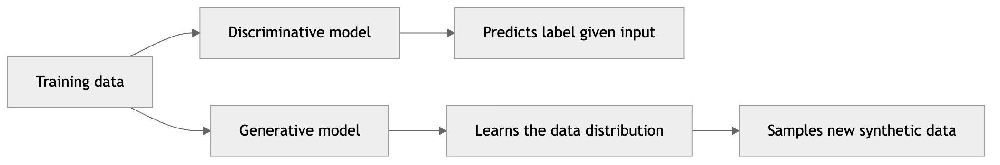

*Figure 308. Discriminative models learn a boundary between classes; generative models learn the distribution of the data itself and can sample new points.*

## 23.2 A Taxonomy of Generative Models

Before diving into individual methods, it pays to build a map. The cleanest way to organize generative models is by *how they represent the distribution* $`p_{\theta}(x)`$ — a distinction usually credited to a well-known tutorial taxonomy by Ian Goodfellow. At the top level, a model either defines an **explicit density** (it writes down a formula for $`p_{\theta}(x)`$, even if only approximately) or an **implicit density** (it never writes down $`p_{\theta}(x)`$ at all and only knows how to produce samples).

Within explicit-density models, there is a further split. Some define a **tractable density** that can be computed exactly:

- **Autoregressive models** factor the joint distribution into a product of conditionals using the chain rule of probability, $`p_{\theta}(x) = \prod_{i}^{}p_{\theta}(x_{i} \mid x_{< i})`$, and model each conditional with a neural network. PixelCNN, WaveNet, and every large language model are autoregressive.
- **Normalizing flows** transform a simple base distribution through a sequence of invertible functions and use the change-of-variables formula to compute the exact density.

Others define an **approximate density** that can only be bounded or estimated:

- **Variational Autoencoders** introduce a latent variable and optimize a tractable lower bound (the ELBO) on the true log-likelihood.
- **Diffusion models** likewise optimize a variational bound, decomposed over many small denoising steps.

Implicit-density models, meanwhile, learn to sample without ever representing $`p_{\theta}(x)`$:

- **Generative Adversarial Networks** train a generator to fool a discriminator; the generator learns to sample from $`p_{\text{data}}`$ but can never tell you the probability of any particular point.

A third, more recent axis cuts across this taxonomy: the **training principle**. *Likelihood-based* methods (autoregressive, flows, VAEs, and — through their bound — diffusion) maximize data likelihood. *Adversarial* methods (GANs) minimize a divergence estimated by a learned critic. *Score-based* methods learn the gradient of the log-density, $`\nabla_{x}\log p(x)`$, called the **score function**; it turns out that diffusion models are exactly score-based models in disguise, which is why the two literatures merged. Keeping this map in mind makes the trade-offs between methods far easier to reason about, and it is the reason a single chapter can treat GANs and diffusion side by side — they are neighbors on the map that made opposite design choices.

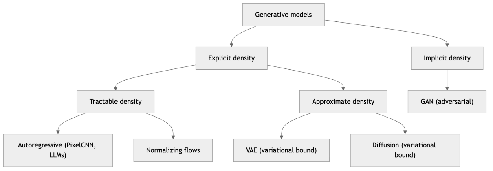

*Figure 309. A taxonomy of generative models organized by how each represents the data distribution.*

We will work roughly up this map from the simplest bridge — the plain autoencoder — through VAEs, GANs, and diffusion, then round out the picture with flows and autoregressive models, and finish with evaluation and a head-to-head comparison.

## 23.3 From Autoencoders to Variational Autoencoders

### 23.3.1 Autoencoders, briefly

We met autoencoders in the chapter on Dimensionality Reduction and Feature Extraction. An autoencoder is a neural network trained to reconstruct its own input through a narrow bottleneck. An **encoder** $`f_{\phi}`$ maps an input $`x`$ to a low-dimensional code $`z = f_{\phi}(x)`$, and a **decoder** $`g_{\theta}`$ maps that code back to a reconstruction $`\widehat{x} = g_{\theta}(z)`$. Training minimizes a reconstruction loss such as $`\left\| x - \widehat{x} \right\|^{2}`$. The bottleneck forces the network to discover a compressed representation that keeps the important structure of the data.

Autoencoders come in several flavors, and they form a natural bridge into probabilistic generative modeling because each one is, in effect, a lesson about how to shape a latent space:

- **Undercomplete autoencoders** are the standard case: the latent dimension is *smaller* than the input dimension, so the bottleneck physically cannot copy the input through and must compress. If the encoder and decoder are linear and the loss is squared error, an undercomplete autoencoder recovers the same subspace as PCA; nonlinear activations let it learn a curved manifold that PCA cannot.
- **Denoising autoencoders** deliberately corrupt the input — adding Gaussian noise or masking out pixels — and ask the network to reconstruct the *clean* original. This prevents the trivial identity solution and forces the model to learn the structure of the data manifold: to denoise, it must know what clean data looks like. This is not a historical curiosity — it is precisely the idea that diffusion models scale up to spectacular effect.
- **Sparse autoencoders** allow a large latent layer but add a penalty (an L1 term, or a KL penalty on average activation) that forces most latent units to be near zero for any given input. The code becomes an *overcomplete but sparse* dictionary, where each input activates only a few units. Sparse autoencoders have recently found a second life in interpretability research, where they are used to pull apart the superimposed features inside large language models.

A plain autoencoder is excellent for compression and denoising but it is a poor *generator*. The problem is that its latent space has no enforced structure: the encoder is free to scatter the codes for the training set anywhere it likes, leaving large “holes” between them. If you pick a random point $`z`$ and feed it to the decoder, you usually get garbage, because that region of latent space was never associated with any real data. To turn an autoencoder into something you can sample from, you need to control the geometry of the latent space. That is exactly what the Variational Autoencoder does.

``` python
# A denoising autoencoder in PyTorch: corrupt the input, reconstruct the clean target
import torch
import torch.nn as nn

class DenoisingAutoencoder(nn.Module):
    def __init__(self, in_dim=784, latent=32):
        super().__init__()
        self.encoder = nn.Sequential(nn.Linear(in_dim, 128), nn.ReLU(),
                                     nn.Linear(128, latent), nn.ReLU())
        self.decoder = nn.Sequential(nn.Linear(latent, 128), nn.ReLU(),
                                     nn.Linear(128, in_dim), nn.Sigmoid())

    def forward(self, x):
        return self.decoder(self.encoder(x))

def train_step(model, x_clean, opt, noise=0.3):
    x_noisy = x_clean + noise * torch.randn_like(x_clean)   # corrupt the input
    x_noisy = x_noisy.clamp(0, 1)
    recon = model(x_noisy)
    loss = nn.functional.mse_loss(recon, x_clean)           # target is the CLEAN image
    opt.zero_grad(); loss.backward(); opt.step()
    return loss.item()
```

### 23.3.2 The variational autoencoder

A **Variational Autoencoder (VAE)**, introduced by Kingma and Welling in 2013, is a probabilistic autoencoder. Rather than mapping an input to a single point, the encoder maps it to a *distribution* over latent codes — specifically a Gaussian with mean $`\mu_{\phi}(x)`$ and diagonal variance $`\sigma_{\phi}^{2}(x)`$. We then place a simple prior on the latent variable, almost always a standard normal $`p(z) = \mathcal{N}(0,I)`$. The decoder defines $`p_{\theta}(x \mid z)`$, the distribution over data given a latent code.

The VAE is a genuine **latent-variable model**. It assumes data is generated by a two-step story: first draw a latent code $`z \sim p(z)`$ from the prior, then draw the observation $`x \sim p_{\theta}(x \mid z)`$ from the decoder. The marginal likelihood of the data under this story is

``` math
p_{\theta}(x) = \int p_{\theta}(x \mid z)\, p(z)\, dz.
```

This integral is the whole difficulty. It runs over every possible latent code, and for a neural-network decoder it is intractable — you cannot compute it, and you cannot compute the posterior $`p_{\theta}(z \mid x)`$ it implies either. The VAE’s central move is to *approximate* the true posterior with a tractable distribution $`q_{\phi}(z \mid x)`$ — the encoder — and then optimize a bound that only requires quantities we can actually compute.

### 23.3.3 Deriving the ELBO

The **Evidence Lower Bound (ELBO)** is worth deriving once, because the same derivation reappears in diffusion models. Start from the log marginal likelihood and multiply and divide by the approximate posterior $`q_{\phi}(z \mid x)`$ inside the integral:

``` math
\log p_{\theta}(x) = log\int p_{\theta}(x \mid z)\, p(z)\, dz = log\mathbb{E}_{q_{\phi}(z \mid x)}\left\lbrack \frac{p_{\theta}(x \mid z)\, p(z)}{q_{\phi}(z \mid x)} \right\rbrack.
```

Because the logarithm is concave, **Jensen’s inequality** lets us push the log inside the expectation, turning an equality into a lower bound:

``` math
\log p_{\theta}(x) \geq \mathbb{E}_{q_{\phi}(z \mid x)}\left\lbrack \log\frac{p_{\theta}(x \mid z)\, p(z)}{q_{\phi}(z \mid x)} \right\rbrack = \underset{\text{reconstruction}}{\underbrace{\mathbb{E}_{q_{\phi}(z \mid x)}\left\lbrack \log p_{\theta}(x \mid z) \right\rbrack}} - \underset{\text{regularization}}{\underbrace{D_{KL}\left( q_{\phi}(z \mid x)\, \parallel \, p(z) \right)}}.
```

That right-hand side is the ELBO. The two terms have clean interpretations that mirror exactly the two ingredients you would expect of a generative autoencoder:

1.  A **reconstruction term** that pushes decoded samples to resemble the input, just like an ordinary autoencoder.
2.  A **regularization term** that pulls each encoded distribution $`q_{\phi}(z \mid x)`$ toward the prior $`\mathcal{N}(0,I)`$, measured by KL divergence. This is what packs all the codes into a single, smooth, gap-free blob around the origin — so that sampling $`z \sim \mathcal{N}(0,I)`$ and decoding produces plausible data.

The name “lower bound” is precise: this quantity is a provable lower bound on the true log-likelihood $`\log p_{\theta}(x)`$, and the gap between them is exactly $`D_{KL}(q_{\phi}(z \mid x)\, \parallel \, p_{\theta}(z \mid x))`$ — the divergence between the approximate posterior and the true one. Maximizing the ELBO therefore does two things at once: it pushes up a bound on the data likelihood, and it tightens the approximation by making the encoder’s posterior a better match for the true posterior. For two Gaussians the KL term has a clean closed form, which is one reason the standard-normal prior is so convenient:

``` math
D_{KL}\left( \mathcal{N}(\mu,\sigma^{2})\, \parallel \,\mathcal{N}(0,1) \right) = \frac{1}{2}\sum_{j}^{}\left( \mu_{j}^{2} + \sigma_{j}^{2} - log\sigma_{j}^{2} - 1 \right).
```

### 23.3.4 The reparameterization trick

There is a subtle obstacle. To train with backpropagation, gradients must flow from the reconstruction loss, through the sampled $`z`$, back into the encoder parameters $`\phi`$. But sampling $`z \sim \mathcal{N}(\mu_{\phi},\sigma_{\phi}^{2})`$ is a stochastic, non-differentiable operation — you cannot differentiate through a random number generator.

The **reparameterization trick** removes the randomness from the path of the gradient. Instead of sampling $`z`$ directly, we sample a noise variable $`\epsilon \sim \mathcal{N}(0,I)`$ that does *not* depend on any parameters, and compute

``` math
z = \mu_{\phi}(x) + \sigma_{\phi}(x) \odot \epsilon.
```

Now $`z`$ is a deterministic, differentiable function of $`\mu_{\phi}`$ and $`\sigma_{\phi}`$, with all the stochasticity isolated in $`\epsilon`$. Gradients flow cleanly through $`\mu`$ and $`\sigma`$, and the network trains end to end. This trick is one of the most reused ideas in deep generative modeling — you will see its fingerprints on diffusion models later in the chapter.

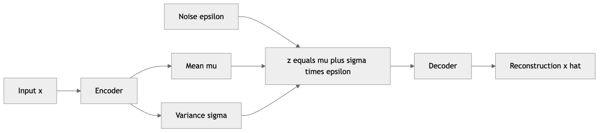

*Figure 310. A VAE encoder outputs a mean and variance, the reparameterization trick injects external noise to form a sampled latent code, and the decoder reconstructs the input.*

Here is a compact VAE in PyTorch trained on MNIST-shaped data. The architecture is deliberately small so the structure is easy to read.

``` python
# Variational Autoencoder (PyTorch)
import torch
import torch.nn as nn
import torch.nn.functional as F

class VAE(nn.Module):
    def __init__(self, in_dim=784, hidden=400, latent=20):
        super().__init__()
        self.fc1 = nn.Linear(in_dim, hidden)
        self.fc_mu = nn.Linear(hidden, latent)      # mean of q(z|x)
        self.fc_logvar = nn.Linear(hidden, latent)  # log-variance for stability
        self.fc2 = nn.Linear(latent, hidden)
        self.fc3 = nn.Linear(hidden, in_dim)

    def encode(self, x):
        h = F.relu(self.fc1(x))
        return self.fc_mu(h), self.fc_logvar(h)

    def reparameterize(self, mu, logvar):
        std = torch.exp(0.5 * logvar)        # sigma = exp(0.5 * log sigma^2)
        eps = torch.randn_like(std)          # external noise, no params
        return mu + eps * std                # the reparameterization trick

    def decode(self, z):
        h = F.relu(self.fc2(z))
        return torch.sigmoid(self.fc3(h))    # pixel intensities in [0, 1]

    def forward(self, x):
        mu, logvar = self.encode(x)
        z = self.reparameterize(mu, logvar)
        return self.decode(z), mu, logvar

def vae_loss(recon_x, x, mu, logvar):
    # Reconstruction term (negative log-likelihood for Bernoulli pixels)
    bce = F.binary_cross_entropy(recon_x, x, reduction='sum')
    # KL term in closed form for Gaussian vs standard normal
    kld = -0.5 * torch.sum(1 + logvar - mu.pow(2) - logvar.exp())
    return bce + kld   # negative ELBO, which we minimize

# Generating new samples after training:
# model.eval()
# z = torch.randn(16, 20)          # sample from the prior N(0, I)
# new_images = model.decode(z)     # decode to 16 synthetic images
```

### 23.3.5 Posterior collapse, blurriness, and the β-VAE

VAEs are easy to train, give you an explicit and interpretable latent space, and provide a principled likelihood bound. They also have two well-known failure modes worth naming.

The first is **posterior collapse**. If the decoder is powerful enough to model the data on its own — this happens especially with autoregressive decoders on text — the optimizer discovers a cheap shortcut: drive the KL term to zero by making $`q_{\phi}(z \mid x)`$ equal to the prior for every input. The encoder stops carrying any information about $`x`$, the latent code becomes useless noise, and the decoder ignores it entirely. The ELBO can still look reasonable, but the “autoencoder” has quietly stopped encoding. Remedies include *KL annealing* (ramping the KL weight up slowly from zero so the model first learns to use the latent), *free bits* (allowing each latent dimension a small KL budget for free), and weakening the decoder.

The second is **blurriness**. VAE samples tend to look soft and smeared. The Gaussian likelihood on pixels effectively averages over plausible reconstructions — if several sharp images are all consistent with a latent code, minimizing squared error produces their blurry average rather than committing to one. This blur is precisely the gap that GANs and diffusion models were designed to close.

A useful generalization is the **β-VAE**, which multiplies the KL term by a coefficient $`\beta`$:

``` math
\mathcal{L}_{\beta} = \mathbb{E}_{q_{\phi}(z \mid x)}\left\lbrack \log p_{\theta}(x \mid z) \right\rbrack - \beta\, D_{KL}\left( q_{\phi}(z \mid x)\, \parallel \, p(z) \right).
```

With $`\beta = 1`$ you recover the standard VAE. Pushing $`\beta > 1`$ tightens the pressure toward the prior and empirically encourages **disentangled** representations, in which individual latent dimensions come to control individual factors of variation (rotation, thickness, lighting) — at the cost of reconstruction quality. The knob makes explicit the fundamental tension in every VAE: reconstruction fidelity versus a clean, samplable latent space.

Because the VAE latent space is smooth and low-dimensional, it is easy to visualize and interpolate. The figure below shows a stylized 2D latent space in which the encoded means of several classes cluster into distinct regions while remaining packed around the origin under the prior — the geometry the KL term is engineering, and the reason you can walk a straight line between two points and decode a smooth morph from one to the other.

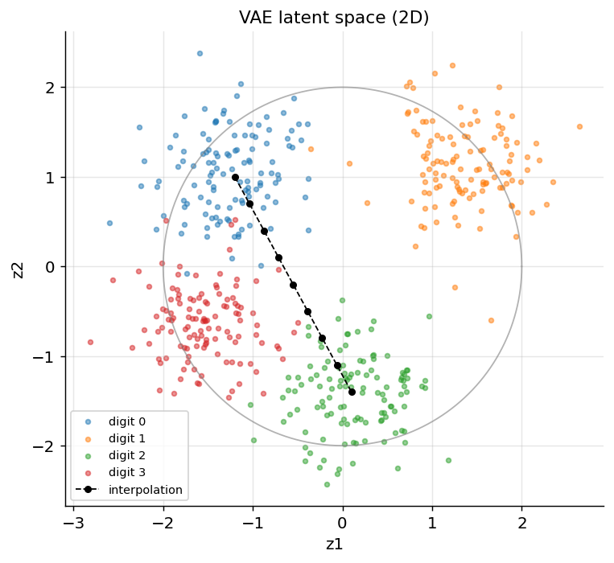

*Figure 311. A stylized 2D VAE latent space: class clusters are separated yet packed around the origin under the N(0, I) prior, and a straight path between two codes interpolates smoothly.*

### 23.3.6 Conditional VAEs

Just as GANs have a conditional variant, so do VAEs. A **Conditional VAE (CVAE)** feeds a label or attribute $`y`$ into both the encoder and the decoder, so the model learns $`p_{\theta}(x \mid z,y)`$ and the prior becomes $`p(z \mid y)`$ (often still a standard normal). At generation time you fix $`y`$ — a digit class, a facial attribute, a caption embedding — and sample $`z`$ from the prior to produce a controlled sample of that kind. Concretely, this is a one-line change to the network: concatenate a (usually embedded) representation of $`y`$ onto the encoder input and onto the latent code before decoding. CVAEs are a natural fit for problems with clear conditioning structure and a need for a likelihood or latent space, such as controllable molecule generation or semi-supervised learning, where the same latent captures the *style* of an example while $`y`$ captures its *class*. They also make the earlier posterior-collapse discussion concrete: if the label $`y`$ already explains the data well, the model has even less incentive to use $`z`$, so CVAEs are especially prone to ignoring their latent unless it is encouraged to carry the residual variation $`y`$ does not.

## 23.4 Generative Adversarial Networks

### 23.4.1 The adversarial idea

A **Generative Adversarial Network (GAN)**, introduced by Ian Goodfellow and colleagues in 2014, takes a strikingly different approach: rather than maximizing a likelihood, it sets up a game between two networks that train each other. The **generator** $`G`$ takes a random noise vector $`z \sim p(z)`$ and transforms it into a fake sample $`G(z)`$. The **discriminator** $`D`$ is a binary classifier that receives either a real sample from the training set or a fake one from $`G`$, and outputs the probability that its input is real.

The two networks have opposing goals. The discriminator tries to get good at telling real from fake. The generator tries to fool the discriminator into classifying its fakes as real. The classic analogy is a counterfeiter (generator) trying to pass fake currency past a detective (discriminator); as the detective sharpens, the counterfeiter must improve, and vice versa. At equilibrium the counterfeits are indistinguishable from real money — the generator has learned $`p_{\text{data}}`$. This is the implicit-density idea from our taxonomy in action: at no point does the GAN compute the probability of any image. It only learns a *transformation* from easy-to-sample noise to hard-to-sample data.

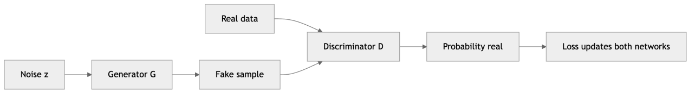

*Figure 312. The generator turns noise into fakes while the discriminator scores real versus fake; the two are trained against each other.*

### 23.4.2 The minimax objective

The original GAN is a two-player **minimax game** with the value function

``` math
\min_{G}\max_{D}\mspace{6mu} V(D,G) = \mathbb{E}_{x \sim p_{\text{data}}}\left\lbrack \log D(x) \right\rbrack + \mathbb{E}_{z \sim p(z)}\left\lbrack \log\left( 1 - D(G(z)) \right) \right\rbrack.
```

Read it from the discriminator’s side first: $`D`$ wants to *maximize* this — push $`D(x)`$ toward 1 on real data and $`D(G(z))`$ toward 0 on fakes. The generator wants to *minimize* it by making $`D(G(z))`$ close to 1. Goodfellow showed that for a fixed generator the optimal discriminator is

``` math
D^{\ast}(x) = \frac{p_{\text{data}}(x)}{p_{\text{data}}(x) + p_{g}(x)},
```

where $`p_{g}`$ is the distribution of the generator’s outputs. Substituting $`D^{\ast}`$ back into $`V`$ and simplifying shows that the generator is then minimizing the **Jensen-Shannon divergence** between $`p_{\text{data}}`$ and $`p_{g}`$:

``` math
V(D^{\ast},G) = 2\, D_{JS}(p_{\text{data}}\, \parallel \, p_{g}) - log4.
```

The global optimum occurs when $`p_{g} = p_{\text{data}}`$, at which point $`D_{JS} = 0`$ and $`D^{\ast}`$ outputs $`\frac{1}{2}`$ everywhere — it can do no better than a coin flip. So a GAN is, in principle, minimizing a specific divergence between the real and generated distributions, just with the divergence estimated on the fly by a learned discriminator rather than computed in closed form.

In practice the generator is not trained with $`log(1 - D(G(z)))`$, because that term saturates and gives weak gradients early in training when the discriminator easily rejects the obvious fakes. The standard fix is the **non-saturating loss**: the generator instead maximizes $`\log D(G(z))`$, which provides strong gradients precisely when the generator is doing poorly. It no longer corresponds to minimizing the exact JS divergence, but it trains far better, and this is what virtually every GAN implementation actually uses.

### 23.4.3 Training dynamics, instability, and mode collapse

GANs are notoriously temperamental. Because the objective is a saddle point of a two-player game rather than the minimum of a single loss, training is a delicate balancing act, and several characteristic failure modes appear:

- **Non-convergence and oscillation.** The two networks can chase each other in circles, with the loss bouncing rather than settling. Simultaneous gradient descent on a minimax objective is not guaranteed to converge even on simple problems; the parameters can orbit the equilibrium indefinitely. Unlike a normal loss curve, a GAN’s loss going down is not necessarily good news.
- **Vanishing gradients.** If the discriminator becomes too strong too fast, it rejects every fake with near-certainty. Where $`p_{\text{data}}`$ and $`p_{g}`$ have little overlap — which is the usual situation early in training, since both are thin manifolds in a huge space — the JS divergence is locally constant and its gradient is nearly zero, so the generator receives almost no signal to improve. This is the theoretical objection that motivated the Wasserstein GAN.
- **Mode collapse.** The single most famous GAN pathology. The generator discovers that producing one (or a few) very convincing output reliably fools the current discriminator, so it collapses onto that mode and stops covering the full diversity of the data. You ask for handwritten digits and get a thousand nearly identical 8s. The discriminator eventually catches on, the generator jumps to a different single mode, and the two play whack-a-mole instead of converging. Mode collapse is the direct consequence of the implicit-density approach: nothing in the objective explicitly rewards *coverage* of the whole distribution, only fooling the current critic.

Many techniques exist to stabilize training: matching the learning rates and update frequencies of $`G`$ and $`D`$, spectral normalization to bound the discriminator’s Lipschitz constant, one-sided label smoothing, feature matching, minibatch discrimination (which lets $`D`$ detect a lack of diversity within a batch and thus punishes mode collapse), and the Wasserstein loss discussed below. The general theme is to keep the discriminator from overpowering the generator and to provide a smoother optimization landscape.

Diagnosing a GAN while it trains takes some experience precisely because the loss curves lie. A few habits help. Watch the discriminator’s accuracy on real and fake batches: if it pins to 100% the generator has stopped receiving gradient (the discriminator is too strong), and if it sits stubbornly at 50% while samples are poor, the generator may be exploiting a weak discriminator rather than genuinely improving. Periodically generate a fixed grid of images from the *same* noise vectors across epochs — this is the single most informative thing you can look at, because it shows whether diversity is growing or collapsing. And track FID on a held-out set every few epochs, since (unlike the raw losses) it actually correlates with sample quality. With a Wasserstein critic you get one extra gift: the critic loss is a meaningful estimate of the Earth Mover’s distance, so for once a decreasing loss really does mean a better generator.

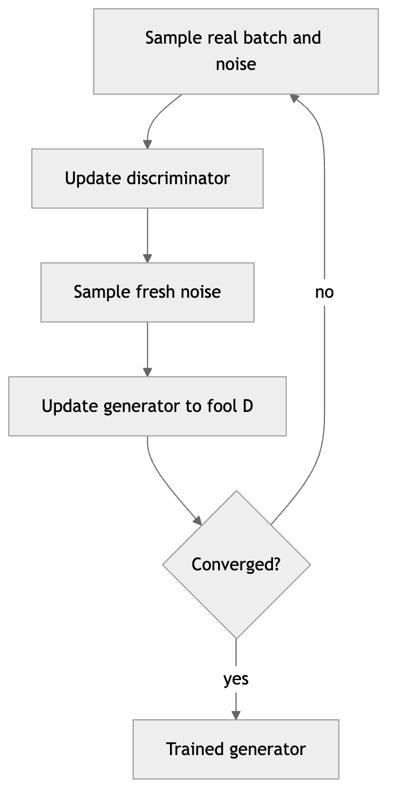

*Figure 313. GAN training alternates between updating the discriminator on real and fake batches and updating the generator to fool the current discriminator.*

The figure below shows what healthy-ish GAN training curves tend to look like: the discriminator and generator losses trade off and oscillate around a rough equilibrium rather than descending monotonically, and the discriminator’s accuracy on fakes hovers near the 50% coin-flip line when the generator is competitive.

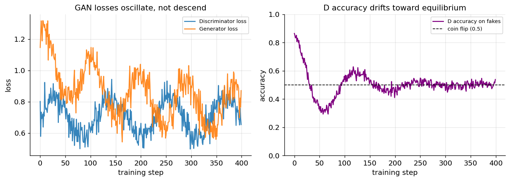

*Figure 314. Illustrative GAN training curves: generator and discriminator losses oscillate around an equilibrium instead of decreasing monotonically, and D’s accuracy on fakes drifts toward the 50% coin-flip line.*

### 23.4.4 The Wasserstein GAN and the Earth Mover’s distance

The **Wasserstein GAN (WGAN)** is important enough to treat on its own, because it diagnosed *why* the original GAN gives vanishing gradients and fixed it with a different distance. The **Wasserstein-1 distance**, also called the **Earth Mover’s distance**, measures the minimum “work” to transform one distribution into another, where work is mass times the distance it moves:

``` math
W(p_{\text{data}},p_{g}) = \inf_{\gamma \in \Pi(p_{\text{data}},p_{g})}\mathbb{E}_{(x,y) \sim \gamma}\left\lbrack \left\| x - y \right\| \right\rbrack,
```

the infimum taken over all joint distributions (transport plans) with the correct marginals. Its decisive advantage over JS divergence is that it varies *smoothly* even when the two distributions do not overlap at all — it reports the actual geometric distance between them rather than saturating. That means a useful gradient always exists, even at the start of training.

The infimum is intractable, but the Kantorovich-Rubinstein duality rewrites it as a maximization over **1-Lipschitz** functions $`f`$:

``` math
W(p_{\text{data}},p_{g}) = \sup_{\left\| f \right\|_{L} \leq 1}\mspace{6mu}\mathbb{E}_{x \sim p_{\text{data}}}\lbrack f(x)\rbrack - \mathbb{E}_{x \sim p_{g}}\lbrack f(x)\rbrack.
```

In a WGAN the discriminator is replaced by a **critic** $`f`$ that estimates this supremum — it outputs an unbounded real score rather than a probability, and there is no sigmoid or log in the loss. The one requirement is that the critic be 1-Lipschitz. The original WGAN enforced this by crudely clipping weights; the far better **WGAN-GP** adds a **gradient penalty** that pushes the norm of the critic’s input gradient toward 1:

``` math
\mathcal{L}_{\text{critic}} = \mathbb{E}_{x \sim p_{g}}\lbrack f(x)\rbrack - \mathbb{E}_{x \sim p_{\text{data}}}\lbrack f(x)\rbrack + \lambda\,\mathbb{E}_{\widehat{x}}\left\lbrack (\left\| \nabla_{\widehat{x}}f(\widehat{x}) \right\|_{2} - 1)^{2} \right\rbrack,
```

where $`\widehat{x}`$ is sampled along straight lines between real and fake points. The practical payoff is real: the critic loss becomes a meaningful, decreasing quantity that correlates with sample quality (so you can finally read the loss curve), training is markedly more stable, and mode collapse is much rarer.

### 23.4.5 Notable GAN variants

The original GAN used fully connected layers and produced small, low-quality images. A cascade of architectural ideas turned GANs into a powerhouse for photorealistic synthesis:

| Variant | Key idea | What it enabled |
|----|----|----|
| **DCGAN** | Replace dense layers with strided/transposed convolutions, batch norm, no pooling, ReLU/LeakyReLU | First stable, recognizably sharp image GAN; the template everyone copied |
| **Conditional GAN (cGAN)** | Feed a label or condition $`y`$ into both $`G`$ and $`D`$ | Control *what* is generated — e.g. “generate a 7” or class-specific images |
| **WGAN / WGAN-GP** | Replace JS divergence with the Wasserstein distance and a Lipschitz critic | A meaningful loss, far better stability, fewer collapses |
| **Pix2Pix** | Condition on a whole input image (paired data) with an L1 + adversarial loss | Supervised image-to-image translation: edges to photos, maps to satellite |
| **CycleGAN** | Two generators + a cycle-consistency loss for *unpaired* data | Translation without paired examples: horses to zebras, summer to winter |
| **ProGAN** | Grow both networks progressively from low to high resolution during training | Stable training up to megapixel faces |
| **StyleGAN / StyleGAN2** | Inject a learned style vector at each resolution via adaptive normalization | Photorealistic faces with disentangled, controllable attributes |

**DCGAN** deserves a first mention because it established the convolutional recipe — transposed convolutions to upsample in the generator, strided convolutions to downsample in the discriminator, batch normalization, and no fully connected or pooling layers — that made image GANs trainable at all.

**Conditional GANs** deserve special mention because they bridge to the rest of modern generative AI. By conditioning the generator on auxiliary information — a class label, a text embedding, a segmentation map — you move from “generate something from this distribution” to “generate *this specific kind* of thing.” Text-to-image conditioning is the same idea scaled up, and it reappears in diffusion models.

**CycleGAN** is a beautiful idea worth understanding. To translate between two domains (say horses and zebras) without any paired examples, it trains two generators, $`G:X \rightarrow Y`$ and $`F:Y \rightarrow X`$, and adds a **cycle-consistency loss** requiring that $`F(G(x)) \approx x`$ and $`G(F(y)) \approx y`$. The round trip must return you to where you started, which forces the mappings to preserve content while changing only style. This unpaired setting is what makes it practical — paired training data (the same scene as both a horse and a zebra) essentially never exists.

**StyleGAN** produced the uncanny “this person does not exist” faces. Its innovation was to stop feeding noise into the first layer and instead map the noise through a learned network into an intermediate “style” space, then inject those styles at every resolution of the generator via adaptive instance normalization. Coarse styles control pose and face shape, fine styles control skin texture and hair — a genuinely disentangled and editable representation.

``` python
# Conditional generator (PyTorch sketch): concatenate a class embedding with noise
import torch
import torch.nn as nn

class ConditionalGenerator(nn.Module):
    def __init__(self, z_dim=100, n_classes=10, img_dim=784, embed=50):
        super().__init__()
        self.label_emb = nn.Embedding(n_classes, embed)
        self.net = nn.Sequential(
            nn.Linear(z_dim + embed, 256), nn.LeakyReLU(0.2),
            nn.Linear(256, 512), nn.LeakyReLU(0.2),
            nn.Linear(512, img_dim), nn.Tanh(),     # outputs in [-1, 1]
        )

    def forward(self, z, labels):
        c = self.label_emb(labels)            # map class id to a dense vector
        x = torch.cat([z, c], dim=1)          # condition the noise on the class
        return self.net(x)
```

## 23.5 Diffusion Models

### 23.5.1 The core intuition

Diffusion models are built on an idea that sounds almost too simple to work: if you slowly add noise to an image until it becomes pure static, you can train a network to *reverse* that process one small step at a time, and then start from pure static and denoise your way to a brand-new image. Where a GAN tries to leap from noise to a finished image in a single forward pass, a diffusion model takes hundreds of small, manageable steps, each one only slightly denoising the previous result. Predicting a tiny amount of removable noise is a far easier and more stable learning problem than synthesizing a whole image at once — which is the central reason diffusion models train so reliably and now dominate image generation.

You can see this as the denoising autoencoder from earlier in the chapter, taken to its logical extreme: instead of learning to remove one fixed level of noise, a diffusion model learns to remove noise at *every* level, and chaining those denoisers together turns pure noise into data.

### 23.5.2 The forward (noising) process

The **forward process** is fixed and requires no learning. Starting from a real image $`x_{0}`$, we add a little Gaussian noise over $`T`$ steps according to a variance schedule $`\beta_{1},\ldots,\beta_{T}`$:

``` math
q(x_{t} \mid x_{t - 1}) = \mathcal{N}\left( x_{t};\ \sqrt{1 - \beta_{t}}\, x_{t - 1},\ \beta_{t}I \right).
```

After enough steps, $`x_{T}`$ is essentially indistinguishable from a sample of pure Gaussian noise. A beautiful property of this chain is that you can jump directly to any timestep in closed form without simulating every step. Defining $`\alpha_{t} = 1 - \beta_{t}`$ and $`{\bar{\alpha}}_{t} = \prod_{s = 1}^{t}\alpha_{s}`$,

``` math
q(x_{t} \mid x_{0}) = \mathcal{N}\left( x_{t};\ \sqrt{{\bar{\alpha}}_{t}}\, x_{0},\ (1 - {\bar{\alpha}}_{t})I \right),\quad\quad x_{t} = \sqrt{{\bar{\alpha}}_{t}}\, x_{0} + \sqrt{1 - {\bar{\alpha}}_{t}}\,\epsilon,
```

with $`\epsilon \sim \mathcal{N}(0,I)`$. This lets training sample a random timestep $`t`$ for each image in a batch and compute its noised version in one shot. Notice the roles of the two coefficients: $`\sqrt{{\bar{\alpha}}_{t}}`$ scales down the signal and $`\sqrt{1 - {\bar{\alpha}}_{t}}`$ scales up the noise, and since $`{\bar{\alpha}}_{t}`$ decreases monotonically from near 1 toward 0 as $`t`$ grows, the mixture slides smoothly from “almost all signal” to “almost all noise.” The **noise schedule** — how $`\beta_{t}`$ grows with $`t`$ — is an important design choice; the original DDPM used a linear schedule, and a later cosine schedule improved sample quality by spending more steps at low noise levels.

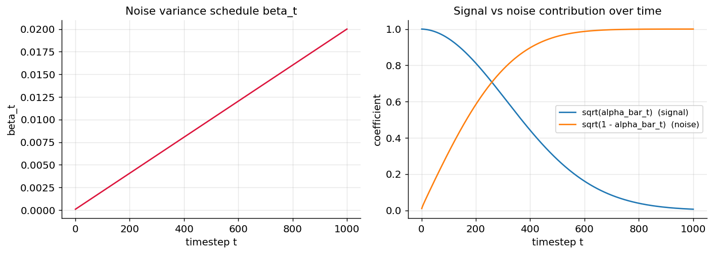

*Figure 315. The diffusion noise schedule: beta_t rises while the cumulative signal coefficient sqrt(alpha_bar_t) falls from 1 to 0, sliding each image from mostly-signal to mostly-noise.*

### 23.5.3 The reverse (denoising) process

The **reverse process** is what we learn. We train a neural network $`\epsilon_{\theta}(x_{t},t)`$ — almost always a U-Net, because its skip connections preserve fine spatial detail — to predict the noise that was added at step $`t`$. The network is told which timestep it is at through a **time embedding** (typically sinusoidal, like the positional encodings in the Transformer chapter) so a single set of weights can denoise at every noise level. The remarkably clean training objective from the Denoising Diffusion Probabilistic Models (DDPM) paper is just a mean-squared error between the true and predicted noise:

``` math
\mathcal{L}_{\text{simple}} = \mathbb{E}_{x_{0},\ \epsilon,\ t}\left\lbrack \parallel \epsilon - \epsilon_{\theta}(\sqrt{{\bar{\alpha}}_{t}}\, x_{0} + \sqrt{1 - {\bar{\alpha}}_{t}}\,\epsilon,\ t) \parallel^{2} \right\rbrack.
```

Like the VAE, this is rooted in a variational bound on the data likelihood — the forward process plays the role of a fixed encoder $`q`$, the reverse process the decoder, and the full ELBO decomposes into a sum of per-step KL terms. The simple MSE loss above is a cleverly reweighted version of that bound that drops constant terms and empirically trains better. There is also a deep connection to score matching: predicting the noise $`\epsilon`$ is equivalent, up to scaling, to estimating the **score** $`\nabla_{x_{t}}\log q(x_{t})`$, which is why diffusion models and score-based models are the same family.

The training loop is strikingly simple, which is a large part of the appeal:

``` python
# One DDPM training step (PyTorch)
import torch

def diffusion_loss(model, x0, alpha_bar, T):
    bs = x0.size(0)
    t = torch.randint(0, T, (bs,), device=x0.device)     # random timestep per image
    ab = alpha_bar[t].view(bs, 1, 1, 1)                   # broadcast over image dims
    eps = torch.randn_like(x0)                            # the noise we will predict
    x_t = ab.sqrt() * x0 + (1 - ab).sqrt() * eps          # closed-form forward process
    eps_pred = model(x_t, t)                              # U-Net predicts the noise
    return torch.nn.functional.mse_loss(eps_pred, eps)    # simple MSE objective
```

To generate, you start from pure noise $`x_{T} \sim \mathcal{N}(0,I)`$ and iteratively apply the learned denoiser. At each step you use the predicted noise to estimate a slightly cleaner image, then (except at the final step) re-inject a small amount of fresh noise. The DDPM update rule is

``` math
x_{t - 1} = \frac{1}{\sqrt{\alpha_{t}}}\left( x_{t} - \frac{1 - \alpha_{t}}{\sqrt{1 - {\bar{\alpha}}_{t}}}\,\epsilon_{\theta}(x_{t},t) \right) + \sigma_{t}\, z,\quad\quad z \sim \mathcal{N}(0,I).
```

Written out as a loop, the sampler is only a few lines — the same U-Net is called once per step, and the final step drops the injected noise:

``` python
# DDPM ancestral sampling (PyTorch)
import torch

@torch.no_grad()
def sample(model, shape, betas, T, device):
    alphas = 1 - betas
    alpha_bar = torch.cumprod(alphas, dim=0)
    x = torch.randn(shape, device=device)                 # start from pure noise x_T
    for t in reversed(range(T)):
        t_batch = torch.full((shape[0],), t, device=device, dtype=torch.long)
        eps = model(x, t_batch)                            # predicted noise
        coef = (1 - alphas[t]) / (1 - alpha_bar[t]).sqrt()
        mean = (x - coef * eps) / alphas[t].sqrt()         # posterior mean estimate
        if t > 0:
            noise = torch.randn_like(x)                    # re-inject noise, except last step
            x = mean + betas[t].sqrt() * noise
        else:
            x = mean
    return x                                               # a fresh sample x_0
```

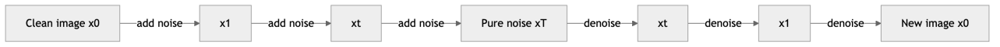

*Figure 316. The forward process gradually adds noise to a clean image; the learned reverse process denoises step by step back to a new sample.*

### 23.5.4 The U-Net backbone

The choice of $`\epsilon_{\theta}`$ is not incidental — the **U-Net** is doing quiet but essential work, and understanding it clarifies why diffusion produces such coherent images. A U-Net is an encoder-decoder convolutional network with a symmetric hourglass shape: a downsampling path progressively halves spatial resolution while increasing channel depth (capturing global, low-frequency structure), a bottleneck, and an upsampling path that restores resolution. The signature feature is the **skip connections** that copy each downsampling feature map directly across to the matching upsampling stage. These skips are what let the network preserve fine, high-frequency spatial detail: without them the bottleneck would blur away exactly the sharpness diffusion is prized for.

Two extra ingredients turn a plain U-Net into a diffusion denoiser. First, the **timestep embedding** — the scalar $`t`$ is expanded into a sinusoidal vector (as in the Transformer chapter) and injected into every residual block, so one network can behave differently at high versus low noise levels. Second, **self-attention layers** at the lower-resolution stages let distant regions of the image coordinate (so a generated face has two matching eyes), and, in text-to-image models, **cross-attention** layers inject the prompt embeddings here — this is the precise point where the text steers the image. The modern diffusion U-Net is therefore a hybrid of convolution (for locality and detail) and attention (for global coherence and conditioning), which is a good microcosm of how the architectures in this book combine.

### 23.5.5 DDPM vs DDIM sampling

The DDPM sampler above is *stochastic* (it injects fresh noise at every step) and needs many steps — often 1000 — because it is essentially simulating a random walk backward. This is diffusion’s Achilles’ heel: hundreds of sequential network evaluations per image.

**DDIM** (Denoising Diffusion Implicit Models) reformulates sampling as a *deterministic*, non-Markovian process that shares the same training objective — so you can train a standard DDPM and switch samplers at inference with no retraining. DDIM’s update removes the injected noise term, which makes generation deterministic given the starting $`x_{T}`$ (so the same seed always yields the same image, and you can meaningfully interpolate in noise space). Crucially, because the trajectory is smooth and deterministic, you can take *large* steps and skip most timesteps: DDIM produces good samples in 20-50 steps instead of 1000, a 20-50× speedup. A large body of later work — DPM-Solver and other higher-order ODE solvers, plus distillation methods that train a student to match many teacher steps in one — has pushed high-quality generation down to a handful of steps or even one.

### 23.5.6 The score-based and continuous-time view

It is worth pausing on why diffusion models and **score-based generative models** turned out to be the same thing, because the connection unifies a lot of the literature and explains the vocabulary you will meet. A score-based model learns the **score function** — the gradient of the log-density, $`s_{\theta}(x) \approx \nabla_{x}\log p(x)`$ — and generates samples by *Langevin dynamics*: start anywhere and repeatedly take a small step in the direction of the score plus a little noise, $`x \leftarrow x + \frac{\eta}{2}s_{\theta}(x) + \sqrt{\eta}\, z`$, which is a random walk that climbs toward high-density regions. The catch is that the score is badly estimated where data is sparse — almost everywhere in a high-dimensional space. The fix is to estimate the score at *many noise levels*, from barely perturbed to heavily corrupted, so that the noisy versions fill the space and connect the low-density gaps to the data manifold. That is exactly the diffusion forward process, and a short calculation shows that predicting the noise $`\epsilon_{\theta}`$ is equivalent, up to a scale factor, to estimating the score of the noised distribution: $`s_{\theta}(x_{t},t) = - \epsilon_{\theta}(x_{t},t)/\sqrt{1 - {\bar{\alpha}}_{t}}`$.

Taking the number of steps to infinity turns the discrete Markov chain into a **stochastic differential equation (SDE)**. The forward SDE gradually turns data into noise; there is a corresponding *reverse-time* SDE, written in terms of the score, that turns noise back into data. This continuous view is more than elegant bookkeeping — it is what lets modern samplers treat generation as solving an ordinary or stochastic differential equation with off-the-shelf numerical solvers (this is precisely what DPM-Solver does), and it is the theoretical bridge to the flow-matching methods mentioned in the flows section. When a paper talks about the “probability-flow ODE” or a “variance-preserving SDE,” this is the framework it is using.

### 23.5.7 Classifier-free guidance

Conditioning a diffusion model on a text prompt is only half the battle; you also want to control *how strongly* the model adheres to the prompt. **Classifier-free guidance (CFG)** is the technique that makes text-to-image diffusion follow prompts as tightly as it does. During training, the conditioning signal (the text embedding) is randomly dropped some fraction of the time, so the *same* network learns both a conditional predictor $`\epsilon_{\theta}(x_{t},t,c)`$ and an unconditional one $`\epsilon_{\theta}(x_{t},t)`$. At sampling time you combine them, extrapolating away from the unconditional prediction:

``` math
{\widetilde{\epsilon}}_{\theta}(x_{t},t,c) = \epsilon_{\theta}(x_{t},t) + w\,\left( \epsilon_{\theta}(x_{t},t,c) - \epsilon_{\theta}(x_{t},t) \right).
```

The **guidance scale** $`w`$ is the knob you feel directly as a user: $`w = 0`$ ignores the prompt, $`w = 1`$ is ordinary conditioning, and larger $`w`$ (typically 5-15) pushes the sample harder toward the prompt, trading diversity and a little realism for prompt fidelity. Turn it up too far and images become oversaturated and stereotyped. CFG replaced an earlier approach (“classifier guidance”) that required a separately trained noise-aware classifier, and its simplicity — just drop the condition sometimes during training — is why every major text-to-image system uses it.

### 23.5.8 Latent diffusion and Stable Diffusion

Diffusion models overtook GANs for high-fidelity image generation around 2021-2022 for a few concrete reasons. They train with a simple, stable regression loss and never suffer from mode collapse, so they cover the full diversity of the data. They scale gracefully and reliably produce sharper, more coherent images than VAEs and more diverse images than GANs. The cost is speed, addressed by the fast samplers above.

**Stable Diffusion** is the system that made these ideas practical at consumer scale, and it combines every concept in this chapter. Running diffusion directly on high-resolution pixels is prohibitively expensive — a $`512 \times 512`$ image has 786,432 values to denoise hundreds of times. So Stable Diffusion is a **latent diffusion model**: a VAE first compresses the image into a much smaller latent space (typically an 8× reduction per side, so a $`64 \times 64`$ latent), the entire diffusion process runs in that compact latent space, and the VAE decoder finally maps the denoised latent back to a full-resolution image. This is the single biggest reason it runs on a consumer GPU rather than a data center.

Text prompts steer generation through **conditioning**: a text encoder (CLIP) turns the prompt into embeddings that are fed to the U-Net via **cross-attention**, exactly the conditional-generation idea we saw with cGANs, now driven by language and injected with the attention mechanism from the Transformer chapter. Classifier-free guidance controls how tightly the image obeys the prompt. So Stable Diffusion is, in one system, a VAE for compression, a diffusion model for synthesis, a U-Net backbone, attention-based text conditioning, and classifier-free guidance for control — a clean illustration of how the techniques in this book compose into something greater than any one of them.

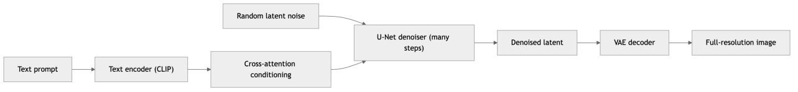

*Figure 317. Stable Diffusion runs diffusion in a compressed VAE latent space, conditions the U-Net on text via cross-attention, then decodes the denoised latent to a full-resolution image.*

## 23.6 Normalizing Flows

**Normalizing flows** occupy the “tractable explicit density” corner of our taxonomy and take the road not traveled by VAEs: instead of *approximating* the likelihood with a bound, they compute it *exactly*. The idea rests on the change-of-variables formula from probability. Suppose $`z \sim p_{z}(z)`$ is drawn from a simple base distribution (a standard normal) and $`x = f(z)`$ for an **invertible**, differentiable function $`f`$. Then the density of $`x`$ is

``` math
p_{x}(x) = p_{z}\left( f^{- 1}(x) \right)\,\left| \det\frac{\partial f^{- 1}}{\partial x} \right|.
```

The determinant of the Jacobian accounts for how the transformation stretches or squeezes volume. If you chain many such invertible transformations together — a “flow” — you can turn a plain Gaussian into an arbitrarily complex distribution, and because each step is invertible with a known Jacobian, you can compute the exact log-likelihood of any data point by running the flow backward and summing log-determinants.

The engineering challenge is designing transformations that are simultaneously (a) expressive, (b) easily invertible, and (c) equipped with a cheap Jacobian determinant — a general determinant costs $`O(d^{3})`$, which is fatal in high dimensions. The breakthrough was the **coupling layer** (RealNVP, and earlier NICE). A coupling layer splits the input in half, passes one half through unchanged, and uses it to compute a scale and shift applied to the other half:

``` math
x_{1:d/2} = z_{1:d/2},\quad\quad x_{d/2 + 1:d} = z_{d/2 + 1:d} \odot exp\left( s(z_{1:d/2}) \right) + t(z_{1:d/2}).
```

This is trivially invertible (solve for $`z`$ given $`x`$), and because the untouched half makes the Jacobian triangular, its determinant is just the product of the scale terms — computable in linear time, no matter how deep and nonlinear the networks $`s`$ and $`t`$ are. Alternating which half is transformed, and permuting channels between layers, lets every dimension eventually influence every other.

A second important flow design is the **autoregressive flow**, which comes in two dual forms. A *masked autoregressive flow* (MAF) makes each dimension an invertible function of the dimensions before it, giving a triangular Jacobian and fast, exact *density evaluation* but slow sequential *sampling*. Its dual, the *inverse autoregressive flow* (IAF), flips the trade-off to give fast sampling but slow density evaluation. The two can even be combined — a MAF teacher distilled into an IAF student — which is exactly how *Parallel WaveNet* turned WaveNet’s slow autoregressive audio generation into a fast, real-time synthesizer. Recognizing that autoregressive models and flows are two views of the same triangular structure is one of the more satisfying unifications in this chapter.

Flows give you two things no other family offers together: **exact likelihoods** (invaluable for density estimation, anomaly detection, and lossless compression) and **fast, exact sampling in a single pass** (unlike diffusion). Their price is a strict architectural constraint — every layer must be invertible and dimension-preserving, so the latent space is exactly as large as the data — which tends to make them less parameter-efficient and, in practice, produce somewhat lower image fidelity than diffusion or GANs. They remain the tool of choice whenever an *exact* likelihood matters, and the change-of-variables machinery underneath them also powers *continuous* normalizing flows and the flow-matching training objectives that have recently become a popular, streamlined alternative to diffusion.

## 23.7 Autoregressive Generative Models

The last family closes the loop back to the rest of the book. **Autoregressive models** live in the “tractable explicit density” corner alongside flows, but they factor the joint distribution using nothing more exotic than the chain rule of probability. Order the dimensions of $`x`$ somehow — pixels raster-scan order, characters left to right — and write

``` math
p_{\theta}(x) = \prod_{i = 1}^{d}p_{\theta}(x_{i} \mid x_{1},\ldots,x_{i - 1}).
```

Every factor is a distribution over a single dimension conditioned on everything before it, and a neural network with a **causal** structure (it may only look at earlier positions) predicts each one. Training is just maximum likelihood — equivalently, next-element prediction with a cross-entropy loss — which makes these models delightfully stable to train, and the likelihood is exact, so they are easy to compare and evaluate.

For images, **PixelRNN** and **PixelCNN** generate one pixel at a time, each conditioned on the pixels already produced above and to the left. The key trick is the **masked convolution**: an ordinary convolution would let a pixel see its neighbors in all directions, violating causality, so PixelCNN zeroes out the kernel weights for the current and future positions, guaranteeing each pixel is predicted only from earlier ones. **WaveNet** did the same for raw audio waveforms, generating one 16-kHz sample at a time with *dilated* causal convolutions that expand the receptive field exponentially with depth, and it powered a generation of text-to-speech systems. These models produce sharp, likelihood-calibrated samples and never mode-collapse; their weakness is speed, since generation is inherently sequential — to make pixel 5000 you must first make pixels 1 through 4999.

``` python
# The masked convolution at the heart of PixelCNN (PyTorch)
import torch
import torch.nn as nn

class MaskedConv2d(nn.Conv2d):
    def __init__(self, mask_type, *args, **kwargs):
        super().__init__(*args, **kwargs)
        self.register_buffer("mask", torch.ones_like(self.weight))
        _, _, kh, kw = self.weight.shape
        self.mask[:, :, kh // 2, kw // 2 + (mask_type == "B"):] = 0  # block current+future in center row
        self.mask[:, :, kh // 2 + 1:, :] = 0                        # block all rows below
    def forward(self, x):
        self.weight.data *= self.mask       # enforce causality every forward pass
        return super().forward(x)
```

The training objective is a plain per-pixel cross-entropy (treating each pixel’s intensity as a categorical variable) — ordinary supervised classification, one output per pixel — which is why autoregressive models are the most stable and easiest to train of any family here. The price is entirely at sampling time.

The reason to end here is that **this is exactly how a large language model works.** A GPT-style model is an autoregressive generative model over text: it factors the probability of a sentence into a product of next-token distributions, $`p_{\theta}(\text{tokens}) = \prod_{i}^{}p_{\theta}(t_{i} \mid t_{< i})`$, and models each conditional with a causal Transformer. Everything in this section — the chain-rule factorization, the causal masking, the maximum-likelihood (cross-entropy) training, the sequential sampling — is precisely the machinery of the LLM chapters that follow. Text generation is not a different paradigm from image generation; it is the autoregressive branch of the same family tree, scaled to trillions of tokens. Diffusion draws images by iterative denoising, LLMs write text by iterative next-token prediction, and both are just different answers to the one question this chapter began with: how do you sample from a learned distribution over data?

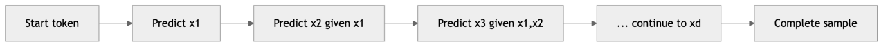

*Figure 318. An autoregressive model factors the joint distribution into a chain of next-element predictions, each conditioned on everything generated so far.*

## 23.8 Comparing the Families

Each family makes a different bargain among sample quality, diversity, training stability, sampling speed, and whether you get a usable likelihood or latent space. The table below extends the earlier three-way comparison to all five families in this chapter.

| Property | VAE | GAN | Diffusion | Normalizing flow | Autoregressive |
|----|----|----|----|----|----|
| Density type | Approximate (ELBO) | Implicit (none) | Approximate (bound) | Exact | Exact |
| Likelihood available | Bound only | No | Bound only | Exact | Exact |
| Sample quality | Moderate, often blurry | High, can be very sharp | Highest, state of the art | Good | High (sharp) |
| Sample diversity | Good (covers modes) | Risk of mode collapse | Excellent (full coverage) | Good | Excellent |
| Training stability | Stable, easy | Unstable, finicky | Stable | Stable | Stable |
| Sampling speed | Fast (one pass) | Fast (one pass) | Slow (many steps) | Fast (one pass) | Slow (sequential) |
| Latent space | Smooth, interpretable | Useful but less structured | Noise schedule, less interpretable | Exact, same-dim | None explicit |
| Typical use | Compression, anomaly detection, interpolation | Fast image synthesis, image translation | Text-to-image, audio, highest fidelity | Density estimation, lossless compression | Text (LLMs), audio, pixels |

The table repays a slow read, because each row is really a consequence of the design choice in the first row. A GAN has no likelihood *because* it is implicit; it risks mode collapse *because* nothing in its adversarial objective rewards coverage. A VAE is blurry *because* its Gaussian pixel likelihood averages over reconstructions, but stable *because* it optimizes a smooth bound. Diffusion is slow *because* it trades a single hard generation step for hundreds of easy ones, and that same trade is exactly why it is stable and high-quality. Autoregressive models are slow for the same structural reason — sequential sampling — but their exact likelihood and stability follow directly from the chain-rule factorization. Once you can read the trade-offs off the core mechanism, you no longer need to memorize the table; you can reconstruct it.

A useful mental model is the **“generative trilemma”**: high sample quality, broad mode coverage, and fast sampling are three goals that are hard to achieve all at once. GANs give quality and speed but struggle with coverage. VAEs and flows give coverage and speed but sacrifice some quality. Diffusion gives quality and coverage but sacrifices speed; autoregressive models give quality and coverage but are also slow. Much of the current research frontier is about relaxing this trilemma — distilling diffusion models into few-step samplers, adding adversarial losses to diffusion training, or using flow-matching objectives that combine flows’ one-pass sampling with diffusion-quality output.

## 23.9 Evaluating Generative Models

Generative models are hard to evaluate because there is no single ground-truth answer to compare against — you are judging a distribution, not a prediction. A good evaluation must capture *both* fidelity (do individual samples look real?) and diversity (does the model cover the whole data distribution, or has it collapsed?). Several complementary tools are used in practice.

**Log-likelihood / bits per dimension.** For models that can compute a likelihood — autoregressive models and flows exactly, VAEs and diffusion through a bound — the held-out log-likelihood, usually reported as *bits per dimension*, is the most principled score. It directly measures how well the model explains real data. Its limitation is that likelihood correlates only loosely with perceptual quality (a model can assign high likelihood yet produce mediocre samples), and it is unavailable for GANs entirely.

**Inception Score (IS)** uses a pretrained Inception classifier and rewards samples that are (a) confidently classified into a single category, indicating each image is recognizable, and (b) spread across many categories over the whole set, indicating diversity. Formally it is $`\exp\left( \mathbb{E}_{x}\, D_{KL}(p(y \mid x)\, \parallel \, p(y)) \right)`$; higher is better. Its main weakness is that it ignores the real data entirely — it only inspects the generated images — so it can be fooled and does not detect mode collapse well.

**Fréchet Inception Distance (FID)** is the modern standard. It passes both real and generated images through the Inception network, models each set of feature activations as a multivariate Gaussian, and measures the Fréchet distance between them:

``` math
\text{FID} = \left\| \mu_{r} - \mu_{g} \right\|^{2} + Tr\left( \Sigma_{r} + \Sigma_{g} - 2(\Sigma_{r}\Sigma_{g})^{1/2} \right),
```

where $`(\mu_{r},\Sigma_{r})`$ and $`(\mu_{g},\Sigma_{g})`$ are the mean and covariance of real and generated features. **Lower FID is better** — it means the generated feature statistics match the real ones. Because FID compares against real data, it captures both quality and diversity and penalizes mode collapse, which is why it became the field’s default. It is not perfect: it assumes Gaussian features, is biased by sample size, and inherits whatever the ImageNet-trained Inception network happens to care about.

**Precision and recall for generative models** disentangle the two things FID mixes together: *precision* measures what fraction of generated samples fall within the real data manifold (fidelity), while *recall* measures what fraction of the real manifold the generated samples cover (diversity). A mode-collapsed GAN can have high precision but terrible recall — precisely the failure FID’s single number can obscure.

**CLIP score** is the standard for *text-to-image* models: it measures the cosine similarity between the CLIP embedding of the prompt and the CLIP embedding of the generated image, quantifying prompt faithfulness rather than raw realism.

A few practical cautions apply whenever you actually compute these numbers. FID is *biased* by the number of samples — it decreases as you generate more images even for a fixed model — so comparisons are only meaningful at a fixed, large sample count (50,000 is the field convention), computed against the same reference statistics with the same Inception weights; a FID reported without those details is not comparable to anyone else’s. Both FID and IS are only as good as the features of the pretrained network they borrow, which was trained on ImageNet and can be blind to failures outside that domain (faces, medical images, text rendered in an image). And every automatic metric scores the *aggregate* distribution, so none of them will tell you that one particular generated image has a person with six fingers. Treat the metrics as a fast, noisy compass for model selection during development, not as the final word.

**Human evaluation** remains the ultimate arbiter. No automatic metric fully captures what a person means by “realistic,” “coherent,” or “faithful to the prompt,” so production systems rely on structured human studies — side-by-side preference tests, ratings of fidelity and prompt alignment — despite their cost and subjectivity. We discussed the general challenge of choosing the right metric in the chapter on Supervised Learning and Model Evaluation; generative metrics extend that same lesson to the unsupervised, distributional setting, where the thing being scored is a whole distribution rather than a single answer.

The figure below illustrates the intuition behind FID in two dimensions: two distributions with different means and spreads are clearly distinguishable, and FID grows as their statistics diverge.

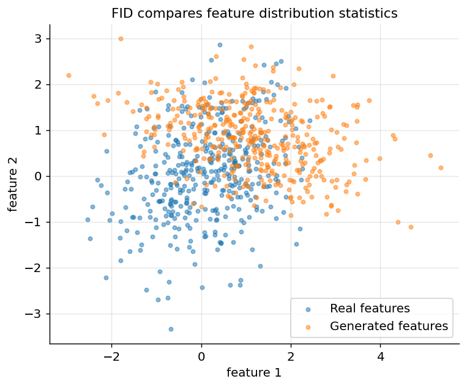

*Figure 319. FID compares the statistics of real and generated feature distributions; here two 2D Gaussians with different mean and spread illustrate distinguishable distributions.*

To make the noising process at the heart of diffusion concrete, the next figure shows how a simple 1-D signal degrades into noise as the timestep increases — the forward process applied to data you can actually see.

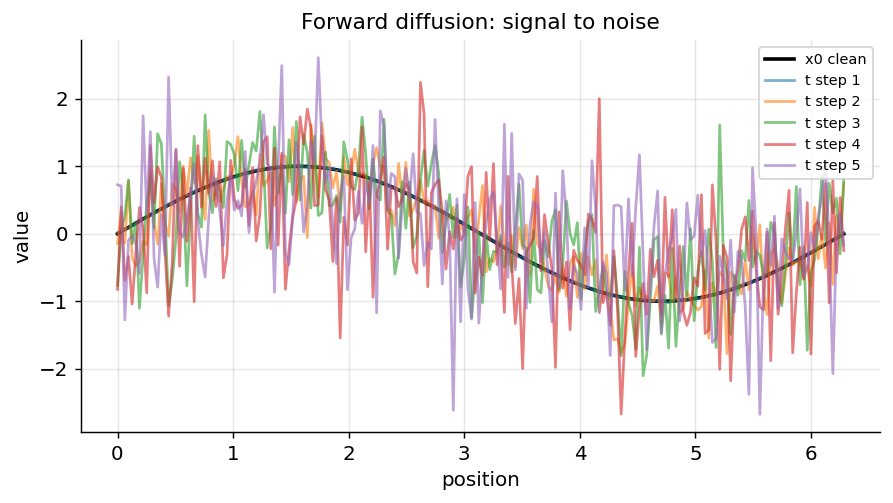

*Figure 320. The diffusion forward process: a clean 1-D signal is progressively corrupted toward pure noise as the timestep increases.*

## 23.10 A Conceptual GAN in Code

To tie the GAN section together, here is a minimal but complete training loop in PyTorch on flattened MNIST-shaped data, followed by a Keras version of the same architecture so you can use either framework. Both are intentionally small; they show the *structure* of adversarial training rather than chasing state-of-the-art samples.

``` python
# Minimal GAN training loop (PyTorch)
import torch
import torch.nn as nn

z_dim, img_dim = 64, 784
G = nn.Sequential(
    nn.Linear(z_dim, 256), nn.LeakyReLU(0.2),
    nn.Linear(256, img_dim), nn.Tanh(),          # images scaled to [-1, 1]
)
D = nn.Sequential(
    nn.Linear(img_dim, 256), nn.LeakyReLU(0.2),
    nn.Linear(256, 1), nn.Sigmoid(),             # probability the input is real
)
bce = nn.BCELoss()
opt_G = torch.optim.Adam(G.parameters(), lr=2e-4, betas=(0.5, 0.999))
opt_D = torch.optim.Adam(D.parameters(), lr=2e-4, betas=(0.5, 0.999))

def train_step(real_batch):
    bs = real_batch.size(0)
    real_lbl, fake_lbl = torch.ones(bs, 1), torch.zeros(bs, 1)

    # --- Train discriminator: real should score 1, fakes should score 0 ---
    z = torch.randn(bs, z_dim)
    fake = G(z)
    d_loss = bce(D(real_batch), real_lbl) + bce(D(fake.detach()), fake_lbl)
    opt_D.zero_grad(); d_loss.backward(); opt_D.step()

    # --- Train generator: fool D into scoring fakes as real (non-saturating) ---
    z = torch.randn(bs, z_dim)
    g_loss = bce(D(G(z)), real_lbl)   # label fakes as "real" to push G
    opt_G.zero_grad(); g_loss.backward(); opt_G.step()
    return d_loss.item(), g_loss.item()

# for epoch in range(epochs):
#     for real_batch in loader:        # real_batch shape (bs, 784), values in [-1, 1]
#         d, g = train_step(real_batch)
# Same GAN architecture (Keras / TensorFlow)
import tensorflow as tf
from tensorflow import keras
from tensorflow.keras import layers

z_dim, img_dim = 64, 784

generator = keras.Sequential([
    layers.Input(shape=(z_dim,)),
    layers.Dense(256), layers.LeakyReLU(0.2),
    layers.Dense(img_dim, activation="tanh"),
])
discriminator = keras.Sequential([
    layers.Input(shape=(img_dim,)),
    layers.Dense(256), layers.LeakyReLU(0.2),
    layers.Dense(1, activation="sigmoid"),
])

bce = keras.losses.BinaryCrossentropy()
opt_g = keras.optimizers.Adam(2e-4, beta_1=0.5)
opt_d = keras.optimizers.Adam(2e-4, beta_1=0.5)

@tf.function
def train_step(real_batch):
    bs = tf.shape(real_batch)[0]
    z = tf.random.normal((bs, z_dim))
    # --- Discriminator update ---
    with tf.GradientTape() as tape_d:
        fake = generator(z)
        d_loss = (bce(tf.ones((bs, 1)), discriminator(real_batch)) +
                  bce(tf.zeros((bs, 1)), discriminator(fake)))
    grads = tape_d.gradient(d_loss, discriminator.trainable_weights)
    opt_d.apply_gradients(zip(grads, discriminator.trainable_weights))
    # --- Generator update (non-saturating) ---
    z = tf.random.normal((bs, z_dim))
    with tf.GradientTape() as tape_g:
        g_loss = bce(tf.ones((bs, 1)), discriminator(generator(z)))
    grads = tape_g.gradient(g_loss, generator.trainable_weights)
    opt_g.apply_gradients(zip(grads, generator.trainable_weights))
    return d_loss, g_loss
```

Notice the two details that make adversarial training work in code: the `.detach()` (PyTorch) / separate tape (Keras) that stops discriminator gradients from flowing into the generator during the D update, and the use of the “real” label when training the generator, which implements the non-saturating loss. Everything else is ordinary supervised training — the magic is entirely in the alternating two-player setup.

## 23.11 A Short History of Generative Modeling

The families in this chapter did not arrive all at once, and their sequence tells a story of ideas answering each other’s weaknesses. The modern era opens in **2013-2014**: the **VAE** (Kingma and Welling) gave deep learning a principled, stable, likelihood-based generator with a usable latent space, and months later the **GAN** (Goodfellow et al.) offered a radically different, likelihood-free route to sharper samples. For several years GANs dominated the visual-quality headlines. **DCGAN (2015)** made them trainable with convolutions; **conditional GANs**, **Pix2Pix**, and **CycleGAN (2016-2017)** turned them into controllable image-translation engines; **WGAN (2017)** diagnosed and partly cured their instability; and **ProGAN** and **StyleGAN (2018-2019)** pushed them to the uncanny photorealistic faces that briefly made “GAN” a household word.

Meanwhile, likelihood-based alternatives matured in parallel. **PixelRNN/PixelCNN** and **WaveNet (2016)** showed that plain autoregression could model images and audio at high fidelity, and **normalizing flows** (NICE, RealNVP, Glow, 2015-2018) delivered exact likelihoods with invertible networks. The autoregressive thread also ran straight into the **Transformer (2017)** and, from **GPT (2018)** onward, into the large language models that redefined the whole field — a reminder that the text and image branches of generative modeling grew from the same root.

The decisive shift came in **2020-2022**. **DDPM (2020)** reframed a decade-old idea about denoising into a stable, simple regression objective that produced samples rivaling and then surpassing GANs, without mode collapse. **Score-based SDEs**, **DDIM**, and **classifier-free guidance (2020-2021)** made diffusion fast and controllable, and **latent diffusion / Stable Diffusion (2022)** made it cheap enough to run on a consumer GPU and open enough to spread everywhere. In the span of about a decade the center of gravity moved from VAEs to GANs to diffusion — each transition driven by fixing the previous champion’s specific failure (blur, then instability, then speed) — while autoregressive models quietly won the text modality outright. The current frontier is convergence: distillation and flow-matching are collapsing diffusion’s step count toward one, and hybrid objectives are borrowing across families, so the sharp boundaries drawn in this chapter are, encouragingly, beginning to blur.

## 23.12 Applications Across Modalities

Generative models are not confined to pretty pictures; the same handful of ideas has reshaped several fields, and seeing the range helps fix which family suits which problem.

**Images.** This is the flagship application and the one that drove the field forward. Text-to-image systems — Stable Diffusion, DALL-E, Midjourney, Imagen — are latent diffusion models with text conditioning, and they now produce photorealistic and stylized images from a sentence. Beyond fresh synthesis, the same models power *inpainting* (filling a masked region coherently), *outpainting* (extending an image past its borders), *super-resolution* (a diffusion model conditioned on a low-resolution image), and *image-to-image editing* (start the reverse process from a noised version of a real photo rather than pure noise, so the output keeps the input’s structure while obeying a new prompt). GANs still hold a niche where single-pass speed matters, such as real-time face editing and super-resolution.

**Audio and speech.** WaveNet’s autoregressive waveform modeling set the modern standard for text-to-speech naturalness, and diffusion models (as in many current TTS and music systems) now generate speech, sound effects, and music, usually conditioned on text or a mel-spectrogram. The compression-then-generate pattern of latent diffusion reappears here: models often generate in a learned audio-token space rather than raw samples.

**Text.** As the autoregressive section stressed, large language models *are* generative models — the entire field of LLMs is the text branch of this chapter, and the following chapters are devoted to it. Diffusion-for-text is an active research direction but autoregression still dominates.

**Science and other structured data.** Generative models design candidate drug molecules and materials (as graphs or SMILES strings), and diffusion models in particular drive structural biology — the protein-structure and protein-design systems that made headlines are built on diffusion over 3D coordinates. VAEs and flows are widely used for *anomaly detection* (a point with low model likelihood is anomalous) in fraud, manufacturing, and network security, and for *data augmentation* where labeled data is scarce. Conditional generation also produces synthetic tabular data that preserves statistical structure while protecting privacy.

A sobering companion to all of this is **misuse**. The same technology produces deepfakes, non-consensual imagery, and convincing disinformation, which is why detection, watermarking, and provenance standards — and the broader questions taken up in the Responsible AI chapter — are now inseparable from the generative-modeling toolkit itself.

## 23.13 Practical Guidance: Choosing a Generative Model

Faced with a real problem, the taxonomy collapses into a few practical questions.

*Do you need an exact likelihood?* For anomaly detection, lossless compression, or rigorous model comparison, you need a density, which rules out GANs. Choose a **normalizing flow** or an **autoregressive model** for an exact number, or a **VAE**/**diffusion** model if a bound suffices.

*Do you need a meaningful latent space?* For interpolation, controllable editing, or downstream representation learning, a **VAE** (or flow) gives you an encoder and a smooth, structured latent space that GANs and diffusion models do not provide out of the box.

*Is sampling speed critical?* If you must generate in a single forward pass — real-time interaction, on-device inference — a **GAN**, **VAE**, or **flow** samples in one shot, whereas diffusion and autoregressive models are inherently multi-step. If quality matters more than latency, diffusion with a fast sampler (DDIM/DPM-Solver) is usually the right default.

*What is your data modality?* Sequential, discrete data (text, code, symbolic sequences) is the natural home of **autoregressive** models. Continuous, high-dimensional perceptual data (images, audio) is where **diffusion** now dominates for quality and **GANs** for speed.

*How much do you value training stability?* If you cannot afford to babysit training, avoid GANs. Diffusion, VAEs, flows, and autoregressive models all train with stable, well-behaved losses; GANs remain the temperamental option, justified only when their single-pass speed is decisive.

For most new image and audio projects today the pragmatic default is a diffusion model — usually a latent diffusion model — because it combines top-tier quality, full mode coverage, and stable training, and the fast samplers have largely neutralized its historical speed disadvantage.

## 23.14 Summary

- **Generative models learn the data distribution** $`p(x)`$ (or $`p(x \mid y)`$) so they can synthesize new samples, in contrast to discriminative models that learn $`p(y \mid x)`$ to make predictions. Minimizing KL to the data distribution is equivalent to maximum likelihood, which underlies most (but not all) generative training.
- A **taxonomy** organizes the field: explicit-density models write down $`p_{\theta}(x)`$ exactly (autoregressive, flows) or approximately (VAE, diffusion), while implicit-density models (GANs) only learn to sample. A cross-cutting axis distinguishes likelihood-based, adversarial, and score-based training.
- **Autoencoders** (undercomplete, denoising, sparse) compress data through a bottleneck but do not give a samplable latent space; the denoising variant is the conceptual seed of diffusion.
- **Variational Autoencoders** are probabilistic autoencoders that maximize the **ELBO** — a Jensen-inequality lower bound on the log-likelihood that splits into a reconstruction term and a KL regularizer. The **reparameterization trick** ($`z = \mu + \sigma \odot \epsilon`$) makes sampling differentiable. VAEs are stable and give a smooth latent space but produce blurry samples and can suffer **posterior collapse**.
- **GANs** pit a generator against a discriminator in a **minimax game** that implicitly minimizes Jensen-Shannon divergence. They produce sharp images but are unstable and prone to **mode collapse**. **WGAN** replaces JS with the smoother **Wasserstein distance** for better gradients; other key variants are DCGAN, conditional GANs, CycleGAN, and StyleGAN.
- **Diffusion models** learn to reverse a fixed gradual noising process by predicting the added noise with a simple MSE loss. They are stable, avoid mode collapse, and produce the highest-quality, most diverse samples. **DDIM** and other fast samplers cut sampling from ~1000 steps to a few dozen, **classifier-free guidance** controls prompt adherence, and **latent diffusion** makes it efficient.
- **Stable Diffusion** composes these ideas: a VAE compresses to a latent space, diffusion runs in that latent space, and text conditioning steers generation via cross-attention with classifier-free guidance.
- **Normalizing flows** give exact likelihoods and fast one-pass sampling via invertible transformations and the change-of-variables formula. **Autoregressive models** factor $`p(x)`$ with the chain rule and are exactly the mechanism behind large language models.
- Evaluation must capture both fidelity and diversity: **FID** (lower is better) is the default, **Inception Score** (higher is better) ignores real data, precision/recall separate quality from coverage, CLIP score measures prompt faithfulness, and **human evaluation** remains essential.

## 23.15 Key Takeaways

- The single question unifying every model in this chapter is *how do you represent and sample from a learned distribution over high-dimensional data* — the families are just different answers with different trade-offs.
- There is no free lunch. The **generative trilemma** — sample quality, mode coverage, and fast sampling — is hard to win on all three axes at once, and each family’s weaknesses (VAE blur, GAN collapse, diffusion slowness) trace directly back to its core design choice.
- If you need a **likelihood or a clean latent space**, reach for a VAE, flow, or autoregressive model; if you need **maximum sample fidelity and diversity**, reach for diffusion; if you need **fast single-pass sampling** and can tolerate finicky training, a GAN may still win.
- Modern systems are **compositions**, not single models: Stable Diffusion alone uses a VAE, a U-Net, attention-based conditioning, and guidance together. Understanding the pieces is what lets you understand the whole.
- The autoregressive branch connects this chapter directly to large language models — image diffusion and text generation are cousins, not strangers.

## 23.16 Exercises

1.  **Conceptual.** Explain in your own words why a standard (non-variational) autoencoder makes a poor generator, and precisely what the KL regularization term in the VAE objective changes about the latent space to fix this.

2.  **Conceptual.** The reparameterization trick rewrites $`z \sim \mathcal{N}(\mu,\sigma^{2})`$ as $`z = \mu + \sigma\epsilon`$ with $`\epsilon \sim \mathcal{N}(0,I)`$. Why is this rewrite necessary for training a VAE with backpropagation? What would break if you sampled $`z`$ directly?

3.  **Conceptual / math.** Starting from $`\log p_{\theta}(x) = log\mathbb{E}_{q_{\phi}(z \mid x)}\lbrack p_{\theta}(x \mid z)p(z)/q_{\phi}(z \mid x)\rbrack`$, use Jensen’s inequality to derive the ELBO, and state exactly what the gap between the ELBO and the true log-likelihood equals. Why does maximizing the ELBO both raise a likelihood bound and improve the encoder?

4.  **Conceptual.** Describe mode collapse and explain why the standard minimax loss can encourage it. Then explain how the Wasserstein distance addresses the vanishing-gradient problem that the JS divergence suffers when the real and generated distributions barely overlap.

5.  **Conceptual.** Explain posterior collapse in a VAE: what shortcut does the optimizer find, why does a powerful decoder make it worse, and how does KL annealing help?

6.  **Coding.** Implement and train the small VAE from this chapter on MNIST (or Fashion-MNIST). After training, sample 16 latent vectors from $`\mathcal{N}(0,I)`$, decode them, and plot the results in a grid. Then take two test images, encode them to their means, linearly interpolate between the two latent codes in 8 steps, and decode each step to visualize the smooth latent space.

7.  **Coding.** Take the PyTorch GAN training loop and add logging of the discriminator’s average output on real and fake batches each epoch. Train on MNIST and plot these two curves over time. What values do they approach near convergence, and how does that relate to the theoretical optimum $`D^{\ast}(x) = \frac{1}{2}`$?

8.  **Conceptual / math.** Using the closed-form forward process $`x_{t} = \sqrt{{\bar{\alpha}}_{t}}\, x_{0} + \sqrt{1 - {\bar{\alpha}}_{t}}\,\epsilon`$, explain what happens to the relative contributions of the signal $`x_{0}`$ and the noise $`\epsilon`$ as $`t`$ increases toward $`T`$. Why does this property let a diffusion model sample any timestep during training without simulating all earlier steps?

9.  **Conceptual.** DDIM produces good samples in 20-50 steps while DDPM needs ~1000, using the *same* trained network. What does DDIM change about the sampling procedure, and why does that change permit far larger steps? What is given up, if anything?

10. **Conceptual.** Explain classifier-free guidance: how is a single network trained to be both conditional and unconditional, what does the guidance scale $`w`$ control, and what goes wrong if you set it very high?

11. **Conceptual.** A normalizing flow and an autoregressive model both give exact likelihoods. Explain how each achieves tractability (the change-of-variables formula with a triangular Jacobian versus the chain-rule factorization), and give one practical scenario where you would prefer each.

12. **Conceptual.** Explain why a GPT-style large language model is a generative model of the same autoregressive family as PixelCNN. Which properties of autoregressive models (stability, exact likelihood, slow sequential sampling) does an LLM inherit, and how do they show up in practice?

---

[← 22 Transformers and the Attention Mechanism](ch22-transformers.md) · [Contents](../README.md#contents) · [24 Large Language Models: How They Work →](ch24-llms-how-they-work.md)
