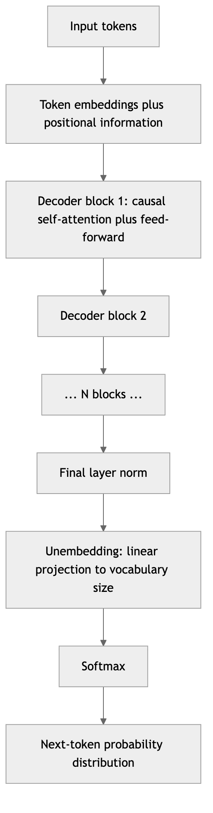
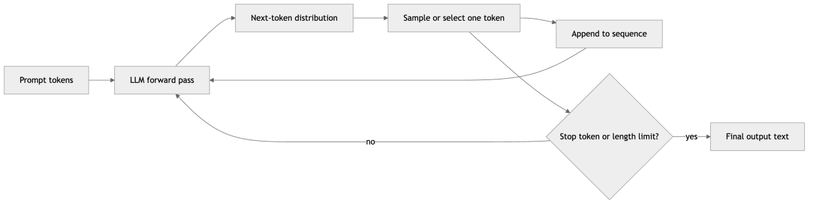
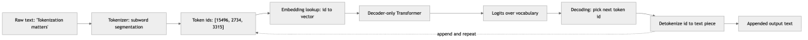
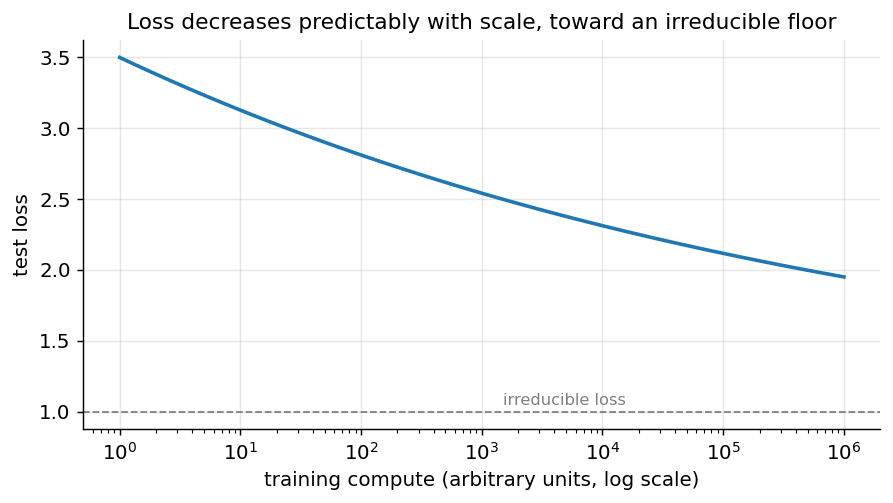
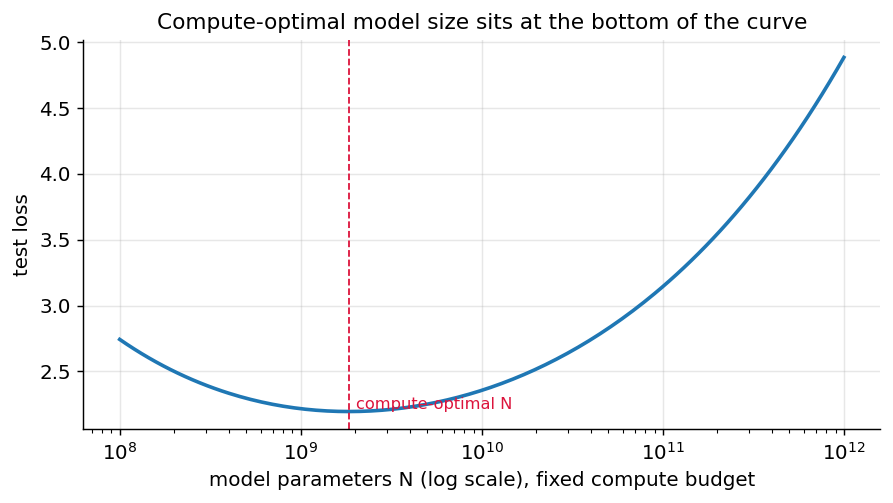
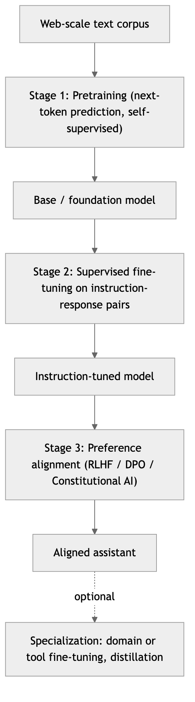
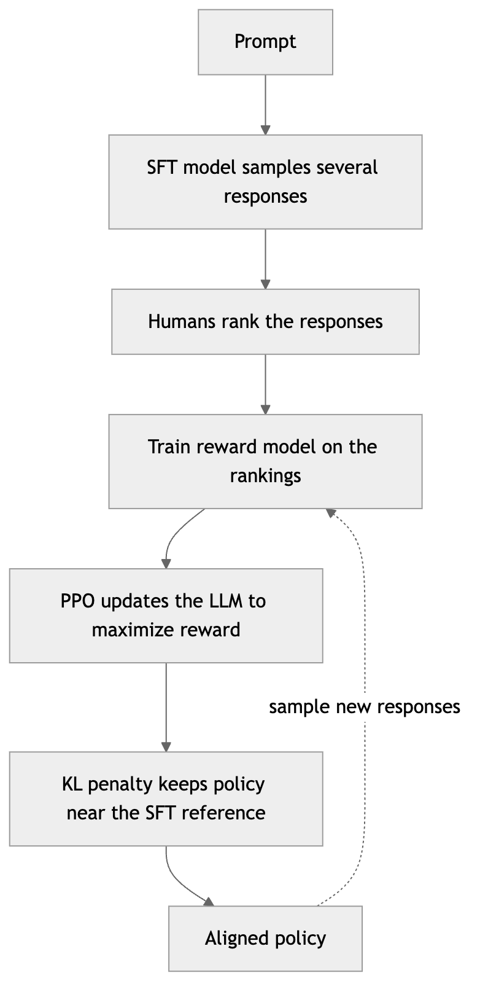
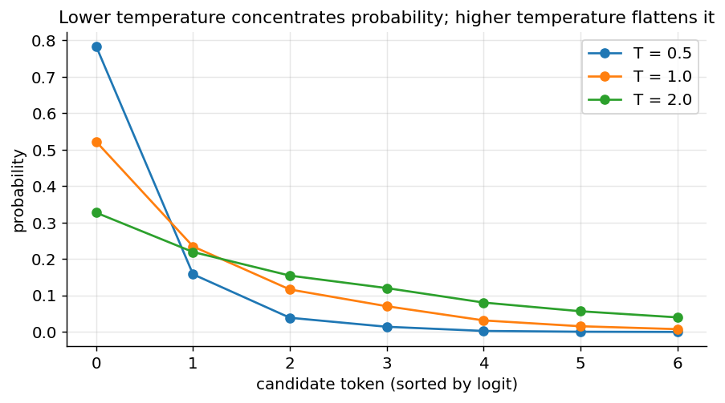
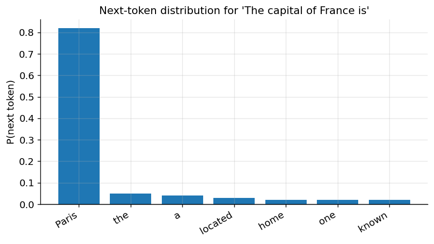

[← 23 Generative AI: GANs, VAEs, and Diffusion Models](ch23-generative-models.md) · [Contents](../README.md#contents) · [25 LLMs in Practice: Prompting, Fine-Tuning, Serving, and the Claude API →](ch25-llms-in-practice.md)

---

# 24 Large Language Models: How They Work

Large language models (LLMs) are the engines behind modern conversational AI. They write code, draft essays, answer questions, translate languages, and reason through problems — all from a single, deceptively simple training objective: *predict the next token*. That one sentence hides an enormous amount of machinery. A frontier LLM is a decoder-only Transformer with tens or hundreds of billions of parameters, trained on trillions of tokens scraped from most of the readable internet, then fine-tuned and aligned through several further stages until it behaves like a helpful assistant. This chapter opens the hood. Building directly on the Transformer architecture from the previous chapter, it explains what an LLM actually is, how text becomes tokens, why next-token prediction over web-scale data produces such broad capability, how the model is trained and aligned, how it generates text at inference time, what the current model landscape looks like, and — crucially — where its abilities end. By the close you should be able to reason about an LLM not as a magic oracle but as a concrete, if remarkable, statistical system with knowable mechanics and predictable failure modes.

## 24.1 What an LLM Is

Strip away the marketing and an LLM is a function. It takes a sequence of tokens as input and returns a probability distribution over the next token. That is the entire external interface. Everything a chatbot appears to do — reasoning, translation, coding, summarizing — is that one operation applied over and over, each prediction appended to the input and fed back in.

Three properties turn this humble function into something transformative. First, it is a **neural network**, specifically a **decoder-only Transformer**, so it can represent astronomically complex relationships between tokens. Second, it is **large** — the parameter count and the training data are both enormous, and (as we will see) capability grows predictably with that scale. Third, it is trained by **self-supervision** on natural text, which means the training signal is essentially free and effectively unlimited: every sentence ever written is a supervised example of “given this prefix, what comes next?”

The result is a model that has, in the course of learning to predict text, absorbed a staggering amount of the structure of that text — grammar, facts, styles, argument patterns, code syntax, common-sense associations, and more. None of this was explicitly taught. It is all a side effect of becoming very good at the next-token game across a huge and diverse corpus.

### 24.1.1 The decoder-only Transformer at the core

Recall the three Transformer families from the previous chapter: encoder-only (BERT), encoder-decoder (T5), and decoder-only (GPT). Modern LLMs are almost universally **decoder-only**. They keep the decoder stack of the original Transformer but drop its cross-attention sublayer, since there is no separate encoder to attend to. What remains is a stack of identical layers, each containing **masked (causal) multi-head self-attention** followed by a **position-wise feed-forward network**, wrapped in residual connections and layer normalization.

The word *causal* is the whole point. A causal mask forces every position to attend only to itself and to earlier positions, never to future ones. This is what makes the architecture a valid autoregressive language model: when the model computes the distribution for token $`t`$, it is structurally forbidden from peeking at tokens $`t + 1,t + 2,\ldots`$. During training this lets the model predict every next-token in a sequence *in parallel* in a single forward pass (via teacher forcing), while guaranteeing that no prediction cheats by looking ahead.



*Figure 321. A decoder-only LLM: token embeddings plus positions flow through N identical causal Transformer blocks to a final projection over the vocabulary*

A few structural details matter for understanding LLMs specifically. The input **embedding** matrix maps each of the $`V`$ vocabulary tokens to a $`d_{model}`$-dimensional vector; the output **unembedding** (often the same matrix, transposed and shared) projects the final hidden state back to a $`V`$-dimensional vector of **logits**, one score per possible next token. A softmax turns those logits into a probability distribution. Modern LLMs almost always replace the original sinusoidal positional encodings with **rotary position embeddings (RoPE)** or **ALiBi**, which encode *relative* position directly inside the attention computation and extrapolate better to long sequences — a point that returns when we discuss context windows. The feed-forward networks, which account for roughly two-thirds of the parameters in a typical model, are where much of the model’s factual knowledge is thought to be stored; a growing number of large models replace the single dense FFN with a **mixture-of-experts (MoE)** layer, in which a router sends each token to only a few of many expert sub-networks, so the model can have a very large total parameter count while activating only a fraction of it per token.

### 24.1.2 Inside a decoder block, and counting parameters

Each of the $`N`$ identical blocks is small enough to write out. In a modern **pre-norm** design, the input hidden state $`x`$ (shape $`n \times d_{model}`$ for a length-$`n`$ sequence) passes through two residual sublayers:

``` math
x \leftarrow x + \text{CausalMHA}\left( \text{LN}(x) \right),\quad\quad x \leftarrow x + \text{FFN}\left( \text{LN}(x) \right).
```

The layer norm sits *inside* each residual branch, which is what lets stacks of dozens or hundreds of blocks train stably. The following PyTorch sketch, a deliberately minimal “mini-GPT” block, makes the structure concrete and connects directly to the multi-head attention module from the previous chapter.

``` python
import torch, torch.nn as nn, torch.nn.functional as F

class DecoderBlock(nn.Module):
    def __init__(self, d_model=768, n_heads=12, mlp_ratio=4):
        super().__init__()
        self.ln1 = nn.LayerNorm(d_model)
        self.attn = nn.MultiheadAttention(d_model, n_heads, batch_first=True)
        self.ln2 = nn.LayerNorm(d_model)
        self.mlp = nn.Sequential(
            nn.Linear(d_model, mlp_ratio * d_model),
            nn.GELU(),
            nn.Linear(mlp_ratio * d_model, d_model),
        )

    def forward(self, x):
        n = x.size(1)
        # causal mask: position i may not attend to positions > i
        mask = torch.triu(torch.ones(n, n, dtype=torch.bool), diagonal=1)
        a, _ = self.attn(self.ln1(x), self.ln1(x), self.ln1(x), attn_mask=mask)
        x = x + a                      # residual around attention
        x = x + self.mlp(self.ln2(x))  # residual around feed-forward
        return x

block = DecoderBlock()
print(block(torch.randn(2, 16, 768)).shape)   # torch.Size([2, 16, 768])
```

Counting parameters clarifies where an LLM’s size actually goes. Ignoring biases and norms, each block has four attention projection matrices ($`W^{Q},W^{K},W^{V},W^{O}`$), each of size $`d_{model}^{2}`$, for $`4d_{model}^{2}`$ attention parameters, plus two feed-forward matrices of size $`d_{model} \times 4d_{model}`$, for $`8d_{model}^{2}`$ FFN parameters — roughly $`12d_{model}^{2}`$ per block. With $`N`$ blocks the transformer body holds about $`12Nd_{model}^{2}`$ parameters, plus $`V \times d_{model}`$ for the (tied) embedding table. Two things fall out immediately. First, the feed-forward networks are twice the size of attention, which is why they are believed to hold most of the model’s stored knowledge. Second, GPT-3’s headline figure checks out: with $`N = 96`$ blocks and $`d_{model} = 12288`$, the body is about $`12 \times 96 \times 12288^{2} \approx 1.7 \times 10^{11}`$ — the famous 175 billion parameters. This back-of-the-envelope estimate, together with the compute rule $`C \approx 6ND`$ used later, is enough to reason quantitatively about any model whose shape you know.

## 24.2 Language Modeling as Next-Token Prediction

At its core, a language model assigns a probability to a sequence of tokens. Using the chain rule of probability, the joint probability of a sequence factorizes exactly into a product of conditional “next-token” probabilities:

``` math
P(t_{1},t_{2},\ldots,t_{n}) = \prod_{i = 1}^{n}P(t_{i} \mid t_{1},\ldots,t_{i - 1}).
```

This factorization is not an approximation; it is a mathematical identity that holds for any joint distribution. Its power is that it converts the intractable problem of modeling a whole document at once into a sequence of much simpler problems: at each position, predict a single next token given everything before it. An LLM is a neural network trained to model each factor $`P(t_{i} \mid t_{< i})`$ with a single set of shared parameters $`\theta`$, so we write $`P_{\theta}(t_{i} \mid t_{< i})`$.

At inference time the model *generates* by turning this around. Given a prompt, it computes the distribution over the next token, chooses one (by a decoding strategy we will study in detail), appends it to the sequence, and repeats. This loop is called **autoregressive** generation, and it is the reason an LLM produces text left to right, one token at a time, rather than all at once.



*Figure 322. Autoregressive generation feeds each predicted token back as input for the next prediction until a stopping condition is met*

Because each step depends on all previous steps, generation is inherently **sequential** even though a single forward pass over a fixed sequence is highly parallel. Generating 500 tokens requires roughly 500 forward passes. This asymmetry — parallel training, sequential generation — is central to the economics and latency of LLMs, and it is exactly what the KV cache (discussed later) exists to optimize.

### 24.2.1 A worked example

Consider the prompt “The capital of France is”. The tokenizer might split this into the tokens `["The", " capital", " of", " France", " is"]`. The model runs a forward pass and produces a distribution over its entire vocabulary for the sixth token. If the model is well trained, the probability mass concentrates sharply on `" Paris"`, with small amounts on plausible alternatives like `" a"`, `" located"`, or `" the"`. A greedy decoder would emit `" Paris"`; the sequence becomes “The capital of France is Paris”; and the model runs again to predict what follows. The knowledge that Paris is the capital of France was never stored as an explicit fact — it lives, distributed across billions of weights, as whatever configuration best predicts that token in that context.

This example also exposes the subtlety at the heart of the whole enterprise. The model was only ever optimized to continue text, yet to do that well across the entire internet it was forced to internalize geography, grammar, and countless other regularities. Capability is a *byproduct of compression*: to predict the next token as accurately as possible over a huge and varied corpus, the most efficient strategy is to learn the underlying structure that generates the text rather than to memorize it. That is the deep reason a single, simple objective yields such general ability — and also why that ability is imperfect and probabilistic rather than exact and guaranteed.

## 24.3 Tokenization: Turning Text into Tokens

Before any neural network runs, text must become integers. A Transformer operates over a fixed **vocabulary** of tokens, each mapped to a row of the embedding matrix. Choosing that vocabulary — the job of the **tokenizer** — is one of the most consequential and least glamorous design decisions in the whole pipeline, and it quietly shapes cost, speed, multilingual fairness, and even arithmetic ability.

### 24.3.1 Why not words or characters

The two obvious choices are both poor. A **word-level** vocabulary is intuitive but brittle: it must be huge to cover a language (hundreds of thousands of words), it still fails on any word it has never seen — names, typos, new slang, code identifiers — forcing an “unknown” token that discards information, and it wastes capacity on morphological variants (*run*, *runs*, *running*, *ran* are four unrelated entries). A **character-level** (or byte-level) vocabulary is tiny and can represent anything, but it makes sequences punishingly long: a 1,000-word document becomes roughly 5,000–6,000 characters, and since attention cost grows with sequence length, this is expensive, and the model must also spend capacity relearning how to spell.

**Subword tokenization** is the compromise that every modern LLM uses. It keeps frequent words as single tokens while breaking rare words into reusable pieces, so the vocabulary stays a manageable size (typically 30,000 to 130,000 tokens) yet can represent *any* string without an unknown token. The word “tokenization” might become `token` + `ization`; an unfamiliar surname splits into familiar fragments; a run of source code splits into operators and identifiers. This is the best of both worlds: short sequences for common text, graceful degradation for the long tail.



*Figure 323. The tokenization-to-generation pipeline, from raw characters through subword tokens and model computation back to text*

### 24.3.2 Byte-Pair Encoding (BPE)

The most widely used algorithm is **Byte-Pair Encoding (BPE)**, borrowed from a 1990s data-compression scheme and adapted for NLP. Training a BPE tokenizer is a greedy, bottom-up merge procedure:

1.  Start with a base vocabulary of individual characters (or, in **byte-level BPE**, the 256 raw bytes, which guarantees that any possible input — any Unicode string, any binary-looking token — is representable with no unknowns).
2.  Scan the training corpus and count the frequency of every adjacent pair of symbols.
3.  Merge the single most frequent pair into a new symbol, and add it to the vocabulary.
4.  Repeat steps 2–3 until the vocabulary reaches the target size (the number of merges is the main hyperparameter).

The result is a vocabulary in which common character sequences — whole frequent words, common prefixes and suffixes, frequent code fragments — have been “grown” into single tokens, while rare sequences remain split into smaller pieces. GPT-2, GPT-3, and GPT-4 all use byte-level BPE. Encoding a new string applies the learned merges in the order they were created.

The algorithm is short enough to implement in a few lines, which is the fastest way to see that there is no magic in it — just greedy frequency counting:

``` python
from collections import Counter

def train_bpe(words, num_merges):
    # start each word as a tuple of characters, with counts
    vocab = Counter(tuple(w) for w in words)
    merges = []
    for _ in range(num_merges):
        pairs = Counter()
        for word, count in vocab.items():
            for a, b in zip(word, word[1:]):
                pairs[(a, b)] += count            # count adjacent pairs
        if not pairs:
            break
        best = pairs.most_common(1)[0][0]         # most frequent pair
        merges.append(best)
        merged = {}
        for word, count in vocab.items():         # merge that pair everywhere
            new, i = [], 0
            while i < len(word):
                if i < len(word) - 1 and (word[i], word[i+1]) == best:
                    new.append(word[i] + word[i+1]); i += 2
                else:
                    new.append(word[i]); i += 1
            merged[tuple(new)] = count
        vocab = merged
    return merges

corpus = ["low"] * 5 + ["lower"] * 2 + ["newest"] * 6 + ["widest"] * 3
print(train_bpe(corpus, num_merges=6))
# Learns merges like ('e','s') -> 'es', ('es','t') -> 'est', ...
# so "est" becomes a single reusable subword shared by 'newest' and 'widest'.
```

Notice how the shared suffix “est” is discovered automatically and becomes one token, so both “newest” and “widest” reuse it — exactly the morphological economy that word-level vocabularies cannot achieve.

### 24.3.3 WordPiece and Unigram / SentencePiece

Two important variants change the *criterion* for building the vocabulary:

- **WordPiece**, used by BERT and its relatives, is structurally similar to BPE but chooses each merge to maximize the *likelihood of the training corpus* under a simple language model, rather than raw pair frequency. It marks word-continuation pieces with a `##` prefix, so “playing” tokenizes as `play`, `##ing`.
- **Unigram language model** tokenization, popularized by **SentencePiece**, works top-down instead of bottom-up. It starts from a large candidate vocabulary and iteratively *removes* the tokens that hurt corpus likelihood least, until it reaches the target size. At encoding time it finds the most probable segmentation of a string. Because SentencePiece operates directly on raw text and treats whitespace as an ordinary symbol (often the visible marker `▁`), it needs no language-specific pre-tokenization and works cleanly for languages without spaces, such as Japanese or Chinese. Llama and many multilingual models use SentencePiece.

| Scheme | Used by | Build criterion | Notable trait |
|----|----|----|----|
| Word-level | Older NLP | — | Fails on unseen words |
| Character / byte | Some models | — | Robust but very long sequences |
| BPE (byte-level) | GPT family | Most frequent adjacent pair | No out-of-vocabulary failures |
| WordPiece | BERT family | Maximizes corpus likelihood | `##` continuation marker |
| Unigram / SentencePiece | Llama, T5, Gemma | Prune to maximize likelihood | Language-agnostic, no pre-tokenization |

### 24.3.4 Tokens versus words, and why tokenization matters

A practical rule of thumb for English: one token is roughly four characters, or about 0.75 words, so 100 tokens is around 75 words. But this ratio is only an average, and its variability has real consequences that every practitioner should internalize:

- **Cost and context are measured in tokens, not words.** API pricing, context-window limits, and latency are all denominated in tokens. A document that looks short can be token-heavy if it is full of rare words, code, or non-English text.
- **Tokenization is not language-fair.** Tokenizers are trained predominantly on English-heavy corpora, so English is efficiently packed while other languages fragment into many more tokens per word. The same sentence in, say, Burmese or Telugu can cost several times more tokens than its English translation — meaning higher cost, slower responses, and less effective context for speakers of under-represented languages.
- **Tokenization explains some “silly” failures.** Because the model sees tokens, not letters, tasks like counting the letters in a word, reversing a string, or precise character manipulation are genuinely hard: a word may be a single opaque token with no visible internal spelling. The famous difficulty some models have counting the *r*’s in “strawberry” is a tokenization artifact, not a reasoning failure per se.
- **Arithmetic is affected by how numbers tokenize.** If “1234” is one token but “1235” is two, the model’s numeric representations become inconsistent. Several modern tokenizers deliberately split numbers into individual digits to make arithmetic more learnable.
- **Boundaries can bite.** Whether a leading space belongs to a token, how trailing whitespace is handled, and where a prompt is cut can subtly change behavior. Always pair a model with *its own* tokenizer; feeding one model’s token ids to another produces nonsense.

``` python
# Inspecting tokenization with Hugging Face
from transformers import AutoTokenizer

tok = AutoTokenizer.from_pretrained("gpt2")
for text in ["Tokenization matters.", "antidisestablishmentarianism", "  123456"]:
    ids = tok(text)["input_ids"]
    pieces = tok.convert_ids_to_tokens(ids)
    print(f"{text!r:35}  {len(ids)} tokens  {pieces}")
# Common words are single tokens; the long rare word fragments into several
# subword pieces; digits and leading spaces reveal the tokenizer's quirks.
```

## 24.4 Pretraining: The Self-Supervised Objective

The first and by far the most expensive stage of building an LLM is **pretraining**: training the decoder-only Transformer on a vast corpus using the next-token objective and nothing else. This is a form of **self-supervised learning** — a term worth unpacking, because it is the key to why LLMs scaled so far.

In ordinary supervised learning (the classification and regression chapters), every training example needs a human-provided label, and labels are expensive. Self-supervision sidesteps this entirely: the “label” for each position is simply *the next token that actually appeared in the text*. The supervision is manufactured, for free, from the raw data itself. Every document is simultaneously millions of labeled examples. This is why LLMs can be trained on trillions of tokens: no human ever had to annotate any of it.

### 24.4.1 Causal language modeling and the loss

Concretely, pretraining minimizes the **cross-entropy** between the model’s predicted next-token distribution and the one-hot truth (the token that actually came next), averaged over every position in the corpus. This is equivalent to maximizing the log-likelihood the model assigns to the training text:

``` math
\mathcal{L}(\theta) = - \frac{1}{N}\sum_{i = 1}^{N}\log P_{\theta}\left( t_{i} \mid t_{1},\ldots,t_{i - 1} \right).
```

This objective is called **causal language modeling (CLM)** to distinguish it from the *masked* language modeling of BERT (which hides random middle tokens and predicts them bidirectionally). CLM predicts strictly left to right, which is what makes the resulting model generative. A closely related quantity is **perplexity**, the exponentiated average loss, $`exp(\mathcal{L})`$, which can be read as the effective number of equally likely choices the model is agonizing over at each step; lower perplexity means a better language model.

Training uses the deep-learning machinery from earlier chapters at extreme scale: the AdamW optimizer, a learning-rate schedule with warmup and cosine decay, mixed-precision arithmetic, gradient clipping, and enormous batch sizes measured in millions of tokens. The computation is spread across thousands of accelerators using data, tensor, and pipeline parallelism. A single frontier pretraining run can occupy tens of thousands of GPUs for weeks and cost tens of millions of dollars — which is exactly why scaling laws, discussed shortly, are not an academic curiosity but a budgeting tool.

The engineering to make such a run even possible is formidable, and worth sketching because it explains why so few organizations train frontier models. No single accelerator can hold a hundred-billion-parameter model plus its optimizer state and activations, so the work is split three ways at once. **Data parallelism** replicates the model across devices and gives each a different slice of the batch, averaging gradients. **Tensor parallelism** splits individual weight matrices across devices so a single layer’s matrix multiply is computed cooperatively. **Pipeline parallelism** places different layers on different devices and streams micro-batches through them like an assembly line. Memory-saving techniques such as **ZeRO** sharding (partitioning optimizer state, gradients, and parameters across devices) and **activation checkpointing** (recomputing activations during the backward pass instead of storing them) are essential. At this scale, hardware failures during a weeks-long run are routine, so frequent checkpointing and fault-tolerant orchestration are part of the recipe. Training is typically a single pass (one **epoch**) or less over the deduplicated corpus, because with trillions of unique tokens there is little need to revisit data — and revisiting it too often encourages memorization. The **loss curve** falls steeply at first and then settles into the long, slow power-law descent that scaling laws describe, punctuated occasionally by sudden loss spikes that engineers must diagnose and recover from by rolling back to a checkpoint.

The output of this stage is a **base model** (or **foundation model**): a network with broad knowledge and remarkable text-completion ability, but no particular inclination to be a helpful assistant. Prompt a raw base model with a question and it is just as likely to continue with *more questions* — because in its training data, questions are often followed by more questions — as to answer. Turning this raw completion engine into something that follows instructions is the job of the later stages.

## 24.5 Training Data: The Fuel

A model can only be as good as what it reads, and at web scale, curating that reading list is a research discipline of its own. Pretraining corpora are assembled from several broad sources, then aggressively cleaned and mixed.

**Sources.** The backbone is usually a filtered snapshot of the open web (for example, Common Crawl, a periodic crawl of billions of pages), supplemented with higher-quality curated collections: books, Wikipedia, academic papers (arXiv, PubMed), high-signal forums and Q&A sites, and — importantly for coding ability — large volumes of source code from public repositories. The total lands in the trillions of tokens.

**Cleaning and filtering.** Raw web text is mostly junk from a training perspective: boilerplate navigation, spam, adult content, machine-generated pages, broken markup, and near-duplicate SEO farms. Pipelines apply language identification, remove HTML and boilerplate, filter by heuristics (document length, punctuation ratios, presence of blocklisted content) and increasingly by learned quality classifiers that keep text resembling curated high-quality sources. Personally identifiable information is scrubbed where feasible. The consistent empirical finding is that **data quality beats data quantity**: a smaller, cleaner corpus often trains a better model than a larger, dirtier one.

**Deduplication.** Removing duplicate and near-duplicate documents is one of the highest-leverage steps. Duplicates arise everywhere — the same article reposted, mirror sites, quoted passages — and leaving them in wastes compute, biases the model toward over-represented text, worsens memorization of specific passages (a privacy and copyright concern), and can inflate benchmark scores through **train-test contamination**, where evaluation questions leak into training. Fuzzy deduplication with techniques like MinHash is now standard.

**Data mixtures.** The proportions of the mixture — how much web text versus code versus books versus math — materially change what the model is good at, and are tuned deliberately. Upweighting code improves not only coding but, somewhat surprisingly, general reasoning. High-quality sources are often **upsampled** (seen more than once per epoch) while bulk web text is seen once or less. Deciding this mixture is a form of curriculum design, and the recipes are among the most closely guarded parts of a frontier model. Some pipelines also stage the mixture over training — for example, front-loading diverse web text and finishing on a high-quality “cool-down” mix — a coarse form of curriculum.

**Synthetic data.** Increasingly, part of the corpus is *generated* rather than scraped: a capable model produces textbook-style explanations, worked reasoning traces, code with tests, or instruction- response pairs, which then train the next model. Used carefully, high-quality synthetic data can be more instructive than raw web text and helps push past the data wall. Used carelessly, training on model output degrades diversity and can trigger **model collapse**, so synthetic data is filtered and mixed rather than used wholesale.

**Legal and ethical dimensions.** Web-scale training raises real questions — copyright and licensing of scraped text and code, consent and privacy, and the propagation of bias and toxic content present in the data. These are not merely footnotes: they shape which data can be used, drive the cleaning and filtering choices above, and are the subject of active litigation and policy. The responsible-AI chapter treats them directly; here it is enough to note that the training corpus is a product of consequential human decisions, not a neutral given. Two further pressures round out the picture: the field is approaching the limits of high-quality human-written text available on the internet (the data wall), and the growing volume of AI-generated text online contaminates fresh crawls, making provenance and filtering ever more important.

## 24.6 Scaling Laws

The single most important empirical discovery about LLMs is that their performance improves **predictably and smoothly** as you increase three quantities together: the number of model **parameters** $`N`$, the number of training **tokens** $`D`$, and the total **compute** $`C`$ (which is roughly $`C \approx 6ND`$ floating-point operations). Over many orders of magnitude, the test loss falls as a **power law** in each of these, of the form

``` math
L(N) \approx L_{\infty} + \left( \frac{N_{c}}{N} \right)^{\alpha_{N}},
```

with analogous expressions for data and compute. Plotted on log-log axes, the loss traces a nearly straight line. This is remarkable: it means that before spending millions of dollars on a training run, you can *extrapolate* from small pilot runs to predict how good the big model will be. Scaling laws turned model building from alchemy into something closer to engineering.



*Figure 324. Scaling laws: test loss falls as a smooth power law in training compute, plotted on a log-x axis*

The compute term deserves a note, because the rule $`C \approx 6ND`$ is used constantly in practice. The factor of 6 comes from accounting: a forward pass costs roughly two floating-point operations per parameter per token (a multiply and an add), and the backward pass costs about twice the forward, for roughly six in total. Multiplying by $`N`$ parameters and $`D`$ training tokens gives the total training compute. This tiny formula lets you estimate the cost of a training run, back out how many tokens a disclosed compute budget implies, or check whether a model was trained compute-optimally — all on the back of an envelope.

### 24.6.1 Kaplan versus Chinchilla: the compute-optimal tradeoff

The story has two chapters. The 2020 **Kaplan et al.** scaling-laws paper (from OpenAI) established the power-law relationships and concluded, influentially, that when you have a fixed compute budget you should spend most of it on making the model *bigger*, training a very large model on a comparatively modest amount of data. This guidance shaped the first generation of giant models — GPT-3 at 175 billion parameters was trained on only about 300 billion tokens.

In 2022 **Hoffmann et al.** at DeepMind revisited the question in the paper that introduced **Chinchilla**, and reached a strikingly different conclusion. By training many models across a grid of sizes and data budgets, they found that the earlier work had *under-trained* its large models. For **compute-optimal** training, parameters and tokens should scale *in roughly equal proportion* — as a rule of thumb, about **20 tokens per parameter**. Under this recipe, GPT-3-scale models were far larger than they needed to be for their token budget. Chinchilla demonstrated the point directly: a 70-billion-parameter model trained on 1.4 trillion tokens outperformed the 175-billion-parameter GPT-3, while being smaller, cheaper, and faster to run.

The Chinchilla result reoriented the whole field. It explained why the next wave of models (Llama and its successors) were relatively “small” but trained on trillions of tokens. It also introduced a crucial distinction between **training compute** and **inference compute**. Chinchilla-optimality minimizes the compute to reach a given loss *during training*, but a model that will serve billions of queries is dominated by *inference* cost. It is therefore rational to deliberately “over-train” a smaller model on far more than 20 tokens per parameter — sacrificing training efficiency — because the resulting model is permanently cheaper and faster to deploy. This is why production models are often trained well past the compute-optimal point.



*Figure 325. For a fixed compute budget there is an optimal model size; too small or too large both give higher loss*

Powerful as they are, scaling laws come with important caveats that temper naive “just make it bigger” thinking. They predict the *pretraining loss*, not any specific downstream capability — and loss is only loosely coupled to usefulness. They assume you can keep feeding the model more high-quality data, which is bumping against the finite supply of quality human text (the data wall). They describe average behavior and say nothing about the specific emergent jumps discussed next. And the returns are a power law, meaning each further increment of capability costs exponentially more compute and money — a punishing economics that pushes the field toward efficiency (better data, distillation, mixture-of- experts, and test-time compute) rather than size alone. Scaling laws are a powerful planning tool, not a promise of indefinite free improvement.

## 24.7 Emergent Abilities and In-Context Learning

Scaling laws describe the *smooth* decline of the pretraining loss. But some of the most useful capabilities of LLMs appear to arrive **abruptly**: they are near-absent in smaller models and then, past some scale threshold, jump to well above chance. These are called **emergent abilities**. Reported examples include multi-step arithmetic, following multi-part instructions, answering questions that require several reasoning hops, and using a small number of in-context examples to learn a new task. The phenomenon is genuinely striking, though it comes with an important caveat: some apparent “emergence” is partly an artifact of using harsh, all-or-nothing metrics (exact-match accuracy) that mask smooth underlying improvement. Under smoother metrics the jumps look more gradual. Either way, the practical lesson holds — bigger models can do qualitatively new things that smaller ones simply cannot.

### 24.7.1 In-context learning

### 24.7.2 What the model actually learns

It is natural to ask what is *inside* those billions of weights that lets next-token prediction turn into knowledge and skill. The honest answer is that we do not fully know — an LLM is trained, not programmed, and its internal computations are largely opaque. But the young field of **mechanistic interpretability** has begun to reverse-engineer pieces of it, and a few robust findings sharpen the intuition. Individual neurons are usually **polysemantic**: they fire for many unrelated concepts, because the model packs far more features than it has dimensions by representing them in **superposition** — as directions in activation space rather than as dedicated units. Attention heads learn interpretable algorithms; the best-known are **induction heads**, which implement a simple copy-and-continue rule (“this token followed that one earlier, so predict it again”) and are strongly associated with the onset of in-context learning during training. Factual associations appear to be stored predominantly in the feed-forward layers, which behave like a large key-value memory that can be located and even edited. The practical upshot is not that LLMs are secretly symbolic reasoners, nor that they are mere lookup tables, but something in between: next-token prediction pressures the model to build reusable internal circuits and features that *generalize*, and it is those learned circuits, not memorized strings, that produce the model’s most impressive behavior — and, when they misfire, its hallucinations.

### 24.7.3 In-context learning

The most economically important emergent ability is **in-context learning (ICL)**: the model can learn a task *from the prompt alone*, at inference time, with no weight updates whatsoever. You show it what you want, and it generalizes. ICL comes in three flavors distinguished by how many demonstrations you provide:

- **Zero-shot.** You give only an instruction: *“Translate to French: ‘good morning’.”* The model answers directly.
- **One-shot.** You give a single worked example before the real query.
- **Few-shot.** You give several worked examples, and the model infers the pattern and continues it:

``` python
Review: "Loved every minute."      Sentiment: positive
Review: "Total waste of money."    Sentiment: negative
Review: "It was fine, I guess."    Sentiment:
```

The model completes the last line with `neutral` — not because anyone fine-tuned it on sentiment, but because it recognized the pattern in the prompt and continued it. This ability, which older models lacked, is what made prompting rather than fine-tuning the dominant way people use LLMs.

It is worth being precise about what is and is not happening in ICL, because the phrasing “learning” misleads. No weights change; nothing is saved. The demonstrations simply become part of the context that conditions the next-token distribution, and the model’s forward pass — plausibly using induction heads and related circuits — infers and continues the pattern. When the conversation ends, the “learning” evaporates completely. This is why ICL is powerful for adapting behavior on the fly yet useless for permanently teaching a model something new: for that you need fine-tuning.

A closely related and hugely important discovery is **chain-of-thought (CoT)** prompting. Instructing the model to “think step by step,” or showing it worked reasoning in the few-shot examples, causes it to generate intermediate reasoning tokens before its final answer — and this dramatically improves accuracy on arithmetic, logic, and multi-step problems. The mechanism is intuitive once you remember that the model has a fixed, small amount of computation per token: forcing it to externalize intermediate steps gives it more forward passes (more “thinking time”) and a scratchpad to condition on, rather than demanding the whole answer be computed in one shot. Chain-of-thought is the conceptual seed of the reasoning models discussed later, which internalize and extend this behavior through training. In-context learning and CoT together are why the craft of prompt engineering matters — a subject the next chapter develops in full.

## 24.8 The Training Pipeline

A production LLM is not a raw base model. It passes through a sequence of stages, each with a different objective and data source, that progressively transform a text-completion engine into a helpful, harmless, and honest assistant.



*Figure 326. The stages that turn raw text into an aligned assistant, from pretraining through fine-tuning to preference alignment*

### 24.8.1 Stage 1: Pretraining

Described above: next-token prediction over a huge corpus, producing the base model. This stage supplies essentially all of the model’s raw knowledge and linguistic competence. The later stages add very little new knowledge; they mostly teach the model how to *use* and *present* what it already learned.

### 24.8.2 Stage 2: Supervised Fine-Tuning (Instruction Tuning)

The base model is next fine-tuned on a curated dataset of **instruction-response pairs** — often tens of thousands to millions of examples, written or heavily reviewed by humans and covering a wide range of tasks (answering questions, summarizing, rewriting, coding, refusing inappropriate requests). This is called **supervised fine-tuning (SFT)** or **instruction tuning**. Mechanically it is the same next-token objective as pretraining, but now the training text has the *format* of a helpful exchange: a user instruction followed by a high-quality assistant response. By imitating these demonstrations, the model learns the *behavior* of an assistant — that an instruction should be followed with a useful, well-structured answer rather than merely continued. SFT is cheap compared to pretraining and produces an **instruction-tuned model** that is already quite usable. It also teaches the **chat template**: the special tokens and role markers (system, user, assistant) that structure a conversation.

Full fine-tuning updates all the model’s weights, which is expensive in memory and storage. In practice most fine-tuning uses **parameter-efficient fine-tuning (PEFT)**, above all **LoRA** (Low-Rank Adaptation). LoRA freezes the pretrained weights and injects a small pair of low-rank matrices $`A`$ and $`B`$ into each targeted weight $`W`$, learning only the update $`\Delta W = BA`$ where $`B`$ and $`A`$ have a tiny inner dimension $`r`$ (often 8 to 64). Because only these adapters train, LoRA cuts trainable parameters and memory by orders of magnitude, lets many task-specific adapters share one frozen base model, and — combined with quantization of the frozen weights (**QLoRA**) — makes fine-tuning a large model feasible on a single GPU. This is the workhorse of practical customization and returns in the LLMs-in-practice chapter.

### 24.8.3 Stage 3: Alignment with Human Preferences

SFT teaches the model to imitate good responses, but human demonstrators cannot cover every situation, and it is often easier for a person to *compare* two responses than to *write* the ideal one. The final stage optimizes the model directly against human (or AI) **preferences** over its own outputs, pushing it toward answers people actually prefer — more helpful, more honest, less likely to produce harmful content. This is the stage that most distinguishes a polished commercial assistant from a raw instruction-tuned model, and it is important enough to deserve its own section.

## 24.9 Reinforcement Learning from Human Feedback and Its Alternatives

The classic alignment recipe is **Reinforcement Learning from Human Feedback (RLHF)**, which combines the reinforcement-learning machinery from earlier chapters with human preference data. It proceeds in three steps.

**Step 1: Collect preference data.** For a wide range of prompts, sample two or more responses from the SFT model and ask human labelers to rank them from best to worst. The output is a dataset of comparisons of the form “for this prompt, response A is preferred over response B.”

**Step 2: Train a reward model.** Train a separate neural network — the **reward model (RM)**, usually initialized from the LLM itself with a scalar output head — to predict a score $`r_{\phi}(x,y)`$ for a response $`y`$ to a prompt $`x`$, fit so that preferred responses score higher than dispreferred ones. The standard objective is the Bradley-Terry loss, which models the probability that one response beats another as a logistic function of their reward difference:

``` math
\mathcal{L}_{RM}(\phi) = - \,\mathbb{E}_{(x,\, y_{w},\, y_{l})}\left\lbrack \log\sigma\left( r_{\phi}(x,y_{w}) - r_{\phi}(x,y_{l}) \right) \right\rbrack,
```

where $`y_{w}`$ is the preferred (“winning”) response and $`y_{l}`$ the rejected (“losing”) one. The reward model distills scattered human judgments into a single differentiable function that can score any response automatically.

**Step 3: Optimize the policy with RL.** Now treat the LLM as a **policy** $`\pi_{\theta}`$ that, given a prompt, generates a response (a sequence of token “actions”), and fine-tune it with reinforcement learning to maximize the reward-model score. The workhorse algorithm is **Proximal Policy Optimization (PPO)**, from the reinforcement-learning chapter. Crucially, the objective includes a **KL-divergence penalty** that keeps the updated policy close to the original SFT model:

``` math
\max_{\theta}\mspace{6mu}\mathbb{E}_{x,\, y \sim \pi_{\theta}}\left\lbrack r_{\phi}(x,y) \right\rbrack\mspace{6mu} - \mspace{6mu}\beta\, D_{KL}\left( \pi_{\theta}( \cdot \mid x)\, \parallel \,\pi_{\text{ref}}( \cdot \mid x) \right).
```

Without this penalty the policy would **reward-hack** — drift into degenerate text that scores high under the imperfect reward model but is gibberish to humans (endless flattery, repeated keywords, exploiting quirks of the RM). The KL term anchors the model to fluent language while nudging it toward higher-reward behavior. RLHF, introduced for LLMs by the InstructGPT work and central to the first ChatGPT, is what produced the leap in helpfulness that brought LLMs to the mainstream.



*Figure 327. The RLHF loop: humans rank sampled responses, a reward model learns their preferences, and PPO optimizes the LLM against that reward with a KL anchor*

### 24.9.1 Why RLHF is hard, and the alternatives

Full RLHF is powerful but operationally painful: it requires training and maintaining a separate reward model, running an unstable on-policy RL loop, keeping several copies of the model in memory (policy, reference, reward, and value networks), and constantly guarding against reward hacking. Several alternatives have emerged to capture most of the benefit with less pain.

- **Direct Preference Optimization (DPO)** is the most influential. It shows, through a clever bit of algebra, that the RLHF objective has a closed-form optimal policy, which lets you optimize the *same* preference data directly with a simple classification-style loss — no separate reward model and no RL loop at all. DPO trains the LLM to raise the likelihood of preferred responses and lower that of rejected ones, relative to the reference model, in a single supervised-feeling step. It is far simpler and more stable, and has become a default for open-weight models. Numerous refinements (IPO, KTO, ORPO, and others) tweak the loss further.
- **RLHF variants and RLAIF.** Collecting human preferences is slow and expensive, so **Reinforcement Learning from AI Feedback (RLAIF)** replaces (or augments) human labelers with a capable LLM acting as the judge, generating preference labels at scale.
- **Constitutional AI (CAI)**, developed at Anthropic, is a prominent form of AI feedback. Instead of relying on humans to label harmfulness case by case, the model is guided by an explicit written set of principles — a “constitution.” In a first phase the model critiques and revises its own responses against those principles (supervised self-improvement); in a second phase it generates preference labels by judging which of two responses better follows the constitution, and those AI-generated preferences train the model via RL. This makes the values steering the model explicit, auditable, and consistent, and reduces the burden of human labeling for sensitive content.

The DPO loss is compact enough to show, and seeing it side by side with the reward-model loss makes the relationship clear. Where the reward model learns a scalar $`r_{\phi}`$, DPO folds the reward *implicitly* into the log-probability ratio between the trained policy and the frozen reference, scaled by $`\beta`$:

``` math
\mathcal{L}_{DPO}(\theta) = - \,\mathbb{E}_{(x,\, y_{w},\, y_{l})}\left\lbrack \log\sigma\left( \beta\log\frac{\pi_{\theta}(y_{w} \mid x)}{\pi_{\text{ref}}(y_{w} \mid x)} - \beta\log\frac{\pi_{\theta}(y_{l} \mid x)}{\pi_{\text{ref}}(y_{l} \mid x)} \right) \right\rbrack.
```

In code the DPO step is strikingly ordinary — no sampling, no reward model, no RL loop, just four log-probabilities per preference pair:

``` python
import torch.nn.functional as F

def dpo_loss(logp_w_policy, logp_l_policy,
             logp_w_ref, logp_l_ref, beta=0.1):
    # log-prob ratios of the winning and losing responses vs the frozen reference
    w_ratio = logp_w_policy - logp_w_ref
    l_ratio = logp_l_policy - logp_l_ref
    # push preferred above rejected; a logistic (Bradley-Terry) loss
    return -F.logsigmoid(beta * (w_ratio - l_ratio)).mean()
```

The high-level takeaway: whether via PPO, DPO, or AI feedback, alignment optimizes the model against *preferences over whole responses* rather than next-token likelihood, and that shift in objective is what makes assistants feel helpful, safe, and on-task. It is worth stressing that alignment mostly shapes *behavior and presentation*; it does not install new factual knowledge, and it cannot fully eliminate the failure modes discussed at the end of this chapter.

## 24.10 Decoding and Sampling Strategies

Pretraining and alignment give us a model that outputs a probability distribution over the next token. But a distribution is not text. **Decoding** is the procedure that turns each distribution into an actual chosen token, and the choice of strategy strongly shapes the style, diversity, and reliability of the output. This is a knob you control at inference time, without retraining.

### 24.10.1 Deterministic decoding: greedy and beam search

The simplest strategy is **greedy decoding**: at each step, pick the single highest-probability token. It is fast and deterministic but tends to produce dull, repetitive text and can get stuck in loops, because always taking the locally most likely token is not the same as finding the globally most likely sequence.

**Beam search** improves on greed by keeping the $`k`$ most probable *partial sequences* (the “beams”) at every step, expanding each and retaining the top $`k`$ overall, so it explores several hypotheses in parallel before committing. It reliably finds higher-probability sequences and is excellent for tasks with a single correct-ish answer, such as machine translation or short factual extraction. But for open-ended, creative generation, beam search tends to produce bland, generic text — high-probability sequences are often the *boring* ones — and it is more expensive. Most chat-style generation therefore uses sampling rather than beam search.

### 24.10.2 Stochastic decoding: temperature, top-k, and top-p

Instead of always taking the most likely token, we can **sample** from the distribution, which introduces the variety that makes text feel natural and creative. Three parameters govern the sampling.

**Temperature** rescales the logits before the softmax. With temperature $`T`$, the probability of token $`i`$ becomes

``` math
P_{i} = \frac{exp(z_{i}/T)}{\sum_{j}^{}\exp(z_{j}/T)}.
```

As $`T \rightarrow 0`$ the distribution collapses onto its peak (equivalent to greedy); at $`T = 1`$ it is the model’s native distribution; and $`T > 1`$ flattens it, spreading probability toward less likely tokens and increasing randomness. Low temperature is best for factual, analytical, or coding tasks where you want reliability; higher temperature suits brainstorming and creative writing.



*Figure 328. Temperature reshapes the next-token distribution before sampling; low T sharpens toward the top token, high T flattens toward uniform*

**Top-k sampling** restricts the choice to the $`k`$ most probable tokens, renormalizes their probabilities, and samples from that shortlist. This prevents the model from ever picking a bizarre low-probability token from the long tail, while retaining variety among the plausible ones. Its weakness is that a fixed $`k`$ is sometimes too permissive (when one token should dominate) and sometimes too restrictive (when many tokens are genuinely plausible).

**Top-p (nucleus) sampling** fixes this by choosing the *smallest* set of tokens whose cumulative probability exceeds a threshold $`p`$ (say 0.9), then sampling from that set. The size of the candidate pool now *adapts* to the model’s confidence: when the model is sure, the nucleus is tiny; when many continuations are reasonable, it widens. Top-p is the most popular sampling method for chat and is frequently combined with a moderate temperature.

The next figure makes a single decoding step concrete, showing the model’s probabilities for the token after “The capital of France is”.



*Figure 329. A single decoding step: the model’s next-token probabilities after the prompt ‘The capital of France is’*

### 24.10.3 Repetition control and stopping

Autoregressive models can fall into loops, repeating a phrase indefinitely. Several penalties counteract this. A **repetition penalty** divides (or subtracts from) the logits of tokens that have already appeared, discouraging verbatim repeats. **Frequency and presence penalties** (exposed by some APIs) scale the penalty by how often a token has occurred and whether it has occurred at all, respectively. **No-repeat n-gram** blocking simply forbids emitting any n-gram that has already appeared. Generation stops when the model emits a designated **end-of-sequence** token, when a user-specified **stop sequence** appears, or when a maximum token limit is reached.

| Strategy | How it works | Best for |
|----|----|----|
| Greedy | Always take the top token | Fast, deterministic short answers |
| Beam search | Keep top-$`k`$ partial sequences | Translation, tasks with one right answer |
| Temperature | Scale logits by $`1/T`$ before softmax | Global control of randomness |
| Top-k | Sample from the $`k`$ likeliest tokens | Bounding randomness with a fixed pool |
| Top-p (nucleus) | Sample from the smallest set with cumulative prob $`> p`$ | Adaptive, natural chat generation |
| Repetition penalty | Down-weight already-used tokens | Preventing loops and verbatim repeats |

``` python
# Decoding controls with Hugging Face generate()
from transformers import AutoModelForCausalLM, AutoTokenizer
import torch

tok = AutoTokenizer.from_pretrained("gpt2")
model = AutoModelForCausalLM.from_pretrained("gpt2")
inputs = tok("The key idea behind attention is", return_tensors="pt")

out = model.generate(
    **inputs,
    max_new_tokens=40,
    do_sample=True,        # stochastic sampling (False = greedy/beam)
    temperature=0.8,       # flatten/sharpen the distribution
    top_p=0.9,             # nucleus sampling
    top_k=50,              # cap the candidate pool
    repetition_penalty=1.2 # discourage loops
)
print(tok.decode(out[0], skip_special_tokens=True))
```

To see how these knobs sit inside the autoregressive loop — with no framework hiding the mechanics — here is a decoding loop in NumPy that applies temperature, top-k, and top-p to a mock model that returns logits. The control flow is exactly what a production `generate()` runs; only the model is a stand-in.

``` python
import numpy as np

def softmax(z):
    z = z - z.max(); e = np.exp(z); return e / e.sum()

def sample_next(logits, temperature=1.0, top_k=0, top_p=1.0, rng=np.random):
    logits = logits / max(temperature, 1e-8)          # temperature scaling
    probs = softmax(logits)
    order = np.argsort(probs)[::-1]                   # sort tokens by probability
    if top_k:                                         # keep only the top-k
        order = order[:top_k]
    cum = np.cumsum(probs[order])                     # nucleus (top-p) cutoff
    keep = order[cum <= top_p]
    keep = keep if len(keep) else order[:1]           # always keep at least one
    p = probs[keep] / probs[keep].sum()               # renormalize the survivors
    return rng.choice(keep, p=p)

def generate(model, prompt_ids, max_new=20, eos=None, **kw):
    ids = list(prompt_ids)
    for _ in range(max_new):
        logits = model(ids)                           # one forward pass -> logits
        nxt = sample_next(logits, **kw)               # pick the next token
        ids.append(int(nxt))                          # append and repeat
        if eos is not None and nxt == eos:
            break
    return ids
```

Every real LLM inference server is this loop wrapped around a Transformer forward pass and accelerated by the KV cache described below. Understanding it removes the last of the mystery from “generation.”

## 24.11 Context Windows and Long-Context Techniques

The **context window** is the maximum number of tokens the model can attend to in a single forward pass — the prompt plus the generated output must together fit within it. It is the model’s working memory. Early GPT-3 offered about 2,048 tokens; today’s frontier models offer context windows of 128,000 tokens to a million or more, enough to hold entire books or large codebases. Context length is one of the headline specifications distinguishing models, because it determines how much a model can consider at once: a long document to summarize, many few-shot examples, retrieved passages, or a long conversation history.

Why not simply make the window arbitrarily large? Because standard self-attention is **quadratic** in sequence length — the attention matrix is $`n \times n`$ — so doubling the context roughly quadruples the attention compute and memory. Extending context is therefore an engineering battle on several fronts:

- **Positional generalization.** A model trained on 4K tokens does not automatically work at 100K; its positional scheme must extrapolate. **Rotary position embeddings (RoPE)** encode relative position inside attention and can be *interpolated* or rescaled (position interpolation, NTK-aware scaling, YaRN) to stretch a model to longer contexts with modest additional training. **ALiBi** biases attention scores by distance and also extrapolates gracefully.
- **Efficient attention.** **FlashAttention** restructures the attention computation to be IO-aware, dramatically cutting memory traffic without changing the result — it makes long context practical rather than merely possible. **Sparse**, **sliding-window** (local), and **linear** attention variants reduce the quadratic cost by having each token attend only to a subset of others; sliding-window attention combined with occasional global tokens is a common recipe (used, for example, by some Mistral models).
- **Architectural alternatives.** State-space models such as **Mamba** and other recurrence-inspired designs aim for linear-time sequence modeling, an active research direction for very long context.

Why does long context matter so much in practice? It is the difference between an assistant that can consider a single email and one that can read an entire contract, a whole codebase, or a book-length report and answer questions grounded in all of it. It lets you supply many few-shot examples, paste in reference material rather than relying on the model’s baked-in knowledge, retain a long conversation, and — critically — feed in retrieved passages, which is the foundation of retrieval-augmented generation. Long context and retrieval are complementary rather than competing: a bigger window raises how much retrieved material you can include, while retrieval decides *what* is worth including.

A subtlety that matters in practice: a large context window does not guarantee the model *uses* all of it well. Empirically, models often attend best to information at the very beginning and very end of a long context and can neglect material buried in the middle — the **“lost in the middle”** effect. Longer contexts also raise cost and latency (more tokens to process and a larger KV cache) and can dilute the model’s focus with irrelevant material. A huge window is an opportunity, not a guarantee; how much you put in it, and where you place the important parts, still matters.

## 24.12 Inference and the KV Cache

Understanding inference is essential to reasoning about LLM latency and cost. Recall that generation is autoregressive: to produce $`m`$ tokens, the model runs $`m`$ sequential forward passes. Naively, each pass would recompute the attention keys and values for *every* token in the growing sequence — an enormous, quadratically redundant amount of work, since the keys and values for the earlier tokens do not change as new tokens are appended.

The **key-value (KV) cache** eliminates this redundancy. During generation the model stores the key and value vectors it has already computed for each layer and each past token, and reuses them. Each new step then only needs to compute the query, key, and value for the *single* new token and attend over the cached keys and values. This turns each decoding step from a full re-processing of the sequence into an incremental update, making generation far faster.

This optimization is why LLM inference has two distinct phases with very different cost profiles:

- **Prefill** (the prompt-processing phase): the entire prompt is processed in one parallel forward pass that populates the KV cache. This is compute-bound and fast per token, which is why long prompts are relatively cheap to *ingest*.
- **Decode** (the generation phase): tokens are produced one at a time, each a small forward pass. This is memory-bandwidth-bound — dominated by reading the model’s weights and the KV cache from memory — which is why generating long outputs is slower per token than reading the prompt.

The catch is that the KV cache consumes memory that grows with both the sequence length and the batch size, and for long contexts it can rival or exceed the size of the model’s weights. This makes KV-cache management the central bottleneck of serving LLMs at scale. Techniques to tame it include **multi-query** and **grouped-query attention (GQA)**, which share key/value projections across attention heads to shrink the cache; **PagedAttention** (the idea behind the vLLM serving engine), which manages cache memory in pages like an operating system to reduce fragmentation and enable high throughput; and **quantization** of the cache. Related serving optimizations — **continuous batching**, **speculative decoding** (a small draft model proposes several tokens that the large model verifies in one pass), and weight quantization — round out the modern inference stack. These are the practical subject of later chapters, but the KV cache is the concept that ties them together.

Two numbers shape almost every deployment decision. **Time to first token (TTFT)** is dominated by the prefill phase and grows with prompt length; **time per output token (TPOT)** is set by the decode phase and by how fast the hardware can stream the weights and KV cache from memory. Because decode is memory-bandwidth-bound, batching many requests together is the key to *throughput* — the accelerator reads each weight once and applies it to many sequences — even though it does little for the latency of any single request. This is why hosted APIs bill separately for input (prefill) and output (decode) tokens, usually pricing output tokens higher, and why streaming responses token by token is the norm: it hides decode latency by showing text as it is produced. Understanding this two-phase cost structure lets you reason about why long prompts are cheap to *read* but long generations are expensive to *write*, and why cutting output length is often the biggest lever on both cost and speed.

## 24.13 Model Sizes and the Open-versus-Closed Landscape

At a conceptual level, the major LLM families share the same DNA: a decoder-only Transformer backbone, the causal-LM pretraining objective, and the pretraining → SFT → alignment pipeline. They differ in scale, training data, alignment approach, and — importantly for practitioners — how they are distributed. Model **size** ranges over several orders of magnitude, from a few billion parameters (small models that run on a laptop or phone) through the tens of billions (the workhorse open-weight range) up to frontier models whose exact sizes are usually undisclosed and which increasingly use mixture-of-experts to reach large total parameter counts economically. As a rough mental map: smaller models are cheaper, faster, and easier to deploy but less capable; larger models are more capable, knowledgeable, and better at hard reasoning but costlier and slower.

The sharpest practical division is **closed (API-only)** versus **open-weight**:

- **Closed / hosted** models are accessed only through an API; the weights are proprietary. This category includes OpenAI’s **GPT** family, Anthropic’s **Claude** family, and Google’s **Gemini** family. You get frontier capability, managed scaling, and no infrastructure burden, at the cost of per-token fees, dependence on a vendor, and data leaving your environment.
- **Open-weight** models publish their trained weights for download, so you can run, fine-tune, and self-host them. This category includes Meta’s **Llama** family, **Mistral**’s models (notable for strong performance at modest size and for popularizing sparse mixture-of-experts in open models), Google’s **Gemma**, Alibaba’s **Qwen**, and others. They offer control, privacy, customizability, and no per-token API fee, at the cost of running the infrastructure yourself and, historically, a capability gap behind the frontier that has been narrowing steadily. (Note that “open weights” is not the same as fully “open source”: the weights are released, but the training data and full recipe usually are not, and licenses vary.)

| Family | Vendor | Distribution | Distinguishing note |
|----|----|----|----|
| GPT | OpenAI | Closed / API | Popularized RLHF-based chat; broad general capability |
| Claude | Anthropic | Closed / API | Constitutional AI alignment; long context; strong reasoning and coding |
| Gemini | Google | Closed / API | Natively multimodal; very long context |
| Llama | Meta | Open weights | Catalyzed the open-weight ecosystem; wide range of sizes |
| Mistral / Mixtral | Mistral AI | Open weights | Strong performance per parameter; sparse mixture-of-experts |
| Gemma | Google | Open weights | Small, efficient models derived from Gemini research |
| Qwen | Alibaba | Open weights | Strong multilingual and coding performance across many sizes |

Two further dimensions cut across this table. The first is **multimodality**: many current frontier models are no longer text-only but accept images (and increasingly audio and video) as input and sometimes produce them as output. Architecturally this is achieved by encoding other modalities into the same token/embedding space the Transformer already consumes — an image becomes a sequence of patch embeddings, for instance — so the decoder-only backbone and next-token objective carry over almost unchanged. The image, audio, and code-generation chapter develops this. The second dimension is the rise of **reasoning models** — variants explicitly trained (often with large-scale reinforcement learning on verifiable math and coding problems) to generate long internal chain-of-thought before answering, spending extra inference compute to solve harder tasks. This “test-time compute” axis is a newer knob orthogonal to raw parameter count: a smaller model allowed to “think” longer can outperform a larger model answering immediately. Related to both is **distillation**, in which a large “teacher” model’s outputs train a much smaller “student,” transferring a surprising fraction of capability into a cheap-to-serve package — the mechanism behind many of the small, fast models now common.

Choosing among all these options is a genuine engineering decision that balances capability, latency, cost, context length, privacy, and openness — precisely the practical subject of the next chapter.

## 24.14 Evaluating Large Language Models

If capability is the whole point, how do we measure it? Evaluating LLMs is genuinely hard, because the outputs are open-ended text with no single correct answer, and because a model good at one thing may be poor at another. The field uses a layered mix of methods, each with real limitations.

**Intrinsic language-modeling metrics.** The most basic is **perplexity** (the exponentiated cross-entropy loss introduced earlier), which measures how well the model predicts held-out text. Perplexity is useful during pretraining to track progress, but it correlates only loosely with downstream usefulness and is not comparable across models with different tokenizers, so it is rarely the headline number.

**Benchmark suites.** Most reported capability scores come from standardized benchmarks of thousands of questions, typically scored automatically:

- **MMLU** (Massive Multitask Language Understanding): multiple-choice questions across 57 academic and professional subjects — a broad knowledge-and-reasoning yardstick.
- **GSM8K** and **MATH**: grade-school and competition mathematics word problems, probing multi-step reasoning.
- **HumanEval** and **MBPP**: programming problems scored by executing the generated code against hidden unit tests — a rare *functional* benchmark where correctness is objective.
- **HellaSwag**, **ARC**, **WinoGrande**: commonsense and sentence-completion reasoning.
- **TruthfulQA**: questions designed to tempt the model into repeating common human misconceptions, probing honesty over plausibility.

Benchmarks give cheap, reproducible, comparable numbers, but they come with well-known hazards. The most serious is **contamination**: because benchmarks live on the public web, their questions can leak into pretraining data, inflating scores without reflecting genuine ability. Benchmarks also saturate (models reach the ceiling and the test stops discriminating), can be gamed, and often fail to predict performance on messy real-world tasks.

**Human preference evaluation.** For open-ended quality — helpfulness, tone, coherence — the gold standard remains human judgment. The dominant modern approach is *pairwise* comparison at scale, as popularized by the **Chatbot Arena**, where anonymous users chat with two unnamed models and vote for the better response; the votes feed an **Elo-style rating** that ranks models by head-to-head win rate. This captures qualities benchmarks miss, at the cost of being slow, expensive, and subjective.

**LLM-as-a-judge.** Because human evaluation is costly, a strong LLM is increasingly used to *grade* other models’ outputs against a rubric or to pick the better of two responses. This scales beautifully and correlates surprisingly well with human preference, but it inherits the judge’s biases — notably a tendency to favor longer answers, its own writing style, or the first option presented — so it must be used with care (randomized ordering, calibration against human labels). We return to LLM-as-judge as a practical evaluation tool in later chapters.

The honest summary is that no single number captures LLM quality. Responsible evaluation triangulates across intrinsic metrics, multiple benchmarks (watching for contamination), human preference, and task-specific tests that mirror your actual use case.

## 24.15 Hallucination: Why Models Make Things Up

The most notorious failure mode of LLMs is **hallucination**: producing fluent, confident text that is factually wrong or entirely fabricated — an invented citation, a non-existent API method, a plausible but false historical claim. Understanding *why* this happens follows directly from everything above, and it dispels the idea that hallucination is a mysterious glitch.

- **The objective rewards plausibility, not truth.** The model is trained to predict likely continuations of text. It has no built-in database of facts and no notion of a truth value; it produces the statistically plausible next token. When the most plausible-sounding continuation happens to be false, the model states it just as fluently as a true one. There is no internal alarm.
- **Knowledge is lossy and interpolated.** Facts are stored implicitly, smeared across billions of weights, not retrieved from an exact index. For well-represented facts this interpolation is reliable; for rare or fine-grained facts the model interpolates between things it has seen and can confabulate a convincing-but-wrong answer, especially for specific names, numbers, dates, and citations.
- **Pressure to answer.** Alignment optimizes for helpfulness, which can inadvertently teach the model that confidently producing *an* answer is rewarded over admitting uncertainty. If the training signal rarely rewards “I don’t know,” the model learns to guess fluently — a subtle way alignment can *worsen* calibration.
- **Confidence is not calibrated to correctness.** The model’s fluency is constant whether it is right or wrong; its tone carries no reliable signal about its accuracy.

It helps to distinguish the *kinds* of hallucination, because they call for different fixes. **Factual** hallucinations state something false about the world; **faithfulness** hallucinations contradict or embellish source material the model was given (a summary that adds claims not in the document); and **fabrication** invents specific artifacts that do not exist — a plausible-looking citation, a URL, a library function, a court case. Fabricated citations and non-existent API methods are especially common and especially dangerous, precisely because they are formatted to look authoritative. The pattern to remember is that the model’s fluency is *uniform*: a fabricated citation is rendered in exactly the same confident register as a real one.

Hallucination cannot be fully eliminated — it is a consequence of the fundamental design — but it can be substantially reduced. **Retrieval-augmented generation (RAG)** grounds the model in retrieved source documents so it quotes and cites real evidence rather than recalling from lossy weights (the subject of an upcoming chapter). Lowering the temperature, asking the model to cite sources or express uncertainty, giving it tools (a calculator, a search engine, a code interpreter) so it can *look up or compute* rather than recall, using a second model or verifier to check claims, and letting reasoning models check their own work all help. But the practitioner’s default stance should be that any factual claim from an LLM is a *hypothesis* to be verified, not a *fact* to be trusted — a discipline that becomes second nature and that separates robust systems from brittle demos.

## 24.16 Limitations

Hallucination is the most famous limitation, but several others are just as important to design around. Every practitioner must internalize these.

- **Knowledge cutoff.** A model only knows what was in its training data up to a certain date. It is unaware of anything that happened afterward unless you supply that information in the prompt — a key motivation for retrieval and tool use.
- **Finite context window.** The model can only attend to a bounded number of tokens. Very long documents must be chunked, summarized, or retrieved over, and information buried in the middle of a long context may be under-used.
- **No persistent memory.** Each request is, by default, stateless. The model “remembers” only what is in the current context window; conversational continuity is an illusion maintained by resending the history each turn. Any longer-term memory is an application-level construct (a database or vector index), not a property of the model.
- **Prompt sensitivity.** Small changes in wording, ordering, or formatting can change outputs noticeably. This brittleness is why prompt engineering is a real skill and why robust systems test prompts empirically.
- **Weak on exact symbol manipulation.** Because it operates on subword tokens and lacks a scratchpad by default, an LLM is unreliable at precise arithmetic, character-level operations, and rigidly formatted output — tasks better delegated to tools or code.
- **Reasoning is imitative and can be shallow.** Chain-of-thought helps, but the model can produce reasoning that *looks* valid while reaching a wrong conclusion, and it can be led astray by misleading premises. It pattern-matches on reasoning it has seen rather than executing guaranteed logic.
- **Bias, safety, and cost.** The model reflects biases present in its training data; it can be manipulated by adversarial prompts (“jailbreaks”); and running large models has real financial, latency, and energy costs.

Underlying several of these is a meta-limitation worth naming: the **illusion of understanding**. Because the model produces fluent, confident, human-sounding language, it is easy to over-attribute — to assume it “knows,” “means,” or “intends” in the way a person does, and to trust it accordingly. It is more accurate, and more useful, to treat an LLM as an extraordinarily capable next-token predictor whose competence is real but uneven and whose confidence carries no guarantee. It has no goals or beliefs of its own, no awareness of what it does and does not know, and no access to ground truth beyond the statistics of its training data. Anthropomorphizing it leads directly to the practical mistakes above: trusting a fabricated citation because it was stated confidently, expecting the model to remember a past conversation, or assuming that fluent reasoning-shaped text is sound reasoning. Calibrated skepticism — using the model’s strengths while designing around its documented weaknesses — is the mark of an effective practitioner, and it connects directly to the responsible-AI themes developed later in the book.

It helps to distinguish three related quantities that are often conflated. **Parameters** are the learned weights, fixed after training — the model’s long-term, baked-in knowledge. The **context window** is the transient working memory available at inference, holding the current prompt and generation. **Memory**, in the product sense, is any external store an application maintains and feeds back into the context. Confusing these leads to misunderstandings such as expecting a model to “learn” from a conversation permanently (it does not — nothing is written back to the weights) or expecting it to know recent events (it cannot, beyond its cutoff, without retrieval).

## 24.17 Summary

- An LLM is a **decoder-only Transformer** trained to model $`P(t_{i} \mid t_{< i})`$; it generates text **autoregressively**, feeding each predicted token back as input. Everything it does is this one next-token operation, repeated.
- **Tokenization** (byte-level BPE, WordPiece, Unigram/SentencePiece) converts text into a compact, open-vocabulary stream of subword tokens. Tokens, not words, are the unit of cost, context, and many characteristic model quirks.
- **Pretraining** minimizes next-token cross-entropy over trillions of tokens via **self-supervision**, producing a knowledgeable **base model**. **Data quality, deduplication, and mixture** matter as much as raw quantity.
- **Scaling laws** make loss predictable as a power law in parameters, data, and compute. The **Chinchilla** result showed that compute-optimal training scales parameters and tokens together (~20 tokens per parameter), superseding the earlier parameter-heavy **Kaplan** guidance; inference cost often justifies over-training smaller models.
- Scale brings **emergent abilities** and **in-context learning** (zero-, one-, and few-shot), letting models learn tasks from the prompt alone with no weight updates — the foundation of prompting.
- Production models pass through **pretraining → supervised fine-tuning (instruction tuning) → alignment**. Alignment via **RLHF** (reward model + PPO with a KL anchor), or the simpler **DPO**, or **RLAIF / Constitutional AI**, optimizes the model against preferences over whole responses.
- **Decoding** — greedy, beam search, temperature, top-k, top-p (nucleus), repetition penalties — controls the randomness and quality of generation at inference time.
- **Context windows** bound working memory; long context is enabled by RoPE/ALiBi scaling, FlashAttention, and sparse/sliding attention. The **KV cache** makes autoregressive inference efficient and is the central bottleneck of serving.
- The landscape spans **closed/hosted** families (GPT, Claude, Gemini) and **open-weight** families (Llama, Mistral, Gemma, Qwen), across sizes from a few billion parameters to frontier scale, with reasoning models adding a test-time-compute dimension.
- **Hallucination** arises because the objective rewards plausibility over truth and knowledge is lossy; together with **knowledge cutoffs, finite context, statelessness, and prompt sensitivity**, it defines the limits that motivate the practical techniques of the chapters that follow.

## 24.18 Key Takeaways

- **It is next-token prediction all the way down.** Reasoning, translation, and coding are all the same operation — sample the next token, append, repeat. Internalizing this demystifies both the power and the failure modes of LLMs.
- **Scale is lawful, not magical.** Capability grows predictably with parameters, data, and compute; Chinchilla tells you to balance parameters and tokens, and inference economics often push you to over-train smaller models.
- **Alignment shapes behavior, not knowledge.** SFT and RLHF/DPO teach a base model *how to act* like a helpful assistant; they add little new information and cannot erase pretraining’s factual limits.
- **The knobs you actually control at inference are decoding and context.** Temperature and top-p set the creativity/reliability tradeoff; what you put in the (finite) context window is the model’s only working memory.
- **The KV cache is why inference is cheap to prefill and expensive to decode**, and why serving at scale is a memory-management problem.
- **Treat every factual claim as a hypothesis.** Hallucination is intrinsic; grounding (retrieval, tools, verification) is the cure, not blind trust.

## 24.19 Exercises

1.  **Conceptual.** Write out the chain-rule factorization of the probability of the sentence “AI is powerful” at the token level, and explain precisely what the model computes at each step during generation. Why is generation sequential even though a single forward pass is parallel?

2.  **Conceptual.** Explain why word-level and character-level vocabularies are both poor choices, and how subword tokenization (e.g., byte-level BPE) resolves the tradeoff. Give two concrete, real-world consequences of tokenization for a non-English user.

3.  **Coding.** Using Hugging Face, load the tokenizers for two different model families and tokenize the same paragraph of English text, the same paragraph translated into another language, and a snippet of source code. Compare the token counts and comment on the cost and fairness implications.

4.  **Math / conceptual.** State the difference between the Kaplan and Chinchilla scaling prescriptions. Given a fixed compute budget $`C \approx 6ND`$, explain why there is an optimal model size, and describe a scenario in which you would deliberately train *past* the compute-optimal point.

5.  **Conceptual.** Explain the difference between a base model and an instruction-tuned model, and why supervised fine-tuning is needed after pretraining. Then describe, in three or four sentences, the role of the reward model in RLHF and how DPO avoids needing one.

6.  **Coding / analysis.** Take a fixed prompt and generate completions with (a) greedy decoding, (b) temperature 0.7 with top-p 0.9, and (c) temperature 1.5. Compare the outputs for diversity, coherence, and repetition. Which settings would you choose for extracting structured data, and which for brainstorming product names, and why?

7.  **Conceptual.** Explain what the KV cache stores and why it makes autoregressive generation efficient. Distinguish the prefill and decode phases of inference and their different bottlenecks. Why does the KV cache become a problem at long context and large batch size?

8.  **Conceptual.** Give three distinct reasons an LLM hallucinates, tying each to something specific about how the model is trained or how it stores knowledge. For each, name one mitigation and explain the mechanism by which it helps.

9.  **Conceptual.** Distinguish a model’s parameters, its context window, and application-level memory. Use the distinction to explain two common user misconceptions about what an LLM “knows” or “remembers.”

10. **Analysis.** You must choose an LLM for a healthcare application handling sensitive patient data, with a strict budget and a requirement to cite sources. Discuss the tradeoffs between a closed hosted model and a self-hosted open-weight model, and explain which capabilities from this chapter (context length, RAG-readiness, decoding controls, alignment) would drive your decision.

---

[← 23 Generative AI: GANs, VAEs, and Diffusion Models](ch23-generative-models.md) · [Contents](../README.md#contents) · [25 LLMs in Practice: Prompting, Fine-Tuning, Serving, and the Claude API →](ch25-llms-in-practice.md)
