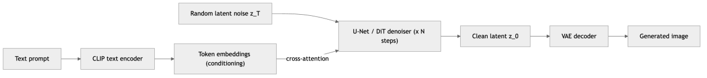
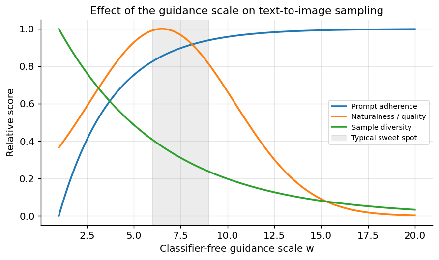
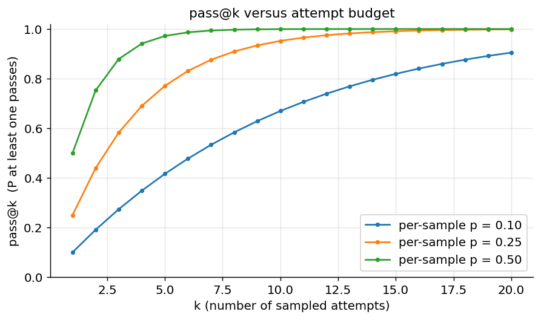
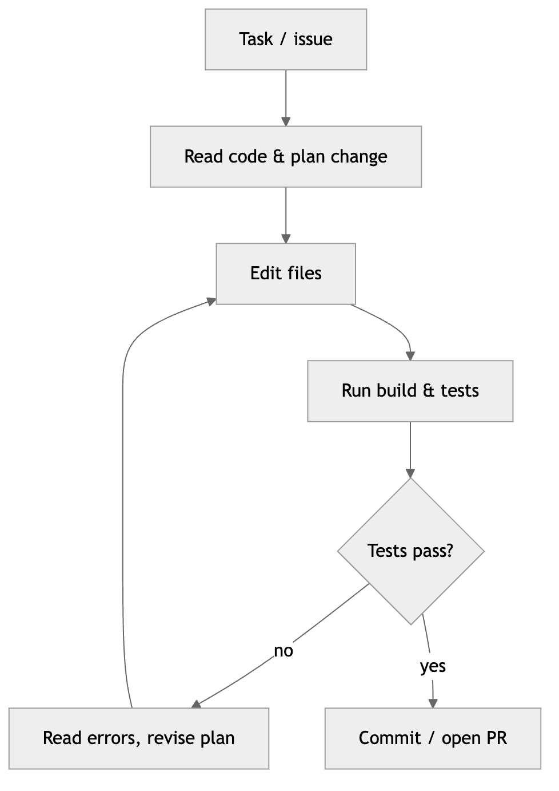
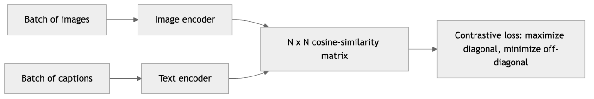
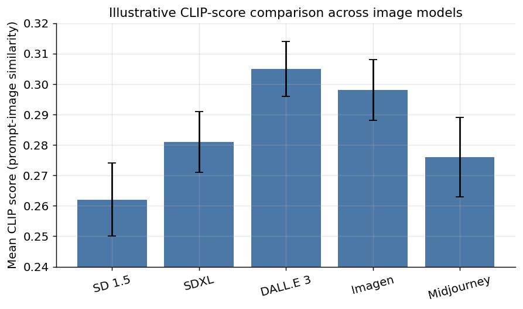

[← 27 Agentic AI](ch27-agentic-ai.md) · [Contents](../README.md#contents) · [29 MLOps: Deploying and Operating ML Systems →](ch29-mlops.md)

---

# 28 Image, Audio, and Code Generation

The generative models of earlier chapters — GANs, VAEs, diffusion models, and Transformers — were introduced largely through the lens of a single modality at a time. In practice, the same handful of ideas now generate photorealistic images from a sentence, clone and synthesize speech, transcribe noisy multilingual audio, compose music, write and refactor code, and reason jointly over pictures and words. This chapter is where those threads converge. It is an *applied* chapter: it assumes you understand diffusion and Transformers from the generative-models and Transformers chapters, and it shows how those mechanisms are specialized, combined, and productized across the creative and technical modalities that define modern generative AI.

The organizing insight is that the field has consolidated around a small number of reusable primitives. A **diffusion process** (usually run in a compressed latent space) is the workhorse for continuous media — images, video, audio spectrograms — because iterative denoising produces the highest-fidelity, most diverse samples and trains stably. A **Transformer** is the workhorse for discrete sequences — text, code, and increasingly the tokens of every other modality — because attention scales and because, once anything is turned into tokens, the same next-token machinery applies. A **contrastive embedding model** such as CLIP is the connective tissue that lets a text prompt steer a pixel generator and lets a language model “see,” by placing images and text in one shared space. Once you internalize these three primitives and the way they are conditioned, wired together, and evaluated, the bewildering zoo of products — Stable Diffusion, DALL·E, Midjourney, Sora, Whisper, MusicGen, Copilot, GPT-4V, Gemini, Claude — resolves into a small number of recognizable architectures with different training data and engineering polish.

It helps to hold the recent arc in mind. Photorealistic text-to-image went from research curiosity to consumer product in the span of a couple of years, as latent diffusion made high-quality generation cheap enough to run on a single GPU and CLIP-style conditioning made prompts actually work. Code assistants moved from novelty autocomplete to indispensable developer tooling and then to autonomous agents. Speech recognition crossed the threshold of “just works” across languages and noise. Video and full multimodal understanding are the current frontier, visibly improving with each model generation. What unifies this rapid progress is not a stream of unrelated breakthroughs but the repeated application and scaling of the same few ideas to new data — which is exactly why learning the primitives pays off more than memorizing product names that will change by the time you read this.

We will move from images to controllable image editing, to video, to audio, to code, to multimodal understanding, then to evaluation, deployment, and ethics. Along the way we will keep returning to the same three questions: *what is the generative primitive, how is it conditioned, and how do we know the output is any good?*

## 28.1 Text-to-Image: The Diffusion Recap, Applied

Modern text-to-image systems are overwhelmingly **diffusion models**. Recall the mechanism from the generative-models chapter. A *forward* process gradually corrupts a clean image $`x_{0}`$ into pure Gaussian noise over $`T`$ steps, adding a little noise at each step according to a fixed schedule. Using the closed-form marginal

``` math
x_{t} = \sqrt{{\bar{\alpha}}_{t}}\, x_{0} + \sqrt{1 - {\bar{\alpha}}_{t}}\,\epsilon,\quad\quad\epsilon \sim \mathcal{N}(0,I),
```

we can jump directly to any noise level $`t`$ without simulating the intermediate steps. A neural network $`\epsilon_{\theta}(x_{t},t)`$ is trained to *predict the noise* that was added, using a simple mean-squared-error objective. At generation time we start from pure noise $`x_{T}`$ and run the learned *reverse* process, repeatedly predicting and removing a little noise until a clean image emerges. Nothing about this is text-aware yet — it is an unconditional image sampler.

Why predict the *noise* rather than the clean image directly? The two are equivalent by the equation above — knowing $`\epsilon`$ and $`x_{t}`$ lets you solve for $`x_{0}`$ — but the noise target is better-conditioned for learning: it keeps the regression target at a roughly constant scale across all timesteps, so a single network trained with a plain MSE loss learns effectively at every noise level. This is the quiet elegance of diffusion: a hard generative-modeling problem is reduced to a stack of easy supervised denoising problems.

To make the output obey a prompt, we make the denoiser **conditional**. The noise-prediction network is given not only the noisy image and timestep but also an encoding of the text: $`\epsilon_{\theta}(x_{t},t,c)`$, where $`c`$ is the conditioning derived from the prompt. Concretely, the prompt is passed through a text encoder to produce a sequence of token embeddings, and those embeddings are injected into the denoising U-Net (or, in newer systems, a diffusion Transformer) through **cross-attention** layers. At each denoising step and each spatial location, the image features *attend* to the text tokens, so that “a red bicycle beside a blue door” pulls the pixels in the corresponding regions toward redness, blueness, bicycle-shaped structure, and door-shaped structure. Cross-attention is exactly the mechanism from the Transformers chapter, repurposed to let a spatial feature map query a text sequence.



*Figure 353. The latent text-to-image diffusion pipeline: a text encoder conditions iterative denoising in a compressed latent space, which a VAE decoder turns into pixels.*

### 28.1.1 Latent diffusion and the Stable Diffusion pipeline

Running diffusion directly on pixels is expensive: a $`512 \times 512 \times 3`$ image is roughly 786,000 dimensions, and every one of the dozens of denoising steps would operate at that resolution. **Latent diffusion** — the architecture behind **Stable Diffusion** — sidesteps this by first compressing the image with a variational autoencoder. The VAE’s *encoder* maps a $`512 \times 512`$ image to a much smaller latent tensor (typically $`64 \times 64 \times 4`$, a roughly 48× reduction in elements), diffusion runs entirely in that latent space, and the VAE’s *decoder* upscales the final clean latent back to full-resolution pixels. Because perceptually important structure survives the compression while imperceptible high-frequency detail is discarded, the diffusion model can spend its capacity on semantics rather than pixel-exact reconstruction.

A Stable Diffusion generation is therefore a composition of three trained networks working in concert:

1.  **Text encoder** (a CLIP text Transformer): turns the prompt into a sequence of embeddings.
2.  **U-Net / diffusion Transformer**: the conditional denoiser that operates on latents, steered by the text embeddings through cross-attention.
3.  **VAE decoder**: converts the final denoised latent into an RGB image.

A **scheduler** (DDPM, DDIM, DPM-Solver, Euler, and others) governs how many denoising steps to take and how large each step is. Fast samplers such as DDIM and DPM-Solver++ produce excellent images in 20–50 steps rather than the ~1000 of naive DDPM, which is what makes interactive, sub-second-to-few-second image generation feasible. This modular decomposition is not merely conceptual; it is exactly how the popular `diffusers` library exposes the model, and it is why you can swap a scheduler, replace the VAE, or fine-tune only the U-Net independently.

``` python
# A latent-diffusion (Stable Diffusion) pipeline with the Hugging Face diffusers library.
# The pipeline object bundles the text encoder, U-Net, VAE, and scheduler.
import torch
from diffusers import StableDiffusionPipeline, DPMSolverMultistepScheduler

pipe = StableDiffusionPipeline.from_pretrained(
    "stabilityai/stable-diffusion-2-1",
    torch_dtype=torch.float16,          # half precision to fit on a consumer GPU
)
# Swap in a fast, high-quality scheduler (fewer steps for the same fidelity).
pipe.scheduler = DPMSolverMultistepScheduler.from_config(pipe.scheduler.config)
pipe = pipe.to("cuda")

image = pipe(
    prompt="a watercolor painting of a lighthouse at sunset, highly detailed, soft light",
    negative_prompt="blurry, lowres, watermark, extra fingers, deformed",
    num_inference_steps=30,             # denoising steps; more = slower, marginally better
    guidance_scale=7.5,                 # classifier-free guidance strength
    height=768, width=768,
    generator=torch.Generator("cuda").manual_seed(42),  # reproducible noise
).images[0]
image.save("lighthouse.png")
```

### 28.1.2 The denoising network and how cross-attention steers pixels

It is worth slowing down on *how* the text actually bends the image, because this is where the abstract “conditioning” becomes concrete. The denoiser is a **U-Net**: a convolutional network that downsamples the noisy latent through several resolution levels, passes it through a bottleneck, and upsamples back to the original latent resolution, with skip connections linking matching levels so fine detail is preserved. Interleaved among these convolutional blocks are two kinds of attention. **Self-attention** lets each spatial location attend to every other location, giving the network a global view so that, for example, the two halves of a symmetric object agree. **Cross-attention** is the conditioning channel: the spatial features form the *queries*, and the text token embeddings form the *keys and values*. At every spatial position, the network computes how much to attend to each word of the prompt and pulls in the corresponding value, so a patch destined to become “a red door” attends strongly to the tokens “red” and “door” and is nudged toward the appropriate color and shape.

This mechanism explains several practical behaviors. **Prompt weighting** — writing `(red:1.4)` in many UIs — literally scales the contribution of a token’s embedding, strengthening or weakening how hard the model attends to it. **Attention leakage** explains why attributes sometimes bind to the wrong object (“a red cube and a blue sphere” occasionally yields a blue cube): the cross-attention maps for “red” and “blue” can bleed across regions, and techniques like attention-guidance and regional prompting exist to correct it. And because self- and cross-attention operate at *every* denoising step, the prompt keeps steering the image throughout generation rather than only at the start — which is why changing the prompt midway (prompt scheduling) can morph a subject partway through denoising.

Newer high-end systems increasingly replace the U-Net with a **diffusion Transformer (DiT)**: the latent is cut into patches, flattened into a token sequence, and processed by a stack of Transformer blocks, with the text injected through cross-attention or by concatenating text and image tokens and letting joint self-attention do the work. DiTs scale more predictably with data and compute than U-Nets and underlie the strongest recent image and video models, but the conditioning logic is identical in spirit — attention between image tokens and text tokens.

### 28.1.3 Schedulers, steps, and reproducibility

The **scheduler** (or sampler) is the algorithm that turns the trained noise-predictor into an actual generation trajectory, and it embodies a real speed–quality trade-off. The original **DDPM** sampler is faithful to the training process but takes hundreds to a thousand tiny steps. **DDIM** reframes sampling as a deterministic (non-Markovian) trajectory that can take much larger strides, producing comparable quality in 20–50 steps and, as a bonus, making generation *deterministic* for a fixed seed. Higher-order ODE solvers — **DPM-Solver++**, **UniPC**, **Euler ancestral**, **Heun** — push this further, often reaching good images in 15–30 steps. More steps yield diminishing returns: past a point the image barely changes, so the practical goal is to find the fewest steps that look right for a given sampler. **Distillation** techniques go even further, training a student model to reproduce many steps in one or a few — **Latent Consistency Models**, **SDXL-Turbo**, and adversarial-distilled models generate a plausible image in *one to four* steps, enabling real-time, type-as-you-see generation at some cost in peak fidelity.

Two reproducibility levers matter in practice. The **seed** fixes the initial random noise; the same seed, prompt, model, scheduler, and step count reproduce the same image exactly (with a deterministic sampler), which turns prompt iteration into a controlled experiment. **Resolution and aspect ratio** are constrained by what the model was trained on — SD 1.5 was trained at 512×512 and degrades (duplicated heads, repeated limbs) when pushed far beyond it, while SDXL was trained on a *bucket* of aspect ratios and native ~1024×1024, so it handles portrait and landscape framings gracefully. Generating far outside the training distribution is a common source of artifacts that no prompt can fix.

### 28.1.4 The role of CLIP text encoders

The bridge from language to pixels is a **text encoder trained to live in a shared image–text space**. **CLIP** (Contrastive Language–Image Pre-training) is the canonical example, and we return to how it is trained in the multimodal section below. For now the key point is that CLIP’s text tower produces embeddings that are already *aligned* with visual concepts, because it was trained on hundreds of millions of image–caption pairs to make an image’s embedding close to its caption’s embedding. When a diffusion model conditions on CLIP text embeddings, it inherits a representation in which “golden retriever” and pictures of golden retrievers already point in similar directions — the diffusion model does not have to learn the meaning of words from scratch, only how to render what those aligned embeddings denote.

Different systems use different text encoders, and this choice materially affects prompt-following. Early Stable Diffusion used CLIP’s text encoder; SDXL uses two CLIP encoders concatenated; **Imagen** (Google) made the influential observation that a large *language-only* encoder (the T5 text Transformer) can encode prompts better than a CLIP text tower, because a model trained on vast text understands compositional language and long descriptions more faithfully. The modern consensus is that scaling the text encoder and using strong language representations improves the model’s ability to honor complex, multi-clause prompts — a lesson that carried directly into newer systems.

### 28.1.5 Classifier-free guidance

A conditional diffusion model can technically generate an image for any prompt, but early experiments showed that samples only loosely followed the text. **Classifier-free guidance (CFG)** is the trick that dramatically sharpens prompt adherence, and it is worth understanding precisely because the *guidance scale* is the single most consequential knob a user turns.

During training, the conditioning is randomly dropped (replaced with an empty/null prompt) a fraction of the time — say 10–20% of examples. This teaches one network to be *both* a conditional denoiser $`\epsilon_{\theta}(x_{t},t,c)`$ and an unconditional denoiser $`\epsilon_{\theta}(x_{t},t,\varnothing)`$. At sampling time we run the denoiser twice per step and extrapolate away from the unconditional prediction and toward the conditional one:

``` math
{\widetilde{\epsilon}}_{\theta}(x_{t},t,c) = \epsilon_{\theta}(x_{t},t,\varnothing) + w\,\left( \epsilon_{\theta}(x_{t},t,c) - \epsilon_{\theta}(x_{t},t,\varnothing) \right).
```

The **guidance scale** $`w`$ controls how aggressively the sample is pushed toward the prompt. At $`w = 1`$ we recover ordinary conditional sampling. Raising $`w`$ (typical values are 5–12) makes the image follow the prompt more literally and increases contrast and saturation, but pushing it too high (say $`w > 15`$) produces over-saturated, cartoonish, artifact-ridden images and *reduces diversity* — every sample collapses toward the same over-emphasized interpretation. There is a genuine trade-off between prompt fidelity and image quality/diversity, and the sweet spot depends on the model, the scheduler, and the prompt.



*Figure 354. The guidance-scale trade-off. Prompt adherence rises with the classifier-free guidance scale while sample diversity and naturalness fall; the usable region is a middle band, not an extreme.*

### 28.1.6 Negative prompts

CFG also gives us **negative prompts** almost for free. Instead of using the empty null prompt as the unconditional reference, we can substitute an *explicit undesirable* prompt $`c^{-}`$ and guide *away* from it:

``` math
{\widetilde{\epsilon}}_{\theta} = \epsilon_{\theta}(x_{t},t,c^{-}) + w\,\left( \epsilon_{\theta}(x_{t},t,c^{+}) - \epsilon_{\theta}(x_{t},t,c^{-}) \right).
```

Now the sample is pushed toward the positive prompt $`c^{+}`$ and simultaneously *repelled* from the negative prompt $`c^{-}`$. This is why practitioners routinely add negative prompts such as `"blurry, lowres, extra fingers, watermark, deformed hands, jpeg artifacts"` — they steer the model away from its characteristic failure modes. Negative prompting is one of the most practical, high-leverage controls in image generation, and it costs nothing extra because the second network evaluation was already happening for CFG.

### 28.1.7 The model landscape: Stable Diffusion, DALL·E, Midjourney, Imagen

The leading text-to-image systems share the diffusion foundation but differ in encoder choices, training data, and product philosophy.

- **Stable Diffusion / SDXL (Stability AI)** popularized *open-weight* latent diffusion. Its openness spawned an enormous ecosystem — fine-tunes, LoRAs, ControlNets, textual inversions, community UIs (Automatic1111, ComfyUI), and hosted marketplaces — and it is the default for anyone who wants to run, customize, or fine-tune models locally, on-premises, or with private data. SDXL added a second text encoder, a larger U-Net, native ~1024×1024 generation with aspect-ratio bucketing, and an optional refinement stage for higher fidelity. The strategic lesson is that an open base model, by inviting the community to build control and personalization on top, can generate more total capability than any single closed model’s roadmap.
- **DALL·E (OpenAI)** traces the field’s own evolution in miniature: a discrete-token autoregressive model (DALL·E 1), then CLIP-guided diffusion (DALL·E 2, “unCLIP,” which generates a CLIP image embedding from the text then decodes it with diffusion), then DALL·E 3, which emphasized *prompt following* by training on richly re-captioned data (see below) and integrating tightly with a chat interface that rewrites terse user requests into detailed prompts. That chat integration matters: the language model does the heavy lifting of turning “make me a birthday card” into a specific, well-structured image prompt, so the user gets good results without learning prompt craft — an illustration of how much of a product’s quality lives outside the image model itself.
- **Midjourney** is a closed, opinionated product tuned for *aesthetics*. It consistently produces striking, stylized, painterly output with minimal prompt effort, at the cost of literal controllability — it will “beautify” a scene rather than follow a plain description exactly. It illustrates that curation of training data and reward tuning toward human aesthetic preference (learning what people actually pick as beautiful) can matter as much as the base architecture, and that a strong product opinion is itself a differentiator. This is the flip side of DALL·E 3’s literal prompt-following: different products deliberately sit at different points on the fidelity-versus-flair spectrum.
- **Imagen (Google)** demonstrated the value of a large frozen T5 language encoder and cascaded super-resolution diffusion (generate a small image, then two diffusion upsamplers to reach high resolution), achieving strong photorealism and notably better *text rendering* — spelling words correctly inside an image, a long-standing failure mode that scales with text-encoder quality. Its descendants feed Google’s consumer image products and, in turn, its video models.

The practical takeaway: architecture is largely commoditized; the differentiators are the *text encoder*, the *training/captioning data*, the *preference tuning*, and the surrounding *product* (prompt rewriting, safety filtering, UI).

### 28.1.8 Data quality and the re-captioning insight

One of the most consequential — and least glamorous — findings in text-to-image is that **caption quality often matters more than model size**. The web image–text pairs that seed these models have noisy, sparse, or SEO-spammy alt-text (“IMG_2043.jpg”, “buy cheap shoes online”), so a model trained on them learns a weak mapping from language to imagery. DALL·E 3’s central move was to train a *captioner* that rewrites every training image with a dense, accurate, descriptive caption, then train the diffusion model on those improved captions. The result was a step-change in *prompt following* — the model honors long, compositional, multi-attribute prompts far better — with no change to the underlying diffusion recipe. This is why modern products also **rewrite the user’s prompt** at inference time: a terse request like “a cat astronaut” is silently expanded into the kind of rich description the model was trained on. The lesson generalizes across this whole chapter: for conditional generators, the quality and richness of the *conditioning-to-output pairing* in training data is frequently the highest-leverage variable.

There is also a live architectural debate worth flagging: while diffusion dominates images today, **autoregressive image generation** (predicting image tokens one at a time, as DALL·E 1 did and as some recent unified multimodal models do) has resurged because it slots naturally into the same Transformer that generates text, enabling one model to read and write images. Whether diffusion or autoregression (or a hybrid) wins for images is unsettled; both are, at bottom, ways to sample from a learned distribution, exactly as the generative-models chapter framed it.

### 28.1.9 Prompt engineering for images

Image prompting is a learnable skill with recurring structure. Strong prompts specify, in roughly decreasing order of impact: **subject** (what is in the frame), **action/pose**, **setting/context**, **style/medium** (photograph, oil painting, 3D render, anime), **artist or aesthetic references**, **lighting** (golden hour, softbox, rim light), **composition and lens** (wide shot, macro, 35mm, bokeh), **color palette**, and **quality/rendering modifiers**. Vague prompts (“a nice landscape”) leave every under-specified attribute to the model’s priors; specific prompts (“a misty pine forest at dawn, low golden sunlight through fog, wide-angle photograph, muted greens, cinematic”) constrain the output toward your intent.

Consider the progression from “a dog” to “a golden retriever puppy sitting in a sunlit meadow, shallow depth of field, 85mm portrait lens, warm afternoon light, soft bokeh, professional photograph.” Each added clause removes ambiguity the model would otherwise resolve by falling back on the average of its training data. The workflow that makes this reliable: pair the positive prompt with a negative prompt targeting known artifacts, set the guidance scale in the model’s sweet spot, **fix a seed** so you can change one clause at a time and see its isolated effect, then vary the seed only once the prompt is right to explore alternatives. Because the same seed and settings reproduce the same image exactly, prompt engineering becomes a controlled, iterative experiment rather than a slot machine — the same disciplined, one-variable-at-a-time mindset you would bring to any experiment.

## 28.2 Controllable and Personalized Generation

Text alone is a blunt instrument. A prompt cannot easily say “keep this exact composition,” “put the new logo *here*,” “make it look like *this specific* cat,” or “match this pose.” A rich family of techniques adds *spatial*, *structural*, and *identity* control on top of a frozen or lightly-adapted base diffusion model. These are what turn text-to-image toys into professional creative tools.

### 28.2.1 Image-to-image, inpainting, and outpainting

**Image-to-image** starts the diffusion process not from pure noise but from a *partially noised version of an existing image*. A `strength` parameter $`s \in \lbrack 0,1\rbrack`$ sets how far into the forward noising process we push the input before denoising: with $`T`$ total steps we begin denoising from timestep $`\lfloor sT\rfloor`$ rather than from $`T`$. Low strength ($`s \approx 0.2`$) keeps the input largely intact and only restyles it lightly; high strength ($`s \approx 0.8`$) preserves only coarse layout and color while regenerating most detail. This is the basis of “reimagine,” style transfer, photo enhancement, and the iterative “refine my last result” loop where each pass nudges the image toward the target. The same principle underlies **hi-res fix** and **refiner** stages, where a first pass generates a small image and a second low-strength img2img pass at higher resolution adds detail without changing the composition.

**Inpainting** regenerates a *masked* region while keeping the rest of the image pixel-identical. At each denoising step the known (unmasked) region is re-noised from the original and spliced back in, so the model only “invents” inside the mask while respecting the surrounding context through cross-attention and the visible pixels. This powers object removal, blemish repair, and “replace the sky” edits. **Outpainting** is the same idea applied outward: the canvas is extended with empty (masked) borders and the model fills them in, coherently continuing the scene beyond its original frame — turning a portrait into a wide landscape or extending a photo to a new aspect ratio. Both rely on the same conditional denoiser; only the masking bookkeeping differs, and specialized inpainting checkpoints (fine-tuned to expect a mask channel) produce noticeably cleaner seams than repurposing a base model. Together these editing modes are what moved diffusion from “generate a picture” to a genuine editing surface professionals can iterate on non-destructively.

### 28.2.2 ControlNet: structural conditioning

**ControlNet** is the most important advance in controllability. It adds an auxiliary network that conditions generation on a *spatial control image* — a Canny edge map, a human-pose skeleton (from a pose estimator), a depth map, a surface-normal map, a semantic segmentation map, a scribble, or a line-art drawing. The trick is architectural: ControlNet clones the encoder half of the frozen U-Net, feeds it the control image, and injects its features back into the base model through **zero-initialized convolutions**. Because those connections start at zero, at the beginning of training ControlNet is a no-op that cannot damage the pretrained model; it then gradually learns to inject structural guidance without catastrophic forgetting. The result is precise spatial control: “generate an image matching *this* pose skeleton” or “follow *these* edges but repaint the content.”

A single base model plus a library of ControlNets gives you depth-, pose-, edge-, and layout-conditioned generation without retraining the expensive base, and multiple ControlNets can be *stacked* (pose plus depth, say) with per-conditioner weights. The practical workflow is powerful: extract a control map from a reference image (run an edge detector or pose estimator), then generate an entirely new image that inherits the reference’s geometry but none of its content — the basis of consistent character posing, architectural visualization from sketches, and “same composition, different style” iteration that professionals rely on.

### 28.2.3 LoRA and DreamBooth: personalization

Often you need the model to reproduce a *specific* subject or style it never saw during pretraining — your product, your character, your art style. Two complementary techniques dominate.

**DreamBooth** fine-tunes the diffusion model on a handful (3–20) of images of a subject, binding it to a rare token identifier (e.g. “a photo of `sks` dog”). To prevent the model from forgetting the general class while overfitting to your five photos, DreamBooth adds a *prior-preservation loss* that keeps generating generic examples of the class (“a photo of a dog”) alongside your specific instances. After a few hundred steps the model can render your subject in novel poses, lighting, and scenes.

**LoRA (Low-Rank Adaptation)**, introduced for LLMs in the LLMs-in-practice chapter, is the efficient way to do this. Rather than updating all the model’s weights, LoRA freezes them and learns small low-rank update matrices $`\Delta W = BA`$ (with $`B`$ and $`A`$ low-rank) injected into the attention and cross-attention layers. A low **rank** (say 4–32) keeps the adapter tiny and guards against overfitting on a handful of images; an **alpha** scaling factor sets how strongly the adapter is applied at inference, so you can dial a style up or down. A LoRA for image models is typically only a few megabytes, trains in minutes on a single GPU from a dozen images, and can be *mixed and matched* at load time — stack a “watercolor style” LoRA with a “specific character” LoRA at chosen weights to get your character rendered in that style. This tiny footprint and composability is why entire marketplaces of shareable style and character LoRAs exist around open base models. DreamBooth and LoRA are frequently combined in practice: use the DreamBooth objective (with prior preservation) but express the weight update as a LoRA, getting DreamBooth’s subject fidelity at LoRA’s cost and portability.

### 28.2.4 IP-Adapter: image prompting

**IP-Adapter** (Image Prompt Adapter) lets you condition on a *reference image* the way you condition on text — without any fine-tuning. It encodes the reference image (with a CLIP image encoder) and adds a *decoupled cross-attention* pathway so the diffusion model attends to the reference’s visual features alongside the text tokens. In effect you get “generate something in the *style* / with the *subject* of this image, described further by this text.” It is faster than training a LoRA (no training at all — just supply the reference image at inference) and complements ControlNet: ControlNet fixes *structure*, IP-Adapter transfers *appearance/identity*, and text supplies the *semantics*. Stacking these three gives remarkably fine-grained control over the output. Face-specialized variants (e.g. IP-Adapter FaceID and similar identity adapters) push this to consistent-character generation from a single reference photo, a capability that is simultaneously useful for creators and fraught for likeness misuse — a recurring double edge we return to in the ethics section.

### 28.2.5 Textual inversion and regional control

Two further techniques round out the toolkit. **Textual inversion** learns a *new word* rather than new weights: given a few images of a concept, it optimizes a single new embedding vector (a “pseudo-word”) so that using it in a prompt evokes the concept, leaving the entire model frozen. The learned artifact is a few kilobytes — even smaller than a LoRA — though it is less expressive because only one embedding is trained, so it captures a concept or style better than fine visual detail of a specific object. In practice teams reach for textual inversion for lightweight, shareable style tokens and for LoRA/DreamBooth when they need faithful reproduction of a specific subject. **Regional prompting** and **attention-map editing** (e.g. attend-and-excite, prompt-to-prompt) address the attribute-binding problem from earlier by manipulating the cross-attention maps directly — forcing each object’s tokens to attend only within its intended region, or transplanting attention maps between two related generations to edit one while preserving layout. These give word-level, region-level control without any training at all.

The overarching pattern is *composable conditioning*: a single frozen base diffusion model becomes a controllable engine by attaching lightweight, independently trained adapters — ControlNet for structure, LoRA/DreamBooth/textual-inversion for learned subjects and styles, IP-Adapter for reference appearance, and text, negative prompts, and attention control for semantics. This composability is the reason a single strong base model can anchor an entire creative ecosystem: the expensive pretraining is done once, and control is added cheaply and modularly on top.

## 28.3 Text-to-Video

Video generation is image generation with a brutal extra constraint: **temporal consistency**. A model must produce not one plausible frame but dozens or hundreds that agree with each other — the same character keeps the same face and clothing, objects move coherently, lighting is continuous, occluded objects reappear correctly, and physics is roughly obeyed. Independently generating frames yields flickering, identity-drifting nonsense; the hard part is *coherence across time*, and it is what separates a convincing clip from an uncanny one. The problem also compounds the data and compute demands: a five-second clip at 24 frames per second is 120 correlated images, and the model must learn motion and dynamics, not just appearance, from video data that is far more expensive to collect and caption than still images.

The dominant modern approach is the **diffusion Transformer (DiT) operating on spacetime patches**, the architecture behind OpenAI’s **Sora** and its peers (Google’s Veo, Runway’s Gen models, Kling, Pika). The recipe generalizes latent diffusion into the temporal dimension:

1.  A video autoencoder compresses the clip into a *spacetime latent* — a grid of latent patches over both space and time, so the model works at a tractable resolution.
2.  These latent patches are flattened into a sequence of tokens and processed by a large **Transformer** (not a convolutional U-Net) with attention spanning across space *and* time. Attention across frames is what enforces consistency: a patch in frame 30 can attend to patches in frame 1.
3.  Diffusion denoising, conditioned on a text prompt (often via a strong language encoder and re-captioned training data, echoing DALL·E 3 and Imagen), runs over the whole spacetime latent at once.
4.  The decoder reconstructs the pixel video.

Treating video as a sequence of spacetime patches is powerful because it is *resolution-, duration-, and aspect-ratio-agnostic* — the same model trains on and generates clips of varying length and shape, much as a language model handles variable-length text. Scaling this architecture with more data and compute produced the leap in coherence and duration that Sora demonstrated.

The training data and objective mirror text-to-image, scaled up: enormous collections of captioned video clips (often auto-captioned by a vision-language model to produce dense, accurate descriptions, and annotated with metadata like camera motion and duration) drive a diffusion objective over spacetime latents. A recurring and provocative framing is that a sufficiently good video generator is an implicit **world model** — to predict coherent frames it must internalize something about how objects, materials, light, and motion behave. Sora’s demonstrations of emergent 3D consistency and object permanence fueled this view, though the models plainly lack a true physics engine and fail in revealing ways.

Beyond pure text-to-video, the same backbone supports **image-to-video** (animate a still image, the most reliable mode because the first frame anchors identity and composition), **video-to-video** restyling, and **camera-control** conditioning that lets a user specify pans, zooms, and dolly moves. First-frame or keyframe conditioning is the video analogue of img2img and dramatically improves controllability and consistency.

The remaining challenges are real and instructive. **Long-range consistency** degrades as clips lengthen — objects can morph, appear, or vanish, and a character who leaves frame may return looking different. **Physical plausibility** is learned only statistically, so models still violate object permanence, gravity, fluid dynamics, and rigid-body constraints in subtle ways (a hallmark “tell” of synthetic video), and struggle with complex causal sequences and precise counting. **Compute cost** is enormous because attention over long spacetime sequences scales quadratically, forcing aggressive latent compression, windowed attention, and cascaded pipelines. And **evaluation** is even harder than for images, since a metric must capture per-frame fidelity, temporal smoothness, prompt adherence, and motion realism simultaneously; **FVD (Fréchet Video Distance)** extends FID to video features but correlates only loosely with human judgment, leaving human evaluation dominant. Video generation today is roughly where image generation was a few years ago: astonishing results, rapid progress, and clear rough edges.

## 28.4 Audio: Recognition, Synthesis, and Music

Audio generative AI spans three distinct tasks that use overlapping machinery. The common trick is that raw waveforms (tens of thousands of samples per second — far too long to model directly) are usually converted into a more compact representation so that image-style diffusion or Transformer sequence modeling can be applied.

Two representations dominate. A **spectrogram** (usually a log-Mel spectrogram) is a time–frequency image: the waveform is windowed and Fourier-transformed to show how much energy sits at each frequency over time. Because it is literally an image, all the image machinery — CNNs, ViTs, and diffusion — applies directly, and a *vocoder* is used to invert the spectrogram back to a waveform. The second representation is a **neural audio codec** such as EnCodec or SoundStream: an autoencoder with a *residual vector-quantized* bottleneck compresses audio into a sequence of **discrete tokens** at a low frame rate (e.g. 50–75 tokens per second across several codebook levels). These tokens are to audio what subword tokens are to text — a discrete vocabulary a Transformer can autoregressively predict — which is why “audio language models” that generate speech, music, and sound with the same next-token machinery as an LLM have become the dominant design. The codec’s decoder turns the generated tokens back into a high-fidelity waveform.

### 28.4.1 Automatic speech recognition: Whisper

**Automatic speech recognition (ASR)** turns speech into text. **Whisper** (OpenAI) is the landmark modern system and a clean case study in the “scale plus supervision” philosophy. It is an ordinary encoder–decoder Transformer: audio is chopped into 30-second windows, converted to log-Mel spectrograms, encoded, and *decoded* autoregressively into text — the exact sequence-to-sequence setup from the Transformers chapter, with a spectrogram as the input sequence. What made Whisper robust was training on 680,000 hours of diverse, weakly-labeled multilingual audio scraped from the web. That scale and diversity, rather than any architectural novelty, gave it striking robustness to accents, background noise, technical vocabulary, and dozens of languages, plus the ability to translate speech to English and to predict timestamps and language — all framed as different decoding tasks selected by special tokens in the prompt. This is the same lesson as Imagen’s text encoder and Sora’s scale: architecture matters less than the quantity and diversity of well-matched data.

Two practical wrinkles are worth knowing. First, because Whisper processes fixed 30-second windows, long audio must be *chunked*, and naive chunking can split words at boundaries — production systems overlap windows or use voice-activity detection to segment on silence. Second, being a generative decoder, Whisper can **hallucinate**: on silence, music, or non-speech it sometimes emits fluent but fabricated text (or repeats a phrase in a loop), a failure mode absent from older discriminative ASR and a reminder that generation and transcription are, mechanically, the same act here. Streaming/real-time ASR (for live captions and voice assistants) uses smaller, causal, chunk-wise models that trade some accuracy for low latency.

``` python
# Automatic speech recognition with Whisper (openai-whisper package).
import whisper

model = whisper.load_model("base")           # tiny/base/small/medium/large trade speed vs. accuracy
result = model.transcribe(
    "meeting.wav",
    language="en",                           # omit to auto-detect
    task="transcribe",                       # or "translate" to translate speech into English
    word_timestamps=True,                    # align words to audio time ranges
)
print(result["text"])
for seg in result["segments"][:3]:
    print(f"[{seg['start']:.1f}s -> {seg['end']:.1f}s] {seg['text']}")
```

### 28.4.2 Text-to-speech and voice cloning

**Text-to-speech (TTS)** is the reverse direction and has reached near-human naturalness. Modern neural TTS is typically a two-stage pipeline: an *acoustic model* maps text (or phonemes) to an intermediate representation (a mel-spectrogram or a sequence of audio codec tokens), and a *vocoder* (such as a HiFi-GAN or a diffusion vocoder) converts that representation into a waveform. Increasingly, systems collapse this into a single Transformer that autoregressively predicts *neural audio codec tokens* directly from text, treating speech synthesis as a language-modeling problem over audio tokens — the same paradigm as text generation.

Beyond naturalness, modern TTS increasingly controls **prosody and emotion** — pace, emphasis, and affect — either through explicit tags, reference prosody, or by letting a large model infer appropriate delivery from context. Diffusion-based TTS (generating a spectrogram by denoising) and flow-matching approaches compete with the autoregressive codec-token approach, trading off streaming latency (autoregressive models can stream token-by-token) against parallel generation quality.

**Voice cloning** conditions the synthesis on a short *reference sample* of a target voice: a speaker encoder embeds a few seconds of the target’s speech into a *voice embedding*, and the TTS model generates arbitrary new text in that voice. Zero-shot voice cloning from just a few seconds of audio is now practical and commercially deployed, and codec-token TTS models can do it essentially as in-context learning — prime the model with the reference audio’s tokens and it continues in the same voice. This capability is simultaneously a boon (accessibility for people who have lost their voice, dubbing across languages, audiobook and game production, personalization) and a serious risk (fraud via cloned-voice phone calls, impersonation, non-consensual likeness) — a tension we take up in the ethics section, and a leading reason to watermark synthetic speech.

### 28.4.3 Music and general audio generation

**Music generation** treats audio as sequences of neural-codec tokens or as spectrograms to be diffused. **MusicGen** (Meta) is a single-stage autoregressive Transformer that generates the discrete tokens of a neural audio codec (EnCodec) conditioned on a text description and, optionally, a melody — producing coherent instrumental music from a prompt like “upbeat 90s hip-hop with a jazzy piano loop.” A subtlety is that a residual codec produces *multiple parallel token streams* (one per codebook level), and a key engineering trick is the *delay pattern* that interleaves them so a single Transformer can predict all levels efficiently. **Suno** and **Udio** and similar consumer products generate full songs *with vocals, lyrics, and song structure*, combining text-conditioned music generation with singing synthesis — a striking demonstration because coherent multi-minute music with intelligible lyrics stresses long-range structure far harder than a short clip. The same token-based approach handles sound effects, foley, and ambient audio, and text-to-audio diffusion models (AudioLDM and kin) do the spectrogram-diffusion analogue.

The frontier challenges mirror video: long-range musical structure (verses, choruses, motifs that recur coherently over minutes) is much harder than local texture; controllability (specifying tempo, key, instrumentation, and structure precisely, or editing one instrument) remains active work; and the ethics are especially charged, since music models can imitate identifiable artists’ styles and voices, raising acute copyright and likeness questions that have already prompted litigation and licensing deals.

## 28.5 Code Generation

Code-generation models are large language models trained heavily on source code. They are the most economically significant application of generative AI to date, embedded in editors used by millions of developers, and they deserve a careful treatment because their training, interaction modes, and evaluation differ meaningfully from prose LLMs.

### 28.5.1 Codex, Copilot, and the code-LLM family

The lineage runs from OpenAI’s **Codex** (a GPT model fine-tuned on public code) — which powered the first **GitHub Copilot** — through a now-crowded field of both open and closed code models: Code Llama, StarCoder, DeepSeek-Coder, Qwen-Coder, and the code-strong general models (GPT-4-class, Claude, Gemini) that increasingly lead coding benchmarks. Architecturally they are ordinary decoder-only Transformers. What distinguishes a *code* model is its training data (billions of lines of source, plus commits, issues, pull-request discussions, and documentation), its tokenizer (tuned to handle whitespace, indentation, and identifiers efficiently), and often specialized training objectives and post-training on code-specific tasks.

It helps to distinguish three **modes of use**, because they impose different requirements. *Inline autocomplete* (the Copilot tab-completion experience) demands very low latency and leans on fill-in-the-middle with the surrounding file as context; here pass@1 and speed dominate. *Conversational assistance* (asking a chat model to explain, refactor, generate tests, or debug a snippet) tolerates more latency and rewards reasoning and instruction-following. *Agentic execution* (an autonomous system that edits files and runs tests, discussed below) trades latency for autonomy and depends on tool use, long context, and self-correction. The same underlying model can serve all three, but the product engineering — context assembly, latency budget, and guardrails — differs sharply.

### 28.5.2 Fill-in-the-middle

A plain language model only predicts the *next* token given the past. But developers rarely write code strictly left-to-right; they insert and edit in the *middle* of a file, with code both before and after the cursor. **Fill-in-the-middle (FIM)** is a training objective that matches this reality. During training, documents are randomly split into a prefix, a middle, and a suffix, and reordered so the model learns to generate the *middle* given *both* the prefix and the suffix. A common transformation places sentinel tokens like this:

``` text
<PRE> {prefix} <SUF> {suffix} <MID> {middle}
```

The model reads the prefix and suffix, then generates the middle. Because a fraction of training examples use this reordering (and the rest remain ordinary left-to-right), the same model can both continue code and infill it. FIM is what makes editor autocomplete feel intelligent: when your cursor sits between an opening brace and a closing one, the model sees the surrounding context on *both* sides and completes accordingly, rather than pretending the code after the cursor does not exist.

### 28.5.3 Repository-level context and retrieval

Real software does not live in a single file. A useful completion often depends on a function defined in another module, a type declared in a header, the project’s conventions, or an API’s exact signature. Modern code assistants therefore assemble a **repository-level context**: they pull in the current file, recently edited and open files, definitions of symbols referenced near the cursor, and sometimes results from a **retrieval** step (the RAG pattern from the retrieval chapter, applied to code) that embeds the codebase and fetches the most relevant snippets. Tree-sitter and language-server information help select *semantically* relevant context rather than merely nearby lines. This is why the same model produces markedly better suggestions inside a well-indexed IDE than from a bare prompt — most of the engineering in a coding product is in *context construction*, not the model itself. Long-context models (hundreds of thousands of tokens) and repository maps push this further, letting an agent hold a substantial slice of a project in view at once.

### 28.5.4 Tokenization for code

Code stresses a tokenizer differently than prose. Indentation is semantically meaningful (in Python especially), identifiers are long and compound (`getUserAccountBalance`), and repeated whitespace is common. General-purpose tokenizers waste tokens encoding runs of spaces one at a time and fragment identifiers awkwardly. Code-tuned tokenizers add tokens for common indentation patterns and keywords, which shortens sequences, lowers cost, and improves the model’s handling of structure. It is a small detail with outsized impact on both efficiency and quality.

### 28.5.5 How code models are trained and evaluated

Training a code model follows the familiar pretraining recipe — next-token (and FIM) prediction over a massive code corpus — usually followed by instruction tuning and reinforcement learning from human (or execution) feedback to make the model follow requests, explain its work, and prefer correct, idiomatic solutions. A distinctive and powerful signal available for code that is *not* available for prose is **executable ground truth**: you can *run* generated code against tests and use pass/fail as a reward or filter. This enables training and evaluation loops grounded in objective correctness rather than human preference alone.

The standard benchmark is **HumanEval**: 164 hand-written Python problems, each specified by a function signature and docstring, with a set of hidden unit tests. A generated solution counts as correct only if it *passes all the tests*. Related benchmarks (MBPP, and more realistic suites like SWE-bench, which asks models to resolve real GitHub issues in large repositories by producing a patch that makes the project’s tests pass) extend the idea to more and harder, more realistic tasks. HumanEval measures whether a model can write a small self-contained function; SWE-bench measures whether it can navigate and fix a real codebase — a much better proxy for professional usefulness, and far harder.

Because a model is stochastic, we care not only about its single best guess but about how often it *can* solve a problem given several attempts. This is captured by the **pass@k** metric: the probability that *at least one* of $`k`$ independently sampled solutions passes all tests. Estimating it naively by sampling exactly $`k`$ times is high-variance, so the standard estimator samples $`n \geq k`$ solutions, counts the number $`c`$ that pass, and computes the unbiased expectation

``` math
\text{pass@}k = \mathbb{E}\left\lbrack \, 1 - \frac{\left( \frac{n - c}{k} \right)}{\left( \frac{n}{k} \right)}\, \right\rbrack.
```

The intuition: $`\left( \frac{n - c}{k} \right)/\left( \frac{n}{k} \right)`$ is the chance that a random draw of $`k`$ from the $`n`$ samples contains *no* passing solution, so one minus that is the chance of at least one success. pass@1 measures single-shot reliability (what matters for autocomplete), while pass@10 or pass@100 measures the model’s *reach* when you can sample many candidates and filter with tests (what matters for agentic workflows that generate-and-check). pass@k rises with $`k`$ — a weaker model given many tries can rival a stronger model given one — which is precisely why agentic, test-driven loops are so effective.

``` python
# Unbiased pass@k estimator (the HumanEval convention).
# n = total samples generated per problem; c = number that passed all tests; k = attempt budget.
from math import comb

def pass_at_k(n: int, c: int, k: int) -> float:
    if n - c < k:            # fewer than k failing samples => a pass is guaranteed
        return 1.0
    return 1.0 - comb(n - c, k) / comb(n, k)

# Example: generated n=20 samples, c=5 passed. Reliability at different attempt budgets:
for k in (1, 5, 10):
    print(f"pass@{k} = {pass_at_k(20, 5, k):.3f}")
```



*Figure 355. pass@k rises with the attempt budget k. A model with a modest per-sample success rate becomes highly likely to solve a problem when allowed several sampled attempts filtered by tests.*

### 28.5.6 What the benchmarks miss

Executable benchmarks are principled but narrow, and their limits shape how much to trust a headline score. **Contamination** is the central worry: popular benchmarks like HumanEval appear all over the public web, so a model may have seen the problems (or near-duplicates) during pretraining, inflating scores without reflecting true ability — which is why fresh, held-out, and continually-updated benchmarks matter. Passing hidden unit tests also proves *functional correctness on those tests only*, not readability, efficiency, security, maintainability, or adherence to a team’s conventions — a solution can pass and still be code you would reject in review. And benchmarks over-represent short, self-contained, algorithmic problems in a few popular languages, under-representing the messy, context-heavy, cross-file work that dominates real engineering. Treat a high pass@k as necessary evidence of capability, not sufficient evidence of a good engineer.

### 28.5.7 Agentic coding

The most transformative shift is from *autocomplete* to *agents*, building directly on the agentic-AI chapter. An **agentic coding** system does not just suggest a line; it is an LLM in a loop with tools — read a file, search the codebase, edit files, run a shell command, execute the tests — that reads a codebase, plans a change, edits multiple files, *runs the tests or the program*, reads the errors, and iterates until the task is done. The executable ground truth that makes code special as a training signal also makes it special as a *feedback* signal at inference time: the agent can check its own work objectively and self-correct. This closes the loop between the pass@k intuition (many tries, filtered by tests) and real productivity — the agent is effectively performing its own test-driven, best-of-many search, but guided by reading the actual error messages rather than sampling blindly.

This is why SWE-bench, which measures exactly this end-to-end capability on real repositories, has become the headline benchmark, and why coding agents (from IDE-integrated assistants to command-line tools like the one you may be using to read this book) are the most economically visible application of agentic AI. The effectiveness hinges on the *environment* as much as the model: reliable test suites, fast feedback, a clean sandbox, and good repository context turn a mediocre agent into a useful one, while a project with no tests starves the loop of the signal it depends on.



*Figure 356. An agentic coding loop. The model plans, edits, and runs tests, then reads the results and iterates until they pass or a step budget is hit.*

The same cautions from the base chapter apply with force. Generated code can be **subtly wrong while looking plausible**, can contain **security vulnerabilities** (injection flaws, weak cryptography, leaked secrets), and can **reproduce training-data code** in ways that raise licensing and attribution concerns. The responsible stance is to treat any generated code — from a completion or an agent — as a *draft from a fast but fallible collaborator*: read it, test it, run static analysis and dependency/license scanners, and never ship it unreviewed. Agentic autonomy raises the stakes, so the guardrails from the agentic-AI chapter (sandboxed execution, step and cost caps, human review of diffs before merge) are not optional.

## 28.6 Multimodal Understanding

So far we have generated media. The complementary capability is *understanding* media — describing an image, answering a question about a chart, reading a screenshot, reasoning over a diagram. This is the domain of **vision-language models (VLMs)**, and it rests on the same contrastive-embedding idea that powers text-to-image conditioning.

### 28.6.1 CLIP and contrastive training

**CLIP** is trained on hundreds of millions of (image, caption) pairs with a **contrastive objective**. In each batch of $`N`$ pairs, an image encoder embeds the images and a text encoder embeds the captions into a shared space. The model computes all $`N \times N`$ pairwise cosine similarities and is trained so that each image is *most* similar to its *own* caption and *less* similar to the other $`N - 1`$ captions in the batch (and symmetrically for each caption). Formally it minimizes a symmetric cross-entropy (InfoNCE) loss over the similarity matrix, with the correct pairs on the diagonal as the positives. The effect is a shared embedding space where semantically matching images and texts land close together.



*Figure 357. CLIP contrastive training. Image and text encoders map a batch into a shared space; the similarity matrix is trained so matched pairs (the diagonal) score highest.*

This single, simple objective yields three enormous downstream benefits. It enables **zero-shot classification**: to classify an image among labels, embed the image and embed each label as a caption (“a photo of a {label}”) and pick the nearest — no task-specific training. It provides the **prompt-to-pixel conditioning** signal used by diffusion models. And it provides a strong, semantically aligned **image encoder** that vision-language models reuse as their “eyes.” CLIP’s importance is hard to overstate: it is the connective tissue of multimodal AI.

``` python
# Zero-shot image classification with CLIP: no task-specific training, just embeddings.
import torch
from PIL import Image
from transformers import CLIPModel, CLIPProcessor

model = CLIPModel.from_pretrained("openai/clip-vit-base-patch32")
proc = CLIPProcessor.from_pretrained("openai/clip-vit-base-patch32")

image = Image.open("photo.jpg")
labels = ["a photo of a cat", "a photo of a dog", "a photo of a car"]

inputs = proc(text=labels, images=image, return_tensors="pt", padding=True)
with torch.no_grad():
    out = model(**inputs)                       # image & text embeddings in a shared space
    probs = out.logits_per_image.softmax(dim=-1)  # cosine similarities -> probabilities
for label, p in zip(labels, probs[0].tolist()):
    print(f"{label:24s} {p:.3f}")
```

### 28.6.2 Vision-language models: how images become tokens

Large multimodal models — **GPT-4V**, **Gemini**, and **Claude**’s vision capabilities — let a single Transformer accept interleaved images and text and reason over them jointly. The central engineering question is: *how does a language model, which consumes a sequence of token embeddings, ingest an image?*

The dominant recipe is a **vision encoder plus a projection into the token space**:

1.  An image is split into a grid of fixed-size **patches** (e.g. $`14 \times 14`$ pixels), exactly as in a Vision Transformer.
2.  A vision encoder (typically a ViT, often initialized from CLIP) turns those patches into a sequence of feature vectors — the image’s “visual tokens.”
3.  A small **projector** (a linear layer or a lightweight resampler such as a Q-Former or perceiver, which also *reduces* the number of tokens to control cost) maps those visual features into the *same* embedding space as the language model’s text tokens.
4.  The projected visual tokens are **interleaved with the text tokens** in the input sequence, and the Transformer attends across both — reading the image the way it reads words.

Training proceeds in stages. First, pretrain (or reuse) the vision encoder and the LLM separately. Second, an **alignment** stage trains mostly the projector on large image–caption datasets so the visual tokens land in a space the frozen LLM can interpret. Third, a **visual instruction-tuning** stage fine-tunes the model (often including the LLM) on curated multimodal instructions — “describe this,” “answer this question about the chart,” “extract the fields from this receipt” — so it learns to *use* the grounded visual information to follow requests. This staged approach reuses two expensive pretrained models and spends new compute only on gluing them together, which is why capable open VLMs (the LLaVA family and successors) could be built relatively cheaply.

Higher-resolution understanding (reading dense text in a document, a screenshot, or a diagram) is achieved by tiling the image into multiple crops and feeding more visual tokens, which is why detailed image understanding costs more tokens — an image is, quite literally, worth some number of tokens in the context window, and that count scales with resolution. This directly connects to the pricing and context-budget considerations from the LLMs-in-practice chapter: a high-resolution multi-page PDF can consume thousands of tokens per page, so resolution is a cost lever, not just a quality lever.

### 28.6.3 From understanding to any-to-any

The trend is toward models that both *understand and generate* across modalities within one system. Two designs compete. In the **unified-token** approach, images (and audio) are quantized into discrete tokens and placed in the *same* vocabulary as text, so a single Transformer autoregressively predicts text or image tokens interchangeably — the model can read an image and *emit* one. In the **hybrid** approach, an LLM handles understanding and reasoning while delegating generation to an attached diffusion decoder that it conditions. Either way, the destination is an *any-to-any* model that ingests and produces text, images, audio, and video through one shared representation. Video understanding extends the image recipe by sampling frames into visual tokens (with the same token-budget pressure, sharpened by many frames), and audio understanding feeds spectrogram or codec tokens into the same sequence — making the “tokenize everything into a shared space” thesis literal.

This architecture reveals the unification the chapter has been building toward: **every modality is projected into a shared sequence of embeddings that a Transformer processes**. Text tokens, image patches, audio-codec tokens, and video spacetime patches all become vectors in a common space; attention does the cross-modal reasoning. Multimodal models are not a new paradigm so much as the systematic application of one paradigm — tokenize everything, embed into a shared space, attend — across all the modalities of this chapter.

The practical reach of vision-language models is broad and growing: **document AI** (reading invoices, forms, and contracts, and answering questions about them), **chart and diagram understanding** (reading a figure and reasoning over its data), **accessibility** (describing scenes for visually impaired users), **GUI and computer-use agents** (reading a screenshot to click the right button, the visual counterpart of the coding agent), and **robotics and embodied AI**, where vision-language-action models map camera input and an instruction to motor actions. Each of these is the same tokenize-embed-attend recipe pointed at a different input distribution, which is why capability gains in the base multimodal model lift all of them at once.

## 28.7 Evaluating Generative Media

Evaluating generative output is genuinely hard because there is no single correct answer — the target is a *distribution* of acceptable outputs, and quality is multi-dimensional (fidelity, diversity, prompt faithfulness, and for some modalities, temporal or logical coherence). Each modality has developed its own metrics, all of them imperfect.

**FID (Fréchet Inception Distance)** is the default for images. It passes real and generated images through a pretrained Inception network, models each set’s features as a multivariate Gaussian, and computes the Fréchet distance between the two Gaussians:

``` math
\text{FID} = \left\| \mu_{r} - \mu_{g} \right\|^{2} + Tr\left( \Sigma_{r} + \Sigma_{g} - 2(\Sigma_{r}\Sigma_{g})^{1/2} \right).
```

Lower FID means the generated feature distribution is statistically closer to the real one, capturing *both* fidelity and diversity in a single number (a model that produces only a few perfect images — mode collapse — is penalized because its feature distribution is too narrow, since the two Gaussians’ covariances diverge). FID’s weaknesses are worth internalizing so you do not over-trust it: it depends on the Inception network’s ImageNet biases (so it can misjudge out-of-domain content like line art or medical images), it needs a *reference set* of real images and thousands of samples to be stable (small-sample FID is unreliable and biased upward), it is sensitive to image preprocessing and resolution, and it does not measure *prompt adherence* at all — a model can score a great FID while ignoring the prompt entirely. Always report FID alongside a prompt-faithfulness metric and human evaluation, never alone.

**Inception Score (IS)** predates FID and rewards images that a classifier confidently labels (fidelity) with a diverse spread of labels across the set (diversity); it is now largely superseded by FID because it ignores the real data entirely and can be gamed. **Precision and recall** for generative models disentangle the two axes FID conflates: *precision* measures what fraction of generated samples fall within the real data manifold (quality), and *recall* measures what fraction of the real manifold the generator can cover (diversity/mode coverage) — useful for diagnosing whether a low FID hides mode collapse.

**CLIP score** fills the prompt-adherence gap. It measures how well a generated image matches its *prompt* by taking the cosine similarity between the image’s CLIP embedding and the prompt’s CLIP embedding (scaled and clipped at zero). A higher CLIP score means better prompt faithfulness. Text-to-image systems are commonly compared on a *FID–CLIP-score trade-off* curve: as you raise the guidance scale, CLIP score improves (better prompt adherence) but FID can worsen (less natural, less diverse images) — the very trade-off we plotted earlier, now made measurable. Because CLIP score inherits CLIP’s own blind spots (it is weak on counting, spatial relations, and fine attribute binding), newer evaluations add VQA-based or LLM-judge protocols that ask targeted questions about the generated image.



*Figure 358. Comparing text-to-image systems by mean CLIP score (prompt faithfulness) across a shared prompt set. Higher is better; error bars show variability across prompts.*

For **code**, evaluation is comparatively principled precisely because correctness is executable: **pass@k** on HumanEval, MBPP, and SWE-bench measures functional correctness objectively, as discussed above. For **speech recognition**, the standard metric is **word error rate (WER)** — the sum of substitutions, insertions, and deletions needed to turn the transcription into the reference, normalized by reference length; lower is better, and character error rate (CER) is used for languages without clear word boundaries. For **TTS and music**, automatic metrics exist (mel-cepstral distortion, speaker-similarity cosine for cloning, Fréchet Audio Distance for realism) but human **mean opinion scores (MOS)** — listeners rating naturalness on a 1–5 scale — remain the gold standard, because a synthesis can be objectively close to the reference yet still sound subtly “off” to a human ear.

Across every modality, **human evaluation** remains the ultimate arbiter. No automatic metric fully captures “beautiful,” “coherent,” “faithful,” or “useful,” so production systems rely on structured human studies — side-by-side preference tests, Likert ratings of fidelity and prompt alignment, and increasingly large-scale **arena-style** comparisons where users vote between anonymized outputs and models are ranked by an Elo system. This is the same lesson from the supervised-evaluation chapter, extended to the distributional, subjective setting of generative media: choose the metric that matches the decision you are making, and never trust a single number.

## 28.8 The Modality Landscape at a Glance

The table below summarizes the generative primitive, conditioning mechanism, leading systems, and dominant evaluation for each modality covered in this chapter. Read across a row to see how one recipe is specialized; read down a column to see the shared primitives (diffusion for continuous media, Transformers for sequences, CLIP-style embeddings for cross-modal conditioning).

| Modality | Generative primitive | Conditioning / control | Representative systems | Primary evaluation |
|----|----|----|----|----|
| Text-to-image | Latent diffusion (U-Net / DiT) | CLIP/T5 text encoder, CFG, negative prompts, ControlNet, LoRA, IP-Adapter | Stable Diffusion / SDXL, DALL·E 3, Midjourney, Imagen | FID, CLIP score, human preference |
| Text-to-video | Diffusion Transformer on spacetime patches | Text encoder, image/first-frame conditioning | Sora, Veo, Runway Gen, Kling, Pika | FVD, human eval (fidelity + temporal coherence) |
| Speech recognition (ASR) | Encoder–decoder Transformer on spectrograms | Audio input; task/language tokens | Whisper | Word error rate (WER) |
| Text-to-speech / voice cloning | Autoregressive codec-token or acoustic model + vocoder | Text + speaker reference embedding | Neural TTS, zero-shot voice cloning systems | MOS (human), speaker similarity |
| Music / audio | Autoregressive over neural-codec tokens, or diffusion | Text description, optional melody | MusicGen, Suno | Human MOS, Fréchet Audio Distance |
| Code | Decoder-only LLM (next-token + fill-in-the-middle) | Prompt/instruction, repo context, tool/test feedback | Codex/Copilot, Code Llama, StarCoder, coding agents | pass@k (HumanEval, MBPP, SWE-bench) |
| Multimodal understanding | Transformer over projected visual + text tokens | Contrastive-pretrained vision encoder (CLIP) + projector | GPT-4V, Gemini, Claude vision | Task accuracy (VQA), human eval |

## 28.9 Serving, Cost, and Deployment

Building a demo is not the same as running a generative feature at scale, and the deployment characteristics differ sharply by modality. The decisive first choice is **hosted API versus self-hosted**. Hosted APIs (for images, video, speech, and code) trade per-call cost and data-governance constraints for zero infrastructure and instant access to frontier models; self-hosting open-weight models (Stable Diffusion, Whisper, open code and vision models) trades upfront GPU and MLOps effort for control, privacy, customizability (your own LoRAs and fine-tunes), and lower marginal cost at volume. The right answer depends on request volume, latency needs, and how sensitive the data is — the same calculus as the LLMs-in-practice chapter, now spanning modalities.

**Latency and throughput** are dominated by different bottlenecks per modality. Diffusion image generation cost is roughly linear in the number of denoising steps, so the biggest lever is *fewer steps* via better schedulers or distilled few-step models — the difference between a 30-step and a 4-step model is nearly an order of magnitude in latency and cost. Video multiplies this by the number of frames and the quadratic cost of spacetime attention, making it by far the most expensive modality to serve. Autoregressive audio and code generation are bound, like LLMs, by sequential token decoding, so techniques from LLM serving apply directly: **batching** many requests, **KV-cache** reuse, speculative decoding, and quantization. For vision-language understanding, the visual-token count (driven by image resolution and tiling) is a first-order cost, so downsampling images that do not need full resolution is an easy win.

**Model-compression** techniques recur across every modality: **quantization** (running weights in 8-bit or 4-bit) shrinks memory and speeds inference with modest quality loss; **distillation** trains a small or few-step student to mimic a large teacher (the same idea behind few-step diffusion and smaller code models); and **pruning** removes redundant weights. These bring large models to consumer GPUs, phones, and browsers — on-device Whisper, on-device Stable Diffusion, and on-device code completion are all now feasible, which matters for privacy, offline use, and cost.

Finally, generative features need a **safety and reliability layer** in front of the model regardless of hosting: input filtering (block disallowed prompts), output filtering (classifiers for unsafe or infringing results), rate limiting, watermarking, and logging — the operational realization of the ethics principles below. Production systems also need **monitoring** suited to generative output: because there is no single ground-truth label, teams track proxy signals (user acceptance/regeneration rates, thumbs-up/down, edit-distance between generated and shipped output for code, abuse-filter hit rates) and sample outputs for periodic human review. The MLOps lessons of the operations chapter apply, with the twist that “correctness” is distributional and partly subjective, so evaluation is continuous rather than a one-time gate.

## 28.10 Ethics, Deepfakes, Watermarking, and Copyright

The capabilities in this chapter are dual-use in the most literal sense: the same voice-cloning system that gives a stroke patient back their voice can impersonate a CEO to authorize a fraudulent wire transfer, and the same image model that accelerates a designer can fabricate defamatory imagery of a private person. Responsible practice is not an afterthought; it is part of building these systems.

**Deepfakes and synthetic media.** Photorealistic fake images, cloned voices, and increasingly convincing fake video can deceive, defame, defraud, and manipulate at scale. The harms are concrete and already occurring: non-consensual intimate imagery, election disinformation using fabricated video of candidates, and targeted financial fraud in which a cloned voice of an executive or family member authorizes a transfer or requests emergency help on a live call. A second-order harm is the **“liar’s dividend”** — once the public knows any media *could* be fake, bad actors dismiss genuine, incriminating evidence as fabricated, eroding shared trust in recordings altogether. As generation improves, *detection* of synthetic media by inspection alone becomes unreliable — the “tells” (impossible physics in video, warped hands in images, spectral artifacts in audio) shrink with every model generation, and detector models trained on one generator often fail to flag the next. Detection cannot be the only line of defense, which is exactly why provenance-at-generation matters.

**Watermarking and provenance.** Because after-the-fact detection is losing the arms race, the emphasis has shifted to establishing provenance *at generation time*. Two complementary approaches: (1) **invisible watermarking**, which embeds a robust, imperceptible signal into generated pixels, audio, or even text (Google’s SynthID is a prominent example spanning modalities) that survives cropping, compression, resampling, and mild editing and can later be detected to flag content as synthetic; and (2) **content provenance standards** such as **C2PA** (the Content Authenticity Initiative), which attach cryptographically signed metadata — “content credentials” — recording how a piece of media was created and each edit applied to it. The two are complementary: a watermark rides *inside* the pixels and survives metadata stripping, while signed credentials carry rich, verifiable history but can be removed. Neither is foolproof — watermarks can be attacked by determined adversaries and metadata stripped by a screenshot — but together they raise the cost of undetected misuse, let platforms label synthetic content automatically, and give downstream models a signal to avoid training on their own outputs. Watermarking generated media should be a default, not a feature, and the strongest posture combines an embedded watermark with signed provenance and a visible label.

**Consent and likeness.** Cloning a person’s voice or face, or generating imagery in their likeness, implicates their rights regardless of technical feasibility. Ethical (and increasingly legal) practice requires *consent* for likeness and voice, honors opt-outs, and refuses generation targeting real private individuals. Products that offer voice cloning should verify that the speaker in the reference sample has consented.

**Copyright and attribution.** Two unresolved questions loom. First, the *training-data* question: models are trained on vast corpora of copyrighted images, text, code, and music, and whether this constitutes fair use is being litigated in multiple jurisdictions, with outcomes likely to differ by country. Second, the *output* question: who, if anyone, owns AI-generated content (several copyright offices have held that purely AI-generated work is not copyrightable), and can outputs *infringe* on works they resemble — a real risk when a model can be prompted to mimic a living artist’s signature style or reproduce a memorized training image. Code models sharpen this with concrete license concerns — generated code can echo GPL or other copyleft-licensed training code verbatim, creating downstream obligations for whoever ships it. Practical safeguards include training-data filtering and creator opt-out mechanisms, output filters that detect near-verbatim reproduction of training examples, style-mimicry guardrails, and automated license/similarity scanning of generated code before it enters a codebase. The technology has outrun settled law, so the defensible engineering posture is conservative defaults, clear provenance, and respect for opt-outs.

**Bias and harmful content.** Generative models reflect and can amplify biases in their training data — skewed demographic depictions for occupation prompts, stereotyped associations, uneven quality across languages and dialects, and Western-centric aesthetic defaults. And they can be prompted (or jailbroken) to produce harmful content: violent or sexual imagery, malware, or instructions for wrongdoing. Mitigations include curating and rebalancing training data, safety fine-tuning, input/output classifiers that block disallowed requests and results, refusal training, and adversarial **red-teaming** before release. None of these is complete; bias mitigation in particular can introduce its own distortions, and the field lacks agreed standards for what “fair” generation even means across cultures.

**Regulation and disclosure.** The legal landscape is consolidating around a few requirements even as the technology outruns it: mandatory *labeling* of AI-generated content (several jurisdictions now require it, especially for political advertising and synthetic media of real people), transparency about training data, and specific protections for likeness and voice. Building for this future — machine-readable provenance, clear user-facing disclosure, retention of generation logs, and consent records — is cheaper than retrofitting it. Treat disclosure as a baseline product requirement, not a legal afterthought.

Building generative applications responsibly therefore means, concretely: **watermark and label** AI-generated media, **attach provenance** metadata, **obtain consent** for any likeness or voice, **filter** harmful and infringing inputs and outputs, **scan** generated code for vulnerabilities and license issues, **disclose** clearly to users that content is AI-generated, and keep a **human in the loop** for consequential decisions. These are engineering requirements, and they belong in the design from the start.

## 28.11 Summary

- Modern creative and multimodal AI consolidates around three primitives: **latent diffusion** for continuous media (images, video, audio), **Transformers** for discrete sequences (text, code, and tokenized media), and **contrastive embeddings (CLIP)** as the cross-modal connective tissue.
- **Text-to-image** systems are conditional latent-diffusion models: a text encoder (CLIP or T5) conditions a U-Net/DiT denoiser via cross-attention, run in a VAE-compressed latent space. **Classifier-free guidance** (with its guidance-scale trade-off) and **negative prompts** are the key controls, and prompt engineering is a learnable, iterative skill.
- **Controllable generation** attaches composable adapters to a frozen base model: **image-to-image/inpainting/outpainting** for editing, **ControlNet** for spatial structure, **LoRA/DreamBooth** for learned subjects and styles, and **IP-Adapter** for reference appearance.
- **Text-to-video** uses diffusion Transformers over spacetime patches (Sora and peers); the defining challenge is **temporal consistency** — coherence, physical plausibility, and cost over many frames.
- **Audio** splits into ASR (**Whisper**: scale + weak supervision over a plain seq2seq Transformer), TTS and **voice cloning** (codec-token or acoustic-model + vocoder pipelines conditioned on a speaker reference), and **music/audio** generation (**MusicGen**, **Suno**) over neural-codec tokens.
- **Code generation** uses code-trained LLMs with a **fill-in-the-middle** objective; correctness is *executable*, enabling **pass@k** evaluation on **HumanEval**/MBPP/SWE-bench and powering **agentic coding** loops that edit, run tests, and self-correct.
- **Multimodal understanding** models (GPT-4V, Gemini, Claude) tokenize images into patch embeddings via a CLIP-style vision encoder and a projector, interleave them with text tokens, and reason jointly — the same tokenize-embed-attend paradigm applied to every modality.
- **Evaluation** is modality-specific and imperfect: **FID** and **CLIP score** for images, **FVD** for video, **WER** for ASR, **MOS** for speech/music, **pass@k** for code — with **human evaluation** the ultimate arbiter everywhere.
- Generative media raises serious risks — **deepfakes**, misinformation, non-consensual likeness, copyright — demanding **watermarking/provenance** (SynthID, C2PA), **consent**, output/input **filtering**, license scanning, disclosure, and human oversight by default.

## 28.12 Key Takeaways

- The apparent zoo of models is a small number of recipes in disguise. Learn the primitive (diffusion vs. Transformer), the conditioning mechanism (cross-attention on embeddings), and the evaluation, and any new system becomes legible.
- Conditioning is where the products differentiate. Architecture is largely commoditized; **text encoders, training/captioning data, preference tuning, and composable control** (CFG, ControlNet, LoRA, IP-Adapter) are what separate a demo from a tool.
- Everything is becoming tokens in a shared space. Image patches, audio-codec tokens, and video spacetime patches are all projected into the same embedding space a Transformer attends over — multimodality is unification, not a new paradigm.
- Executable ground truth makes code special. The ability to *run and test* generated code turns it into both a training signal and an inference-time feedback loop, which is why pass@k rises steeply with attempts and why agentic coding works.
- Capability and responsibility scale together. As outputs become indistinguishable from reality, provenance-at-generation (watermarking, signed metadata), consent, and filtering move from nice-to-have to non-negotiable.

## 28.13 Exercises

1.  **Conceptual.** Trace a single text-to-image generation through the Stable Diffusion pipeline, naming each of the three trained networks and the scheduler, and explain *where* and *how* the text prompt influences the output. Why is diffusion run in a latent space rather than on pixels?

2.  **Conceptual / math.** Write out the classifier-free guidance update and explain the role of the guidance scale $`w`$. What happens to prompt adherence, image quality, and diversity as $`w \rightarrow 1`$ and as $`w`$ becomes very large? How does substituting an explicit negative prompt for the null prompt change the equation, and what does it accomplish?

3.  **Conceptual.** You must generate images of a specific product (a sneaker your company sells) in many scenes, matching a reference photo’s exact composition. Which combination of ControlNet, LoRA/DreamBooth, and IP-Adapter would you use for the structure, the learned subject identity, and the reference appearance, and why is each suited to its role?

4.  **Conceptual.** Why is temporal consistency the defining challenge of text-to-video, and how does treating video as a sequence of *spacetime patches* processed by a Transformer with attention across frames help? Name two failure modes that still betray synthetic video.

5.  **Conceptual.** Whisper introduced little architectural novelty yet achieved a large jump in robustness. What was the source of that improvement, and what does this suggest about the relative importance of architecture versus data in ASR?

6.  **Conceptual.** Explain the fill-in-the-middle training objective and why it suits code editing better than pure next-token prediction. Sketch the prefix/suffix/middle reordering with sentinel tokens.

7.  **Coding / math.** Using the unbiased pass@k estimator, compute pass@1, pass@5, and pass@10 for a problem where you sampled $`n = 20`$ solutions and $`c = 3`$ passed. Then explain, in terms of pass@k, why an agentic loop that generates several candidates and filters them with tests can outperform a single-shot completion from the same model.

8.  **Conceptual.** Describe how a vision-language model ingests an image: patches, vision encoder, projector, and interleaving with text tokens. Why does higher-resolution image understanding cost more tokens, and what does that imply for the context budget of a document-reading task?

9.  **Conceptual / math.** Explain CLIP’s contrastive training objective over an $`N \times N`$ similarity matrix and describe the three downstream capabilities it unlocks (zero-shot classification, diffusion conditioning, VLM vision encoding). Why is a shared image–text embedding space the enabling idea for both generation *and* understanding?

10. **Conceptual.** Compare FID and CLIP score: what does each measure, what does each miss, and why do text-to-image systems report a FID–CLIP-score trade-off curve rather than a single number? Connect this curve to the guidance-scale behavior from Exercise 2.

11. **Applied.** You are shipping a product that generates marketing images and voiceovers from user prompts. Design a responsible-AI plan covering watermarking/provenance, consent for likeness and voice, input/output filtering, disclosure, and copyright/license safeguards. For each measure, state the specific harm it mitigates.

12. **Conceptual.** Across images, video, audio, code, and multimodal understanding, identify the shared “tokenize, embed into a shared space, attend” paradigm. Give one concrete example per modality of what plays the role of a token, and explain why this unification makes multimodal models a natural extension rather than a break from earlier chapters.

---

[← 27 Agentic AI](ch27-agentic-ai.md) · [Contents](../README.md#contents) · [29 MLOps: Deploying and Operating ML Systems →](ch29-mlops.md)
