[← 28 Image, Audio, and Code Generation](ch28-image-audio-code-gen.md) · [Contents](../README.md#contents) · [30 Responsible AI: Ethics, Bias, Safety, and Governance →](ch30-responsible-ai.md)

---

# 29 MLOps: Deploying and Operating ML Systems

A model that achieves high accuracy in a notebook has delivered no value until it runs reliably in production, serving real predictions to real users, and continues to do so as the world changes. *MLOps* — machine learning operations — is the discipline of deploying, monitoring, and maintaining ML systems in production. It applies the lessons of DevOps to the peculiarities of machine learning, where the software depends not only on code but also on *data* and *models* that drift over time. This chapter covers the full lifecycle, the tooling, and the operational mindset that turn experiments into dependable products — from versioning data and tracking experiments, through building automated training-to-deployment pipelines, to serving models at scale, choosing safe rollout strategies, monitoring for the many ways a model can silently rot, and retraining before users notice. It ends with governance and the emerging practice of LLMOps for large language models.

The recurring theme is that the model is the easy part. In a mature ML organization, the code that defines and trains the model is a small fraction of the system; the overwhelming majority of the engineering effort — and of the failures — lives in the surrounding infrastructure for data pipelines, feature computation, serving, configuration, testing, and monitoring. MLOps is the name for taking that surrounding infrastructure seriously.

## 29.1 Why ML Systems Are Different from Traditional Software

Traditional software is deterministic in a comforting way: given the same input, correctly written code produces the same output today, tomorrow, and next year. Its behavior is fully specified by its source, and its source is the single artifact you version, test, and deploy. Machine learning breaks every one of those assumptions, and understanding exactly how is the foundation of everything that follows.

**Behavior is learned from data, not written in code.** An ML system’s logic is *induced* from a training dataset rather than authored by a programmer. This means the training data is as much a part of the system as the code — arguably more so. Two teams running identical training code on different data snapshots produce different systems. To reproduce, audit, or debug a model, you must be able to reproduce, audit, and debug the exact data it learned from. Traditional version control tracks code; ML demands that you version data too.

**The world changes underneath a fixed model.** A deployed model is a frozen snapshot of statistical relationships that held at training time. But the real world is non-stationary: user behavior shifts, markets move, fraud patterns adapt, sensors age, a competitor launches a product, a pandemic rearranges everyone’s habits. The model does not change, yet its accuracy erodes because the distribution it was trained on no longer matches the distribution it now sees. This phenomenon — *model decay* or *model staleness* — has no analogue in traditional software, where a correct function stays correct forever. It is the single most important operational fact about ML: **a model in production is a depreciating asset.**

**Training and serving are two different code paths.** In research you compute features once, on a static dataframe, in Python. In production those same features must be computed again — often in a different language, on a streaming or request-time code path, under latency pressure, from live data sources. Any discrepancy between how a feature is computed at training time and how it is computed at serving time is called *training-serving skew*, and it silently destroys accuracy. A model trained on `age` measured in years but served `age` in months, or trained on a feature that used a full-history average but served one that used only the last day, will make confident nonsense predictions. The model itself is blameless; the mismatch is a plumbing bug that only surfaces as a quality problem.

**Testing means testing data and models, not only code.** A unit test asserts that a function returns the expected value. But what is the “expected value” of a probabilistic model? You cannot assert `predict(x) == 0.73`. Instead you test *distributions* and *aggregate behavior*: that the input data has the expected schema and value ranges, that the trained model beats a baseline on a held-out set, that accuracy on important subgroups exceeds a floor, that latency is within budget. Correctness is statistical and multi-dimensional.

**There are more moving parts, each of which can rot independently.** A production ML system is a composite of code, data, features, model weights, configuration, and infrastructure. Any one can change without the others, and each can break the whole. This proliferation of coupled, evolving components is what a famous Google paper called the *hidden technical debt* of machine learning: ML systems have all the maintenance burdens of ordinary software plus a large set of ML-specific ones — entangled features (change anything, and everything changes), undeclared consumers of a model’s output, unstable data dependencies, and glue code that dwarfs the model.

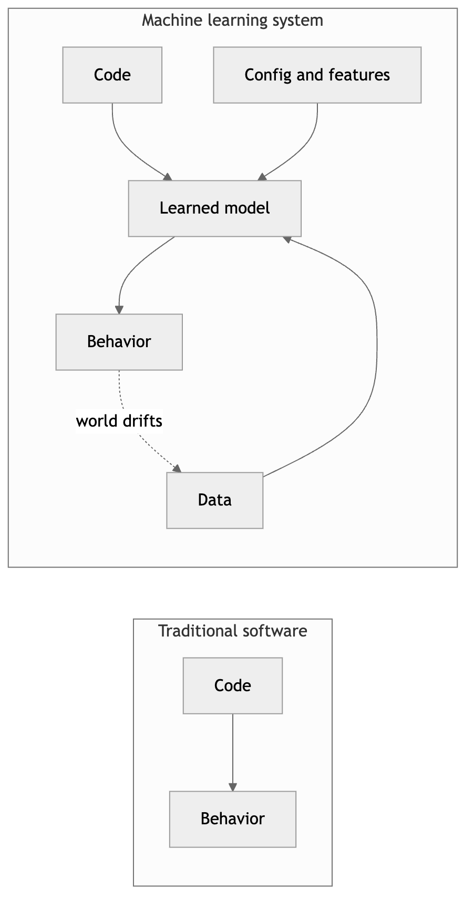

*Figure 359. Traditional software is defined by code alone; an ML system is defined by code, data, and a learned model, each of which evolves independently.*

To make the stakes concrete, consider a fraud-detection model that shipped with 94% precision. Six months later, precision has quietly fallen to 71%, and nobody edited a line of code. What happened? Fraudsters adapted their tactics (concept drift); a payment-processor change altered the format of a key field so a feature now computes differently than it did in training (training-serving skew); a new market launch introduced a customer segment the model never saw (data drift); and a library upgrade subtly changed how a preprocessing step rounds values. Each of these is invisible to a traditional test suite, each degrades the model without any code change, and the compounding effect is a system that was excellent at launch and dangerous half a year later. The entire apparatus of MLOps exists to catch and reverse exactly this kind of silent decay.

The practical consequence is that you cannot manage an ML system with software practices alone. You need everything DevOps offers — version control, automated testing, continuous integration and delivery, infrastructure as code, observability — plus a new layer that treats data and models as first-class, versioned, monitored artifacts. That new layer is MLOps. It is worth stating plainly what MLOps *is not*: it is not a single tool you buy, not a job title one person holds, and not a phase that comes after modeling. It is a set of practices and a supporting toolchain that span the entire lifecycle and are owned jointly by data scientists, ML engineers, and operations. The organizations that do it well treat “we trained a good model” as the midpoint of the work, not the end.

## 29.2 The ML Lifecycle in Production

MLOps reframes machine learning from a one-time project into a continuous, cyclic process. In the research framing, you gather data, train a model, report a metric, and you are done. In the production framing, shipping the first model is the *beginning*: data keeps arriving, the model keeps serving, the world keeps drifting, monitoring keeps watching, and the whole loop keeps turning. A model is never “finished”; it is operated.

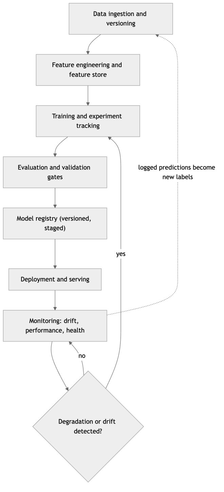

*Figure 360. The MLOps lifecycle is a continuous loop. Monitoring in production feeds back into data and triggers retraining, closing the circle.*

Each stage in this loop is a subject in its own right, and the rest of the chapter walks through them in order: versioning the data and models that flow through the loop; tracking the experiments that produce candidate models; managing features so training and serving agree; automating the pipeline that carries a model from commit to production; choosing how and where to serve; rolling out safely; monitoring relentlessly; and retraining automatically. What unifies them is the loop’s feedback character: the output of monitoring is an input to training, and the whole point of the machinery is to make that feedback fast, safe, and reliable.

It helps to distinguish three planes that coexist in this loop. The **data plane** moves and transforms data. The **model plane** trains, versions, and serves models. The **operational plane** tests, deploys, and observes. Traditional DevOps has mastered the operational plane for stateless code; MLOps extends that mastery across all three, with the data and model planes carrying the extra weight of statistical correctness and reproducibility.

## 29.3 Data and Model Versioning

Reproducibility is the bedrock of trustworthy ML, and reproducibility is impossible without versioning every ingredient of a result. If you cannot answer “exactly what data, code, and configuration produced this model?” then you cannot debug it, audit it, roll it back, or defend it to a regulator. Versioning is not bureaucracy; it is the difference between an engineering discipline and alchemy. The failure it prevents is mundane and universal: a model performs well, weeks pass, someone asks to reproduce or extend it, and the exact data snapshot is gone, the code has moved on, and the environment has drifted — so the result cannot be rebuilt and effectively never existed. Versioning makes results durable.

### 29.3.1 Versioning data

Git is superb for code and hopeless for data. Datasets are large (gigabytes to terabytes), binary, and frequently updated; committing them to Git bloats the repository and grinds it to a halt. The solution is a class of tools — most prominently **DVC (Data Version Control)** — that version data the way Git versions code, but store the heavy bytes elsewhere. DVC keeps a small text pointer file in Git (a hash and metadata) while the actual data lives in remote object storage such as S3, GCS, or Azure Blob. The pointer is versioned alongside your code, so checking out a past commit gives you both the code *and* the exact data that went with it.

``` text
# Track a dataset with DVC; the data goes to remote storage, a small .dvc pointer to Git.
$ dvc init
$ dvc remote add -d storage s3://my-bucket/ml-data
$ dvc add data/train.parquet          # creates data/train.parquet.dvc (a pointer)
$ git add data/train.parquet.dvc data/.gitignore
$ git commit -m "Add training data v1"
$ dvc push                            # upload the bytes to S3

# Later, a teammate reproduces the exact state:
$ git checkout <commit>               # gets code + the .dvc pointer
$ dvc pull                            # downloads the matching data bytes
```

Beyond raw files, DVC and similar tools (LakeFS, Delta Lake, Pachyderm, Git LFS for smaller assets) let you define *data pipelines* as dependency graphs: “this cleaned dataset depends on that raw file and this script; re-run only what changed.” This gives you data lineage and cached, reproducible transformations. The key discipline is *immutability*: a versioned dataset, once published, never changes in place. New data becomes a new version, and every model records which version it consumed.

### 29.3.2 Versioning models and the model registry

A trained model is an artifact — a file of weights plus the code and environment needed to run it — and it too needs versioning. But models need more than a hash; they need a *lifecycle*. A **model registry** is a centralized catalog of trained models that tracks, for each model, all of its versions, the *stage* each version is in (for example: `None`, `Staging`, `Production`, `Archived`), its lineage (which data, code, and experiment run produced it), and its evaluation metrics. The registry is the single source of truth for the question every operations team must be able to answer instantly: *which model is serving production traffic right now, and how was it made?*

MLflow Model Registry, Weights & Biases Artifacts, SageMaker Model Registry, and Vertex AI Model Registry all provide this. A typical workflow: an experiment produces a candidate model; the model is *registered* as a new version; automated and human review *promote* it to `Staging`, then to `Production`; the previously production model is moved to `Archived` but kept, so a rollback is a single stage transition rather than a rebuild.

``` python
# Registering and promoting a model with MLflow (sketch).
import mlflow
from mlflow.tracking import MlflowClient

# During training, log the model as part of a run:
with mlflow.start_run() as run:
    mlflow.log_metric("val_auc", 0.913)
    mlflow.sklearn.log_model(model, artifact_path="model")
    # Register this run's model under a named entry in the registry:
    result = mlflow.register_model(
        model_uri=f"runs:/{run.info.run_id}/model",
        name="churn-classifier",
    )

# Promote the new version to Production once it passes review/gates:
client = MlflowClient()
client.transition_model_version_stage(
    name="churn-classifier",
    version=result.version,
    stage="Production",
    archive_existing_versions=True,   # old prod version -> Archived, enabling rollback
)
```

The registry is the hinge between experimentation and operations. Everything upstream of it (data, features, training, experiments) exists to produce good candidate versions; everything downstream (deployment, serving, monitoring) consumes whatever the registry marks as `Production`. Decoupling the two through the registry means the serving system does not need to know how a model was trained, and the training system does not need to know how it is served.

## 29.4 Experiment Tracking

Machine learning is relentlessly empirical. You do not write a model correctly on the first try; you train dozens or hundreds of variants with different features, architectures, hyperparameters, and data slices, and you keep the ones that win. Without disciplined record-keeping this quickly becomes chaos: a folder of `model_final_v2_reallyfinal.pkl` files, results in a lost terminal scrollback, and no way to answer “what did we change between the run that got 0.88 and the run that got 0.91?”

*Experiment tracking* tools solve this by recording, for every training run, its **parameters** (the hyperparameters and configuration), its **metrics** (loss, accuracy, AUC, and any custom measures, often logged over time as training progresses), its **artifacts** (the trained model, plots, confusion matrices, sample predictions), and its **context** (the code version, the data version, the environment, the hardware, who ran it and when). The two dominant tools are **MLflow** (open source, self-hostable, with tracking, projects, models, and registry components) and **Weights & Biases** (a hosted platform with especially strong live dashboards, hyperparameter sweeps, and collaboration features). Others include Neptune, Comet, ClearML, and TensorBoard for the visualization slice.

``` python
# Experiment tracking with MLflow: a few lines instrument a training script.
import mlflow

mlflow.set_experiment("churn-classifier")

with mlflow.start_run(run_name="xgb-depth6-lr0.1"):
    params = {"max_depth": 6, "learning_rate": 0.1, "n_estimators": 400}
    mlflow.log_params(params)
    mlflow.log_param("data_version", "train.parquet@v3")   # tie run to data

    model = train_xgboost(X_train, y_train, **params)

    for epoch, loss in training_history:      # metrics can be logged as a series
        mlflow.log_metric("train_loss", loss, step=epoch)

    val_auc = evaluate(model, X_val, y_val)
    mlflow.log_metric("val_auc", val_auc)
    mlflow.log_artifact("confusion_matrix.png")
    mlflow.sklearn.log_model(model, "model")
```

The same idea expressed with Weights & Biases is almost identical in spirit — `wandb.init(...)`, `wandb.log({...})` — with the difference that runs stream live to a hosted dashboard where you and your team watch curves update in real time and compare runs side by side. The value compounds over time: after a few weeks the tracking store becomes an institutional memory of every idea the team has tried, searchable and sortable, so nobody repeats a failed experiment and every reported number is traceable to the exact conditions that produced it.

Experiment trackers also power *hyperparameter sweeps*: rather than launching runs by hand, you declare a search space (grid, random, or Bayesian) and the tracker orchestrates dozens or hundreds of runs, records each, and surfaces the best configuration along with the sensitivity of the metric to each hyperparameter. This turns tuning from a manual chore into a systematic, recorded search — and because every run is logged with its full context, the winning configuration is not a lucky number someone remembers but a reproducible artifact tied to its data and code. The discipline pays a second dividend in collaboration: a new team member can open the tracking dashboard and understand months of accumulated knowledge — what was tried, what worked, what did not — without archaeology through old notebooks and chat logs.

Good tracking hygiene is simple and non-negotiable: log the *inputs* (params, data version, code commit) as faithfully as the *outputs* (metrics, artifacts), so that any run can be re-executed. An experiment you cannot re-run is a rumor, not a result.

## 29.5 Feature Stores

Features — the engineered inputs a model actually consumes — are where training-serving skew is born and where it must be killed. Consider a feature like “number of transactions by this user in the last 7 days.” At training time you compute it in a batch job over historical data, joining transaction tables in a warehouse. At serving time, when a request arrives, you must compute the *same* number from live data within milliseconds. If the two computations disagree even slightly — a different time window, a different treatment of timezone, a different handling of refunds — the model receives inputs it never trained on and quietly degrades. A *feature store* exists to guarantee that they agree.

A feature store is a system that centralizes the definition, computation, storage, and serving of features. Its defining architecture is the *dual store*:

- The **offline store** holds large volumes of historical feature values, used to build training datasets. It is optimized for throughput and typically backed by a data warehouse or data lake (BigQuery, Snowflake, Parquet on S3).
- The **online store** holds the latest feature values per entity, used to serve models at inference time. It is optimized for low-latency point lookups and typically backed by a key-value store (Redis, DynamoDB, Cassandra).

The crucial property is that a feature is *defined once* and materialized into *both* stores from the same definition, eliminating skew by construction. Feature stores also provide *point-in-time correctness* for training: when you build a training set, the store fetches each feature’s value *as of* the moment of each historical event, preventing the label leakage that occurs if you accidentally join in a feature computed after the outcome was known.

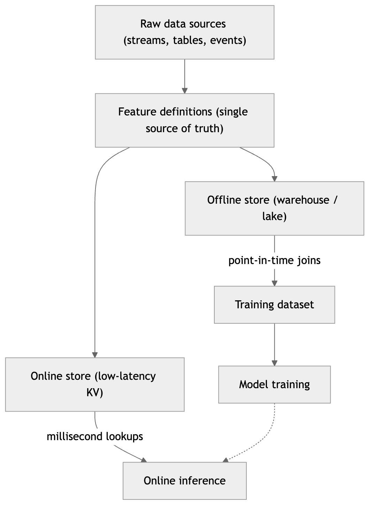

*Figure 361. A feature store defines features once and serves them to both the offline (training) and online (serving) paths, guaranteeing consistency.*

Open-source and managed feature stores include **Feast** (open source, lightweight), **Tecton** (managed, real-time focused), and the built-in feature stores of the major clouds (SageMaker Feature Store, Vertex AI Feature Store, Databricks Feature Store). A sketch of the two access patterns with Feast:

``` python
# Feature retrieval with a feature store (Feast-style sketch).

# TRAINING: point-in-time correct historical features for a set of labeled events.
training_df = store.get_historical_features(
    entity_df=labeled_events,               # has entity ids + event timestamps + labels
    features=[
        "user_stats:txn_count_7d",
        "user_stats:avg_txn_amount_30d",
        "device:is_new_device",
    ],
).to_df()

# SERVING: the freshest feature values for a single request, from the online store.
features = store.get_online_features(
    features=[
        "user_stats:txn_count_7d",
        "user_stats:avg_txn_amount_30d",
        "device:is_new_device",
    ],
    entity_rows=[{"user_id": 4412, "device_id": "d-991"}],
).to_dict()
```

Beyond consistency, feature stores add *reuse* and *freshness* as first-class concerns. Reuse: a well-defined feature like “average transaction amount over 30 days” is expensive to compute and useful to many models, so computing it once and sharing it across teams avoids duplicated, subtly divergent implementations — the very thing that breeds skew. Freshness: features have different update cadences, and the store manages *materialization* — the scheduled or streaming jobs that recompute feature values and push them into the online store. A feature that must reflect the last few seconds (streaming aggregation) is materialized differently from one that is recomputed nightly, and the store tracks each feature’s freshness so a model does not silently consume a stale value.

Not every project needs a feature store; a single model with request-time-only features may not justify the operational cost. But the moment features are shared across models, computed from aggregations over time, or reused between teams, a feature store pays for itself by turning training-serving consistency from a hope into an invariant.

## 29.6 The Training-to-Deployment Pipeline: CI, CD, and CT

In traditional software, *continuous integration* (CI) automatically builds and tests every code change, and *continuous delivery/deployment* (CD) automatically ships changes that pass. ML inherits both and adds a third that has no software analogue: *continuous training* (CT), the automated retraining of models on fresh data. Together, CI/CD/CT form the automated spine of an MLOps system.

The pipeline differs from software CI/CD in what it tests and produces. A software pipeline tests code and produces a binary. An ML pipeline additionally *validates data*, *trains a model*, *evaluates the model against quality gates*, and produces a *versioned model artifact* — and any of those steps can fail for statistical rather than logical reasons.

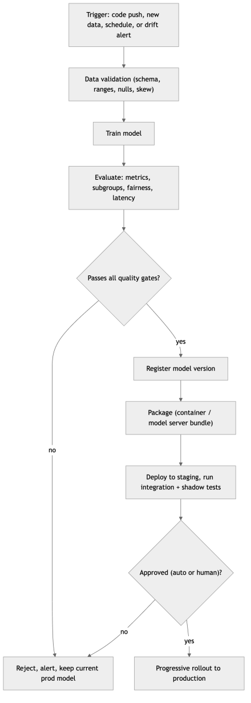

*Figure 362. An ML CI/CD/CT pipeline. Code and data changes both trigger the flow; automated gates block low-quality or unfair models from reaching production.*

The distinguishing feature of an ML pipeline is its *gates*: automated checks that a candidate model must clear before it advances. Common gates include a minimum metric threshold on a held-out set, a requirement that the new model beat the current production model (or a simple baseline), per-subgroup performance floors to catch fairness regressions, a latency-and-size budget so the model can actually be served, and data-validation checks that fail the run if the incoming data violates its expected schema or distribution. Because these gates are automated, a bad model is caught by machinery, not by a person noticing something looks off after launch.

### 29.6.1 Data validation as a first-class test

The step that most distinguishes an ML pipeline from a software pipeline is *data validation*, and it deserves its own emphasis because bad data is the most common cause of production ML failures — more common than bad models. Before a single training step runs, the pipeline should assert that the incoming data conforms to an expected *schema* (the right columns, of the right types), that numeric features fall within plausible *ranges* (an age of 900 or a negative transaction count is a bug, not a data point), that *null rates* per column have not spiked, that *categorical vocabularies* have not suddenly gained or lost values, and that the *statistical distribution* of the new data has not diverged wildly from the data the current model was trained on. Tools such as TensorFlow Data Validation, Great Expectations, Pandera, and Evidently formalize these checks into declarative, versioned “expectations” that fail the pipeline loudly when violated.

The reasoning is simple: a model trained on corrupt data will itself be corrupt, and no downstream evaluation gate reliably catches every such failure — a model can score well on a held-out split drawn from the same corrupt distribution. Validating data *before* training is far cheaper than discovering weeks later that a broken upstream join silently zeroed out your most important feature. Data validation is the pipeline’s smoke detector; it costs little and prevents disasters.

``` python
# Data validation as a pipeline gate (Great Expectations / Pandera-style sketch).
import pandas as pd

def validate(df: pd.DataFrame, reference_stats: dict) -> None:
    # 1. Schema: required columns and types
    required = {"user_id": "int64", "txn_count_7d": "int64", "amount": "float64"}
    for col, dtype in required.items():
        assert col in df.columns, f"missing column: {col}"
        assert str(df[col].dtype) == dtype, f"{col} has wrong dtype {df[col].dtype}"

    # 2. Ranges: plausible values only
    assert df["amount"].between(0, 1e6).all(), "amount out of range"
    assert df["txn_count_7d"].ge(0).all(), "negative transaction count"

    # 3. Null rates: no unexpected spike
    assert df["amount"].isna().mean() < 0.01, "amount null rate spiked"

    # 4. Distribution: mean has not drifted implausibly vs training reference
    z = abs(df["amount"].mean() - reference_stats["amount_mean"]) / reference_stats["amount_std"]
    assert z < 5, f"amount mean drifted {z:.1f} sigma from training reference"
    # A failed assertion exits non-zero and stops the pipeline before training.
```

A minimal pipeline definition in a CI system (here GitHub Actions) shows the shape; production pipelines are usually built with dedicated orchestrators (Kubeflow Pipelines, Vertex AI Pipelines, SageMaker Pipelines, Airflow, Metaflow, ZenML) that handle scheduling, caching, distributed steps, and lineage:

``` yaml
# .github/workflows/ml-pipeline.yml  — a minimal ML CI/CD pipeline
name: ml-pipeline
on:
  push:
    branches: [main]
  schedule:
    - cron: "0 3 * * 1"          # weekly continuous-training run (Mondays 03:00)
jobs:
  train-and-gate:
    runs-on: ubuntu-latest
    steps:
      - uses: actions/checkout@v4
      - name: Install deps
        run: pip install -r requirements.txt
      - name: Pull versioned data
        run: dvc pull
      - name: Validate data
        run: python pipeline/validate_data.py    # schema, ranges, train/serve skew
      - name: Train
        run: python pipeline/train.py --config configs/prod.yaml
      - name: Evaluate against quality gates
        run: python pipeline/evaluate.py --min-auc 0.90 --beat-prod --fairness-check
      - name: Register model (only if evaluate.py exited 0)
        run: python pipeline/register.py --stage Staging
```

Continuous training deserves emphasis because it is what keeps the loop turning. A CT pipeline is triggered not only by code changes but by *time* (retrain weekly on the latest data), by *volume* (a threshold of new labeled examples has accumulated), or by *monitoring* (a drift or performance alert, discussed below). The pipeline then runs the same validated, gated path — so retraining on fresh data is as safe and reproducible as any other deploy, rather than a risky manual scramble. The end state teams aspire to is a system where a monitored performance dip automatically triggers retraining on recent data, the new model passes its gates, rolls out progressively, and a human is merely notified — the loop closing itself.

## 29.7 Deployment Patterns

Once a model has passed its gates and been registered, it must be *deployed* — made available to produce predictions. There is no single right way; the pattern depends on how predictions are consumed. The four dominant patterns trade off latency, freshness, cost, and complexity.

**Batch (offline) inference** scores large volumes of data on a schedule and stores the results for later use. A nightly job predicts churn probability for every customer and writes it to a table that the marketing dashboard reads the next morning. Batch is the simplest and cheapest pattern: it reuses data-pipeline infrastructure, has no latency pressure, and can run on spot/preemptible compute. Its limitation is *freshness* — predictions are as stale as the last run — so it fits problems where inputs change slowly and predictions are not needed the instant an event occurs.

**Online (real-time) inference** answers individual requests synchronously with low latency, typically behind a REST or gRPC API. A fraud check at checkout, a recommendation on page load, or a search ranking must return within tens or low hundreds of milliseconds. Online serving is the most operationally demanding pattern: it needs a running service, autoscaling, load balancing, latency budgets, and high availability. It is the right choice whenever a prediction must reflect the current request and be returned immediately.

**Streaming inference** sits between batch and online. Instead of responding to explicit requests, the model consumes an unbounded event stream (Kafka, Kinesis, Pub/Sub) and emits predictions continuously as events arrive. It suits event-driven problems — flagging anomalous transactions as they stream in, updating a session’s recommendations as a user clicks — where inputs arrive as a flow rather than as discrete requests, and where near-real-time (seconds) rather than synchronous (milliseconds) latency is acceptable.

**Edge inference** runs the model on the device where the data originates — a phone, a camera, a car, a sensor — rather than on a server. It is mandatory when connectivity is unreliable, when latency must be minimal (no network round trip), when data must not leave the device for privacy reasons, or when bandwidth is scarce. The cost is severe resource constraints: models must be compressed, quantized, or distilled to fit tight memory and compute budgets (a theme connected to the model-efficiency techniques discussed elsewhere), and updating a model across a fleet of devices is its own logistics problem.

| Pattern | Latency | Freshness | Cost | Complexity | Typical use |
|----|----|----|----|----|----|
| Batch | High (minutes–hours) | Stale until next run | Lowest | Low | Nightly churn scores, demand forecasts |
| Online | Very low (ms) | Per-request | High | High | Fraud checks, recommendations, search |
| Streaming | Low (seconds) | Near-real-time | Medium | Medium–High | Live anomaly detection, session updates |
| Edge | Very low (on-device) | Per-request | Device cost; low server cost | High (fleet mgmt) | On-device vision, offline/private inference |

Many real systems combine patterns. A recommender might precompute candidate items in a nightly batch job and re-rank them online per request; a fraud system might score transactions in a stream while a nightly batch job recomputes user risk profiles. The pattern is chosen per prediction, not per company.

The choice has consequences that ripple through the rest of the system. Batch inference can tolerate a slow, heavyweight model and simple infrastructure because nothing waits on it, but it cannot react to events as they happen. Online inference demands the whole serving apparatus of the next section — low-latency feature lookups, autoscaling, tight latency budgets, high availability — because a user is blocked on every prediction. Streaming inherits the event-processing infrastructure (a stream platform, stateful operators, exactly-once semantics) that anomaly and personalization use cases need. Edge trades server cost and privacy risk for the hard constraints of on-device compute and the logistics of updating models across a fleet. Choosing the pattern early, from how predictions will actually be consumed, avoids the expensive mistake of building an elaborate real-time service for a problem that a nightly batch job would have solved.

## 29.8 Model Serving

*Serving* is the engineering of the online pattern: how a trained model becomes a running service that answers requests reliably, quickly, and at scale. It is where ML meets systems engineering in earnest. The requirements read like any high-availability web service — low and predictable latency, horizontal scalability, health checks, graceful degradation, zero-downtime deploys — with two ML-specific twists: the service must fetch or compute the *exact* features the model expects, and it must log its inputs and outputs so that monitoring can later judge whether the predictions were any good. A serving system that forgets to log is flying blind; the log is not an afterthought but the raw material of the entire monitoring and retraining loop.

### 29.8.1 From weights to a service

At its simplest, serving wraps the model in a web service that accepts inputs, runs inference, and returns predictions. The example below serves a scikit-learn model with **FastAPI**, adding the production essentials the naive version omits: input validation, a health-check endpoint (so orchestrators know the service is alive), class probabilities, and explicit feature-count checking.

``` python
# serve.py — a minimal but production-minded FastAPI model server
from fastapi import FastAPI, HTTPException
from pydantic import BaseModel, field_validator
import joblib
import numpy as np

app = FastAPI(title="churn-classifier")
model = joblib.load("model.joblib")     # a trained scikit-learn estimator
N_FEATURES = model.n_features_in_

class Features(BaseModel):
    values: list[float]

    @field_validator("values")
    @classmethod
    def check_length(cls, v):
        if len(v) != N_FEATURES:
            raise ValueError(f"expected {N_FEATURES} features, got {len(v)}")
        return v

@app.get("/health")                      # liveness/readiness probe target
def health():
    return {"status": "ok"}

@app.post("/predict")
def predict(payload: Features):
    x = np.array(payload.values).reshape(1, -1)
    proba = float(model.predict_proba(x)[0, 1])
    return {"prediction": int(proba >= 0.5), "probability": proba}

# Run with:  uvicorn serve:app --host 0.0.0.0 --port 8000
```

To run identically across a developer laptop, a staging cluster, and production, the service is packaged in a **container** with Docker, which bundles code, model, and dependencies into a single reproducible image. Pinning versions and copying only what is needed keeps images small and builds deterministic.

``` text
# Dockerfile
FROM python:3.11-slim
WORKDIR /app
COPY requirements.txt .
RUN pip install --no-cache-dir -r requirements.txt
COPY serve.py model.joblib .
EXPOSE 8000
CMD ["uvicorn", "serve:app", "--host", "0.0.0.0", "--port", "8000"]
```

### 29.8.2 Serving architecture at scale

A single container is a starting point, not a production system. Real serving puts the model service behind a load balancer, runs many replicas for throughput and availability, and orchestrates them — usually with **Kubernetes** — so that replicas are health-checked, restarted on failure, and autoscaled with load. A feature store or feature cache supplies request-time features; a logging sink captures inputs and predictions for monitoring.

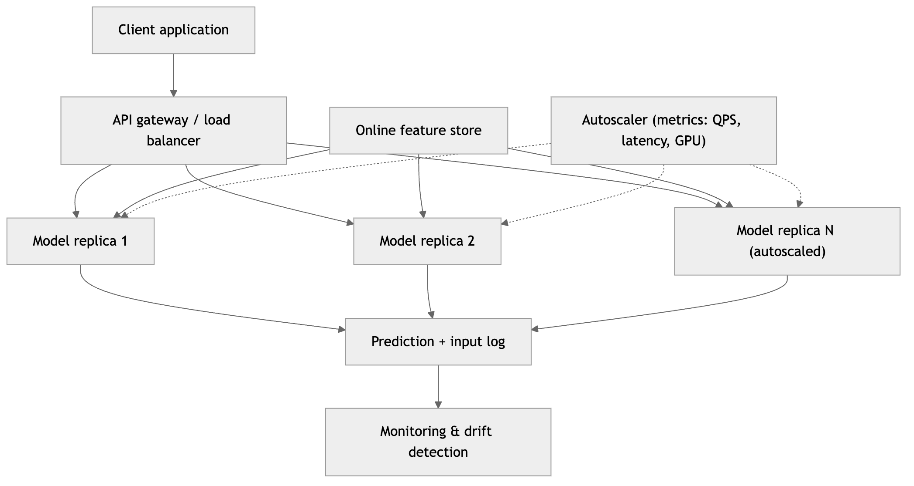

*Figure 363. A production online-serving architecture: a gateway routes requests to autoscaled model replicas that fetch features and log every prediction for monitoring.*

**Autoscaling** adjusts the number of replicas to match demand: scale out when latency or queue depth rises, scale in when traffic ebbs to save money. Horizontal pod autoscalers key off CPU, GPU, request rate, or custom latency metrics; some platforms support *scale-to-zero* for rarely used models, spinning up a replica only when a request arrives (at the cost of cold-start latency).

### 29.8.3 Dedicated model servers

Wrapping a model in FastAPI is fine for simple cases, but purpose-built **model servers** add capabilities that are tedious to build by hand: dynamic request *batching* (combining concurrent requests into one efficient batch — critical on GPUs), multi-model hosting, hardware acceleration, versioning, and standardized REST/gRPC endpoints. The leading options:

- **TorchServe** — the reference server for PyTorch models, with handlers, batching, and versioning.
- **TensorFlow Serving** — high-performance serving for TensorFlow SavedModels, battle-tested at scale.
- **NVIDIA Triton Inference Server** — framework-agnostic (PyTorch, TensorFlow, ONNX, TensorRT), optimized for GPUs, with dynamic batching and concurrent model execution; the common choice for heavy deep-learning and LLM serving.
- **BentoML** — a Python-first framework that packages models and business logic into a “Bento” and deploys it as a container to many targets; ergonomic for mixed pipelines.
- **KServe / Seldon Core** — Kubernetes-native serving layers that add standardized inference protocols, autoscaling (including scale-to-zero), canary rollouts, and explainability on top of the above.

Two protocol choices recur. **REST/JSON** is universal, human-readable, and easy to debug — the right default for most services. **gRPC** uses binary Protocol Buffers over HTTP/2, giving lower latency and higher throughput for high-volume, machine-to-machine, or streaming traffic, at the cost of being less convenient to inspect.

| Serving option | Best for | Strengths | Trade-offs |
|----|----|----|----|
| FastAPI / Flask (DIY) | Simple models, custom logic | Full control, minimal deps | You build batching, scaling, versioning |
| TorchServe / TF Serving | Single-framework deep models | Batching, versioning, tuned | Framework-specific |
| Triton | GPU / mixed-framework / LLMs | Multi-framework, GPU-optimized, dynamic batching | Heavier to configure |
| BentoML | Python pipelines + models | Ergonomic packaging, multi-target deploy | Opinionated workflow |
| KServe / Seldon | Kubernetes-native serving | Autoscaling, canary, standard protocols | Requires Kubernetes |
| Serverless (Lambda, Cloud Run) | Spiky / low-volume traffic | Scale-to-zero, no infra to manage | Cold starts, size/latency limits |

### 29.8.4 The latency–throughput trade-off and batching

Serving performance has two axes: *latency* (how long one request takes) and *throughput* (how many requests per second the system handles). They are in tension, and *batching* is the primary lever. Processing requests one at a time minimizes per-request latency but wastes hardware — especially GPUs, which are efficient only when fed large batches. Combining many concurrent requests into a batch dramatically raises throughput but adds latency, because each request waits for the batch to fill. Dynamic batching (wait up to a few milliseconds to gather a batch, then run it) tunes this trade-off.

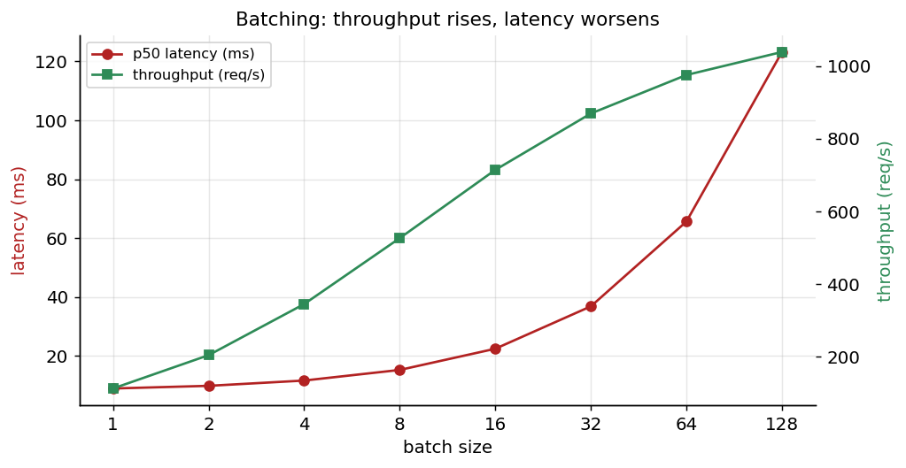

*Figure 364. The batching trade-off. Larger batches raise throughput (green) but worsen per-request latency (red); the right batch size is where throughput gains flatten while latency is still acceptable.*

The engineering goal is to meet a latency *service-level objective* (for example, p99 under 100 ms) while maximizing throughput per dollar. Levers include batching, model optimization (quantization, distillation, compilation to TensorRT/ONNX), caching frequent predictions, choosing the right hardware (CPU for small models, GPU for large ones), and horizontal scaling. Measuring the *tail* (p95, p99) matters more than the average: a good mean with a terrible p99 means a meaningful fraction of users have a bad experience.

### 29.8.5 The inference graph, not just the model

A subtle but critical point: what you deploy is almost never *only* the model’s forward pass. A prediction request passes through a small graph — parse and validate the input, fetch features from the online store, apply the exact preprocessing used in training (scaling, encoding, imputation), run the model, post-process the output (thresholding, calibration, formatting), and log everything. Every one of these steps must match training, and the cleanest way to guarantee that is to *serialize the whole pipeline*, not just the estimator — for example, a scikit-learn `Pipeline` object that bundles the preprocessing and the model, saved as one artifact, so training and serving share literally the same code. When preprocessing lives in a separate serving script that “re-implements” the training transforms, you have manufactured training-serving skew; when it travels with the model as one versioned artifact, skew is designed out. Interchange formats such as ONNX and standardized model packaging (MLflow’s `pyfunc` flavor, BentoML’s service definition) exist largely to carry this whole graph across environments intact.

## 29.9 Deployment Strategies

Having a servable model is not the same as safely putting it in front of users. Replacing a working production model with a new one is risky: the new model might be worse in ways that offline evaluation missed — on live traffic, on a subgroup, on latency, on some interaction with the rest of the system. *Deployment strategies* control that risk by governing how traffic moves from the old model to the new.

**Blue-green deployment** runs two complete environments: *blue* (current production) and *green* (the new version). You deploy and fully test green while blue still serves all traffic, then switch the router to send everything to green at once. If anything goes wrong, you switch back to blue instantly. The benefit is a fast, clean rollback; the cost is running two full environments and the fact that the cutover is all-or-nothing — every user hits the new model at the same moment.

**Canary deployment** releases the new model to a small fraction of traffic first (say 1%, then 5%, 25%, 50%, 100%), watching metrics at each step and rolling back if they degrade. The name comes from the canary in a coal mine: a small exposure that warns of danger before it reaches everyone. Canary is the workhorse strategy for online models because it limits the blast radius of a bad model to a tiny slice of users and surfaces problems on real traffic that offline tests cannot.

**Shadow deployment** (also called dark launch) sends a *copy* of live traffic to the new model while the old model’s predictions are the ones actually used and returned. The new model’s outputs are logged and compared but never affect users. This is the safest way to validate a model on real production traffic — including its latency and its behavior on the true input distribution — with zero user risk, because the shadow model’s predictions are discarded. Shadowing is especially valuable before a first launch or for validating a major architecture change.

**A/B testing** deploys two (or more) models to disjoint, randomized user groups and compares them on *business* metrics — conversion, revenue, engagement — with statistical rigor, over enough time to reach significance. It answers a different question than the others: not “is the new model healthy?” but “does the new model actually produce better *outcomes*?” A model with higher offline AUC does not always drive more revenue; A/B testing is how you find out for real.

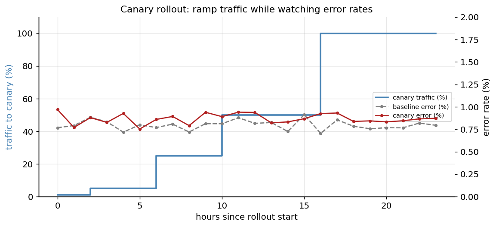

*Figure 365. A healthy canary rollout. Traffic to the new model ramps in stages (blue steps) while the canary’s error rate (red) stays close to the baseline (grey); a divergence would trigger rollback before most users were affected.*

Two practical points make these strategies work in practice. The first is *rollback mechanics*: a rollout is only as safe as its ability to reverse, so traffic routing should be controlled by a configuration value or feature flag — a model version pointer that a deploy tool flips — rather than baked into an image that must be rebuilt and redeployed to change. When the router simply reads “serve version 7” from config, rolling back to version 6 is a one-line change that takes effect in seconds, and it can even be automated: a monitoring rule that trips a threshold flips the pointer without a human in the loop. The second is the *offline-online gap*: a model that wins on your held-out test set does not always win on live traffic, because the test set is a frozen sample of the past while live traffic is the moving present, and because business outcomes (did revenue rise?) are not the same as statistical metrics (did AUC rise?). This gap is precisely why canary and A/B stages exist — they are the only place you learn how a model behaves on the distribution and the objectives that actually matter.

These strategies compose. A common recipe: shadow-test a new model to confirm it is healthy on real traffic, then canary it to a growing slice while watching operational metrics, then run an A/B test at 50/50 to confirm it improves business outcomes, then promote it to 100% — with blue-green infrastructure underneath so a rollback is instantaneous at any point. The unifying principle is *progressive exposure*: never bet all your traffic on an unproven model, and always keep the previous model one switch away.

## 29.10 Monitoring in Production

Monitoring is where MLOps earns its keep, because it addresses the defining risk from the start of this chapter: **a model can silently degrade while its code and weights never change.** Traditional software monitoring watches whether the service is *up* — latency, error rates, resource usage — and ML systems need all of that too. But ML adds a second, harder question: is the model still *right*? A service can be perfectly healthy by every systems metric while making increasingly wrong predictions, because the data has drifted out from under it. There are four layers to watch.

### 29.10.1 Operational monitoring

The foundation is ordinary service health: request rate, latency percentiles (p50/p95/p99), error rates, CPU/GPU/memory utilization, and availability. If the service is down or slow, nothing else matters. This layer uses standard observability tooling (Prometheus, Grafana, Datadog) and is well-understood; ML adds prediction-specific health signals such as the rate of prediction failures, the fraction of requests hitting fallback logic, and feature-fetch latency. A frequently overlooked signal here is *missing or malformed features* at serving time: when the online store returns a null because a materialization job fell behind, the model may silently substitute a default and make a degraded prediction that looks perfectly healthy from the outside. Counting null and out-of-range feature values per request, and alerting when they spike, catches a whole class of failures that live in the plumbing between the feature store and the model rather than in either one alone.

### 29.10.2 Data drift

*Data drift* (also *covariate shift*) is a change in the distribution of the model’s *inputs* relative to training — the model still sees the same kinds of features, but their values have shifted. A credit model trained before an interest-rate spike sees applicants with different debt profiles; a vision model trained on summer photos sees winter scenes. The model was never tested on this new distribution, so its reliability is unknown and usually worse.

You detect data drift by statistically comparing the live input distribution to a reference (the training distribution or a recent stable window), feature by feature. The two standard tools:

- The **Kolmogorov-Smirnov (KS) test** for continuous features compares two samples’ cumulative distributions and returns a statistic and p-value; a small p-value flags drift.
- The **Population Stability Index (PSI)** bins a feature and sums `(live% - ref%) * ln(live% / ref%)` across bins. Rules of thumb: PSI below 0.1 means no meaningful shift, 0.1-0.2 a moderate shift worth watching, above 0.2 a significant shift warranting action.

``` python
# Drift detection: KS test and PSI for a single feature (sketch).
import numpy as np
from scipy import stats

def ks_drift(reference, live, alpha=0.05):
    """Kolmogorov-Smirnov test for continuous features."""
    stat, p_value = stats.ks_2samp(reference, live)
    return {"ks_stat": stat, "p_value": p_value, "drift": p_value < alpha}

def psi(reference, live, bins=10):
    """Population Stability Index between reference and live samples."""
    edges = np.quantile(reference, np.linspace(0, 1, bins + 1))
    edges[0], edges[-1] = -np.inf, np.inf            # capture the tails
    ref_pct = np.histogram(reference, edges)[0] / len(reference)
    live_pct = np.histogram(live, edges)[0] / len(live)
    eps = 1e-6                                        # avoid log(0) / divide-by-zero
    ref_pct = np.clip(ref_pct, eps, None)
    live_pct = np.clip(live_pct, eps, None)
    return float(np.sum((live_pct - ref_pct) * np.log(live_pct / ref_pct)))

# In a monitoring job, run these per feature on a rolling window and alert on thresholds.
```

Drift monitoring is best visualized over time: track a drift statistic per feature per day and alert when it crosses a threshold. The value creeps up long before a catastrophic failure, giving you a window to act.

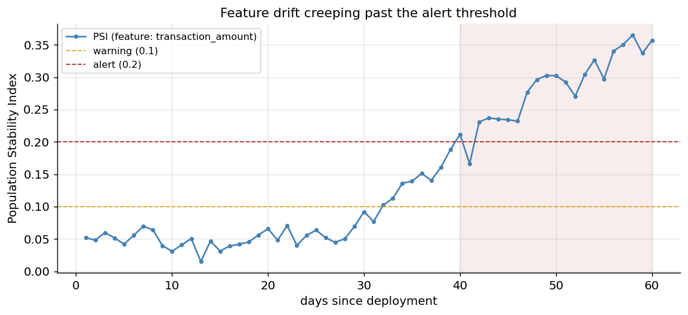

*Figure 366. A drift-detection time series. The Population Stability Index for a feature is stable for weeks, then creeps past the warning (0.1) and alert (0.2) thresholds as the input distribution shifts — the early warning that a model is going stale.*

It is also instructive to look directly at the distributions themselves: overlaying the training and live histograms of a feature makes drift visible at a glance and helps diagnose its cause.

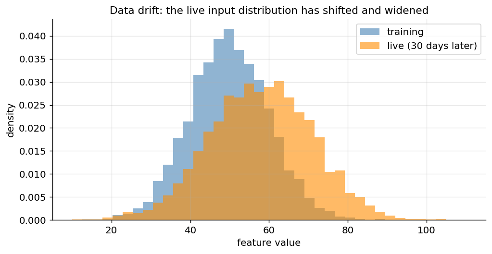

*Figure 367. Data drift seen directly. The live input distribution (orange) has shifted higher and widened relative to the training distribution (blue); a model trained on the blue distribution is now extrapolating.*

Three practical subtleties make drift detection harder than running one test. First, the *choice of window* matters: comparing today against all of training will flag a shift that happened long ago and has since stabilized, while comparing a small recent window is noisy and can false-alarm. A common pattern is a fixed *reference* window (training or a known-good period) versus a rolling *detection* window (say the last day or week). Second, *multiple testing* inflates false alarms: if you run a KS test on 200 features every day, some will cross the significance threshold by chance alone, so you should correct for it (a Bonferroni or false-discovery-rate adjustment) or alert on the *number* of drifting features rather than any single one. Third, for *high-dimensional or unstructured* inputs — images, text, embeddings — per-feature univariate tests are meaningless; instead you monitor drift in a lower-dimensional representation (embedding statistics, the output of a dimensionality reduction, or a domain-classifier that tries to distinguish reference from live data — if it succeeds, the two distributions differ).

### 29.10.3 Concept drift

*Concept drift* is subtler and more dangerous: the *relationship* between inputs and the target changes, so the learned mapping is wrong even if the inputs look the same. What counts as fraud evolves as fraudsters adapt; what predicts a click changes as fashions shift; spending patterns that signaled churn last year mean something different after an economic shock. Concept drift can occur *with* obvious input drift or *without* it — the inputs may look statistically identical while their meaning has changed — which is why input monitoring alone is insufficient.

Detecting concept drift ideally requires *labels*: you compare the model’s live accuracy to its training accuracy and watch for decline. When labels arrive quickly (did the user click? did the transaction charge back within days?), this is straightforward. When labels are delayed or expensive, you rely on proxies: prediction-distribution drift (the mix of predicted classes shifting), confidence drift (the model becoming systematically less certain), and business-metric decline.

### 29.10.4 Prediction and label drift

Two related signals round out the picture. *Prediction drift* watches the distribution of the model’s *outputs*: if a fraud model that flagged 2% of transactions suddenly flags 15%, something has changed even before you have ground truth. *Label drift* watches the distribution of the true target when labels are available: if the base rate of the positive class shifts, class priors have changed and the model’s calibration may be off. Both are cheap to compute (no labels needed for prediction drift) and serve as early tripwires.

### 29.10.5 Alerting and the feedback loop

Monitoring is only useful if it *acts*. Each signal is paired with a threshold and an alert: page an on-call engineer for operational outages, open a ticket for moderate drift, and — at higher severity — automatically trigger the retraining pipeline. The essential design principle is that monitoring outputs feed back into the lifecycle loop: logged predictions and eventual labels become new training data; drift and performance alerts become retraining triggers. Monitoring is not a dashboard someone occasionally glances at; it is the sensory system that closes the MLOps loop.

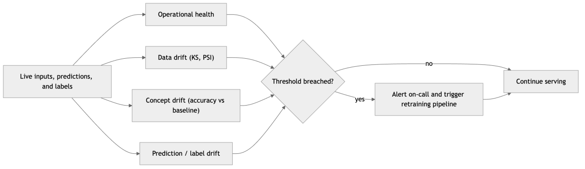

*Figure 368. The monitoring-to-retraining feedback loop. Multiple signals feed a decision that either continues serving or triggers the gated retraining pipeline.*

## 29.11 Retraining: Triggers and Automation

Since models decay, retraining is not optional; the only question is *when* and *how much* to automate it. There are three broad triggering strategies, often combined.

**Scheduled retraining** runs the pipeline on a fixed cadence — daily, weekly, monthly — regardless of measured performance. It is simple, predictable, and easy to reason about, and it works well when drift is gradual and roughly constant. Its weakness is that it is blind: it retrains when nothing has changed (wasting compute) and may wait too long when something changes fast.

**Trigger-based retraining** fires when monitoring detects a problem: a drift statistic crosses a threshold, live accuracy drops below an SLA floor, or a business metric declines. This is more responsive and efficient — you retrain exactly when the model needs it — but requires trustworthy monitoring and guards against thrashing (retraining repeatedly on noise).

**Volume-based retraining** fires when a threshold of new labeled data has accumulated, which suits problems where the constraint is data availability rather than time.

Whatever the trigger, the retraining pipeline should be the *same* gated CI/CD/CT pipeline described earlier: pull fresh versioned data, validate it, train, evaluate against quality gates (including a requirement to beat the current production model), register, and roll out progressively. This is what makes automated retraining safe rather than reckless — a retrained model earns production the same way any model does, and if the fresh data is corrupt or the new model is worse, the gates reject it and the current model keeps serving. A subtle but important discipline is deciding the *training window*: retrain on a rolling recent window to track drift, or on all history to maximize data, or on a weighted blend — a choice that depends on how fast the concept moves.

Two failure modes deserve explicit guards. The first is *thrashing*: a noisy trigger that fires on random fluctuations retrains constantly, burning compute and churning models without improving anything. The fix is hysteresis — require a sustained breach (the metric below threshold for N days, not one bad afternoon), rate-limit retraining to a maximum cadence, and always gate the candidate against production so noise-driven retrains simply fail their gate and change nothing. The second is *feedback contamination*: when a model’s own predictions influence the labels it later trains on (a fraud model that blocks transactions never learns whether those transactions were truly fraudulent; a recommender only ever gets feedback on items it chose to show), the training data becomes a biased mirror of the model rather than of the world. Mitigations include reserving a small fraction of randomized, un-modeled traffic to gather unbiased labels, and explicitly logging which predictions influenced which outcomes so the bias can be corrected. Both guards reflect the same principle: automation amplifies whatever you point it at, so you must point it at a signal that is real.

The payoff of the full loop is a system that heals itself. A monitored metric dips; a trigger fires; the pipeline retrains on recent data; the candidate beats production on the gates; it canaries out safely; and accuracy recovers — often before any user complains.

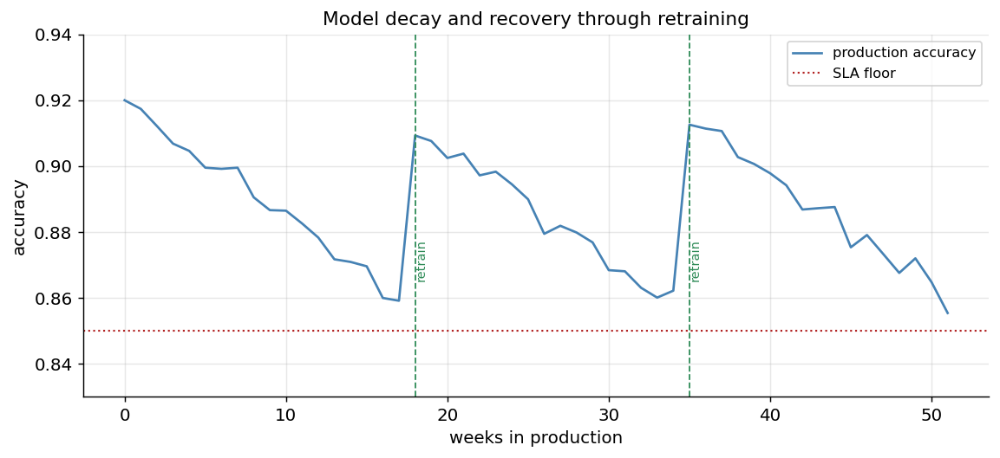

*Figure 369. Model decay and recovery. Accuracy drifts downward in production as the world changes (blue); each retraining event (green dashed) resets it, keeping the model above its service-level floor (red dotted). Without retraining, the line would cross the floor and stay there.*

## 29.12 Scalability and Cost

Production ML runs on real hardware that costs real money, and cost is a first-class engineering constraint, not an afterthought. The largest costs are usually *serving* (running inference around the clock) and *training* (especially for large models), followed by data storage and pipeline compute. Several levers control them.

On the *serving* side: right-size the hardware to the model (do not put a small tree ensemble on a GPU); use dynamic batching to raise hardware utilization; cache frequent or repeated predictions; apply model-optimization techniques — quantization, pruning, distillation, and compilation to inference runtimes like ONNX Runtime or TensorRT — to shrink the model and speed it up; autoscale so you pay only for the capacity you use, and consider scale-to-zero for intermittent models; and prefer the smallest model that meets the quality bar, since a marginally more accurate model that costs ten times as much to serve is often the wrong trade.

On the *training* side: use spot/preemptible instances for fault-tolerant jobs, cache and reuse pipeline steps that have not changed (a good orchestrator does this automatically), and retrain only when needed rather than on a wasteful cadence. Track cost per prediction and cost per training run as explicit metrics, the same way you track accuracy and latency — what you do not measure, you cannot optimize.

Scalability is the flip side of cost: the system must handle growth in traffic and data without falling over or requiring a rewrite. Horizontal scaling (more replicas behind a load balancer) is the default answer for serving; distributed training and data-parallel pipelines handle growth on the training side. The goal is a system whose capacity and cost scale smoothly and predictably with load.

A useful habit is to define explicit *service-level objectives* (SLOs) and budget against them. A serving SLO might state “p99 latency under 100 ms and availability of 99.9%”; a cost SLO might cap “cost per thousand predictions” at a target. These make trade-offs legible: when a proposed model is more accurate but blows the latency SLO or doubles the cost per prediction, the SLOs turn a vague argument into a concrete decision. They also guide autoscaling policy — scale out to protect the latency SLO, scale in to protect the cost budget — and give monitoring something precise to alert on. The discipline mirrors the rest of MLOps: name the thing you care about, measure it continuously, and let the measurement drive automated action.

## 29.13 Reproducibility, Lineage, and Governance

Everything in this chapter ultimately rests on being able to answer questions about *how a prediction came to be* — for debugging, for improvement, and increasingly for law. Three related disciplines provide that answer.

**Reproducibility** is the ability to re-create a result exactly. It requires pinning every input to a computation: the code (a Git commit), the data (a DVC or dataset version), the environment (pinned dependencies, ideally a container image), the configuration and hyperparameters, and the random seeds. A run that fixes all of these can be reproduced bit-for-bit; a run that fixes none is a one-time accident. Reproducibility is the property that makes debugging and auditing possible at all.

**Lineage** (or provenance) is the recorded chain of *what produced what*: this prediction came from this model version, which came from this training run, which used this data version and this code commit and these features. With lineage, a wrong prediction in production can be traced back through the model, the training data, and the feature definitions to find the root cause. Feature stores, model registries, experiment trackers, and pipeline orchestrators each capture a slice of lineage; mature platforms stitch them into an end-to-end graph.

**Governance** is the organizational layer: the policies, approvals, documentation, and audit trails that ensure models are used responsibly and lawfully. It includes *model cards* and *datasheets* (standardized documentation of a model’s intended use, performance, and limitations, and of a dataset’s composition and collection), *access controls* on who can deploy or promote a model, *approval workflows* for high-stakes changes, and *audit logs* of every deployment and decision. In regulated domains — finance, healthcare, hiring, and anywhere the emerging AI regulations apply — governance is a legal requirement, and the ability to explain and document a model’s decisions is not optional. Governance connects MLOps to the responsible-AI concerns of fairness, transparency, and accountability treated elsewhere in this book.

The reassuring insight is that good MLOps and good governance are largely the *same* practices viewed from different angles. A model registry with staged versions and lineage is both an engineering convenience and an audit trail. Automated quality gates that check per-subgroup performance are both a reliability safeguard and a fairness control. Reproducible pipelines are both what lets you debug a model and what lets you demonstrate to a regulator how a decision was produced. Monitoring that detects drift is both operational hygiene and evidence of ongoing diligence. Teams that build the lifecycle infrastructure for reliability find they have most of the governance apparatus for free; teams that treat governance as a separate compliance bolt-on end up duplicating work and satisfying neither goal well. The lesson is to design the lifecycle so that the record you need to *operate* the system is the same record you need to *account for* it.

## 29.14 The MLOps Maturity Model

Organizations do not arrive at full MLOps overnight; they progress through recognizable levels of automation and rigor. A common framing (aligned with Google’s and Microsoft’s maturity models) has three broad stages.

**Level 0 — Manual process.** Everything is hand-driven and script-based. Data scientists train models in notebooks, hand a model file to engineers, and deploy manually. There is little or no versioning, testing, monitoring, or automated retraining. Releases are infrequent and painful, and when a model decays, nobody notices until a business metric drops. This is where most teams start, and it works until it doesn’t — typically at the first silent failure or the first “which model is in production?” mystery.

**Level 1 — ML pipeline automation.** The training process is automated and reproducible: a pipeline handles data validation, training, evaluation, and model registration, and can be triggered repeatedly. Continuous training becomes possible — models retrain automatically on fresh data or on a schedule. Experiment tracking, data versioning, and a model registry are in place. Deployment may still involve manual steps, but the model-production path is automated and trustworthy.

**Level 2 — CI/CD/CT automation.** The entire path is automated and monitored end to end. Code and pipeline changes flow through CI/CD; models retrain and redeploy through gated, progressive rollouts; monitoring detects drift and performance issues and can trigger retraining automatically; and rollback is fast and routine. Humans set policy and review high-stakes changes but are not in the critical path for routine updates. The system is, in the ideal, self-healing.

| Level | Training | Deployment | Monitoring | Retraining | Feels like |
|----|----|----|----|----|----|
| 0 — Manual | Notebooks, by hand | Manual handoff | Little or none | Ad hoc, reactive | Heroics and surprises |
| 1 — Pipeline | Automated pipeline | Semi-automated | Basic | Scheduled / semi-auto | Reproducible training |
| 2 — CI/CD/CT | Automated + gated | Progressive, automated | Full (drift + perf) | Triggered, automated | Self-healing system |

The point of the model is not to shame teams at Level 0 but to give a roadmap: the next investment that most improves reliability is usually the one that moves you up a level. Not every system needs Level 2 — a low-stakes internal model may be perfectly well served at Level 1 — but knowing where you are and where the failure modes lie lets you invest deliberately rather than reactively. The progression also warns against a common anti-pattern: jumping straight to elaborate automation before the fundamentals are in place. Automated retraining on top of unversioned data and no monitoring does not produce a self-healing system; it produces an automated way to ship broken models faster. The levels are ordered for a reason — versioning and reproducibility come before pipeline automation, which comes before full CI/CD/CT — and skipping the foundations tends to collapse under its own weight. Maturity is earned in order, and the right question is never “how do we get to Level 2?” but “what is the one gap whose absence hurts us most today?”

## 29.15 LLMOps: Operating Large Language Models

The rise of large language models has spawned an emerging extension of MLOps sometimes called *LLMOps*. Most MLOps principles carry over directly — versioning, deployment, monitoring, cost control, governance — but LLMs introduce enough new operational realities to warrant their own practices.

**Prompts are a new versioned artifact.** For LLM applications, much of the “model behavior” lives not in trained weights (which are often a frozen third-party API) but in *prompts*, *system messages*, *retrieval configurations*, and *tool definitions*. These must be versioned, tested, and rolled out with the same discipline as code and models. A prompt change is a deployment; it needs a version, a review, and a rollback path. Prompt-management tools and prompt registries are the LLMOps analogue of the model registry.

**Evaluation is harder and central.** There is rarely a single accuracy number for a generative system. LLM evaluation combines curated test sets scored by rules or reference answers, *LLM-as-a-judge* pipelines (using a strong model to grade another model’s outputs against a rubric), human review, and task-specific metrics for faithfulness, relevance, and safety. Building an automated *eval pipeline* — a suite that scores every prompt or model change on a battery of cases before it ships — is the LLMOps equivalent of the quality gate, and it is often the hardest part to get right because the “correct” answer is fuzzy. The pipeline runs a fixed dataset of representative inputs through the candidate configuration, scores each output (by rules, by reference comparison, or by a judge model against a rubric), aggregates the scores, and blocks the change if the aggregate regresses against the current production configuration — the same beat-production gate as classical ML, adapted to fuzzy outputs.

``` python
# An LLM eval pipeline as a deployment gate (sketch).
def run_eval(candidate_config, eval_dataset, judge, baseline_score, min_pass=0.85):
    scores = []
    for case in eval_dataset:                     # each: {input, rubric, reference}
        output = generate(case["input"], config=candidate_config)
        # Score by a rubric graded by a strong judge model (0..1):
        score = judge.grade(output, rubric=case["rubric"], reference=case.get("reference"))
        scores.append(score)
    mean_score = sum(scores) / len(scores)
    passed = mean_score >= min_pass and mean_score >= baseline_score  # beat prod
    return {"mean_score": mean_score, "passed": passed}
# Wire this into CI: a prompt or model change that fails run_eval never reaches users.
```

**Guardrails are an operational component.** Because LLMs can produce harmful, off-topic, hallucinated, or injected-instruction outputs, production systems wrap them in *guardrails*: input filters (blocking prompt injection and disallowed requests), output filters (checking for toxicity, PII leakage, policy violations, and hallucination against retrieved sources), and structured-output validation. These guardrails are code that must be tested, versioned, and monitored like any other production component, and they connect directly to the safety and responsible-AI concerns covered elsewhere.

**Cost and latency monitoring take center stage.** LLM inference is expensive and often billed per token, so *token usage*, *cost per request*, and *latency* become primary operational metrics — not afterthoughts. Levers include prompt compression, caching (both exact-match response caching and semantic caching), routing easy requests to smaller/cheaper models and hard ones to larger models, and setting per-user or per-feature budgets. A runaway prompt or an unbounded agent loop can generate enormous bills, so cost monitoring with hard limits is a safety mechanism, not just an accounting one.

**Observability shifts to traces.** For multi-step LLM applications — retrieval-augmented generation and agents that call tools in loops — the unit of observability is a *trace*: the full sequence of prompts, retrievals, tool calls, and responses that produced an output. Tools such as LangSmith, Langfuse, and Phoenix specialize in capturing and inspecting these traces so a bad answer can be debugged step by step. This mirrors the lineage discipline of classical MLOps, adapted to the branching, multi-call structure of LLM systems.

A further wrinkle is that many LLM systems are built on *third-party* models accessed through an API, which the operator does not control and cannot version. The provider may update the model underneath you, silently changing its behavior — a form of drift with no data explanation at all. This makes two LLMOps practices essential: pin to specific model versions where the provider allows it, and run the eval suite continuously (not only at deploy time) so that a provider-side change is caught as a regression before users feel it. It also motivates keeping a fallback — a second provider or a self-hosted model — behind the same feature-flagged routing used for classical rollbacks, so a degraded or unavailable upstream model can be swapped out in seconds rather than during an outage.

In short, LLMOps is MLOps with the emphasis rebalanced: prompts join models as versioned artifacts, evaluation becomes a discipline unto itself, guardrails become load-bearing infrastructure, and cost becomes a headline metric. The loop is the same; the artifacts and failure modes are new.

## 29.16 Putting It Together: The Life of a Model

The individual pieces cohere best when you trace them end to end on a single concrete system. Imagine a payment company deploying a fraud-detection model, and follow it through the loop.

**Training.** An engineer opens a feature branch and adjusts a feature definition in the feature store. Pushing the branch triggers the CI/CD/CT pipeline. It pulls the current versioned training data with `dvc pull`, runs data validation (schema, ranges, null rates, distribution checks), and — all green — kicks off training. The run is instrumented with the experiment tracker: hyperparameters, the data version, the code commit, and the resulting metrics are all logged, and the trained artifact is the full preprocessing-plus-model pipeline serialized as one object.

**Gating and registration.** The pipeline evaluates the candidate on a held-out set: overall AUC, but also precision on the fraud class, performance broken out by region and card type (a fairness and robustness check), and inference latency on a representative batch. The candidate must clear each threshold *and* beat the model currently marked `Production`. It does, so it is registered as version 8 of `fraud-classifier` and promoted to `Staging`.

**Deployment.** The registry event triggers packaging: the pipeline builds a container, deploys it to staging, and runs integration tests and a shadow test against a copy of live traffic to confirm the new version is healthy — right latency, sensible prediction distribution, no crashes — while the old version’s predictions are the ones actually used. Satisfied, an engineer approves promotion. The rollout controller flips the traffic pointer to send 1% of production traffic to version 8, then 5%, 25%, 50%, watching error rates and the fraud-catch rate at each step. All comparable to baseline, so it reaches 100%. Version 7 is archived, one switch away.

**Serving.** A transaction arrives. The API gateway routes it to one of several autoscaled replicas. The replica fetches the user’s features from the online feature store (transaction counts, average amounts, device signals) with millisecond lookups, runs the serialized pipeline, returns a fraud probability, and logs the input and the prediction to the monitoring sink. Under load, the autoscaler adds replicas; overnight it removes them to save money.

**Monitoring and the loop closing.** Weeks pass. The monitoring job computes PSI per feature daily against the training reference and tracks the model’s precision as chargeback labels arrive with a lag. One feature’s PSI creeps past 0.2, and precision on the newest transactions dips toward the SLA floor — fraudsters have found a new pattern (concept drift) and a market launch has shifted the input mix (data drift). The alert does not page a human at 3 a.m.; it triggers the continuous-training pipeline on the most recent data. The retrained candidate — version 9 — flows through the very same validation, gates, registration, and progressive rollout. Precision recovers. No user ever noticed, and the entire episode is recorded in the lineage graph: which prediction, from which model version, trained on which data, triggered by which alert. That is a self-healing system, and it is the whole point.

## 29.17 The Operational Mindset

Beyond any specific tool, MLOps is ultimately a *mindset*, and the mindset can be stated as a handful of assumptions to engineer around. Assume that data *will* drift and that models *will* decay — build monitoring and retraining so that decay is caught and reversed rather than discovered by users. Assume that failures *will* happen — make rollbacks trivial and keep the previous model one switch away. Assume that you *will* need to explain a prediction someday — version everything and record lineage so that you can. Assume that the model is the *small* part of the system — invest accordingly in data, features, serving, and monitoring. The goal is never a single great model in a notebook; it is a *system* that keeps delivering good predictions, safely, reproducibly, and affordably, as the world around it changes. That system, tended over its whole lifecycle, is what MLOps builds.

## 29.18 Summary

- **ML systems differ fundamentally from traditional software**: behavior is learned from data, the world drifts underneath a fixed model (model decay), training and serving are separate code paths that can disagree (training-serving skew), and testing must cover data and models, not just code. This creates hidden technical debt with no software analogue.
- **The MLOps lifecycle is a continuous loop**: data and features feed training and experiments; evaluated models are registered and deployed; production is monitored; drift and degradation trigger retraining — closing the circle.
- **Versioning is the bedrock**: data versioning (DVC and friends) keeps large data reproducible via pointers to remote storage; a model registry catalogs versions, stages, and lineage as the single source of truth for what is in production.
- **Experiment tracking** (MLflow, Weights & Biases) records params, metrics, artifacts, and context so every result is reproducible and comparable; **feature stores** define features once and serve them to both offline (training) and online (serving) paths, eliminating skew by construction.
- **CI/CD/CT** extends software CI/CD with data validation, model training, automated quality gates, and *continuous training* — automated retraining that flows through the same gated, progressive path.
- **Deployment patterns** — batch, online, streaming, edge — trade latency, freshness, cost, and complexity; **model serving** turns weights into scalable services using containers, Kubernetes, autoscaling, and dedicated servers (TorchServe, TF Serving, Triton, BentoML, KServe), balancing the latency-throughput trade-off with batching.
- **Deployment strategies** — shadow, canary, blue-green, A/B — control rollout risk through progressive exposure, always keeping the previous model one switch away.
- **Monitoring** watches four layers: operational health, data drift (KS test, PSI), concept drift (accuracy vs. baseline), and prediction/label drift; alerts feed back to trigger **retraining**, which flows through the same gates so automation stays safe.
- **Reproducibility, lineage, and governance**, and progression up the **MLOps maturity model** (manual → pipeline → CI/CD/CT), turn ML from heroics into an engineering discipline; **LLMOps** extends all of this to language models, adding prompt versioning, eval pipelines, guardrails, and token-cost monitoring.

## 29.19 Key Takeaways

- The model is the easy part; most of the effort and most of the failures live in data, features, serving, and monitoring. Invest there.
- A production model is a depreciating asset — plan for decay from day one with monitoring and retraining rather than treating a launch as the finish line.
- Version *everything* (data, code, model, config, environment) so that any result can be reproduced, audited, and rolled back.
- Automate the path from experiment to production and gate it with data and model-quality checks; never let an ungated model reach users.
- Roll out with progressive exposure (shadow → canary → A/B) and keep instant rollback available.
- Monitor for drift as diligently as for uptime — a healthy service can still make wrong predictions.

## 29.20 Exercises

1.  Explain, using the concepts of data dependency and non-stationarity, why a model’s accuracy can fall in production even though its code and weights never changed.
2.  Define *training-serving skew* and describe a concrete scenario in which it silently degrades a model. How does a feature store prevent it?
3.  Distinguish *data drift* from *concept drift*, giving a concrete example of each, and explain why monitoring inputs alone is insufficient to catch concept drift.
4.  Implement the `psi` function from the monitoring section and test it on two samples drawn from `N(0,1)` and `N(0.5,1.2)`. At what shift does PSI cross 0.2? Relate your finding to the interpretation thresholds.
5.  Compare the four deployment patterns (batch, online, streaming, edge) and choose the most appropriate for each of: nightly credit-limit updates, an on-device keyboard autocorrect, a live payment-fraud flag, and product recommendations on page load. Justify each choice.
6.  Contrast shadow, canary, blue-green, and A/B deployment. Design a rollout plan for a new recommendation model that composes at least two of them, and state what metric would trigger a rollback at each stage.
7.  Extend the FastAPI service to (a) load the model version marked `Production` from a model registry at startup, (b) log every input and prediction to a monitoring sink, and (c) expose a `/metrics` endpoint reporting request count and latency percentiles.
8.  Design a CI/CD/CT pipeline for a churn model. List the quality gates you would enforce before a deploy — including a fairness gate and a “beat current production” gate — and explain the risk each gate mitigates.
9.  Your monitoring shows PSI on a key feature rising past 0.2 while labels are delayed by 30 days. Describe how you would decide whether to retrain now, and what proxies you would use in the absence of fresh labels.
10. Place a system you know (or invent) on the MLOps maturity model. Identify the single investment that would most improve its reliability, and justify why it matters more than the alternatives.
11. For an LLM-powered customer-support assistant, describe the LLMOps practices you would put in place: what you would version, how you would build an eval pipeline, what guardrails you would add, and which cost and latency metrics you would monitor with hard limits.

---

[← 28 Image, Audio, and Code Generation](ch28-image-audio-code-gen.md) · [Contents](../README.md#contents) · [30 Responsible AI: Ethics, Bias, Safety, and Governance →](ch30-responsible-ai.md)
