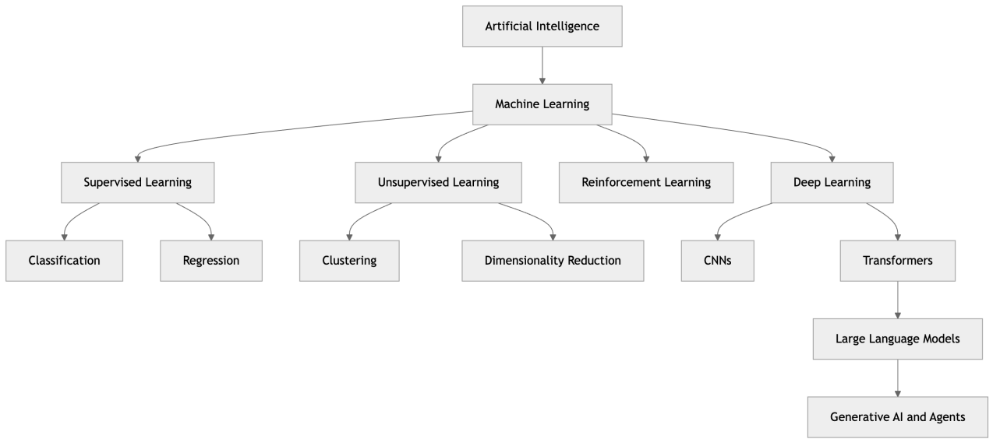

[← Appendix C: Datasets, Projects, and Further Reading](ch33-appendix-c-datasets-resources.md) · [Contents](../README.md#contents)

---

# 31 Glossary of AI/ML Terms and Terminologies

This glossary collects the vocabulary used throughout *Ultimate AI/ML* and across the wider field, organized alphabetically. Definitions are concise but precise; where a concept has a full treatment elsewhere in the book, the glossary gives the working definition you need at a glance. Use it as a quick reference while reading: when a chapter introduces a term you have not met, or reuses one whose meaning has grown fuzzy, look it up here for a one- or two-sentence anchor and a pointer to related ideas. Entries cross-reference one another by name — following those links is a good way to build a mental map of how the field’s concepts fit together. The concept map below shows how the largest ideas relate before we dive into the alphabetical entries.

*Figure 376. A high-level concept map of the major areas of AI and how they relate*

## 31.1 A

**Ablation study** — An experiment that removes or disables one component of a system at a time to measure its contribution to overall performance.

**Action** — In reinforcement learning, a choice the agent makes at each step that influences the environment and the reward it receives. The set of all possible actions is the *action space*.

**Actor-critic** — A reinforcement-learning family that pairs a policy (“actor”) with a value estimator (“critic”), using the critic’s feedback to reduce the variance of policy-gradient updates.

**Accuracy** — The fraction of predictions a classifier gets right; simple but misleading on imbalanced data, where precision, recall, and F1 are more informative.

**Activation function** — A nonlinear function (e.g., ReLU, sigmoid, tanh, softmax) applied to a neuron’s weighted sum, giving neural networks the ability to model nonlinear relationships.

**AdaBoost** — A boosting algorithm that combines many weak learners, reweighting misclassified examples so each new learner focuses on the previous ones’ mistakes.

**Adam** — A widely used adaptive optimizer that maintains per-parameter learning rates using running estimates of the gradient’s first and second moments; often the default choice for deep networks.

**Adversarial example** — An input deliberately perturbed by a small, often imperceptible amount to make a model misclassify it, exposing fragility in the model’s decision boundary.

**Agent** — An AI system, typically built on an LLM, that reasons about a goal, uses tools, takes actions, and observes results in a loop until the task is complete. See also *ReAct*, *tool use*.

**AGI (Artificial General Intelligence)** — A hypothetical AI with human-level general competence across virtually all cognitive tasks; today’s systems are narrow by comparison.

**Algorithm** — A defined procedure; in ML, the method used to learn a model from data (e.g., gradient descent, k-means).

**Alignment** — The process of making a model’s behavior conform to human intentions and values, often via techniques such as RLHF and constitutional AI.

**Anomaly detection** — Identifying rare items or events that deviate markedly from the norm, used in fraud and fault detection. See also *outlier*, *DBSCAN*.

**A/B testing** — Comparing two variants (e.g., two models or two prompts) by randomly splitting live traffic and measuring which performs better on a chosen metric.

**Apriori** — A classic association-rule mining algorithm that finds frequent itemsets by exploiting the fact that any subset of a frequent set is itself frequent.

**Artificial Intelligence (AI)** — The broad field concerned with building systems that perform tasks requiring human-like intelligence.

**Antecedent** — In an association rule, the “if” part — the itemset whose presence is used to predict the consequent.

**Association rule mining** — Discovering “if-then” relationships between items in transactional data (e.g., market-basket analysis), scored by support, confidence, and lift.

**Autoregressive model** — A model that generates a sequence one element at a time, conditioning each new element on those already produced; the generation scheme behind GPT-style LLMs.

**Attention** — A mechanism that lets a model weigh the relevance of different parts of the input when producing each part of the output; the foundation of Transformers. See also *self-attention*.

**Autoencoder** — A neural network trained to reconstruct its input through a compressed bottleneck, used for dimensionality reduction, denoising, and anomaly detection.

**AutoML** — Tools and techniques that automate parts of the ML pipeline such as model selection, feature engineering, and hyperparameter tuning.

**AUC (Area Under the Curve)** — The area under the ROC curve; a threshold-independent measure of a classifier’s ability to rank positives above negatives.

## 31.2 B

**Backpropagation** — The algorithm that computes gradients of the loss with respect to every weight in a neural network by applying the chain rule backward through the network.

**Bagging** — *Bootstrap aggregating*; training many models on bootstrap samples and averaging their predictions to reduce variance (e.g., random forests).

**Bandit (multi-armed)** — A simplified reinforcement-learning setting with one state and several actions (“arms”), used to study the exploration–exploitation tradeoff.

**Batch** — The subset of training examples processed together in one forward/backward pass.

**Batch normalization** — A technique that normalizes layer inputs per mini-batch to stabilize and accelerate training.

**Bayes’ theorem** — The rule for updating a probability given evidence: posterior ∝ likelihood × prior; the basis of naive Bayes classifiers and Bayesian inference.

**Bayesian optimization** — A sample-efficient search method that builds a probabilistic model of an objective (e.g., validation score) to choose promising hyperparameters to try next.

**Beam search** — A decoding strategy that keeps the top-k most probable partial sequences at each step, trading compute for higher-quality generated text.

**Bellman equation** — The recursive relationship at the heart of reinforcement learning: the value of a state equals the immediate reward plus the discounted value of the next state. Solving it (exactly or approximately) yields optimal value functions and policies.

**Bernoulli distribution** — The distribution of a single binary trial with probability p of success; the building block of binary classification likelihoods.

**BERT** — An early influential Transformer that is pretrained bidirectionally with masked-language modeling, strong at understanding tasks such as classification and question answering.

**Bias (statistical)** — Error from overly simplistic assumptions; high bias causes underfitting.

**Bias (fairness)** — Systematic unfairness in model behavior toward certain groups, usually inherited from data. See also *fairness*, *disparate impact*.

**Bias (neuron)** — A learnable constant added to a neuron’s weighted sum, shifting the activation independently of the inputs.

**Bias-variance tradeoff** — The tension between underfitting (high bias) and overfitting (high variance); good generalization balances the two.

**BLEU** — A precision-based metric that scores machine-translation or generated text by n-gram overlap with reference texts.

**Boosting** — An ensemble method that trains models sequentially, each correcting the errors of its predecessors (e.g., AdaBoost, gradient boosting).

**Bootstrap** — Sampling with replacement to create resampled datasets, used in bagging and to estimate the uncertainty of a statistic.

**BPE (Byte-Pair Encoding)** — A tokenization algorithm that iteratively merges the most frequent adjacent symbol pairs, producing a subword vocabulary that balances coverage and length.

**BPTT (Backpropagation Through Time)** — The version of backpropagation used to train recurrent networks, unrolling the network across time steps and summing gradients along the sequence.

## 31.3 C

**Calibration** — How well a classifier’s predicted probabilities match observed frequencies; a well-calibrated model that says “70%” is right about 70% of the time.

**Callback** — A hook invoked at defined points during training (e.g., end of epoch) to log metrics, save checkpoints, or trigger early stopping.

**Canary deployment** — Releasing a new model to a small fraction of traffic first, monitoring it, and expanding the rollout only if it behaves well.

**Chain rule** — The calculus rule for differentiating composed functions; applied repeatedly, it is what makes backpropagation possible.

**Channel** — One of the stacked feature planes in a CNN tensor; an RGB image has three input channels, and convolutional layers produce many learned channels.

**Chunking** — In RAG, splitting source documents into smaller passages so each can be embedded, indexed, and retrieved independently. Chunk size and overlap strongly affect retrieval quality.

**Categorical variable** — A feature that takes one of a finite set of discrete values (e.g., color), typically encoded via one-hot or ordinal encoding before modeling.

**Centroid** — The mean position of the points in a cluster; k-means iteratively updates centroids to minimize within-cluster distance.

**Chain-of-thought** — A prompting technique that asks an LLM to reason step by step, often improving accuracy on multi-step problems.

**Checkpoint** — A saved snapshot of a model’s parameters (and optimizer state) during training, allowing resumption or rollback.

**Classification** — A supervised task of predicting a discrete class label.

**Class imbalance** — See *imbalanced data*.

**CI/CD (Continuous Integration / Continuous Delivery)** — Automated pipelines that test and deploy code — and in MLOps, data, models, and pipelines — on every change.

**Clustering** — An unsupervised task of grouping similar data points without labels.

**CNN (Convolutional Neural Network)** — A neural network using convolutional layers to detect local patterns, dominant in computer vision.

**Collaborative filtering** — A recommendation technique that predicts a user’s preferences from the behavior of similar users or items.

**Conda** — A package and environment manager popular in data science for installing Python (and non-Python) dependencies in isolated environments.

**Conditional probability** — The probability of one event given that another has occurred, written P(A\|B); the foundation of Bayes’ theorem.

**Computer vision** — The field concerned with enabling machines to interpret images and video; dominated by CNNs and, increasingly, vision Transformers.

**Confidence (association rules)** — The conditional probability that the consequent appears given the antecedent in an association rule.

**Confusion matrix** — A table of true vs. predicted classes showing true/false positives and negatives, from which precision, recall, and accuracy are computed.

**Constitutional AI** — An alignment approach in which a model critiques and revises its own outputs against a written set of principles, reducing reliance on human feedback labels.

**Context window** — The maximum number of tokens an LLM can attend to at once.

**Convolution** — The operation of sliding a learnable filter over an input to produce a feature map.

**Consequent** — In an association rule, the “then” part — the itemset predicted to appear when the antecedent is present.

**Containerization** — Packaging an application with its dependencies into an isolated, portable unit (e.g., a Docker image) so it runs the same everywhere.

**Correlation** — A normalized measure (typically in \[−1, 1\]) of the linear relationship between two variables; correlation does not imply causation.

**Corpus** — A large collection of text (or other data) used to train or evaluate a model.

**Cosine similarity** — A measure of similarity between two vectors based on the angle between them; central to semantic search and embedding retrieval.

**Covariance** — A measure of how two variables vary together; the covariance matrix underlies PCA.

**Cross-entropy** — A loss function measuring the difference between predicted and true probability distributions; standard for classification.

**Cross-validation** — Evaluating a model on multiple train/test splits (e.g., k-fold) for a more reliable performance estimate.

**CUDA** — NVIDIA’s platform for general-purpose GPU computing, the substrate on which most deep-learning frameworks accelerate training and inference.

**Curse of dimensionality** — The phenomenon where data becomes sparse and distances lose meaning in high-dimensional spaces, motivating dimensionality reduction.

## 31.4 D

**Data augmentation** — Expanding a dataset with transformed copies (e.g., rotated images, paraphrased text) to improve generalization.

**Dataset** — A structured collection of examples used to train, validate, or test a model.

**Data drift** — A shift in the distribution of input data over time, degrading a deployed model. See also *concept drift*, *monitoring*.

**Concept drift** — A change over time in the relationship between inputs and the target, so a model’s learned mapping becomes stale even if the inputs look unchanged.

**Data leakage** — When information unavailable at prediction time leaks into training, inflating performance and breaking in production.

**Data pipeline** — The sequence of automated steps that ingest, clean, transform, and deliver data for training or inference.

**DataFrame** — A labeled, table-like data structure (rows and named columns) central to pandas and the standard container for tabular data in Python.

**Derivative** — The instantaneous rate of change of a function; the multivariable generalization is the gradient, which drives optimization in ML.

**Determinant** — A scalar computed from a square matrix that indicates whether it is invertible and how it scales volume under transformation.

**Decision boundary** — The surface separating regions a classifier assigns to different classes.

**Decision tree** — A model that makes predictions via a sequence of feature-based splits.

**Deep learning** — Machine learning with neural networks of many layers.

**DBSCAN** — A density-based clustering algorithm that finds arbitrarily shaped clusters and labels outliers as noise, without requiring the number of clusters up front.

**Dendrogram** — The tree diagram produced by hierarchical clustering, showing how points merge into clusters at increasing distance thresholds.

**Differential privacy** — A formal guarantee that a model’s output reveals little about any single training record, achieved by adding calibrated noise.

**Diffusion model** — A generative model that creates data by iteratively denoising random noise; state of the art for image generation.

**Dimensionality reduction** — Reducing the number of features while preserving structure (e.g., PCA, t-SNE, UMAP).

**Discount factor (γ)** — In reinforcement learning, a value in \[0,1\] that weighs how much future rewards count relative to immediate ones.

**Discriminative model** — A model that learns the boundary or conditional probability p(y\|x) between classes, as opposed to a generative model. See also *generative model*.

**Disparate impact** — A fairness concern in which a model’s outcomes differ across protected groups even without explicit use of the protected attribute.

**Distillation** — Training a smaller “student” model to mimic a larger “teacher,” compressing capability into a cheaper model.

**Docker** — A containerization tool that packages a model and its dependencies into a portable image, widely used to make ML deployments reproducible.

**Dot product** — The sum of element-wise products of two vectors; measures their alignment and is the core operation inside every neuron and attention score.

**DQN (Deep Q-Network)** — A reinforcement-learning method that uses a neural network to approximate Q-values, enabling Q-learning in high-dimensional state spaces such as raw pixels.

**Dropout** — A regularization technique that randomly zeroes neurons during training to prevent co-adaptation and overfitting.

## 31.5 E

**Early stopping** — Halting training when validation performance stops improving, a simple and effective form of regularization.

**Eigenvalue / eigenvector** — For a matrix, a vector whose direction is unchanged under the matrix’s transformation and the scalar by which it is stretched; eigenvectors of the covariance matrix are the principal components in PCA.

**Elastic net** — A regularized linear model that combines L1 (lasso) and L2 (ridge) penalties, inheriting feature selection from the former and stability from the latter.

**Elbow method** — A heuristic for choosing the number of clusters k by plotting within-cluster error against k and picking the “elbow” where returns diminish.

**Emergent ability** — A capability that appears in large models but is largely absent in smaller ones, seemingly arising only past a scale threshold.

**Environment** — In reinforcement learning, everything outside the agent: it receives the agent’s actions and returns new states and rewards.

**Embedding** — A dense vector representation of data (text, images) in which semantically similar items lie close together.

**Encoder / Decoder** — Two halves of many architectures: the encoder compresses input into a representation, and the decoder generates output from it; Transformers come in encoder-only, decoder-only, and encoder–decoder variants.

**Ensemble** — A model that combines several models’ predictions to improve accuracy and robustness.

**Entropy** — A measure of uncertainty in a distribution; used in decision-tree splitting and information theory.

**Epoch** — One full pass through the entire training dataset.

**Epsilon-greedy** — A simple RL exploration strategy that picks a random action with probability ε and the best-known action otherwise.

**EM (Expectation-Maximization)** — An iterative algorithm for fitting models with latent variables, alternating between estimating the latents and updating parameters; used by Gaussian mixture models.

**Explainability (XAI)** — Methods and properties that make a model’s predictions understandable to humans (e.g., SHAP, LIME, feature importance). See also *interpretability*.

**Expectation (expected value)** — The probability-weighted average of a random variable’s possible values; the theoretical “mean” of a distribution.

**Experiment tracking** — Systematically logging the parameters, code, data, and metrics of each training run so results are reproducible and comparable (e.g., with MLflow or Weights & Biases).

**Explained variance** — The fraction of a dataset’s total variance captured by a set of principal components; used to decide how many to keep in PCA.

**Exploding gradient** — When gradients grow uncontrollably large in deep or recurrent networks, destabilizing training; mitigated by gradient clipping and normalization.

**Exploration vs. exploitation** — The reinforcement-learning dilemma between trying new actions and exploiting known-good ones.

**Exploratory data analysis (EDA)** — The initial, open-ended investigation of a dataset with summaries and plots to understand its structure, spot problems, and form hypotheses.

## 31.6 F

**F1 score** — The harmonic mean of precision and recall, balancing the two in a single metric.

**Fairness** — The goal that a model treats individuals and groups equitably; formalized by criteria such as demographic parity, equalized odds, and equal opportunity, which can conflict.

**Feature** — An individual measurable input variable used by a model.

**Feature engineering** — Creating, transforming, or selecting features to improve model performance.

**Feature importance** — A ranking of how much each feature contributes to a model’s predictions, computed by permutation, split-based measures, or SHAP.

**Feature map** — The output of applying a convolutional filter across an input, highlighting where a pattern appears.

**Feature scaling** — Standardizing or normalizing features to comparable ranges so scale-sensitive algorithms (e.g., k-NN, SVM, gradient descent) behave well.

**Feature selection** — Choosing a subset of the most useful features to reduce overfitting, cost, and noise.

**Feature store** — A central system for computing and serving features consistently in training and inference.

**Federated learning** — Training a shared model across many devices or organizations that keep their data local, sending only model updates rather than raw data.

**Feedforward network** — A neural network in which information flows one way from input to output with no cycles; the dense layers inside a Transformer block are feedforward.

**Few-shot learning** — Prompting or training a model with only a handful of examples.

**Fine-tuning** — Further training a pretrained model on task-specific data. See also *LoRA*, *PEFT*.

**Filter (kernel)** — A small learnable array of weights slid across an input in a convolution to detect a specific local pattern such as an edge or texture.

**Forward pass** — The computation that runs inputs through a network layer by layer to produce an output; paired with the backward pass that computes gradients.

**Foundation model** — A large model pretrained on broad data that can be adapted to many downstream tasks.

**FP-growth** — An association-rule mining algorithm that compresses the data into a frequent-pattern tree, finding frequent itemsets faster than Apriori by avoiding candidate generation.

**F-beta score** — A generalization of the F1 score that weights recall more (β\>1) or precision more (β\<1) according to the application.

## 31.7 G

**GAN (Generative Adversarial Network)** — A generative model in which a generator and a discriminator compete, the generator learning to produce realistic data.

**Gaussian (normal) distribution** — The bell-shaped distribution characterized by a mean and variance, ubiquitous in statistics.

**Gaussian Mixture Model (GMM)** — A probabilistic clustering model that represents data as a mixture of several Gaussian distributions, fit by Expectation-Maximization.

**GDPR** — The European Union’s General Data Protection Regulation, which grants individuals rights over their personal data and constrains how it may be collected and used — a key driver of privacy and “right to explanation” requirements in ML.

**Generalization** — A model’s ability to perform well on new, unseen data rather than just the training set.

**Gini impurity** — A measure of how mixed the classes are in a node; decision trees choose splits that most reduce it (an alternative to information gain).

**Generative AI** — AI that creates new content — text, images, audio, code — rather than only classifying or predicting.

**Generative model** — A model that learns the joint distribution of data and can sample new examples (e.g., GANs, VAEs, diffusion models, LLMs). Contrast *discriminative model*.

**GPT** — A family of decoder-only Transformer language models trained to predict the next token, foundational to modern generative LLMs.

**Gradient** — The vector of partial derivatives of a function; points in the direction of steepest increase.

**Gradient boosting** — A boosting method that fits each new model to the residual errors of the current ensemble (e.g., XGBoost, LightGBM).

**Gradient clipping** — Capping the magnitude of gradients during training to prevent exploding gradients, common in recurrent networks.

**Gradient descent** — The optimization algorithm that iteratively updates parameters in the direction opposite the gradient to minimize a loss.

**Grid search** — An exhaustive hyperparameter search over a predefined grid of values.

**GloVe** — A word-embedding method that learns vectors by factorizing a global word co-occurrence matrix.

**GPU (Graphics Processing Unit)** — A massively parallel processor originally for graphics, now the standard hardware for training and serving deep-learning models.

**Ground truth** — The true, correct labels or values against which predictions are compared.

**Guardrails** — Rules, filters, or classifiers layered around an LLM to constrain its inputs and outputs, blocking unsafe, off-policy, or malformed responses.

**GRU (Gated Recurrent Unit)** — A streamlined gated recurrent cell with reset and update gates, a lighter alternative to the LSTM.

## 31.8 H

**Hallucination** — When a generative model produces confident but false or fabricated information.

**He initialization** — A weight-initialization scheme scaled for ReLU-family activations, keeping signal variance stable through deep networks.

**Heteroscedasticity** — When the variance of a regression’s errors changes across the range of inputs, violating a standard assumption of ordinary least squares.

**Hidden layer** — A layer of neurons between the input and output layers of a neural network.

**Hidden state** — The internal memory a recurrent network carries from one time step to the next, summarizing the sequence seen so far.

**Hierarchical clustering** — A clustering family that builds a nested hierarchy of clusters, either by merging (agglomerative) or splitting (divisive); visualized as a dendrogram.

**Hinge loss** — The loss minimized by support vector machines, penalizing points inside or on the wrong side of the margin.

**Holdout set** — Data set aside and never used in training, reserved for an honest final performance estimate.

**Hyperparameter** — A configuration set before training (e.g., learning rate, number of trees), as opposed to a learned parameter.

**Hyperparameter tuning** — Searching for the best hyperparameters (grid search, random search, Bayesian optimization).

**Hybrid search** — Retrieval that blends dense (embedding) similarity with sparse (keyword) matching to combine semantic understanding with exact-term precision; common in production RAG.

**Hyperplane** — A flat decision surface of one dimension less than the feature space; SVMs seek the maximum-margin separating hyperplane.

## 31.9 I

**Imbalanced data** — A dataset in which classes are very unequally represented, which can mislead accuracy-based evaluation; addressed by resampling, class weights, or metrics like F1 and AUC.

**ImageNet** — A large labeled image dataset whose annual competition catalyzed the deep-learning revolution in computer vision; models pretrained on it are common transfer-learning starting points.

**Imputation** — Filling in missing values in a dataset using strategies such as the mean, median, or a model-based estimate.

**Inference** — Using a trained model to make predictions on new data.

**Information gain** — The reduction in entropy from a decision-tree split; used to choose splits.

**In-context learning** — An LLM’s ability to perform a task from examples or instructions given in the prompt, without any weight updates.

**Instance-based learning** — Methods that make predictions directly from stored examples (e.g., k-NN), without an explicit trained model.

**Interpretability** — The degree to which a human can understand the internal mechanics or reasoning of a model; simpler models (linear, trees) are more interpretable than deep networks. See also *explainability*.

**IoU (Intersection over Union)** — An object-detection and segmentation metric measuring the overlap between predicted and true regions divided by their union.

**Itemset** — A set of items considered together in association-rule mining; a “frequent” itemset is one whose support exceeds a threshold.

## 31.10 J–K

**Jailbreak** — A crafted prompt that bypasses an LLM’s safety guardrails.

**Joint probability** — The probability that two or more events occur together, written P(A, B).

**Jupyter notebook** — An interactive document mixing code, output, and prose, the standard scratchpad for data science and experimentation.

**Kernel** — A function that computes similarity in an implicit high-dimensional space, enabling nonlinear SVMs (the “kernel trick”).

**k-Fold cross-validation** — Splitting data into k parts, training on k−1 and validating on the remainder, rotating through all folds and averaging the results.

**k-Means** — A clustering algorithm that partitions data into k clusters by minimizing within-cluster distance to centroids.

**k-Nearest Neighbors (k-NN)** — A classifier/regressor that predicts based on the majority or average of the k closest training points.

**KL divergence (Kullback–Leibler)** — An asymmetric measure of how one probability distribution differs from another; appears in VAEs, RLHF, and drift detection.

**Knowledge distillation** — See *distillation*.

## 31.11 L

**Label** — The target/output value associated with a training example in supervised learning.

**Lasso (L1 regularization)** — A regularized linear model whose L1 penalty drives some coefficients exactly to zero, performing feature selection as it fits.

**Latency** — The time between sending a request to a model and receiving its response; a key production constraint, especially for interactive LLM applications.

**Latent space** — A learned, lower-dimensional representation where meaningful structure of the data is captured; sampling from it lets VAEs and diffusion models generate new data.

**LDA (Linear Discriminant Analysis)** — A supervised dimensionality-reduction and classification method that projects data onto axes maximizing separation between classes.

**Layer normalization** — Normalizing across the features of a single example rather than across a batch; standard in Transformers.

**Learning rate** — A hyperparameter controlling the step size of gradient-descent updates.

**Learning-rate schedule** — A rule that changes the learning rate during training (e.g., warmup then decay) to improve convergence.

**Learning curve** — A plot of performance (or loss) against training-set size or epochs, used to diagnose underfitting, overfitting, and whether more data would help.

**Lift** — In association-rule mining, how much more often antecedent and consequent occur together than expected if they were independent.

**Linkage** — In hierarchical clustering, the rule for measuring distance between clusters (e.g., single, complete, average, or Ward linkage), which shapes the resulting dendrogram.

**LightGBM** — A fast, leaf-wise gradient-boosting library optimized for large tabular datasets.

**Likelihood** — The probability of the observed data under a model with given parameters; maximizing it is the basis of maximum-likelihood estimation.

**LIME** — A method that explains an individual prediction by fitting a simple, interpretable model locally around it.

**Linear regression** — Modeling a continuous target as a linear combination of features.

**Logistic regression** — A linear classifier that outputs class probabilities via the sigmoid (or softmax) function.

**Log loss** — Another name for cross-entropy loss in classification, penalizing confident wrong predictions heavily.

**Logit** — The raw, pre-activation score output by a model before it is turned into a probability by sigmoid or softmax.

**LLM (Large Language Model)** — A Transformer-based language model with billions of parameters trained on vast text corpora, capable of broad language understanding and generation. See also *GPT*, *foundation model*, *in-context learning*.

**LoRA (Low-Rank Adaptation)** — A parameter-efficient fine-tuning method that trains small low-rank matrices while freezing the base model. See also *PEFT*.

**Loss function** — The objective quantifying prediction error that training seeks to minimize.

**LSTM (Long Short-Term Memory)** — A gated recurrent network with a protected cell state that learns long-range dependencies.

## 31.12 M

**Machine learning** — Building systems that learn patterns from data rather than following explicit rules.

**MAE (Mean Absolute Error)** — A regression metric equal to the average absolute difference between predictions and targets; more robust to outliers than MSE.

**MAPE (Mean Absolute Percentage Error)** — A regression metric expressing average error as a percentage of the true values, easy to communicate but unstable when targets are near zero.

**Margin** — The distance between an SVM’s decision boundary and the nearest training points (support vectors); SVMs maximize it.

**Market-basket analysis** — The classic application of association-rule mining: finding which products tend to be purchased together.

**Matrix** — A rectangular array of numbers; linear algebra over matrices (multiplication, inversion, decomposition) is the computational core of most ML.

**Markov Decision Process (MDP)** — The formal framework for reinforcement learning, defined by states, actions, transitions, rewards, and a discount factor.

**Masked language modeling** — A pretraining objective (used by BERT) that hides some tokens and trains the model to predict them from context.

**Maximum likelihood estimation (MLE)** — Choosing model parameters that make the observed data most probable.

**Mean / Median / Mode** — Measures of central tendency: the average, the middle value, and the most frequent value of a distribution, respectively.

**Matplotlib** — The foundational Python plotting library, the basis for most static data visualization in the ecosystem.

**Mean-shift** — A clustering algorithm that iteratively shifts points toward the densest nearby region, discovering clusters without a preset count.

**Mini-batch** — A small batch of examples used per gradient update, balancing speed and stability.

**Mixture of Experts (MoE)** — An architecture with many specialized sub-networks (“experts”) and a router that activates only a few per input, scaling capacity without proportional compute.

**MLP (Multilayer Perceptron)** — A fully connected feedforward neural network with one or more hidden layers; the classic “vanilla” deep network.

**MLOps** — The discipline of deploying, monitoring, and maintaining ML systems in production.

**Mode collapse** — A GAN failure in which the generator produces only a few output varieties, ignoring the diversity of the training data.

**Model** — The learned function mapping inputs to outputs.

**Model card** — A short document describing a model’s intended use, training data, performance, and limitations, promoting transparency and responsible deployment.

**Model registry** — A versioned store of trained models and their metadata, governing which model is staged or promoted to production.

**Momentum** — An optimization technique that accumulates a moving average of past gradients to accelerate descent and smooth out oscillations.

**Monitoring** — Continuously tracking a deployed model’s inputs, outputs, and performance to catch drift, errors, or degradation.

**MSE (Mean Squared Error)** — A regression loss equal to the average squared difference between predictions and targets; penalizes large errors heavily.

**Multicollinearity** — High correlation among a regression’s input features, which inflates coefficient variance and makes individual effects hard to interpret.

**Multi-head attention** — Running several attention operations in parallel, each learning to focus on different relationships, then concatenating their outputs; a core Transformer component.

**Multimodal** — Models that process multiple data types (e.g., text and images) together.

**Multiclass / Multilabel classification** — Predicting one of several classes / predicting multiple applicable labels per instance, respectively.

## 31.13 N

**Naive Bayes** — A probabilistic classifier applying Bayes’ theorem with a (naive) feature- independence assumption.

**Named-entity recognition (NER)** — An NLP task that locates and classifies spans of text into categories such as person, organization, or location.

**Natural Language Processing (NLP)** — The field concerned with enabling machines to understand and generate human language.

**Narrow AI** — AI specialized for a single task or domain (the only kind that exists today), as opposed to the hypothetical general intelligence of AGI.

**Neuron** — The basic unit of a neural network: it computes a weighted sum of its inputs plus a bias, then applies an activation function.

**Next-token prediction** — The self-supervised objective of predicting the following token in a sequence; the training task behind autoregressive LLMs.

**n-gram** — A contiguous sequence of n tokens; n-gram statistics underlie classic language models and overlap metrics such as BLEU.

**Norm** — A measure of a vector’s length; the L1 (sum of absolute values) and L2 (Euclidean) norms appear throughout regularization and distance calculations.

**Neural network** — A model of interconnected layers of neurons that learn via backpropagation.

**Normalization** — Rescaling features to a common range or distribution to aid training. See also *standardization*.

**NumPy** — The foundational Python library for numerical computing with n-dimensional arrays, underpinning most of the ML ecosystem.

## 31.14 O

**Objective function** — The quantity an algorithm optimizes; a loss to minimize or a reward/utility to maximize.

**Object detection** — A computer-vision task that both locates (with bounding boxes) and classifies multiple objects in an image; models include YOLO and Faster R-CNN.

**Off-policy / On-policy** — RL methods that learn about a policy different from the one generating the data (off-policy, e.g., Q-learning) versus about the very policy being followed (on-policy, e.g., SARSA).

**OLS (Ordinary Least Squares)** — The standard method for fitting linear regression by minimizing the sum of squared residuals.

**Out-of-bag (OOB) error** — In bagging/random forests, an estimate of generalization error computed from the samples each tree did not see, giving free validation without a separate holdout.

**One-hot encoding** — Representing a categorical value as a binary vector with a single 1.

**One-vs-rest (one-vs-all)** — A scheme for turning a binary classifier into a multiclass one by training a separate model to distinguish each class from all the others.

**Orchestration** — Coordinating the steps of a workflow — data pipelines, training jobs, deployments, or an agent’s tool calls — so they run in the right order with the right dependencies.

**Ordinal encoding** — Mapping ordered categories to integers that preserve their ranking.

**Optimizer** — The algorithm that updates model weights from gradients (e.g., SGD, Adam, RMSProp).

**Outlier** — A data point far from the rest of the distribution.

**Overfitting** — When a model learns noise in the training data and generalizes poorly to new data.

## 31.15 P

**Padding** — Adding extra values (often zeros) around an input — to keep convolution output sizes consistent, or to make variable-length sequences the same length in a batch.

**Pandas** — The standard Python library for tabular data manipulation via labeled DataFrames.

**Parameter** — A value learned during training (e.g., a weight), as opposed to a hyperparameter.

**PCA (Principal Component Analysis)** — A linear dimensionality-reduction method that projects data onto orthogonal directions of maximum variance.

**PEFT (Parameter-Efficient Fine-Tuning)** — A family of methods (e.g., LoRA, adapters, prompt tuning) that adapt large models by training only a small number of parameters.

**Perceptron** — The simplest artificial neuron; a linear classifier and historical building block of neural networks.

**Permutation importance** — A model-agnostic feature-importance measure: shuffle one feature’s values and observe how much performance drops.

**Perplexity** — A measure of how well a language model predicts a sample; lower perplexity means the model is less “surprised” by the text.

**Pipeline** — A chained sequence of data-processing and modeling steps executed as a unit, ensuring the same transforms are applied in training and inference.

**Policy** — In reinforcement learning, the agent’s strategy mapping states to actions.

**Policy gradient** — A class of RL methods that directly optimize the policy’s parameters by following the gradient of expected reward (e.g., REINFORCE, PPO).

**Pooling** — A CNN operation that downsamples feature maps, reducing size and adding invariance.

**Polynomial regression** — Linear regression extended with polynomial terms of the features, letting a linear model fit curved relationships.

**Positional encoding** — Information added to Transformer inputs to convey token order, since self-attention is otherwise order-agnostic.

**Posterior** — In Bayesian inference, the updated probability of a hypothesis after observing evidence, proportional to likelihood times prior.

**Precision** — Of the instances predicted positive, the fraction that are actually positive.

**Precision-recall curve** — A plot of precision against recall across thresholds, especially useful for evaluating classifiers on imbalanced data.

**Pretraining** — The initial large-scale training of a model on broad data before fine-tuning.

**Prior** — In Bayesian inference, the probability assigned to a hypothesis before observing evidence.

**Probability distribution** — A function describing how likely each possible value of a random variable is (e.g., Gaussian, Bernoulli, uniform).

**Pruning** — Removing parts of a model to simplify it: cutting weak branches from a decision tree to fight overfitting, or dropping low-importance weights to compress a neural network.

**Prompt** — The input text given to an LLM that shapes its response.

**Prompt engineering** — Crafting prompts to elicit better LLM outputs.

**Prompt injection** — An attack in which malicious instructions embedded in input or retrieved content hijack an LLM’s behavior; a key risk for agents and RAG systems.

**PPO (Proximal Policy Optimization)** — A stable, widely used policy-gradient RL algorithm; the workhorse optimizer in many RLHF pipelines.

**PyTorch** — A widely used deep-learning framework known for its intuitive, dynamic computation graph and dominance in research.

## 31.16 Q

**Q-learning** — A model-free reinforcement-learning algorithm that learns the value of state-action pairs.

**Q-value** — The expected cumulative reward of taking a given action in a given state and following the policy thereafter.

**Quantization** — Reducing the numeric precision of model weights (e.g., to 8 or 4 bits) to shrink size and speed up inference.

**Query, Key, Value** — The three learned projections of each token in attention: a query is matched against all keys to produce weights, which combine the values into the output.

**Quantile** — A cut point dividing a distribution into equal-probability intervals (e.g., quartiles, percentiles).

## 31.17 R

**RAG (Retrieval-Augmented Generation)** — Augmenting an LLM’s prompt with retrieved documents to ground its answers in external knowledge. See also *vector database*, *chunking*.

**Random forest** — An ensemble of decision trees trained on bootstrap samples with feature randomness.

**Random search** — Hyperparameter search that samples configurations at random, often more efficient than grid search in high dimensions.

**Random variable** — A quantity whose value is subject to chance, described by a probability distribution.

**R-squared (coefficient of determination)** — A regression metric giving the fraction of the target’s variance explained by the model; 1 is perfect, 0 is no better than predicting the mean.

**ReAct** — An agent prompting pattern that interleaves reasoning steps with actions (tool calls), using observations to guide the next step.

**Recall** — Of the actual positives, the fraction the model correctly identifies. Also called sensitivity.

**Receptive field** — The region of the input that influences a particular unit in a CNN; deeper layers have larger receptive fields and capture more global structure.

**Recommender system** — A system that suggests items to users based on past behavior, using collaborative filtering, content-based methods, or hybrids.

**Red teaming** — Deliberately probing a model with adversarial inputs to uncover harmful, unsafe, or policy-violating behavior before deployment.

**Reranking** — A second retrieval stage that re-scores an initial candidate set with a more accurate (often cross-encoder) model, improving the passages fed to a RAG generator.

**Regression** — A supervised task of predicting a continuous numeric value.

**Regularization** — Techniques (L1, L2, dropout, early stopping) that penalize complexity to reduce overfitting.

**Reinforcement learning** — Learning to act by trial and error to maximize cumulative reward.

**ReLU (Rectified Linear Unit)** — The activation function max(0, x); the default in many deep networks.

**Residual connection (skip connection)** — A shortcut that adds a layer’s input to its output, easing gradient flow and enabling very deep networks; central to ResNets and Transformers.

**Residual (regression)** — The difference between an observed value and the model’s prediction; analyzing residuals reveals bias and violated assumptions.

**ResNet** — A deep CNN architecture built from residual (skip) connections, which made training networks of hundreds of layers practical.

**Return** — In reinforcement learning, the total (usually discounted) reward accumulated over a trajectory; the quantity the agent ultimately maximizes.

**Reward** — The scalar feedback signal an RL agent seeks to maximize.

**Reward model** — In RLHF, a model trained on human preference comparisons that scores outputs, providing the reward signal used to fine-tune the policy.

**RLHF (Reinforcement Learning from Human Feedback)** — Aligning an LLM using a reward model trained on human preferences.

**Ridge (L2 regularization)** — A regularized linear model whose L2 penalty shrinks coefficients toward zero, reducing variance and handling multicollinearity without eliminating features.

**RMSE (Root Mean Squared Error)** — The square root of the MSE, expressed in the same units as the target for easier interpretation.

**Rollback** — Reverting a deployed model to a previous known-good version when a new release underperforms or misbehaves.

**RNN (Recurrent Neural Network)** — A network that processes sequences by maintaining a hidden state across time steps.

**ROC curve** — A plot of true-positive vs. false-positive rate across thresholds; its area (AUC) summarizes ranking quality.

## 31.18 S

**Sampling** — Drawing examples from a distribution; in text generation, choosing the next token probabilistically (e.g., top-k, nucleus/top-p) rather than always taking the most likely one.

**SARSA** — An on-policy RL algorithm that updates action values using the action actually taken next, in contrast to Q-learning’s off-policy max.

**Scalar** — A single number, as opposed to a vector, matrix, or higher-rank tensor.

**Scaling laws** — Empirical relationships showing that model loss improves predictably as a power law in model size, dataset size, and compute, guiding how large models are provisioned.

**Scree plot** — A plot of the variance explained by each principal component in descending order, used to pick how many components to retain.

**Seaborn** — A Python visualization library built on matplotlib that simplifies attractive statistical graphics.

**Scikit-learn** — The standard Python library for classical machine learning, offering a consistent fit/predict API across algorithms.

**Segmentation** — In computer vision, labeling each pixel of an image with the object or region it belongs to.

**Self-attention** — Attention applied within a single sequence, letting each token attend to every other token; the core operation of the Transformer.

**Self-supervised learning** — Learning from unlabeled data by generating supervision from the data itself (e.g., next-token prediction, masked-language modeling).

**Semantic search** — Retrieval based on meaning rather than keyword overlap, done by comparing embeddings with cosine similarity.

**Semi-supervised learning** — Learning from a mix of labeled and unlabeled data.

**Sequence-to-sequence (seq2seq)** — An architecture that maps an input sequence to an output sequence (e.g., translation), typically with an encoder and a decoder.

**Sensitivity** — See *recall*.

**Serving** — Making a trained model available to return predictions in production, via batch jobs or real-time APIs.

**Shadow deployment** — Running a new model alongside the live one on real traffic without acting on its outputs, so its behavior can be validated safely before promotion.

**Shapley value** — A game-theory concept fairly attributing a prediction among features by averaging each feature’s marginal contribution over all orderings; the basis of SHAP.

**SGD (Stochastic Gradient Descent)** — Gradient descent using one or a few examples per update.

**SHAP** — A game-theoretic method that attributes a prediction to each feature consistently, based on Shapley values.

**Sigmoid** — The S-shaped function squashing values into (0, 1); used for binary probabilities.

**Silhouette score** — A clustering-quality metric measuring how well each point fits its own cluster versus the nearest other cluster.

**Soft margin** — An SVM formulation that permits some misclassifications via slack variables, trading a wider margin for a few errors on non-separable data.

**Softmax** — A function turning a vector of scores into a probability distribution over classes.

**Spectral clustering** — A clustering method that uses the eigenvectors of a similarity graph to embed points before clustering them, capturing non-convex structure.

**Specificity** — Of the actual negatives, the fraction correctly identified; the true-negative rate, complementary to recall.

**Stacking** — An ensemble technique that trains a “meta-model” to combine the predictions of several base models.

**Standardization** — Rescaling a feature to zero mean and unit variance (a z-score); a common form of feature scaling.

**Standard deviation** — The square root of variance, quantifying how spread out a distribution is around its mean.

**State** — In reinforcement learning, the representation of the environment’s current situation on which the agent bases its action.

**Stemming / Lemmatization** — NLP preprocessing that reduces words to a root form — crudely by chopping suffixes (stemming) or to a valid dictionary base (lemmatization).

**Stop words** — Very common words (e.g., “the”, “and”) often removed in classical NLP because they carry little topical meaning.

**Structured output** — Constraining an LLM to emit a machine-readable format such as JSON conforming to a schema, making its responses reliable inputs to downstream code.

**Stride** — The step size with which a convolutional filter or pooling window moves across the input.

**Supervised learning** — Learning a mapping from inputs to known labels.

**Support (association rules)** — How frequently an itemset appears in the dataset, a basic measure of its importance.

**Support Vector Machine (SVM)** — A classifier that finds the maximum-margin boundary, extended to nonlinear problems via kernels.

**System prompt** — A high-level instruction given to an LLM that sets its role, constraints, and behavior for a conversation.

## 31.19 T

**Tanh** — The hyperbolic-tangent activation, an S-shaped function squashing values into (−1, 1).

**TD learning (Temporal-Difference)** — RL methods that update value estimates from the difference between successive predictions, learning from incomplete episodes; Q-learning and SARSA are examples.

**Teacher forcing** — A sequence-training technique that feeds the true previous token (rather than the model’s own prediction) as input at each step, speeding and stabilizing training.

**Text-to-image** — Generative models that synthesize images from natural-language descriptions (e.g., diffusion models such as Stable Diffusion).

**t-SNE** — A nonlinear technique for visualizing high-dimensional data in two or three dimensions.

**Temperature** — A decoding parameter scaling an LLM’s output randomness; lower is more deterministic.

**TensorFlow** — A widely used deep-learning framework developed by Google, with strong production and deployment tooling.

**Tensor** — A multidimensional array; the basic data structure of deep-learning frameworks.

**Test set** — Data held out until the very end to give an unbiased estimate of a finished model’s performance.

**TF-IDF (Term Frequency–Inverse Document Frequency)** — A classic weighting that scores a word high when it is frequent in a document but rare across the corpus; the basis of keyword search and sparse retrieval.

**Threshold** — The cutoff applied to a classifier’s probability output to decide the predicted class; tuning it trades precision against recall.

**Toxicity** — Harmful, abusive, or offensive content; detecting and suppressing it is a core responsible-AI concern for generative systems.

**TPU (Tensor Processing Unit)** — Google’s custom accelerator chip designed specifically for deep-learning tensor operations.

**Token** — A subword unit of text processed by a language model.

**Tokenization** — Splitting text into tokens (e.g., via Byte-Pair Encoding).

**Tool use (function calling)** — An LLM’s ability to invoke external functions or APIs — search, calculators, code execution — extending it beyond text generation; foundational to agents.

**Top-k / Top-p (nucleus) sampling** — Decoding strategies that restrict next-token choices to the k most likely tokens, or to the smallest set whose cumulative probability exceeds p, respectively.

**Train/test split** — Partitioning data into a set for fitting the model and a disjoint set for evaluating it, the most basic guard against over-optimistic performance estimates.

**Training** — The process of fitting a model’s parameters to data.

**Trajectory** — In reinforcement learning, a sequence of states, actions, and rewards experienced by the agent over an episode.

**Transfer learning** — Reusing a model pretrained on one task as the starting point for another.

**Transformer** — The attention-based architecture underlying modern LLMs and much of deep learning.

**Transparency** — The responsible-AI principle that stakeholders can understand how a system works, what data it uses, and how decisions are made; supported by model cards and documentation.

**Transpose** — The matrix operation that swaps rows and columns, foundational to linear-algebra computations in ML.

**True positive / False positive** — A correct positive prediction / an incorrect positive prediction; with their negative counterparts they populate the confusion matrix.

## 31.20 U

**UMAP** — A nonlinear dimensionality-reduction and visualization technique that often preserves more global structure than t-SNE and runs faster.

**Underfitting** — When a model is too simple to capture the data’s structure (high bias).

**Unsupervised learning** — Finding structure in unlabeled data (clustering, dimensionality reduction).

**Upsampling / Downsampling** — Increasing or decreasing the number of examples (to rebalance classes) or the resolution of a signal or feature map.

## 31.21 V

**VAE (Variational Autoencoder)** — A generative autoencoder that learns a probabilistic latent space, enabling sampling of new data.

**Value function** — In reinforcement learning, a function estimating the expected return from a state (V) or state-action pair (Q); central to value-based methods.

**Vector** — An ordered list of numbers representing a point or direction in space; features, weights, and embeddings are all vectors.

**Validation set** — Data held out to tune hyperparameters and monitor training, separate from the test set.

**Vanishing gradient** — When gradients shrink toward zero in deep or recurrent networks, stalling learning; addressed by ReLU, residual connections, and gating.

**Variance (statistical)** — The average squared deviation of a variable from its mean, measuring spread.

**Variance (model)** — Error from sensitivity to the training data; high variance causes overfitting.

**Vector database** — A store optimized for similarity search over embedding vectors; key to RAG.

**Virtual environment** — An isolated Python installation with its own dependencies, keeping projects from clashing over package versions.

**Vision Transformer (ViT)** — A Transformer that treats image patches as tokens, rivaling CNNs on many vision tasks.

## 31.22 W–Z

**Weight** — A learned parameter scaling an input in a model.

**Warmup** — A schedule that starts training with a small learning rate and ramps it up over the first steps, stabilizing early optimization of large models.

**Watermarking** — Embedding a detectable, often invisible signal into generated text or images to mark it as AI-produced, aiding provenance and misuse detection.

**Weight decay** — An L2 regularization term that shrinks weights toward zero during optimization, discouraging overly complex models.

**Weight initialization** — The scheme for setting a network’s starting weights (e.g., Xavier/Glorot, He); a poor choice can stall or destabilize training.

**Word embedding** — A dense vector representation of a word capturing semantic relationships (e.g., word2vec, GloVe).

**Word2vec** — An early, influential method for learning word embeddings by predicting a word from its context (or vice versa).

**Xavier (Glorot) initialization** — A weight-initialization scheme that scales starting weights to keep signal variance stable across layers, well suited to sigmoid/tanh activations.

**XGBoost** — A fast, regularized gradient-boosting library widely used for tabular data.

**YOLO (You Only Look Once)** — A family of fast, single-pass object-detection models that predict bounding boxes and classes in one forward pass, enabling real-time detection.

**Zero-shot learning** — Performing a task with no task-specific examples, relying on a model’s general knowledge.

**Z-score** — The number of standard deviations a value lies from the mean; the result of standardization and a common outlier flag.

## 31.23 Summary

- This glossary defines the core vocabulary of AI/ML spanning supervised, unsupervised, and reinforcement learning; the mathematics and statistics that underpin them; every major algorithm named in the book; deep-learning architectures; evaluation metrics; and modern generative-AI, LLM, MLOps, and responsible-AI terminology.
- The concept map at the start situates the major areas; the alphabetical entries and their cross-references provide quick, precise definitions you can return to while reading the rest of the book.
  

---

[← Appendix C: Datasets, Projects, and Further Reading](ch33-appendix-c-datasets-resources.md) · [Contents](../README.md#contents)
